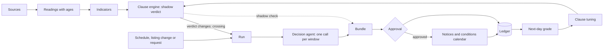

# Skyclause product

Skyclause makes one approved, graded call for each class, event or commute window that haze, a storm or a stadium crowd may hit, from live public readings, and keeps the record; tagline: "The call for every window." Nothing is built yet: this doc describes the proposed platform and its hackathon pilot (5–17 November 2026), and **Inference** marks conclusions no source states.

Contents:

1.  [At a glance](#at-a-glance)
1.  [Positioning](#positioning)
1.  [Users and jobs](#users-and-jobs)
1.  [The core loop](#the-core-loop)
1.  [Surfaces](#surfaces)
1.  [Glossary](#glossary)
1.  [Principles](#principles)
1.  [Packaging and pricing](#packaging-and-pricing)
1.  [Go to market and owners](#go-to-market-and-owners)
1.  [Success metrics](#success-metrics)
1.  [Roadmap](#roadmap)
    1.  [P0 pilot](#p0-pilot)
    1.  [P1 beta](#p1-beta)
    1.  [P2 general availability](#p2-general-availability)
    1.  [P3 later, to November 2027](#p3-later-to-november-2027)
1.  [See also](#see-also)

## At a glance

| Field         | Plan                                                                                                                                                                                                                                    |
| ------------- | --------------------------------------------------------------------------------------------------------------------------------------------------------------------------------------------------------------------------------------- |
| What it is    | A platform that turns live public readings into one call per declared window, approved by a person, sent to subscribers and graded after the fact                                                                                       |
| For whom      | Approvers on duty and the people who act on calls: student club organisers, commuting students, later lecturers and APU's facilities, safety and welfare desk (FSSW, unconfirmed); developers and AI assistants through the API and MCP |
| Packs         | **Sky pack** (rain, storms, haze) and **Crowd pack** (stadium and arena nights at Bukit Jalil); one clause sheet per pack per project                                                                                                   |
| The one job   | Answer "what should we do about this window?" before it starts, in writing, with every input's age, and say afterwards whether the call was right                                                                                       |
| Channels      | Email, a subscribable ICS conditions calendar per project, signed webhooks and in-app from P1; Microsoft 365 and Jira as platform channels from P2 (the P0 pilot already writes Jira issues); recipients need no account                |
| Surfaces      | Landing, the Commons, dashboard, the core (windows, signals, clauses, calls, ledger), analysis, public pages, developer playground, connect your AI, SDK, CLI, MCP and web components                                                   |
| Pricing model | Commons and Community free; Team paid from P2 and Campus after GA, per month in MYR; every price a proposal, untested                                                                                                                   |
| Owners        | Pilot: a teammate on the approver rota. Target: FSSW for the Sky pack, a club events lead (clubs other than GDGoC APU first) for the Crowd pack                                                                                         |
| Status        | Nothing built. P0 pilot 5–17 November 2026 on Gemini Enterprise, Sky storm crossing and evidence by email first; P1 beta by 5 February 2027                                                                                             |
| Track         | Intelligent Automation & Digital Transformation (proposed)                                                                                                                                                                              |

## Positioning

Skyclause creates a category between a reading and a warning: **the approved, graded call for a scheduled window**. A readings app says what the air is now; a warning says weather may turn across a state; neither says what to do about the 15:30 release or the 19:00 workshop, who decided, or whether they were right. The evidence that each lecturer, organiser and office decides alone, with no shared record, is in [IDEA](/docs/IDEA.md#nobody-writes-the-call-down).

| Alternative today                                                    | What it gives                                        | Why it falls short                                                                                                                                                                     |
| -------------------------------------------------------------------- | ---------------------------------------------------- | -------------------------------------------------------------------------------------------------------------------------------------------------------------------------------------- |
| AirVisual or aqicn.org ([Skyclause idea][sky who])                   | A reading people trust over the official index       | A number, not a decision for a window; no approver, no record                                                                                                                          |
| Forum threads checked before travelling ([Skyclause idea][sky use])  | Flood reports from whoever posted                    | After the fact, unverified, nobody's call                                                                                                                                              |
| Ad hoc online switches and club closures ([Skyclause idea][sky who]) | One lecturer's or committee's decision               | Made alone from different sources; nothing written answers "how did APU monitor local readings in October?"                                                                            |
| Ticket sites and Instagram ([Fanfall idea][crowd problem])           | Show dates, for an organiser who thinks to check     | A guess, then a notice or a bus; nobody records whether it was right. **Inference** in the source: most organisers don't check                                                         |
| PredictHQ ([Bukit Jalil venue page][predicthq])                      | Event-demand forecasts behind a paid API             | Doesn't hand an APU organiser a decision or publish its own error the next day ([Fanfall idea][crowd substitutes])                                                                     |
| RapidKL announcements                                                | Extended station hours on big nights                 | An operator's response to the crowd, not a call for your event                                                                                                                         |
| Warnings-only clauses (the Skyclause idea's "warnings-only rule")    | MET warnings naming W.P. Kuala Lumpur                | MET forecast thunderstorms every afternoon of 5–11 November ([IDEA][idea why now]), so such a clause fires on most forecast afternoons; its false-alarm ratio is measured, not assumed |
| Trackers, dashboards and `apu-smart-shuttle`'s rain alerts           | Charts and alerts ([competition][competition repos]) | They stop at the alert: no approved call, no grade                                                                                                                                     |

> For student organisers, commuting students and the campus offices that answer for them, who must decide what to do about a class, event or commute when haze, a storm or a stadium crowd may hit it, Skyclause is the call for every window: one decision per window from live public readings, approved by a named person, sent to people who need no account, and graded in public. Unlike readings apps, ticket sites and warnings-only clauses, it writes the call down and says whether it was right.

[sky who]: /docs/ideas/02-skyclause.md#who-decides-today-and-with-what-record
[crowd problem]: /docs/ideas/04-fanfall.md#problem-and-evidence
[crowd substitutes]: /docs/ideas/04-fanfall.md#why-the-crowd-wont-build-it
[predicthq]: https://www.predicthq.com/major-events/venues/bukit-jalil-national-stadium-my
[idea why now]: /docs/IDEA.md#why-now
[competition repos]: /docs/research/competition.md#public-repositories-so-far

## Users and jobs

Personas come from the two idea docs and their research only; no quotes are invented. How often each hazard occurs is evidenced in [IDEA](/docs/IDEA.md#problem-and-evidence).

- **Approver on duty** (pilot: a teammate on the rota). Job: approve, edit or reject a bundle before its calls expire. Today: no rota and no record; each person decides alone. Skyclause gives: one bundle per run with fired clauses, input ages, the shadow verdict and recipients; an SLA, then escalation. How often: rarely; see IDEA on how seldom [storms meet a release wave][idea storms] and how often [surge nights][idea crowd] fall.
- **Student club events lead.** Job: keep, shift or add transport for an evening or outdoor event, and decide whether to close in haze. Today: searches ticket sites and Instagram, posts its own congestion warning or books a bus, and closes on whatever reading it trusts. Skyclause gives: a surge-night recommendation before the night, Sky notices for its declared events, a grade after, and a dated record. How often: a few surge nights a term, storm afternoons in the monsoon, haze in the dry season.
- **Commuting student.** Job: choose when and how to travel for an 08:30 or late-afternoon class through LRT Bukit Jalil. Today: forum threads on rainy mornings, AirVisual or aqicn.org. Skyclause gives: notices for the windows they declare, the conditions calendar, and a dated record to explain a late arrival. How often: weekdays; non-Normal calls are rare.
- **Lecturer** (later, opt-in after 10 November 2026). Job: code attendance (Late or Absent With Reason) and choose teaching mode within their own authority. Today: ad hoc switches to online classes. Skyclause gives: the measured facts for the window; Hybrid recommended always says teaching mode is the lecturer's and the university's decision. How often: haze seasons and storm afternoons.
- **FSSW officer** (target, unconfirmed). Job: show the local monitoring KPT asked every university for on 7 October 2026, and hold the seat for lecturer notices. Today: APU's knowledge base has no page for haze, thunderstorms or lightning (searched 5 November 2026). Skyclause gives: the approval seat, the rota, the ledger and published grades. How often: daily in a haze season, and on forecast storm afternoons.
- **Subscriber with no account.** Job: hear about the windows they care about and nothing else. Today: nothing reaches them. Skyclause gives: email notices and the ICS calendar, preferences by magic link, unsubscribe on every notice. How often: only when a non-Normal call covers their window.
- **Developer integrating the API.** Job: put calls, signals or a ledger into a club site, bot or student tool. Today: fetch undocumented JPS and APIMS endpoints server-side, each with its own shape and no terms ([data sources][ds apims]). Skyclause gives: one API with every reading's age, signed webhooks, the SDK, the CLI and embeds. How often: continuously.
- **AI user asking their assistant.** Job: ask Claude, ChatGPT or Gemini "what's the call for my class tomorrow?". Today, **Inference**: the assistant has no live gauge or API reading to answer from. Skyclause gives: MCP tools that read calls and ledgers, declare windows and request evidence; none can approve. How often: on demand.
- **Guest or hackathon reviewer.** Job: see it work without an account or a Gemini Enterprise seat. Today: a Gemini Enterprise review needs a seat and a role, and shared users see only their own runs ([reviewer access][ge reviewer]). Skyclause gives: the Commons, a share link with the reviewer role, guest windows and evidence requests. How often: assessment, 11–14 November 2026.

[idea storms]: /docs/IDEA.md#haze-and-storms-at-the-exit-wave
[idea crowd]: /docs/IDEA.md#stadium-nights-at-bukit-jalil
[ds apims]: /docs/research/data-sources.md#doe-apims-air-pollutant-index
[ge reviewer]: /docs/research/gemini-enterprise.md#what-each-reviewer-needs

## The core loop

**Core** means the five things every project runs on: windows, signals (sources, readings and indicators), clauses, calls with their approvals, and the ledger. PRD specifies them in [Windows](/docs/PRD.md#windows-win), [Signals](/docs/PRD.md#signals-sig), [Clauses](/docs/PRD.md#clauses-cls), [Calls and approvals](/docs/PRD.md#calls-and-approvals-cal) and [Ledger and evidence](/docs/PRD.md#ledger-and-evidence-led).

1.  **Sources to readings.** Source adapters fetch each catalogued source on its own interval (the JPS gauge `0232901RF` every 5 minutes, APIMS every 15 minutes for its hourly index, Rapid Rail's daily file when it lands) and store each reading with source time, receipt time, status and latency. A failed fetch stores an error, never the last value.
1.  **Readings to indicators.** Rain in the last 60 minutes and 2–4 hours, the highest API across three stations, warnings in force, and the Crowd pack's baseline, uplift, forecast and band from the forecast module. Every indicator carries its age.
1.  **Indicators to clauses.** The clause engine evaluates the project's clause sheet and gives a shadow verdict per window. A change of verdict is a crossing, and a crossing wakes a run.
1.  **Run to the agent's call.** A schedule (06:45 on weekdays for the Sky pack), a crossing, a calendar or listing change, or a request starts a run for one project and one pack. The decision agent reads the sheet, raw indicators with ages, MET warning text verbatim and the declared windows, and proposes each call, its recipients and wording; it does no arithmetic. Its proposal is the call of record, and a disagreement with the shadow verdict is listed first.
1.  **Bundle to approval.** A run produces one bundle: the calls for every window at risk in that pack, plus pack-level items such as a surge-night entry. An all-Normal bundle writes nothing and needs no approval; its trace is the record. Otherwise the approver on the rota approves it once, editing or rejecting calls inside it, within its SLA or it escalates.
1.  **Notices, calendar and ledger.** Approved calls go to subscribers as notices and onto the project's conditions calendar; every run, call, edit, approval, rejection, send and delay goes into the ledger, which answers evidence requests.
1.  **Next-day grade to clause tuning.** Sky windows are graded against the gauge and APIMS, Crowd nights against `SP17` gate taps on D+1, rejected calls included. A miss, false alarm, out-of-band night or unlisted surge opens a review item; the owner tunes the clause sheet after a labelled replay, and the next run uses the new version.

## Surfaces

PRD gives each surface its route and requirements; DESIGN gives its look.

| Surface                    | Purpose                                                                                                                                                                                                                                                                                                 | Spec                                   |
| -------------------------- | ------------------------------------------------------------------------------------------------------------------------------------------------------------------------------------------------------------------------------------------------------------------------------------------------------- | -------------------------------------- |
| Landing                    | One page in the "quiet instrument" direction: pick a date and time and see the clause engine's verdict for the Commons project "Bukit Jalil" right now, labelled not reviewed and not sent, with every input's age and a permalink to the latest real approved call; pricing and FAQ are sections of it | [PRD LND], [DESIGN landing]            |
| Accounts and guest sign-in | Sign-in methods and passkeys, invites, and "Continue as guest" behind a bot check                                                                                                                                                                                                                       | [PRD ACC]                              |
| The Commons                | One shared guest workspace with the live "Bukit Jalil" project: signals, site-level verdicts, listings, run traces, the clause sheet read-only, guest windows and evidence requests                                                                                                                     | [PRD GST]                              |
| Share links                | An expiring, revocable link to one project, as view or reviewer; how hackathon reviewers self-trigger                                                                                                                                                                                                   | [PRD PRJ]                              |
| Organisation               | A club, office or faculty: members and roles, approver rota, billing, audit log, keys, webhooks, integrations, retention                                                                                                                                                                                | [PRD ORG], [PRD AUD]                   |
| Project                    | A site with its windows, sources, enabled packs, clause sheets, channels, rota and subscribers                                                                                                                                                                                                          | [PRD PRJ]                              |
| Dashboard                  | Bundles needing review first, then today's windows at risk, signal health with ages, the next surge nights and forecast storm afternoons, and yesterday's grades                                                                                                                                        | [PRD DSH], [DESIGN screens]            |
| Core: windows              | Declare and review the classes, events and commute waves that get calls                                                                                                                                                                                                                                 | [PRD WIN]                              |
| Core: signals              | Every source, reading and indicator with its age and health                                                                                                                                                                                                                                             | [PRD SIG]                              |
| Core: clauses              | The clause sheet per pack, its versions, defaults and diffs                                                                                                                                                                                                                                             | [PRD CLS]                              |
| Core: calls                | The approvals queue, bundles and calls, with the shadow check and each call's delay                                                                                                                                                                                                                     | [PRD CAL], [PRD NTC]                   |
| Core: ledger               | The record of every run, call and grade, and the answers to evidence requests                                                                                                                                                                                                                           | [PRD LED]                              |
| Analysis                   | Precision, recall and false-alarm ratio with Wilson intervals, forecast error, band coverage, agent–shadow agreement, delays and labelled what-if replays                                                                                                                                               | [PRD ANL], [DESIGN data visualisation] |
| Developer playground       | API console, clause sandbox (CEL against live Commons indicators and labelled replays), webhook inspector and MCP inspector                                                                                                                                                                             | [PRD DEV]                              |
| Connect your AI            | Config for Claude, ChatGPT, Gemini CLI, Gemini Enterprise, Cursor and VS Code, each with a "verified on" date; the tools, their scopes, and the statement that no AI can approve                                                                                                                        | [PRD CAI]                              |
| Settings                   | Account (profile, sign-in, appearance with light, dark, system and high-contrast themes, notifications, BYOK, API keys, export and deletion), organisation and project settings, billing                                                                                                                | [PRD SET], [PRD BIL], [DESIGN themes]  |
| Public pages               | Public project page, public ledger, ICS calendar, call permalinks, service status and legal pages, each with the non-affiliation line                                                                                                                                                                   | [PRD PUB]                              |
| SDK                        | `@skyclause/sdk` for TypeScript and `skyclause` for Python, generated from the OpenAPI document                                                                                                                                                                                                         | [PRD SDK]                              |
| CLI                        | `skyclause`: device-code login, `--json` everywhere, `signals tail`, `clauses test`, `replay` and `diff`, a local MCP server; approval only interactively, by a signed-in human with the Approver role or above                                                                                         | [PRD CLI], [DESIGN CLI output]         |
| Agent layer                | Remote MCP with read and draft tools, local stdio MCP, an Agent Skills pack, and an A2A card kept as not verified                                                                                                                                                                                       | [PRD AGT]                              |
| Web components             | Static and live favicons, Open Graph cards, oEmbed, `<skyclause-status>` and `<skyclause-window>` with an iframe fallback, a subscribe-to-calendar button                                                                                                                                               | [PRD WEB], [DESIGN embeds]             |
| Docs                       | Guides and the API reference, with examples captured from real calls and readings, each with capture date and station ID                                                                                                                                                                                | [PRD IA]                               |

[PRD LND]: /docs/PRD.md#landing-page-lnd
[PRD ACC]: /docs/PRD.md#accounts-and-sign-in-acc
[PRD GST]: /docs/PRD.md#guest-access-and-the-commons-gst
[PRD ORG]: /docs/PRD.md#organisations-org
[PRD PRJ]: /docs/PRD.md#projects-prj
[PRD DSH]: /docs/PRD.md#dashboard-dsh
[PRD WIN]: /docs/PRD.md#windows-win
[PRD SIG]: /docs/PRD.md#signals-sig
[PRD CLS]: /docs/PRD.md#clauses-cls
[PRD CAL]: /docs/PRD.md#calls-and-approvals-cal
[PRD NTC]: /docs/PRD.md#notices-and-channels-ntc
[PRD LED]: /docs/PRD.md#ledger-and-evidence-led
[PRD ANL]: /docs/PRD.md#grades-and-analysis-anl
[PRD DEV]: /docs/PRD.md#developer-playground-dev
[PRD CAI]: /docs/PRD.md#connect-your-ai-cai
[PRD SET]: /docs/PRD.md#settings-set
[PRD BIL]: /docs/PRD.md#billing-bil
[PRD PUB]: /docs/PRD.md#public-pages-pub
[PRD SDK]: /docs/PRD.md#sdk-sdk
[PRD CLI]: /docs/PRD.md#cli-cli
[PRD AGT]: /docs/PRD.md#agent-layer-agt
[PRD WEB]: /docs/PRD.md#web-components-web
[PRD AUD]: /docs/PRD.md#audit-and-data-rights-aud
[PRD IA]: /docs/PRD.md#information-architecture
[DESIGN landing]: /docs/DESIGN.md#landing-art-direction
[DESIGN screens]: /docs/DESIGN.md#screens
[DESIGN data visualisation]: /docs/DESIGN.md#data-visualisation
[DESIGN themes]: /docs/DESIGN.md#themes
[DESIGN CLI output]: /docs/DESIGN.md#cli-output
[DESIGN embeds]: /docs/DESIGN.md#web-components-and-brand-assets

## Glossary

The canonical words. Use them, not synonyms: notice, not "alert"; clause, not "rule" (except when quoting Fanfall's "rules sheet"); window, not "event"; call, not "forecast". "Forecast" alone means only the Crowd pack's exit-count estimate; MET's forecast keeps its source name, as in "MET forecast" and "forecast storm afternoon".

| Term                | Meaning                                                                                                                                                                                                                                                               |
| ------------------- | --------------------------------------------------------------------------------------------------------------------------------------------------------------------------------------------------------------------------------------------------------------------- |
| Approval            | One decision per bundle by the approver on duty, with per-call edit and reject inside it; re-checked if inputs changed since drafting. Crowd listings also pass approval                                                                                              |
| Approver            | A member with the Approver role or above (roles are cumulative, so Admins and Owners too), the only members who can approve a bundle that sends to people ([roles])                                                                                                   |
| Approver alert      | A web push and email to whoever is on duty when a bundle needs review ([CAL-18](/docs/PRD.md#calls-and-approvals-cal)); it goes to members only, never to subscribers, and never approves anything                                                                    |
| Approver rota       | Who is on duty when, per project; defaults cover 14:00–19:15 MYT on forecast storm afternoons and 08:00–22:00 on surge nights                                                                                                                                         |
| Arrival period      | From doors to show time on a night; replaces Fanfall's "arrival window"                                                                                                                                                                                               |
| Band                | The range around a forecast, from the backtest's own 10th–90th percentile relative error                                                                                                                                                                              |
| Baseline            | Median exits at the station on the same weekday over the previous eight weeks                                                                                                                                                                                         |
| Bundle              | What one run produces: the calls for every window at risk in one pack, plus pack-level items; superseded by a newer run covering the same windows, expired when its last call expires ([CAL-8])                                                                       |
| Call                | The decision agent's decision for one window in one pack: a mode (plus recommendations on a surge night) or No call, the fired clauses with input ages, recipients and wording; the call of record                                                                    |
| Clause              | One condition in a clause sheet: what it reads, when it fires, and the mode or recommendation it proposes                                                                                                                                                             |
| Clause engine       | The deterministic evaluator (`packages/clauses`) that runs the same sheet as the agent and gives the shadow verdict                                                                                                                                                   |
| Clause sheet        | A project's editable, versioned set of clauses for one pack, starting from published defaults                                                                                                                                                                         |
| Commons             | The one shared guest workspace, with one live project, "Bukit Jalil", bound to the real public feeds                                                                                                                                                                  |
| Conditions calendar | A project's subscribable ICS calendar of approved calls and surge-night entries                                                                                                                                                                                       |
| Crossing            | A change of the shadow verdict; it wakes a run                                                                                                                                                                                                                        |
| Crowd pack          | Sources, clauses and grading for stadium and arena nights; modes Normal or Surge night                                                                                                                                                                                |
| Decision agent      | The language model that proposes each call, its recipients and its wording from the sheet, raw indicators and windows; it never does arithmetic and never approves                                                                                                    |
| Escalation          | A bundle not approved within its SLA moves to the next approver on the rota, then to admins; logged                                                                                                                                                                   |
| Evidence request    | A request for the record of a window or date, such as "evidence for 2 Nov 14:00–16:30", answered from the ledger                                                                                                                                                      |
| Exit period         | From show end to 90 minutes after on a night; replaces Fanfall's "exit window"                                                                                                                                                                                        |
| Forecast            | The Crowd pack's estimate of exits at the station for a night: baseline plus uplift, summed when events share a night. MET's forecast is a source and keeps its name: "MET forecast", and "forecast storm afternoon" for an afternoon MET forecasts thunderstorms for |
| Grade               | The after-the-fact result of a call: hit, miss, false alarm or correct Normal (Sky); in band, out of band or unlisted surge (Crowd)                                                                                                                                   |
| Guest               | An anonymous account created by "Continue as guest", limited to the Commons and per-device and per-IP budgets                                                                                                                                                         |
| Guest window        | A window a guest declares in the Commons: shown to all guests, moderated, expires after 14 days; its calls read "Draft: not reviewed, not sent"                                                                                                                       |
| Indicator           | A value derived from readings that clauses read, such as rain in the last 60 minutes or the highest API across three stations, with its age                                                                                                                           |
| Ledger              | A project's append-only record of runs, calls, edits, approvals, sends, delays and grades                                                                                                                                                                             |
| Listing             | A venue event from a listing source with its URL and revision; proposed, then listed with the `list` action or rejected; listings can be cancelled, and nights can be unlisted. Changes and cancellations need approval                                               |
| Mode                | A call's ranked state within a pack. Sky: Normal, Outdoor-limited, Commute disruption, Hybrid recommended. Crowd: Normal or Surge night ([clause tables])                                                                                                             |
| Night               | One evening at the venues, the Crowd pack's unit of forecast and grade                                                                                                                                                                                                |
| No call             | The state when an input a clause needs is stale or erroring; it names the input and since when, and blocks only the clauses that need it                                                                                                                              |
| Notice              | A message sent to recipients after approval, with an unsubscribe link (a reply of "unsubscribe" in the P0 pilot) and a line saying Skyclause is not a safety or emergency service                                                                                     |
| Pack                | A set of sources, clauses, modes and grading for one kind of risk: the Sky pack or the Crowd pack                                                                                                                                                                     |
| Reading             | One stored value from a source with source time, receipt time, status and latency; a failed fetch is stored as an error                                                                                                                                               |
| Recommendation      | A Crowd action on a surge night: keep with an advisory, shift the start or end out of the arrival or exit period, ask the shuttle desk for a run, or leave before doors                                                                                               |
| Replay              | A run of clauses over a published historical dataset; always labelled replay and never mixed with live grades                                                                                                                                                         |
| Review item         | An item opened by a miss, false alarm, out-of-band night or unlisted surge, for the owner to explain; Jira optional                                                                                                                                                   |
| Run                 | One pass of the decision agent for one project and one pack, started by a schedule, a crossing, a calendar or listing change, or a request; it produces one bundle                                                                                                    |
| Shadow check        | The comparison of the agent's call with the shadow verdict; a disagreement is shown first in the bundle                                                                                                                                                               |
| Shadow verdict      | The clause engine's deterministic verdict on the same sheet and inputs                                                                                                                                                                                                |
| Share link          | An expiring, revocable link that shares one project with people outside the organisation, as view or reviewer                                                                                                                                                         |
| Sky pack            | Sources, clauses and grading for rain, storms and haze; modes Normal to Hybrid recommended                                                                                                                                                                            |
| SLA                 | How long a bundle may wait for approval before escalation: by default 10 minutes for a Sky crossing and 2 hours for a Crowd outlook                                                                                                                                   |
| Source              | A public feed or the project's own device that yields readings, such as the JPS gauge `0232901RF`, APIMS station `CA16W` or Rapid Rail's `SP17` taps                                                                                                                  |
| Source adapter      | A catalogued connector that fetches and normalises one kind of source                                                                                                                                                                                                 |
| Subscriber          | A recipient with no account who gives an email, a role and windows, and manages preferences by magic link                                                                                                                                                             |
| Surge night         | The Crowd mode for a night forecast to bring a large crowd; it carries recommendations                                                                                                                                                                                |
| Uplift              | The median extra exits for an event's class (stadium concert, stadium football, arena show) over two years                                                                                                                                                            |
| Venue calendar      | The calendar of approved listings for the venues around a station                                                                                                                                                                                                     |
| Watch               | A per-window Sky state, not a mode: Storm watch prints as context and sends nothing alone                                                                                                                                                                             |
| Window              | A declared span that gets a call: a class, an event or a commute wave                                                                                                                                                                                                 |

[roles]: /docs/PRD.md#roles-and-permissions
[CAL-8]: /docs/PRD.md#calls-and-approvals-cal
[clause tables]: /docs/PRD.md#clauses-cls

## Principles

1.  **Real data or an error, never a fallback.** Every reading comes from a live public source or the project's own device; a failed source shows as an error with its age, and the clauses that need it return No call. No seeded windows, sample organisations, typed-in values or recordings swapped in; replays are labelled.
1.  **A person approves anything sent to people.** Only a member with the Approver role or above can approve what reaches recipients; no API key, MCP token or agent can.
1.  **The record is the product.** Every run, call, approval, delay and grade is kept and exportable on every tier. The source idea's **Inference**: the record and evidence replies may be used more than the notices ([Skyclause idea][sky use]).
1.  **Grade in public.** Every call is graded after the fact, rejected calls included, and grades are published with n and Wilson 95% intervals. None exist yet.
1.  **Most days are Normal.** Quiet by default: an all-Normal run sends nothing and asks no one; Watch prints as context only.
1.  **AI drafts, never approves.** The agent proposes calls and wording, the clause engine checks it, and disagreement is shown first. The model does no arithmetic.
1.  **Recipients need no account.** An email address, a calendar URL and a magic link are enough; every notice carries an unsubscribe link (in the P0 pilot, a reply of "unsubscribe").
1.  **Privacy by subtraction.** Collect the least and drop the rest at ingest: lecturer names never stored, only counts per window reach a model, camera frames masked and deleted after one semester, bus positions dropped after segment times, no personal data to any free-tier model ([TRD](/docs/TRD.md#privacy-and-data-retention)).
1.  **Inform the decision, don't take it.** Each recipient acts within authority they already hold. Hybrid recommended says teaching mode is the lecturer's and the university's decision; Skyclause never excuses attendance and is not a safety or emergency service.

## Packaging and pricing

Prices are in MYR and every one is a proposal, untested: no club or office has been asked what it would pay. The P1 beta collects no payment ([BIL-1]); paid plans start at P2 with Team, and Campus follows after GA. Billing runs through Stripe in MYR with invoices; the service tax rate and registration threshold, and FPX through Stripe in Malaysia, are unverified ([TRD](/docs/TRD.md#billing), [PRD][BIL-1]).

Cost drivers:

- **Model tokens per run.** The decision agent reads the clause sheet, indicators with ages, warning text and windows, and writes calls and notices, so tokens grow with windows at risk and recipients. The default is Gemini through Vertex AI, pinned per release; for scale, Gemini 3.8 Flash lists $0.75 input and $3.75 output per million tokens until 31 December 2026 on the AI Studio price list ([Google Cloud research](/docs/research/google-cloud.md#current-gemini-models)).
- **Email per notice.** Notices go only after approval and only to subscribers whose windows a call covers.
- **Storage.** Readings partitioned by month, ridership files and camera frames; a 5-minute gauge alone is 288 readings a day (our arithmetic). Pricing assumes a catalogued station is fetched once and shared by every project bound to it; [TRD's cost model](/docs/TRD.md#cost-model) confirms or corrects that.
- **Why costs stay low.** The agent runs only when a run is due (a schedule, a crossing, a listing change or a request), never per poll; an all-Normal bundle needs no approval and sends nothing; with BYOK an organisation pays its own model provider and those runs don't draw on the hosted allowance ([TRD](/docs/TRD.md#byok-and-model-routing)).

| Limit                              | Commons                                        | Community                                | Team                                                         | Campus                                                                  |
| ---------------------------------- | ---------------------------------------------- | ---------------------------------------- | ------------------------------------------------------------ | ----------------------------------------------------------------------- |
| Price                              | Free (proposal, untested)                      | Free (proposal, untested)                | RM 49 a month per organisation, from P2 (proposal, untested) | RM 900 a month per campus, billed yearly, after GA (proposal, untested) |
| For                                | Guests and reviewers                           | One club or student group                | Clubs and offices with several sites or both packs           | A university office sending lecturer notices                            |
| Projects                           | The shared "Bukit Jalil" project               | 1                                        | 5                                                            | 50                                                                      |
| Approvers (Approver role or above) | None; guests can't approve                     | 3                                        | 15                                                           | No limit                                                                |
| Hosted-model runs a month          | Per-device and per-IP budgets                  | 150                                      | 1,500                                                        | 15,000                                                                  |
| BYOK                               | No                                             | Yes                                      | Yes                                                          | Yes                                                                     |
| Subscribers                        | None                                           | 200                                      | 2,000                                                        | 25,000                                                                  |
| Channels                           | In-app; the pilot's public conditions calendar | Email, ICS calendar, in-app, one webhook | All P1 channels; Microsoft 365 and Jira from P2              | All channels                                                            |
| Support                            | Docs and the status page                       | Docs, status page and email, best effort | Email, best effort, ahead of the free tiers                  | A named contact; any SLA is an open question                            |
| SSO and data residency             | No                                             | No                                       | No                                                           | Only once verified                                                      |

Retention is the same on every tier, per NFR-14 in [PRD's non-functional requirements][prd nfr]: readings for the life of the project, the ledger and audit log for the life of the organisation, camera frames for one semester and guest windows for 14 days. No customer-facing SLA or service credits are offered in the P1 beta; NFR-3's availability figures are internal targets, and whether Campus gets a contractual SLA is an [open question](/docs/PRD.md#open-questions).

How each limit traces to a usage driver:

- **Projects** trace to sites: a project is one site with its packs.
- **Approvers** trace to the rota: the default rota covers storm afternoons and surge nights, and escalation needs a next approver, so Community allows three.
- **Runs** trace to schedules: one scheduled run a day per pack (the pilot's 06:45 weekday Sky run, about 22 a month, and the source idea's 07:00 daily Crowd outlook, about 30) is about 52 a month for a project with both packs (our arithmetic), so Community's 150 leaves about 100 for crossings, listing changes and requests. Grading is computed, not a run.
- **Subscribers and channels** trace to email and delivery cost; **support** traces to staff time, which the free tiers don't pay for.
- **SSO and residency** are sold only once verified: APU runs Microsoft 365, and Google's location pages list no Malaysia region ([Google Cloud research](/docs/research/google-cloud.md#cloud-run); checked 5 November 2026).

[BIL-1]: /docs/PRD.md#billing-bil
[prd nfr]: /docs/PRD.md#non-functional-requirements

## Go to market and owners

The proposed track is Intelligent Automation & Digital Transformation. Owner roles follow the [judging research](/docs/research/judging.md#owners-and-what-has-to-be-true) (business owner, IT, and whoever answers for personal data); the owners come from [Skyclause time to impact][sky impact] and [Fanfall at a glance](/docs/ideas/04-fanfall.md#at-a-glance).

| Role                      | Pilot, 5–17 November 2026                  | Target                                                                                                                                            |
| ------------------------- | ------------------------------------------ | ------------------------------------------------------------------------------------------------------------------------------------------------- |
| Sky pack business owner   | A teammate on the approver rota            | FSSW, unconfirmed: one public review mentions its head and no knowledge-base page names it; otherwise the GDGoC APU committee for its subscribers |
| Crowd pack business owner | A teammate runs the desk                   | A club events lead, asking clubs other than GDGoC APU first because GDGoC APU co-runs this hackathon                                              |
| Approver seat             | The teammate on duty in the published rota | FSSW for lecturer notices; the agreeing club's events lead for Crowd outlooks                                                                     |
| Accounts and connectors   | The team                                   | APU ITSM                                                                                                                                          |
| Personal data (PDPA)      | The team                                   | APU's data protection officer                                                                                                                     |
| Feeder and camera         | The team                                   | The GDGoC APU committee                                                                                                                           |

Channels to first users:

- **Students, 5–8 November 2026:** remote interviews with outdoor and martial-arts club committee members, evening-event organisers and commuters with 17:45 classes through LRT Bukit Jalil, recruited through student channels ([Skyclause research plan](/docs/ideas/02-skyclause.md#research-plan)).
- **Club events leads:** leads of clubs with November evening events, reached through public club pages and the hackathon's channels; GDGoC APU's events lead in round two; Student Service by email ([Fanfall research plan][crowd research]).
- **The public conditions calendar:** anyone subscribes by URL from Outlook or Google Calendar, with no sign-up.
- **Reviewers:** the Commons and share links on the platform; in the pilot, the team inbox and the shared review calendar.
- **Lecturers:** opt-in after 10 November 2026; APU-wide windows only if APU gives written permission for the timetable feed, requested through the organisers.

Owner plans:

- **By 5 February 2027 (3 months).** Sky: the team asks APU through the organisers for written timetable permission, offers FSSW a pilot as approver for lecturer notices, and runs calls through the monsoon for subscribed organisers, students and lecturers; owner, the FSSW manager if FSSW agrees, otherwise the GDGoC APU committee. Crowd: the desk runs every surge night from 17 November for at least three clubs with a monthly graded ledger, and Student Service is asked to add the surge-night calendar to its club-event guidance; owner, the agreeing club's events lead, with the team as desk operator ([Fanfall time to impact][crowd impact]).
- **By 5 May 2027 (6 months).** The measured outcomes in [Success metrics](#success-metrics) are reported for both packs, and the owner sets a false-alarm ceiling. If FSSW or a successor hasn't agreed by the 3-month mark, the office claim is dropped, not the product ([IDEA](/docs/IDEA.md#risks-and-kill-criteria)).
- **Assumptions:** the Gemini Enterprise licence continues after the sponsored trial while pilot parts still run on it; a club agrees to own the Crowd pack; Rapid Rail keeps publishing daily; the undocumented JPS, APIMS and GoLive endpoints stay up; timetable permission helps but neither pack needs it.

Beyond APU, all **Inference**:

- **Other Malaysian campuses.** JPS, MET and APIMS cover the country, so any campus or club can bind a catalogued gauge and station for the Sky pack, and KPT's 7 October 2026 instruction went to every university.
- **Venues near a rail station.** The Crowd pack needs a venue with listings and a station with gate taps in Rapid Rail's daily file; Unifi Arena and the National Hockey Stadium already share `SP17` with the stadium.
- **An outside hook.** DBKL's Bukit Jalil micro-traffic study, due in the first quarter of 2027, may welcome a graded public record of event nights; nothing depends on it ([Fanfall time to impact][crowd impact]).

## Success metrics

Nothing is measured yet; every baseline below is a planned measurement or n=0, and grades are always split into live and replay.

| Metric                                                       | Pack  | Baseline                                                                                                                                                                         | Line or target                                                                                                        | Source                                           |
| ------------------------------------------------------------ | ----- | -------------------------------------------------------------------------------------------------------------------------------------------------------------------------------- | --------------------------------------------------------------------------------------------------------------------- | ------------------------------------------------ |
| Minutes from crossing to approved notice                     | Sky   | None measured. The source's worked example (**Inference** from documented delays) has a notice about 15 minutes after the crossing at the 15:05 poll, 20 after the 15:00 reading | Recorded on every call; approval inside the 10-minute SLA; latency budgets in NFR-2 ([PRD][prd nfr])                  | [Skyclause][sky impact]                          |
| Precision, recall and false-alarm ratio, n ≥ 300 windows     | Sky   | A warnings-only clause's false-alarm ratio over the same afternoons, from the feeder's own log                                                                                   | Published with n and Wilson 95% intervals; the owner sets a false-alarm ceiling                                       | [Skyclause][sky impact]                          |
| Minutes to assemble evidence, before and after               | Sky   | Three people assembling the evidence for 2 November 14:00–16:30 by hand, timed                                                                                                   | The same task by evidence request, timed including the approval wait                                                  | [Skyclause][sky impact]                          |
| Share of notified people who acted                           | Both  | n=0; a two-tap "did the weather change your plan?" email after each graded window from 11 November 2026                                                                          | Reported with n; Crowd decisions also counted from the organiser reply log                                            | [Skyclause][sky impact], [Fanfall][crowd impact] |
| Agent–shadow agreement                                       | Both  | n=0                                                                                                                                                                              | Kill line: disagreement on more than 1 in 10 graded windows for reasons other than stale inputs; published either way | [Skyclause][sky impact]                          |
| Forecast error and band coverage, n ≥ 20 new events          | Crowd | The source idea's 48-event backtest ([Fanfall research plan][crowd research])                                                                                                    | Reported against the 10th–90th percentile band                                                                        | [Fanfall][crowd impact]                          |
| Organiser minutes per clash check                            | Crowd | Three organisers answering "What's on at Bukit Jalil on 17 November, and what should my attendees do?" with their usual tools, timed                                             | The same from an advisory, including reading and approval time                                                        | [Fanfall][crowd impact]                          |
| Share of APU evening events on surge nights with an advisory | Crowd | n=0                                                                                                                                                                              | Reported monthly                                                                                                      | [Fanfall][crowd impact]                          |
| Calendar and notice subscribers                              | Both  | 0                                                                                                                                                                                | Reported monthly                                                                                                      | [Fanfall][crowd impact]                          |

Product health, from events defined in [PRD](/docs/PRD.md#analytics-events); every baseline is n=0:

- **Activation:** the share of new organisations whose first project has a declared window graded within 7 days of creation.
- **Weekly approvers:** members with the Approver role or above who approved, edited or rejected at least one bundle that week, against the rota's slots on forecast storm afternoons and surge nights.
- **Runs with no approval past SLA:** bundles that escalated, and bundles that expired unapproved; the aim is that none expire without an escalation logged.
- **Signal health:** the share of hours each source was fresh, stale or erroring, since a stale input means No call.

## Roadmap

Dates, themes and owners per phase. [PRD](/docs/PRD.md#scope-and-release-phases) owns which requirement IDs ship in each phase, and [TRD](/docs/TRD.md#gemini-enterprise-pilot) maps each pilot part to its platform replacement.

### P0 pilot

- **Dates:** 5–17 November 2026: prototype due 23:59 MYT on 10 November, assessment 11–14 November, top five on 15 November, final on 17 November ([brief](/docs/BRIEF.md#key-dates)).
- **Themes:** the idea docs' builds on Gemini Enterprise workflows, Workspace connectors, Apps Script feeders, Jira Cloud Free, the phone camera on probation and the Pi 5. One pack first: the Sky storm crossing plus evidence by email. The Crowd outlook and next-day grading join only if the Sky path works end to end by 7 November; otherwise the Crowd pack ships as surge-night entries on the public conditions calendar plus daily grading.
- **Owners:** a teammate on the approver rota approves; the team runs the desk.
- **Assumptions:** the licence sits on a Workspace domain; reviewers reach the team inbox or the review calendar; [IDEA's kill criteria](/docs/IDEA.md#risks-and-kill-criteria) hold.

### P1 beta

- **Dates:** by 5 February 2027, any signed-in account can create an organisation; the beta serves the 3-month owners.
- **Themes:** the platform takes over from the pilot: the core for both packs; accounts, organisations, projects and the dashboard; guest sign-in, the Commons and share links; rota, SLA and escalation; email, the ICS calendar, webhooks and in-app; BYOK; the API, SDK, CLI and remote MCP with read and draft tools; published grades and analysis; public pages, web components, the developer playground and connect your AI; the live landing. No payment is collected.
- **Owners:** the FSSW manager if FSSW agrees, otherwise the GDGoC APU committee (Sky); the agreeing club's events lead, with the team as desk operator (Crowd).
- **Assumptions:** a club agrees; the undocumented endpoints stay up; the surge nights listed to January 2027 go ahead.

### P2 general availability

- **Dates:** by 5 May 2027, at the 6-month measurement.
- **Themes:** billing in MYR for the Team tier; Microsoft 365 (Outlook mail and calendar entries, window import) and Jira as platform channels; the Bahasa Melayu app and the `/ms/` landing; A2A only if a live test passes.
- **Owners:** FSSW as business owner (target), APU ITSM, APU's data protection officer and the GDGoC APU committee; club events leads for the Crowd pack.
- **Assumptions:** Stripe handles MYR invoicing and service tax; an owner has set a false-alarm ceiling; a Malay reader approves the Malay glossary.

### P3 later, to November 2027

- **Dates:** after GA, through November 2027.
- **Themes:** the Campus tier, with SSO and data residency only once verified; the haze clauses' first live season in the 2027 dry season; other Malaysian campuses and rail-served venues (**Inference**); custom public-URL sources behind an allow-list, an SSRF guard and a recorded licence check; more channels (Google Calendar API, Slack, Microsoft Teams, Telegram, WhatsApp, web push), each after its terms are recorded; the SVG status badge.
- **Owners:** the GA owners, plus a named business owner per new campus.
- **Assumptions:** published grades earn trust; JPS, APIMS and GoLive, which publish no terms, tolerate derived values shown with a source link (an open risk).

## See also

- [IDEA](/docs/IDEA.md): the problem, evidence numbers, origins, risks and kill criteria.
- [PRD](/docs/PRD.md), [TRD](/docs/TRD.md) and [DESIGN](/docs/DESIGN.md): requirements and routes, how it is built, how it looks.
- [Skyclause idea](/docs/ideas/02-skyclause.md) and [Fanfall idea](/docs/ideas/04-fanfall.md): the two merged ideas.
- [Social](/docs/research/social.md), [data sources](/docs/research/data-sources.md), [competition](/docs/research/competition.md), [judging](/docs/research/judging.md), [Gemini Enterprise](/docs/research/gemini-enterprise.md) and [Google Cloud](/docs/research/google-cloud.md): the research used here.
- [Brief](/docs/BRIEF.md) and [context](/docs/CONTEXT.md): rules, dates and data rulings.

[sky impact]: /docs/ideas/02-skyclause.md#time-to-impact
[crowd impact]: /docs/ideas/04-fanfall.md#time-to-impact
[sky use]: /docs/ideas/02-skyclause.md#why-people-will-use-it
[crowd research]: /docs/ideas/04-fanfall.md#research-plan
