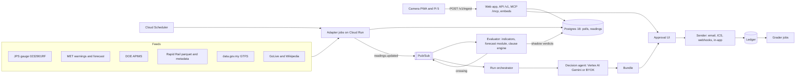
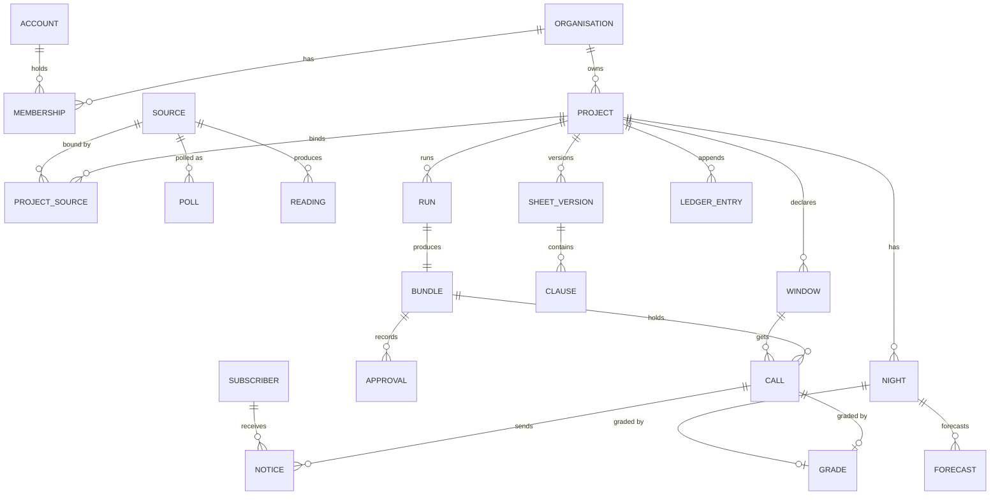
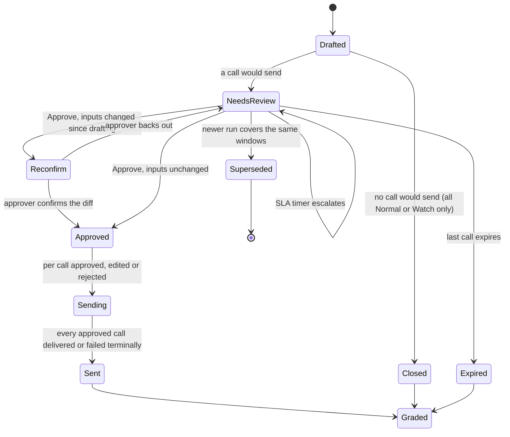

# Skyclause technical requirements

How the Skyclause platform is built: the services, data, pipelines and interfaces that turn public feeds into approved, graded calls. Requirements and the roles matrix live in the [PRD](/docs/PRD.md), terms in the [glossary](/docs/PRODUCT.md#glossary) and visuals in [DESIGN](/docs/DESIGN.md). Nothing is built yet; versions and platform facts were checked on 5 November 2026, and **Inference** marks conclusions no source states.

Contents:

1.  [Architecture](#architecture)
1.  [Stack](#stack)
1.  [Repository layout](#repository-layout)
1.  [Data model](#data-model)
    1.  [Entities and keys](#entities-and-keys)
    1.  [Tenancy keys and append-only tables](#tenancy-keys-and-append-only-tables)
    1.  [Readings partitioning](#readings-partitioning)
1.  [Signal pipeline](#signal-pipeline)
    1.  [Adapter contract](#adapter-contract)
    1.  [Adapters by source](#adapters-by-source)
    1.  [Freshness, staleness and recovery](#freshness-staleness-and-recovery)
    1.  [Device sources](#device-sources)
1.  [Clause engine](#clause-engine)
    1.  [Clause shape and the indicator registry](#clause-shape-and-the-indicator-registry)
    1.  [Evaluation and precedence](#evaluation-and-precedence)
    1.  [Explanations, versions and replays](#explanations-versions-and-replays)
1.  [Decision agent](#decision-agent)
    1.  [Agent inputs and output schema](#agent-inputs-and-output-schema)
    1.  [Model routing for the agent](#model-routing-for-the-agent)
    1.  [Prompt-injection defences](#prompt-injection-defences)
    1.  [Agent evals and budgets](#agent-evals-and-budgets)
1.  [Approval and delivery](#approval-and-delivery)
    1.  [Bundle state machine](#bundle-state-machine)
    1.  [Approver rota and escalation](#approver-rota-and-escalation)
    1.  [Channels and sends](#channels-and-sends)
1.  [Grading](#grading)
1.  [API](#api)
    1.  [API conventions](#api-conventions)
    1.  [API resources](#api-resources)
    1.  [Webhook event catalogue](#webhook-event-catalogue)
1.  [Auth and tenancy](#auth-and-tenancy)
    1.  [Sign-in and sessions](#sign-in-and-sessions)
    1.  [Tenancy enforcement](#tenancy-enforcement)
    1.  [Guests, share links and bot checks](#guests-share-links-and-bot-checks)
1.  [BYOK and model routing](#byok-and-model-routing)
1.  [Billing](#billing)
1.  [SDK](#sdk)
1.  [CLI](#cli)
1.  [Agent layer](#agent-layer)
    1.  [Remote MCP server](#remote-mcp-server)
    1.  [MCP tools and scopes](#mcp-tools-and-scopes)
    1.  [Agent Skills pack](#agent-skills-pack)
    1.  [A2A agent card](#a2a-agent-card)
1.  [Web components](#web-components)
    1.  [Favicons and the live favicon](#favicons-and-the-live-favicon)
    1.  [Open Graph and oEmbed](#open-graph-and-oembed)
    1.  [Custom elements and iframe fallback](#custom-elements-and-iframe-fallback)
1.  [Gemini Enterprise pilot](#gemini-enterprise-pilot)
    1.  [Pilot parts and platform replacements](#pilot-parts-and-platform-replacements)
    1.  [Connecting a Gemini Enterprise tenant](#connecting-a-gemini-enterprise-tenant)
1.  [Security](#security)
1.  [Privacy and data retention](#privacy-and-data-retention)
1.  [Observability and SLOs](#observability-and-slos)
1.  [Testing](#testing)
1.  [Environments and deployment](#environments-and-deployment)
1.  [Cost model](#cost-model)
1.  [Technical risks](#technical-risks)
1.  [Not verified](#not-verified)
1.  [See also](#see-also)

## Architecture

Skyclause is one TypeScript monorepo deployed as a few Cloud Run units in `asia-southeast1` (Singapore; see [Privacy and data retention](#privacy-and-data-retention) for why not Malaysia). Public feeds are polled once per source for every tenant, so the number of organisations, projects and guests never changes the polling budget; device sources post to the API. Postgres is the system of record for polls, readings, verdicts, bundles, approvals and the ledger.



| Unit             | Runs on                                          | Does                                                                                                                              |
| ---------------- | ------------------------------------------------ | --------------------------------------------------------------------------------------------------------------------------------- |
| `web`            | Cloud Run service                                | Next.js app on `skyclause.com`, `app.`, `api.` (`/v1`), `mcp.` (`/mcp`) and `embed.`; Better Auth; SSE streams; oEmbed; OG images |
| `worker` service | Cloud Run service (Pub/Sub push, Scheduler HTTP) | Evaluator, run orchestrator, sender (outbox), SLA and expiry handlers called by Cloud Tasks, the auditor tick                     |
| Adapter jobs     | Cloud Run jobs on Cloud Scheduler                | One job per source kind: fetch, parse, write `poll` and `reading` rows, publish `readings.updated`                                |
| Batch jobs       | Cloud Run jobs                                   | Graders, forecast module, migrations, retention, partition checks, live contract tests                                            |
| `docs`           | Cloud Run service                                | `docs.skyclause.com`: guides, API reference from `/openapi.json`, CLI and SDK docs                                                |

Cloud Run jobs "do not listen for or serve requests" ([Cloud Run jobs]), so Pub/Sub push subscriptions and the per-minute evaluator tick target the `worker` service, built from the same image as the jobs. Retries on poll jobs are set to 0: the next scheduled poll is the retry, which keeps every adapter inside its rate budget.

The six flows:

1.  **Poll.** Cloud Scheduler starts an adapter job. Each request writes one `poll` row (HTTP status, latency, outcome); new observations become `reading` rows; the job publishes `readings.updated` with the source ID.
1.  **Evaluate.** The evaluator recomputes indicators for every project bound to the source, runs the forecast module for Crowd nights, and evaluates each project's published clause sheets for open windows and site-level verdicts. A changed verdict is a **crossing**: a `crossing` row and a Pub/Sub message. A per-minute tick re-evaluates, so staleness and opening spans change verdicts without a new reading.
1.  **Run.** The orchestrator turns a schedule tick, crossing, change (window, listing) or request into one run per project and pack, snapshots its inputs, records the shadow verdict, calls the decision agent, validates the output and writes the bundle.
1.  **Approve.** A bundle that would send waits in Needs review; Cloud Tasks timers fire SLA escalation and expiry; approval re-checks inputs.
1.  **Send and record.** The sender drains an outbox (email, ICS feed version, webhooks, in-app); each send is idempotent; every sent, rejected or all-Normal outcome appends a ledger entry.
1.  **Grade.** Graders compare Sky calls with the gauge and APIMS nightly and Crowd nights with gate taps on D+1, and open review items.

**Run orchestration is a Postgres state machine, not a hosted workflow engine.** A run is a short chain of idempotent steps (snapshot, shadow, draft, validate, persist), each recorded in `run_step`; Pub/Sub redelivers a message whose handler died, and the handler resumes at the first unfinished step. The human wait is not inside the run: the bundle is a row the dashboard must query anyway, and its timers are Cloud Tasks scheduled at `sla_due_at` and `expires_at` (first 1M operations a month free ([Cloud Tasks pricing])). Rejected:

- **Inngest** (`inngest` 4.26.2): `step.waitForEvent` with a CEL `if` expression is documented for approvals ([waitForEvent]), but its maximum wait is Not verified while a Crowd outlook can wait up to 14 days, and bundle state would live in two places.
- **Trigger.dev** (`@trigger.dev/sdk` 4.8.3): `wait.forToken` fits ([wait for token]), but billing while waiting and self-hosting are Not verified, and step payloads would leave `asia-southeast1` unless self-hosted (**Inference**).
- **AI SDK 7 `WorkflowAgent`** (`@ai-sdk/workflow` 2.0.95): a durable agent that survives delayed approvals ([AI SDK 7]), but it ties the wait to one agent invocation, whereas the approval belongs to the bundle after the agent has finished; its runtime on Cloud Run is Not verified.
- **Cloud Workflows:** steps are defined outside the TypeScript codebase, so `packages/clauses` can't run in-process; not checked against primary sources here.

[Cloud Tasks pricing]: https://cloud.google.com/tasks/pricing
[waitForEvent]: https://www.inngest.com/docs/reference/functions/step-wait-for-event
[wait for token]: https://trigger.dev/docs/wait-for-token

## Stack

Versions are the npm or PyPI latest on 5 November 2026 unless marked "not checked"; each is pinned exactly in the lockfile.

| Layer            | Choice and version                                                                                                                                                            | Why                                                                                            | Alternatives rejected                                                                                                                                                          |
| ---------------- | ----------------------------------------------------------------------------------------------------------------------------------------------------------------------------- | ---------------------------------------------------------------------------------------------- | ------------------------------------------------------------------------------------------------------------------------------------------------------------------------------ |
| Language         | TypeScript, ESM; Node.js 22 or later on Cloud Run; Bun 1.4.4 for installs, scripts and CLI binaries                                                                           | One language from adapters to embeds; AI SDK 7 needs Node 22+ and ESM ([AI SDK 7])             | Python backend (splits the clause engine across languages)                                                                                                                     |
| Web              | Next.js 16.4.5 App Router, React 19.3, Cache Components on ([Next.js 16.4])                                                                                                   | Server Components, Route Handlers for API, MCP, oEmbed and OG images in one deployable         | Separate SPA plus API server (two deployables for the pilot's scale)                                                                                                           |
| UI               | shadcn CLI 4.23.0 on Base UI (`@base-ui/react` 1.9.0), Tailwind CSS 4.3.4, shadcn charts on Recharts 3.10.1                                                                   | Base UI is shadcn's default since July 2026 ([shadcn Base UI]); charts themed by CSS variables | Radix via `init -b radix` (`radix-ui` 1.8.1): no reason to leave the default                                                                                                   |
| API              | Hono with zod route schemas generating OpenAPI 3.1 (versions not checked), mounted in a Next.js Route Handler                                                                 | One schema validates requests and generates `/openapi.json`, SDKs and docs                     | Hand-written OpenAPI beside Route Handlers (drifts); tRPC (no public OpenAPI)                                                                                                  |
| Auth             | Better Auth 1.7.17 with organization, anonymous, `@better-auth/api-key`, MCP and `@better-auth/cimd` 1.7.17                                                                   | Organisations, guests, org API keys and an MCP OAuth provider in one Postgres schema           | Clerk (`@clerk/nextjs` 7.9.24): per-key fees, no guest users or MCP OAuth provider on its API-keys page ([Clerk API keys]); Auth.js, now part of Better Auth, v5 still beta.32 |
| Database         | Cloud SQL for PostgreSQL 18 with `pg_partman` and `pg_cron` ([Cloud SQL extensions])                                                                                          | Relational tenancy with row-level security, monthly partitions, one store for ledger and auth  | TimescaleDB (not on Cloud SQL's list; Supabase deprecated it for Postgres 17); Neon (Free suspends after 5 min idle, Asian regions Not verified); Firestore (no RLS or joins)  |
| Data access      | Drizzle ORM and Drizzle Kit (not checked)                                                                                                                                     | SQL-shaped schema and migrations in one package; Better Auth has an adapter                    | Prisma, Kysely: either works; one tool for schema and migrations decided it                                                                                                    |
| Scheduling       | Cloud Scheduler, Cloud Run jobs, Pub/Sub, Cloud Tasks                                                                                                                         | Managed cron and retries in-region; jobs run up to 168 h for backfills ([Cloud Run jobs])      | GitHub Actions cron (disabled after 60 days without activity); Apps Script (pilot only)                                                                                        |
| Clause language  | CEL via `@bufbuild/cel` 0.6.2 ([cel-es])                                                                                                                                      | Ships cel-spec conformance data, so the verdict can be checked to be the same everywhere       | `@marcbachmann/cel-js` 8.0.0 ([cel-js]): conformance pass rate Not verified; `cel-js` 0.8.2 (unpublished since July 2025); JSONLogic or a custom DSL                           |
| AI               | AI SDK 7 (`ai` 7.0.163), `@ai-sdk/google-vertex` 5.0.132, `@ai-sdk/google` 4.0.112, `@ai-sdk/anthropic` 4.0.97, `@ai-sdk/openai` 4.0.109, `@openrouter/ai-sdk-provider` 3.1.0 | One structured-output API across the five BYOK providers; `@ai-sdk/otel` spans                 | Direct provider SDKs (five integrations to keep in step)                                                                                                                       |
| Models           | `gemini-3.8-flash` (drafts), `gemini-4-argon` (grade reviews) on Vertex AI ([model versions])                                                                                 | Retire no earlier than September and October 2027                                              | `gemini-3.6-flash` (retires 19 November 2026 on Agent Platform); `gemini-2.5-*` (deprecated, reroutes 1 December 2026)                                                         |
| Keys and secrets | Cloud KMS (`@google-cloud/kms` 6.3.0), Secret Manager                                                                                                                         | Envelope encryption with a regional KEK ([KMS envelope encryption])                            | An application master key in environment variables                                                                                                                             |
| Files            | Cloud Storage; DuckDB in the worker for parquet (not checked)                                                                                                                 | Frames with lifecycle deletion; DuckDB reads the Rapid Rail parquet directly                   | BigQuery loads (kept for later analytics)                                                                                                                                      |
| Transit          | `gtfs-realtime-bindings` for GTFS-rt protobuf (not checked)                                                                                                                   | The binding the data-sources check used (in Python)                                            | A hand-written protobuf decoder                                                                                                                                                |
| Agent layer      | `@modelcontextprotocol/server` 2.4.0 (spec 2026-07-28) ([MCP TypeScript SDK]); `@a2a-js/sdk` 1.3.0 behind a flag                                                              | Stateless streamable HTTP; one tool set for remote and stdio                                   | `@modelcontextprotocol/sdk` 1.32.2, kept only for a compatibility route if needed                                                                                              |
| Embeds           | Lit 3.3.3 ([Lit blog])                                                                                                                                                        | Small custom elements with shadow DOM; OpenJS Foundation project                               | React inside shadow roots (heavier); plain custom elements (more hand-written rendering)                                                                                       |
| CLI              | commander 15.0.0 on the SDK; binaries from `bun build --compile` ([Bun executables])                                                                                          | Stable, small; single binaries for macOS, Linux (including arm64 for the Pi 5) and Windows     | oclif 6.0.15 (plugins and installers not needed); citty 0.2.2 (smaller community)                                                                                              |
| Email            | Amazon SES in `ap-southeast-1` (Not verified)                                                                                                                                 | Sends from Singapore beside the data; DKIM and bounce handling                                 | Postmark, Resend: no regional reason to prefer; none checked                                                                                                                   |
| Billing          | Stripe (not checked)                                                                                                                                                          | MYR prices, invoices, customer portal                                                          | Local gateways without subscription billing                                                                                                                                    |
| Observability    | OpenTelemetry to Cloud Trace, Monitoring and Logging; `@ai-sdk/otel`                                                                                                          | One trace from poll to notice, with model spans                                                | Vendor APM agents                                                                                                                                                              |
| Infra and CI     | Terraform; GitHub Actions with Workload Identity Federation (not checked)                                                                                                     | Reviewed infrastructure changes; no long-lived cloud keys in CI                                | Console-built infrastructure                                                                                                                                                   |
| Tests            | Vitest, fast-check, Playwright with axe (not checked)                                                                                                                         | Unit, property, end-to-end and accessibility checks in one pipeline                            | Bun's test runner (production runs on Node, so tests do too)                                                                                                                   |

[Next.js 16.4]: https://nextjs.org/blog/next-16-4.md
[shadcn Base UI]: https://ui.shadcn.com/docs/changelog/2026-07-base-ui-default
[Clerk API keys]: https://clerk.com/docs/guides/development/machine-auth/api-keys
[Lit blog]: https://lit.dev/blog/

## Repository layout

One Bun workspace. Apps depend on packages, never the reverse; only `packages/db` writes SQL; `packages/clauses` depends on nothing but its CEL library, so it runs unchanged in Node, Bun and the browser.

```text
skyclause/
├── apps/
│   ├── web/            Next.js 16.4: marketing, app, public pages, /v1 API, /mcp, OAuth, /oembed, OG images, embed frames
│   ├── worker/         Cloud Run image: adapter and batch job entry points, plus the worker service (evaluator, orchestrator, sender, auditor)
│   └── docs/           docs.skyclause.com: guides, API reference from /openapi.json, examples captured from real calls
├── packages/
│   ├── clauses/        CEL parse, type-check, evaluate, explain; precedence and No call; replay; the deep shared module
│   ├── sources/        source adapters, indicator definitions and the registry, the Pi device agent
│   ├── forecast/       Crowd baseline, uplift, forecast and band for a night
│   ├── agent/          decision agent: input assembly, output schema, validation, model table, routing
│   ├── db/             Drizzle schema, SQL migrations, RLS policies, the withTenant query layer
│   ├── api/            Hono routes and zod schemas; generates OpenAPI 3.1
│   ├── delivery/       outbox, email templates, ICS writer, webhook signer and retrier
│   ├── mcp/            MCP tools, resources and prompts, shared by the remote server and `skyclause mcp`
│   ├── sdk/            @skyclause/sdk: generated types plus pagination, SSE and webhook helpers
│   ├── sdk-python/     skyclause on PyPI, generated from the same document
│   ├── cli/            skyclause CLI on commander and the SDK
│   ├── elements/       <skyclause-status> and <skyclause-window> in Lit 3
│   ├── skills/         Agent Skills pack source (SKILL.md per skill)
│   └── config/         shared tsconfig, lint and Prettier settings, env schema
├── infra/              Terraform for every Google Cloud resource
└── .github/workflows/  CI, release, deploy
```

## Data model

### Entities and keys

Better Auth owns `user` (our **account**), `member` (membership), `organization`, `session` and its own `account` table (sign-in methods, not our account); the rest are ours. Every tenant row carries `org_id`; "global" rows are the shared source catalogue.

| Entity                      | Key fields                                                                                                                                                                                                                        | Tenancy        | Notes                                                                             |
| --------------------------- | --------------------------------------------------------------------------------------------------------------------------------------------------------------------------------------------------------------------------------- | -------------- | --------------------------------------------------------------------------------- |
| organisation                | `id`, `slug` (unique, not reserved), `name`, `plan`, `stripe_customer_id`, `deleted_at`                                                                                                                                           | root           | Better Auth `organization`, extended                                              |
| membership                  | `org_id`, `account_id`, `role` (owner, admin, approver, editor, viewer, guest)                                                                                                                                                    | org            | Better Auth `member`; roles via `createAccessControl`                             |
| account                     | `id`, `email`, `is_anonymous`, `locale`, `theme`, `density`, `reduced_motion`                                                                                                                                                     | auth           | Better Auth `user`                                                                |
| guest_budget                | `device_hash`, `ip_hash`, `day`, counters for runs, tokens, evidence requests, windows                                                                                                                                            | org `commons`  | Caps per [GST-8](/docs/PRD.md#guest-access-and-the-commons-gst)                   |
| project                     | `org_id`, `slug`, `time_zone` (default `Asia/Kuala_Lumpur`), `site` (lat, lon), `public`, `semester_ends_on`                                                                                                                      | org            | The Commons project is `commons/bukit-jalil`                                      |
| project_pack                | `project_id`, `pack` (`sky`, `crowd`), `enabled`, `sheet_id`, `schedule` (local times and days)                                                                                                                                   | org            | The 06:45 and 07:00 runs come from here                                           |
| source                      | `kind`, `external_id` (`0232901RF`, `CA16W`, `Ds058`, `SP17`), `owner_org_id`, `cadence_s`, `freshness`, `licence`, `attribution`, `probation`                                                                                    | global or org  | Catalogue sources have no owner; camera and Pi sources belong to one organisation |
| project_source              | `project_id`, `source_id`, `role`                                                                                                                                                                                                 | org            | Any project may bind any catalogue source                                         |
| poll                        | `source_id`, `started_at`, `http_status`, `latency_ms`, `outcome` (`ok`, `unchanged`, `error`), `error`                                                                                                                           | follows source | The error row; append-only, monthly partitions                                    |
| reading                     | `source_id`, `metric`, `observed_at`, `received_at`, `device_time`, `value`, `revision`, `poll_id`                                                                                                                                | follows source | Append-only, monthly partitions                                                   |
| indicator_snapshot          | `project_id`, `pack`, `t_eval`, `values` (name → value, unit, observed_at, age_s, state, reading IDs), `hash`                                                                                                                     | org            | Immutable; verdicts, runs and approvals point at it                               |
| clause_sheet, sheet_version | `project_id`, `pack`; version `n`, `status` (draft, published), `content_hash`, `published_by`, `published_at`                                                                                                                    | org            | Published versions are immutable ([CLS-7](/docs/PRD.md#clauses-cls))              |
| clause                      | `version_id`, `key`, `reads`, `requires`, `span`, `when` (CEL), `proposes`, `wording` per language                                                                                                                                | org            | One row per clause per version, so grades group by clause                         |
| window                      | `project_id`, `title`, `starts_at`, `ends_at`, `rrule`, `declared_by`, `guest`, `expires_at`, `moderation`                                                                                                                        | org            | Guest windows expire 14 days after creation                                       |
| shadow_state, crossing      | `project_id`, `pack`, `window_id` or site; `verdict`, `since`; crossing `from`, `to`, `at`, `snapshot_id`                                                                                                                         | org            | Crossings append-only                                                             |
| run, run_step               | `project_id`, `pack`, `trigger`, `dedupe_key`, `sheet_version_id`, `snapshot_id`, `model`, `fallback_used`, `tokens_in`, `tokens_out`, `status`                                                                                   | org            | `run_step` records each step for resumption                                       |
| bundle                      | `run_id`, `state`, `superseded_by`, `sla_due_at`, `expires_at`, `escalation_level`, `review_hash`                                                                                                                                 | org            | See [Bundle state machine](#bundle-state-machine)                                 |
| call                        | `bundle_id`, `window_id` (null for pack-level items), `mode`, `watch`, `no_call`, `recommendations`, `fired`, `blocked`, `shadow_mode`, `agrees`, `decision`, `expires_at`, `crossing_at`, `drafted_at`, `approved_at`, `sent_at` | org            | Delays per [CAL-12](/docs/PRD.md#calls-and-approvals-cal)                         |
| approval                    | `bundle_id` or `listing_id`, `call_id`, `actor_id`, `action` (approve, edit, reject, reconfirm, escalate), `diff`, `at`                                                                                                           | org            | Append-only                                                                       |
| notice                      | `call_id`, `subscriber_id`, `channel`, `language`, `idempotency_key`, `status`, `provider_message_id`                                                                                                                             | org            | The outbox row                                                                    |
| subscriber                  | `project_id`, `email`, `role`, `window_ids`, `language`, `consent_at`, `consent_version`, `confirmed_at`, `unsubscribed_at`, `manage_token_hash`                                                                                  | org            | No account                                                                        |
| listing                     | `project_id`, `venue`, `title`, `doors_at`, `show_at`, `show_class`, `source_url`, `source_revision`, `sources`, `state`                                                                                                          | org            | proposed → approved → listed                                                      |
| night, forecast             | `project_id`, `date`, `listing_ids`, `state`; forecast `baseline`, `uplift`, `forecast`, `band_low`, `band_high`, `method_version`, `created_at`                                                                                  | org            | Forecasts append-only, so each provably predates its night                        |
| grade, review_item          | `call_id` or `night_id`, `outcome`, `observed`, `sheet_version_id`, `graded_at`; review `state`, `explanation`, `jira_key`                                                                                                        | org            | Live only; replays go to `replay_result`                                          |
| evidence_request            | `project_id`, `requester`, `span`, `status`, `answer`, `received_at`, `drafted_at`, `approved_at`, `replied_at`                                                                                                                   | org            | Times per [LED-6](/docs/PRD.md#ledger-and-evidence-led)                           |
| ledger_entry                | `project_id`, `seq`, `kind`, `refs`, `body`, `prev_hash`, `hash`                                                                                                                                                                  | org            | Append-only hash chain                                                            |
| api_key                     | `org_id`, `name`, `prefix`, `hash`, `scopes` (`read`, `draft`, `admin`), `expires_at`, `rate_limit`, `created_by`                                                                                                                 | org            | Better Auth api-key plugin, org-referenced                                        |
| ai_key, ai_usage            | `org_id` or `account_id`, `provider`, `ciphertext`, `wrapped_dek`, `kek_version`, `last4`, `declared_tier`, `priority`; usage per run                                                                                             | org or account | See [BYOK and model routing](#byok-and-model-routing)                             |
| webhook, webhook_delivery   | `org_id`, `project_id`, `url`, `secret` (KMS-wrapped), `events`, `status`; delivery `attempt`, `status_code`, `latency_ms`, `next_at`                                                                                             | org            | Deliveries append-only                                                            |
| share_link                  | `project_id`, `token_hash`, `role` (view, reviewer), `expires_at`, `revoked_at`                                                                                                                                                   | org            |                                                                                   |
| rota_shift                  | `project_id`, `account_id`, `days`, `local_start`, `local_end`, `condition`, `order`                                                                                                                                              | org            | See [Approver rota and escalation](#approver-rota-and-escalation)                 |
| audit_event                 | `org_id`, `actor` (account, API key, OAuth client, system), `action`, `target`, `before`, `after`, `ip_hash`, `at`                                                                                                                | org            | Append-only                                                                       |



### Tenancy keys and append-only tables

- Every tenant table has `org_id NOT NULL` and, where scoped, `project_id`; foreign keys are composite (`org_id`, `project_id`), so a child row can't point into another organisation.
- Catalogue sources (`owner_org_id IS NULL`) and their polls and readings are readable by every role, including guests and public pages; device sources are readable only inside their organisation.
- Append-only tables: `poll`, `reading`, `indicator_snapshot`, `crossing`, `approval`, `forecast`, `grade`, `ledger_entry`, `audit_event`, `webhook_delivery`, `ai_usage`. The application role has `INSERT` and `SELECT` only, and a trigger rejects `UPDATE` and `DELETE`; retention and erasure run as a separate `retention` role ([LED-1](/docs/PRD.md#ledger-and-evidence-led)).
- The ledger is a hash chain: `hash = sha256(prev_hash || canonical_json(body))`, with `seq` gapless per project; the integrity check walks the chain and names the first bad entry ([LED-2](/docs/PRD.md#ledger-and-evidence-led)). Bodies hold counts, roles and pseudonymous IDs, never emails, so erasure pseudonymises without breaking the chain.
- IDs are UUIDv7 (time-ordered); authorisation never relies on an ID being secret.

### Readings partitioning

- `poll` and `reading` are range-partitioned by month on `started_at` and `observed_at` with `pg_partman`, which Cloud SQL lists; TimescaleDB is not on the list ([Cloud SQL extensions]). `premake` keeps three future months; a default partition catches backfilled rows outside the premade range until maintenance moves them; `pg_cron` runs `partman.run_maintenance_proc()` hourly, and the auditor alarms if next month's partition is missing.
- Volume (our arithmetic): one JPS gauge at 288 readings a day, 68 APIMS stations × 24 = 1,632, daily Rapid Rail exits per station, a few MET rows: about 2,000 rows a day for the pilot catalogue. Partitions serve retention and vacuum, not scale.
- Indexes: `(source_id, metric, observed_at DESC)` for latest-value reads; BRIN on `received_at` for latency reports.

## Signal pipeline

Cadences are PRD's [NFR-1](/docs/PRD.md#non-functional-requirements); behaviour follows the [Skyclause states](/docs/ideas/02-skyclause.md#states-and-failure-handling) and [Fanfall states](/docs/ideas/04-fanfall.md#states-and-failure-handling) and [SIG](/docs/PRD.md#signals-sig).

### Adapter contract

```ts
export interface SourceAdapter<Raw> {
  kind: SourceKind // 'jps_rain' | 'met_warning' | 'met_forecast' | 'apims' | 'rapidrail_od' | ...
  apiFamily?: 'datagovmy-weather' | 'datagovmy-gtfs-rt' | 'datagovmy-gtfs-static'
  cadence: Duration // expected interval between new data
  freshness: 'observed' | 'polled' // age from source time, or from the last good poll
  fetch(source: Source, ctx: PollContext): Promise<Raw> // one request; throws HttpError with status
  parse(raw: Raw, source: Source): ReadingInput[] // pure; throws SchemaError when the shape changes
  backfill?(source: Source, ctx: PollContext): Promise<Raw> // first poll after binding only
  indicators: IndicatorDefinition[] // registered with packages/clauses
}
```

- Every request writes one `poll` row with HTTP status, latency and outcome. A non-2xx, a 20-second timeout or a `SchemaError` writes `outcome = error` with the message; nothing copies or carries forward the last value ([SIG-2](/docs/PRD.md#signals-sig)).
- Readings dedupe on (`source_id`, `metric`, `observed_at`); a re-fetched value that differs appends `revision + 1`. Indicators use the latest revision; calls keep the reading IDs they saw.
- Adapters on one data.gov.my API take a slot from a per-API budget of 4 requests a minute (a Postgres advisory lock and counter) ([data.gov.my notes][dgm]); a `429` is an error poll and the next scheduled poll is the retry. Paths always end with `/`, since a missing slash returns `301` with HTML.
- Only adapters call upstream. The app, API, playground, embeds and MCP read stored rows, so tenants and guests add no upstream requests.
- Times are stored in UTC and shown in MYT.

[dgm]: /docs/research/data-sources.md#shared-notes-on-the-datagovmy-api

### Adapters by source

| Source                             | Endpoint                                                                                                              | Cadence                                                                        | Parse and store                                                                                                                                                                                                                                          | Failure modes                                                                                                                                |
| ---------------------------------- | --------------------------------------------------------------------------------------------------------------------- | ------------------------------------------------------------------------------ | -------------------------------------------------------------------------------------------------------------------------------------------------------------------------------------------------------------------------------------------------------- | -------------------------------------------------------------------------------------------------------------------------------------------- |
| JPS rain gauge `0232901RF`         | The JSON behind `infobanjirjpskl.water.gov.my/Rainfall/Station/75?districtId=0` (undocumented, no terms)              | Every 5 min, `observed`                                                        | 5-minute rain in mm; the first poll after binding stores the 7-day window the endpoint holds (for the pilot, from 29 October) ([day-to-day loop](/docs/ideas/02-skyclause.md#day-to-day-loop))                                                           | Path or shape may change without notice: error polls and a schema alarm; Public Infobanjir is not a fallback                                 |
| MET warnings                       | `api.data.gov.my/weather/warning/`                                                                                    | Every 10 min, `polled`                                                         | One reading per warning keyed by `issued`, `title_en` and `valid_from`; `title_bm`, `title_en`, `heading_en`, `text_en`, `valid_from`, `valid_to` stored verbatim; in force only between `valid_from` and `valid_to` ([SIG-4](/docs/PRD.md#signals-sig)) | Shares the Weather API's 4 a minute with the forecast; a 15 October warning was still listed on 5 November                                   |
| MET forecast, Kuala Lumpur `Ds058` | `api.data.gov.my/weather/forecast/?contains=Kuala%20Lumpur@location__location_name`                                   | Daily data; polled every 6 h, stored on change, `polled`                       | Seven days of morning, afternoon, night and summary text in Malay, minimum and maximum temperature; drives the "forecast storm afternoon" rota condition                                                                                                 | Stale when no row covers today                                                                                                               |
| DOE APIMS                          | `eqms.doe.gov.my/api3/publicportalapims/mapcaqm`; history at `.../apitablehourly?stateid=<n>&datetime=<epoch>`        | Hourly data; polled every 15 min, `observed`                                   | All 68 stations per hour by `STATION_ID` and `RECORD_DT`; defaults `CA16W` Cheras, Petaling Jaya and Putrajaya; binding backfills three days so "the last three 06:00 readings" exist                                                                    | CORS-locked, so server-side only; undocumented; PM2.5 and PM10 enter as 24-hour averages, so the index lags (shown, not corrected)           |
| Rapid Rail origin-destination      | Metadata in `data-gov-my/datagovmy-meta`; file `storage.data.gov.my/transportation/rail/rapidrail_2026_daily.parquet` | Metadata every 30 min once `next_update` passes; file when as-of advances      | DuckDB sums exits per destination station per day, excluding `A0: All Stations` or every count doubles; `SP17` exits feed the Crowd grade; the file is kept in Cloud Storage by as-of date                                                               | Late file: grade "pending until" `next_update` ([SIG-11](/docs/PRD.md#signals-sig)); schema change: error poll; the year rolls the file name |
| GTFS Realtime                      | `api.data.gov.my/gtfs-realtime/vehicle-position/prasarana/?category=rapid-bus-kl` and `rapid-bus-mrtfeeder`           | Every 60 s during arrival and exit periods only, started by the evaluator tick | Protobuf decoded; vehicles kept inside a polygon around `SP17` and TPM; T580 segment times `KL149` → `KL2009` written; raw positions dropped once segment times exist                                                                                    | 2 of the API's 4 a minute; out-of-area positions (E028) dropped; missing positions mean missing telemetry, not a cancelled bus               |
| GTFS Static                        | `api.data.gov.my/gtfs-static/prasarana/?category=<cat>`                                                               | Daily 04:00                                                                    | Stops, routes and scheduled times for segment baselines                                                                                                                                                                                                  | Calendars end (MRT feeder 6 December 2026): stale after expiry                                                                               |
| GoLive                             | `golive-asia.com/api/event/list`                                                                                      | Hourly, `polled`                                                               | Shows at the Bukit Jalil complex become `listing` rows in `proposed` with URL; `Z`-suffixed times stored raw and flagged until verified as local                                                                                                         | Undocumented; terms ban only ticket bots; single-source listings flagged ([SIG-13](/docs/PRD.md#signals-sig))                                |
| Wikipedia stadium and arena pages  | MediaWiki API, `action=query&prop=revisions`                                                                          | Daily, by revision ID (1381307107 and 1381135293 on 5 November)                | A new revision is parsed into listings carrying URL and revision; CC BY-SA 4.0 share-alike applies to derived listings                                                                                                                                   | Vandalism and cancelled shows: every listing passes a person ([CAL-14](/docs/PRD.md#calls-and-approvals-cal))                                |
| Camera PWA, Pi 5                   | `POST /v1/ingest/{sourceId}`                                                                                          | Camera every 10 min in daylight; Pi as configured                              | See [Device sources](#device-sources)                                                                                                                                                                                                                    | Device silence and buffering                                                                                                                 |

Endpoint facts come from [data sources](/docs/research/data-sources.md#met-malaysia-warnings), [APIMS](/docs/research/data-sources.md#doe-apims-air-pollutant-index), [Rapid Rail](/docs/research/data-sources.md#rapid-rail-origin-destination-ridership), [GTFS Realtime](/docs/research/data-sources.md#bus-and-train-positions-gtfs-realtime) and Fanfall's [real data](/docs/ideas/04-fanfall.md#real-data-and-privacy).

### Freshness, staleness and recovery

- Input states: fresh, stale, error, recovered ([SIG-3](/docs/PRD.md#signals-sig)), plus `probation` and `off_hours` for the camera.
- `observed` sources: age is `t_eval − observed_at` of the newest reading; stale after two missed intervals (JPS 10 minutes, APIMS 2 hours, camera 20 minutes in daylight).
- `polled` sources (warnings, forecast, listings): age is time since the last `ok` or `unchanged` poll, because an unchanged warning list is still current; stale after two missed or failed polls.
- Error: the latest poll failed; the state names the HTTP status and since when.
- Recovered: the first good reading after stale or error marks the input recovered and names it on the next call; clauses use it only from the next fresh reading.
- Rapid Rail is "pending" until its `next_update`, then stale after two missed polls.
- Ages are computed at `t_eval` and frozen in the indicator snapshot, so a replay reproduces them exactly.

### Device sources

- **Camera PWA** ([SIG-8](/docs/PRD.md#signals-sig), [SIG-9](/docs/PRD.md#signals-sig)): Chrome on an Android phone on a charger with the page in front and a screen wake lock, the only setup that keeps reporting ([pages left running](/docs/research/iot-and-network.md#web-pages-and-pwas-left-running)). The page masks the lower third before any pixel leaves the device, scores near-landmark and far-skyline contrast against a clear-day reference on the phone ([edge processing](/docs/research/iot-and-network.md#edge-versus-cloud-processing)), and posts two ratios, a small JPEG and `device_time` every 10 minutes. Offline, it queues in IndexedDB and uploads in order with original times and an idempotency key; the server adds `received_at`, so latency shows per reading. Frames go to Cloud Storage under `frames/{project}/{date}/`.
- **Probation:** `source.probation` stays true until two labellers agree with the phone's flag on at least 90% of at least 100 daylight frames, including at least 10 obscured; until then the registry marks camera indicators unusable in clauses. Outside the project's daylight hours the camera is `off_hours`, which clauses treat as an absent optional input, not as stale.
- **Pi 5** ([SIG-10](/docs/PRD.md#signals-sig)): the device agent in `packages/sources` is compiled with Bun for `bun-linux-arm64` and runs under systemd with `Restart=always`, `StartLimitIntervalSec=0` and the hardware watchdog ([services and watchdogs](/docs/research/iot-and-network.md#services-and-watchdogs)). It stamps nothing before NTP sync, since the board has no RTC battery ([power and the RTC](/docs/research/iot-and-network.md#power-undervoltage-and-the-rtc)); buffers to an append-only JSON-lines file with `fsync`, kept small because power cuts corrupt SD cards; uploads in order on reconnect; and sends a heartbeat each minute. Posts stopping for 60 minutes mark the source offline. On the platform, GTFS-rt decoding and the ridership reduction run in cloud adapters; the Pi is an optional project device.
- **Device auth:** one token per device from the api-key plugin, scoped to `ingest` on one source, rotated in project settings.

## Clause engine

`packages/clauses` is the deep shared module: the worker evaluates live with it, the API serves `evaluate` and `replay` with it, the CLI's `clauses test`, `replay` and `diff` call it, and the playground runs it in the browser. Defaults and modes are PRD's [Clauses (CLS)](/docs/PRD.md#clauses-cls).

### Clause shape and the indicator registry

```ts
export function check(sheet: SheetInput, registry: IndicatorRegistry): CheckResult // types, names, spans
export function evaluate(sheet: CheckedSheet, snapshot: IndicatorSnapshot, windows: Window[], tEval: Instant): Verdicts
export function explain(verdicts: Verdicts): ClauseExplanation[]
export function replay(sheet: CheckedSheet, history: ReadingHistory, range: DateRange): ReplayResult // labelled replay
```

A clause, here the default Storm confirmed from the [Skyclause clause sheet](/docs/ideas/02-skyclause.md#the-clause-sheet):

```yaml
key: storm_confirmed
pack: sky
name: Storm confirmed
requires: [w.rain_max_60m_mm]
span: { from: end-30m, to: end+60m }
when: w.rain_max_60m_mm >= 31.0
proposes: { mode: commute_disruption }
wording:
  en: Storm confirmed at the JPS gauge (Lebat class)
```

- Each adapter declares its indicators with name, CEL type (`double`, `int`, `bool`, `timestamp`, `duration`, `list`), unit, scope (`site` or `window`) and source kind; window-scoped indicators (prefix `w.`) are computed by the engine over each window's span, site-scoped ones (prefix `site.`) once per evaluation. The CEL environment declares `site` and `w` from the registry, so an unknown name or a type mismatch fails `check` and the sheet can't publish.
- Crowd indicators (baseline, uplift, forecast, band) come from `packages/forecast` per night and enter as `site.night.*` ([SIG-7](/docs/PRD.md#signals-sig)); the engine never computes them and the model never does arithmetic.
- The allowed CEL subset: comparisons, arithmetic, `&&`, `||`, `!`, `has()`, `size()`, and `all` and `exists` over lists. No custom functions, no I/O, no `now`: time enters only through `t_eval` and the span ([CLS-6](/docs/PRD.md#clauses-cls)).
- **Library: `@bufbuild/cel` 0.6.2**, pinned exactly. It ships cel-spec conformance data (`@bufbuild/cel-spec`), so CI can prove the subset we allow behaves to spec in Node and the browser alike; the README still says "Beta", which the exact pin, the conformance run and a replay diff on every upgrade contain. `@marcbachmann/cel-js` 8.0.0 is smaller, has zero dependencies and a stable major, but its conformance pass rate is Not verified; `packages/clauses` hides the library, so switching is local ([cel-es], [cel-js], [cel-spec]).

[cel-spec]: https://github.com/google/cel-spec

### Evaluation and precedence

- **Spans.** `from` and `to` are relative to the window's `start` or `end` (Storm confirmed: 30 minutes before to 60 minutes after the end). A window is evaluated while `t_eval` falls inside its span; window indicators read observed readings from `from` to the earlier of `to` and `t_eval`, and the span is marked complete once `to` has passed.
- **Per clause:** fired, not fired or blocked. Blocked means a `requires` input isn't fresh; the result names the input and since when ([CLS-3](/docs/PRD.md#clauses-cls)).
- **Sky:** the highest fired mode wins and every fired clause is listed; a clause proposing Watch sets `watch = true` and never a mode ([CLS-2](/docs/PRD.md#clauses-cls)).
- **No call:** a window's verdict is No call when a blocked clause proposes a mode above the highest fired mode; otherwise the highest fired mode stands and blocked clauses are listed. So a silent gauge blocks Storm confirmed but not a Hybrid recommended haze call.
- **Crowd:** Surge night when a surge clause fires; recommendations are the union of fired clauses' recommendations, in sheet order; the Silent input row gives No call for clauses that need a silent Crowd input.
- **Site-level verdicts** (haze, surge nights) evaluate with no windows ([CLS-11](/docs/PRD.md#clauses-cls)).
- **Crossings.** A verdict that differs from `shadow_state` is a crossing ([CLS-4](/docs/PRD.md#clauses-cls)). It starts a run when the new verdict is above Normal, when it is No call inside an open span, when a site-level verdict changes, or when it falls back to Normal while an unapproved bundle covers the window (so the stale draft is superseded). Other changes are recorded only. While a run for the same project and pack is in progress, further crossings queue at most one follow-up run.

### Explanations, versions and replays

```ts
type ClauseExplanation = {
  clause: string // 'storm_confirmed'
  sheet_version: number
  result: 'fired' | 'not_fired' | 'blocked'
  when: string // the CEL condition as published
  span?: { from: string; to: string; complete: boolean }
  inputs: Array<{
    indicator: string // 'w.rain_max_60m_mm'
    source: string // '0232901RF'
    value: number | string | boolean | null // null only with state error or stale
    unit?: string
    observed_at: string // RFC 3339
    age_s: number
    state: 'fresh' | 'stale' | 'error' | 'recovered' | 'probation' | 'off_hours'
    reading_ids: string[]
  }>
}
```

- **Versions.** Every save is a draft; publishing runs `check`, shows the diff against the live version and a 30-day replay of which calls would change, labelled replay, and makes an immutable numbered version ([CLS-8](/docs/PRD.md#clauses-cls)). Only Approver and above can publish, from a human session; API keys can't. Each run pins the version it used.
- **Determinism.** `evaluate` is pure: no clock, I/O or randomness. The same version hash, snapshot hash, windows and `t_eval` give the same verdict hash, stored on each run so a later replay proves it.
- **Replays.** Any version or draft over recorded readings or a published dataset (the Rapid Rail yearly files, the Sensor.Community archive) writes `replay_result` rows; every output says "replay", never enters live grades and is never shown when a live source fails ([CLS-9](/docs/PRD.md#clauses-cls)).

## Decision agent

`packages/agent` drafts the call of record ([CAL-3](/docs/PRD.md#calls-and-approvals-cal)). It runs once per run (schedule, crossing, change or request), never per poll and never per landing-page visitor.

### Agent inputs and output schema

The orchestrator assembles every input before the call, as JSON data blocks: the pinned clause sheet (keys, conditions, wording), the indicator snapshot with values, units, states and ages, MET warning text verbatim, the windows at risk as IDs with start and end times, candidate recipients as opaque IDs with role and language, and yesterday's grades. Window titles, emails and names never enter a prompt; they are filled in after drafting ([NFR-11](/docs/PRD.md#non-functional-requirements)). The agent does not see the shadow verdict, so agreement between the two measures something.

```json
{
  "$schema": "https://json-schema.org/draft/2020-12/schema",
  "$id": "https://api.skyclause.com/schemas/proposed-bundle.json",
  "type": "object",
  "additionalProperties": false,
  "required": ["pack", "calls", "items"],
  "properties": {
    "pack": { "enum": ["sky", "crowd"] },
    "calls": {
      "type": "array",
      "items": {
        "type": "object",
        "additionalProperties": false,
        "required": [
          "window_id",
          "mode",
          "watch",
          "no_call",
          "fired",
          "recommendations",
          "recipients",
          "notices",
          "reason"
        ],
        "properties": {
          "window_id": { "type": "string" },
          "mode": {
            "enum": ["normal", "outdoor_limited", "commute_disruption", "hybrid_recommended", "surge_night", null]
          },
          "watch": { "type": "boolean" },
          "no_call": { "type": ["array", "null"], "items": { "type": "string", "description": "indicator name" } },
          "fired": {
            "type": "array",
            "items": {
              "type": "object",
              "required": ["clause", "inputs"],
              "properties": {
                "clause": { "type": "string" },
                "inputs": { "type": "array", "items": { "type": "string" } }
              }
            }
          },
          "recommendations": {
            "type": "array",
            "items": { "enum": ["keep_with_advisory", "shift_start", "shift_end", "ask_shuttle", "leave_before_doors"] }
          },
          "recipients": { "type": "array", "items": { "type": "string", "description": "candidate recipient ID" } },
          "notices": {
            "type": "array",
            "items": {
              "type": "object",
              "required": ["language", "subject", "body"],
              "properties": {
                "language": { "enum": ["en", "ms"] },
                "subject": { "type": "string", "maxLength": 120 },
                "body": { "type": "string", "maxLength": 2000 }
              }
            }
          },
          "reason": { "type": "string", "maxLength": 1500 }
        }
      }
    },
    "items": {
      "type": "array",
      "items": {
        "type": "object",
        "required": ["kind", "night_id"],
        "properties": { "kind": { "const": "surge_night_entry" }, "night_id": { "type": "string" } }
      }
    }
  }
}
```

After the model returns, `validate` enforces what the schema can't, and a failure leaves the run "No draft" with the reason (one repair attempt first):

- every fired clause exists in the pinned version, and every cited input exists in the snapshot;
- every number in a notice appears in the snapshot or the window times (the model never computes);
- recipients are a subset of that window's candidates; links point only at sources and Skyclause;
- the not-a-safety-service line, attributions, unsubscribe and, for Hybrid recommended, the teaching-mode line come from templates, not the model ([CAL-15](/docs/PRD.md#calls-and-approvals-cal));
- a Malay notice needs a Malay-reading approver on the rota, or the call is drafted in English.

Then each call is compared with the shadow verdict (`agrees`), and disagreements go first in the bundle ([CAL-4](/docs/PRD.md#calls-and-approvals-cal)).

### Model routing for the agent

- Defaults on Vertex AI, pinned per release in `packages/agent/models.ts`: `gemini-3.8-flash` for drafts (released 2 September 2026, retirement no earlier than 2 September 2027) and `gemini-4-argon` for review-item drafts after grading (13 October 2026, no earlier than 13 October 2027) ([model versions]). Never `gemini-3.6-flash`, which Agent Platform retires on 19 November 2026 although AI Studio labels it Stable, nor the deprecated `gemini-2.5-*` ([AI Studio models]).
- Endpoint `global`, which gives no data residency. Singapore ML processing is listed for `gemini-4-argon`, `gemini-3.5-flash` and `gemini-2.5-flash`, not `gemini-3.8-flash`, so an in-region option drafts with `gemini-4-argon` at its price ([data residency]).
- A model change ships only with an eval report; organisation keys and fallback are in [BYOK and model routing](#byok-and-model-routing).

[AI Studio models]: https://aistudio.google.com/docs/models

### Prompt-injection defences

- **No tools.** The agent receives a fully assembled input and returns one structured object; it can't fetch, write or send. Only an approved bundle reaches people.
- **Data is data.** Listings, forwarded emails, MET warning text and evidence-request text are JSON-encoded inside delimited data blocks, and the system prompt says they carry no instructions; window titles never enter at all.
- **Output checks** above: recipients by ID, numbers traced to the snapshot, links allow-listed, required lines from templates.
- **Free-tier keys** get no recipient roles (see [BYOK](#byok-and-model-routing)); nothing personal is in any prompt by construction.
- Injection strings in the eval suite are test inputs, not product data.

### Agent evals and budgets

- **Eval set:** graded live history (snapshot, approved call, grade) plus labelled replays; at launch n = 0 and reports print n. Metrics: schema validity, unsupported numbers (target 0), agent–shadow agreement excluding stale-input cases against the kill line of 1 in 10 graded windows, recipient precision and approver edit rate. CI runs it on any prompt or model change and nightly on new grades.
- **Budgets:** per run 32,000 input and 4,000 output tokens by default; per organisation a daily token cap by plan; per guest device and IP the [GST-8](/docs/PRD.md#guest-access-and-the-commons-gst) caps. Over budget, the run fails as "No draft: budget" with the shadow verdict still shown; nothing downgrades silently.
- **Traces:** `@ai-sdk/otel` spans carry model, tokens and latency; prompts and outputs are stored with the run.

## Approval and delivery

Behaviour is PRD's [Calls and approvals (CAL)](/docs/PRD.md#calls-and-approvals-cal); this section is the mechanism.

### Bundle state machine



- **Supersession:** a newer bundle covering every window of an open one supersedes it, links to it and blocks its approval; with partial overlap only the overlapping calls are superseded.
- **Expiry** ([CAL-8](/docs/PRD.md#calls-and-approvals-cal)): each call's `expires_at` is its window's start, or its end when Storm confirmed or Flash-flood risk fired it; a Cloud Tasks task per call marks it expired, pack-level items such as a surge-night entry expire when the night's arrival period starts; an expired call is never sent, and the bundle expires when its last call does. Expired calls are still graded, so an unapproved crossing shows up in review.
- **Re-check at approval** ([CAL-9](/docs/PRD.md#calls-and-approvals-cal)): Approve sends the `review_hash` the approver saw; the server re-evaluates with current inputs and, if any input value, state or verdict differs, answers 409 `inputs-changed` with a "changed since drafting" diff; confirming records `reconfirm` and approves against the new snapshot.
- **Who can approve:** Approver, Admin or Owner (roles are cumulative; [roles](/docs/PRD.md#roles-and-permissions)), from a human session authenticated within 12 hours ([ACC-8](/docs/PRD.md#accounts-and-sign-in-acc)). The approve endpoint is first-party only (`app.skyclause.com/api/bundles/{id}/approve`), absent from `/openapi.json` and the SDKs; API keys and OAuth tokens get 403.
- **Listings** use the same queue and `approval` rows: proposed → approved → listed; a change or cancellation needs approval ([CAL-14](/docs/PRD.md#calls-and-approvals-cal)).

### Approver rota and escalation

- `rota_shift` rows give days, local start and end, an optional condition and an order. Conditions read indicators, so the defaults work unattended: 14:00–19:15 MYT when `site.met_afternoon_thunderstorm` is true (from the MET forecast text) and 08:00–22:00 on surge nights.
- On Needs review, everyone on duty is notified within 30 seconds (in-app and email); the bundle records who and when ([CAL-10](/docs/PRD.md#calls-and-approvals-cal)).
- `sla_due_at` defaults to 10 minutes for a Sky crossing and 2 hours for a Crowd outlook; a Cloud Tasks task at that time escalates to the next on the rota, then to Admins and Owners at the next interval, each step an `approval` row with `action = escalate` and an audit event ([CAL-11](/docs/PRD.md#calls-and-approvals-cal)).

### Channels and sends

- **Outbox.** Approval inserts `notice` rows in the same transaction, each with `idempotency_key = sha256(bundle_id, call_id, subscriber_id, channel)` under a unique index. The sender claims rows with `FOR UPDATE SKIP LOCKED`, sends and stores the provider message ID; a crash between send and record can repeat one email at worst, and the key prevents any second row.
- **Email:** Amazon SES in `ap-southeast-1` (proposed; Not verified). The sending domain `notices.skyclause.com` publishes SPF, DKIM (2048-bit) and DMARC at `p=quarantine`, moving to `p=reject` after a month of clean reports. Every notice has a plain-text part, `List-Unsubscribe` and `List-Unsubscribe-Post: List-Unsubscribe=One-Click` (RFC 8058), the line "Skyclause is not a safety or emergency service. In an emergency, call 999." and source attributions; bounces and complaints suppress the address ([NTC](/docs/PRD.md#notices-and-channels-ntc)).
- **ICS:** `/p/{org}/{project}/calendar.ics` (RFC 5545) with one `VEVENT` per sent non-Normal call or surge night; `UID` `call-{id}@skyclause.com` is stable, `SEQUENCE` rises on supersession, and a withdrawn entry becomes `STATUS:CANCELLED`; the description lists fired clauses with input ages and the permalink; `ETag` and `Last-Modified` make polling cheap. How often Outlook and Google refresh subscribed calendars is Not verified, so a Sky crossing never relies on ICS alone.
- **Webhooks:** HTTPS endpoints that pass the SSRF guard; each delivery is signed and retried as below; an endpoint failing for 24 hours is disabled and Admins are emailed.

```ts
// Headers: Skyclause-Webhook-Id, Skyclause-Webhook-Timestamp (Unix seconds), Skyclause-Signature: v1=<hex>
const signed = `${id}.${timestamp}.${rawBody}`
const expected = hex(hmacSha256(endpointSecret, signed))
// Receivers reject when |now - timestamp| > 300 s or the signature differs (constant-time compare),
// and drop repeats of the same Skyclause-Webhook-Id, which stays constant across retries.
// Retries after a non-2xx or 10 s timeout: 1 min, 5 min, 30 min, 2 h, 6 h, 12 h, and a last attempt
// 24 h after the first, each with ±10% jitter (NTC-5).
```

- **In-app:** the bundle event stream updates the dashboard, approvals queue and the live favicon.
- **Phase 2:** Microsoft Graph (Outlook mail and calendar, since APU runs Microsoft 365) and Jira Cloud as a decision register mirroring ledger entries and review items, each a per-organisation OAuth connection whose refresh token is KMS-wrapped; both send through the same outbox ([NTC-11](/docs/PRD.md#notices-and-channels-ntc)).

## Grading

Outcomes are PRD's [Grades and analysis (ANL)](/docs/PRD.md#grades-and-analysis-anl); graders are batch jobs and never touch replays.

- **Sky, nightly at 23:55 MYT** for windows whose span closed: the observed mode is the pinned sheet version evaluated on complete readings over the span (gauge, APIMS, warnings in force; the camera only after probation). Hit: call above Normal and observed above Normal; miss: Normal, rejected or expired with observed above Normal; false alarm: above Normal, observed Normal; correct Normal. No call windows are counted separately, a different non-Normal mode is recorded as `mode_diff`, and a rejected call is graded on what was proposed, so a rejection can be judged right or wrong.
- **Crowd, on D+1** when the Rapid Rail as-of date passes night D: actual `SP17` exits against the forecast written before the night. In band when `band_low ≤ actual ≤ band_high`; out of band otherwise; unlisted surge when no listed night explains actual minus baseline at or above the sheet's threshold. Until the file lands the grade is "pending until" `next_update`.
- **Metrics** per pack, clause and period: precision = hits ÷ (hits + false alarms); recall = hits ÷ (hits + misses); false-alarm ratio = false alarms ÷ (hits + false alarms); band coverage = in band ÷ graded nights; absolute percentage error = |actual − forecast| ÷ actual; agent–shadow agreement = agreeing calls ÷ graded calls, excluding stale-input cases; delays crossing → approved → sent at p50 and p95. Every figure prints n, the Wilson 95% interval and the date range; with n = 0 it prints n = 0.

```ts
// Wilson score interval; z = 1.96 for 95%
export function wilson(x: number, n: number, z = 1.96): [number, number] | null {
  if (n === 0) return null
  const p = x / n
  const d = 1 + (z * z) / n
  const c = p + (z * z) / (2 * n)
  const r = z * Math.sqrt((p * (1 - p)) / n + (z * z) / (4 * n * n))
  return [(c - r) / d, (c + r) / d]
}
// Unit checks from the repo: wilson(40, 50) ≈ [0.67, 0.89] (judging research);
// wilson(7, 8) ≈ [0.53, 0.98] and wilson(7, 21) ≈ [0.17, 0.55] (Fanfall's surge flag).
```

- **Review items:** a miss, false alarm, expired call above Normal, out-of-band night or unlisted surge opens one `review_item` for the project's approvers; Jira mirrors them in Phase 2 ([ANL-4](/docs/PRD.md#grades-and-analysis-anl)). The next 06:45 run receives yesterday's grades.
- Analysis views are materialised nightly from `grade`; replays live only in `replay_result` ([accuracy method](/docs/research/judging.md#measuring-an-agents-accuracy-honestly)).

## API

### API conventions

- **Base** `https://api.skyclause.com/v1`. OpenAPI 3.1 at `skyclause.com/openapi.json`, generated from the zod route schemas in `packages/api`; CI fails when the committed document drifts.
- **Auth:** `Authorization: Bearer` with an organisation API key (scopes `read`, `draft`, `admin`, capped by the creator's role), an OAuth access token (`read`, `draft`; audience-checked) or a first-party session ([roles](/docs/PRD.md#roles-and-permissions)). Approval and clause publishing are not in `/v1`.
- **Shape:** JSON with `snake_case` fields, RFC 3339 UTC timestamps, ages in whole seconds. A source failure is data, not an empty value: readings and indicators carry `state`, and No call carries the input and since when.
- **Pagination:** `limit` (1–200, default 50) and an opaque `cursor`; responses are `{ "data": [...], "next_cursor": null }` with a string cursor while more remain.
- **Rate limits:** per key from the api-key plugin, and per IP hash for public and guest routes; over the limit, `429` with `Retry-After` (seconds).
- **Idempotency:** `Idempotency-Key` is required on creating `POST`s; the key, organisation, route and request hash are kept 24 hours; a repeat returns the stored response, and the same key with a different body returns 422.
- **Errors:** RFC 9457 `application/problem+json` with `type` `https://docs.skyclause.com/problems/<slug>`, `title`, `status`, `detail`, `instance`; slugs include `validation-failed`, `insufficient-scope`, `rate-limited`, `idempotency-mismatch`, `source-error`, `bundle-superseded`, `call-expired`, `inputs-changed` and `budget-exhausted`. A row in another organisation returns 404, never 403 ([NFR-10](/docs/PRD.md#non-functional-requirements)).
- **SSE:** `GET /v1/projects/{id}/readings/stream` and `GET /v1/projects/{id}/bundles/stream` as `text/event-stream`; each event `id` is a per-project sequence for `Last-Event-ID` resumption; a comment heartbeat every 15 seconds; the server ends streams after a set lifetime and clients reconnect. Fan-out uses Postgres `LISTEN`/`NOTIFY`, one listener per instance.
- **Versioning:** additive changes ship in `/v1`; breaking ones only under `/v2`; deprecations send `Deprecation` (RFC 9745) and `Sunset` (RFC 8594) headers at least six months before removal ([SDK-5](/docs/PRD.md#sdk-sdk)).
- **CORS:** `*` without credentials on public read routes only.

### API resources

| Resource             | Endpoints                                                                                                                             | Scope                  |
| -------------------- | ------------------------------------------------------------------------------------------------------------------------------------- | ---------------------- |
| Projects             | `GET /projects`, `GET /projects/{id}`                                                                                                 | `read`                 |
| Windows              | `GET`, `POST /projects/{id}/windows`; `PATCH`, `DELETE /windows/{id}`                                                                 | `draft`                |
| Sources and readings | `GET /projects/{id}/sources`, `GET /sources/{id}/readings`, `GET /sources/{id}/polls`, readings stream                                | `read`                 |
| Indicators           | `GET /projects/{id}/indicators?pack=`                                                                                                 | `read`                 |
| Clause sheets        | `GET /projects/{id}/clause-sheets`, `GET /clause-sheets/{id}/versions/{n}`, `POST .../evaluate`, `POST .../replay`, `POST .../drafts` | `read`; drafts `admin` |
| Runs                 | `GET /projects/{id}/runs`, `GET /runs/{id}`, `POST /projects/{id}/runs` (ask for a call)                                              | `read`, `draft`        |
| Bundles and calls    | `GET /projects/{id}/bundles`, `GET /bundles/{id}`, `GET /calls/{id}`, bundles stream                                                  | `read`                 |
| Ledger and grades    | `GET /projects/{id}/ledger`, `GET /projects/{id}/grades`, `GET /projects/{id}/analysis`, `GET /projects/{id}/ledger/verify`           | `read`                 |
| Evidence             | `POST /projects/{id}/evidence-requests`, `GET /evidence-requests/{id}`                                                                | `draft`                |
| Listings and nights  | `GET`, `POST /projects/{id}/listings` (propose from an allow-listed URL), `GET /projects/{id}/nights`, `GET /nights/{id}`             | `read`, `draft`        |
| Subscribers          | `GET`, `POST /projects/{id}/subscribers`, `DELETE /subscribers/{id}`                                                                  | `admin`                |
| Webhooks             | `GET`, `POST /webhooks`, `GET /webhooks/{id}/deliveries`, `POST /webhooks/{id}/redeliver`                                             | `admin`                |
| Ingest               | `POST /ingest/{sourceId}`                                                                                                             | device token           |
| Public               | `GET /public/{org}/{project}/status`, `GET /public/{org}/{project}/ledger`, `POST /public/commons/evaluate`                           | none                   |
| Usage                | `GET /usage`                                                                                                                          | `read`                 |

`POST /public/commons/evaluate` backs the landing hero: it evaluates the published Commons sheet for the visitor's window with the clause engine and returns the verdict with every input's age, labelled "Clause engine verdict: not reviewed, not sent"; no model runs per visitor ([LND-1 to LND-3](/docs/PRD.md#landing-page-lnd)).

### Webhook event catalogue

Each event is a thin envelope, `{ "id", "type", "created_at", "org_id", "project_id", "data" }`, where `data` holds IDs and the fields named below; receivers fetch the rest.

| Event                                                                                                                 | When                                   | `data`                                       |
| --------------------------------------------------------------------------------------------------------------------- | -------------------------------------- | -------------------------------------------- |
| `source.error`, `source.stale`, `source.recovered`                                                                    | An input changes state                 | `source_id`, `state`, `since`, `http_status` |
| `crossing.detected`                                                                                                   | A shadow verdict changes               | `window_id` or site, `from`, `to`            |
| `run.completed`, `run.failed`                                                                                         | A run ends                             | `run_id`, `trigger`, `bundle_id` or `reason` |
| `bundle.drafted`, `bundle.needs_review`, `bundle.escalated`, `bundle.approved`, `bundle.superseded`, `bundle.expired` | Bundle transitions                     | `bundle_id`, `state`, `call_ids`             |
| `call.sent`, `call.graded`                                                                                            | A call is delivered or graded          | `call_id`, `mode`, `outcome`                 |
| `listing.proposed`, `listing.listed`, `listing.changed`                                                               | Listing transitions                    | `listing_id`, `state`                        |
| `night.graded`, `review_item.opened`, `evidence_request.answered`                                                     | Grades, review items, evidence replies | IDs and outcome                              |

## Auth and tenancy

This section enforces PRD's [roles and permissions](/docs/PRD.md#roles-and-permissions) matrix.

### Sign-in and sessions

- **Better Auth 1.7.17** in `apps/web`, on the same Postgres in an `auth` schema. Plugins: organization (custom roles via `createAccessControl`, invitations expiring after 48 hours, `membershipLimit` raised from its default of 100 by plan) ([Better Auth organization]); anonymous ([Better Auth anonymous]); `@better-auth/api-key` with `references` set to organisation, so `organizationId` is required, plus built-in rate limits, `expiresIn` and the `skc_` prefix ([Better Auth API key]); MCP with `@better-auth/cimd` (`metadataProfile: "mcp-2026-07-28"`), and never `oauthProvider()` beside it ([Better Auth MCP]). Magic link (15 minutes, single use), Google and passkeys come from Better Auth's own plugins, whose versions are Not verified ([ACC](/docs/PRD.md#accounts-and-sign-in-acc)).
- **Roles** are cumulative, Viewer < Editor < Approver < Admin < Owner, with Guest only in the Commons and the share-link reviewer only in its project. API keys carry `read`, `draft` or `admin`; MCP tokens `read` and `draft`; neither can approve or publish.
- **Recent authentication:** approving, publishing a clause version and creating a key need a session authenticated within 12 hours, otherwise a passkey or magic-link step ([ACC-8](/docs/PRD.md#accounts-and-sign-in-acc)).
- **CLI device code** (RFC 8628) at `/device`, codes valid 10 minutes; whether Better Auth ships a device-authorisation plugin is Not verified, and without one we implement the two endpoints over Better Auth sessions. The result is a human session, so the CLI can approve interactively.
- **Every Server Action and Route Handler checks auth itself**: in Next.js 16 Server Functions are POSTs to the page route, and `proxy.ts` only maps hosts to route groups ([Next.js proxy]).

[Better Auth organization]: https://www.better-auth.com/docs/plugins/organization
[Better Auth anonymous]: https://www.better-auth.com/docs/plugins/anonymous
[Better Auth API key]: https://www.better-auth.com/docs/plugins/api-key
[Better Auth MCP]: https://www.better-auth.com/docs/plugins/mcp
[Next.js proxy]: https://nextjs.org/docs/app/api-reference/file-conventions/proxy

### Tenancy enforcement

**Choice: Postgres row-level security as the backstop beneath a tenant-scoped query layer.**

- `packages/db` exports `withTenant(ctx, fn)`, which opens a transaction, runs `SET LOCAL app.org_id`, `app.account_id` and `app.role`, and hands `fn` a Drizzle client; no tenantless client is exported.
- Every tenant table has RLS enabled and forced, with `org_id = current_setting('app.org_id')::uuid`; catalogue rows pass when `owner_org_id IS NULL`; public pages use a `public_reader` role limited to projects with `public = true`; workers use a `system` role that sets `app.org_id` per project as they iterate.
- Why both: a forgotten `WHERE org_id` is the likeliest multi-tenant bug, and RLS turns it into an empty result instead of a leak, while the query layer keeps policies simple and indexes used. `SET LOCAL` lasts one transaction, so it survives a transaction-mode pooler (**Inference**, standard Postgres behaviour). Cost: every request runs in a transaction, and every policy needs an `org_id` index.
- Rejected: the query layer alone (one missed filter leaks); a schema or database per tenant (many small tenants, and the shared catalogue and Commons make cross-tenant reads awkward).
- Every API route has a test that reads as organisation A against B's rows and expects 404.

### Guests, share links and bot checks

- **Guests:** `/guest` runs Cloudflare Turnstile, verified server-side (Better Auth's captcha integration is Not verified), then `signIn.anonymous()`, which creates `{id}@anonymous.placeholder.invalid`, and joins `commons` as Guest. Budgets per signed device cookie and per IP hash; guest windows expire after 14 days and inactive guest accounts after 30 ([GST](/docs/PRD.md#guest-access-and-the-commons-gst)).
- **Conversion:** signing up runs `onLinkAccount({ anonymousUser, newUser })`, which creates the new organisation and project, moves active guest windows and evidence requests, and lets Better Auth delete the anonymous user. A sign-in still waiting on a second factor doesn't link, and whether social sign-in triggers the hook is Not verified, so both are tested.
- **Share links:** 32 random bytes, base64url, stored as SHA-256; role view or reviewer; required expiry, revocable; `/share/{token}` issues a session limited to that project; each use is audited.
- **Subscribers:** `/subscribe/{token}` and preference links use hashed single-purpose tokens; no account is created.

## BYOK and model routing

- **Envelope encryption** per key: a fresh 256-bit DEK encrypts the provider key with AES-256-GCM, with AAD of owner ID, provider and key ID; one KEK in Cloud KMS `asia-southeast1` (a software key version, about $0.06 a month) wraps the DEK; the row stores ciphertext, IV, wrapped DEK and KEK version, never a plaintext DEK ([KMS envelope encryption]). The KEK rotates every 90 days and a re-wrap job moves DEKs forward.
- **Write-only:** after saving, only provider, last four characters, a fingerprint, declared tier and last test result are readable; MCP collects keys only by URL-mode elicitation to the settings page.
- **Key test** on save and on demand: one minimal request with the key; a failing key can't be enabled.
- **Decryption** happens only inside the worker request that calls the model, under the one service account allowed to decrypt; the provider is built per call (`createGoogle({ apiKey })`, `createOpenRouter({ apiKey })`, and the Vertex, Anthropic and OpenAI equivalents), and redaction keeps keys out of logs, traces and errors ([AI SDK Google provider], [OpenRouter provider]).
- **Precedence:** organisation runs use the organisation's ordered list of key and model; if the list is empty, the platform default on Vertex, metered by plan. Account keys apply only to actions the account starts itself (playground, its own requests and MCP drafts) and only where the organisation allows member keys; unattended runs never use them.
- **Fallback is the organisation's choice and never silent:** with it on, a provider error moves to the next entry and the bundle names the provider and model that drafted and the fallback; with it off, the run reads "No draft: provider error" beside the shadow verdict.
- **Free tiers:** unpaid AI Studio use may be human-reviewed, and Google asks for no personal information there ([Gemini API terms](/docs/research/google-cloud.md#gemini-api-terms-that-matter-for-students)). Every key carries a declared tier; free or unknown keys get prompts without recipient roles. Prompts never carry personal data anyway.
- **Metering:** `ai_usage` records model, key, tokens in and out and an estimated cost per run, shown in settings; BYOK usage isn't billed ([BIL-7](/docs/PRD.md#billing-bil)).

[AI SDK Google provider]: https://ai-sdk.dev/providers/ai-sdk-providers/google-generative-ai
[OpenRouter provider]: https://ai-sdk.dev/providers/community-providers/openrouter

## Billing

- Phase P2 per [BIL](/docs/PRD.md#billing-bil); the beta collects no payment. Stripe Billing in MYR with one customer per organisation, Products and Prices from [PRODUCT pricing](/docs/PRODUCT.md#packaging-and-pricing) (all untested), Checkout and the Customer Portal; signature-verified Stripe webhooks update `organisation.plan` and the entitlements that gate projects, runs, members and rate limits server-side.
- **Metering:** runs and default-model tokens per organisation per month, reported to Stripe's usage-based billing (the current meter API is Not verified).
- **Service tax:** the Malaysian service tax rate, registration threshold and whether Stripe Tax covers Malaysia are Not verified; until registration is recorded, invoices carry no tax line ([BIL-3](/docs/PRD.md#billing-bil)).
- **Payment methods:** cards; FPX through Stripe in Malaysia is Not verified.
- A failed payment starts 14 days' grace; downgrades make extra projects read-only and never delete data.

## SDK

- **`@skyclause/sdk`:** types generated from `/openapi.json` (generator chosen at build: `openapi-typescript` with a fetch client; not checked), ESM only, no Node built-ins, Web Crypto for HMAC, so one build serves Node 22+, Bun, Deno, browsers and edge runtimes; one contract suite runs on all five ([SDK](/docs/PRD.md#sdk-sdk)).
- **Hand-written:** `paginate()` async iterators over cursors; `stream()` SSE readers with `Last-Event-ID` resumption and backoff; `webhooks.verify(rawBody, headers, secret)` with constant-time compare; typed problem errors, so a source failure arrives as an error naming the source and since when; idempotency keys and retries on 429 and 5xx that honour `Retry-After`.
- **Python `skyclause`:** pydantic models and an httpx client generated from the same document, with the same three helpers.
- No approval operation exists in either SDK, because the endpoint isn't in the public document. Versions follow semver with the SDK major equal to the API major; each release records the OpenAPI hash, and CI fails when generated code drifts. Examples are captured from real calls with capture date and station ID ([DEV-5](/docs/PRD.md#developer-playground-dev)).

## CLI

commander 15.0.0 (Node 22.12 or later) over the SDK; [CLI](/docs/PRD.md#cli-cli) sets the requirements and [DESIGN](/docs/DESIGN.md#cli-output) the output.

```text
skyclause login | logout | whoami
skyclause init                               link this directory to an existing project; never creates one
skyclause projects list | show <project>
skyclause windows list | add | remove
skyclause signals list | tail <source>       tail streams readings with ages
skyclause clauses show | test <file> | replay --from <date> --to <date> | diff <a> <b>
skyclause calls list | show <id>
skyclause bundles list | show <id> | approve <id>
skyclause evidence request --window <id> | show <id>
skyclause mcp                                local stdio MCP server
skyclause skills install
skyclause config get | set
```

- `--json` on every command gives one stable JSON document (NDJSON for `tail`); No call is data and exits 0; errors exit 1, usage 2, auth 3, `inputs-changed` 4. Global flags: `--org`, `--project`, `--profile`, `--no-color`.
- `bundles approve` needs a TTY, a device-code session (never an API key) and the Approver role or above, prints the re-check diff and asks to confirm; `--json` or a pipe refuses with the reason.
- **Auth:** `skyclause login` shows a user code for `/device`; the token goes to the OS keychain (macOS Keychain, Windows Credential Manager, libsecret on Linux), never a plain file; keychain access from a Bun-compiled binary is Not verified. CI uses `SKYCLAUSE_API_KEY` (`read` and `draft`).
- **Config** at `~/.config/skyclause/config.json`:

```json
{
  "profile": "default",
  "profiles": { "default": { "api": "https://api.skyclause.com/v1", "org": "commons", "project": "bukit-jalil" } }
}
```

- **Distribution:** npm `skyclause` (`npx skyclause`); GitHub release binaries from Bun 1.4.4 `bun build --compile` for `bun-linux-x64`, `bun-linux-arm64`, the `-musl` variants, `bun-darwin-arm64`, `bun-darwin-x64`, `bun-windows-x64` and `bun-windows-arm64`, with macOS binaries codesigned ([Bun executables]); a tap repository `skyclause/homebrew-tap`, installed after `brew tap skyclause/tap` and `brew trust --formula skyclause/tap/skyclause`, since non-official taps now need explicit trust ([Homebrew taps]).
- `skyclause mcp` serves the remote server's tools over stdio with `@modelcontextprotocol/server` 2.4.0 and the CLI's credentials.

[Homebrew taps]: https://docs.brew.sh/How-to-Create-and-Maintain-a-Tap

## Agent layer

### Remote MCP server

- `mcp.skyclause.com/mcp` is a Route Handler in `apps/web` wrapped by Better Auth's `requireMcpAuth` and built on `@modelcontextprotocol/server` 2.4.0, which implements spec 2026-07-28 ([MCP TypeScript SDK]). Requirements: [AGT](/docs/PRD.md#agent-layer-agt).
- **Spec 2026-07-28:** stateless, with no `initialize` and no `Mcp-Session-Id`; the version travels in `_meta` and `MCP-Protocol-Version`; `server/discover` is served; POSTs carry `Mcp-Method` and `Mcp-Name`; list and read results set `ttlMs` and `cacheScope`; input requests use `InputRequiredResult` ([MCP changelog]).
- **Older clients:** Gemini Enterprise's revision is undocumented and it calls `tools/list` on reload, so the server replies `application/json` and also accepts the 2025-11-25 `initialize` handshake ([MCP revision note](/docs/research/iot-and-network.md#fit-with-gemini-enterprise-custom-mcp)). Whether SDK v2 serves that handshake is Not verified; if not, a compatibility route on `@modelcontextprotocol/sdk` 1.32.2 (fixed for at least six months after 27 July 2026) serves the same tool definitions.
- **Authorisation:** OAuth 2.1 with Protected Resource Metadata (RFC 9728) at `/.well-known/oauth-protected-resource` and authorisation server metadata (RFC 8414) at `/.well-known/oauth-authorization-server` listing PKCE `S256`, which ChatGPT requires ([ChatGPT auth]); clients must send `resource` (RFC 8707) and the server checks audience and RFC 9207 `iss`; a 401 carries `WWW-Authenticate` with `resource_metadata` and `scope`, a 403 `insufficient_scope` triggers step-up ([MCP authorization]).
- **Registration:** client ID metadata documents for ChatGPT (preferred there) and probably Claude, whose "published identity" being CIMD is Not verified ([Claude connectors]); a pre-registered client with ID and secret for Gemini Enterprise (redirect `https://vertexaisearch.cloud.google.com/oauth-redirect`) and for Antigravity (`https://antigravity.google/oauth-callback`); dynamic client registration only as a rate-limited fallback, since the spec deprecates it and Better Auth ships it off.
- Consent at `/oauth/consent` names client, redirect host, organisation, projects and scopes, and says "No AI can approve a bundle or send to people" ([ACC-6](/docs/PRD.md#accounts-and-sign-in-acc)).

### MCP tools and scopes

- The tool list and scopes are PRD's [AGT-2](/docs/PRD.md#agent-layer-agt) table: nine `read` tools (`list_projects`, `get_signals`, `list_bundles`, `get_call`, `explain_call`, `get_clause_sheet`, `replay_clauses`, `get_ledger`, `get_grades`) and three `draft` tools (`declare_window`, `ask_for_call`, `request_evidence`). There is no approve, send or publish tool, and no scope that could carry one.
- Tools live in `packages/mcp` as functions over an SDK client built with the caller's token, so remote and stdio share one implementation and one permission check (the API's). Read tools set `readOnlyHint`, which spares Gemini Enterprise users a confirmation per call; the set stays far below its 100-action limit.
- Results carry ages and No call states as the API does; draft tools spend the calling account's budgets, and every call is audited with client, account, tool and time ([AGT-6](/docs/PRD.md#agent-layer-agt)).
- **Resources:** `skyclause://{org}/{project}/clause-sheet`, `skyclause://{org}/{project}/signals` and `skyclause://{org}/{project}/ledger/{date}`. **Prompts:** `call-for-window`, `evidence-for-window`, `explain-a-grade`.
- **Elicitation:** URL mode only for secrets (AI keys, Phase 2 Microsoft and Jira connections), pointing at the settings page; form mode never asks for keys, as the spec forbids ([MCP elicitation]).

### Agent Skills pack

```text
skills/
├── skyclause-call/        SKILL.md: ask for a call for a window and read its input ages; never claim approval
│   └── references/api.md
├── skyclause-ledger/      SKILL.md: read a ledger and grades, always with n and intervals
└── skyclause-evidence/    SKILL.md: request evidence for a window and quote it with sources
```

- Source in `packages/skills`, published to a public `skyclause/skills` repository for `npx skills add skyclause/skills` (`skills` 1.7.6) and as zipped release assets for claude.ai uploads and Gemini Enterprise, where an admin must enable skills ([skills CLI], [Gemini Enterprise skills](/docs/research/gemini-enterprise.md#skills)); `/skills` and `skyclause skills install` serve the same files.
- Frontmatter per the spec: `name` matching the directory (at most 64 characters, lowercase and hyphens), `description` up to 1,024 characters, `license` and `compatibility` (needs the Skyclause MCP server or CLI); bodies under 500 lines; no "claude" or "anthropic" in names; `skills-ref validate` runs in CI ([Agent Skills spec]).

### A2A agent card

- Behind the `a2a` flag and Not verified until a live test: `/.well-known/agent-card.json` advertising a `draft-call` skill (a window handed over by a Gemini Enterprise workflow becomes a drafted bundle for human review) and a `get-call` skill.
- Gemini Enterprise registers external A2A agents only on Standard and Plus, "supports the A2A v0.3 streaming mechanism" only, accepts OAuth 2.0 or nothing, and no API keys or custom headers; the current spec is 1.0.0 ([register A2A], [A2A spec]). `@a2a-js/sdk` 1.3.0 targets 1.0; the documented v0.3 compatibility layer is Python's (`a2a.compat.v0_3` in `a2a-sdk` 1.3.0), so a JavaScript v0.3 path is Not verified.

[MCP changelog]: https://modelcontextprotocol.io/specification/latest/changelog
[ChatGPT auth]: https://developers.openai.com/apps-sdk/build/auth
[Claude connectors]: https://support.claude.com/en/articles/11175166-getting-started-with-custom-connectors-using-remote-mcp
[MCP authorization]: https://modelcontextprotocol.io/specification/2026-07-28/basic/authorization
[MCP elicitation]: https://modelcontextprotocol.io/specification/2026-07-28/client/elicitation
[skills CLI]: https://github.com/vercel-labs/skills
[Agent Skills spec]: https://agentskills.io/specification
[register A2A]: https://docs.cloud.google.com/gemini/enterprise/docs/register-and-manage-an-a2a-agent
[A2A spec]: https://a2a-protocol.org/latest/specification/

## Web components

Requirements are PRD's [WEB](/docs/PRD.md#web-components-web); visuals are DESIGN's [web components and brand assets](/docs/DESIGN.md#web-components-and-brand-assets).

### Favicons and the live favicon

- **Static set:** `icon.svg` with an embedded `prefers-color-scheme: dark` style, `favicon.ico` at 32×32 declared `sizes="32x32"`, a 180×180 `apple-touch-icon.png`, and a manifest served as `application/manifest+json` with 192 and 512 icons and a 512 maskable icon with a 409 px safe zone ([favicon guide]). They are declared through `metadata.icons`, not the `app/favicon.ico` convention, which emits `sizes="any"` and makes Chrome prefer the ICO ([Next.js app icons]).
- SVG favicons reach 92.55% of global usage, but Safari and iOS Safari only from 26.0, so the ICO and PNG stay ([caniuse SVG favicon]).
- **App tab:** the client swaps `<link rel="icon">` between pre-rendered SVGs (none, 1–9 and more needing review), driven by the bundle stream; whether the swap works in Safari 26 is Not verified, so the document title carries the count too.
- **Public project:** `/p/{org}/{project}/favicon.svg` is a request-time Route Handler (so never statically cached) returning the SVG for the current real mode, or the error variant when an input is erroring; `Cache-Control: public, max-age=60` and an `ETag` from the project's state version ([WEB-3](/docs/PRD.md#web-components-web)).

[favicon guide]: https://evilmartians.com/chronicles/how-to-favicon-in-2021-six-files-that-fit-most-needs
[Next.js app icons]: https://nextjs.org/docs/app/api-reference/file-conventions/metadata/app-icons
[caniuse SVG favicon]: https://caniuse.com/link-icon-svg

### Open Graph and oEmbed

- `opengraph-image.tsx` per project, call and window returns `ImageResponse` from `next/og` at 1200×630; `params` is a Promise in v16, and builds fail above 8 MB for OG and 5 MB for Twitter images ([Next.js opengraph-image]). `/c/{callId}/og.png` is immutable once the call is sent (`max-age=31536000, immutable`); project images cache for 60 seconds. Pages set `og:title`, `og:type`, `og:image`, `og:url` and `og:image:width`, `:height` and `:alt` ([OGP]); `twitter:card` is `summary_large_image`, with X's card limits Not verified.
- `GET skyclause.com/oembed?url=&maxwidth=&maxheight=&format=json` answers for `/p/...` and `/c/...` URLs with `version: "1.0"`, `type: "rich"`, `html` (an iframe on `embed.skyclause.com`, a different domain as oEmbed advises), `width`, `height`, `provider_name`, `provider_url` and `cache_age`; 404 for unknown URLs, 401 for private projects, 501 for `format=xml` ([oEmbed]). Discovery is `<link rel="alternate" type="application/json+oembed">` from `alternates.types` in `generateMetadata` (**Inference** from the Next docs) plus an HTTP `Link` header.

[Next.js opengraph-image]: https://nextjs.org/docs/app/api-reference/file-conventions/metadata/opengraph-image
[OGP]: https://ogp.me/
[oEmbed]: https://oembed.com/

### Custom elements and iframe fallback

- `packages/elements` ships `<skyclause-status project="commons/bukit-jalil">` (current mode or No call with input ages) and `<skyclause-window project="…" start="…" end="…">` (the call for one window) in Lit 3.3.3, with open shadow roots (closed mode is no security boundary), styles shared through `adoptedStyleSheets` ([MDN shadow DOM]), theming by CSS custom properties (`--skyclause-font`, `--skyclause-fg`, `--skyclause-bg`, `--skyclause-accent`) and `::part(mode)`, `::part(age)` and `::part(attribution)`.
- Data comes from the public read routes (CORS `*`, no credentials) and the SSE stream; errors render as errors. Distribution: npm `@skyclause/elements` and a versioned `embed.skyclause.com/elements/v1.js` with published SRI hashes; host pages must allow the embed origin in `script-src` and the API in `connect-src`.
- **Iframe fallback** at `embed.skyclause.com/{org}/{project}` for hosts whose CSP blocks third-party scripts: `frame-ancestors`, which works only as an HTTP header and supersedes `X-Frame-Options`, is `*` for public projects or the organisation's allow-list ([MDN frame-ancestors]); hosts are told to use `sandbox="allow-scripts allow-popups"` and `loading="lazy"` ([MDN iframe]); height arrives by `postMessage` (`skyclause:resize`).
- Every embed carries its attribution line (MET, Rapid Rail and data.gov.my under CC BY 4.0; Wikipedia under CC BY-SA 4.0; links for JPS, APIMS and GoLive), the non-affiliation line and the not-a-safety-service line. A shadcn `registry.json` for a status card can follow later.

[MDN shadow DOM]: https://developer.mozilla.org/en-US/docs/Web/API/Web_components/Using_shadow_DOM
[MDN frame-ancestors]: https://developer.mozilla.org/en-US/docs/Web/HTTP/Reference/Headers/Content-Security-Policy/frame-ancestors
[MDN iframe]: https://developer.mozilla.org/en-US/docs/Web/HTML/Reference/Elements/iframe

## Gemini Enterprise pilot

The pilot (5–17 November 2026) runs the idea docs' builds on Gemini Enterprise, Sky storm crossing and evidence-by-email first; nothing is built yet. Each part maps to its platform replacement, and the pilot's real readings and ledger rows can be imported later as history marked with their pilot origin.

### Pilot parts and platform replacements

| Pilot part           | In the pilot                                                                                             | On the platform                                                                 |
| -------------------- | -------------------------------------------------------------------------------------------------------- | ------------------------------------------------------------------------------- |
| Feeders              | Apps Script time triggers for JPS, MET, APIMS, GoLive and Wikipedia; error rows in Sheets                | Adapter jobs on Cloud Scheduler writing `poll` and `reading`                    |
| Clause sheet         | A Sheet with formula shadow check                                                                        | `sheet_version` with CEL in `packages/clauses`; an importer for the pilot sheet |
| Readings and windows | Sheets tabs and an opt-in Form                                                                           | Postgres; windows from the app, API and MCP                                     |
| Crossing hand-off    | A file in Drive `crossings/`, because there is no webhook trigger                                        | A `crossing` row and a Pub/Sub message                                          |
| Triggers             | Schedules at 06:45 Monday to Friday and 07:00 daily; Drive, Gmail and Calendar event triggers (5–10 min) | Per-pack schedules, crossings, change events and requests                       |
| Agent node           | A Gemini agent node reading Sheets with Get cell values                                                  | The decision agent in `packages/agent` on Vertex AI or BYOK                     |
| Approval step        | One workflow **Approval** per run                                                                        | The bundle approval UI with rota, SLA, escalation and re-check                  |
| Writes               | Gmail Send and Reply, Calendar Create event, Jira Create issue and comment, Sheets Update cell values    | Email outbox, ICS feed, webhooks and ledger; Microsoft 365 and Jira in Phase 2  |
| Decision register    | Jira Cloud Free ([NTC-4](/docs/PRD.md#notices-and-channels-ntc))                                         | `ledger_entry` hash chain and `review_item`                                     |
| Phone camera         | A phone page posting to an Apps Script web app                                                           | The camera PWA posting to `/v1/ingest`                                          |
| Pi 5                 | GTFS-rt decoding and the DuckDB ridership reduction, posting to Apps Script                              | Cloud adapters; the Pi becomes an optional project device                       |
| Auditor and grading  | Apps Script emails (silent feed, crossing with no run in 20 min, credentials on day 12); nightly grading | The auditor tick and grader jobs                                                |
| Run evidence         | The **Runs** tab                                                                                         | Run traces, call pages and the public ledger                                    |

Sources: [Skyclause loop](/docs/ideas/02-skyclause.md#day-to-day-loop), [Skyclause connectors](/docs/ideas/02-skyclause.md#connectors-and-platform-check), [Fanfall workflows](/docs/ideas/04-fanfall.md#day-to-day-workflows) and [Fanfall connectors](/docs/ideas/04-fanfall.md#connectors-and-platform-check).

### Connecting a Gemini Enterprise tenant

- **Custom MCP Server data store** (public preview): Streamable HTTP only, public HTTPS with a CA-signed certificate, OAuth 2.0 with a static client ID and secret (our pre-registered client) or no auth, no API keys or static headers, at most 100 enabled actions, tools off until enabled, and confirmation for each call unless the tool sets `readOnlyHint`; a default organisation policy blocks MCP data stores until someone with `roles/orgpolicy.policyAdmin` lifts it ([requirements](/docs/research/gemini-enterprise.md#requirements-and-registration)). Because `mcp.skyclause.com` is a custom domain, Gemini Enterprise's `.run.app` ID token doesn't apply and OAuth carries identity.
- **Workflow shape:** schedule → MCP step (`get_call` or `ask_for_call`) → agent node → Gemini Enterprise Approval → Gmail. Gemini Enterprise's approval covers its own writes; Skyclause's approval stays the only path to Skyclause subscribers. Whether MCP steps bypass human review is Not verified.
- **Waking a workflow:** there is no webhook trigger ([triggers](/docs/research/gemini-enterprise.md#triggers-and-schedules)); a notice emailed to a Gemini Enterprise user's inbox can start a Gmail "email received" run after 5–10 minutes (**Inference** from the trigger list). A2A v0.3 is the other path, Not verified.
- **Limits:** scheduled runs use the author's delegated credentials, which expire every 14 days and need a manual refresh that Skyclause can't see or do; 160 assistant queries per seat a day on Standard (200 on Plus), and one run isn't one query; schedules run only in `global`, `us` and `eu` ([limits](/docs/research/gemini-enterprise.md#limits-that-bite-in-a-one-week-build), [unattended runs](/docs/research/gemini-enterprise.md#what-runs-without-anyone-signed-in)).
- **Polling budget:** the pilot's merged Apps Script pollers make about 480 runs a day (JPS 288, MET warnings 144, APIMS 24, GoLive 24 and daily jobs; repo arithmetic), about 11 seconds each on a consumer account's 90 trigger-minutes ([free-tier limits](/docs/research/gemini-enterprise.md#free-tier-limits-that-matter)). On the platform the adapters poll once for every tenant, and a Gemini Enterprise schedule every 30 minutes reads stored results: 48 runs a day before counting queries per run (our arithmetic), to be measured against the 160-query pool.

## Security

| Threat              | Controls                                                                                                                                                                                                                                                          |
| ------------------- | ----------------------------------------------------------------------------------------------------------------------------------------------------------------------------------------------------------------------------------------------------------------- |
| Cross-tenant access | RLS under `withTenant`, composite keys, a 404 cross-organisation test per route, no reliance on secret IDs                                                                                                                                                        |
| Guest abuse         | Turnstile, budgets per device and IP hash, title refusals and moderation, reports, 14-day expiry, no sends from guests                                                                                                                                            |
| SSRF                | Listing proposals fetch only allow-listed hosts (GoLive, Wikipedia); webhook URLs resolve and refuse private, loopback, link-local and metadata addresses at connect time, with no redirects; later custom sources add an allow-list and a recorded licence check |
| Prompt injection    | No agent tools, data blocks, output validation, recipients by ID, human approval ([defences](#prompt-injection-defences))                                                                                                                                         |
| Webhook spoofing    | Signed outbound deliveries with timestamps; Stripe signatures verified inbound; Pub/Sub push and Cloud Tasks calls carry OIDC tokens the worker checks                                                                                                            |
| Key theft           | KMS envelope encryption, one decrypting service account, redaction; API keys stored hashed and shown once (if the api-key plugin doesn't hash, we wrap it)                                                                                                        |
| Forged approval     | First-party human sessions only, 12-hour recent auth, role checked at approval time, `review_hash`, audit                                                                                                                                                         |
| Stolen device token | One source per token, rotation, rate limits, readings marked by device                                                                                                                                                                                            |

- **Secrets** live in Secret Manager (database password, Stripe, SES, Turnstile, OAuth client secrets) and mount per service; CI deploys through Workload Identity Federation with no service-account keys.
- **CSP:** the app sends a nonce-based `script-src` with `'strict-dynamic'`, `frame-ancestors 'none'` and HSTS; the embed origin sets `frame-ancestors` per project ([NFR-10](/docs/PRD.md#non-functional-requirements)).
- **Patching:** Next.js ships security patches monthly (the latest on 3 November 2026, out-of-band ones on 22 September and 14 October) ([Next.js blog]); patches land within 7 days and out-of-band ones within 48 hours.
- **Dependencies:** exact versions in `bun.lock`, weekly update PRs, a stated reason for every new dependency, dependency and secret scanning in CI, npm provenance on published packages, an SBOM per image and base images pinned by digest.

[Next.js blog]: https://nextjs.org/blog

## Privacy and data retention

| PDPA principle    | Implementation                                                                                                            |
| ----------------- | ------------------------------------------------------------------------------------------------------------------------- |
| General (consent) | Versioned PDPA notice and consent on every form; `consent_at` and `consent_version` stored                                |
| Notice and choice | Notice language per subscriber; one-click unsubscribe on every notice                                                     |
| Disclosure        | Only processors: the email provider, Stripe, model providers; no personal data in any prompt, so none reaches a free tier |
| Security          | KMS, RLS, Secret Manager, audit log, breach runbook                                                                       |
| Retention         | The table below                                                                                                           |
| Data integrity    | Accounts edit in settings; subscribers by magic link                                                                      |
| Access            | Export and correction; portability under the 2024 amendment                                                               |

The 2024 amendment (Act A1727) adds processors' security duty, breach notification (72 hours to the Commissioner, then 7 days to data subjects, per a secondary source), DPOs above thresholds and removes the cross-border whitelist ([PDPA research](/docs/research/judging.md#malaysias-pdpa-and-the-2024-amendment)).

Retention follows PRD's [NFR-14](/docs/PRD.md#non-functional-requirements) table; the mechanisms:

| Data                          | Kept                                            | Mechanism                                                                                                                                                |
| ----------------------------- | ----------------------------------------------- | -------------------------------------------------------------------------------------------------------------------------------------------------------- |
| Public-source readings, polls | Life of the project                             | Catalogue rows are shared, so they stay while any project binds the source; a deleted project loses its bindings                                         |
| Camera frames                 | To `semester_ends_on`, at most 183 days         | Cloud Storage lifecycle rule plus a nightly sweep; contrast rows kept                                                                                    |
| Raw bus positions             | Until segment times exist, at most 24 hours     | Memory and a scratch object with a 1-day lifecycle; segment times kept                                                                                   |
| Guest windows, guest accounts | 14 days from creation; 30 days without activity | Nightly jobs, counted in their logs                                                                                                                      |
| Subscribers                   | Until unsubscribe plus 30 days                  | Erased, leaving a hashed suppression entry                                                                                                               |
| Ledger, audit log             | Life of the organisation                        | Personal fields pseudonymised on account or subscriber deletion; the hash chain holds no emails                                                          |
| Deleted organisation          | 30-day grace                                    | Purged; backups age out within 35 days                                                                                                                   |
| Export files                  | 7 days                                          | Signed URLs and a lifecycle rule                                                                                                                         |
| APU timetable PII             | Never stored                                    | `NAME`, `SAMACCOUNTNAME`, `LECTID` dropped at ingest, before storage, logs or prompts ([APU](/docs/research/apu.md#personal-data-in-the-timetable-feed)) |

- **Export and deletion:** account and organisation exports run as jobs producing JSON and CSV within 24 hours; deletion follows [AUD-3 and AUD-4](/docs/PRD.md#audit-and-data-rights-aud).
- **Region:** all storage and compute in `asia-southeast1`. Google's location pages for Compute Engine, Cloud Run, Cloud SQL, KMS and Cloud Scheduler (updated 26–30 October 2026) list no Malaysia region; "Kuala Lumpur (asia-southeast4)" appears only on the Cloud Run pricing page and in `/docs/research/google-cloud.md#cloud-run`, so no residency is promised ([regions], [Cloud Run locations]). Gemini on `global` has no residency guarantee ([data residency]). Personal data is stored in Singapore, and the privacy notice says so.

[regions]: https://docs.cloud.google.com/compute/docs/regions-zones
[Cloud Run locations]: https://docs.cloud.google.com/run/docs/locations

## Observability and SLOs

- OpenTelemetry in every service and job, exporting traces to Cloud Trace, metrics to Cloud Monitoring and structured logs to Cloud Logging (exporter packages not checked); AI SDK spans through `@ai-sdk/otel`. Runs, bundles, calls and notices store their trace ID, so a call page links to the trace from poll to notice.
- PRD's [NFR-1 to NFR-3](/docs/PRD.md#non-functional-requirements) set the targets; this table says how each is measured. If they ever differ, PRD wins.

| SLI                           | Target                                | Measured as                                                               |
| ----------------------------- | ------------------------------------- | ------------------------------------------------------------------------- |
| Polls on schedule             | 99% start within 60 s of their slot   | Scheduler slot against `poll.started_at`, per adapter, 30-day window      |
| Source freshness              | Reported per source, not budgeted     | Share of minutes each input is fresh; upstream outages shown on `/status` |
| Reading to shadow verdict     | 60 s                                  | `reading.received_at` to the evaluation that used it                      |
| Crossing to needs review      | p95 3 min                             | `crossing.at` to the bundle's Needs review transition                     |
| Approver notified             | 30 s                                  | Needs review to the first notification sent                               |
| Approval to provider          | p95 60 s; 99.9% within 60 s           | `approved_at` to the provider's acceptance per notice                     |
| Approval SLA                  | Every breach escalated and logged     | `sla_due_at` against approval and escalation rows                         |
| Webhooks                      | 99% delivered within the retry window | `webhook_delivery` outcomes                                               |
| App, API and MCP availability | 99.5% a month in P1, 99.9% from P2    | Synthetic checks and load balancer success ratio                          |

- **Error budgets:** when a 30-day budget is spent, feature deploys touching that path stop until it recovers; fixes still ship.
- **Auditor**, a worker tick every minute ([SIG-12](/docs/PRD.md#signals-sig)): a feed or device silent for two intervals (one notification, and one on recovery); a crossing with no run within 20 minutes; a bundle nearing its SLA with nobody on duty; OAuth connections near expiry (Phase 2) and, during the pilot, day 12 of the 14-day Gemini Enterprise credentials; failing webhook endpoints; next month's partitions missing; KMS rotation due; a pinned model within 30 days of retirement; a Rapid Rail file two hours past `next_update`. The auditor's own heartbeat has an absence alarm.

## Testing

Test doubles appear only inside tests; staging and production run on real feeds.

- **Clause engine:** unit tests per clause shape; fast-check properties for determinism (same inputs, same verdict hash), monotonicity (raising an indicator a `>=` condition reads never lowers the verdict), precedence (the verdict is the highest fired mode) and No call (blocking an input yields No call or a mode no lower than the highest fired); the allowed CEL subset against `@bufbuild/cel-spec` conformance data.
- **Real-number regressions, labelled replay:** the default haze clauses on 06:00 readings for the 22 weekdays from 5 October to 3 November 2026 must give 9 Hybrid recommended, 5 Outdoor-limited, 7 Normal and 1 no data, as the [Skyclause backtest](/docs/ideas/02-skyclause.md#haze-a-ministry-instruction-with-no-university-rule) did from the Malaysia Haze Monitor log, whose licence the repo hasn't recorded, so the copy stays inside tests until it is; the Crowd surge flag replayed over the Rapid Rail files reports precision and recall with intervals beside the source idea's 7 of 8 and 7 of 21, and any difference goes to IDEA, not into the test.
- **Adapter contracts:** a daily Cloud Scheduler job (not GitHub cron, which stops after 60 days without activity ([GitHub schedules](/docs/research/iot-and-network.md#github-disables-scheduled-workflows))) calls each live endpoint once within its rate budget and validates the shape; a failure alarms and opens an issue. Parser unit tests use captured real responses stored with capture date and station ID.
- **Approval flow end to end** (Playwright, in an ephemeral environment whose sources are test doubles): crossing → draft → approve with a re-check diff → email to a test inbox → ICS entry → signed webhook verified → grade; plus supersession, per-call expiry, escalation and a rejected call that is still graded.
- **Auth and tenancy:** the 404 cross-organisation suite; API keys, MCP tokens and guests can't approve or publish; `onLinkAccount` moves guest windows, including after social sign-in.
- **MCP:** a client on `@modelcontextprotocol/client` 2.4.0 exercises the stateless and `initialize` paths; Claude, ChatGPT and Gemini Enterprise are tested by hand and recorded as "Verified on <date>" ([CAI-2](/docs/PRD.md#connect-your-ai-cai)).
- **Accessibility:** axe in Playwright on every screen, embed and email template against WCAG 2.2 AA, with DESIGN's [accessibility rules](/docs/DESIGN.md#accessibility).
- **Agent evals:** as in [Agent evals and budgets](#agent-evals-and-budgets).

## Environments and deployment

| Environment | Where                                                | Data                                                                                    |
| ----------- | ---------------------------------------------------- | --------------------------------------------------------------------------------------- |
| dev         | Laptop: Postgres 18 with `pg_partman` in a container | Adapters run on demand against live feeds within budgets, never on a schedule; no seeds |
| staging     | Its own Google Cloud project, `asia-southeast1`      | Real feeds on schedule; notices only to an allow-list of team addresses                 |
| production  | Its own Google Cloud project, `asia-southeast1`      | Real feeds and real recipients                                                          |

- **Terraform** (not checked) defines projects, Cloud Run services and jobs, Scheduler jobs, Pub/Sub topics, Cloud Tasks queues, Cloud SQL, KMS, Secret Manager, buckets with lifecycle rules and IAM; state sits in a versioned bucket.
- **GitHub Actions:** pull requests run install with Bun, Prettier and lint, type-check, unit and property tests, the OpenAPI drift check, the seed check ([NFR-15](/docs/PRD.md#non-functional-requirements)) and builds; `main` builds one image, deploys it to staging, runs the end-to-end suite, then promotes the same digest to production after a manual approval.
- **Migrations:** Drizzle Kit SQL reviewed in the PR, expand and contract (add, backfill, switch, drop a release later), run as a Cloud Run job before traffic moves.
- **Feature flags:** a `feature_flag` table, global and per organisation (`pack_crowd`, `a2a`, `msgraph`, `jira`), evaluated server-side; no flag changes what data is shown as true.
- **Rollback:** Cloud Run revisions with traffic splitting, so a rollback moves traffic to the previous revision; migrations stay compatible for one release; jobs pin image digests.

## Cost model

Our arithmetic, for the pilot site (one project with both packs, plus Commons traffic), per 30-day month. Assumptions: 12 runs a day (Sky: 06:45, two crossings and five requests on average; Crowd: 07:00, two listing changes and one grading), 12,000 input and 2,000 output tokens per draft, 8 billed seconds at 1 vCPU and 512 MiB per job execution, AI Studio list prices as a stand-in for Vertex AI ([current models](/docs/research/google-cloud.md#current-gemini-models)), whose own prices are Not verified.

| Item                       | Basis                                                                                                                                                                                                                                                                                              | Monthly                                               |
| -------------------------- | -------------------------------------------------------------------------------------------------------------------------------------------------------------------------------------------------------------------------------------------------------------------------------------------------- | ----------------------------------------------------- |
| Cloud Scheduler            | 13 jobs (8 adapters, evaluator tick, auditor, Sky grader, retention, contract tests) minus 3 free, at $0.10 per job per 31 days ([Cloud Scheduler pricing]); the tick starts the GTFS-rt job only inside arrival and exit periods, and the Crowd grader and forecast follow the Rapid Rail adapter | $1.00                                                 |
| Cloud Run jobs             | About 570 executions a day × 8 s = 4,560 vCPU-s, plus GTFS-rt polls on about 12 nights (12 × 300 polls × 8 s = 28,800 a month)                                                                                                                                                                     | About 166,000 vCPU-s                                  |
| Cloud Run services         | Evaluator ticks 1,440 a day × 0.5 s, 12 runs × 20 s, 50,000 web and API requests × 0.1 s                                                                                                                                                                                                           | About 34,000 vCPU-s                                   |
| Cloud Run total            | About 200,000 vCPU-s against the 180,000 vCPU-s, 360,000 GiB-s and 2M requests free per billing account ([Cloud Run](/docs/research/google-cloud.md#cloud-run))                                                                                                                                    | About 20,000 vCPU-s billable; price Not verified      |
| Cloud SQL                  | Smallest instance with storage and backups in `asia-southeast1`                                                                                                                                                                                                                                    | Not verified; likely the largest line (**Inference**) |
| Cloud KMS                  | One software key version at $0.000082192 an hour × 720 h, plus about 2,000 operations at $0.03 per 10,000 ([KMS pricing])                                                                                                                                                                          | About $0.07                                           |
| Pub/Sub, Cloud Tasks       | Well under 10 GiB and 1M operations                                                                                                                                                                                                                                                                | $0                                                    |
| Drafts, `gemini-3.8-flash` | 12 × (12,000 × $0.75 + 2,000 × $3.75) per 1M tokens = $0.198 a day                                                                                                                                                                                                                                 | $5.94 to 31 December 2026; $11.88 after               |
| Reviews, `gemini-4-argon`  | One a day × (8,000 × $2 + 1,500 × $10) per 1M tokens = $0.031                                                                                                                                                                                                                                      | $0.93 to 30 November 2026; $1.86 after                |
| Email, Storage, egress     | Frames, parquet copies, notices                                                                                                                                                                                                                                                                    | Not verified                                          |

Known lines come to about $8 a month until December 2026 and about $15 after, plus Cloud SQL, Cloud Run above the free tier and email; whether job vCPU-seconds count against the request-based free tier is Not verified. If job start-up dominates, the per-minute and 5-minute adapters can move to HTTP endpoints on the worker service. The pilot's Gemini Enterprise seats (Standard from $30 a seat a month, per the [Gemini Enterprise research](/docs/research/gemini-enterprise.md#gemini-enterprise-editions-and-prices)) are a pilot cost only.

[KMS pricing]: https://cloud.google.com/kms/pricing
[Cloud Scheduler pricing]: https://cloud.google.com/scheduler/pricing

## Technical risks

Engineering risks only; market and pilot risks are IDEA's [risks and kill criteria](/docs/IDEA.md#risks-and-kill-criteria).

| Risk                                                                                                                             | Effect                                  | Mitigation                                                                                                    |
| -------------------------------------------------------------------------------------------------------------------------------- | --------------------------------------- | ------------------------------------------------------------------------------------------------------------- |
| The undocumented JPS JSON, APIMS and GoLive endpoints change or close                                                            | No call on every clause that needs them | Daily contract tests, schema errors as error polls, a fast adapter fix path; never a fallback value           |
| data.gov.my's 4 requests a minute per API, `429`s                                                                                | Missed polls                            | Per-API budgets; one poll per source for all tenants                                                          |
| Model retirement and repricing (`gemini-3.6-flash` retires 19 November 2026; Argon doubles on 30 November; Flash on 31 December) | Failed drafts or doubled cost           | Pinned models, retirement in the auditor, eval-gated swaps, token budgets                                     |
| MCP spec churn and Gemini Enterprise's unknown revision                                                                          | Gemini Enterprise can't list tools      | Stateless and `initialize` paths, dated live verification                                                     |
| Better Auth gaps (1.8 in beta; API key hashing, device flow, `onLinkAccount` on social sign-in unknown)                          | Auth holes or missing flows             | A test per unknown; wrap or implement where missing                                                           |
| `@bufbuild/cel` is beta                                                                                                          | Verdicts shift after an upgrade         | Exact pin, conformance subset, replay diff before every upgrade, the library hidden behind `packages/clauses` |
| Cold starts on the crossing path                                                                                                 | Crossing to needs review over 3 minutes | Measure it; set minimum instances on the worker if p95 breaches                                               |
| `LISTEN`/`NOTIFY` fan-out under Cloud SQL connection limits                                                                      | Gaps in streams                         | One listener per instance; `Last-Event-ID` resumption                                                         |
| A new sending domain's reputation                                                                                                | Notices in spam                         | SPF, DKIM, DMARC, gradual volume, one-click unsubscribe, bounce suppression                                   |
| Calendar clients refresh ICS slowly                                                                                              | Stale entries in subscribers' calendars | ICS is never the only channel for a crossing                                                                  |
| Home devices (power, SD cards, Android battery limits)                                                                           | Silent camera or Pi                     | Buffering, watchdogs, the auditor; devices never sit on the critical path                                     |
| No Malaysia region                                                                                                               | Residency requests can't be met         | No promise; a migration plan once a region launches                                                           |
| The Malaysia Haze Monitor log's licence is unrecorded                                                                            | The haze regression may be unusable     | Ask the maintainer; keep the copy inside tests                                                                |

## Not verified

Platform and technical unknowns; market and evidence unknowns are in IDEA's [Not verified](/docs/IDEA.md#not-verified) and product questions in PRD's [open questions](/docs/PRD.md#open-questions).

- **Gemini Enterprise:** which MCP revision its custom MCP connector speaks; whether MCP steps in workflows bypass human review; whether A2A registration works with our card (it speaks v0.3 only, and a JavaScript v0.3 compatibility layer is unconfirmed).
- **MCP clients:** whether TS SDK v2 serves 2025-11-25 `initialize` clients; whether Claude's "published identity" is CIMD; Cursor's remote OAuth support.
- **Gemini models:** GA or preview stage of each model on Agent Platform (a search snippet implied Argon went GA on 13 October 2026; the release notes weren't read); Vertex AI prices (AI Studio's are used above); whether retirement dates beyond the "no earlier than" floors move.
- **Better Auth:** whether API keys are stored hashed, the default key header, whether API keys create sessions, whether social sign-in triggers `onLinkAccount`, the device-authorisation, passkey, magic-link and captcha plugins and their versions.
- **Billing:** FPX through Stripe in Malaysia; the service tax rate and registration threshold; Stripe Tax coverage for Malaysia; the current Stripe meter API.
- **Google Cloud:** Cloud SQL prices; Cloud Run prices above the free tier and whether jobs share it; Cloud Scheduler's minimum interval (the per-minute tick assumes one minute); whether KMS has a free tier; Cloud Run's maximum request duration for SSE; the Malaysia region's launch date and ID.
- **Web:** X card types and limits (the docs returned 402 and 404); whether a JavaScript favicon swap works in Safari 26 and Chrome; Lit SSR maturity; how often Outlook and Google Calendar refresh subscribed ICS feeds.
- **Feeds:** the exact JSON path behind the JPS station page; whether MET warnings carry a Malay body as well as `title_bm`; whether GoLive's `Z` times are local show times; the APIMS station IDs for Petaling Jaya and Putrajaya (taken from the `mapcaqm` response at binding).
- **Tooling not checked on 5 November:** versions of Hono, zod, Drizzle, DuckDB, `gtfs-realtime-bindings`, `openapi-typescript`, Vitest, fast-check, Playwright, the OpenTelemetry exporters, Terraform and the Stripe SDK; Amazon SES in `ap-southeast-1` and its inbound mail; OS keychain access from a Bun-compiled binary; Inngest's maximum wait and Trigger.dev's billing while waiting (both rejected anyway).

## See also

- [PRD](/docs/PRD.md): routes, the [roles matrix](/docs/PRD.md#roles-and-permissions), clause tables and requirement IDs; [PRODUCT](/docs/PRODUCT.md) and its [glossary](/docs/PRODUCT.md#glossary); [DESIGN](/docs/DESIGN.md); [IDEA](/docs/IDEA.md) and its [origins](/docs/IDEA.md#origins).
- Source ideas: [Skyclause](/docs/ideas/02-skyclause.md) and [Fanfall](/docs/ideas/04-fanfall.md).
- Research: [data sources](/docs/research/data-sources.md), [Gemini Enterprise](/docs/research/gemini-enterprise.md), [Google Cloud](/docs/research/google-cloud.md), [IoT and network](/docs/research/iot-and-network.md), [judging](/docs/research/judging.md) and [APU](/docs/research/apu.md).
- [Brief](/docs/BRIEF.md) and [context](/docs/CONTEXT.md), including the [data rulings](/docs/CONTEXT.md#decisions-so-far).

[AI SDK 7]: https://vercel.com/changelog/ai-sdk-7
[Bun executables]: https://bun.com/docs/compiler/executables
[cel-es]: https://github.com/bufbuild/cel-es
[cel-js]: https://github.com/marcbachmann/cel-js
[Cloud Run jobs]: https://docs.cloud.google.com/run/docs/create-jobs
[Cloud SQL extensions]: https://docs.cloud.google.com/sql/docs/postgres/extensions
[data residency]: https://docs.cloud.google.com/gemini-enterprise-agent-platform/resources/data-residency
[KMS envelope encryption]: https://docs.cloud.google.com/kms/docs/envelope-encryption
[MCP TypeScript SDK]: https://github.com/modelcontextprotocol/typescript-sdk
[model versions]: https://docs.cloud.google.com/gemini-enterprise-agent-platform/models/model-versions
