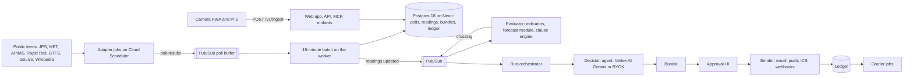

# Skyclause technical requirements

How the Skyclause platform is built: the services, data, pipelines and interfaces that turn public feeds into approved, graded calls. Requirements and the roles matrix live in the [PRD](/docs/PRD.md), terms in the [glossary](/docs/PRODUCT.md#glossary) and visuals in [DESIGN](/docs/DESIGN.md). Nothing is built yet; versions and platform facts were checked on 5 November 2026, and **Inference** marks conclusions no source states.

Contents:

1.  [Architecture](#architecture)
1.  [Stack](#stack)
1.  [Repository layout](#repository-layout)
1.  [Data model](#data-model)
    1.  [Entities and keys](#entities-and-keys)
    1.  [Tenancy, append-only tables and partitions](#tenancy-append-only-tables-and-partitions)
1.  [Signal pipeline](#signal-pipeline)
    1.  [Adapter contract](#adapter-contract)
    1.  [Adapters by source](#adapters-by-source)
    1.  [Freshness, staleness and recovery](#freshness-staleness-and-recovery)
    1.  [Device sources](#device-sources)
1.  [Clause engine](#clause-engine)
    1.  [Clause shape and the indicator registry](#clause-shape-and-the-indicator-registry)
    1.  [Evaluation and precedence](#evaluation-and-precedence)
    1.  [Explanations, versions and replays](#explanations-versions-and-replays)
1.  [Decision agent](#decision-agent)
    1.  [Agent inputs and output schema](#agent-inputs-and-output-schema)
    1.  [Model routing for the agent](#model-routing-for-the-agent)
    1.  [Prompt-injection defences](#prompt-injection-defences)
    1.  [Agent evals and budgets](#agent-evals-and-budgets)
1.  [Approval and delivery](#approval-and-delivery)
    1.  [Bundle state machine](#bundle-state-machine)
    1.  [Approver rota and escalation](#approver-rota-and-escalation)
    1.  [Channels and sends](#channels-and-sends)
1.  [Grading](#grading)
1.  [API](#api)
    1.  [API conventions](#api-conventions)
    1.  [API resources](#api-resources)
    1.  [Webhook event catalogue](#webhook-event-catalogue)
1.  [Auth and tenancy](#auth-and-tenancy)
    1.  [Sign-in and sessions](#sign-in-and-sessions)
    1.  [Tenancy enforcement](#tenancy-enforcement)
    1.  [Guests, share links and bot checks](#guests-share-links-and-bot-checks)
1.  [BYOK and model routing](#byok-and-model-routing)
1.  [Billing](#billing)
1.  [SDK](#sdk)
1.  [CLI](#cli)
1.  [Agent layer](#agent-layer)
    1.  [Remote MCP server](#remote-mcp-server)
    1.  [MCP tools and scopes](#mcp-tools-and-scopes)
    1.  [Agent Skills pack](#agent-skills-pack)
    1.  [A2A agent card](#a2a-agent-card)
1.  [Web components](#web-components)
    1.  [Favicons and the live favicon](#favicons-and-the-live-favicon)
    1.  [Open Graph and oEmbed](#open-graph-and-oembed)
    1.  [Custom elements and iframe fallback](#custom-elements-and-iframe-fallback)
1.  [Gemini Enterprise pilot](#gemini-enterprise-pilot)
    1.  [Pilot parts and platform replacements](#pilot-parts-and-platform-replacements)
    1.  [Connecting a Gemini Enterprise tenant](#connecting-a-gemini-enterprise-tenant)
1.  [Security](#security)
1.  [Privacy and data retention](#privacy-and-data-retention)
1.  [Observability and SLOs](#observability-and-slos)
1.  [Testing](#testing)
1.  [Environments and deployment](#environments-and-deployment)
1.  [Cost model](#cost-model)
1.  [Technical risks](#technical-risks)
1.  [Not verified](#not-verified)
1.  [See also](#see-also)

## Architecture

Skyclause is one TypeScript monorepo deployed as a few Cloud Run units in `asia-southeast1` (Singapore; see [Privacy and data retention](#privacy-and-data-retention) for why not Malaysia). Public feeds are polled once per source for every tenant, so the number of organisations, projects and guests never changes the polling budget; device sources post to the API. Postgres, on Neon in AWS `ap-southeast-1` (also Singapore), is the system of record for polls, readings, verdicts, bundles, approvals and the ledger; it sleeps when idle, so nothing on a schedule wakes it more than every 15 minutes ([sleep budget](#environments-and-deployment)).



| Unit             | Runs on                                          | Does                                                                                                                                                                                                                                |
| ---------------- | ------------------------------------------------ | ----------------------------------------------------------------------------------------------------------------------------------------------------------------------------------------------------------------------------------- |
| `web`            | Cloud Run service                                | Next.js app on `skyclause.m1ku.tech`, `app.`, `api.` (`/v1`), `mcp.` (`/mcp`) and `embed.`; Better Auth; SSE; oEmbed; OG images; `docs.skyclause.m1ku.tech` runs from the same image                                                |
| `worker` service | Cloud Run service (Pub/Sub push, Scheduler HTTP) | Evaluator, run orchestrator, sender (outbox), handlers called by Cloud Tasks (SLA, expiry, staleness and span deadlines), and the 15-minute batch (buffered poll writes, poll plans, the auditor, schedules, partition maintenance) |
| Adapter jobs     | Cloud Run jobs on Cloud Scheduler                | One job per source kind: read its poll plan, fetch, parse, and publish the `poll` and `reading` rows to the poll buffer; never Postgres                                                                                             |
| Batch jobs       | Cloud Run jobs                                   | Graders, forecast module, migrations, retention, partition checks, live contract tests                                                                                                                                              |

Cloud Run jobs "do not listen for or serve requests" ([Cloud Run jobs]), so Pub/Sub push subscriptions, Cloud Tasks and the Scheduler calls for the minute tick and the 15-minute batch target the `worker` service, built from the same image as the jobs. Retries on poll jobs are set to 0: the next scheduled poll is the retry, which keeps every adapter inside its rate budget. The six flows:

1.  **Poll.** Cloud Scheduler starts an adapter job. It reads its poll plan (bound sources, conditional-request validators, `next_update`) from an object in the sources bucket and publishes each request's `poll` (HTTP status, latency, outcome) and new observations to the Pub/Sub topic `poll-results`, never touching Postgres. Every 15 minutes the worker's batch pulls the buffer, writes each source's `poll` and `reading` rows in one transaction, acknowledges the messages only after the commit (unacknowledged messages are kept 7 days by default ([Pub/Sub retention])), rewrites the poll plans and publishes `readings.updated` with the source ID.
1.  **Evaluate.** The evaluator recomputes indicators for every project bound to the source, runs the forecast module for Crowd nights, and evaluates each project's published clause sheets for open windows and site-level verdicts. A changed verdict is a **crossing**: a `crossing` row and a Pub/Sub message. Each evaluation also replaces one Cloud Tasks task per project for the next moment its verdict can change without a new reading (an input turning stale, a span opening or closing), so staleness and opening spans still change verdicts; no tick reads the database.
1.  **Run.** The orchestrator starts one run per project and pack for a batch schedule, crossings that meet the [Evaluation and precedence](#evaluation-and-precedence) rule, share-link and MCP declarations, time edits, ICS changes (`calendar`) and listing approvals or changes. Each run snapshots its inputs, records the shadow verdict, calls the decision agent, validates the output and writes the bundle. Guests can only "Ask for a call".
1.  **Approve.** A bundle that would send waits in Needs review; Cloud Tasks timers fire SLA escalation and expiry; approval re-checks inputs.
1.  **Send and record.** The sender drains an outbox (email, ICS feed version, webhooks, in-app); each send is idempotent; every sent or rejected outcome appends a ledger entry; All-Normal bundles write no ledger entry.
1.  **Grade.** Graders compare Sky calls with the gauge and APIMS nightly and Crowd nights with gate taps on D+1, and open review items.

**Run orchestration is a Postgres state machine, not a hosted workflow engine.** A run is a short chain of idempotent steps (snapshot, shadow, budget, draft, validate, compare, persist), each recorded in `run_step` in its own transaction under the run's row lock; Pub/Sub redelivers a message whose handler died, and the handler resumes at the first unfinished step, so a finished step, the model call included, never runs again, and a second delivery of the same run waits on the lock. A step that throws fails the run, except for a transient database fault, which Pub/Sub redelivers. One run per project and pack is `running`; the next stays `queued` until the running run publishes it, and the 15-minute batch republishes runs queued for over a minute and running runs with no step for 10 minutes. The run keeps each step's output (prompts and model outputs included), and one `ai_usage` row per model call. The Sky schedule is `project_pack.schedule`, a five-field cron string read in the project's time zone (minute and hour lists, a weekday list or range), `45 6 * * 1-5` when unset; the first batch at or after each slot requests the run, so a missed batch catches up the same day. The human wait is not inside the run: the bundle is a row the dashboard must query anyway, and its timers are Cloud Tasks scheduled at `sla_due_at` and each call's `expires_at` (first 1M operations a month free ([Cloud Tasks pricing])). Rejected:

- **Inngest** (`inngest` 4.26.2): maximum `waitForEvent` duration Not verified, and bundle state would live twice ([waitForEvent]).
- **Trigger.dev** (`@trigger.dev/sdk` 4.8.3): billing while waiting Not verified; payloads leave the region unless self-hosted ([wait for token]).
- **AI SDK 7 `WorkflowAgent`** (`@ai-sdk/workflow` 2.0.95): ties the wait to one agent invocation, but approval belongs to the bundle ([AI SDK 7]).
- **Cloud Workflows:** steps live outside the TypeScript codebase, so `packages/clauses` can't run in-process.

[Cloud Tasks pricing]: https://cloud.google.com/tasks/pricing
[waitForEvent]: https://www.inngest.com/docs/reference/functions/step-wait-for-event
[wait for token]: https://trigger.dev/docs/wait-for-token

## Stack

Versions are the npm or PyPI latest on 5 November 2026 where a version is given; each is pinned exactly in the lockfile.

| Layer             | Choice and version                                                                                                                                                            | Why                                                                                                                                   | Alternatives rejected                                                                                   |
| ----------------- | ----------------------------------------------------------------------------------------------------------------------------------------------------------------------------- | ------------------------------------------------------------------------------------------------------------------------------------- | ------------------------------------------------------------------------------------------------------- |
| Language          | TypeScript, ESM; Node.js 22 or later on Cloud Run; Bun 1.4.4 for installs, scripts and binaries                                                                               | One language from adapters to embeds; AI SDK 7 needs Node 22+ and ESM ([AI SDK 7])                                                    | A Python backend: splits the clause engine                                                              |
| Web               | Next.js 16.4.5 App Router, React 19.3, Cache Components ([Next.js 16.4])                                                                                                      | Route Handlers serve API, MCP, oEmbed and OG images from one deployable                                                               | SPA plus API server: two deployables                                                                    |
| UI                | shadcn CLI 4.23.0 on Base UI (`@base-ui/react` 1.9.0), Tailwind CSS 4.3.4, shadcn charts on Recharts 3.10.1                                                                   | Base UI is shadcn's default since July 2026 ([shadcn Base UI])                                                                        | Radix (`radix-ui` 1.8.1): no reason to leave the default                                                |
| API               | Hono with zod route schemas generating OpenAPI 3.1, mounted in a Route Handler                                                                                                | One schema validates requests and generates `/openapi.json`, SDKs and docs                                                            | Hand-written OpenAPI: drifts; tRPC: no public OpenAPI                                                   |
| Auth              | Better Auth 1.7.17 with organization, anonymous, `@better-auth/api-key`, MCP and `@better-auth/cimd` 1.7.17                                                                   | Organisations, guests, org API keys and an MCP OAuth provider in one Postgres schema                                                  | Clerk: no guests or MCP provider ([Clerk API keys]); Auth.js: merged into Better Auth                   |
| Database          | Neon serverless Postgres 18 on the Free plan in `aws-ap-southeast-1`, with `pg_partman` ([Neon extensions]); Drizzle ORM and Drizzle Kit                                      | Row-level security, monthly partitions, one store for ledger and auth; $0 inside the sleep budget                                     | Cloud SQL: an always-on instance; Neon Launch: about US$20 a month, the upgrade path; Firestore: no RLS |
| Scheduling        | Cloud Scheduler, Cloud Run jobs, Pub/Sub, Cloud Tasks                                                                                                                         | Managed cron and retries in-region; jobs run up to 168 h for backfills ([Cloud Run jobs])                                             | GitHub Actions cron: disabled after 60 idle days                                                        |
| Clause language   | CEL via `@bufbuild/cel` 0.6.2 ([cel-es])                                                                                                                                      | Ships cel-spec conformance data                                                                                                       | `@marcbachmann/cel-js` 8.0.0: conformance unpublished ([cel-js])                                        |
| AI                | AI SDK 7 (`ai` 7.0.163), `@ai-sdk/google-vertex` 5.0.132, `@ai-sdk/google` 4.0.112, `@ai-sdk/anthropic` 4.0.97, `@ai-sdk/openai` 4.0.109, `@openrouter/ai-sdk-provider` 3.1.0 | One structured-output API across the five BYOK providers; `@ai-sdk/otel` spans                                                        | Five direct provider SDKs                                                                               |
| Keys and secrets  | Cloud KMS (`@google-cloud/kms` 6.3.0), Secret Manager                                                                                                                         | Envelope encryption with a regional KEK ([KMS envelope encryption])                                                                   | A master key in environment variables                                                                   |
| Files and parsing | Cloud Storage; DuckDB for parquet; `gtfs-realtime-bindings` for GTFS-rt                                                                                                       | Frames with lifecycle deletion; the Rapid Rail parquet read in place                                                                  | BigQuery loads: later, for analytics                                                                    |
| Agent layer       | `@modelcontextprotocol/server` 2.4.0 (spec 2026-07-28) ([MCP TypeScript SDK]); `@a2a-js/sdk` 1.3.0 behind a flag                                                              | Stateless streamable HTTP; one tool set for remote and stdio                                                                          | SDK v1 1.32.2: compatibility route only                                                                 |
| Embeds            | Lit 3.3.3 ([Lit blog])                                                                                                                                                        | Small custom elements with shadow DOM                                                                                                 | React in shadow roots: heavier                                                                          |
| CLI               | commander 15.0.0 on the SDK, run with Bun from the repo workspace                                                                                                             | Stable and small                                                                                                                      | oclif 6.0.15: unneeded plugins; citty 0.2.2: smaller community                                          |
| Email, billing    | Amazon SES in `ap-southeast-2` (Sydney) ([SES endpoints]); Stripe                                                                                                             | SES in Sydney because the AWS account's organisation policy allows no other region (decided 6 November 2026); MYR prices and invoices | Postmark, Resend: no regional reason                                                                    |
| Ops               | OpenTelemetry to Cloud Trace, Monitoring and Logging; Terraform; GitHub Actions with Workload Identity Federation; Vitest, fast-check, Playwright with axe                    | One trace from poll to notice; reviewed infrastructure; no cloud keys in CI                                                           | Vendor APM agents; console-built infrastructure                                                         |

[Next.js 16.4]: https://nextjs.org/blog/next-16-4.md
[shadcn Base UI]: https://ui.shadcn.com/docs/changelog/2026-07-base-ui-default
[Clerk API keys]: https://clerk.com/docs/guides/development/machine-auth/api-keys
[Lit blog]: https://lit.dev/blog/

## Repository layout

One Bun workspace. Apps depend on packages, never the reverse; only `packages/db` writes SQL; `packages/clauses` depends on nothing but its CEL library, so it runs unchanged in Node, Bun and the browser.

```text
skyclause/
├── apps/
│   ├── web/            Next.js 16.4: marketing, app, public pages, /v1 API, /mcp, OAuth, /oembed, OG images, embed frames
│   ├── worker/         Cloud Run image: adapter and batch job entry points, plus the worker service (evaluator, orchestrator, sender, auditor)
│   └── docs/           Fumadocs static export at docs.skyclause.m1ku.tech: guides, API reference from /openapi.json, examples captured from real calls in `apps/docs/examples/<operationId>/`, each with "Captured {YYYY-MM-DD HH:MM} MYT · station `{id}`" or "Captured {YYYY-MM-DD HH:MM} MYT · project `{org}/{project}`" when no station applies
├── packages/
│   ├── contracts/      seam types and schemas, operation registry, catalogues, `notBuilt(owner)`
│   ├── clauses/        CEL parse, type-check, evaluate, explain; precedence and No call; replay; the deep shared module
│   ├── sources/        source adapters, indicator definitions and the registry, the Pi device agent
│   ├── forecast/       Crowd baseline, uplift, forecast and band for a night
│   ├── agent/          decision agent: input assembly, output schema, validation, model table, routing
│   ├── db/             Drizzle schema, SQL migrations, RLS policies, the withTenant query layer
│   ├── auth/           Better Auth, `resolvePrincipal`, `can`, page helpers
│   ├── api/            Hono routes and zod schemas; generates OpenAPI 3.1
│   ├── delivery/       outbox, email templates, ICS writer, webhook signer and retrier
│   ├── i18n/           `t()`, `catalogue/{en,ms}/<feature>.json`, formatters
│   ├── mcp/            MCP tools, resources and prompts, shared by the remote server and `skyclause mcp`
│   ├── sdk/            @skyclause/sdk: generated types plus pagination, SSE and webhook helpers
│   ├── sdk-python/     skyclause for Python (P2), generated from the same document
│   ├── cli/            skyclause CLI on commander and the SDK
│   ├── elements/       <skyclause-status> and <skyclause-window> in Lit 3
│   ├── skills/         Agent Skills pack source (SKILL.md per skill)
│   └── config/         shared tsconfig, lint and Prettier settings, env schema
└── infra/              Terraform for every Google Cloud resource
```

## Data model

### Entities and keys

Better Auth owns `user` (our **account**), `member` (membership), `organization`, `session` and its own `account` table (sign-in methods). Every tenant row carries `org_id`; "global" rows are the shared source catalogue. The table lists keys and the fields engineers need; Drizzle's schema in `packages/db` is the full definition.

| Entity                                  | Key fields                                                                                                                                                                                 | Tenancy        | Notes                                                                                                                                                      |
| --------------------------------------- | ------------------------------------------------------------------------------------------------------------------------------------------------------------------------------------------ | -------------- | ---------------------------------------------------------------------------------------------------------------------------------------------------------- |
| organisation, membership, account       | `slug`, `plan`, `stripe_customer_id`; membership `role`; account `email`, `is_anonymous`, `locale`                                                                                         | root, auth     | Better Auth tables, extended; `guest_budget` (device and IP hashes, daily counters) caps guests per [GST-8](/docs/PRD.md#guest-access-and-the-commons-gst) |
| project, project_pack                   | `slug`, `time_zone`, `public`, `semester_ends_on`; pack `pack`, `enabled`, `sheet_id`, `schedule`                                                                                          | org            | The Commons project is `commons/bukit-jalil`                                                                                                               |
| source, project_source                  | `kind`, `external_id`, `owner_org_id`, `cadence_s`, `freshness`, `licence`, `probation`; binding `role`                                                                                    | global or org  | Catalogue sources have no owner; camera and Pi sources do                                                                                                  |
| poll, reading                           | `source_id`, `started_at`, `http_status`, `latency_ms`, `outcome`; `metric`, `observed_at`, `received_at`, `value`, `revision`                                                             | follows source | Append-only, monthly partitions                                                                                                                            |
| indicator_snapshot                      | `project_id`, `pack`, `t_eval`, `values` (value, unit, age, state, reading IDs per name), `hash`                                                                                           | org            | Immutable; verdicts, runs and approvals point at it                                                                                                        |
| sheet_version, clause                   | version `n`, `status`, `content_hash`, `published_by`; clause `key`, `requires`, `span`, `when`, `proposes`                                                                                | org            | Published versions immutable ([CLS-7](/docs/PRD.md#clauses-cls))                                                                                           |
| window                                  | `starts_at`, `ends_at`, `title`, `declared_by`, `guest`, `expires_at`, `moderation`                                                                                                        | org            | A zero-length `commute_wave` is valid; series materialise 90 days ahead                                                                                    |
| shadow_state, crossing                  | `window_id` or site, `verdict`, `since`; crossing `from`, `to`, `at`, `snapshot_id`                                                                                                        | org            | Crossings append-only                                                                                                                                      |
| run, run_step                           | `trigger`, `dedupe_key`, `sheet_version_id`, `snapshot_id`, `model`, `fallback_used`, tokens, `status`                                                                                     | org            | Steps make runs resumable                                                                                                                                  |
| bundle, call                            | bundle `state`, `superseded_by`, `review_hash`, `sla_due_at`; call `mode`, `watch`, `no_call`, `fired`, `agrees`, `decision`, `expires_at`, delay times                                    | org            | Delays per [CAL-12](/docs/PRD.md#calls-and-approvals-cal)                                                                                                  |
| approval                                | `bundle_id` or `listing_id`, `call_id`, `actor_id`, `action`, `diff`                                                                                                                       | org            | Append-only                                                                                                                                                |
| notice                                  | `call_id`, `subscriber_id`, `channel`, `idempotency_key`, `status`, `provider_message_id`                                                                                                  | org            | The outbox row                                                                                                                                             |
| subscriber, consent_record, suppression | subscriber `email`, `role`, `window_ids`, `language`, `confirmed_at`; consent `notice_version`, `at`, `ip_hash`; suppression `email_hash`, `reason` (bounce, complaint, unsubscribe), `at` | org            | Bounces and complaints from SES land in `suppression`; consent rows append-only                                                                            |
| push_subscription                       | `account_id`, `endpoint`, `p256dh`, `auth`, `user_agent`, `last_ok_at`                                                                                                                     | org            | Web push for approvers                                                                                                                                     |
| listing, night, forecast                | listing `source_url`, `source_revision`, `state`; night `date`, `state`; forecast `baseline`, `uplift`, `forecast`, `band_low`, `band_high`, `created_at`                                  | org            | Forecasts append-only, so each provably predates its night                                                                                                 |
| grade, review_item                      | `call_id`, `night_id` or a callless `window_id`, `outcome`, `local_date`, Crowd `actual`; review `reasons`, `explanation`                                                                  | org            | Live only; replays go to `replay_result`                                                                                                                   |
| evidence_request                        | `span`, `requester` (`requester_kind`, `account_id` or `subscriber_id`), `status`, `pack`, `pack_hash`, SES `message_id`, received, drafted, approved and replied times                    | org            | Per [LED-6](/docs/PRD.md#ledger-and-evidence-led)                                                                                                          |
| ledger_entry                            | `project_id`, `seq`, `kind`, `refs`, `body`, `prev_hash`, `hash`                                                                                                                           | org            | Append-only hash chain                                                                                                                                     |
| api_key, ai_key, ai_usage               | key `prefix`, `hash`, `scopes`, `expires_at`; AI key `provider`, `ciphertext`, `wrapped_dek`, `kek_version`, `declared_tier`, `priority`                                                   | org or account | [BYOK](#byok-and-model-routing)                                                                                                                            |
| webhook, webhook_delivery               | `url`, `secret` (KMS-wrapped), `events`, `verified_at`, `status`; delivery `attempt`, `status_code`, `latency_ms`                                                                          | org            | Deliveries start only after `verified_at`                                                                                                                  |
| share_link, rota_shift                  | `token_hash`, `role`, `expires_at`, `revoked_at`; shift `account_id`, `project_id` (null on the organisation rota), `days`, `local_start`, `local_end`, `condition`, `order`               | org            |                                                                                                                                                            |
| verification                            | `target` (Claude, ChatGPT, Gemini Enterprise, Cursor, VS Code), `client_version`, `tested_at`, `result`, `tested_by`, `notes`                                                              | global         | Backs "Verified on <date>" ([CAI-2](/docs/PRD.md#connect-your-ai-cai))                                                                                     |
| pilot_archive                           | `project_id`, `kind` (Sheets ledger, Jira register, run traces), `object_path`, `sha256`, `captured_at`                                                                                    | org            | Read-only files, linked from the project; never in `ledger_entry`                                                                                          |
| audit_event                             | `actor` (account, API key, OAuth client, system), `action`, `target`, `before`, `after`, `at`                                                                                              | org            | Append-only                                                                                                                                                |

### Tenancy, append-only tables and partitions

- Every tenant table has `org_id NOT NULL` and, where scoped, `project_id`; foreign keys are composite (`org_id`, `project_id`), so a child row can't point into another organisation.
- Catalogue sources (`owner_org_id IS NULL`) and their polls and readings are readable by every role, including guests and public pages; device sources are readable only inside their organisation.
- Append-only tables: `poll`, `reading`, `indicator_snapshot`, `crossing`, `approval`, `forecast`, `grade`, `ledger_entry`, `audit_event`, `webhook_delivery`, `ai_usage`. The application role has `INSERT` and `SELECT` only, and a trigger rejects `UPDATE` and `DELETE`; retention and erasure run as a separate `retention` role ([LED-1](/docs/PRD.md#ledger-and-evidence-led)).
- The ledger is a hash chain: `hash = sha256(prev_hash || JCS({seq, kind, refs, body, at}))`, with a genesis hash of 32 zero bytes, `at` in UTC milliseconds, hex hashes and `seq` gapless per project; the integrity check walks the chain by `seq` and names the first bad entry with its reason (`seq_gap`, `prev_hash` or `hash`) ([LED-2](/docs/PRD.md#ledger-and-evidence-led)). A removed entry is named by the one after it. Removing the newest entry leaves a shorter chain that still verifies, so only a head hash recorded outside the ledger can show it. Bodies hold counts, roles and pseudonymous IDs, never emails, so erasure pseudonymises without breaking the chain.
- IDs are UUIDv7 (time-ordered); authorisation never relies on an ID being secret.
- `poll` and `reading` are range-partitioned by month on `started_at` and `observed_at` with `pg_partman` 5.1.0, which Neon supports ([Neon extensions]). `premake` keeps three future months, and a default partition catches rows outside them; only `retention` may move those rows, since moving deletes from an append-only table. The worker's 15-minute batch runs `partition_maintenance()` (`partman.run_maintenance()` as owner) once an hour (there is no `pg_cron`: on Neon it runs only while the compute is awake), and the auditor alarms if next month's partition is missing.
- Volume (our arithmetic): one JPS gauge at 288 readings a day, 68 APIMS stations × 24 = 1,632, daily Rapid Rail exits per station, a few MET rows: about 2,000 rows a day for the pilot catalogue. Partitions serve retention and vacuum, not scale.
- Indexes: `(source_id, metric, observed_at DESC)` for latest-value reads; BRIN on `received_at` for latency reports.

## Signal pipeline

Cadences are PRD's [NFR-1](/docs/PRD.md#non-functional-requirements); behaviour follows the [Skyclause states](/docs/ideas/02-skyclause.md#states-and-failure-handling) and [Fanfall states](/docs/ideas/04-fanfall.md#states-and-failure-handling) and [SIG](/docs/PRD.md#signals-sig).

### Adapter contract

```ts
export interface SourceAdapter<Raw> {
  kind: SourceKind // 'jps_rain' | 'met_warning' | 'met_forecast' | 'apims' | 'rapidrail_od' | ...
  apiFamily?: 'datagovmy-weather' | 'datagovmy-gtfs-rt' | 'datagovmy-gtfs-static'
  cadence: Duration // expected interval between new data
  freshness: 'observed' | 'polled' // age from source time, or from the last good poll
  fetch(sources: Source[], ctx: PollContext): Promise<Raw> // one request for all bound sources; throws HttpError with status
  parse(raw: Raw, sources: Source[]): ReadingInput[] // pure; throws SchemaError when the shape changes
  backfill?(source: Source, ctx: PollContext): Promise<Raw> // first poll after binding only
  indicators: IndicatorDefinition[] // registered with packages/clauses
}
```

- Every request writes one `poll` row per bound source, sharing `request_id`, with HTTP status, latency and outcome. A non-2xx, a 20-second timeout or a `SchemaError` writes `outcome = error` with the message; nothing copies or carries forward the last value ([SIG-2](/docs/PRD.md#signals-sig)).
- Readings dedupe on (`source_id`, `metric`, `observed_at`); a re-fetched value that differs appends `revision + 1`. Indicators use the latest revision; calls keep the reading IDs they saw.
- Adapters on one data.gov.my API take a slot from a per-API budget of 4 requests a minute (a Postgres advisory lock and counter) ([data.gov.my notes][dgm]); a `429` is an error poll and the next scheduled poll is the retry. Paths always end with `/`, since a missing slash returns `301` with HTML.
- Only adapters call upstream. The app, API, playground, embeds and MCP read stored rows, so tenants and guests add no upstream requests.
- Times are stored in UTC and shown in MYT.
- Catalogue rows come from adapters' `discover()` methods via daily `catalogue-sync`; nobody types coordinates.

[dgm]: /docs/research/data-sources.md#shared-notes-on-the-datagovmy-api

### Adapters by source

This table is the one source for poll intervals; PRD's [NFR-1](/docs/PRD.md#non-functional-requirements) links here, and endpoints, licences and live checks are in the linked research.

| Source                                                                                                  | Poll cadence                                                                  | Parse and store                                                                                                                                                                                                    | Failure handling                                                                                              |
| ------------------------------------------------------------------------------------------------------- | ----------------------------------------------------------------------------- | ------------------------------------------------------------------------------------------------------------------------------------------------------------------------------------------------------------------ | ------------------------------------------------------------------------------------------------------------- |
| [JPS rain gauge `0232901RF`](/docs/ideas/02-skyclause.md#day-to-day-loop)                               | Every 5 min, `observed`                                                       | 5-minute rain in mm; a value at T covers (T−5 min, T]; the first poll after binding stores the 7-day window the endpoint holds (for the pilot, from 29 October)                                                    | Undocumented JSON may change: error polls and a schema alarm; Public Infobanjir is not a fallback             |
| [MET warnings](/docs/research/data-sources.md#met-malaysia-warnings)                                    | Every 10 min, `polled`                                                        | One reading per warning keyed by `issued`, `title_en`, `valid_from`; text stored verbatim; in force only between `valid_from` and `valid_to` ([SIG-4](/docs/PRD.md#signals-sig))                                   | Shares the Weather API's 4 a minute with the forecast; old warnings stay listed, so the window decides        |
| [MET forecast `Ds058`](/docs/research/data-sources.md#weather-forecasts-for-campus)                     | Every 6 h, stored on change, `polled`                                         | Seven days of Malay period text and temperatures; sets `site.met_afternoon_thunderstorm` for the rota                                                                                                              | Stale when no row covers today                                                                                |
| [DOE APIMS](/docs/research/data-sources.md#doe-apims-air-pollutant-index)                               | Every 15 min for hourly data, `observed`                                      | All 68 stations by `STATION_ID` and `RECORD_DT`; defaults `CA16W` Cheras, `CA19B` Petaling Jaya and `CA17W` Putrajaya; binding backfills three days from the hourly history so the last three 06:00 readings exist | Server-side only (CORS); undocumented; the index lags as 24-hour averages, shown, not corrected               |
| [Rapid Rail origin-destination](/docs/research/data-sources.md#rapid-rail-origin-destination-ridership) | Metadata every 30 min once `next_update` passes; the file when as-of advances | DuckDB sums daily exits per station, excluding `A0: All Stations`; `SP17` exits feed the Crowd grade; the file is kept in Cloud Storage by as-of date                                                              | Late: "pending until" `next_update` ([SIG-11](/docs/PRD.md#signals-sig)); schema change: error poll           |
| [GTFS Realtime](/docs/research/data-sources.md#bus-and-train-positions-gtfs-realtime)                   | Every 60 s in arrival and exit periods only, started by the evaluator tick    | `rapid-bus-kl` and `rapid-bus-mrtfeeder` decoded; vehicles inside a polygon around `SP17` and TPM; T580 segment times `KL149` → `KL2009` written, raw positions dropped                                            | 2 of the API's 4 a minute; out-of-area positions dropped; missing positions mean missing telemetry            |
| [GTFS Static](/docs/research/data-sources.md#routes-and-stops-near-apu-gtfs-static)                     | Daily at 04:00                                                                | Stops, routes and scheduled times for segment baselines                                                                                                                                                            | Stale once a feed calendar ends                                                                               |
| [GoLive](/docs/ideas/04-fanfall.md#real-data-and-privacy)                                               | Hourly, `polled`                                                              | Bukit Jalil complex shows become `proposed` listings with URL; `Z`-suffixed times stored raw and flagged                                                                                                           | Single-source listings flagged ([SIG-13](/docs/PRD.md#signals-sig))                                           |
| [Wikipedia stadium and arena pages](/docs/ideas/04-fanfall.md#real-data-and-privacy)                    | Daily, by revision ID                                                         | Wikipedia revisions provide class history as `historical` listings, carrying URL and revision; share-alike applies to derived listings. Never use pilot data.                                                      | Vandalism and cancelled shows: every listing passes a person ([CAL-14](/docs/PRD.md#calls-and-approvals-cal)) |
| Camera PWA, Pi 5                                                                                        | Camera every 10 min in daylight; Pi as configured                             | `POST /v1/ingest/{sourceId}`; see [Device sources](#device-sources)                                                                                                                                                | Device silence and buffering                                                                                  |

`CA17W` and `CA19B` were checked in a [live capture](/docs/sources/eqms.doe.gov.my/mapcaqm.md) of `https://eqms.doe.gov.my/api3/publicportalapims/mapcaqm` at 21:13 MYT on 5 November 2026 (API 62 and 57, record time 21:00). The JPS series comes from `https://infobanjirjpskl.water.gov.my/Rainfall/GetRainfallGraph/75` ([capture](/docs/sources/infobanjirjpskl.water.gov.my/rainfall-graph-75.md), 21:12 MYT the same day), and MET warnings carry a Malay body, `text_bm`, beside `title_bm` in all four records ([capture](/docs/sources/api.data.gov.my/weather-warning.md), 21:13 MYT).

The GTFS Realtime cadence is the platform's; the pilot's Pi probe polls every minute from 16:00 to 24:00 on surge nights and one matched normal night a week ([Fanfall workflows](/docs/ideas/04-fanfall.md#day-to-day-workflows)).

### Freshness, staleness and recovery

- Input states: fresh, stale, error, recovered ([SIG-3](/docs/PRD.md#signals-sig)), plus `probation` and `off_hours` for the camera.
- `observed` sources: age is `t_eval − observed_at` of the newest reading; stale after two missed intervals (JPS 10 minutes, APIMS 2 hours, camera 20 minutes in daylight).
- `polled` sources (warnings, forecast, listings): age is time since the last `ok` or `unchanged` poll, because an unchanged warning list is still current; stale after two missed or failed polls.
- Error: the latest poll failed, naming the HTTP status and since when. Recovered: the first good reading after stale or error marks the input recovered and names it on the next call; clauses use it only from the next fresh reading.
- Rapid Rail is "pending" until its `next_update`, then stale after two missed polls. Ages are computed at `t_eval` and frozen in the indicator snapshot, so a replay reproduces them exactly.

### Device sources

- **Camera PWA** ([SIG-8](/docs/PRD.md#signals-sig), [SIG-9](/docs/PRD.md#signals-sig)): Chrome on an Android phone on a charger with the page in front and a screen wake lock, the only setup that keeps reporting ([pages left running](/docs/research/iot-and-network.md#web-pages-and-pwas-left-running)). The page masks the lower third before any pixel leaves the device, scores near-landmark and far-skyline contrast against a clear-day reference on the phone ([edge processing](/docs/research/iot-and-network.md#edge-versus-cloud-processing)), and posts two ratios, a small JPEG and `device_time` every 10 minutes. Offline, it queues in IndexedDB and uploads in order with original times and an idempotency key; the server adds `received_at`, so latency shows per reading. Frames go to Cloud Storage under `frames/{project}/{date}/`.
- **Probation:** `source.probation` stays true until the phone's flag matches the settled label on at least 90% of at least 100 daylight frames, including at least 10 obscured (two labellers label each frame blind to each other and to the flag; the settled label is their agreed label or a recorded resolution); until then the registry marks camera indicators unusable in clauses. Outside the project's daylight hours the camera is `off_hours`, which clauses treat as an absent optional input, not as stale.
- **Pi 5** ([SIG-10](/docs/PRD.md#signals-sig)): the device agent in `packages/sources` is compiled with Bun for `bun-linux-arm64` and runs under systemd with `Restart=always`, `StartLimitIntervalSec=0` and the hardware watchdog ([services and watchdogs](/docs/research/iot-and-network.md#services-and-watchdogs)). It stamps nothing before NTP sync, since the board has no RTC battery ([power and the RTC](/docs/research/iot-and-network.md#power-undervoltage-and-the-rtc)); buffers to an append-only JSON-lines file with `fsync`, kept small because power cuts corrupt SD cards; uploads in order on reconnect; and sends a heartbeat each minute. Posts stopping for 60 minutes mark the source offline. On the platform, GTFS-rt decoding and the ridership reduction run in cloud adapters; the Pi is an optional project device. Device auth: one token per device from the api-key plugin, scoped to `ingest` on one source, rotated in project settings.

## Clause engine

`packages/clauses` is the deep shared module: the worker evaluates live with it, the API serves `evaluate` and `replay` with it, the CLI's `clauses test`, `replay` and `diff` call it, and the playground runs it in the browser. Defaults and modes are PRD's [Clauses (CLS)](/docs/PRD.md#clauses-cls).

### Clause shape and the indicator registry

```ts
export function check(sheet: SheetInput, registry: IndicatorRegistry): CheckResult // types, names, spans
export function evaluate(sheet: CheckedSheet, snapshot: IndicatorSnapshot, windows: Window[], tEval: Instant): Verdicts
export function explain(verdicts: Verdicts): ClauseExplanation[]
export function replay(sheet: CheckedSheet, history: ReadingHistory, windows: Window[], range: DateRange): ReplayResult // labelled replay
```

A clause, here the default Storm confirmed from the [Skyclause clause sheet](/docs/ideas/02-skyclause.md#the-clause-sheet):

```yaml
key: storm_confirmed
requires: [w.rain_max_60m_mm]
span: { from: end-30m, to: end+60m }
when: w.rain_max_60m_mm >= 31.0
proposes: { mode: commute_disruption }
wording: { en: Storm confirmed at the JPS gauge (Lebat class) }
```

- Clause scope is `site`, `window` or `night`; absent `optional` inputs do not block a clause, `builtin: 'silent_input'` marks the built-in Silent input clause, and `expiry` may be `'start'` or `'end'`.
- Each adapter declares its indicators with name, CEL type (`double`, `int`, `bool`, `timestamp`, `duration`, `list`), unit, scope (`site` or `window`) and source kind; window-scoped indicators (prefix `w.`) are computed by the engine over each window's span, site-scoped ones (prefix `site.`) once per evaluation. The CEL environment declares `site` and `w` from the registry, so an unknown name or a type mismatch fails `check` and the sheet can't publish.
- Crowd indicators (baseline, uplift, forecast, band) come from `packages/forecast` per night and enter as `site.night.*` ([SIG-7](/docs/PRD.md#signals-sig)); the engine never computes them and the model never does arithmetic.
- The allowed CEL subset: comparisons, arithmetic, `&&`, `||`, `!`, `has()`, `size()`, and `all` and `exists` over lists. No custom functions, no I/O, no `now`: time enters only through `t_eval` and the span ([CLS-6](/docs/PRD.md#clauses-cls)).
- **Library: `@bufbuild/cel` 0.6.2**, pinned exactly. It ships cel-spec conformance data (`@bufbuild/cel-spec`), so CI can prove the subset we allow behaves to spec in Node and the browser alike; the README still says "Beta", which the exact pin, the conformance run and a replay diff on every upgrade contain. `@marcbachmann/cel-js` 8.0.0 is smaller, has zero dependencies and a stable major, but its conformance pass rate is Not verified; `packages/clauses` hides the library, so switching is local ([cel-es], [cel-js], [cel-spec]).

[cel-spec]: https://github.com/google/cel-spec

### Evaluation and precedence

- **Spans.** `from` and `to` are relative to the window's `start` or `end` (Storm confirmed: 30 minutes before to 60 minutes after the end). A window is evaluated while `t_eval` falls inside its span, and the span is marked complete once `to` has passed. `w.rain_max_60m_mm` is the highest rolling 60-minute total at any t from `from` to the earlier of `to` and `t_eval`; the total at t sums the readings stamped in (t − 60 min, t], so it may include readings from before the span opens. `w.rain_max_4h_mm` is the same over 240 minutes, for Flash-flood risk. Other window indicators read observed readings from `from` to the earlier of `to` and `t_eval`, with the interval-valued warning exception below.
- **Rainfall coverage.** Each trailing total needs its complete five-minute measurement grid. Historical candidates keep their own grid endpoint; a later recorded observation proves that a missing endpoint is a hole. An open live edge may carry the last complete available total while the next observation is pending. At `t_eval == to`, that hold is permitted only if its endpoint is inside the span; for `t_eval > to`, terminal coverage is required. The span's `complete` flag records clock completion, not data completeness. Missing historical coverage blocks the clause rather than shifting its rolling interval backward.
- **Window warnings.** Warnings have validity intervals, and adapters append an observation only when a warning changes. An unchanged warning genuinely observed before `from` can carry into a span if its validity overlaps that span. An explicit or inferred effective clause span governs validity overlap; observations after the earlier of `to` and `t_eval` cannot affect that span. With neither an explicit nor an inferred span, the default Storm watch clause uses validity overlap with the actual window. Observation and receipt timestamps remain separate from validity boundaries: explanations retain the original observation time and age, never substitute `valid_from` or span opening. The snapshot's `received_at <= t_eval` cutoff applies, so an eligible observation received after span close but by `t_eval` can still contribute.
- **Per clause:** fired, not fired, blocked or `not_open`. A `not_open` clause (span not yet open) neither fires nor blocks. Blocked means a `requires` input isn't fresh; the result names the input and since when ([CLS-3](/docs/PRD.md#clauses-cls)).
- **Sky:** the highest fired mode wins and every fired clause is listed; a clause proposing Watch sets `watch = true` and never a mode ([CLS-2](/docs/PRD.md#clauses-cls)).
- **No call:** a window's verdict is No call when a blocked clause proposes a mode above the highest fired mode; otherwise the highest fired mode stands and blocked clauses are listed. So a silent gauge blocks Storm confirmed but not a Hybrid recommended haze call.
- **Crowd:** Surge night when a surge clause fires; recommendations are the union of fired clauses' recommendations, in sheet order; the Silent input row gives No call for clauses that need a silent Crowd input. When a listing has no show end, exit clauses are blocked until [PRD open question 5](/docs/PRD.md#open-questions) is resolved.
- **Site-level verdicts** (haze) and night-level verdicts (surge nights) evaluate with no windows ([CLS-11](/docs/PRD.md#clauses-cls)).
- **Crossings.** A verdict that differs from `shadow_state` is a crossing ([CLS-4](/docs/PRD.md#clauses-cls)). It starts a run when the new verdict is above Normal, when it is No call inside an open span, when a site-level verdict changes, or when it falls back to Normal while an unapproved bundle covers the window (so the stale draft is superseded). Other changes are recorded only. While a run for the same project and pack is in progress, further crossings queue at most one follow-up run.

### Explanations, versions and replays

- **Explanations.** `explain` returns, per clause, the key, sheet version, result (fired, not fired, blocked, `not_open`), the CEL condition as published, the span with a `complete` flag, and each input's indicator name, source ID (such as `0232901RF`), value (null only when stale or erroring), unit, `observed_at`, age, state and reading IDs. Call pages, `explain_call` and evidence packs render this one shape.
- **Versions.** Default sheets for both packs publish as version 1 by `system` at project creation, without a ledger entry; Crowd stays off until PRJ-3's sources are bound. Every save is a draft; publishing runs `check`, shows the diff against the live version and a labelled replay preview of which calls would change over the last 30 days of stored run snapshots, and makes an immutable numbered version ([CLS-8](/docs/PRD.md#clauses-cls)). After creation, only Approver and above can publish, from a human session; API keys can't. Each run pins the version it used.
- **Determinism.** `evaluate` is pure: no clock, I/O or randomness. The same version hash, snapshot hash, windows and `t_eval` give the same verdict hash, stored on each run so a later replay proves it.
- **Replays.** Any version or draft over recorded readings or a published dataset (the Rapid Rail yearly files, the Sensor.Community archive) writes `replay_result` rows; every output says "replay", never enters live grades and is never shown when a live source fails ([CLS-9](/docs/PRD.md#clauses-cls)).

## Decision agent

`packages/agent` drafts the call of record ([CAL-3](/docs/PRD.md#calls-and-approvals-cal)). It runs once per run (schedule, crossing, change or request), never per poll and never per landing-page visitor.

### Agent inputs and output schema

The orchestrator assembles every input before the call, as JSON data blocks: the pinned clause sheet (keys, conditions, wording), the indicator snapshot with values, units, states and ages, MET warning text verbatim, the windows at risk as IDs with start and end times, candidate recipients as opaque IDs with role and language, and yesterday's grades. Window titles, emails and names never enter a prompt; they are filled in after drafting ([NFR-11](/docs/PRD.md#non-functional-requirements)). The agent doesn't see the shadow verdict, so their agreement measures something.

```ts
// packages/agent/schema.ts: the proposed bundle, passed to AI SDK structured output
const Notice = z.object({ language: z.enum(['en', 'ms']), subject: z.string().max(120), body: z.string().max(2000) })
const Call = z.object({
  window_id: z.string(),
  mode: z.enum(['normal', 'outdoor_limited', 'commute_disruption', 'hybrid_recommended', 'surge_night']).nullable(),
  watch: z.boolean(),
  no_call: z.array(z.string()).nullable(), // indicator names that block the call
  fired: z.array(z.object({ clause: z.string(), inputs: z.array(z.string()) })),
  recommendations: z.array(
    z.enum(['keep_with_advisory', 'shift_start', 'shift_end', 'ask_shuttle', 'leave_before_doors'])
  ),
  recipients: z.array(z.string()), // candidate recipient IDs only
  notices: z.array(Notice),
  reason: z.string().max(1500)
})
export const ProposedBundle = z.object({
  pack: z.enum(['sky', 'crowd']),
  calls: z.array(Call),
  items: z.array(z.object({ kind: z.literal('surge_night_entry'), night_id: z.string() }))
})
```

After the model returns, `validate` enforces what the schema can't, and a failure leaves the run "No draft" with the reason (after one repair attempt):

- every fired clause exists in the pinned version, and every cited input exists in the snapshot;
- every number in a notice appears in the snapshot or the window times (the model never computes);
- recipients are a subset of that window's candidates; links point only at sources and Skyclause;
- the not-a-safety-service line, attributions, unsubscribe and, for Hybrid recommended, the teaching-mode line come from templates, not the model ([CAL-15](/docs/PRD.md#calls-and-approvals-cal));
- drafts and approver edits must pass the English and Malay attendance-excuse deny-lists; a match blocks drafting or approval ([CAL-15](/docs/PRD.md#calls-and-approvals-cal));
- from P1, a Malay notice needs a Malay-reading approver on the rota, or the call is drafted in English ([LOC-5](/docs/PRD.md#localisation-loc)); P0 notices are English only.

Then each call is compared with the shadow verdict (`agrees`), and disagreements go first in the bundle with both verdicts. The shadow pick uses the clause wording ([CAL-4](/docs/PRD.md#calls-and-approvals-cal)).

### Model routing for the agent

- Defaults on Vertex AI, pinned per release in `packages/agent/models.ts`: `gemini-3.8-flash` for drafts, including review-item drafts after grading.
- Release and retirement dates are external, checked 5 November 2026 on Google's [model versions] page, and not in the repo's research: `gemini-3.8-flash` released 2 September 2026, retiring no earlier than 2 September 2027; `gemini-4-argon` released 13 October 2026, no earlier than 13 October 2027; `gemini-3.6-flash` retires 19 November 2026 although [AI Studio's model list][AI Studio models] labels it Stable, so it is never used, nor the deprecated `gemini-2.5-*`, which reroute on 1 December 2026.
- Endpoint `global`, which gives no data residency. Singapore ML processing is listed for `gemini-4-argon`, `gemini-3.5-flash` and `gemini-2.5-flash`, not `gemini-3.8-flash` ([data residency]; external, checked 5 November 2026). A model change ships only with an eval report; organisation keys and fallback are in [BYOK and model routing](#byok-and-model-routing).

[model versions]: https://docs.cloud.google.com/gemini-enterprise-agent-platform/models/model-versions
[AI Studio models]: https://aistudio.google.com/docs/models

### Prompt-injection defences

- **No tools.** The agent receives a fully assembled input and returns one structured object; it can't fetch, write or send. Only an approved bundle reaches people.
- **Data is data.** Listings, forwarded emails, MET warning text and evidence-request text are JSON-encoded inside delimited data blocks, and the system prompt says they carry no instructions; window titles never enter at all.
- **Output checks** above: recipients by ID, numbers traced to the snapshot, links allow-listed, required lines from templates.
- **Free-tier keys** get no recipient roles ([BYOK](#byok-and-model-routing)); nothing personal is in any prompt by construction. Injection strings in the eval suite are test inputs, not product data.

### Agent evals and budgets

- **Eval set:** graded live history (snapshot, approved call, grade) plus labelled replays; at launch n = 0 and reports print n. Metrics: schema validity, unsupported numbers (target 0), agent–shadow agreement excluding stale-input cases against the kill line of 1 in 10 graded windows, recipient precision and approver edit rate. CI runs it on any prompt or model change and nightly on new grades.
- **Eval suite:** `packages/agent/test/evals/` holds the labelled replays and injection cases. `bun run test` runs them through `draftBundle` on model doubles, so the pull-request checks cover the suite; pull requests never call a live model (decided 8 November 2026). The gate fails on a schema-invalid output after repair, an unsupported number in a validated bundle, an injection case whose planted effect passes `validate`, an input estimate below the provider's reported tokens or a call with none reported, or a case it couldn't measure (a provider error or a budget stop). The runner, `bun packages/agent/test/evals/run.ts`, runs the same cases on the platform's Vertex model and prints the report as JSON and Markdown. It stops before its cost estimate, at the [cost model](#cost-model)'s `gemini-3.8-flash` prices, passes `EVAL_MAX_USD`.
- **Budgets:** per run 32,000 input and 4,000 output tokens by default; per organisation a daily token cap by plan; per guest device and IP the [GST-8](/docs/PRD.md#guest-access-and-the-commons-gst) caps. Over budget, the run fails as "No draft: budget" with the shadow verdict still shown; nothing downgrades silently.
- **Traces:** `@ai-sdk/otel` spans carry model, tokens and latency; prompts and outputs are stored with the run.

## Approval and delivery

Behaviour is PRD's [Calls and approvals (CAL)](/docs/PRD.md#calls-and-approvals-cal); this section is the mechanism.

### Bundle state machine

```mermaid
stateDiagram-v2
  [*] --> Drafted
  Drafted --> Closed: no call would send (all Normal or Watch only)
  Drafted --> NeedsReview: a call would send
  NeedsReview --> NeedsReview: SLA timer escalates
  NeedsReview --> Superseded: newer run covers the same windows
  NeedsReview --> Expired: last call expires
  NeedsReview --> Reconfirm: Approve, inputs changed since drafting
  Reconfirm --> Approved: approver confirms; validate passes
  Reconfirm --> NeedsReview: approver backs out
  Reconfirm --> Superseded: newer run covers the same windows
  Reconfirm --> Expired: last call expires
  NeedsReview --> Approved: Approve, inputs unchanged
  Approved --> Sending: per call approved, edited or rejected
  Sending --> Sent: every approved call delivered or failed terminally
  Sent --> Graded
  Closed --> Graded
  Expired --> Graded
  Superseded --> [*]
```



- **Supersession:** a newer bundle covering every window of an open one supersedes it, links to it and blocks its approval; with partial overlap only the overlapping calls are superseded ([CAL-7](/docs/PRD.md#calls-and-approvals-cal)).
- **Expiry** ([CAL-8](/docs/PRD.md#calls-and-approvals-cal)): each call's `expires_at` is its window's start by default or with `expiry: 'start'`, and its end with `expiry: 'end'`; pack-level items such as a surge-night entry expire when the night's arrival period starts. A Cloud Tasks task per call marks it expired, an expired call is never sent, and the bundle expires when its last call does. Expired calls are still graded, so an unapproved crossing shows up in review.
- **Guest-window bundles** ([GST-5](/docs/PRD.md#guest-access-and-the-commons-gst)): they are `draft_only`, labelled "Draft: not reviewed, not sent"; they never send or appear on the conditions calendar or public ledger, and are excluded from published grades.
- **Re-check at approval** ([CAL-9](/docs/PRD.md#calls-and-approvals-cal)): Approve sends the `review_hash` the approver saw; the server re-evaluates with current inputs and, if any input value, state or verdict differs, answers 409 `inputs-changed` with a "changed since drafting" diff; confirming records `reconfirm` and reruns `validate` against the new snapshot, approving only if it passes and otherwise returning `redraft-required`. The 409's `review_hash` is a `recheck.{snapshot_id}.{diff hash}` token, and confirming sends it back with `reconfirm: true`; the hash covers the bundle's `review_hash` and each change's value, state and `observed_at`, so a confirm takes a fresh snapshot and answers 409 again with a new token when anything else changed.
- **Per call** ([CAL-4](/docs/PRD.md#calls-and-approvals-cal), [CAL-6](/docs/PRD.md#calls-and-approvals-cal), [LOC-5](/docs/PRD.md#localisation-loc)): every open call needs approve, edit or reject, and a disagreeing one a pick. A shadow pick writes the engine's mode, fired clauses and clause wording onto the call, keeping the agent's call on its `choose_verdict` row. An edit replaces the wording per language and only removes recipients. A non-reader's approval of a model-written Malay notice drops the Malay wording, so Malay recipients get English.
- **Who can approve** is PRD's [roles matrix](/docs/PRD.md#roles-and-permissions), checked at approval time, from a human session with recent authentication ([ACC-8](/docs/PRD.md#accounts-and-sign-in-acc)). The approve endpoint is first-party only (`app.skyclause.m1ku.tech/api/bundles/{id}/approve`), absent from `/openapi.json` and the SDKs; API keys and OAuth tokens get 403.
- **Listings** use the same queue and `approval` rows: `proposed` → `listed` (action `list`), `rejected`, `cancelled`; nights add `unlisted`. A change or cancellation needs approval ([CAL-14](/docs/PRD.md#calls-and-approvals-cal)).

### Approver rota and escalation

- `rota_shift` rows hold the organisation rota and per-project overrides ([ORG-4](/docs/PRD.md#organisations-org), [PRJ-7](/docs/PRD.md#projects-prj)). Shift conditions read indicators, so templates work unattended: the storm-afternoon template applies when `site.met_afternoon_thunderstorm` is true, the surge-night template when a night is listed.
- **Approver alerts** go to everyone on duty and Admins when a draft has a non-Normal shadow verdict, by web push and email at once, plus in-app. Web push uses VAPID keys from Secret Manager (each VAPID value is optional in `loadEnv` until the `vapid-keys` job has made it), a service worker registered at `app.skyclause.m1ku.tech/sw.js` and one `push_subscription` per device; the sender posts to each push endpoint within 30 seconds of Needs review and records the push service's response, and email goes through the same outbox. A 404 or 410 from a push service deletes that subscription. Who was alerted, by which channel and when is stored on the bundle ([CAL-10](/docs/PRD.md#calls-and-approvals-cal)).
- **Shift reminders:** a Cloud Tasks task 30 minutes before every shift reminds each approver on it by push and email. When the day's MET forecast or an approved listing switches on a conditional shift, another reminder goes by both channels.
- **Escalation:** `sla_due_at` comes from the pack's SLA ([PRJ-7](/docs/PRD.md#projects-prj)); a Cloud Tasks task at that time alerts the rota approver with the lowest `order` above those on duty. One SLA later, it alerts Admins. Each step is an `approval` row with `action = escalate` and an audit event ([CAL-11](/docs/PRD.md#calls-and-approvals-cal)).

### Channels and sends

- **Outbox.** Approval inserts `notice` rows in the same transaction, each with `idempotency_key = sha256(bundle_id, call_id, subscriber_id, channel)` under a unique index. The sender claims rows with `FOR UPDATE SKIP LOCKED`, sends and stores the provider message ID; a crash between send and record can repeat one email at worst, and the key prevents any second row.
- **Sender** (`c-sender-email`): the worker's `sender` consumer on `bundle.approved` sends the approved calls' `call` notices at once, and the `notice-sweep` in the 15-minute batch retries what failed (the minute tick never touches Postgres). A claim locks one queued row, checks it, takes a 15-minute lease (`claimed_until`, `attempts + 1`, longer than the worker's 600-second request timeout), mints the recipient's `manage`, `unsubscribe` and, for Crowd, `reply` tokens, and commits; SES is called outside any transaction, and a second transaction stores `sent`, `provider_message_id` and `accepted_at`. A crash after SES accepted the email leaves the lease, so the first sweep after it lapses sends once more under the same key, and the first email's links still work. Before each send: a project that isn't `open` keeps the row `queued` (PRJ-8); a call past `expires_at` makes it `expired` (CAL-8); a missing, unconfirmed or unsubscribed subscriber, or a `suppression` on `emailHash(address)`, makes it `suppressed` (NTC-8 to NTC-10). A transport error retries on 5 sweeps, then the row is `failed`; with SES unset (before gate 4B) the send fails loudly and spends no attempt. Once a call has no queued notice it goes `sent`, or `failed` when every notice failed or expired, appends `call_sent` with the notices counted by status and language, and emits `call.sent` (`mode` null for a No call); the bundle is `sent` with its last call, or, when approval rejected every call, as soon as `sender` reads its `bundle.approved`.
- **Delivery status** (NTC-10): `/ses/events` checks each SNS message by AWS's steps (SignatureVersion 2, a certificate on `sns.<region>.amazonaws.com`, `SES_EVENTS_SNS_TOPIC_ARN`) and maps SES's events by `provider_message_id` for every notice kind: `Delivery` makes a sent notice `delivered`; a `Permanent` `Bounce` or a `Complaint` makes a sent or delivered one `bounced` or `complained` and suppresses the address, replacing an `unsubscribe` suppression. Transient bounces change nothing. A status only moves forward and a suppression is written only with its move, so an SNS redelivery or a replayed message changes nothing; `handled_event` can't hold SNS message IDs, since it references `domain_event`. An event that arrives before its send is recorded answers 503, so SNS retries it.
- **Email:** Amazon SES in `ap-southeast-2` (Sydney), which receives mail for `in.skyclause.m1ku.tech` at `inbound-smtp.ap-southeast-2.amazonaws.com` (checked 6 November 2026; [SES endpoints]); the AWS account's organisation policy allows no other region, so SES, its SNS topics, the inbound bucket and `infra/aws`'s state bucket are all in Sydney (decided 6 November 2026). A receipt rule scans for spam and viruses, stores mail in `INBOUND_BUCKET` with a 1-day lifecycle and notifies SNS, which calls worker `/ses/inbound`. The worker verifies, reads and deletes each object, then routes `{org}.{project}@in…` to `c-evidence` (LED-3) and `r+{token}@in…` to `c-recipient-replies` (CAL-17), using the `reply` token minted by `c-sender-email`; `inbound_email` stays off until gate 4 is done. Until gate 4B the SES variables are unset and mail is off: `loadEnv` takes them all or none, the five sending ones on `web` and those plus the four receiving ones on the worker. **Known limit (6 November 2026):** SES stays in its sandbox, because AWS denied production access and the product lead chose not to pursue it, so it sends at most 200 messages in 24 hours and 1 a second, and only to addresses and domains verified in SES ([SES sandbox]); a send to anyone else fails as an SES error, never silently, and receiving isn't limited. The sending domain `notices.skyclause.m1ku.tech` publishes SPF, DKIM (2048-bit) and DMARC at `p=quarantine`, moving to `p=reject` after a month of clean reports. Every notice has a plain-text part, `List-Unsubscribe` and `List-Unsubscribe-Post: List-Unsubscribe=One-Click` (RFC 8058), the line "Skyclause is not a safety or emergency service. In an emergency, call 999." and source attributions; bounces and complaints suppress the address ([NTC](/docs/PRD.md#notices-and-channels-ntc)).
- **Templates:** every `call` notice's wording is a template in `packages/delivery` (`renderNotice`, with `checkRequiredLines` and the English and Malay attendance-excuse deny-lists), its strings in `packages/i18n/catalogue/{en,ms}/notices.json`; only the approved wording is free text. `recipientsByLanguage` reads `notice` rows, so it lives in `packages/db` (`src/channels/`), since delivery reads no database.
- **ICS:** `/p/{org}/{project}/calendar.ics` (RFC 5545, English) with one `VEVENT` per sent non-Normal call or surge night; a call's stable `UID` is `call-{first sent call id}@skyclause.m1ku.tech`, a surge night's `UID` is `night-{id}@skyclause.m1ku.tech`, and `SEQUENCE` rises on supersession; a withdrawn entry becomes `STATUS:CANCELLED`; the description lists fired clauses with input ages and the permalink; `ETag` and `Last-Modified` make polling cheap. The feed returns 404 while the project is `suspended`. How often Outlook and Google refresh subscribed calendars is Not verified, so a Sky crossing never relies on ICS alone.
- **Webhooks:** HTTPS endpoints that pass the SSRF guard. The generated `skw_` secret is shown once at creation. **Ownership proof first:** on creation the endpoint receives a `webhook.verify` POST with a random challenge in the JSON body `{type: "webhook.verify", challenge}` and must answer 200 with that challenge in the body within 10 seconds; until it does, `verified_at` is null and no event is delivered. Each delivery is then signed and retried as below; an endpoint failing for 24 hours is disabled and Admins are emailed. Manual redelivery resends the newest real event matching the endpoint's subscriptions.

```ts
// The HMAC key is the full `skw_` secret encoded as UTF-8.
// Headers: Skyclause-Webhook-Id, Skyclause-Webhook-Timestamp (Unix seconds), Skyclause-Signature: v1=<hex>
const expected = hex(hmacSha256(endpointSecret, `${id}.${timestamp}.${rawBody}`))
// Receivers reject when |now - timestamp| > 300 s or the signature differs (constant-time compare), and drop
// repeats of an id, which stays constant across retries. Retries after a non-2xx or a 10 s timeout: 1 min, 5 min,
// 30 min, 2 h, 6 h, 12 h, and a last attempt 24 h after the first, each with ±10% jitter (NTC-5).
```

- **In-app:** the bundle event stream updates the dashboard, approvals queue and the live favicon.
- **P2:** Microsoft Graph (Outlook mail and calendar, since APU runs Microsoft 365) and Jira Cloud as a decision register mirroring ledger entries and review items, each a per-organisation OAuth connection whose refresh token is KMS-wrapped; both send through the same outbox ([NTC-11](/docs/PRD.md#notices-and-channels-ntc)).
- **GET-safe links:** email links open a page whose one button POSTs.

## Grading

Outcomes are PRD's [Grades and analysis (ANL)](/docs/PRD.md#grades-and-analysis-anl); graders are batch jobs and never touch replays.

- **Sky, nightly at 23:55 MYT with a 06:30 MYT catch-up** (D26; the pilot's grader, #56, catches up at 06:00) for windows whose span closed: the observed mode is the pinned sheet version evaluated on complete readings over the span (gauge, APIMS, warnings in force; the camera only after probation). Hit: call above Normal and observed above Normal; miss: Normal, rejected or expired with observed above Normal; false alarm: above Normal, observed Normal; correct Normal. No call windows are counted separately, a different non-Normal mode is recorded as `mode_diff`, and a rejected call is graded on what was proposed, so a rejection can be judged right or wrong.
- **Crowd, on D+1** when the Rapid Rail as-of date passes night D: actual `SP17` exits against the forecast written before the night. In band when `band_low ≤ actual ≤ band_high`; out of band otherwise; unlisted surge when no listed night explains actual minus baseline at or above the sheet's threshold. Until the file lands the grade is "pending until" `next_update`.
- **Metrics** per pack, clause and period: precision = hits ÷ (hits + false alarms); recall = hits ÷ (hits + misses); false-alarm ratio = false alarms ÷ (hits + false alarms); band coverage = in band ÷ graded nights; absolute percentage error = |actual − forecast| ÷ actual; agent–shadow agreement = agreeing calls ÷ graded calls, excluding stale-input cases; delays crossing → approved → sent at p50 and p95. Every figure prints n, the Wilson 95% interval and the date range; with n = 0 it prints n = 0. The interval is Wilson's score interval with z = 1.96: (p̂ + z²/2n ± z·√(p̂(1 − p̂)/n + z²/4n²)) ÷ (1 + z²/n), where p̂ = x/n; unit tests check it against 40 of 50 (0.67–0.89) from the [judging research](/docs/research/judging.md#measuring-an-agents-accuracy-honestly) and 7 of 8 (0.53–0.98) from Fanfall.
- **Review items:** a miss, false alarm, expired call above Normal, out-of-band night or unlisted surge opens one `review_item` for the project's approvers; Jira mirrors them from P2 ([ANL-4](/docs/PRD.md#grades-and-analysis-anl)). The next 06:45 run receives yesterday's grades.
- Analysis views are materialised nightly from `grade`; replays live only in `replay_result`.
- **What the Sky grader reads:** each closed window's calls that weren't superseded, plus a window whose shadow verdict went above Normal with no call at all, which gets a grade of its own. A window is graded once its last enabled window clause's span has ended. It uses the call's run version (else the window's shadow version, else the live one) over gauge, APIMS, warning and post-probation device readings; a missing required input makes it No call. Only an approved call can hit or false-alarm; a rejected, expired or undrafted one is a miss when the observed mode is above Normal and correct Normal otherwise. `mode_diff` is the observed mode's rank minus the proposed one's when both are above Normal. `agrees` comes from the call and `stale_inputs` from `compare` over its stored shadow verdict.
- **What the Crowd grader reads:** listed, non-historical nights before today in the project's zone, against the newest `forecast` created before arrivals start, under the live Crowd version; `pack_crowd` off skips the organisation. An unlisted surge is a date in the last 14 days with no listed or `unlisted` night where the published `surge_night` clause fires with the actual exits as the night's figure; the grader inserts an `unlisted` night, which the grade names.
- **Reasons and writes:** a review item's `reasons` are `miss`, `false_alarm`, `expired_above_normal`, `out_of_band`, `unlisted_surge` and `no_call` (ANL-2: the shadow verdict fired and no call of the window was approved); a grade with any opens one item. A guest window's grade opens none and enters no ledger, and a Closed bundle's call enters no ledger ([CAL-5](/docs/PRD.md#calls-and-approvals-cal)). `app` and `system` may update only an item's explanation columns. Partial unique keys allow one grade per call, callless window and night, so re-runs write nothing. `local_date` is the window's start or the night's date in the project's zone. A pending night has no row: the grades list shows it as `pending`, with `pending_until` from the rail source's next update.

## API

### API conventions

- **Base** `https://api.skyclause.m1ku.tech/v1`. OpenAPI 3.1 at `skyclause.m1ku.tech/openapi.json`, generated from the zod route schemas in `packages/api`; CI fails when the committed document drifts.
- **Auth:** `Authorization: Bearer` with an organisation API key (scopes `read`, `draft`, `admin`, capped by the creator's role), an OAuth access token (`read`, `draft`; audience-checked) or a first-party session ([roles](/docs/PRD.md#roles-and-permissions)). Approval and clause publishing are not in `/v1`.
- **Organisation:** named in the path (`/api/orgs/{org}`, `/v1/public/{org}/{project}`) or carried by the principal; sessions send `Skyclause-Organization: <slug or id>`, which `apiFetch` sets from the URL. Missing: `400` `organization-required`; not a member or mismatched: `404`.
- **Shape:** JSON with `snake_case` fields, RFC 3339 UTC timestamps, ages in whole seconds. A source failure is data, not an empty value: readings and indicators carry `state`, and No call carries the input and since when.
- **Pagination:** `limit` (1–200, default 50) and an opaque `cursor`; responses are `{ "data": [...], "next_cursor": null }` with a string cursor while more remain.
- **Rate limits:** in `packages/api`, 600 requests a minute per credential (key, token, share link or session) and 120 per IP hash on public, guest and token routes and on any request without one, in fixed one-minute windows; the IP hash is HMAC-SHA-256 under `IP_HASH_KEY`, and raw IPs are never stored; over the limit, `429` with `Retry-After` (seconds). CORS is `*` without credentials on public read routes only.
- **Idempotency:** `Idempotency-Key` is required on creating `POST`s; the key, organisation, route and request hash are kept 24 hours; a repeat returns the stored response, and the same key with a different body returns 422. Only a 2xx or 3xx response is kept, so a refused or failed request can be retried with its key, and a repeat while the first request still runs returns 409; a reservation whose request never finishes frees after 10 minutes, the web service's request timeout. The keys sit in `idempotency_key` and the windows in `rate_limit`, S tables written through `withSystem`.
- **Errors:** RFC 9457 `application/problem+json` with `type` `https://docs.skyclause.m1ku.tech/problems/<slug>`, `title`, `status`, `detail`, `instance`; slugs include `validation-failed`, `insufficient-scope`, `rate-limited`, `idempotency-mismatch`, `source-error`, `bundle-superseded`, `call-expired`, `inputs-changed` and `budget-exhausted`, plus `unauthenticated` (401), `not-found` (404), `idempotency-in-progress` (409), `conflict` (409, a write the resource's state no longer allows, such as approving an evidence reply already sent) and `internal-error` (500) where no domain slug applies. `validation-failed` lists `errors`, each with `in` (`body`, `query`, `path`, `header` or `cookie`), an RFC 6901 `pointer` and a `detail`. A row in another organisation returns 404, never 403 ([NFR-10](/docs/PRD.md#non-functional-requirements)).
- **SSE:** `GET /v1/projects/{id}/readings/stream` and `GET /v1/projects/{id}/bundles/stream` as `text/event-stream`; each event `id` is a per-project sequence for `Last-Event-ID` resumption; a comment heartbeat every 15 seconds; the server ends streams after a set lifetime and clients reconnect. Fan-out uses Postgres `LISTEN`/`NOTIFY`, one listener per instance.
- **Versioning:** additive changes ship in `/v1`; breaking ones only under `/v2`; deprecations send `Deprecation` (RFC 9745) and `Sunset` (RFC 8594) headers at least six months before removal ([SDK-5](/docs/PRD.md#sdk-sdk)).

### API resources

| Resource             | Endpoints                                                                                                                             | Scope                  |
| -------------------- | ------------------------------------------------------------------------------------------------------------------------------------- | ---------------------- |
| Projects             | `GET /projects`, `GET /projects/{id}`                                                                                                 | `read`                 |
| Windows              | `GET`, `POST /projects/{id}/windows`; `PATCH`, `DELETE /windows/{id}`                                                                 | `draft`                |
| Sources and readings | `GET /projects/{id}/sources`, `GET /sources/{id}/readings`, `GET /sources/{id}/polls`, readings stream                                | `read`                 |
| Indicators           | `GET /projects/{id}/indicators?pack=`                                                                                                 | `read`                 |
| Clause sheets        | `GET /projects/{id}/clause-sheets`, `GET /clause-sheets/{id}/versions/{n}`, `POST .../evaluate`, `POST .../replay`, `POST .../drafts` | `read`; drafts `admin` |
| Runs                 | `GET /projects/{id}/runs`, `GET /runs/{id}`, `POST /projects/{id}/runs` (ask for a call)                                              | `read`, `draft`        |
| Bundles and calls    | `GET /projects/{id}/bundles`, `GET /bundles/{id}`, `GET /calls/{id}`, bundles stream                                                  | `read`                 |
| Ledger and grades    | `GET /projects/{id}/ledger`, `GET /projects/{id}/grades`, `GET /projects/{id}/analysis`, `GET /projects/{id}/ledger/verify`           | `read`                 |
| Evidence             | `GET`, `POST /projects/{id}/evidence-requests`, `GET /evidence-requests/{id}`                                                         | `draft`                |
| Listings and nights  | `GET`, `POST /projects/{id}/listings` (propose from an allow-listed URL), `GET /projects/{id}/nights`, `GET /nights/{id}`             | `read`, `draft`        |
| Subscribers          | `GET`, `POST /projects/{id}/subscribers`, `DELETE /subscribers/{id}`                                                                  | `admin`                |
| Webhooks             | `GET`, `POST /webhooks`, `GET /webhooks/{id}/deliveries`, `POST /webhooks/{id}/redeliver`                                             | `admin`                |
| Ingest               | `POST /ingest/{sourceId}`; `GET /usage` (`read`)                                                                                      | device token           |
| Public               | `GET /public/{org}/{project}/status`, `GET /public/{org}/{project}/ledger`, `POST /public/commons/evaluate`                           | none                   |

`POST /public/commons/evaluate` backs the landing hero: it evaluates the published Commons sheet for the visitor's window with the clause engine and returns the verdict with every input's age, labelled "Clause engine verdict: not reviewed, not sent"; no model runs per visitor ([LND-1 to LND-3](/docs/PRD.md#landing-page-lnd)).

### Webhook event catalogue

Each event is a thin envelope, `{ "id", "type", "created_at", "org_id", "project_id", "data" }`, where `data` holds IDs and the fields named below; receivers fetch the rest.

| Event                                                                                                                 | When                                   | `data`                                       |
| --------------------------------------------------------------------------------------------------------------------- | -------------------------------------- | -------------------------------------------- |
| `source.error`, `source.stale`, `source.recovered`                                                                    | An input changes state                 | `source_id`, `state`, `since`, `http_status` |
| `crossing.detected`                                                                                                   | A shadow verdict changes               | `window_id` or site, `from`, `to`            |
| `run.completed`, `run.failed`                                                                                         | A run ends                             | `run_id`, `trigger`, `bundle_id` or `reason` |
| `bundle.drafted`, `bundle.needs_review`, `bundle.escalated`, `bundle.approved`, `bundle.superseded`, `bundle.expired` | Bundle transitions                     | `bundle_id`, `state`, `call_ids`             |
| `call.sent`, `call.graded`                                                                                            | A call is delivered or graded          | `call_id`, `mode`, `outcome`                 |
| `listing.proposed`, `listing.listed`, `listing.changed`                                                               | Listing transitions                    | `listing_id`, `state`                        |
| `night.graded`, `review_item.opened`, `evidence_request.answered`                                                     | Grades, review items, evidence replies | IDs and outcome                              |

## Auth and tenancy

This section enforces PRD's [roles and permissions](/docs/PRD.md#roles-and-permissions) matrix.

### Sign-in and sessions

- **Better Auth 1.7.17** in `apps/web`, on the same Postgres in an `auth` schema. Plugins: organization (custom roles via `createAccessControl`, invitations set to expire after 7 days instead of the plugin's 48-hour default ([ORG-2](/docs/PRD.md#organisations-org)), `membershipLimit` raised from its default of 100 by plan) ([Better Auth organization]); anonymous ([Better Auth anonymous]); `@better-auth/api-key` with `references` set to organisation, so `organizationId` is required, plus `expiresIn` and the `skc_` prefix; its built-in per-key rate limit (10 requests a day by default) is off, since `packages/api` limits every credential ([Better Auth API key]); MCP with `@better-auth/cimd` (`metadataProfile: "mcp-2026-07-28"`), and never `oauthProvider()` beside it ([Better Auth MCP]). Magic link (15 minutes, single use), Google and passkeys come from Better Auth's own plugins, whose versions are Not verified ([ACC](/docs/PRD.md#accounts-and-sign-in-acc)). Sign-up cannot start with a passkey; the last remaining sign-in method cannot be removed, and magic link can be turned off only while a passkey or Google remains.
- **Roles and scopes** follow PRD's [roles matrix](/docs/PRD.md#roles-and-permissions): one `createAccessControl` statement per matrix row, and API key scopes (`read`, `draft`, `admin`) and MCP token scopes (`read`, `draft`) mapped to the same statements; no scope maps to approve or publish.
- **Recent authentication:** approving, publishing a clause version, creating a key, adding a passkey, unlinking Google and turning off magic link need a session authenticated within 12 hours, otherwise a passkey or magic-link step ([ACC-8](/docs/PRD.md#accounts-and-sign-in-acc)).
- **CLI device code** (RFC 8628) at `/device`, codes valid 10 minutes; the CLI sends `client_id=skyclause-cli` and `User-Agent: skyclause-cli/{version} ({os}; {device name})` to `/device`, and `cli_login.os` records `{os}`. Better Auth 1.7.17 ships a device-authorisation plugin, installed at its defaults until the device-code flow configures it. A device session inherits `authenticatedAt` from the confirming session, so the CLI can approve interactively.
- **Staff:** `requireStaff()` matches `SKYCLAUSE_STAFF_EMAILS`; staff access is audited and confers no role. Staff writes to G tables (`guest_block`, `incident`) run in `withTenant` on `commons` as `system` job `staff:{accountId}`, committing with their audit row.
- **Every Server Action and Route Handler checks auth itself**: in Next.js 16 Server Functions are POSTs to the page route, and `proxy.ts` only maps hosts to route groups ([Next.js proxy]). Under `HOST_MODE=multi` WEB-1's icons and manifest and `/health` answer on every host, the Cloud Run URL included, and any other path on an unknown host is the 404 page.

[Better Auth organization]: https://www.better-auth.com/docs/plugins/organization
[Better Auth anonymous]: https://www.better-auth.com/docs/plugins/anonymous
[Better Auth API key]: https://www.better-auth.com/docs/plugins/api-key
[Better Auth MCP]: https://www.better-auth.com/docs/plugins/mcp
[Next.js proxy]: https://nextjs.org/docs/app/api-reference/file-conventions/proxy

### Tenancy enforcement

**Choice: Postgres row-level security as the backstop beneath a tenant-scoped query layer.**

- `packages/db` exports `withTenant(ctx, fn)`, which opens a transaction, runs `SET LOCAL app.org_id`, `app.account_id` and `app.role`, and hands `fn` a Drizzle client, beside `withSystem`, `withPublicReader` and `withRetention`; no tenantless client is exported. The one other client, `authDatabase()` from `@skyclause/db/auth`, is Better Auth's, on the `auth_app` login, which reaches only the `auth` schema.
- Every tenant table has RLS enabled and forced, with `org_id = current_org_id()`, which reads `app.org_id` and treats it unset or empty as no organisation, since a pooled connection reads `''` after a `SET LOCAL` ends; catalogue rows pass when `owner_org_id IS NULL`; public pages use a `public_reader` role limited to projects with `public = true`; workers use a `system` role that sets `app.org_id` per project as they iterate.
- Why both: a forgotten `WHERE org_id` is the likeliest multi-tenant bug, and RLS turns it into an empty result instead of a leak, while the query layer keeps policies simple and indexes used. `SET LOCAL` lasts one transaction, so it survives a transaction-mode pooler (**Inference**, standard Postgres behaviour). Cost: every request runs in a transaction, and every policy needs an `org_id` index.
- Rejected: the query layer alone (one missed filter leaks); a schema or database per tenant (many small tenants, and the shared catalogue and Commons make cross-tenant reads awkward).
- Every API route has a test that reads as organisation A against B's rows and expects 404.

### Guests, share links and bot checks

- **Commons:** `f-deploy` runs the idempotent `commons:provision` job (`d-commons`) after `migrate`. It creates `commons`, `bukit-jalil`, default sheets and GST-2 bindings, then turns `pack_crowd` on. The job is audited as `system` and never creates readings, windows or calls. `PILOT_PROJECT` names the project whose approved calls LND-3 and GST-3 link and which holds the pilot archive, linked from `c-ledger-ui`'s ledger (LED-8). If `COMMONS_MODEL_TOKENS_PER_DAY` is unset, Commons runs are refused.
- **Guests:** `/guest` runs Cloudflare Turnstile, verified server-side (Better Auth's captcha integration is Not verified), then `signIn.anonymous()`, which creates `{id}@anonymous.placeholder.invalid`, and joins `commons` as Guest. Budgets per signed device cookie and per IP hash; guest windows expire after 14 days and inactive guest accounts after 30 ([GST](/docs/PRD.md#guest-access-and-the-commons-gst)). The GST-9 English and Malay word lists are published and licensed.
- **Conversion:** signing up runs `onLinkAccount({ anonymousUser, newUser })`, which creates the organisation named "{name}'s organisation" and a project with slug `bukit-jalil`, moves active guest windows and evidence requests, and lets Better Auth delete the anonymous user. A sign-in still waiting on a second factor doesn't link, and whether social sign-in triggers the hook is Not verified, so both are tested.
- **Share links:** 32 random bytes, base64url, stored as SHA-256; role view or reviewer; required expiry, revocable; `/share/{token}` issues a session limited to that project; each use is audited.
- **Subscribers:** `/subscribe/{token}` and preference links use single-purpose tokens made and stored like share links: `confirm` lasts 7 days and is spent once, `manage` 30 days, `unsubscribe` as long as the subscriber, `reply` and `feedback` 30 days and one answer each, a `reply` token ending with its window too; no account is created. Nothing reaches an address until it confirms by email. One RFC 8058 POST unsubscribes and writes an organisation-wide `unsubscribe` suppression of `emailHash(address)`, which confirming again lifts unless another of the address's rows in the organisation stays unsubscribed. Each consent record keeps its form (`subscribe_link`, `import`, `confirm` or `preferences`), notice version, language and, for a preference change, the names of the fields changed.
- **Replies and plan feedback:** a Crowd recipient answers "keep", "shift to HH:MM" (24-hour, project-local, on the window's date) or "shuttle" on the notice's reply page or by replying to `r+{token}@in…`. An emailed reply counts only with SES spam and virus `PASS`, a sender equal to the subscriber's address and the answer as its first unquoted line, case-insensitive; anything else is dropped with a `crowd_reply.dropped` audit row. Each reply is a `crowd_reply` row and a `crowd_reply` ledger entry with its time. After each graded Sky window, every subscriber its call notice reached (not suppressed, unsubscribed or on a guest window) gets one "Did the weather change your plan?" email with an unsubscribe link; a yes or no adds a `plan_feedback` row of 1 to the window, and the spent token keeps only the UTC day, so no answer links to a person.

## BYOK and model routing

- **Envelope encryption** per key: a fresh 256-bit DEK encrypts the provider key with AES-256-GCM, with AAD of owner ID, provider and key ID; one KEK in Cloud KMS `asia-southeast1` (a software key version, about $0.06 a month) wraps the DEK; the row stores ciphertext, IV, wrapped DEK and KEK version, never a plaintext DEK ([KMS envelope encryption]). The KEK rotates every 90 days and a re-wrap job moves DEKs forward.
- **Write-only:** after saving, only provider, last four characters, a fingerprint, declared tier and last test result are readable; MCP collects keys only by URL-mode elicitation to the settings page.
- **Key test** before sealing and on demand in the worker: one minimal request with the key; a failing key can't be enabled. `e-byok-api` owns sealing for both purposes.
- **Decryption** happens only inside the worker request that calls the model; the worker is the only decrypter and uses the one service account allowed to decrypt. The provider is built per call (`createGoogle({ apiKey })`, `createOpenRouter({ apiKey })`, and the Vertex, Anthropic and OpenAI equivalents), and redaction keeps keys out of logs, traces and errors ([AI SDK Google provider], [OpenRouter provider]).
- **Precedence:** organisation runs use the organisation's ordered list of key and model; if the list is empty, the platform default on Vertex, metered by plan. Account keys apply only to actions the account starts itself (playground, its own requests and MCP drafts) and only where the organisation allows member keys; unattended runs never use them.
- **Fallback is the organisation's choice and never silent:** with it on, a provider error moves to the next entry and the bundle names the provider and model that drafted and the fallback; with it off, the run reads "No draft: provider error" beside the shadow verdict.
- **Free tiers:** unpaid AI Studio use may be human-reviewed, and Google asks for no personal information there ([Gemini API terms](/docs/research/google-cloud.md#gemini-api-terms-that-matter-for-students)). Every key carries a declared tier; free or unknown keys get prompts without recipient roles. Prompts never carry personal data anyway.
- **Metering:** `ai_usage` records model, key, tokens in and out and an estimated cost per run, shown in settings; BYOK usage isn't billed ([BIL-7](/docs/PRD.md#billing-bil)).

[AI SDK Google provider]: https://ai-sdk.dev/providers/ai-sdk-providers/google-generative-ai
[OpenRouter provider]: https://ai-sdk.dev/providers/community-providers/openrouter

## Billing

- P2 per [BIL](/docs/PRD.md#billing-bil); the beta collects no payment. Stripe Billing in MYR with one customer per organisation, Products and Prices from [PRODUCT pricing](/docs/PRODUCT.md#packaging-and-pricing) (all untested), Checkout and the Customer Portal; signature-verified Stripe webhooks update `organisation.plan` and the entitlements that gate projects, runs, members and rate limits server-side.
- **Metering:** runs and default-model tokens per organisation per month, reported to Stripe's usage-based billing (the current meter API is Not verified).
- **Service tax:** the Malaysian service tax rate, registration threshold and whether Stripe Tax covers Malaysia are Not verified; until registration is recorded, invoices carry no tax line ([BIL-3](/docs/PRD.md#billing-bil)).
- **Payment methods:** cards; FPX through Stripe in Malaysia is Not verified.
- A failed payment starts 14 days' grace; downgrades make extra projects read-only and never delete data.

## SDK

- **`@skyclause/sdk`** (P1): types generated from `/openapi.json` with a thin fetch client, ESM only, no Node built-ins, Web Crypto for HMAC, so one build serves Node 22+, Bun, Deno, browsers and edge runtimes; one contract suite runs on all five ([SDK](/docs/PRD.md#sdk-sdk)).
- **Distribution:** none, as public releases were dropped on 6 November 2026. Workspace packages depend on `@skyclause/sdk` as `workspace:*`; nothing goes to npm, and the Python SDK (P2) isn't published to PyPI.
- **Hand-written:** `paginate()` async iterators over cursors; `stream()` SSE readers with `Last-Event-ID` resumption and backoff; `webhooks.verify(rawBody, headers, secret)` with constant-time compare; typed problem errors, so a source failure arrives as an error naming the source and since when; idempotency keys and retries on 429 and 5xx that honour `Retry-After`.
- **Python `skyclause`** (P2): pydantic models and an httpx client generated from the same document, with the same three helpers.
- No approval operation exists in either SDK, because the endpoint isn't in the public document. Versions follow semver with the SDK major equal to the API major; each release records the OpenAPI hash, and CI fails when generated code drifts. Examples are captured from real calls with capture date and station ID ([DEV-5](/docs/PRD.md#developer-playground-dev)).

## CLI

Commands are PRD's [CLI-4](/docs/PRD.md#cli-cli) (plus `login`, `init` and `config`); output is DESIGN's [CLI output](/docs/DESIGN.md#cli-output). Implementation:

- commander 15.0.0 (Node 22.12 or later) over `@skyclause/sdk`; each command is a thin function over one SDK call, so `--json` prints the SDK's typed result as one stable document (NDJSON for `signals tail`). No call is data and exits 0; errors exit 1, usage 2, auth 3 and `inputs-changed` 4.
- `bundles approve` calls the first-party approve endpoint with the device-code session, never an API key; it needs a TTY, prints the re-check diff and asks to confirm, and refuses `--json` or a pipe with the reason ([CLI-5](/docs/PRD.md#cli-cli)).
- **Auth:** `skyclause login` shows a user code for `/device`; the token goes to the OS keychain (macOS Keychain, Windows Credential Manager, libsecret on Linux), never a plain file; keychain access from Bun is Not verified. CI uses `SKYCLAUSE_API_KEY`.
- **Config** at `~/.config/skyclause/config.json`: named profiles, each with `api` (default `https://api.skyclause.m1ku.tech/v1`), `org` and `project`; `skyclause init` writes it for an existing project and never creates one ([CLI-6](/docs/PRD.md#cli-cli)).
- **Use:** from a clone, `bun install` links the CLI's `skyclause` bin into `node_modules/.bin` (the root `package.json` lists the CLI package as a `workspace:*` dev dependency), and `bun run skyclause <command>` runs it on macOS, Linux and Windows. Not `bunx skyclause`, which falls back to the public npm registry when the link is missing. Nothing is published to npm, Homebrew or GitHub releases, and no binary is codesigned or notarised: public releases were dropped on 6 November 2026.
- `skyclause mcp` serves the remote server's tools over stdio with `@modelcontextprotocol/server` 2.4.0 and the CLI's credentials.

## Agent layer

### Remote MCP server

- `mcp.skyclause.m1ku.tech/mcp` is a Route Handler in `apps/web` wrapped by Better Auth's `requireMcpAuth` and built on `@modelcontextprotocol/server` 2.4.0, which implements spec 2026-07-28 ([MCP TypeScript SDK]). Requirements: [AGT](/docs/PRD.md#agent-layer-agt).
- **Spec 2026-07-28:** stateless, with no `initialize` and no `Mcp-Session-Id`; the version travels in `_meta` and `MCP-Protocol-Version`; `server/discover` is served; POSTs carry `Mcp-Method` and `Mcp-Name`; list and read results set `ttlMs` and `cacheScope`; input requests use `InputRequiredResult` ([MCP changelog]).
- **Older clients:** Gemini Enterprise's revision is undocumented and it calls `tools/list` on reload, so the server replies `application/json` and also accepts the 2025-11-25 `initialize` handshake ([MCP revision note](/docs/research/iot-and-network.md#fit-with-gemini-enterprise-custom-mcp)). Whether SDK v2 serves that handshake is Not verified; if not, a compatibility route on `@modelcontextprotocol/sdk` 1.32.2 (fixed for at least six months after 27 July 2026) serves the same tool definitions.
- **Authorisation:** OAuth 2.1 with Protected Resource Metadata (RFC 9728) at `/.well-known/oauth-protected-resource` and authorisation server metadata (RFC 8414) at `/.well-known/oauth-authorization-server` listing PKCE `S256`, which ChatGPT requires ([ChatGPT auth]); `APP_ORIGIN` is the issuer, and the resource identifiers are `{MCP_ORIGIN}/mcp` and `{API_ORIGIN}/v1`; clients must send `resource` (RFC 8707), and the server checks audience and RFC 9207 `iss`; a 401 carries `WWW-Authenticate` with `resource_metadata` and `scope`, a 403 `insufficient_scope` triggers step-up ([MCP authorization]).
- **Registration:** client ID metadata documents for ChatGPT (preferred there) and probably Claude, whose "published identity" being CIMD is Not verified ([Claude connectors]); pre-registered confidential clients per organisation for Gemini Enterprise (redirect `https://vertexaisearch.cloud.google.com/oauth-redirect`) and a client with ID and secret for Antigravity (`https://antigravity.google/oauth-callback`); dynamic client registration only as a rate-limited fallback, since the spec deprecates it and Better Auth ships it off.
- Consent at `/oauth/consent` names client, redirect host, organisation, projects and scopes, and says "No AI can approve a bundle or send to people" ([ACC-6](/docs/PRD.md#accounts-and-sign-in-acc)); a share-link reviewer may consent with a grant bound to that link.

[MCP changelog]: https://modelcontextprotocol.io/specification/latest/changelog
[ChatGPT auth]: https://developers.openai.com/apps-sdk/build/auth
[MCP authorization]: https://modelcontextprotocol.io/specification/2026-07-28/basic/authorization
[Claude connectors]: https://support.claude.com/en/articles/11175166-getting-started-with-custom-connectors-using-remote-mcp

### MCP tools and scopes

- Tools and scopes are PRD's [AGT-2](/docs/PRD.md#agent-layer-agt) table. Scope mapping: the nine `read` tools need an OAuth token with `read`, the three `draft` tools (`declare_window`, `ask_for_call`, `request_evidence`) need `draft`, and both map to the same `createAccessControl` statements as API keys; no scope maps to approve, send or publish, so no tool can.
- Tools live in `packages/mcp` as functions over an SDK client that calls `/v1` in-process with the caller's principal (`createSdk({fetch: (req) => v1.fetch(req, {principal})})`), forwarding no token; remote and stdio share one implementation and the API's permission checks. Read tools set `readOnlyHint`, which spares Gemini Enterprise users a confirmation per call; the set stays far below its 100-action limit.
- Results carry ages and No call states as the API does; draft tools spend the calling organisation's plan allowance, and runs started by MCP drafts count towards its hosted-model run allowance; every call is audited with client, account, tool and time ([AGT-6](/docs/PRD.md#agent-layer-agt)).
- **Resources:** `skyclause://{org}/{project}/clause-sheet`, `skyclause://{org}/{project}/signals` and `skyclause://{org}/{project}/ledger/{date}`. **Prompts:** `call-for-window`, `evidence-for-window`, `explain-a-grade`.
- **Elicitation:** URL mode only for secrets (AI keys, P2 Microsoft and Jira connections), pointing at the settings page; form mode never asks for keys, as the spec forbids ([MCP elicitation]).
- **MCP inspector** ([DEV-4](/docs/PRD.md#developer-playground-dev)): `/developers/mcp` runs `@modelcontextprotocol/client` 2.4.0 in the browser against the remote server with the visitor's token and keeps the session's JSON-RPC requests and responses in memory for display, newest first; `Authorization` headers, tokens and any field the server marks secret are replaced with `[redacted]` before display, and nothing is persisted server-side beyond the normal audit event.

[MCP elicitation]: https://modelcontextprotocol.io/specification/2026-07-28/client/elicitation

### Agent Skills pack

- Three skills, each a directory with `SKILL.md`: `skyclause-call` (ask for a call for a window and read its input ages, never claiming approval, with `references/api.md`), `skyclause-ledger` (read a ledger and grades, always with n and intervals) and `skyclause-evidence` (request evidence for a window and quote it with sources).
- Source in `packages/skills`. `/skills` serves its files and one zip per skill for claude.ai uploads and Gemini Enterprise, where an admin must enable skills ([Gemini Enterprise skills](/docs/research/gemini-enterprise.md#skills)), and `skyclause skills install` installs the same files. There is no public `skyclause/skills` repository and no release asset: public releases were dropped on 6 November 2026.
- Frontmatter per the spec: `name` matching the directory (at most 64 characters, lowercase and hyphens), `description` up to 1,024 characters, `license` and `compatibility` (needs the Skyclause MCP server or CLI); bodies under 500 lines; no "claude" or "anthropic" in names; `skills-ref validate` runs in CI ([Agent Skills spec]).

[Agent Skills spec]: https://agentskills.io/specification

### A2A agent card

- Behind the `a2a` flag and Not verified until a live test: `/.well-known/agent-card.json` advertising a `draft-call` skill (a window handed over by a Gemini Enterprise workflow becomes a drafted bundle for human review) and a `get-call` skill.
- Gemini Enterprise registers external A2A agents only on Standard and Plus, "supports the A2A v0.3 streaming mechanism" only, accepts OAuth 2.0 or nothing, and no API keys or custom headers; the current spec is 1.0.0 ([register A2A], [A2A spec]). `@a2a-js/sdk` 1.3.0 targets 1.0; the documented v0.3 compatibility layer is Python's (`a2a.compat.v0_3` in `a2a-sdk` 1.3.0), so a JavaScript v0.3 path is Not verified.

[register A2A]: https://docs.cloud.google.com/gemini/enterprise/docs/register-and-manage-an-a2a-agent
[A2A spec]: https://a2a-protocol.org/latest/specification/

## Web components

Requirements are PRD's [WEB](/docs/PRD.md#web-components-web); visuals are DESIGN's [web components and brand assets](/docs/DESIGN.md#web-components-and-brand-assets).

### Favicons and the live favicon

- **Static set:** `icon.svg` with an embedded `prefers-color-scheme: dark` style, `favicon.ico` at 32×32 declared `sizes="32x32"`, a 180×180 `apple-touch-icon.png`, and a manifest served as `application/manifest+json` with 192 and 512 icons and a 512 maskable icon with a 409 px safe zone ([favicon guide]). They are declared through `metadata.icons`, not the `app/favicon.ico` convention, which emits `sizes="any"` and makes Chrome prefer the ICO ([Next.js app icons]).
- SVG favicons reach 92.55% of global usage, but Safari and iOS Safari only from 26.0, so the ICO and PNG stay ([caniuse SVG favicon]).
- **App tab:** the client swaps `<link rel="icon">` between pre-rendered SVGs (none, 1–9 and more needing review), driven by the bundle stream; whether the swap works in Safari 26 is Not verified, so the document title carries the count too.
- **Public project:** `/p/{org}/{project}/favicon.svg` is a request-time Route Handler (so never statically cached) returning the SVG for the highest mode of approved calls in force (until each window's last span end or the night's exit end), or the no-call state when none are in force; a failing required input adds No call and selects the error variant. It uses `Cache-Control: public, max-age=60` and an `ETag` from the project's state version ([WEB-3](/docs/PRD.md#web-components-web)).

[favicon guide]: https://evilmartians.com/chronicles/how-to-favicon-in-2021-six-files-that-fit-most-needs
[Next.js app icons]: https://nextjs.org/docs/app/api-reference/file-conventions/metadata/app-icons
[caniuse SVG favicon]: https://caniuse.com/link-icon-svg

### Open Graph and oEmbed

- `opengraph-image.tsx` per project, call and window returns `ImageResponse` from `next/og` at 1200×630; window cards are untitled and public only; `params` is a Promise in v16, and builds fail above 8 MB for OG and 5 MB for Twitter images ([Next.js opengraph-image]). `/c/{callId}/og.png` is immutable once the call is sent (`max-age=31536000, immutable`); project images cache for 60 seconds. Pages set `og:title`, `og:type`, `og:image`, `og:url` and `og:image:width`, `:height` and `:alt` ([OGP]); `twitter:card` is `summary_large_image`, with X's card limits Not verified.
- `GET skyclause.m1ku.tech/oembed?url=&maxwidth=&maxheight=&format=json` answers for `/p/...` and `/c/...` URLs with `version: "1.0"`, `type: "rich"`, `html` (an iframe on `embed.skyclause.m1ku.tech`, a different domain as oEmbed advises), `width`, `height`, `provider_name`, `provider_url` and `cache_age`; 404 for unknown URLs, 401 for private projects, 501 for `format=xml` ([oEmbed]). Discovery is `<link rel="alternate" type="application/json+oembed">` from `alternates.types` in `generateMetadata` (**Inference** from the Next docs) plus an HTTP `Link` header.

[Next.js opengraph-image]: https://nextjs.org/docs/app/api-reference/file-conventions/metadata/opengraph-image
[OGP]: https://ogp.me/
[oEmbed]: https://oembed.com/

### Custom elements and iframe fallback

TRD owns this contract for public projects only; DESIGN draws it.

```html
<skyclause-status project="{org}/{project}" theme="light|dark|auto"></skyclause-status>
<skyclause-window window="{windowId}"></skyclause-window>
<skyclause-window project="{org}/{project}" start="{RFC 3339}" end="{RFC 3339}"></skyclause-window>
```

- `<skyclause-status>` shows the approved call in force per pack (until its window's last span end or the night's exit end; highest mode wins), or "No approved call yet"; a failing required input adds No call with the blocking input and since when. `<skyclause-window window>` shows the call for a declared window; with `project`, `start` and `end` instead, it shows the clause engine's verdict for that span, labelled "Clause engine verdict: not reviewed, not sent". `theme` defaults to `auto` (`prefers-color-scheme`).
- **Theming:** CSS custom properties `--skyclause-bg`, `--skyclause-fg`, `--skyclause-muted`, `--skyclause-accent`, `--skyclause-radius` and `--skyclause-font`; parts `mode`, `window`, `strip`, `age`, `source`, `link` and `attribution` for `::part()`. Nothing else is public styling API.
- Lit 3.3.3 with open shadow roots (closed mode is no security boundary) and styles shared through `adoptedStyleSheets` ([MDN shadow DOM]). Data comes from the public read routes (CORS `*`, no credentials) and the SSE stream; errors render as errors, never a cached value.
- **Distribution:** only the versioned `embed.skyclause.m1ku.tech/elements/v1.js` with published SRI hashes, not npm, as public releases were dropped on 6 November 2026; host pages must allow the embed origin in `script-src` and the API in `connect-src`.
- **Iframe fallback** at `embed.skyclause.m1ku.tech/{org}/{project}` (and `/window/{windowId}`) for hosts whose CSP blocks third-party scripts: `frame-ancestors`, which works only as an HTTP header and supersedes `X-Frame-Options`, is `*` ([MDN frame-ancestors]); hosts are told to use `sandbox="allow-scripts allow-popups"` and `loading="lazy"` ([MDN iframe]); height arrives by `postMessage` (`skyclause:resize`).
- Every embed carries its attribution line (MET, Rapid Rail and data.gov.my under CC BY 4.0; Wikipedia under CC BY-SA 4.0; links for JPS, APIMS and GoLive), the non-affiliation line and the not-a-safety-service line ([PUB-4, PUB-5](/docs/PRD.md#public-pages-pub)).

[MDN shadow DOM]: https://developer.mozilla.org/en-US/docs/Web/API/Web_components/Using_shadow_DOM
[MDN frame-ancestors]: https://developer.mozilla.org/en-US/docs/Web/HTTP/Reference/Headers/Content-Security-Policy/frame-ancestors
[MDN iframe]: https://developer.mozilla.org/en-US/docs/Web/HTML/Reference/Elements/iframe

## Gemini Enterprise pilot

The pilot (5–17 November 2026) runs the idea docs' builds on Gemini Enterprise, Sky storm crossing and evidence-by-email first; nothing is built yet. Each part maps to its platform replacement. Pilot data is never imported into the platform's hash-chained ledger: the Sheets ledger, the Jira register export and the run traces are archived read-only as `pilot_archive` files in Cloud Storage, each with its SHA-256 and capture time, and linked from the project as "Pilot archive (Gemini Enterprise, November 2026)".

P1 has no pilot sheet importer or server-side undo; SET-7 undo stays on the client.

### Pilot parts and platform replacements

| Pilot part           | In the pilot                                                                                                                                            | On the platform                                                                                            |
| -------------------- | ------------------------------------------------------------------------------------------------------------------------------------------------------- | ---------------------------------------------------------------------------------------------------------- |
| Feeders              | Apps Script time triggers for JPS, MET, APIMS, GoLive and Wikipedia; error rows in Sheets                                                               | Adapter jobs on Cloud Scheduler writing `poll` and `reading`                                               |
| Clause sheet         | The `clauses` tab, evaluated into `shadow` by tested TypeScript; each owner edit adds a `clause_versions` row and a `clause_version` ledger entry       | `sheet_version` with CEL in `packages/clauses`                                                             |
| Readings and windows | Sheets tabs and an opt-in Form                                                                                                                          | Postgres; windows from the app, API and MCP                                                                |
| Crossing hand-off    | A file in Drive `crossings/`, because there is no webhook trigger                                                                                       | A `crossing` row and a Pub/Sub message                                                                     |
| Triggers             | Schedules at 06:45 Monday to Friday and 07:00 daily; Drive, Gmail and Calendar event triggers (5–10 min)                                                | Per-pack schedules, crossings, change events and requests                                                  |
| Agent node           | A Gemini agent node reading Sheets with Get cell values                                                                                                 | The decision agent in `packages/agent` on Vertex AI or BYOK                                                |
| Approval step        | One workflow **Approval** per run                                                                                                                       | The bundle approval UI with rota, SLA, escalation and re-check                                             |
| Writes               | Gmail Send and Reply, Calendar Create event, Jira Create and Update issues, Sheets Update cell values; Jira Cloud Free as the decision register (NTC-4) | Email outbox, ICS feed, webhooks, the hash-chained ledger and review items; Microsoft 365 and Jira from P2 |
| Phone camera         | A phone page posting to an Apps Script web app                                                                                                          | The camera PWA posting to `/v1/ingest`                                                                     |
| Pi 5                 | GTFS-rt decoding and the DuckDB ridership reduction, posting to Apps Script                                                                             | Cloud adapters; the Pi becomes an optional project device                                                  |
| Auditor and grading  | Apps Script emails (silent feed, no `ledger` row for a crossing 20 min after its file, credentials on day 12); nightly grading                          | The auditor tick and grader jobs; the **Runs** tab becomes run traces, call pages and the public ledger    |

Sources: [Skyclause loop](/docs/ideas/02-skyclause.md#day-to-day-loop), [Skyclause connectors](/docs/ideas/02-skyclause.md#connectors-and-platform-check), [Fanfall workflows](/docs/ideas/04-fanfall.md#day-to-day-workflows) and [Fanfall connectors](/docs/ideas/04-fanfall.md#connectors-and-platform-check).

### Connecting a Gemini Enterprise tenant

- **Custom MCP Server data store** (public preview): Streamable HTTP only, public HTTPS with a CA-signed certificate, OAuth 2.0 with a static client ID and secret (our pre-registered client) or no auth, no API keys or static headers, at most 100 enabled actions, tools off until enabled, and confirmation for each call unless the tool sets `readOnlyHint`; a default organisation policy blocks MCP data stores until someone with `roles/orgpolicy.policyAdmin` lifts it ([requirements](/docs/research/gemini-enterprise.md#requirements-and-registration)). Because `mcp.skyclause.m1ku.tech` is a custom domain, Gemini Enterprise's `.run.app` ID token doesn't apply and OAuth carries identity.
- **Workflow shape:** schedule → MCP step (`get_call` or `ask_for_call`) → agent node → Gemini Enterprise Approval → Gmail. Gemini Enterprise's approval covers its own writes; Skyclause's approval stays the only path to Skyclause subscribers. Whether MCP steps bypass human review is Not verified.
- **Waking a workflow:** there is no webhook trigger ([triggers](/docs/research/gemini-enterprise.md#triggers-and-schedules)); a notice emailed to a Gemini Enterprise user's inbox can start a Gmail "email received" run after 5–10 minutes (**Inference** from the trigger list). A2A v0.3 is the other path, Not verified.
- **Limits:** scheduled runs use the author's delegated credentials, which expire every 14 days and need a manual refresh that Skyclause can't see or do; 160 assistant queries per seat a day on Standard (200 on Plus), and one run isn't one query; schedules run only in `global`, `us` and `eu` ([limits](/docs/research/gemini-enterprise.md#limits-that-bite-in-a-one-week-build), [unattended runs](/docs/research/gemini-enterprise.md#what-runs-without-anyone-signed-in)).
- **Polling budget:** the pilot's merged Apps Script pollers make about 560 runs a day (JPS 288, MET warnings 144, APIMS 96, MET forecast 4, GoLive 24 and daily jobs), about 39 seconds each in the 6 trigger-hours a day of the pilot owner's Workspace account (our arithmetic; [free-tier limits](/docs/research/gemini-enterprise.md#free-tier-limits-that-matter)). On the platform the adapters poll once for every tenant, and a Gemini Enterprise schedule every 30 minutes reads stored results: 48 runs a day before counting queries per run (our arithmetic), to be measured against the 160-query pool.

## Security

| Threat                      | Controls                                                                                                                                                                                                                                                          |
| --------------------------- | ----------------------------------------------------------------------------------------------------------------------------------------------------------------------------------------------------------------------------------------------------------------- |
| Cross-tenant access         | RLS under `withTenant`, composite keys, a 404 cross-organisation test per route, no reliance on secret IDs                                                                                                                                                        |
| Guest abuse                 | Turnstile, budgets per device and IP hash, title refusals and moderation, reports, 14-day expiry, no sends from guests                                                                                                                                            |
| SSRF                        | Listing proposals fetch only allow-listed hosts (GoLive, Wikipedia); webhook URLs resolve and refuse private, loopback, link-local and metadata addresses at connect time, with no redirects; later custom sources add an allow-list and a recorded licence check |
| Prompt injection            | No agent tools, data blocks, output validation, recipients by ID, human approval ([defences](#prompt-injection-defences))                                                                                                                                         |
| Webhook spoofing and misuse | Signed outbound deliveries with timestamps; an endpoint must echo a challenge before any delivery; Stripe signatures verified inbound; Pub/Sub push and Cloud Tasks calls carry OIDC tokens the worker checks                                                     |
| Key theft                   | KMS envelope encryption, one decrypting service account, redaction; API keys stored hashed and shown once (if the api-key plugin doesn't hash, we wrap it)                                                                                                        |
| Forged approval             | First-party human sessions only, 12-hour recent auth, role checked at approval time, `review_hash`, audit                                                                                                                                                         |
| Stolen device token         | One source per token, rotation, rate limits, readings marked by device                                                                                                                                                                                            |

- **Secrets** live in Secret Manager (database password, Stripe, SES, Turnstile, OAuth client secrets) and mount per service; CI deploys through Workload Identity Federation with no service-account keys.
- **CSP:** the app sends a nonce-based `script-src` with `'strict-dynamic'`, `frame-ancestors 'none'` and HSTS; the embed origin serves only public projects and sets `frame-ancestors *` ([NFR-10](/docs/PRD.md#non-functional-requirements)).
- **Patching:** Next.js ships security patches monthly (the latest on 3 November 2026, out-of-band ones on 22 September and 14 October) ([Next.js blog]); patches land within 7 days and out-of-band ones within 48 hours. Dependabot has no security updates for Bun, so a daily `bun audit --production` on `main` fails and opens one devops issue when a production dependency has an advisory: work starts within a day of the advisory reaching `bun audit`, which can trail the release that fixes it.
- **Dependencies:** exact versions in `bun.lock`, weekly update PRs, a stated reason for every new dependency, dependency scanning and `gitleaks` secret scanning in CI, an SBOM per image and base images pinned by digest. No package is published, so npm provenance doesn't apply: public releases were dropped on 6 November 2026.

[Next.js blog]: https://nextjs.org/blog

## Privacy and data retention

PDPA principles map as follows ([PDPA research](/docs/research/judging.md#malaysias-pdpa-and-the-2024-amendment)): **general and notice and choice**, a versioned notice and consent on every form (`consent_record`), a notice language per subscriber and one-click unsubscribe; **disclosure**, only processors (the email provider, Amazon SES in Sydney; AWS, which stores inbound mail there for up to a day; the database host, Neon; Stripe; model providers) and no personal data in any prompt, so none reaches a free tier; **security**, KMS, RLS, Secret Manager, the audit log and a breach runbook; **retention**, the table below; **integrity and access**, editing in settings or by magic link, export and correction, and portability under the 2024 amendment.

The 2024 amendment (Act A1727) adds processors' security duty, breach notification (72 hours to the Commissioner, then 7 days to data subjects, per a secondary source), DPOs above thresholds and removes the cross-border whitelist ([PDPA research](/docs/research/judging.md#malaysias-pdpa-and-the-2024-amendment)).

Retention periods are PRD's [NFR-14](/docs/PRD.md#non-functional-requirements); the mechanism per data class:

| Data                          | Mechanism                                                                                                                                                |
| ----------------------------- | -------------------------------------------------------------------------------------------------------------------------------------------------------- |
| Public-source readings, polls | Catalogue rows are shared, so they stay while any project binds the source; deleting a project removes its bindings                                      |
| Camera frames                 | Cloud Storage lifecycle rule from `semester_ends_on`, plus a nightly sweep; contrast rows kept                                                           |
| Raw bus positions             | Memory and a scratch object with a 1-day lifecycle rule; segment times kept                                                                              |
| Guest windows and accounts    | Nightly jobs that log deletions by count                                                                                                                 |
| Subscribers                   | A nightly job erases unsubscribed rows after the grace period, leaving the hashed `suppression` entry; `consent_record` rows are pseudonymised           |
| Ledger and audit log          | Personal fields pseudonymised on account or subscriber deletion; the hash chain holds no emails, so it stays valid                                       |
| Deleted organisation          | Soft delete, then a purge job; purged rows leave Neon's 6-hour restore window, and there are no backups                                                  |
| Export files                  | Signed URLs and a lifecycle rule                                                                                                                         |
| APU timetable PII             | `NAME`, `SAMACCOUNTNAME`, `LECTID` dropped at ingest, before storage, logs or prompts ([APU](/docs/research/apu.md#personal-data-in-the-timetable-feed)) |

- **Export and deletion:** account and organisation exports run as jobs producing JSON and CSV within 24 hours; deletion follows [AUD-3 and AUD-4](/docs/PRD.md#audit-and-data-rights-aud).
- **Region:** compute, files, keys and queues in GCP `asia-southeast1`; the database in Neon's `aws-ap-southeast-1`, which is AWS Singapore ([Neon regions]); traffic between them crosses the public internet under TLS. Google's location pages for Compute Engine, Cloud Run, KMS and Cloud Scheduler (updated 26–30 October 2026) list no Malaysia region; "Kuala Lumpur (asia-southeast4)" appears only on the Cloud Run pricing page and in `/docs/research/google-cloud.md#cloud-run`, so no residency is promised ([regions], [Cloud Run locations]). Gemini on `global` has no residency guarantee ([data residency]). Email is the exception: SES in Sydney, Australia (`ap-southeast-2`) carries every notice, and AWS stores inbound mail there for up to a day (a 1-day bucket lifecycle; the worker deletes each object once it has read it). Personal data of record is stored in Singapore, email passes through Sydney, and the privacy notice says both.

[regions]: https://docs.cloud.google.com/compute/docs/regions-zones
[Cloud Run locations]: https://docs.cloud.google.com/run/docs/locations

## Observability and SLOs

- OpenTelemetry in every service and job, exporting traces to Cloud Trace, metrics to Cloud Monitoring and structured logs to Cloud Logging; AI SDK spans through `@ai-sdk/otel`. Runs, bundles, calls and notices store their trace ID, so a call page links to the trace from poll to notice.
- **Web vitals:** Core Web Vitals reach Cloud Monitoring through `/e` (NFR-9).
- Targets are PRD's [NFR-1 to NFR-3](/docs/PRD.md#non-functional-requirements); this table says how each is measured and when someone is paged.

| SLI                           | Measured as                                                                                                         | Alerting                                                    |
| ----------------------------- | ------------------------------------------------------------------------------------------------------------------- | ----------------------------------------------------------- |
| Polls on schedule             | Scheduler slot against `poll.started_at`, per adapter, 30-day window                                                | Page when an adapter misses three slots in a row            |
| Source freshness              | Share of minutes each input is fresh; upstream outages shown on `/status`                                           | Auditor notifies project admins; not a platform page        |
| Reading to shadow verdict     | `reading.received_at` to the evaluation that used it                                                                | Page when p95 over 15 minutes exceeds target                |
| Crossing to needs review      | `crossing.at` to the bundle's Needs review transition                                                               | Page on a p95 breach over an hour; every breach in a report |
| Approver alerted              | Needs review to the push service's or SES's acceptance                                                              | Page when alerts fail for two bundles in a row              |
| Approval to provider          | `approved_at` to the provider's acceptance per notice; webhook outcomes per endpoint                                | Page when the 60-second share drops below target            |
| Approval SLA                  | `sla_due_at` against approval and escalation rows                                                                   | Escalation is the alert; unescalated breaches page          |
| App, API and MCP availability | Synthetic checks every minute on `/health`, which never queries the database, and Cloud Run's request success ratio | Page on a fast burn of the monthly error budget             |

- **Error budgets:** when a 30-day budget is spent, feature deploys touching that path stop until it recovers; fixes still ship.
- **On-call:** a platform rota (separate from approver rotas) carries pages from Cloud Monitoring by push and SMS-capable paging; the primary acknowledges within 15 minutes in P1 and 5 minutes from P2, with a secondary after that.
- **Incident communication:** `/status` ([PUB-6](/docs/PRD.md#public-pages-pub)) shows our components apart from source status; the on-call opens an incident there within 15 minutes of a page that affects users, updates it at least hourly and posts a summary within 5 working days. A personal-data breach follows the PDPA runbook ([AUD-7](/docs/PRD.md#audit-and-data-rights-aud)).
- **Auditor**, in the worker's 15-minute batch ([SIG-12](/docs/PRD.md#signals-sig)): a feed or device silent for two intervals (one notification, and one on recovery); a crossing with no bundle in Needs review 5 minutes later (checked at the next batch, so the notification lands within 20 minutes of the crossing); a bundle nearing its SLA with nobody on duty; OAuth connections near expiry (P2) and, during the pilot, day 12 of the 14-day Gemini Enterprise credentials; failing webhook endpoints; next month's partitions missing; KMS rotation due; a pinned model within 30 days of retirement; a Rapid Rail file two hours past `next_update`. The auditor's own heartbeat has an absence alarm, so a database that won't wake (Neon suspends it when the month's allowance runs out) pages through the missing heartbeat.

## Testing

Test doubles appear only inside tests; production runs on real feeds.

- **Clause engine:** unit tests per clause shape; fast-check properties for determinism (same inputs, same verdict hash), monotonicity (raising an indicator a `>=` condition reads never lowers the verdict), precedence (the verdict is the highest fired mode) and No call (blocking an input yields No call or a mode no lower than the highest fired); the allowed CEL subset against `@bufbuild/cel-spec` conformance data.
- **Real-number regressions, labelled replay:** the default haze clauses on 06:00 readings for the 22 weekdays from 5 October to 3 November 2026 must give 9 Hybrid recommended, 5 Outdoor-limited, 7 Normal and 1 no data, as the [Skyclause backtest](/docs/ideas/02-skyclause.md#haze-a-ministry-instruction-with-no-university-rule) did from the Malaysia Haze Monitor log, whose licence the repo hasn't recorded, so the copy stays inside tests until it is; the Crowd surge flag replayed over the Rapid Rail files reports precision and recall with intervals beside the source idea's 7 of 8 and 7 of 21, and any difference goes to IDEA, not into the test.
- **Adapter contracts:** a daily Cloud Scheduler job (not GitHub cron, which stops after 60 days without activity ([GitHub schedules](/docs/research/iot-and-network.md#github-disables-scheduled-workflows))) calls each live endpoint once within its rate budget and validates the shape; a failure alarms and opens an issue. Parser unit tests use captured real responses stored with capture date and station ID.
- **Approval flow end to end** (Playwright, in an ephemeral environment whose sources are test doubles): crossing → draft → approve with a re-check diff → email to a test inbox → ICS entry → signed webhook verified → grade; plus supersession, per-call expiry, escalation and a rejected call that is still graded.
- **Auth and tenancy:** the 404 cross-organisation suite; API keys, MCP tokens and guests can't approve or publish; `onLinkAccount` moves guest windows, including after social sign-in.
- **MCP:** a client on `@modelcontextprotocol/client` 2.4.0 exercises the stateless and `initialize` paths; Claude, ChatGPT and Gemini Enterprise are tested by hand and recorded as "Verified on <date>" ([CAI-2](/docs/PRD.md#connect-your-ai-cai)).
- **Accessibility:** axe in Playwright on every screen, embed and email template against WCAG 2.2 AA, with DESIGN's [accessibility rules](/docs/DESIGN.md#accessibility).

## Environments and deployment

| Environment | Where                                                                                    | Data                                                                                    |
| ----------- | ---------------------------------------------------------------------------------------- | --------------------------------------------------------------------------------------- |
| dev         | Laptop: Postgres 18 with `pg_partman` in a container                                     | Adapters run on demand against live feeds within budgets, never on a schedule; no seeds |
| production  | The `skyclause` project, `asia-southeast1`; the database on Neon in `aws-ap-southeast-1` | Real feeds and real recipients                                                          |

- **One live environment** (decided 6 November 2026): production, in the existing `skyclause` project. There is no staging environment and no second project.
- **Terraform** defines the project's Cloud Run services, jobs and domain mappings, Scheduler jobs, Pub/Sub topics, Cloud Tasks queues, KMS, Secret Manager, buckets with lifecycle rules and IAM, and the Neon project, roles and database through the community `kislerdm/neon` provider, which Neon sponsors but doesn't maintain ([Neon Terraform]); state sits in a versioned bucket.
- **Custom hosts:** Cloud Run domain mappings, not a load balancer, for `skyclause.m1ku.tech`, `app.`, `api.`, `mcp.`, `embed.` and `docs.` (decided 6 November 2026). They are in Preview, and Google calls them "not production-ready" because of latency issues; Google issues each certificate, which "usually takes about 15 minutes but can take up to 24 hours" ([Cloud Run domain mappings]). Mapping needs the domain verified in Search Console, which a person does; we verify `skyclause.m1ku.tech` itself and never add a record at the `m1ku.tech` apex.
- **GitHub Actions:** pull requests run install with Bun, Prettier and lint, type-check, unit and property tests, the OpenAPI drift check, the seed check ([NFR-15](/docs/PRD.md#non-functional-requirements)) and builds; a green merge to `main` that touches app code builds one image, runs migrations and deploys that digest to every service and job in production (decided 6 November 2026). `DEPLOY_FREEZE=true` skips a deploy, and unbuilt placeholders are printed as a report, not a gate.
- **Migrations:** Drizzle Kit SQL reviewed in the PR, expand and contract (add, backfill, switch, drop a release later), run as a Cloud Run job before traffic moves.
- **Feature flags:** a `feature_flag` table, global and per organisation (`pack_crowd`, `a2a`, `msgraph`, `jira`), evaluated server-side; no flag changes what data is shown as true.
- **Rollback:** Cloud Run revisions with traffic splitting, so a rollback moves traffic to the previous revision; migrations stay compatible for one release; jobs pin image digests.
- **Database:** Neon's Free plan gives each project 100 CU-hours a month, 1 GB of storage, 5 GB of egress, a 6-hour history window (up to 1 GB of changes) and one manual snapshot; running out of CU-hours or egress suspends the compute "until the next billing period or until you upgrade", and past 1 GB, operations that add storage fail ([Neon plans]). The compute is fixed at 0.25 CU and scales to zero after 5 idle minutes, which Free can't turn off; the next query wakes it "within a few hundred milliseconds" ([Neon scale to zero]). Every login connects to the direct host with `sslmode=verify-full`, because the pooled host is PgBouncer in transaction mode, which drops `LISTEN`/`NOTIFY`, session `SET` and session advisory locks ([Neon pooling]); only `migrator` is a Neon-made role, since Neon puts those in `neon_superuser`, and it creates the other logins in SQL. IP allow-lists are Scale only, so TLS and passwords guard the database.
- **Sleep budget** (decided 6 November 2026; target well under 100 CU-hours a month): nothing on a schedule wakes the database more than every 15 minutes. Adapters write through the poll buffer; the minute tick and every timer never read or write Postgres (a timer is a Cloud Tasks task at its due time, whose handler wakes the database then); periodic work (the auditor, schedules, status and SLI probes, poll plans, the event republish and partition maintenance) runs in the 15-minute batch; `/health` never queries the database; and nothing holds an idle connection, since whether one keeps the compute awake is Not verified. Our arithmetic: awake all month at 0.25 CU is 182.5 CU-hours, over the allowance; waking for about 5 minutes every 15 is about 61 CU-hours, before user traffic and timers, each of which keeps it awake at least 5 minutes more.
- **Recovery:** Neon Free's instant restore reaches any point in the last 6 hours and takes seconds; there are no scheduled snapshots, and the one manual snapshot stays unused so deleted data never outlives the window ([Neon plans], [Neon restore]). An incident found within 6 hours restores to the moment before it; one found later can't be restored from Neon. A restore leaves a backup branch, deleted once the restore is checked. Cloud Storage buckets for frames and archives are versioned. A drill runs every quarter: branch the database from 10 minutes back, time it, walk the ledger hash chain end to end, delete the branch and record it in the ops log. Relaxed on 6 November 2026 from 35 daily backups, RPO 5 minutes and RTO 4 hours (1 hour from P2); see [#220](https://github.com/m1kulabs/Skyclause/issues/220).
- **Support:** channels per tier are [PRODUCT pricing](/docs/PRODUCT.md#packaging-and-pricing)'s (docs and `/status` for Commons; email, best effort, for Community and Team, Team ahead; a named contact for Campus). One support inbox tags each message with the sender's plan so Team mail is read first; support staff hold no Approver role, so no support channel can approve or send.

## Cost model

Our arithmetic, for the pilot site (one project with both packs, plus Commons traffic), per 30-day month. Assumptions: 12 runs a day (Sky: 06:45, two crossings and five requests on average; Crowd: 07:00, two listing changes and one grading), 12,000 input and 2,000 output tokens per draft, one review draft a day at 8,000 and 1,500, 8 billed seconds at 1 vCPU per job execution, and AI Studio list prices as a stand-in for Vertex AI ([current models](/docs/research/google-cloud.md#current-gemini-models)).

| Item                        | Basis                                                                                                                                                                         | Monthly                                                                                           |
| --------------------------- | ----------------------------------------------------------------------------------------------------------------------------------------------------------------------------- | ------------------------------------------------------------------------------------------------- |
| Drafts, `gemini-3.8-flash`  | 12 × (12,000 × $0.75 + 2,000 × $3.75) per 1M tokens = $0.198 a day                                                                                                            | $5.94 to 31 December 2026; $11.88 after                                                           |
| Reviews, `gemini-3.8-flash` | 8,000 × $0.75 + 1,500 × $3.75 per 1M tokens = $0.011625 a day                                                                                                                 | $0.35 to 31 December 2026; $0.70 after                                                            |
| Cloud Scheduler             | 13 jobs (8 adapters, the minute tick, the 15-minute batch, Sky grader, retention, contract tests) minus 3 free, at $0.10 per job per 31 days ([Cloud Scheduler pricing])      | $1.00                                                                                             |
| Cloud KMS                   | One software key version at $0.000082192 an hour × 720 h, plus about 2,000 operations at $0.03 per 10,000 ([KMS pricing])                                                     | About $0.07                                                                                       |
| Cloud Run free-tier check   | Jobs: about 570 executions a day × 8 s, plus GTFS-rt on about 12 nights × 300 polls × 8 s, about 166,000 vCPU-s; services: about 34,000 vCPU-s (ticks, runs, 50,000 requests) | About 200,000 vCPU-s against 180,000 free ([Cloud Run](/docs/research/google-cloud.md#cloud-run)) |
| Neon Free                   | 100 CU-hours, 1 GB of storage and 5 GB of egress per project a month ([Neon plans])                                                                                           | $0 inside the sleep budget                                                                        |
| Domain mappings             | No SKU in the Cloud Billing catalog on 6 November 2026; normal Cloud Run usage only                                                                                           | $0                                                                                                |

Known lines come to about $7 a month through 31 December 2026 and about $14 after. Pub/Sub and Cloud Tasks stay inside their free allowances. Email is capped rather than priced: the SES sandbox allows 200 messages in 24 hours ([SES sandbox]). Email, storage, Cloud Run's internet egress to Neon, Vertex AI's own prices and Cloud Run above the free tier (and whether job seconds count against it) have no verified price, so they are left out rather than guessed; if job start-up dominates, the frequent adapters can move to HTTP endpoints on the worker service. The pilot's Gemini Enterprise seats (Standard from $30 a seat a month, per the [Gemini Enterprise research](/docs/research/gemini-enterprise.md#gemini-enterprise-editions-and-prices)) are a pilot cost only.

[KMS pricing]: https://cloud.google.com/kms/pricing
[Cloud Scheduler pricing]: https://cloud.google.com/scheduler/pricing

## Technical risks

Engineering risks only; market and pilot risks are IDEA's [risks and kill criteria](/docs/IDEA.md#risks-and-kill-criteria).

| Risk                                                                                                                             | Effect                                                    | Mitigation                                                                                                                                                   |
| -------------------------------------------------------------------------------------------------------------------------------- | --------------------------------------------------------- | ------------------------------------------------------------------------------------------------------------------------------------------------------------ |
| The undocumented JPS JSON, APIMS and GoLive endpoints change or close                                                            | No call on every clause that needs them                   | Daily contract tests, schema errors as error polls, a fast adapter fix path; never a fallback value                                                          |
| data.gov.my's 4 requests a minute per API, `429`s                                                                                | Missed polls                                              | Per-API budgets; one poll per source for all tenants                                                                                                         |
| Model retirement and repricing (`gemini-3.6-flash` retires 19 November 2026; Argon doubles on 30 November; Flash on 31 December) | Failed drafts or doubled cost                             | Pinned models, retirement in the auditor, eval-gated swaps, token budgets                                                                                    |
| MCP spec churn and Gemini Enterprise's unknown revision                                                                          | Gemini Enterprise can't list tools                        | Stateless and `initialize` paths, dated live verification                                                                                                    |
| Better Auth gaps (1.8 in beta; the device flow, magic link and captcha unproven)                                                 | Auth holes or missing flows                               | A test per unknown; wrap or implement where missing                                                                                                          |
| `@bufbuild/cel` is beta                                                                                                          | Verdicts shift after an upgrade                           | Exact pin, conformance subset, replay diff before every upgrade, the library hidden behind `packages/clauses`                                                |
| Cold starts on the crossing path                                                                                                 | Crossing to needs review over 3 minutes                   | Measure it; set minimum instances on the worker if p95 breaches                                                                                              |
| Home devices (power, SD cards, Android battery limits)                                                                           | Silent camera or Pi                                       | Buffering, watchdogs, the auditor; devices never sit on the critical path                                                                                    |
| Neon Free's monthly CU-hours or 5 GB of egress run out                                                                           | The database suspends until the next month: a full outage | The sleep budget; the auditor's missing heartbeat pages; upgrading to Launch lifts the suspension ([#220](https://github.com/m1kulabs/Skyclause/issues/220)) |
| Neon Free's 1 GB of storage fills                                                                                                | Writes that add storage fail                              | Monthly partitions and retention sweeps; Launch has no cap                                                                                                   |
| Cloud Run domain mappings are Preview, with latency issues                                                                       | Slow or failing custom hosts                              | Accepted at $0; a global external Application Load Balancer if they bite                                                                                     |
| SES stays in its sandbox (known limit, 6 November 2026)                                                                          | Email reaches only verified addresses, at most 200 a day  | Verify team and pilot addresses; ask AWS for production access again if the product lead decides to                                                          |

## Not verified

Platform and technical unknowns; market and evidence unknowns are in IDEA's [Not verified](/docs/IDEA.md#not-verified) and product questions in PRD's [open questions](/docs/PRD.md#open-questions).

- **SES inbound:** The regional endpoint was checked 6 November 2026 ([SES endpoints]); live delivery remains unverified while `inbound_email` is off until gate 4 is done.
- **Gemini Enterprise and MCP clients:** which MCP revision its custom MCP connector speaks; whether MCP steps in workflows bypass human review; whether A2A registration works with our card (it speaks v0.3 only, and a JavaScript v0.3 compatibility layer is unconfirmed); whether TS SDK v2 serves 2025-11-25 `initialize` clients; whether Claude's "published identity" is CIMD; Cursor's remote OAuth support.
- **Gemini models:** GA or preview stage of each model on Agent Platform (a search snippet implied Argon went GA on 13 October 2026; the release notes weren't read); Vertex AI prices (AI Studio's are used above); whether retirement dates beyond the "no earlier than" floors move.
- **Better Auth:** the magic-link and captcha plugins and their versions. Verified on 1.7.17 by `packages/auth/test/better-auth.test.ts` (9 November 2026): API keys are stored as their SHA-256, never in plaintext; the plugin's default header is `x-api-key`, and Skyclause reads keys only from `Authorization: Bearer`; an API key never creates a session; a Google sign-in from a guest session triggers `onLinkAccount`; the organization, anonymous, API key, passkey, device-authorisation, bearer, JWT, MCP and CIMD plugins are all 1.7.17.
- **Billing:** FPX through Stripe in Malaysia; the service tax rate and registration threshold; Stripe Tax coverage for Malaysia; the current Stripe meter API.
- **Google Cloud:** Cloud Run prices above the free tier and whether jobs share it; Cloud Scheduler's minimum interval (the per-minute tick assumes one minute); whether KMS has a free tier; Cloud Run's maximum request duration for SSE; the Malaysia region's launch date and ID; whether Search Console accepts `skyclause.m1ku.tech` itself for domain mappings, whose page says to verify the base domain, which isn't ours; domain-mapping latency from Malaysia.
- **Neon:** whether an idle open connection (a pool's, or a `LISTEN` session) keeps a Free compute awake, since the docs say "inactivity" without defining it; our real CU-hours, storage and egress at the batch cadence; whether `pg_notify` works through the transaction-mode pooler; how Cloud Run to Neon traffic routes between the two clouds in Singapore.
- **Web:** X card types and limits (the docs returned 402 and 404); whether a JavaScript favicon swap works in Safari 26 and Chrome; Lit SSR maturity; how often Outlook and Google Calendar refresh subscribed ICS feeds.
- **Feeds:** whether GoLive's `Z` times are local show times.
- **Tooling:** versions of packages the 5 November checks didn't cover (Hono, zod, Drizzle, DuckDB, `gtfs-realtime-bindings`, the Stripe SDK, test and OpenTelemetry packages) are pinned at implementation; OS keychain access from Bun.
- **Haze regression:** the expected 9 Hybrid recommended, 5 Outdoor-limited, 7 Normal and 1 no data in [Testing](#testing) come from the Malaysia Haze Monitor log, which has no stored copy, so they can't be re-derived from the repo.

## See also

- [PRD](/docs/PRD.md): routes, the [roles matrix](/docs/PRD.md#roles-and-permissions), clause tables and requirement IDs; [PRODUCT](/docs/PRODUCT.md) and its [glossary](/docs/PRODUCT.md#glossary); [DESIGN](/docs/DESIGN.md); [IDEA](/docs/IDEA.md) and its [origins](/docs/IDEA.md#origins).
- Source ideas: [Skyclause](/docs/ideas/02-skyclause.md) and [Fanfall](/docs/ideas/04-fanfall.md).
- Research: [data sources](/docs/research/data-sources.md), [Gemini Enterprise](/docs/research/gemini-enterprise.md), [Google Cloud](/docs/research/google-cloud.md), [IoT and network](/docs/research/iot-and-network.md), [judging](/docs/research/judging.md) and [APU](/docs/research/apu.md).
- [Brief](/docs/BRIEF.md) and [context](/docs/CONTEXT.md), including the [data rulings](/docs/CONTEXT.md#decisions-so-far).

[AI SDK 7]: https://vercel.com/changelog/ai-sdk-7
[cel-es]: https://github.com/bufbuild/cel-es
[cel-js]: https://github.com/marcbachmann/cel-js
[Cloud Run domain mappings]: https://docs.cloud.google.com/run/docs/mapping-custom-domains
[Cloud Run jobs]: https://docs.cloud.google.com/run/docs/create-jobs
[data residency]: https://docs.cloud.google.com/gemini-enterprise-agent-platform/resources/data-residency
[KMS envelope encryption]: https://docs.cloud.google.com/kms/docs/envelope-encryption
[MCP TypeScript SDK]: https://github.com/modelcontextprotocol/typescript-sdk
[Neon extensions]: https://neon.com/docs/extensions/pg-extensions
[Neon plans]: https://neon.com/docs/introduction/plans
[Neon pooling]: https://neon.com/docs/connect/connection-pooling
[Neon regions]: https://neon.com/docs/introduction/regions
[Neon restore]: https://neon.com/docs/introduction/branch-restore
[Neon scale to zero]: https://neon.com/docs/introduction/scale-to-zero
[Neon Terraform]: https://neon.com/docs/reference/terraform
[Pub/Sub retention]: https://cloud.google.com/pubsub/docs/subscription-properties
[SES endpoints]: https://docs.aws.amazon.com/general/latest/gr/ses.html
[SES sandbox]: https://docs.aws.amazon.com/ses/latest/dg/request-production-access.html
