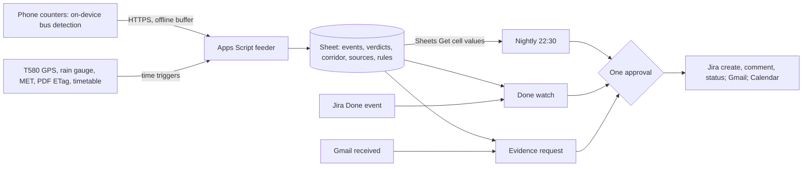

# Kept

Kept grades APU's Campus Connect LRT shuttle against its own published schedule, departure by departure, for the Logistics & Operations (LNO) shuttle desk. Phones clamped at the two boarding points detect buses on-device and send only counts and timestamps, and an Apps Script feeder adds Rapid Bus T580 GPS, the Sungai Kuyoh rain gauge and MET warnings to a Sheet. Every weekday at 22:30 a Gemini Enterprise workflow decides, for each departure that failed on 3 of its last 5 observed days, whether it was the operator's miss, a gap in the schedule's design, or external, then raises or updates a Jira issue: a fix request for the operator, or a service-change packet for the next schedule revision. When the desk moves an issue to Done, Kept watches that departure until five observed passes close it as held or the first failure reopens it; every writing run waits for one approval. Proposed track: Intelligent Automation & Digital Transformation. Rank and score: see the [ranking](/docs/ideas/00-ranking.md).

Contents:

1.  [At a glance](#at-a-glance)
1.  [Origins](#origins)
1.  [Problem and evidence](#problem-and-evidence)
1.  [How it works](#how-it-works)
    1.  [Signal to Sheet](#signal-to-sheet)
    1.  [Workflows](#workflows)
    1.  [Rule set](#rule-set)
    1.  [States and failure handling](#states-and-failure-handling)
1.  [Why people will use it](#why-people-will-use-it)
1.  [Why the crowd won't build it](#why-the-crowd-wont-build-it)
1.  [Scores](#scores)
1.  [Research plan](#research-plan)
1.  [Time to impact](#time-to-impact)
1.  [Demo and review](#demo-and-review)
1.  [Build plan](#build-plan)
1.  [Risks and kill criteria](#risks-and-kill-criteria)
1.  [See also](#see-also)

## At a glance

| Item                  | Detail                                                                                                                                                                                                                                                                                                           |
| --------------------- | ---------------------------------------------------------------------------------------------------------------------------------------------------------------------------------------------------------------------------------------------------------------------------------------------------------------- |
| Owner                 | LNO shuttle desk. **Inference:** LNO's public KB space covers APCard parking and smart meters, not the shuttle ([APU KB](/docs/research/apu.md#apu-knowledge-base-on-confluence)), so the first interview confirms who manages the Campus Connect contract                                                       |
| First users           | LNO desk staff; LRT Bukit Jalil commuters in the 07:30–09:00 and 16:45–18:45 waves                                                                                                                                                                                                                               |
| Track                 | Intelligent Automation & Digital Transformation: "connecting devices with useful actions" ([tracks](/docs/BRIEF.md#challenge-tracks))                                                                                                                                                                            |
| Trigger               | Schedule, weekdays 22:30 MYT; Jira Cloud event when a Kept issue moves to Done; Gmail "When an email is received" for evidence requests ([GE triggers](/docs/research/gemini-enterprise.md#triggers-and-schedules))                                                                                              |
| Live signal           | On-device bus detections and 60-second heartbeats from two team phones; T580 GPS each minute; rain gauge and MET warnings every 15 minutes; shuttle PDF ETag and timetable daily                                                                                                                                 |
| Connectors            | 1P Google Drive: Sheets Get cell values, live read of ledger and rule tab. 1P Gmail: event trigger; Send, Reply. 1P Google Calendar: Create event. 3P Jira Cloud Free: Done event trigger; federated search; Create issue, Create comment, Change issue status ([GE actions]). No MCP; Apps Script is the feeder |
| Decision              | Per recurring failed departure: operator miss, design gap, external, or unattributed; then raise, add evidence, or leave. Per Done issue: held or reopened                                                                                                                                                       |
| Action and approval   | Jira issues, comments and reopens; one Gmail digest and evidence replies; Calendar no-shuttle notices. One Approval step per writing run; runs that find nothing write nothing                                                                                                                                   |
| Reviewer self-trigger | Move any open Kept issue to Done on an invited Jira seat, or email "evidence 11 Nov 17:00–18:45" to the Kept inbox                                                                                                                                                                                               |

## Origins

All three cross-set scorers ranked Kept first and proposed folding the other two into it. The merge keeps Kept's grading loop and Done watch as the spine and takes from the others only what makes a verdict fairer or more actionable.

- **[Kept](/docs/ideas/opus/01-kept.md), the spine:**
  - Kept: the on-device counter, the Sheet ledger and its deterministic match, the nightly grade, Done → watch → reopen, Gmail evidence requests, the Friday late-and-weekend rule, and the Microsoft 365 mapping.
  - Changed: three workflows, not four. The seven daily peak checks are gone: a same-hour alert still waits for an approval click, the desk acts on patterns rather than single buses, and one scorer called four workflows heavy for three students. The feeder emails the team when a counter goes silent, and rain now also gates detector trust (R4).
  - Dropped: the crowd-check and name-collision claims, which cite no source.
- **[LastLink](/docs/ideas/astra/02-lastlink.md), rules R2 and R5:**
  - Kept: its distinct decision, which observed stop and time merits a service-change request, as the design-gap packet; its source boundaries (T580 is not the shuttle; a missing position is unavailable telemetry, never a cancellation; repeated samples of one departure are one item); per-source fresh, stale, failed or unknown; the outcome check after a change; its counterevidence; and the rules-only baseline its delivery contract asks for ([shared contract](/docs/ideas/astra/00-ranking.md#shared-delivery-contract)).
  - Dropped: volunteers logging by hand as the sensor, which every scorer named as its fatal risk; phone GPS; the unnamed "transport liaison"; 30-minute batches.
  - Verdict: strengthens. A design gap without a packet is one more complaint; with denominators, waves and counterexamples it is an input to the next schedule revision.
- **[Kuyoh Shuttle Sentinel](/docs/ideas/argon/02-kuyoh-shuttle-sentinel.md), rules R3 and R4:**
  - Kept: T580 corridor speed, MET warnings, and its per-window Green/Amber/Red state, renamed the corridor state that attribution reads; its halt-on-error, now "a failed attribution feed blocks an operator-miss verdict".
  - Changed: the Sungai Kuyoh rainfall gauge `0232901RF` replaces the water-level gauge `0232901WL`, which read 26.37 m against a 28.00 m Normal threshold on 3 November ([Infobanjir]) and is unlikely to reach Waspada (alert) in a week.
  - Dropped: live corridor advisories and relief-van calendar blocks, because the events are rare, no reviewer can trigger one, and a rival README already promises rain alerts ([rival repos]); the attendance grace window, which is Academic Administration's policy, not LNO's; ServiceNow, SharePoint, Slack and the preview MCP server; the opt-in geolocation probe.
  - Verdict: strengthens as attribution rules only. As a live advisory product it would add a second owner and a decision that may never fire.

## Problem and evidence

- **Reviews:** 13 of 58 low-star texts about APU mention the bus, shuttle, taxi or LRT, for example "the bus either doesn't come, comes too early, comes too late or when on time it's always full" (M Vertica route, 1 star, 13 Nov 2024), "expect long queue times at 8am and 5pm" (2 stars, 12 Nov 2024), and "Bus Service absolutely tak boleh pakai" (Malay: unusable; 1 star, 25 Sep 2026) ([shuttle research]).
- **Students:** "bus queues are insane in peak hour" (19 Jul 2025), and "if you have to be on campus at 9, make sure you're at the station by 820 or 830" (a 20 Apr 2026 reply in an 18 Apr 2026 thread) ([Reddit commute]). APRide exists because late classes and weekends break "the weekday shuttle rhythm" ([shuttle research]).
- **Counterevidence:** a January 2026 rider calls morning waits bearable, usually under 20 minutes, and a Parkhill resident reports 10–15 minutes in September 2026, against 30–60 minutes in a June 2025 account ([S2], [S4], [S6]). **Inference:** the pain is peak capacity and uncertainty, not universal delay, so Kept measures queue, left-behind and time to board separately and claims nothing it hasn't measured.
- **APU's own schedule disclaims the peaks** ([shuttle PDF], V1_20261022, effective 22 Oct 2026): "When the bus is full, it will depart"; "APU does not guarantee a seat at all times on every trip"; at peaks "the buses may not be able to arrive or depart following the published schedules"; the 20:45 and 21:45 APU → LRT buses carry "Limited space only".
- **Where the promise meets demand,** recounted from the [timetable feed] at 01:46 MYT on 4 Nov 2026 (ETag `c9d8d238…`, lecturer fields dropped, `ONL` rooms excluded ([room codes](/docs/research/apu.md#timetable-room-codes))) against the [shuttle API]'s 39 weekday APU → LRT trips:
  - 79, 77, 89 and 86 rooms release at 17:45 from Monday to Thursday this week (190 to 257 intake groups a day, recounted from the feed on 4 November): 5 minutes after the 17:40 bus, 15 before the 18:00.
  - 75 to 89 rooms start at 08:30, inside the unscheduled morning window.
  - Of on-campus sessions from 26 Oct to 22 Nov, 134 end at 20:30 or later, 130 of them at 21:30, which leaves only the limited 21:45 bus; 122 fall on weekends, when no shuttle runs, 60 of them on 21–22 Nov.
- **What exists:** APSpace offers bus tracking ([APU systems]); a 2023 review says its shuttle page "keeps on loading with no end" ([APSpace](/docs/research/competition.md#the-official-apspace-app)). **Inference:** the desk has complaints and stars, not a dated record of which departure failed, how often, and why.

[Reddit commute]: /docs/research/social.md#getting-to-campus-shuttle-lrt-bukit-jalil-and-traffic
[S2]: /docs/research/social.md#s2-a-former-student-names-classrooms-and-several-service-failures
[S4]: /docs/research/social.md#s4-a-rider-reports-bearable-morning-waits
[S6]: /docs/research/social.md#s6-a-parkhill-resident-describes-an-alternative-commute
[timetable feed]: https://s3-ap-southeast-1.amazonaws.com/open-ws/weektimetable
[shuttle API]: https://api.apiit.edu.my/transix-v2/schedule/active

## How it works

The feeder measures, the Sheet matches, and Gemini decides; no rider has to run anything.

### Signal to Sheet

- **Counters (unattended once clamped):** an old Android phone runs a GitHub Pages page with MediaPipe's EfficientDet-Lite0 detector, `categoryAllowlist: ["bus"]`, at about 2 frames a second ([MediaPipe]). A box that stays in the bay zone for 30 seconds is an arrival and its exit a departure; passing buses are ignored. Frames stay in memory; the page posts `{stop, arrived_at, departed_at, dwell_s, confidence, device_time}` and a 60-second heartbeat ([edge split](/docs/research/iot-and-network.md#edge-versus-cloud-processing)).
  - APU bay, 16:45–18:45: 12 published APU → LRT departures. LRT Bukit Jalil pick-up, 07:30–09:00: six 15-minute slots graded by gaps, because the PDF publishes no times there, though the shuttle API lists 11 nominal ones from 07:35 to 08:35.
  - Both windows are in daylight: sunrise is 06:57 and sunset 18:57 MYT on 5 Nov ([sun times]).
- **Taps (optional):** whoever is at the stop confirms a detection as "LRT shuttle" or "other bus" and flags "left full"; riders reach the page from a QR card and tap "joined queue" and "boarded". No location permission and no identity, only a random token that rotates daily.
- **Feeder (no Gemini):** T580 positions each minute in the windows, within data.gov.my's 4 requests a minute ([GTFS-R](/docs/research/data-sources.md#bus-and-train-positions-gtfs-realtime)); the rain gauge and MET warnings every 15 minutes ([MET](/docs/research/data-sources.md#met-malaysia-warnings)); the PDF ETag and the timetable daily, reduced to release waves. A failed fetch writes an error row with its HTTP status, never the last value. Every row is a live feed or a team phone, with no replays, as the [data ruling] allows.
- **Ledger:** a Sheet formula labels each published departure kept, late, early, missed, or not observed, so the desk can audit the measurement. A corridor column gives each 15 minutes a state: normal, slow (T580 under the rule tab's speed on the Bukit Jalil–TPM segment), wet (rain at the gauge), or unknown (no T580 on the segment; it runs every 50 minutes from 07:30 in the feed's `frequencies.txt` ([GTFS static])). A sources tab marks each feed fresh, stale, failed or unknown at read time.

[MediaPipe]: https://developers.google.com/edge/mediapipe/solutions/vision/object_detector/web_js
[sun times]: https://api.sunrise-sunset.org/json?lat=3.0559&lng=101.7000&date=2026-11-05&formatted=0&tzid=Asia/Kuala_Lumpur
[GTFS static]: https://api.data.gov.my/gtfs-static/prasarana/?category=rapid-bus-kl

### Workflows

1.  **Nightly decision (schedule, weekdays 22:30):** reads the day's verdicts, the last ten observed weekdays, corridor states, waves, the rule tab and open Jira issues; applies R2–R8; drafts all writes behind one Approval step.
2.  **Done watch (Jira event, polled every 5–10 minutes):** when the desk moves a Kept issue to Done, it drafts "Watch opened" with the last five observed days as the baseline; the nightly run then checks the departure each night.
3.  **Evidence request (Gmail event):** the desk forwards a complaint ("the 5:40 never came yesterday") or writes "evidence 5 Nov 17:00–18:45"; Gemini maps the text to departures and dates and drafts the verdict table with coverage and attribution, and one approval sends it.

### Rule set

The rule tab is editable, and its starting values are agreed with the desk in round 2. R1 is a Sheet formula; R2–R8 are the workflow's decisions.

| Rule         | What it decides                                                                                                                                                                                   |
| ------------ | ------------------------------------------------------------------------------------------------------------------------------------------------------------------------------------------------- |
| R1 Match     | Late after +5 minutes, missed after +15, and a gap over 15 minutes in the continuous window                                                                                                       |
| R2 Recur     | A slot recurs when it failed on 3 of its last 5 observed days; not-observed days don't count, and one departure on one day is one item however many riders tapped                                 |
| R3 Attribute | Operator miss: absent or late in a normal, dry window. Design gap: on time, or early and full, while a release wave (start: 50 rooms within 10 minutes) was still arriving. External: slow or wet |
| R4 Halt      | A failed or stale rain feed, or a failed T580 feed, makes the slot unattributed and holds it; an unknown road marks an operator miss "road unverified"; wet windows grade only confirmed buses    |
| R5 Packet    | A recurring design gap becomes one service-change packet: days observed out of published, waves, left-behind taps with n, counterexample days, and what remains uncertain                         |
| R6 Dedupe    | One open issue per slot and kind; new evidence becomes a comment; nothing new, no write                                                                                                           |
| R7 Watch     | Under watch, one observed failure reopens the issue; five observed passes close it as held                                                                                                        |
| R8 Gaps      | Fridays: next week's sessions ending after 19:15 or on weekends get one service-gap issue and Calendar notices naming T580 from TPM Carpark; a new PDF ETag pauses verdicts on changed routes     |

### States and failure handling

- **States:** a departure is kept, late, early, missed, not observed, or counter down. An issue moves candidate → raised → evidence added → Done → watching → held or reopened; unattributed slots stay candidates. A source is fresh, stale, failed, or unknown.
- **Counter offline:** events queue in IndexedDB and arrive flagged "late upload" with their device time; every row carries device and server time, so latency shows ([network visibility]). A heartbeat gap writes "counter down 17:52–18:04", never "missed". Counters send over mobile data, since campus Wi-Fi enrolment for headless devices is unknown ([campus Wi-Fi](/docs/research/iot-and-network.md#apu-campus-wi-fi)).
- **Platform:** schedules need a multi-region location, and credentials expire every 14 days, so refresh them on 10 Nov ([GE unattended](/docs/research/gemini-enterprise.md#what-runs-without-anyone-signed-in)). Event runs that fail with `RESOURCE_EXHAUSTED` aren't retried, so the nightly run also searches Jira for issues resolved since its last run, which also covers Jira's unlisted event names. The Approval step goes in through the visual editor, because natural language can't add one ([GE limits](/docs/research/gemini-enterprise.md#limits-that-bite-in-a-one-week-build)).
- **Day-one gate:** Create comment and Change issue status are documented GA Jira Cloud actions ([GE actions]), but LastLink is right that nothing is proven on this licence until its action list shows them ([platform constraints], F4). If status change is missing, Kept comments and a person reopens.
- **Quota:** one schedule plus a few event runs a weekday, against 160 assistant queries per user per day on Standard; measure ten runs and simplify if use passes 80% of the pool ([platform constraints], F3).

[network visibility]: /docs/research/iot-and-network.md#what-a-judge-can-see-of-the-network
[platform constraints]: /docs/research/gemini-enterprise.md#platform-constraints-and-design-consequences

## Why people will use it

- **The desk's loop:** forward a complaint and get a dated verdict reply for one approval click; a Monday digest of recurring gaps; a Jira queue shaped like APU's Virtual Help Centre on Jira Service Management ([APU systems]); and a watch that says whether a fix held, with nobody checking by hand.
- **The schedule revision:** APU does revise it; the 2024 M Vertica reviewer later updated the review to say more shuttle times were added ([shuttle research]). **Inference:** the version after V1_20261022 can cite packets rather than reviews.
- **Riders:** nothing to install or keep running. A QR scan shows "last LRT shuttle left 6 min ago; 2 of the last 5 left full", read live from the ledger, and one calendar subscription carries "no shuttle for this session" notices with the T580 fallback, in Google Calendar or Outlook.
- **On APU's Microsoft 365 stack:** Outlook replaces Gmail and Google Calendar, a SharePoint list replaces the Sheet, Teams carries the digest, and an LNO request type in APU's Jira Service Management replaces Jira Free; the workflow and rule tab carry over. **Inference:** that is configuration plus one ingest function, and it can't be shown this week, since the Microsoft 365 developer sandbox is closed to most students and ships sample data ([sandboxes](/docs/research/gemini-enterprise.md#free-sandboxes)).
- **After the team graduates:** LNO owns the rule tab, a mains-powered mount with its own SIM covers the bay, and GDGoC APU maintains the open-source counter page.

## Why the crowd won't build it

- **Absent tier:** "Shuttle, bus or parking" is 0.5% of 780 simulated ideas, and those are GPS trackers on Pub/Sub and BigQuery ([crowd clusters](/docs/research/competition.md#clusters-and-shares), [crowd tiers](/docs/research/competition.md#saturation-tiers)); Devpost holds 79 `campus shuttle` and 15 `shuttle tracker` matches ([crowd counts](/docs/research/competition.md#crowding-counts)). None of the briefing's examples touches transport ([briefing ideas](/docs/research/competition.md#ideas-shown-at-the-briefing)).
- **Structural misses:** only 1% of simulated ideas combine an unattended run, a named owner and a measured baseline, and 3% use public feeds ([crowd misses](/docs/research/competition.md#what-the-crowd-structurally-misses)); Kept has all four.
- **Substitutes answer "where is the bus", not "did the promise hold":**
  - APSpace's bus tracking ([APU systems]); `nacyng-netizen/apu-smart-shuttle`, a README for a GPS tracker with ETAs and rain alerts and no Gemini Enterprise part ([rival repos]); and `Kibbs-dibs/BUSSYSTEM`, with demand forecasting, camera occupancy and complaint triage ([APU tools]).
  - Transit's crowdsourcing already gives campuses positions and disruption notices, and Jira Service Management already reopens closed items ([substitutes](/docs/research/competition.md#existing-substitutes), C2 and C3). Neither reopens because a bus was seen failing at the stop.
  - A spreadsheet log, which the research plan tests Kept against.

## Scores

**81.6 / 100, rank 1 of 8** in the [cross-set ranking](/docs/ideas/00-ranking.md). Three independent scorers rated this doc on the [unified matrix](/docs/ideas/00-ranking.md#scoring-matrix): an NTT DATA forward deployed engineer (FDE), an APU School of Technology IoT lecturer, and a Google Cloud advocate who is also an APU student. The used score is their mean, except day-to-day workflow and theme, which take the lowest. The reason shown is the lowest scorer's. Per-scorer totals: FDE 78.2, lecturer 86.6, advocate 85.8. All three passed it on every gate. The source ideas scored Kept 81.5, LastLink 50.9, Kuyoh Shuttle Sentinel 60.2 on the same matrix before the merge.

| Component           | Weight | FDE | Lecturer | Advocate | Used | Lowest scorer's reason                                                                                                                                                                                               |
| ------------------- | -----: | --: | -------: | -------: | ---: | -------------------------------------------------------------------------------------------------------------------------------------------------------------------------------------------------------------------- |
| Impact              |     14 |   4 |        4 |        4 |    4 | Named LNO shuttle desk (unconfirmed), 36+ countable departures, a verdict that changes a Jira queue, and a measurable before/after in desk minutes and kept rate.                                                    |
| Connectors          |     14 |   4 |        5 |        4 | 4.33 | Drive/Sheets live read, Gmail trigger and send, Calendar write, Jira Cloud trigger plus create/comment/status each do a real job; no MCP; Jira Done event name is unlisted (self-flagged, nightly search covers it). |
| Day-to-day workflow |     14 |   4 |        5 |        5 |    4 | Weekday 22:30 schedule plus Jira and Gmail events, editable R1-R8 rule tab, error rows and heartbeat states, one approval; weakened because a teammate must clamp the counter each window.                           |
| Research            |     14 |   4 |        4 |        5 | 4.33 | 13 of 58 low-star texts mention transport (verified in social.md), APU's own PDF disclaims peaks, and interviews and 36-54 items are reachable, but LNO access is unproven.                                          |
| Time to impact      |     14 |   3 |        4 |        3 | 3.33 | No APU system change and a dated 3/6-month plan with owners, but needs a fixed mount, camera permission and LNO ownership, and the counter stops when the team stops.                                                |
| Theme               |     10 |   5 |        5 |        5 |    5 | Real camera on-device detector, offline IndexedDB buffer with late-upload flags, per-row latency and heartbeat gaps make IoT and network load-bearing.                                                               |
| Originality         |     10 |   4 |        4 |        4 |    4 | Grading a promise against a schedule is absent from the crowd baseline, though shuttle is a crowded topic and one rival tracker exists.                                                                              |
| Buildability        |      5 |   3 |        3 |        4 | 3.33 | Phone detector, two stop sites, seven feeds, three workflows and a 36-item scoring in 6 days is heavy for three people, though no card or boards.                                                                    |
| Demo                |      5 |   4 |        4 |        5 | 4.33 | Reviewer can move a Jira issue to Done or email an evidence request; video can show a live row landing and a reopen.                                                                                                 |

## Research plan

- **Round 1, 4–5 Nov,** about the last real time it happened, Mom Test style ([interviews](/docs/research/judging.md#interviews)):
  - An LNO shuttle-desk staff member, at the LNO counter: "The last complaint about a departure: how did you check it, how long did it take, what did you tell the operator?" Then: is the morning promise the PDF's continuous window or the API's 11 times?
  - Three riders in the 17:45 queue at the APU bay, and one in the 08:00 wave at LRT Bukit Jalil.
  - The BUSSYSTEM author, an APU student who has built a shuttle project ([APU tools]).
- **Round 2, 6–7 Nov:** LNO again on Fri 6 Nov with the first packet, to set tolerances and the wave threshold; a student whose class ends at 21:30; a student with weekend classes. Record refusals and contradictions.
- **Timed observation, before anything is built:** on 4 Nov 16:45–18:45 at the APU bay, two observers log every departure (time, full or not, rough count left behind) and three teammates time join-to-board; on 5 Nov 07:30–09:00 at LRT Bukit Jalil, the same by gaps. For the desk, minutes to verify one complaint, observed if possible, otherwise reported and labelled so ([baseline](/docs/research/judging.md#baseline-and-before-and-after-metric)).
- **Items:** 12 evening departures and 6 morning slots on 5 and 6 Nov, 36 scored on 7 Nov; 10 Nov adds 18 for 54 ([accuracy](/docs/research/judging.md#measuring-an-agents-accuracy-honestly)).
  - Positive class: "failed" means missed after +15 minutes, left full with riders behind, or a gap over 15 minutes in the continuous window. Recall leads, because a missed failure costs more than a false alarm.
  - Labels: two observers per window, independently, with disagreements recorded. Detector events are scored apart from verdicts, so counter errors and rule errors don't mix.
  - Baseline: the same items through rules plus a template with no Gemini step. Gemini's classification and packet stay only if they save desk review time without adding errors.
  - Report: confusion matrix, precision, recall, n and Wilson 95% intervals with the test date; with few positives among 36 items, say how wide the intervals are.

## Time to impact

The plan maps to GOV.UK's discovery, alpha and private beta ([phases](/docs/research/judging.md#mapping-3-and-6-months-to-delivery-phases)).

- **By 4 Feb 2027:** LNO owns the workflow and rule tab and reads the weekly digest. A fixed counter at the bay grades the 36 APU → LRT departures from 10:35 to 18:55; the 19:15, 20:45 and 21:45 stay "not observed" until a dusk and after-dark test passes. Complaints are verified by forwarding, and the next schedule revision carries a packet for at least the 17:40/17:45 collision.
- **Measured by 4 May 2027, against the 4–6 Nov baseline:** the kept rate of observed departures; riders left behind per evening peak; the median join-to-board wait in the 17:45 wave; desk minutes per complaint verified; the share of Done issues still held after the watch; precision and recall, re-measured monthly on 30 departures. The stack runs on Outlook, SharePoint and APU's Jira Service Management.
- **Owners:** the LNO shuttle desk (business owner), APU ICT (seats, connectors, Microsoft 365), APU's data protection officer (notice and retention), and the team, then GDGoC APU (counter page).
- **Assumptions:** LNO says yes in round 1 or 2; facilities allow a mount; a Gemini Enterprise seat continues after the trial; APU grants written permission for the PDF, the shuttle API and the timetable feed ([APU terms]).

## Demo and review

Video, about 3:45, recorded from the live system with capture dates on screen ([minute plan](/docs/research/judging.md#minute-plan)):

1.  **0:00–0:15:** slate "Recorded 5–10 Nov 2026 from the live system" and the one-liner.
2.  **0:15–0:40:** 89 rooms release at 17:45 on 4 Nov against the 17:40 bus; a rider quote; the stopwatch baseline.
3.  **0:40–1:15:** a box on a bus at the bay and the row landing with device and server time; airplane mode, then "late upload".
4.  **1:15–1:55:** the nightly Runs trace reads the ledger, classifies 17:40 as a design gap and builds the packet; the approval; the Jira issue and digest.
5.  **1:55–2:25:** the desk moves it to Done; "Watch opened" minutes later; the next failing night reopens it.
6.  **2:25–2:45:** a labelled, controlled cut of the feeder's rain fetch turns a slot "unattributed", not "operator miss".
7.  **2:45–3:15:** precision and recall with n, baseline against after, and the dated plan with owners.
8.  **3:15–3:45:** what the research changed, how the team worked, the app URL, the access request and the repo.

How reviewers fire it during 11–14 Nov, with approvals answered 08:00–24:00 MYT by a published rota:

- **Jira:** invited to the team's Jira Free site (2 of 10 seats) and the Gemini Enterprise app, a reviewer moves any open Kept issue to Done; "Watch opened" is drafted within about 10 minutes, and that night's run comments or reopens.
- **Email, no seat needed:** "evidence 11 Nov 17:00–18:45" sent to the Kept inbox returns the verdict table after one approval.
- **Network:** the counter page with `?stop=REVIEW` posts a test tap whose row shows its latency and is excluded from every metric.
- **Run history:** shared users see only their own runs, so the README and video carry the owner's Runs tab for 5–10 Nov ([GE runs](/docs/research/gemini-enterprise.md#run-history-as-evidence)). Test access with a non-team account on 9 Nov, because federated Drive search covers only the searcher's domain ([GE accounts]).

## Build plan

The riskiest pieces come first: the licence and Jira actions, then counter accuracy, then LNO. No card: phones, the public model, GitHub Pages, Apps Script, a Sheet in the licensed Workspace domain, and Jira Cloud Free.

| Day        | Work                                                                                                                                                                                                                                                                                                                                                    |
| ---------- | ------------------------------------------------------------------------------------------------------------------------------------------------------------------------------------------------------------------------------------------------------------------------------------------------------------------------------------------------------- |
| Wed 4 Nov  | Ask the organisers about the licence account type and for written permission on the PDF, shuttle API and timetable; ask LNO in person for an interview and a spot at the bay. Create the Jira site; when the licence lands, check the Jira trigger's **Preview results** and action list first. Ledger and counter page v0. Stopwatch baseline at 16:45 |
| Thu 5 Nov  | Counters live at 07:30 (LRT) and 16:45 (bay) with two observers; feeder for rain and MET; nightly workflow v1 reads and drafts only; interview round 1                                                                                                                                                                                                  |
| Fri 6 Nov  | Second counted day; Approval step, Jira create and comment, the digest, R8 with Calendar; the T580 decoder; LNO round 2                                                                                                                                                                                                                                 |
| Sat 7 Nov  | Score the 36 items and the rules-only baseline; tune dwell, zone and tolerances; run Done → watch → reopen end to end on a real issue; README draft                                                                                                                                                                                                     |
| Sun 8 Nov  | Deepavali. README, deck and diagram; confirm every member has registered before registration closes                                                                                                                                                                                                                                                     |
| Mon 9 Nov  | Holiday, graded as no service; record the video; test reviewer access with a non-team account                                                                                                                                                                                                                                                           |
| Tue 10 Nov | Count both windows; refresh schedule credentials; submit early in the day; approval rota through 14 Nov                                                                                                                                                                                                                                                 |

- **Fallbacks:** camera access inside Apps Script's sandboxed iframe is unverified, so the page lives on GitHub Pages and posts `text/plain` to `doPost` to avoid a CORS preflight (**Inference**). If Apps Script can't reduce the 17 MB timetable in one run, a free GitHub Actions job writes a small waves file daily. T580 comes last, because R4 grades without it as "road unverified".

## Risks and kill criteria

- **LNO never engages and no fixed mount is allowed,** the scorers' main fatal risk: ask in person on 4 Nov. The evidence builds in the team's Jira either way, and interviews and items don't depend on LNO. A clamp, not a person, holds the counter: setup and takedown cost one teammate about 10 minutes a window, and a commuting teammate carries the morning phone. Conceded: without LNO's mount, Kept stops when the team does.
- **Camera permission:** ask LNO and security on 4 Nov. Until then a teammate holds the phone in the queue with a printed notice, framed on the bay; the LRT pick-up counter stands on the public footpath.
- **Detector errors:** both windows are in daylight, which leaves rain and glare. R4 grades wet windows only from confirmed detections, the bay zone and dwell threshold ignore passing buses, and detector precision and recall are published apart from verdicts.
- **Kill criteria:**
  - **4–5 Nov:** if both baselines show every departure kept and nobody left behind, the problem isn't there this week; stop.
  - **5 Nov:** if no camera position is allowed at either stop, the IoT core fails; stop.
  - **6 Nov:** if LNO says departure evidence would change no decision, LastLink's strongest objection, drop the service-change claim and pitch the operator-miss loop with the owner unconfirmed.
  - **7 Nov:** if detector recall on bus events is under 0.9 (a proposed bar), grade only confirmed detections; if those cover under half of published departures, publish observer counts and no kept rate.
- **Privacy (PDPA):** frames never leave the phone, the allowlist keeps only `bus`, and nothing detects faces or people, so no biometrics; taps are anonymous, and raw taps are deleted after 30 days; prompts carry no personal data, and lecturer fields are dropped at ingest ([timetable privacy](/docs/research/apu.md#personal-data-in-the-timetable-feed)). **Inference:** a student prototype likely falls outside PDPA's commercial scope, but an APU deployment wouldn't, so the DPO signs off before month 3 ([PDPA](/docs/research/judging.md#malaysias-pdpa-and-the-2024-amendment)).
- **Permissions:** APU's Terms of Use ask for permission before any use of site contents ([APU terms]); get it in writing from the organisers and store each file's URL and fetch time.
- **Fairness to the operator:** the PDF calls times estimated and lets full buses leave, so early-and-full is a capacity signal, never an operator fault; R3 and R4 keep rain and road out of the operator's column.
- **Feeds and accounts:** a feed that fails during assessment shows its error row, and verdicts read "not observed" or "unattributed", never a cached value; Infobanjir is undocumented HTML with no published terms ([Infobanjir]); a licence on consumer accounts would break Drive and Gmail ([GE accounts]).
- **A rival shuttle entry:** at least one tracker is coming ([rival repos]), so the first 15 seconds say "Kept grades the promise and closes the loop with the desk".

## See also

- Source ideas: [Kept](/docs/ideas/opus/01-kept.md), [LastLink](/docs/ideas/astra/02-lastlink.md), and [Kuyoh Shuttle Sentinel](/docs/ideas/argon/02-kuyoh-shuttle-sentinel.md).
- [Social research](/docs/research/social.md), [competition](/docs/research/competition.md), [APU documents and systems](/docs/research/apu.md), [public data sources](/docs/research/data-sources.md), [Gemini Enterprise](/docs/research/gemini-enterprise.md), [IoT and network](/docs/research/iot-and-network.md), and [judging](/docs/research/judging.md).
- The [Campus Connect schedule V1_20261022][shuttle PDF], the [shuttle page](https://www.apu.edu.my/shuttle-services-campus-connect), and the [data ruling].

[shuttle research]: /docs/research/social.md#shuttle-buses-and-the-lrt-last-mile
[shuttle PDF]: https://publicwebsite-media.apu.edu.my/assets/2026-10/2026Oct22_APU-SHUTTLE-SERVICES.pdf
[APU systems]: /docs/research/apu.md#systems-apu-runs
[APU tools]: /docs/research/competition.md#repositories-and-adoption
[APU terms]: /docs/research/apu.md#terms-of-use-and-robotstxt
[rival repos]: /docs/research/competition.md#public-repositories-so-far
[Infobanjir]: /docs/research/data-sources.md#river-level-at-lrt-bukit-jalil-public-infobanjir
[GE actions]: /docs/research/gemini-enterprise.md#actions-and-write-back
[GE accounts]: /docs/research/gemini-enterprise.md#edition-and-account-limits
[data ruling]: /docs/CONTEXT.md#decisions-so-far
