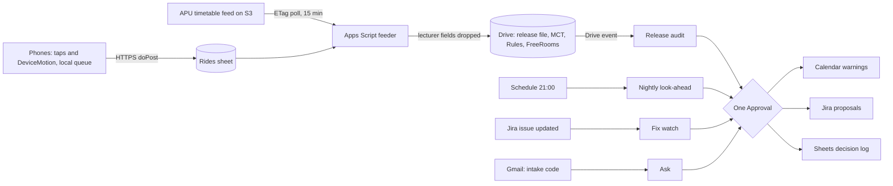

# Sempat

Sempat (Malay for "make it in time") checks each week of timetable APU publishes against how long class changes really take, timed on phones in APU's lifts and stairwells, before anyone has to live it. For APU's Schedulers office, a new release of APSpace's public timetable feed triggers an audit: every room change with 15 minutes or less between sessions is judged against the measured minimum connecting time, by lift and by stairs. One approval then releases calendar warnings with the faster route to the affected intakes, and Jira room-swap proposals to the office, impossible-by-lift changes first. It measures before it builds: a kill line set in advance stops it on 5 November if the lifts cope. Proposed track: Intelligent Automation & Digital Transformation. Rank and score: see the [ranking](/docs/ideas/00-ranking.md).

Contents:

1.  [At a glance](#at-a-glance)
1.  [Origins](#origins)
1.  [Problem and evidence](#problem-and-evidence)
1.  [How it works](#how-it-works)
    1.  [Connectors and channels](#connectors-and-channels)
    1.  [Verdicts and states](#verdicts-and-states)
    1.  [Failure handling](#failure-handling)
    1.  [Measurements a team of three can collect](#measurements-a-team-of-three-can-collect)
1.  [Why people will use it](#why-people-will-use-it)
1.  [Why the crowd won't build it](#why-the-crowd-wont-build-it)
1.  [Scores](#scores)
1.  [Research plan](#research-plan)
1.  [Time to impact](#time-to-impact)
1.  [Demo and review](#demo-and-review)
1.  [Build plan](#build-plan)
1.  [Risks and kill criteria](#risks-and-kill-criteria)
1.  [See also](#see-also)

## At a glance

| Item                  | Design                                                                                                                                                                                                          |
| --------------------- | --------------------------------------------------------------------------------------------------------------------------------------------------------------------------------------------------------------- |
| Owner                 | APU's Schedulers office, Block A, Level 7, which generates and publishes programme schedules ([Scheduler User Guideline], [Campus Facilities and Navigation Guide]); unconfirmed until the 5 November interview |
| First users           | Students in the 662 intake groups with a tight room change in the week of 2–8 November, those who can't take the stairs first; class reps, who post the calendar link                                           |
| Track                 | Intelligent Automation & Digital Transformation                                                                                                                                                                 |
| Trigger               | A new feed release (ETag change, polled every 15 minutes; about weekly); a nightly look-ahead at 21:00, Sunday to Thursday; a Jira status change; an email naming an intake                                     |
| Live signal           | Team and volunteer phones timing lift waits, rides, stairs and spine walks (taps plus DeviceMotion ride detection), queued through lift dead zones                                                              |
| 1P connectors         | Google Drive with Sheets actions (event trigger, read, write); Google Calendar (write); Gmail (event trigger, reply)                                                                                            |
| 3P connectors         | Jira Cloud Free (read, write, event trigger), mirroring APU's Jira Service Management help centre; no custom MCP                                                                                                |
| Decision              | Does each room change fit its gap at the measured 75th percentile, by lift and by stairs, and if not, which same-slot room swap clears it for every intake in the session                                       |
| Action and approval   | One Approval step per run releases the batch: Calendar warnings on team-owned per-intake calendars, Jira proposals, a Sheets decision log                                                                       |
| Reviewer self-trigger | Log a test lift ride from the README's QR code, subscribe to a pilot calendar, or email an intake code to the Sempat inbox                                                                                      |
| Preconditions         | Written APU permission to use the feed, requested in `#help-desk` on 4 November; the lecturer fields `NAME`, `SAMACCOUNTNAME` and `LECTID` dropped at ingest                                                    |

## Origins

- **[Sempat](/docs/ideas/opus-01/04-sempat.md) leads** (Pass A mean 77.0). Kept: the measured minimum-connecting-time (MCT) table checked against every release, its verdicts including "not enough evidence", the cheapest-first fix ladder, the four connectors, the phones, and one approval per run. Changed: the transfer count is corrected (see [Problem and evidence](#problem-and-evidence)); the sprint is replanned for three people; a kill line fixed before measuring replaces "a clean result is still evidence"; proposals rank impossible-by-lift first; a fix now needs fresh evidence before it counts. Dropped: the fourth teammate.
- **[Timetable & HVAC Reconciler](/docs/ideas/argon/03-timetable-hvac-reconciler.md)** gives two rules. Its back-to-back physical and online check becomes the mode-switch verdict, because it is a feasibility problem the same engine finds (75 that week); its tutorial-group prefix check becomes a guard that stops a renamed code from silently orphaning a calendar. Its weekly release diff was already Sempat's release step. Dropped: the 4-hour gap rule (186 such gaps that week, but two scorers read them as deliberate, and nobody would fix them after publication); the HVAC half, since no post says empty rooms run air conditioning, one says it's usually off, and campus energy is the most saturated crowd cluster at 10.5% ([competition](/docs/research/competition.md#saturation-tiers)); APIMS and Open-Meteo, because a station 5.9 km away says nothing about a room; the QR check-in; ServiceNow and SharePoint, which duplicated Jira; and the preview custom MCP on the critical path.
- **[AccessRelay](/docs/ideas/astra/03-accessrelay.md)** gives its state discipline. Acknowledged isn't fixed and an offered room isn't access, so a swap counts only once the feed shows it and a timed trip confirms it. A stale or outage-reported lift reads "unknown", never a cached "fits". Its kill rule (reject the product if a checklist or call gives the same outcome) is adopted, and its step-free framing sets proposal priority. Dropped: the outage case tracker as the core (no APU cases, rare events, and every scorer found its workflow thin), camera observations of signage, and its second owner.

## Problem and evidence

- **One fixed gap:** in the live [feed][tt] (ETag `c9d8d238…`, unchanged since 28 October, fetched 4 November), the week of 2–8 November has 1,377 room changes: consecutive sessions of one intake group on one day, both in `Block-Level-Room` rooms, with 15 minutes or less between them. 1,366 are exactly 15 minutes and 11 are 10, across 662 of the 933 intake groups with two or more sessions on a day. Because sessions are shared, they are 534 distinct moves. 958 change block, and 1,044 cross blocks touching floor 4 or above, or climb three or more floors in one block. 255 cross-block changes start at 10:45 and 223 at 15:45; on 5 November, 24 rooms in Block B and 24 in Block D start a class at 10:45. **Computed** for this doc with the source idea's definition, whose 1,441 also counted 64 pairs in the same room; schema and change behaviour are in [APU](/docs/research/apu.md#apspace-timetable-feed).
- **Three blocks carry it:** B has 62 rooms on levels 1–9, D 52 on levels 6–9, and E 34 on levels 5–9 ([APU](/docs/research/apu.md#timetable-room-codes)); 1,033 of the 1,377 changes stay within those three (computed).
- **Nobody plans for travel time:** the Scheduler User Guideline (version 8, edited 3 November 2026) covers intakes, dates, approvals and publishing. Its clashes are date conflicts, and "room", "venue" and "travel" don't appear in it (read 4 November). Solvers treat travel as standard: UniTime counts a distance conflict when travel exceeds the break, and ITC 2019 stores a travel time per room pair ([UniTime], [ITC 2019]). **Inference:** rooms are assigned on a uniform 15-minute assumption; who assigns them is the first interview question.
- **Published weeks can be checked ahead:** the feed was last written on 28 October and answers conditional GETs with `304` ([APU](/docs/research/apu.md#timetable-feed-change-behaviour)). The source idea's backtest over [scheduleDB]'s history (85 commits, 22 August 2024 to 29 October 2026, count re-checked) found weeks published 3–19 days ahead and no session's time or room changed across seven releases; that diff isn't re-checked here. Students' "time table changes every week" reaches them by announcement ([social](/docs/research/social.md#timetable-churn-and-a-compressed-calendar)), not through the feed.
- **The pain evidence is thin:** on the other platforms, lifts appear "low in these sources", with two lift-specific items and seven overcrowding mentions, ranked 10th of 15 themes ([social](/docs/research/social.md#lifts-stairs-and-crowding), [ranking](/docs/research/social.md#other-platforms-theme-ranking)). On Reddit they come up in 4 threads, two about the campus, in passing, and "no thread measured waits or described specific class changeovers" ([social](/docs/research/social.md#lifts-laundry-and-deposits)). X held no first-hand APU lift complaint among 550 posts ([social](/docs/research/social.md#apus-footprint-on-x)).
- **What there is:** one of the research's four strongest APU-specific signals, "most of the student is climbing stairs to 8,9 floor. A block have 9 floor 15classes a floor only two lift. Lift always full" (18 likes on APU's orientation reel, 27 October 2026) ([social](/docs/research/social.md#lifts-stairs-and-crowding), [ranking](/docs/research/social.md#other-platforms-theme-ranking)); the feed has 15 timetabled rooms on each of Block D's levels 7 and 8 (computed). Also "APU if you're reading this fix your damn elevators lah" (54 points) ([social](/docs/research/social.md#lifts-laundry-and-deposits)). **Inference:** demand is unproven; what's certain is a timetable built on one gap nobody has timed. Sempat's first deliverable is the timing, and the kill line in [Risks and kill criteria](#risks-and-kill-criteria) decides from it.
- **Who is hit hardest, by analogy only:** a disabled student elsewhere: "the lifts are tiny and often broken and full of undergrads… I am sometimes late to class" ([social](/docs/research/social.md#lifts-stairs-and-crowding)); a wheelchair user at an unnamed university who joined class by Zoom outside the hall for six weeks until a room change ([social](/docs/research/social.md#s8-a-lift-outage-leaves-a-student-outside-the-lecture-hall)); a wheelchair user at Miami University who kept missing class to unreliable elevators ([Miami Student]). The fix in the second case, a room change, is Sempat's cheapest office action. No APU step-free case is known.
- **Mode switches:** 75 changes that week put an online session within 15 minutes of a physical one, 62 of them online first (computed). All 2,692 online rows say `LOCATION` "APU CAMPUS" (computed; [APU](/docs/research/apu.md#timetable-room-codes) notes the field). The Reconciler cites a first-week student who skipped a class "due to physical and online confusion" ([attendance worry thread]); Reddit refused automated reads on 4 November, so the quote isn't re-checked.
- **Workarounds:** stairs, lateness, or nothing. At least 26 repositories read the feed to copy sessions into calendars or chat; none times a transfer or tells timetabling anything ([APU](/docs/research/apu.md#who-already-uses-the-timetable-feed), [competition](/docs/research/competition.md#apu-student-built-tools)).

[tt]: https://s3-ap-southeast-1.amazonaws.com/open-ws/weektimetable
[Miami Student]: https://www.miamistudent.net/article/2026/10/miami-university-elevators-ada-wheelchair-mobility-accessibility
[attendance worry thread]: https://www.reddit.com/r/malaysiauni/comments/1vctvfq/

## How it works

1.  **Signal (phones):** a GitHub Pages page. The student taps "at the lobby"; the page detects the ride's start and stop from DeviceMotion's vertical acceleration and tells lift from stairs; the student taps "arrived". Extra taps record "car passed full" and "lift out of service". DeviceMotion works in Chrome on Android and Safari on iOS after a prompt ([IoT](/docs/research/iot-and-network.md#phone-and-laptop-sensors-in-the-browser)). Only event times, mode, block and floors leave the phone; raw traces don't, since a gait trace could be biometric data under the 2024 PDPA amendment ([judging](/docs/research/judging.md#malaysias-pdpa-and-the-2024-amendment)).
1.  **Network:** each event waits in local storage until the connection returns, carrying device, send and server times, so a lift's dead zone shows row by row. The poll log records each `304` and its latency, and the Runs tab the Drive event delay ([IoT](/docs/research/iot-and-network.md#what-a-judge-can-see-of-the-network)).
1.  **Feeder (Apps Script in the licensed Workspace domain):** `doPost` appends rides to the Rides sheet ([Gemini Enterprise](/docs/research/gemini-enterprise.md#phone-or-board-to-google-sheets)). A time trigger polls the feed with `If-None-Match`. On a new ETag it drops the three lecturer fields before anything is stored, de-duplicates co-taught rows, diffs against the last release, and computes every room change and mode switch with its facts: gap, blocks, floors, slot, and rooms releasing per block. It lists rooms with no timetabled class for each session, runs the code-drift guard, and writes `release-<date>-<etag>.csv` to a watched Drive folder. Storage is one Sheet in that domain with Rides, Transfers, MCT, Rules, FreeRooms, poll log and decision log tabs. At 20:30 it rebuilds the MCT table: per block and load level, the count, median, 75th percentile and its upper bound, and the newest trip; stair pace per floor; spine walks per block pair.
1.  **Workflows (Gemini Enterprise):** "Sempat release audit" (Drive event) reads the release, MCT, Rules, FreeRooms and open Jira issues, assigns verdicts, groups changes by session across intakes, picks up to three swap rooms that clear every intake without breaking another change, skips duplicates of open issues, and drafts warnings and proposals. "Sempat nightly look-ahead" (schedule) re-judges tomorrow on the refreshed MCT and advances proposal states. "Sempat fix watch" (Jira event) records a Done. "Sempat ask" (Gmail event) drafts one intake's audit as a reply.
1.  **Rule set (Rules tab, owner-editable):** the margin; trips needed for a warning (5) and a proposal (15); peak windows; room types never proposed (labs, suites, auditoriums); blocks in scope (B, D and E for the pilot); staleness (30 days); the outage and mode-switch rules; the drift halt.
1.  **Action:** one Approval step per run, because connector writes "require human review" and scheduled runs that affect others pause for approval; it's added in the UI, since prompts can't add one ([Gemini Enterprise](/docs/research/gemini-enterprise.md#what-runs-without-anyone-signed-in), [limits](/docs/research/gemini-enterprise.md#limits-that-bite-in-a-one-week-build)). The approver sees counts and each item: new proposals, new and withdrawn warnings. The team's operations lead approves in the pilot, a duty scheduler after handover.

What the office is asked for, cheapest first, and never a slot move: nothing (student warnings go out anyway); a same-slot room swap, proposed at least 3 days ahead, only for cells with 15+ trips and only if it breaks no other intake's change, with capacity left to the office; then a travel-time matrix per block and floor pair in the form solvers take.

### Connectors and channels

| Connector                        | Type | Mode                       | Job                                                                                                                 |
| -------------------------------- | ---- | -------------------------- | ------------------------------------------------------------------------------------------------------------------- |
| Google Drive with Sheets actions | 1P   | Event trigger, read, write | A release file starts the audit; Get cell values on Transfers, MCT, Rules, FreeRooms; Update cell values on the log |
| Google Calendar                  | 1P   | Write                      | Create, update and delete warning events on per-intake public calendars; at APU, Outlook's create and update event  |
| Gmail                            | 1P   | Event trigger, write       | Receives intake questions; replies with that intake's audit                                                         |
| Jira Cloud Free                  | 3P   | Read, write, event trigger | Searches open issues; creates issues, comments and links, changes status; an issue update starts the fix watch      |

- **Platform facts:** these actions and triggers are listed as GA ([Gemini Enterprise](/docs/research/gemini-enterprise.md#actions-and-write-back), [triggers](/docs/research/gemini-enterprise.md#triggers-and-schedules)). Drive, Gmail and Calendar need a Workspace account in the licensed domain, and federated Drive search reads only that domain's files ([Gemini Enterprise](/docs/research/gemini-enterprise.md#edition-and-account-limits)).
- **Students connect nothing:** the workflow writes only to team-owned public calendars, one per pilot intake. Google Calendar users add it from a link; APU Microsoft 365 Outlook and Apple users subscribe to its ICS address. Events appear only on days with a flagged change, so the calendar copies no classes. **Inference:** Outlook refreshes subscribed feeds every few hours, so warnings go out the evening before.
- **Not verified:** whether Calendar can write to a secondary calendar, whether one Approval covers every write that follows, and which Jira events the trigger exposes; all three are tested on 4 November. If Calendar fails, the feeder renders verdicts as ICS files on GitHub Pages and Calendar drops out.

### Verdicts and states

- **Verdicts per room change:** fits; stairs only; impossible by lift (the step-free failure, ranked first); impossible either way; not enough evidence (fewer trips than the rule); unknown (lift reported out of service with no fresh trips since, or newest trip past the staleness rule); mode switch (a student warning only, never a proposal, naming the nearest room with no timetabled class on that floor, worded as "no timetabled class", never "free").
- **Proposal states:** Proposed (approved, in Jira) → Accepted (the office marks Done) → Published (a later release shows the new room) → Verified (a timed trip on the new move fits). A release that doesn't show a promised room reopens the issue, citing its ETag; "Won't do" leaves the student warning up. Only Verified counts in the impact numbers.

### Failure handling

- **Feed fails:** a non-2xx status or timeout writes an error row, no audit runs, and the poll log and Runs tab show it. No cached copy is used. If APU refuses permission or closes the feed, Sempat stops and says so.
- **Codes drift:** if a release renames a tutorial-group prefix (APU's KB documents a 2021 switch from `T1` to `G1` that broke cached selections ([KB prefix change])), drops a subscribed intake, or changes a field, affected calendars get one event saying the intake can't be checked, citing the release, and the team gets a Jira task.
- **Phones go quiet:** cells age into "unknown" at the staleness rule; nothing inherits an old "fits".
- **Platform:** quota failures on event runs aren't retried, so the nightly run re-reads the latest release and the team checks Runs daily; credentials expire every 14 days and are refreshed before 11 November. Unapproved drafts stay visibly pending ([Gemini Enterprise](/docs/research/gemini-enterprise.md#what-runs-without-anyone-signed-in)).
- **The AI step earns its place:** each audit also logs the rules-only result. Gemini Enterprise decides evidence sufficiency, swaps that work across shared sessions, duplicates and wording; where it adds errors without saving review time, that node is told to follow the rules verbatim.

### Measurements a team of three can collect

| Component      | Cells                                           | For warnings | For proposals | Plan by Thursday evening                        |
| -------------- | ----------------------------------------------- | ------------ | ------------- | ----------------------------------------------- |
| Lift, peak     | B, D, E at changeovers with 15+ rooms releasing | 5 each       | 15 each       | 4 windows × 3 lobbies × 2 rides = 24, 8 a block |
| Lift, low load | B, D, E                                         | 3 each       | 5 each        | 12 in one quiet hour on Thursday                |
| Stairs         | Pace per floor, up and down                     | 5 each way   | 5 each way    | 12                                              |
| Spine walks    | Six busiest block pairs                         | 1 each       | 2 each        | 6                                               |

- **Why so few:** the longest of 5 trips exceeds the true 75th percentile 76% of the time (1 − 0.75⁵), and the second-longest of 15 does 92% (binomial order statistics). **Inference:** fitting each block's wait against rooms releasing lets these trips cover unmeasured slots; a cell short of trips says "not enough evidence".
- **Cost:** about 54 trips, roughly two hours a person. Peak cells reach 15 only as evaluation walks add lift legs, so a block may file no proposals by 10 November.

## Why people will use it

- **Students:** the evening before a flagged day, one event in the calendar they already check: "Tight: D-08-06 → B-07-02 by 10:45", with the measured lift time (75th percentile and trip count) and the stairs-and-spine time. Quiet days show nothing. A "log this trip" link adds a trip.
- **Students who can't take the stairs:** their impossible-by-lift changes go to the office first, and the event carries the Jira issue number.
- **The Schedulers office:** a few ready swaps per release, each with three candidate rooms and its evidence, instead of complaints; it is never asked to move a slot.
- **After the team leaves:** lifts don't change between semesters, so the model needs a two-day sprint per new intake week, not daily volunteers. **Inference:** GDGoC APU or a School of Technology IoT class can run it as a lab exercise.

## Why the crowd won't build it

- **Crowd baseline:** timetable optimisation (2.7%) and queues (2.5%) are thin tiers; student-facing timetable tools are absent from 780 simulated ideas; only 1% combine an unattended run, a named owner and a measured baseline ([competition](/docs/research/competition.md#saturation-tiers), [gaps](/docs/research/competition.md#what-the-crowd-structurally-misses)). None of the briefing's four examples (an admissions-file checker, a scholarship-eligibility agent, a study planner, a GitHub trend watcher) checks a timetable ([context](/docs/CONTEXT.md#crowded-and-open-ground)).
- **APU's own tools copy sessions:** at least 12 timetable tools since 2013 sync, post or compare classes, and APSync alerts on changes every 12 hours ([competition](/docs/research/competition.md#apu-student-built-tools)). None measures a transfer; Sempat adds that and credits them, using scheduleDB's history for backtests and offering meow-d's [apspace-calendar] and APSync the weekly warnings as JSON.
- **Substitutes:** campus outage notices exist ([competition](/docs/research/competition.md#existing-substitutes)), and APU's [Campus Facilities and Navigation Guide] says which elevator reaches each auditorium, but both are static. Solvers model travel time, yet APU publishes none.
- **Source idea's crowd check on 4 November:** no Devpost project on lift waits; one board-based [Lift-vs-Stair-Detector] with no timetable; research on phone-detected lift rides ([arXiv 2405.03218]) and a "travel floor feasibility" timetabling constraint ([arXiv 2503.06109]); nothing that times a real campus's lifts and checks a live timetable.

[Lift-vs-Stair-Detector]: https://github.com/Aroosa-Batool/Lift-vs-Stair-Detector
[arXiv 2405.03218]: https://arxiv.org/html/2405.03218v3
[arXiv 2503.06109]: https://arxiv.org/pdf/2503.06109

## Scores

**77.5 / 100, rank 2 of 8** in the [cross-set ranking](/docs/ideas/00-ranking.md). Three independent scorers rated this doc on the [unified matrix](/docs/ideas/00-ranking.md#scoring-matrix): an NTT DATA forward deployed engineer (FDE), an APU School of Technology IoT lecturer, and a Google Cloud advocate who is also an APU student. The used score is their mean, except day-to-day workflow and theme, which take the lowest. The reason shown is the lowest scorer's. Per-scorer totals: FDE 73.4, lecturer 77.2, advocate 84.8. All three passed it on every gate. The source ideas scored Sempat 77.0, Timetable & HVAC Reconciler 47.9, AccessRelay 48.1 on the same matrix before the merge.

| Component           | Weight | FDE | Lecturer | Advocate | Used | Lowest scorer's reason                                                                                                                                                         |
| ------------------- | -----: | --: | -------: | -------: | ---: | ------------------------------------------------------------------------------------------------------------------------------------------------------------------------------ |
| Impact              |     14 |   4 |        4 |        4 |    4 | Schedulers office, 1,377 room changes in one week, a measurable share that fail by lift, and proposals tracked Proposed to Verified; but demand for the fix is unproven.       |
| Connectors          |     14 |   4 |        5 |        4 | 4.33 | Drive/Sheets event, Gmail, Calendar write and Jira each decide or write something; Calendar secondary-calendar write and Jira events are untested (self-flagged).              |
| Day-to-day workflow |     14 |   4 |        4 |        5 |    4 | ETag-triggered release audit, nightly look-ahead, Jira and Gmail events, owner-editable rules tab, error rows and one approval; releases are only weekly so real runs are few. |
| Research            |     14 |   3 |        3 |        4 | 3.33 | The doc itself says lift pain evidence is thin (10th of 15 themes, no APU measurement); the timed observation and 30 walked items are reachable, and the kill line is honest.  |
| Time to impact      |     14 |   3 |        3 |        4 | 3.33 | No APU private system change and calendar subscription is a channel students already use, but it relies on volunteer trips and the office taking Jira proposals.               |
| Theme               |     10 |   4 |        4 |        4 |    4 | DeviceMotion lift/stair detection with local queue and dead-zone latency is a real phone sensor and visible network, though taps drive most timing.                            |
| Originality         |     10 |   4 |        4 |        5 | 4.33 | Measuring real transfer time against a published timetable is not in the crowd baseline; timetable-copy tools are many but none times transfers.                               |
| Buildability        |      5 |   3 |        4 |        4 | 3.67 | 54 timed trips, a detector, four workflows, per-intake calendars and a frozen model by 5 Nov 20:00 is a lot for three people.                                                  |
| Demo                |      5 |   4 |        4 |        4 |    4 | Reviewer can log a test ride, subscribe or email an intake code; video can show a ride landing; release replay is allowed when labelled.                                       |

## Research plan

- **Round one (5 November, problem and baseline):** a scheduler in the Schedulers office (who assigns rooms, whether travel counts, and a timed hand search for one same-slot swap from the Class List export); a Programme Leader who approves schedules; two class reps from intakes with 10:45 B↔D changes; a Student Services staff member (Level 3) on how a student who can't take stairs gets a room changed today; Logistics & Operations building staff on lift cars per block and out-of-service practice. No interview records health details.
- **Round two (9–10 November, outputs):** the same scheduler with the audit's three best real swap candidates (accept, and if not, why); the two reps with their intake's real warning, the first of which land on the evening of 9 November; a maintainer of APSync or apspace-calendar on merging the JSON. Seven people in ten sessions, quotes labelled by role ([judging](/docs/research/judging.md#consent-and-anonymised-quotes)).
- **Timed observation (Thursday 5 November, 10:30–10:45):** at the B, D and E lobbies, people waiting at 10:35 and 10:40 and cars that pass full (tallies, no images), while teammates time the same moves by lift and by stairs. The scheduler's minutes for one hand-found swap are the office baseline.
- **30 real items, labelled:** each is one distinct move (date, start, origin, destination) from the published timetable, predicted by the frozen model before it's walked door to door by lift at its real time: 24 on Friday 6 November (8 changeovers × 3 people) and 6 on Tuesday 10 November (10:45 and 14:15), half predicted "won't fit" where the model allows. Label: arrival after the destination session's start; two teammates check each label against the logged times. Report precision and recall of "won't fit by lift" with n and Wilson intervals, mean absolute error in minutes, and misses ([judging](/docs/research/judging.md#measuring-an-agents-accuracy-honestly)). Scored items then join the model.
- **Detector accuracy:** on 40 rides, detected start and stop against taps and floor-indicator video; report mode precision and recall and timing error in seconds.

## Time to impact

- **By 4 February 2027 (owner: the team, then GDGoC APU; the duty scheduler for proposals):** 20 or more pilot intakes subscribed with nightly warnings; the office triaging proposals after each release; MCT version 1 published and merged into one student calendar tool; a second sprint in the first week of a new intake.
- **Measured by 4 May 2027:** the share of published room changes that don't fit, release by release; proposals reaching Accepted, Published and Verified, and how many days ahead; minutes late at the five worst moves, before and after; scheduler minutes per swap against seconds; trips per cell; whether the travel-time matrix fed the next schedule generation. Subscriber counts aren't visible on public calendars, so retention is asked of class reps.
- **What has to be true:** APU grants permission and keeps the feed public; the office takes proposals through Jira or an email digest; blocks and lifts stay as they are; the Workspace domain allows public calendars. No APU private system changes.

## Demo and review

A video of about 3:40 from the live system, labelled as a recording with its capture date:

- **0:00–0:25:** 1,377 room changes in a week, nearly all exactly 15 minutes, nobody timing them, and the thin social evidence stated plainly.
- **0:25–1:05:** a teammate taps "at the lobby" in Block D at 10:30; the phone shows "riding", the signal drops, and the row lands after the doors open with its delay printed. Film only the floor indicator and the phone.
- **1:05–1:55:** the poll log's `304`s, then a release, live or the 28 October release replayed from scheduleDB's history and labelled; the Drive event starts the audit, and the Runs trace shows verdicts, the Approval, a Jira issue with three candidate rooms, and the warnings written.
- **1:55–2:30:** the warning in a phone calendar and in Outlook on an APU account; a mode-switch warning naming a room.
- **2:30–3:05:** the kill-line result, precision and recall with n, the scheduler's baseline, and one proposal held at Accepted until the feed shows it.
- **3:05–3:40:** several days of the owner's Runs tab, the credential refresh, and how to review.

Reviewers see their own runs, not the owner's ([Gemini Enterprise](/docs/research/gemini-enterprise.md#reviewer-access)), so they trigger it outside the app: scan the README's QR code, allow motion, tap "test trip" and ride any lift (the row is tagged test, kept out of the model, and shows its server delay and the next nightly log); open a pilot intake's calendar; or email the inbox, for example "UCDF2603DSM G1 next week", for an approved reply, checked twice daily from 11 to 14 November.

## Build plan

Critical path first; no card: Apps Script, Sheets, GitHub Pages, Jira Cloud Free and the sponsored licence.

- **Wednesday 4 November:** by 10:00, the tap logger with its local queue and `doPost`, then ride the 10:45 changeover (118 room changes); add DeviceMotion detection for 15:45. Start the ETag poller. Test Calendar secondary-calendar writes, Sheets reads, and one Approval over two writes. Ask the organisers in `#help-desk` for written permission for the feed and KB pages; email the Schedulers office and Student Services for interviews.
- **Thursday 5 November:** the 10:45 timed observation and 15:45 window, a quiet-hour low-load set, stairs and spine walks; round-one interviews; Jira project; the MCT script. **20:00: freeze the model and apply the kill line.**
- **Friday 6 November:** 24 evaluation walks; build the release audit with its Approval and backtest it on the releases scheduleDB captured on 18 and 29 October (the second is the live 28 October release), labelled as replays.
- **Saturday 7 November:** the look-ahead, fix watch and ask workflows (Standard allows one creation per user per day, three for the team); pilot calendars and the JSON publisher; schedules on, expiring 21 November.
- **Sunday 8 November (Deepavali):** README, deck and diagram; every member registered before registration closes.
- **Monday 9 November (holiday, no classes):** round-two interviews online; score the items; test reviewer access from a non-team account.
- **Tuesday 10 November:** 6 walks at 10:45 and 14:15; feature freeze; record the video; refresh credentials; the leader submits in the afternoon.

## Risks and kill criteria

- **Kill line (lifts cope), fixed before measuring:** at 20:00 on 5 November, if the frozen model finds fewer than 28 of the 1,377 room changes in the week of 2–8 November (2%) failing by lift at the 75th percentile, Sempat stops. **Inference** (the team's threshold, not evidence): below that, about six a teaching day, a scheduler can fix them by hand from a one-page table, AccessRelay's simpler-substitute test. The team publishes the MCT table as evidence the gap holds and moves to its next-ranked product with five days left. A second check: if the model clears the line but all 12 of Friday's walks predicted "won't fit by lift" arrive on time, the model overcalls and the same rule applies.
- **Detector fails:** if fewer than 16 of the first 20 rides have a detected start and stop within 5 seconds of the taps, taps become the timing source, the detector is reported as experimental, and the pitch admits the phones are timed probes with a visible network.
- **Office won't engage:** if on 9 November the scheduler rejects all three candidates for a reason that covers every swap, such as rooms fixed per module for the semester, proposals stop; warnings and the published table continue with GDGoC APU or the Student Council as approver.
- **Students don't want it:** if round-one reps report no lateness at changeovers, or in round two say their intake wouldn't change route or subscribe, kill the warnings; if reps prefer a pinned table of measured times, ship the table.
- **Permission and privacy:** APU's terms ask permission before "use of this Website or any of the Contents" ([APU](/docs/research/apu.md#terms-of-use-and-robotstxt)). The feed names 492 lecturers, so all three lecturer fields go at ingest, before any Sheet, prompt or issue ([APU](/docs/research/apu.md#personal-data-in-the-timetable-feed)); public history is processed locally and discarded. Trips carry a weekly rotating device ID, an on-campus yes or no, no coordinates and no raw motion, behind a consent screen, kept 90 days, aggregates published.
- **Consumer licences:** Drive, Gmail and Calendar fail on `@gmail.com` accounts; the feeder then files each release as a Jira issue, a Jira event starts the audit, and verdicts publish as ICS.
- **Room facts the feed lacks:** capacity and non-class bookings are invisible, so every proposal says "capacity to confirm" and never offers labs, suites or auditoriums.
- **Conduct:** riding at peak adds people to full cars, so trips record "car passed full" instead of squeezing in; never film passengers; stairs at walking pace.

## See also

- [Brief](/docs/BRIEF.md) and [context](/docs/CONTEXT.md#recommended-shape): rules, judging points and the recommended shape.
- [APU](/docs/research/apu.md): the timetable feed, the KB and the Terms of Use.
- [Social](/docs/research/social.md#cross-platform-signals): the lift, accessibility and timetable evidence, and its limits.
- [Competition](/docs/research/competition.md): the crowd baseline, APU's student tools and substitutes.
- [Gemini Enterprise](/docs/research/gemini-enterprise.md), [IoT and network](/docs/research/iot-and-network.md) and [judging](/docs/research/judging.md): platform limits, phone sensors, research method and privacy.
- Key sources: [scheduleDB], [apspace-calendar], the [UniTime] and [ITC 2019] travel-time models, and APU's [Scheduler User Guideline], [Campus Facilities and Navigation Guide] and [KB prefix change].

[Scheduler User Guideline]: https://apiit.atlassian.net/wiki/spaces/ITSM/pages/3971612673/Scheduler+User+Guideline
[Campus Facilities and Navigation Guide]: https://apiit.atlassian.net/wiki/spaces/LNO/pages/3855974442
[UniTime]: https://www.unitime.org/papers/patat2016.pdf
[ITC 2019]: https://www.itc2019.org/papers/itc2019-patat2018.pdf
[scheduleDB]: https://github.com/lrxrn/scheduleDB
[apspace-calendar]: https://github.com/meow-d/apspace-calendar
[KB prefix change]: https://apiit.atlassian.net/wiki/spaces/ITSM/pages/801013944
