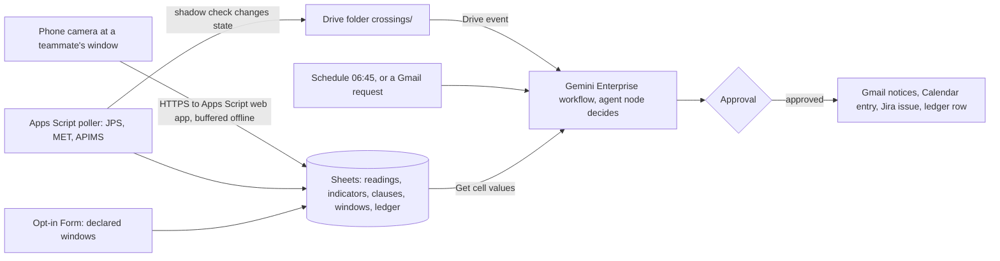

# Skyclause

Skyclause makes one logged, approved haze-and-storm call for each class or event window its subscribers declare at Asia Pacific University (APU), so club organisers, commuting students and, later, lecturers act on measured readings around Bukit Jalil instead of rumours, and APU gains the written monitoring record that the higher-education ministry (KPT) asked every university for on 7 October 2026. A 06:45 schedule, a Drive event when a reading crosses a clause in an editable sheet, and email requests start a Gemini Enterprise workflow whose agent node reads the JPS rain gauge at LRT Bukit Jalil, MET warnings and forecasts, DOE's hourly air pollutant index (API) and the team's own window camera, picks a mode per window (Normal, Outdoor-limited, Commute disruption, Hybrid recommended), and after one approval sends Gmail notices, a public Calendar entry and a Jira decision record. Proposed track: **Intelligent Automation & Digital Transformation**. Caveat: nothing is built yet, no APU office has agreed to own it, and until one does a teammate holds the approval seat; **Inference** marks conclusions no source states.

Contents:

1.  [At a glance](#at-a-glance)
1.  [Origins](#origins)
1.  [Problem and evidence](#problem-and-evidence)
    1.  [Haze: a ministry instruction with no university rule](#haze-a-ministry-instruction-with-no-university-rule)
    1.  [Storms: the exit wave meets the afternoon cell](#storms-the-exit-wave-meets-the-afternoon-cell)
    1.  [Who decides today, and with what record](#who-decides-today-and-with-what-record)
1.  [How it works](#how-it-works)
    1.  [Day-to-day loop](#day-to-day-loop)
    1.  [The clause sheet](#the-clause-sheet)
    1.  [States and failure handling](#states-and-failure-handling)
    1.  [Connectors and platform check](#connectors-and-platform-check)
    1.  [Cloud, IoT and network](#cloud-iot-and-network)
    1.  [Real data and privacy](#real-data-and-privacy)
1.  [Why people will use it](#why-people-will-use-it)
1.  [Why the crowd won't build it](#why-the-crowd-wont-build-it)
1.  [Off-campus fit](#off-campus-fit)
1.  [Scores](#scores)
1.  [Research plan](#research-plan)
1.  [Time to impact](#time-to-impact)
1.  [Demo and review](#demo-and-review)
1.  [Build plan](#build-plan)
1.  [Risks and kill criteria](#risks-and-kill-criteria)
1.  [Not verified](#not-verified)
1.  [See also](#see-also)

## At a glance

| Field                 | Plan                                                                                                                                                                                                                                       |
| --------------------- | ------------------------------------------------------------------------------------------------------------------------------------------------------------------------------------------------------------------------------------------ |
| Owner                 | Pilot: the teammate on a published roster who holds the workflow-owner seat. Target: APU's facilities, safety and welfare desk (FSSW), not confirmed; one public review mentions its head and no KB page names it                          |
| First users           | Student club and event organisers with outdoor or evening activities, and commuting students with 08:30 or late-afternoon classes, recruited through student channels; lecturers who opt in after 10 November                              |
| Track                 | Intelligent Automation & Digital Transformation                                                                                                                                                                                            |
| Trigger               | Schedule at 06:45 Monday to Friday (today's call); Drive event on a new file in `crossings/` (a clause changed state); Gmail "When an email is received" (evidence or call request)                                                        |
| Live signal           | JPS gauge `0232901RF`, 5-minute rain; MET warnings and KL forecast (polled every 10 minutes and 6 hours); DOE APIMS hourly API (polled every 15 minutes) at Cheras, Petaling Jaya and Putrajaya; the team's window camera, on probation    |
| Connectors            | 1P: Drive (event trigger, read), Sheets via Drive actions (Get cell values; Update cell values after approval), Gmail (event trigger; Send, Reply), Calendar (Create event). 3P: Jira Cloud Free (Create issue, Create comment). MCP: none |
| Decision              | For each window an opted-in recipient declared, the agent node picks the mode from the clause sheet and the readings with their ages, or returns "no call" when an input it needs is stale                                                 |
| Action and approval   | A Normal call ends with no write and its run trace is the record; any other call stops once at **Approval**, then sends notices, the calendar entry, the Jira issue and the ledger row                                                     |
| Reviewer self-trigger | Email "evidence for 2 Nov 14:00–16:30" or "call for tomorrow" to the team inbox (reply after approval, staffed 08:00–22:00 MYT, 11–14 November); subscribe to the public conditions calendar                                               |

## Origins

The only source is [Skyclause](/docs/ideas/opus/01/02-skyclause.md); this version answers its scorers' objections and the team's off-campus limits.

- **Kept:** the clause sheet with published defaults, release waves instead of fixed windows, local confirmation before a storm call, one approval per non-normal call, the Jira decision register, evidence replies by email, nightly grading, error rows instead of stale values, and the window camera.
- **Changed, the deciding step:** in the source, Apps Script evaluated every clause and Gemini applied a precedence lookup. Here the agent node evaluates the sheet against raw indicators; the feeder's formula verdict is a shadow check that only wakes the workflow and flags disagreement in the approval bundle.
- **Changed, the timetable:** the source polled APU's timetable feed hourly for session counts, and APU's Terms of Use ask for written permission before any use of its contents ([APU terms](/docs/research/apu.md#terms-of-use-and-robotstxt)). The product no longer reads it: windows come from an opt-in Form where each recipient declares their own sessions or events. APU-wide counts per wave return only with written permission. The counts below come from one research fetch made with the method in [APU research](/docs/research/apu.md#apspace-timetable-feed-measurements), not from the product.
- **Changed, for the team's limits:** nobody can be at APU before 10 November and no APU staff member or lecturer will act during the build, so the camera sits at a teammate's home window, a teammate approves, and first users are students. The source's FSSW duty officer and lecturer recipients move to the 3-month plan.
- **Changed, the clauses:** Storm confirmed now fires on the gauge's "Lebat" class whether or not a MET warning is in force, because no public warning history can show which warnings were in force on 2 November. Without the board, the camera's far-skyline contrast alone can fire Haze watch, and only after it passes probation.
- **Cut for buildability** (all three scorers called the source too many parts for three people in a week): the 20:00 and 15:30 schedules (the crossing trigger covers storms), the Registrar memo, the PM2.5 board (no board can be ordered in time), the Gemini API photo second opinion, Infobanjir as a live input, the `@Skyclause` manual run (see [Not verified](#not-verified)) and the weekly Jira grade comments.
- **Numbers re-checked on 5 November:** most held (see [Problem and evidence](#problem-and-evidence)). Fixed: Batu Muda fell below 100 at 07:00, not 08:00, and read 79–96 after; sensor 101147's 06:00 hourly mean was 6, not 5 µg/m³; AttendiX filters history 7, 30 or 98 days back, which says nothing about an edit window; the haze backtest gives 9 Hybrid recommended and 7 Normal, not 8 and 8; on 13 October Putrajaya read 109 at 06:00, so the source's own three-station clause said Outdoor-limited, not Normal; waves were recounted over 29 October to 4 November, the gauge's current window (74, not 72). Dropped: "KL warnings covered the exit wave on 20 of 24 October weekdays" and its companion figures, which came from the source author's OCR of 282 MET graphics on X and can't be re-run (MET's endpoint keeps no history and X's API returned 402); the board's price; the Gemini API quota; civil twilight; the campus building's height.

## Problem and evidence

### Haze: a ministry instruction with no university rule

- On 7 October 2026 KPT told every university to monitor API readings in its own locality; on 9 October vice-chancellors were told they could decide class closures themselves; Universiti Malaya went hybrid from 12 October ([X research][x haze]).
- Schools got numbers and universities didn't: suspend outdoor activities above API 100 and close above 200 ([Malay Mail, 7 Oct][mm moe]), then close above 180 or after three consecutive days above 150 ([The Star, 8 Oct][star moe]).
- Haze drew the highest engagement in the Reddit study (posts of 3,418, 2,226, 1,598 and 1,555 points). A lecturer: "I too wanna WFH but alas college management don't think like that"; at APU, most martial-arts clubs "are closed down … due to the Haze" ([Reddit research][reddit haze]). A student tagging the ministry: students "kena beratur tunggu bas dalam jerebu" (still have to queue for buses in the haze) ([X research][x haze]).
- **Frequency, replayed:** at Cheras (`CA16W`, the station nearest APU at about 5.9 km ([data sources][ds apims])), the API passed 100 on 20 of the 31 days with readings from 3 October to 3 November 2026, passed 150 on 17 and peaked at 190 (recounted from the [Malaysia Haze Monitor](https://github.com/herr-hollis/Malaysia-Haze-Monitor) log). Skies cleared on 27 October, "Jerebu is back ni" was posted on 1 November and Selangor reopened its schools on 4 November ([X research][x haze]); Cheras read 68 at 07:00 on 5 November.
- **Backtest, replayed:** the haze clauses below, run on 06:00 readings at the three stations for the 22 weekdays from 5 October to 3 November, give 9 Hybrid recommended, 5 Outdoor-limited, 7 Normal and 1 day with no data. APU had no rule to compare against.
- **The official index lags:** PM2.5 and PM10 enter as 24-hour moving averages ([DOE API calculation](https://eqms.doe.gov.my/Documents/APIMS/API_Calculation.pdf), [The Edge, 22 Oct](https://theedgemalaysia.com/node/822832)). On 25 October public sensor 101147, a PMS5003 3.7 km from DOE's Batu Muda station and about 14 km north of campus, fell from an hourly mean of 46 µg/m³ at 02:00 to 6 at 06:00 and stayed under 9 until 22:00 ([Sensor.Community archive](https://archive.sensor.community/)); Batu Muda's API read 124 at 06:00, 99 at 07:00 and 79–96 for the rest of the day. The other direction: Cheras read 83 at 06:00 on 13 October and 151 by 18:00. A student: readings "could stay at like 80 even though the air quality is clearly in the unhealthy/very unhealthy range" ([Reddit research][reddit haze]).
- **Inference:** a local reading leads the index on both arrival and clearing, which is why the camera's skyline contrast is a clause input once it passes probation. Haze will most likely appear only as a replay this month.

[mm moe]: https://www.malaymail.com/news/malaysia/2026/10/07/haze-education-ministry-orders-state-and-district-education-offices-schools-to-monitor-haze-act-based-on-api-readings/238138
[star moe]: https://www.thestar.com.my/news/nation/2026/10/08/haze-schools-must-close-if-api-exceeds-150-for-three-days-says-education-ministry

### Storms: the exit wave meets the afternoon cell

- **The build and assessment weeks are wet:** MET's KL forecast fetched at 07:14 MYT on 5 November says thunderstorms every afternoon from 5 to 11 November: "menyeluruh" (widespread) on 6 November and "di kebanyakan tempat" (in most places) on 9–11 November ([data sources](/docs/research/data-sources.md#weather-forecasts-for-campus)).
- **What fell at Bukit Jalil:** the Sg. Kuyoh di LRT Bukit Jalil gauge logged 81.5, 0, 16.5, 65, 39 and 18.5 mm on 30 October to 4 November ([Public Infobanjir](https://publicinfobanjir.water.gov.my/rainfalldata/Wilayah%20Persekutuan%20Kuala%20Lumpur), 07:00 on 5 November). Its 5-minute series ([JPS KL gauge](https://infobanjirjpskl.water.gov.my/Rainfall/Station/75?districtId=0)), where a reading stamped T covers (T−5 min, T], puts 77.5 mm over (18:00, 20:00] on 30 October and 63.0 mm over (14:00, 16:00] on 2 November, when the 60-minute total first reached JPS's "Lebat" class (31–60 mm in an hour) at 15:00 (our arithmetic on the [stored capture](/docs/sources/infobanjirjpskl.water.gov.my/rainfall-graph-75.md)).
- **Who it hit:** on 2 November, 155 physical sessions ended between 14:00 and 16:30, 89 of them at 15:30, and a traffic account listed a flash flood "Bukit Jalil arah Puchong" ([X research](/docs/research/social.md#event-crowds-and-flash-floods-around-bukit-jalil)). LRT Bukit Jalil's fare gates went under at the evening peak on 6 May 2026, and a review says "the university is flooded during heavy rain" ([other platforms research][other rain]).
- **Volume:** from 2 to 6 November, 508–563 physical sessions ran each weekday, 139–174 ended between 16:30 and 19:15 and 75–89 started by 08:30. From 29 October to 4 November there were 74 weekday release waves of at least 10 physical sessions, and heavy rain within 30 minutes before to 60 minutes after the release hit 4 of them, all on 2 November between 14:30 and 15:45 (124 sessions). On 10–13 November, around the assessment, there are 307–380 physical sessions a day and none on 8–9 November ([APU research](/docs/research/apu.md#apspace-timetable-feed-measurements)).
- **Counterevidence:** in a wet week, heavy rain met a wave on one afternoon; the heaviest hour, 61.5 mm to 19:40 on 30 October, missed every wave. **Inference:** most calls are Normal, so the product earns trust only if the rare call is right; a warnings-only rule would fire on most forecast afternoons, and its false-alarm ratio is measured from the feeder's own log, not assumed.

### Who decides today, and with what record

- International students warn that missing 80% attendance means "deportation or expel" (127 points) ([Reddit research](/docs/research/social.md#attendance-moodle-locks-and-the-80-visa-rule)). In AttendiX a lecturer's records show Present, Absent, Absent With Reason or Late ([KB: How to Edit Attendance Record?](https://apiit.atlassian.net/wiki/spaces/ITSM/pages/221218032)). **Inference:** whether a student caught in a storm is Late or Absent With Reason is already the lecturer's call; Skyclause supplies the measured facts for the window and never excuses anyone.
- APU's public knowledge base, searched on 5 November, has no page for "haze", "jerebu", "thunderstorm" or "lightning", and one unrelated page each for "flood" and "heavy rain". Workarounds: AirVisual or aqicn.org instead of official readings, ad hoc switches to online classes ([Reddit research][reddit haze]), and forum checks for floods before travelling ([other platforms research][other rain]).
- The owner is a guess with one public trace: a parent's review mentions APU's "campus facilities, safety and welfare head" ([other platforms research](/docs/research/social.md#parking-supply-and-safety)); no KB page found on 5 November names FSSW or such an office.
- **Inference:** each lecturer, organiser and office decides alone, from different sources, with no shared record; nothing written answers "how did APU monitor local readings in October?".

## How it works

### Day-to-day loop

1.  **Feeder (Apps Script, unattended):** time triggers poll the JPS gauge every 5 minutes, MET warnings every 10, the MET forecast every 6 hours (stored on change) and APIMS every 15 minutes; a web app receives the camera every 10 minutes. The first JPS poll stores the 7-day window the endpoint still holds, so the ledger starts at 29 October. Each row keeps source time, receipt time, HTTP status and fetch latency, and a failed poll writes an error row, never the last value ([public feed path](/docs/research/gemini-enterprise.md#public-feed-polled-into-sheets)).
1.  **Indicators and shadow check:** the feeder computes rain in the last 60 minutes and 2–4 hours, the highest API of the three stations, the last three 06:00 readings, which warnings are in force, the camera's contrast ratios and each input's age, then evaluates each clause by formula. When a verdict changes, it drops a file into `crossings/`.
1.  **The call (agent node):** on the schedule or a crossing, the node reads the clause sheet, the indicators, the MET warning text verbatim and the declared windows through **Get cell values**. For each window at risk it decides the mode by the sheet's precedence, quotes each fired clause with its input's age, applies the sheet's written rule for stale inputs ("no call: gauge silent 25 min"), picks the recipients whose windows it covers, and drafts their notices. If its mode differs from the shadow verdict, the bundle says so first.
1.  **The one approval:** a non-normal call shows as **Needs Review**; the rostered teammate approves, edits or rejects it.
1.  **Writes after approval:** Gmail notices, an event on the public conditions calendar, a Jira issue (clauses, readings, windows, approver, times) and an **Update cell values** ledger row. A Hybrid recommended notice quotes the school rule and says that teaching mode is the lecturer's and the university's decision.
1.  **Requests:** an email fires a Gmail-triggered run that answers "evidence for <window>" or "call for <date>" from the ledger, Jira and camera frames; the reply is sent after approval.
1.  **Grading (Apps Script, nightly):** each declared window is graded against what the gauge and APIMS logged (hit, miss, false alarm, correct Normal); the next call quotes yesterday's grades. A window where the shadow check fired but no approved call exists is listed as "no call" for the approver to explain.
1.  **Auditor (Apps Script):** emails the team when a feed or the camera goes silent, when a crossing file gets no run within 20 minutes, and on day 12 of the 14-day schedule credentials ([unattended runs](/docs/research/gemini-enterprise.md#what-runs-without-anyone-signed-in)).

**Worked example, 2 November (Inference from documented delays, not measured):** the gauge reaches Lebat at 15:00, the 15:05 poll writes the crossing file, the Drive trigger fires by 15:10–15:15, and an approved notice could go out about 15:20: in time for the 15:30 wave of 89 sessions and the 15:45 wave, too late for the 14:30 and 15:00 ones.

### The clause sheet

The owner edits thresholds and wording in a Sheet; defaults come from the published school rules and Public Infobanjir's rain classes. The highest mode wins, and every fired clause is listed on the call.

| Clause           | Reads                                           | Fires when (default)                                                                                                                          | Proposes                          |
| ---------------- | ----------------------------------------------- | --------------------------------------------------------------------------------------------------------------------------------------------- | --------------------------------- |
| Haze watch       | API at Cheras, Petaling Jaya, Putrajaya; camera | API 101 or more at any station, or (after probation) the far-skyline contrast below its threshold on three daylight frames with no gauge rain | Outdoor-limited                   |
| Haze severe      | API, last three 06:00 readings                  | API above 180, or above 150 at 06:00 on three consecutive days at one station (the 8 October school rule)                                     | Hybrid recommended                |
| Storm watch      | MET warnings                                    | A warning naming W.P. Kuala Lumpur is valid across a window                                                                                   | Nothing alone; printed as context |
| Storm confirmed  | JPS gauge                                       | At least 31 mm in 60 minutes ("Lebat") from 30 minutes before to 60 minutes after a window ends                                               | Commute disruption                |
| Flash-flood risk | JPS gauge                                       | More than 60 mm in 2–4 hours, Public Infobanjir's flash-flood note                                                                            | Commute disruption, flood note    |
| Silent input     | Every feed                                      | No reading for two intervals, or an error row                                                                                                 | No call for clauses needing it    |

### States and failure handling

- **Per window:** Normal → Watch (warning in force, context only) → Drafted → Needs Review → Approved, Edited or Rejected → Sent → Graded. **Per input:** fresh, stale (two intervals missed), error, recovered; a recovered input is named on the next call and needs one fresh reading before a clause uses it.
- **A failed source** shows as an error on the call and blocks only the clauses that need it; the camera never stands in for a silent gauge. On 5 November the MET endpoint still listed a thunderstorm warning valid 05:00–09:00 on 15 October, so the feeder treats a warning as in force only between its `valid_from` and `valid_to`.
- **Quota and latency:** event-triggered runs that fail on quota aren't retried ([limits](/docs/research/gemini-enterprise.md#limits-that-bite-in-a-one-week-build)), which is why the auditor watches for a crossing with no run. A crossing waits up to 5 minutes for the poll and 5–10 for the Drive trigger, then for a click, so the roster covers 14:00–19:15 on forecast storm afternoons and every call records its delay.

### Connectors and platform check

| Connector                | 1P/3P | Mode                                               | Job                                                        |
| ------------------------ | ----- | -------------------------------------------------- | ---------------------------------------------------------- |
| Google Drive             | 1P    | Event trigger (new file in `crossings/`); read     | Starts crossing runs; holds the frames evidence links to   |
| Sheets via Drive actions | 1P    | Get cell values; Update cell values after approval | Clause sheet, indicators, windows; the approved ledger row |
| Gmail                    | 1P    | Event trigger (email received); Send, Reply        | Requests in; notices and evidence replies out              |
| Google Calendar          | 1P    | Create event                                       | Public conditions calendar, subscribable from Outlook      |
| Jira Cloud Free          | 3P    | Create issue, Create comment; federated search     | Decision register with each call's grade                   |

- Schedules with cron and a time zone, and Drive and Gmail event triggers polled every 5–10 minutes, are documented; there is no webhook trigger, hence the Drive hand-off ([triggers](/docs/research/gemini-enterprise.md#triggers-and-schedules)). Sheets cell reads and writes have been GA since 12 October 2026; Gmail, Calendar and Jira Cloud's create issue and create comment are listed GA actions ([actions](/docs/research/gemini-enterprise.md#actions-and-write-back)), though Jira comments stay unproven until they work in the app ([platform checks](/docs/research/gemini-enterprise.md#platform-constraints-and-design-consequences)). At APU, Outlook and OneDrive or SharePoint would replace Gmail, Calendar and Drive; all are GA.
- Connector writes from a workflow agent node require human review, and scheduled runs that email people pause for approval ([unattended runs](/docs/research/gemini-enterprise.md#what-runs-without-anyone-signed-in)). **Inference:** the approval page doesn't say who may approve, so the workflow owner's seat is the approver.
- Sheets are read through actions at query time, never through an ingested copy that would answer from old data ([federated versus ingestion](/docs/research/gemini-enterprise.md#federated-search-versus-ingestion)). Drive, Gmail and Calendar connectors need a Workspace account, not `@gmail.com` ([account limits](/docs/research/gemini-enterprise.md#edition-and-account-limits)).

### Cloud, IoT and network

- **Cloud:** the Gemini Enterprise workflows decide, with step traces in the **Runs** tab ([run history](/docs/research/gemini-enterprise.md#run-history-as-evidence)); Apps Script polls and ingests; Sheets and Drive hold readings and frames; Jira Cloud holds the register.
- **IoT, the camera station, on probation:** an old Android phone on a charger at a teammate's high window keeps a Chrome page in front with `getUserMedia` and a wake lock, the only setup in which a page keeps reporting ([browser sensors](/docs/research/iot-and-network.md#phone-and-laptop-sensors-in-the-browser), [pages left running](/docs/research/iot-and-network.md#web-pages-and-pwas-left-running)). Every 10 minutes it masks the lower third of the frame, measures the contrast of a near landmark and the far skyline against a clear-day reference, and posts two ratios and a small JPEG; scoring happens on the phone ([edge processing](/docs/research/iot-and-network.md#edge-versus-cloud-processing)).
- **The probation test, 5–8 November:** two teammates label each daylight frame "landmark visible" or "obscured" by eye. The phone's flag must agree on at least 90% of at least 100 frames, including at least 10 obscured ones. If it passes, the camera can fire Haze watch and its frames corroborate storms; if it fails, it keeps only evidence frames and the network proof, and the demo says so. **Inference:** the frames describe the teammate's neighbourhood, so every camera row carries its distance from campus; after dusk the camera says nothing.
- **Network:** each camera row carries device time and receipt time, so latency shows per reading; the page buffers frames in IndexedDB offline and uploads them with original timestamps; each poll logs status and latency; every call prints each input's age ([what a judge can see](/docs/research/iot-and-network.md#what-a-judge-can-see-of-the-network)). The phone uses home Wi-Fi or a 4G hotspot; campus Wi-Fi isn't needed ([campus Wi-Fi](/docs/research/iot-and-network.md#apu-campus-wi-fi)). The Pi 5 isn't used: it has no add-on sensors, and nothing on the critical path needs a second device.

### Real data and privacy

- **Live:** the JPS 5-minute JSON (undocumented, no terms found), MET warnings and forecast (CC BY 4.0), DOE APIMS (undocumented endpoint, no terms) ([data sources][ds apims]), the team's camera, and the opt-in Form.
- **Replayed, labelled:** the Malaysia Haze Monitor hourly API log and the [Sensor.Community archive](https://archive.sensor.community/) (DbCL), only for the haze backtest and never shown when a live source fails ([data rulings](/docs/CONTEXT.md#decisions-so-far)).
- **Not read:** APU's timetable feed, until APU gives written permission; then the feeder keeps counts per wave and drops `NAME`, `SAMACCOUNTNAME` and `LECTID` at ingest ([APU research](/docs/research/apu.md#personal-data-in-the-timetable-feed)).
- **Privacy:** the Form collects an email address, a role and the declared windows, with a notice and an unsubscribe link; the camera masks the lower third and points at the skyline, so no faces are captured ([PDPA](/docs/research/judging.md#malaysias-pdpa-and-the-2024-amendment)); frames are deleted after one semester; no personal data goes to any free-tier model.

## Why people will use it

- **Revealed effort:** people already spend effort on this: AirVisual or aqicn.org instead of official readings, classes moved online ad hoc ([Reddit research][reddit haze]), clubs closed for the haze, and a commuter who checks the forum on rainy mornings "to see if anyone open thread show the flood" ([other platforms research][other rain]).
- **Habit loop:** the cue is a notice or calendar entry in an inbox and calendar people already open; the action is a ten-second read and their own choice; the reward is no surprise at the exit and a dated record to point at when explaining a late arrival.
- **No new mandate:** each recipient acts within authority they already hold (an organiser over an event, a student over their commute, later a lecturer over attendance codes); only Hybrid recommended needs closure authority, and the notice says so.
- **Zero install:** recipients need no Gemini Enterprise seat; Outlook and Google Calendar subscribe to the calendar, and "evidence for <window>" costs one email.
- **Counterevidence:** no source shows a student or lecturer asking for such a call, and most days are Normal; **Inference:** the record and the evidence replies may be used more than the notices.

## Why the crowd won't build it

- **The simulated crowd:** air quality is 2.2% of 780 simulated ideas, a thin tier, built on new sensors and LoRa; flood warning is 3.2%, in the crowded off-campus tier ([clusters](/docs/research/competition.md#clusters-and-shares), [tiers](/docs/research/competition.md#saturation-tiers)). Only 3% use public feeds, and 1% combine an unattended run, a named owner and a measured baseline ([what the crowd misses](/docs/research/competition.md#what-the-crowd-structurally-misses)).
- **This hackathon:** `apu-smart-shuttle` promises "traffic and rain alerts" inside a shuttle tracker ([public repositories](/docs/research/competition.md#public-repositories-so-far)); Skyclause tracks nothing and outputs a logged, approved call.
- **GitHub, re-searched on 5 November:** "haze malaysia" returns 33 repositories, trackers and dashboards; the closest, HazeLens ASEAN, describes itself as "Environmental Decision Intelligence for Southeast Asia", not an institution's call. "snow day predictor" returns 57 repositories that guess closures for parents; "air quality school closure" and "storm warning class" return none, and no repository is named Skyclause.
- **Inference:** the scarce combination is a ministry hook, release windows, local confirmation that beats a warnings-only rule, and an approved record; the crowd stops at the alert.

## Off-campus fit

The critical path works with nobody at APU, no APU staff action, and only the team's phones and free accounts, under four conditions: a teammate's high window with a near landmark and a skyline in view; the event's licence on a Workspace domain; a teammate staffing the approval seat; and windows from the opt-in Form instead of APU's timetable. The gauge, warnings, forecast and API are public feeds polled from Apps Script, and the camera posts over home Wi-Fi.

What the build is not: the full product puts the camera on a campus window, takes APU-wide counts per wave from the timetable with written permission, and has FSSW approve calls to lecturers. None of that is possible before 10 November. The reduced version, which the team can build now, makes real calls for the windows its student subscribers declare, from live public telemetry and a home camera whose readings describe the teammate's neighbourhood, not the campus. If no student opts in, the calls still run and grade against the gauge, but nobody outside the team receives them.

## Scores

**71.1 / 100, rank 2 of 18** in the [cross-set ranking](/docs/ideas/00-ranking.md); it passes every gate, with G4 conditional. Scored on 5 November 2026 on the [matrix](/docs/ideas/00-ranking.md#scoring-matrix) by three independent scorers who read this doc and checked its claims: an NTT DATA forward deployed engineer (FDE), an APU School of Technology IoT lecturer, and a Google Cloud advocate who is also an APU student. Models: FDE (Claude Sonnet 5.5), Lecturer (Claude Fable 5.1), Advocate (Claude Opus 5.5). Day-to-day workflow and theme take the lowest score; the rest take the mean.

| Component           | Weight | FDE | Lecturer | Advocate | Used | Lowest scorer's reason                                                                                                                                                                                                    |
| ------------------- | -----: | --: | -------: | -------: | ---: | ------------------------------------------------------------------------------------------------------------------------------------------------------------------------------------------------------------------------- |
| Impact              |     13 |   3 |        3 |        3 |    3 | Real volume (508-563 physical sessions a day, 4 rain-hit waves) and a timed evidence-assembly baseline, but the owner FSSW is unconfirmed and storms are rare.                                                            |
| Connectors          |     13 |   4 |        5 |        4 | 4.33 | Drive event trigger, Sheets reads and approved writes, Gmail event and send, Calendar and Jira Cloud all GA and used; Jira is only a decision register.                                                                   |
| Day-to-day workflow |     13 |   5 |        5 |        4 |    4 | A 06:45 schedule, Drive crossing events and Gmail requests read an editable clause sheet, an auditor flags crossings that got no run, it grades nightly, and it pauses once per non-normal call.                          |
| Research            |     13 |   4 |        4 |        4 |    4 | Haze/storm pain and ministry instruction are cited, and Cheras 5.9 km and Sheets GA date match the research docs; APU-specific owner and demand evidence is thin.                                                         |
| Time to impact      |     13 |   3 |        4 |        3 | 3.33 | Dated 3- and 6-month plan with an FSSW or committee owner, but lecturer notices wait on timetable permission and an office nobody has approached.                                                                         |
| Theme               |     10 |   3 |        4 |        3 |    3 | Public JPS/MET/DOE feeds plus a home camera on probation; if the camera fails the IoT layer is polled third-party feeds, as the doc concedes.                                                                             |
| Originality         |      9 |   4 |        4 |        3 | 3.67 | Air quality is Thin and flood is Crowded, 33 'haze malaysia' GitHub trackers exist, and apu-smart-shuttle promises rain alerts; the approved institutional call is the only distinct part.                                |
| Real use            |      6 |   4 |        3 |        3 | 3.33 | social.md confirms AirVisual/aqicn use, ad hoc online switches and forum flood checks, and email/calendar is an existing channel, but no source shows anyone asking for a call and the doc concedes most days are Normal. |
| Buildability        |      5 |   2 |        2 |        2 |    2 | Three feed pollers, camera page with edge scoring, clause sheet, shadow check, three workflows, grading and auditor is far beyond a week for three people.                                                                |
| Demo                |      5 |   4 |        4 |        4 |    4 | A reviewer emails an evidence request and gets an approved reply, but cannot cause a crossing and storms are only likely on 9-11 November.                                                                                |

- **Gates:** G1 pass (3 pass, 0 conditional, 0 fail); G2 pass (3 pass, 0 conditional, 0 fail); G3 pass (3 pass, 0 conditional, 0 fail); G4 conditional (2 pass, 1 conditional, 0 fail).
- **Off-campus gate, per the lowest scorer:** The camera sits at a teammate's home window, feeds are polled from Apps Script, and windows come from an opt-in Form; nothing needs campus, though the full product wants a campus window and FSSW.
- **What would help most, per the lowest scorer:** Drop the camera probation, the morning call and the nightly grader, and ship the storm crossing plus the evidence-by-email workflow for one recruited club or commuter group.

## Research plan

The team's limits rule out lecturers and APU staff this week, so the 6–8 interviews are with students, held remotely ([plan shape](/docs/research/judging.md#a-research-plan-for-this-week)).

- **Round one, 5–6 November (four):** two committee members of outdoor or martial-arts clubs (who decided the October closures, on what reading); one student organiser of an evening or outdoor event (the rain plan); one commuter with 17:45 classes through LRT Bukit Jalil (what they did on 2 November).
- **Round two, 7–8 November (three or four):** two more commuters and one student whose class moved online in October, each shown a real call and an evidence reply; ask "would you act on this, and who else must agree?".
- **Timed observation:** three people each assemble the evidence for 2 November 14:00–16:30 by hand from APIMS, MET, Infobanjir and X, timed with a stopwatch; then the same task by emailing Skyclause, timed including the approval wait.
- **30–50 real items:** 40 evidence replies for real windows from 29 October to 9 November; two teammates check every fact (warning times, rain totals, API values, input ages) against the raw source before seeing the reply, settle disagreements, and report the share correct with n and a Wilson interval ([accuracy method](/docs/research/judging.md#measuring-an-agents-accuracy-honestly)).
- **Calls:** every call's agreement with the shadow check, and the warnings-only rule's false-alarm ratio against the gauge-confirmed rule over the weekday afternoons of 5–13 November.
- **What can't be measured by 10 November:** whether a call matches what people met at the exit, because nobody can stand there. From 11 November, subscribers get a one-tap "did the weather change your plan?" email after each graded window.
- **What would change the design:** if organisers want a forecast more than a confirmation, add the forecast to the 06:45 call; if commuters ignore notices, keep the calendar and evidence replies only.

## Time to impact

- **By 3 months (early February 2027):** the team asks APU, through the organisers, for written permission to read the timetable feed, so windows cover every physical session; FSSW is offered a pilot as the approver for lecturer notices; calls run through the monsoon for subscribed organisers, students and lecturers; evidence replies answer lateness questions. Owner: the FSSW manager if FSSW agrees, otherwise the GDGoC APU committee for its subscribers.
- **By 6 months (early May 2027), measured:** minutes from crossing to approved notice; precision, recall and false-alarm ratio on at least 300 graded windows; minutes to assemble evidence, before and after; the share of notified people who acted, from the one-tap survey; agent–shadow agreement. The haze clauses get their first live season only in the 2027 dry season.
- **Owners** ([owner roles](/docs/research/judging.md#owners-and-what-has-to-be-true)): FSSW (business owner, target), APU ITSM (accounts and connectors), APU's data protection officer (PDPA), and the GDGoC APU committee (feeder and camera).
- **Assumptions:** the licence continues after the sponsored trial; APU grants the timetable permission; an office or the committee takes the approval seat and sets a false-alarm ceiling; the undocumented APIMS and JPS endpoints stay up.

## Demo and review

A 3:45 video recorded on 9 November from the live system, labelled with its capture date ([minute plan](/docs/research/judging.md#minute-plan)):

1.  **0:00–0:20:** slate; "Skyclause makes the haze-and-storm call for your classes and events, with the record."
1.  **0:20–0:45:** the problem: the KPT instruction, no APU rule, 139–174 sessions in the exit wave, 63.0 mm over (14:00, 16:00] on 2 November, each reading stamped T covering (T−5 min, T], as 89 sessions ended at 15:30.
1.  **0:45–1:50:** a real crossing run from 5–9 November in the **Runs** tab: the crossing file, the agent's per-window reasoning with input ages, the shadow-check line, **Needs Review**, approval, then the email, the calendar entry and the Jira issue. If no crossing happens, the video shows a Normal morning call and says no crossing occurred.
1.  **1:50–2:20:** an email asking "evidence for 2 Nov 14:00–16:30" and its approved reply.
1.  **2:20–2:50:** the camera at the window, a frame beside its contrast row and latency, the probation verdict, and an error row from a failed feed.
1.  **2:50–3:45:** impact (timed baseline before and after, evidence accuracy with n, the warnings-only false-alarm ratio, the haze replay), what interviews changed, the 3- and 6-month plan, and how to review.

The reviewer fires it by emailing the team inbox, the dependable path since a reviewer's own run sees only their own history ([reviewer access](/docs/research/gemini-enterprise.md#reviewer-access)), or by subscribing to the conditions calendar. A reviewer can't cause a storm; forecast thunderstorms on 9–11 November make a live crossing during assessment likely, not certain.

## Build plan

| Day        | Build (critical path first)                                                                                                                            | Research and checks                                                               |
| ---------- | ------------------------------------------------------------------------------------------------------------------------------------------------------ | --------------------------------------------------------------------------------- |
| Thu 5 Nov  | Licence on a Workspace domain; one run whose agent node reads a Sheet, pauses at **Approval** and sends one Gmail; feeder with error rows; opt-in Form | Ask organisers for timetable permission and reviewer emails; recruit 6–8 students |
| Fri 6 Nov  | Clause sheet v1 and shadow check; Drive crossing workflow with Calendar, Jira and ledger writes; camera page live at the window                        | Round one; first forecast storm afternoon                                         |
| Sat 7 Nov  | 06:45 morning call; Gmail evidence workflow; nightly grading; auditor                                                                                  | Round two; timed baseline; label camera frames                                    |
| Sun 8 Nov  | Camera probation verdict; README, deck, diagram                                                                                                        | Check 40 evidence replies; confirm every member registered before midnight        |
| Mon 9 Nov  | Feature freeze; refresh schedule credentials; record the video                                                                                         | Test the reviewer email path from a non-team account                              |
| Tue 10 Nov | Submit early; keep everything running                                                                                                                  | Watch quota use and the auditor                                                   |

No card: Apps Script, Sheets, Drive, Gmail and Calendar on the licensed Workspace domain, Jira Cloud Free ([sandboxes](/docs/research/gemini-enterprise.md#free-sandboxes)), and the camera page on GitHub Pages. If the licence is late, the feeder, camera, clause sheet and grading log real data from 5 November and the workflows attach to the same Sheets.

## Risks and kill criteria

- **The build overruns:** if by the end of 7 November no crossing run has gone from file to approved Gmail, Calendar and Jira writes, cut the morning call and the camera's clause role and ship the crossing and evidence workflows only.
- **The camera fails probation:** it is demoted to evidence frames and network proof on 8 November. **Concession:** the IoT layer is then public telemetry polled from three agencies plus a visible network, which is weak against the theme.
- **Nobody acts on a call:** if fewer than four of the six or more students interviewed by 8 November say they would act on a call or subscribe, drop notices and keep the record and evidence path.
- **The agent and the shadow check disagree:** if they differ on more than 1 in 10 graded windows for reasons other than stale inputs, rewrite the clause wording before adding recipients; the count is published either way.
- **No office owns it:** FSSW is a hypothesis with one public trace and no reason yet to act on a student tool. Kill the office claim, not the product, if FSSW or a successor hasn't agreed by the 3-month mark; it continues as the committee's calendar for subscribers.
- **Permission never comes:** windows stay opt-in, and the APU-wide volume claim stays a research figure.
- **Undocumented endpoints change:** APIMS and the JPS JSON may break without notice ([APIMS notes][ds apims]); each failure is an error on the call, with no fallback value.
- **Platform limits:** credentials expire every 14 days (refresh on 9 November); 160 assistant queries per user a day on Standard, so measure use over ten runs and slow the crossing poll if projected use passes 80% ([limits](/docs/research/gemini-enterprise.md#limits-that-bite-in-a-one-week-build)); reviewers outside the organisation may need an IAM exception.

## Not verified

- Whether any teammate's window has a near landmark and a skyline in view, how far it is from campus, and whether its contrast ratios track haze or rain at all; the probation test decides the last.
- Whether a workflow can take both a Gmail trigger and a manual `@` run, which a read-only `@Skyclause` add-on would need.
- Whether Jira Cloud's Create comment works in the team's app, and how long approvals take in practice.
- Whether a MET warning named Kuala Lumpur on the afternoon of 2 November; no public history exists.
- Which JPS view is right for 3 November: the KL portal's daily field says 46 mm, Public Infobanjir 39 mm.
- Whether FSSW exists under that name and what it decides, and the gauge's own coordinates (JPS publishes none; it is named for LRT Bukit Jalil station).

## See also

- [Cross-set ranking](/docs/ideas/00-ranking.md), [brief](/docs/BRIEF.md) and [context](/docs/CONTEXT.md): rules, judging points, Gemini Enterprise limits.
- [Social research][x haze]: the haze, flood and attendance evidence.
- [Competition](/docs/research/competition.md) and [Gemini Enterprise](/docs/research/gemini-enterprise.md): the simulated crowd; triggers, approvals, actions and live-data paths.
- [Data sources](/docs/research/data-sources.md), [IoT and network](/docs/research/iot-and-network.md) and [APU](/docs/research/apu.md): feeds, the team's devices, and the timetable feed and its terms.
- [Judging](/docs/research/judging.md): baselines, accuracy, the video and privacy.

[x haze]: /docs/research/social.md#haze-and-air-quality-decisions
[reddit haze]: /docs/research/social.md#haze-heat-and-flash-floods
[other rain]: /docs/research/social.md#heat-rain-and-flash-floods
[ds apims]: /docs/research/data-sources.md#doe-apims-air-pollutant-index
