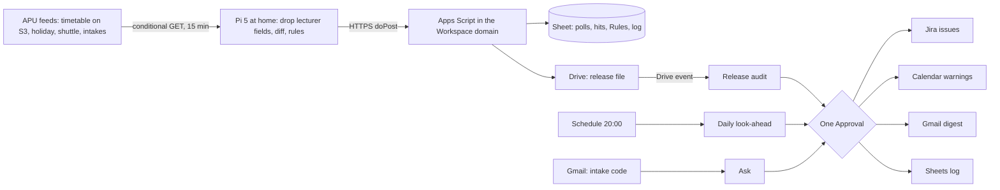

# ChronoDiff

ChronoDiff audits each release of APU's public class timetable before students have to live it. A Raspberry Pi 5 at a team member's home polls the APSpace timetable feed every 15 minutes with its ETag, drops lecturer names at the edge, diffs each new release and runs an owner-editable rule sheet over it: room double-bookings, holiday collisions, short-notice moves, sessions moved past the last shuttle, online-to-physical switches, tight room changes, long gaps and renamed group codes. A Gemini Enterprise workflow judges and groups the hits, and one approval releases Jira items for APU's Schedulers office and calendar warnings for the affected intakes. Proposed track: **Intelligent Automation & Digital Transformation**. Caveat: the feed hasn't changed since 28 October and published sessions almost never move, so most of what ChronoDiff finds sits in newly published weeks, not in edits; **Inference** marks conclusions no source states.

Contents:

1.  [At a glance](#at-a-glance)
1.  [Origins](#origins)
1.  [Problem and evidence](#problem-and-evidence)
1.  [How it works](#how-it-works)
    1.  [Signal to cloud path](#signal-to-cloud-path)
    1.  [Workflows](#workflows)
    1.  [Rule set](#rule-set)
    1.  [States and failure handling](#states-and-failure-handling)
    1.  [Connectors and platform check](#connectors-and-platform-check)
    1.  [Cloud, IoT and network](#cloud-iot-and-network)
    1.  [Real data and privacy](#real-data-and-privacy)
1.  [Why people will use it](#why-people-will-use-it)
1.  [Why the crowd won't build it](#why-the-crowd-wont-build-it)
1.  [Off-campus fit](#off-campus-fit)
1.  [Scores](#scores)
1.  [Research plan](#research-plan)
1.  [Time to impact](#time-to-impact)
1.  [Demo and review](#demo-and-review)
1.  [Build plan](#build-plan)
1.  [Risks and kill criteria](#risks-and-kill-criteria)
1.  [Not verified](#not-verified)
1.  [See also](#see-also)

## At a glance

| Field                 | Plan                                                                                                                                                                                                                             |
| --------------------- | -------------------------------------------------------------------------------------------------------------------------------------------------------------------------------------------------------------------------------- |
| Owner                 | APU's Schedulers office, Block A, Level 7, which sets up intakes and publishes schedules ([Scheduler User Guideline], [Campus Facilities and Navigation Guide]); unconfirmed, so a teammate plays the scheduler during the build |
| First users           | Class reps and students of pilot intakes, who subscribe to a per-intake warning calendar; the scheduler, through a Jira queue                                                                                                    |
| Track                 | Intelligent Automation & Digital Transformation                                                                                                                                                                                  |
| Trigger               | A new feed release (ETag change, polled every 15 minutes) lands a file in Drive and starts the audit; a daily 20:00 look-ahead schedule; an email naming an intake                                                               |
| Live signal           | APU's public timetable feed by conditional GET, plus its holiday, shuttle and intake feeds by body hash, with each poll's status, latency and bytes logged by the Pi                                                             |
| Connectors            | 1P: Google Drive with Sheets actions, Google Calendar, Gmail. 3P: Jira Cloud Free. All GA; no custom MCP and no preview feature on the critical path                                                                             |
| Decision              | Which rule hits are real problems (a clash or a combined delivery), which intakes need a warning, which room with no timetabled class to offer, and which hits duplicate an open issue                                           |
| Action and approval   | One Approval step per run releases Jira issues, Calendar warnings and a Gmail digest, logged in Sheets                                                                                                                           |
| Reviewer self-trigger | Email an intake code to the ChronoDiff inbox and get that intake's audit of the live release, with the latest poll time and ETag, after approval                                                                                 |

## Origins

- **[ChronoDiff](/docs/ideas/argon-02/01-chronodiff.md) leads**, because its home-Pi ETag poller is the one loop that needs nobody at APU. Kept: the 15-minute conditional poll, the edge drop of lecturer fields, the release diff, its four rules (double-booking, holiday, short notice, last shuttle), free-room candidates, the Drive event trigger, one Approval and loud failures. Changed: the Pi writes to the Sheet through an Apps Script `doPost` instead of Cloud Run, Pub/Sub and BigQuery, which need a billing account the team lacks; the owner is the Schedulers office named in APU's KB, since no public page names Academic Administration as the publisher; the 3-month plan no longer has APU run the poller; and the doc now says plainly that no APU source documents a double-booking. Dropped: SharePoint and Outlook, because the team has no Microsoft 365 tenant and the developer sandbox is closed to most students and ships sample data ([free sandboxes](/docs/research/gemini-enterprise.md#free-sandboxes)); Confluence and its REST copy of APU's AA pages (republishing without permission); BigQuery federated query (preview); the phone Geolocation commute check, which decided nothing; and the 6-month CloudFront step, an APU system change.
- **[Timetable & HVAC Reconciler](/docs/ideas/argon-01/03-timetable-hvac-reconciler.md)** gives three rules: long same-day gaps (now report-only), physical and online switches, and the tutorial-group prefix guard, plus its audit-after-publication cadence. Dropped: the HVAC half, since its own threads don't show empty rooms being cooled, one says the air conditioning is usually off, and campus energy is the most saturated crowd cluster at 10.5% ([clusters](/docs/research/competition.md#clusters-and-shares)); the QR room check-in, which needs people on campus; APIMS and Open-Meteo; ServiceNow and SharePoint, which duplicated Jira; and the custom MCP on Cloud Run, which is preview, blocked by default by an organisation policy, and needs a card. Its two Reddit quotes (the "AI-algorithm" thread and "physical and online confusion") aren't in the research docs and returned `403` on 5 November, so they're out.
- **[Sempat](/docs/ideas/opus-01/04-sempat.md)** gives the tight-transfer rule, same-slot candidate rooms, per-intake warning calendars, the Gmail ask, the fix watch that reopens an issue when a release doesn't show the promised room, and its DeviceMotion lift and stair timer as a campus-gated module. Changed: its 1,441 transfers counted 64 pairs in the same room, so the doc uses 1,377; its 677 intake groups become 662; and no transfer verdict claims a failure until someone times APU's lifts. Dropped: the on-campus measurement sprint, evaluation walks and in-person interviews, which the team can't do before 10 November.

## Problem and evidence

- **Students say the timetable keeps changing:** "Timetable churn and a compressed calendar" ranks third of 15 APU themes on platforms other than Reddit and X, tied on the top score of 9 ([theme ranking](/docs/research/social.md#other-platforms-theme-ranking)). A diploma student wrote "The time table changes every week", with changes "announced by the lecturers or administrators"; another "got marked absent" after being given another major's timetable ([timetable churn](/docs/research/social.md#timetable-churn-and-a-compressed-calendar)).
- **They distrust APSpace's timetable and room data:** the app is rated 3.62 from 143 ratings on the App Store (rechecked 5 November) and 3.27 from 381 on Google Play. Of the 119 newest Play reviews, 15 mention the timetable, and a June 2026 App Store review says "some of the empty class shows is fake" ([APSpace app](/docs/research/competition.md#the-official-apspace-app)). A former student describes a classroom finder showing occupied rooms as empty ([S2](/docs/research/social.md#s2-a-former-student-names-classrooms-and-several-service-failures)).
- **They build their own tools:** a GitHub code search for the feed URL returned 32 files in 26 repositories on 5 November, and at least 12 timetable tools date from 2013 to 2026 ([student tools]). The Discord bot's author built it because a parent kept asking "Is the timetable still the same as last week?" ([feed users]). All of them copy sessions; none checks rooms, holidays, shuttles or transfers.
- **Counterevidence, the feed rarely changes once published:** it was last written on 28 October at 09:39:49 MYT and still answered `304` at 07:13 on 5 November. [scheduleDB]'s public history holds 85 commits from 22 August 2024 to 29 October 2026, with a median of 7.0 days between 2026 commits and a longest gap of 17. Its 18 and 29 October releases moved no published session's time or room and added 0 and 2 intake-group rows (computed for this doc). **Inference:** the churn students report arrives by announcement, or as re-slotting across newly published weeks: 2 November against 16 November changed 87.7% of 4,181 first-start slots ([feed measurements](/docs/research/apu.md#apspace-timetable-feed-measurements)). ChronoDiff's main catch is therefore problems in new weeks, two to three weeks before they're lived.
- **No APU source documents a room double-booking.** The live feed holds one overlap: intake `APUMP2610` group G1 has `BM076-3-M-PC` and `CT070-3-M-NDP` in room `D-07-17` from 19:00 to 21:30 on six dates (computed). Both modules belong to the same intake, so **Inference:** it may be a combined delivery, and only the scheduler can say.
- **What the live feed does show for 2–8 November (computed):** 1,377 changes between Block-Level-Room rooms (labs and auditoriums excluded) with 15 minutes or less between sessions (1,366 of exactly 15, 11 of 10), across 662 intake groups; the count rises if labs and auditoriums are included. Of the 1,377, 958 change block, and 255 cross-block changes start at 10:45 and 223 at 15:45. 75 pairs of an online and a physical session for one intake group sit within 15 minutes of each other, 62 of them online first, and the 2,692 rows in `ONLMCO3-*` online rooms still say `LOCATION` "APU CAMPUS" ([room codes](/docs/research/apu.md#timetable-room-codes)). 186 same-day gaps exceed 4 hours. 8 and 9 November, the window's only holidays, hold no classes.
- **Lift pain is thin evidence:** lifts rank 10th of 15 themes, "low in these sources"; the strongest item is "A block have 9 floor 15classes a floor only two lift. Lift always full" (18 likes, 27 October 2026) ([lifts](/docs/research/social.md#lifts-stairs-and-crowding)). Reddit has "fix your damn elevators lah" (54 points), but "no thread measured waits or described specific class changeovers" ([Reddit lifts](/docs/research/social.md#lifts-laundry-and-deposits)).
- **Nobody publishes travel time:** APU's Scheduler User Guideline (version 8, 3 November 2026) covers intakes, approvals and publishing, and its clashes are date clashes. Solvers model travel: UniTime counts a distance conflict when travel exceeds the break, and ITC 2019 stores a travel time per room pair ([UniTime](https://www.unitime.org/papers/patat2016.pdf), [ITC 2019](https://www.itc2019.org/papers/itc2019-patat2018.pdf)).
- **Manual rescheduling is slow elsewhere:** at Kwame Nkrumah University in Zambia, one grouped reschedule took at least 2 hours 43 minutes, and venue confirmation took 21 to 44 minutes, once arriving after a 07:00 start ([RSIS study]). That is one university, not APU.
- **Missed classes cost APU students:** the r/malaysiauni sample holds 24 attendance titles from 2024 to 2026, at least 18 about the 80% rule that guards exams and visa renewal ([attendance](/docs/research/social.md#attendance-moodle-locks-and-the-80-visa-rule)). The link from timetable confusion to absence rests on one Google Maps review.

## How it works

### Signal to cloud path

### Workflows

1.  **Poll (Pi, unattended):** every 15 minutes the Pi sends `If-None-Match` with the last ETag; an unchanged feed returns `304` with no body. The holiday, shuttle and intake feeds on `api.apiit.edu.my` send no ETag, so the Pi hashes each body hourly. Every poll posts a row: time, URL, status, latency and bytes ([endpoints](/docs/research/apu.md#timetable-feed-endpoints)).
1.  **Release (Pi):** on a new ETag the Pi decompresses the 17,153,209-byte JSON in memory, drops `NAME`, `SAMACCOUNTNAME` and `LECTID`, and de-duplicates co-taught rows (31,606 to 31,569 today). It diffs against the last release, runs the [rule set](#rule-set), lists rooms in the same block with no timetabled class for each hit, and posts hits and a summary to Apps Script, which writes rows and `release-<date>-<etag>.csv` to a watched Drive folder.
1.  **Release audit (Gemini Enterprise, Drive event):** a Gemini Agent node reads the hits, the Rules tab and open Jira issues. It judges each hit (a real clash or a combined delivery), groups hits by session across intakes, skips duplicates of open issues, picks up to three candidate rooms, and drafts Jira issues and per-intake warnings.
1.  **Approve:** one Approval step shows counts and each item; the teammate playing the scheduler approves, edits or rejects the batch.
1.  **Write:** Jira creates, links and comments on issues; Calendar creates, updates or deletes events on per-intake calendars; Gmail sends the digest to subscribed reps; Sheets logs the decision.
1.  **Daily look-ahead (schedule, 20:00 `Asia/Kuala_Lumpur`):** re-checks tomorrow's flagged sessions against the latest release, withdraws warnings a release has resolved, searches Jira for issues the scheduler marked Done and checks the latest release shows the promised room, and reports "no poll since HH:MM" if the Pi went quiet. It passes through the same single approval.
1.  **Ask (Gmail event):** an email naming an intake code drafts that intake's hits for the next two weeks, with the latest poll time and ETag, and replies after approval.

What the office is asked for, cheapest first, and never a slot move: nothing, since student warnings go out anyway; then a room change in the same slot, offered at least 3 days ahead and never into a lab, suite or auditorium, with capacity left to the office to check.

### Rule set

The rules live in an editable Rules tab: thresholds, on and off per rule, pilot intakes, blocks in scope, room types never offered, and an assumed minimum connecting time that stays blank until someone times APU's lifts. Live results come from the 28 October release: the whole window for the first two rules, the week of 2–8 November for the last four.

| Rule                  | Fires when                                                                                                                                                              | Live result                        | Goes to                                                                 |
| --------------------- | ----------------------------------------------------------------------------------------------------------------------------------------------------------------------- | ---------------------------------- | ----------------------------------------------------------------------- |
| `ROOM_DOUBLE_BOOKING` | Two different `MODID`s overlap in one physical room on a date; `ONL` rooms are skipped                                                                                  | 1 (`D-07-17`, six dates)           | Jira first; a warning only once the office confirms it                  |
| `HOLIDAY_COLLISION`   | A session falls on a date tagged `all` or `students` in the holiday feed (29 entries for 2025, 32 for 2026)                                                             | 0                                  | Jira and warning                                                        |
| `SHORT_NOTICE_SHIFT`  | A release moves a session's time or room within 48 hours of its start                                                                                                   | 0 in the 18 and 29 October replays | Warning and Jira                                                        |
| `LAST_SHUTTLE`        | A release moves a physical session's end past a route's last weekday departure from APU: 18:15 (Bayu Jalil) to 21:45 (LRT Bukit Jalil, City of Green), none at weekends | Change-only; none since 28 October | Warning naming the routes lost                                          |
| `MODE_SWITCH`         | Online and physical sessions of one intake group sit within 15 minutes                                                                                                  | 75                                 | Warning only, naming the nearest room with no timetabled class          |
| `TIGHT_TRANSFER`      | Consecutive physical sessions in different Block-Level-Room rooms with 15 minutes or less between them                                                                  | 1,377                              | Office digest with same-slot candidates; no student warning until timed |
| `LONG_GAP`            | More than 4 hours between same-day sessions                                                                                                                             | 186                                | Weekly report only                                                      |
| `CODE_DRIFT`          | A release renames a group prefix (APU's 2021 `T1` to `G1` switch broke cached selections, [KB prefix change]), drops a subscribed intake, or changes the 18 fields      | 0                                  | Halt that intake's checks; one event saying so; a Jira task             |

Shuttle times come from the [shuttle feed](https://api.apiit.edu.my/transix-v2/schedule/active) (set "WEF 22 Oct 2026", 253 trips). The feeds don't map intakes to routes, so `LAST_SHUTTLE` compares against every route.

### States and failure handling

- **Hit states:** Drafted → Approved (in Jira or Calendar) → Accepted (the office marks it Done) → Published (a later release shows the change). A release that doesn't show a promised room reopens the issue, citing its ETag. Only Published counts in the impact numbers.
- **Feed fails:** a non-2xx status or timeout writes an error row with URL, status and time, no audit runs, and the look-ahead reports it. Nothing falls back to an earlier copy.
- **Pi goes quiet:** no poll rows means the look-ahead reports the gap; nothing inherits an old "no change".
- **Platform:** event runs that fail with `RESOURCE_EXHAUSTED` aren't retried, so the look-ahead re-reads the latest release; schedule credentials expire every 14 days and are refreshed before 11 November; unapproved drafts stay visibly pending ([unattended]).
- **The AI step earns its place:** every run also logs the rules-only result. Where the agent adds errors without saving review time, its node is told to follow the rules verbatim.

### Connectors and platform check

| Connector                        | Type | Mode                       | Job                                                                                                                         |
| -------------------------------- | ---- | -------------------------- | --------------------------------------------------------------------------------------------------------------------------- |
| Google Drive with Sheets actions | 1P   | Event trigger, read, write | A release file starts the audit; Get cell values on hits, Rules and poll log; Update cell values on the log                 |
| Google Calendar                  | 1P   | Write                      | Create, update and delete warning events on team-owned per-intake calendars                                                 |
| Gmail                            | 1P   | Event trigger, write       | Receives intake questions; sends the digest and replies                                                                     |
| Jira Cloud Free                  | 3P   | Read, write                | Searches open issues; creates issues, comments and links; changes status. Mirrors APU's Jira Service Management help centre |

- **Triggers:** schedules take cron with a time zone, only in multi-region app locations; event triggers on Drive and Gmail poll every 5–10 minutes, and there is no webhook, so the Pi lands a Drive file instead ([triggers](/docs/research/gemini-enterprise.md#triggers-and-schedules)). Worst case from release to review card: about 25 minutes.
- **Actions:** Sheets Get and Update cell values (since 12 October 2026), Calendar Create, Update and Delete event, Gmail Send and Reply, and Jira Create issue, Create comment, Link issues and Change issue status are listed GA actions ([actions](/docs/research/gemini-enterprise.md#actions-and-write-back)).
- **Review:** connector writes from agent nodes "require human review", and scheduled runs that affect other people pause for approval, so each run has one Approval step, added in the UI because prompts can't add one ([unattended], [limits](/docs/research/gemini-enterprise.md#limits-that-bite-in-a-one-week-build)).
- **Accounts:** Drive, Gmail and Calendar need a Workspace organisation account; consumer `@gmail.com` accounts get `403` ([edition limits](/docs/research/gemini-enterprise.md#edition-and-account-limits)). Students connect nothing: they add a calendar link in Google Calendar or subscribe to its ICS address in Outlook on their APU Microsoft 365 account or Apple Calendar, and see events only on days with a hit.
- **Add-on only, if a card appears:** Cloud Run, Pub/Sub and a BigQuery subscription for per-hop latency; this needs billing, and BigQuery federated query is preview ([live paths](/docs/research/gemini-enterprise.md#comparison-of-live-data-paths)).

### Cloud, IoT and network

- **Cloud:** Gemini Enterprise workflows; an Apps Script web app with the Sheet and Drive folder in the licensed domain ([phone or board to Sheets](/docs/research/gemini-enterprise.md#phone-or-board-to-google-sheets)); Calendar, Gmail and Jira Cloud. No card.
- **IoT, conceded:** the Pi 5 is an edge computer and network probe, not a sensor. It does the 17 MB decompress and diff and removes lecturer identities before anything leaves the home, but only a third-party feed drives each decision. Sempat's DeviceMotion lift and stair timer, with its offline queue ([phone sensors](/docs/research/iot-and-network.md#phone-and-laptop-sensors-in-the-browser)), is a campus-gated module: it starts only when a teammate can ride APU's lifts, after 10 November.
- **Network:** each poll row carries the Pi's send time, Apps Script's receipt time, HTTP status, time to first byte and bytes, so a `304` (no body) shows against a 1,138,362-byte full fetch. The Pi probes two paths: S3 in Singapore and `api.apiit.edu.my` behind CloudFront. The Runs tab shows the Drive event delay, and pulling the Pi's WAN cable shows error rows, then recovery ([network visibility](/docs/research/iot-and-network.md#what-a-judge-can-see-of-the-network)).

### Real data and privacy

- **Live:** APU's [timetable feed](https://s3-ap-southeast-1.amazonaws.com/open-ws/weektimetable) and its holiday, shuttle and intake feeds; the team's own Jira project, calendars and inbox. **Labelled replay:** [scheduleDB]'s published history, for backtests and the demo's change path only. Its licence is unclear (an MIT badge in the README, ISC in `package.json`, no licence file), and the data is APU's.
- **Personal data:** the lecturer fields cover 492 lecturers and place each one in a room for four weeks, so the Pi drops them before storage, logs or any prompt ([personal data](/docs/research/apu.md#personal-data-in-the-timetable-feed)). scheduleDB holds them too, so it is diffed on the Pi and discarded. No field names a student, and ChronoDiff reads no attendance or grades.
- **Terms:** APU's Terms of Use ask for permission before "use of this Website or any of the Contents", and the feed has no licence ([terms](/docs/research/apu.md#terms-of-use-and-robotstxt)). Ask the organisers in `#help-desk` for written permission, naming the URL and the fields kept, before the demo depends on it; request only URLs named in public source code. No KB page is copied into any store; KB pages are linked.

## Why people will use it

- **Revealed demand, from students:** 26 repositories read the feed, APSync "checks for changes every 12 hours and notifies you", and a bot exists because a parent kept asking whether the timetable had changed ([student tools]). ChronoDiff reaches them through the calendar they already check, one event the evening before a flagged day, and class reps post the link in their intake's Teams group.
- **Conceded:** that demand is for sync and change alerts, not audits, and no administrator's workaround is cited. The office's use is a hypothesis the interviews test.
- **For the Schedulers office:** a Jira queue with the evidence row and up to three candidate rooms per hit, instead of complaints; for `D-07-17`, 40 of Block D's 52 timetabled rooms have no class from 19:00 to 21:30 on any of that intake's dates (computed). It is never asked to move a slot.
- **After the team leaves:** the Rules tab and Jira project hand over to the office; the poller is a small service any machine can run.

## Why the crowd won't build it

- **Crowd baseline:** room booking and timetable optimisation is a thin 2.7% cluster; student-facing timetable sync or change alerts appear in none of 780 simulated ideas, 6 mention rescheduling from the administrator's side, and 3 build on APSpace. Only 1% combine an unattended run, a named owner and a measured baseline ([saturation](/docs/research/competition.md#saturation-tiers), [crowd gaps](/docs/research/competition.md#what-the-crowd-structurally-misses)).
- **NTT DATA's own demo:** the APU GenAI Assistant has a current-student persona covering the timetable, on sample data ([NTT DATA demos](/docs/research/competition.md#demos-already-built-under-the-ntt-data-name)). That is a chat persona, not a release audit with an owner loop.
- **Student tools:** they poll slowly (cron-apu-timetable on Fridays, APSync every 12 hours, apspace-to-calendar every 3 days) and copy sessions ([feed users]). APSync already alerts on changes, so change alerts alone aren't new; checking rooms, holidays, shuttles and switches, and routing fixes to an owner, is.
- **Commercial suites:** platforms such as Ad Astra/Infosilem and Scientia Syllabus+ support scheduling inside an institution's own systems ([RSIS study]); none reads APU's public feed against its holiday and shuttle feeds.
- **Remaining risk:** **Inference:** an APU team that knows the feed may build a timetable bot, but that is the sync tool again.

## Off-campus fit

- **The critical path works with nobody at APU, no APU staff action, and only the team's phones and one Pi 5:** the Pi at home polls public feeds, Apps Script writes to the Sheet, Gemini Enterprise decides, and Jira Cloud Free, Calendar and Gmail take the approved writes, with a teammate playing the scheduler. Phones only approve and receive.
- **Two conditions hold it up:** the sponsored licence must sit on a Workspace domain, or Drive, Gmail and Calendar fail and the degraded path takes over (the Pi files each release as a Jira issue, an audit runs over Jira, and the Pi publishes warnings as ICS files on GitHub Pages, outside Gemini Enterprise); and APU must not object to the feed's use, since written permission is requested, not granted.
- **What needs campus presence:** timing lifts and stairs for `TIGHT_TRANSFER` verdicts, watching a changeover, and interviewing the scheduler in person.
- **The reduced version the team can build now** is everything above, with `TIGHT_TRANSFER` as an untimed list of structural risks for the office. That is not Sempat's measured product, and the doc doesn't claim it is.

## Scores

**71.0 / 100, rank 3 of 18** in the [cross-set ranking](/docs/ideas/00-ranking.md); it passes every gate with all three scorers. Scored on 5 November 2026 on the [matrix](/docs/ideas/00-ranking.md#scoring-matrix) by three independent scorers who read this doc and checked its claims: an NTT DATA forward deployed engineer (FDE), an APU School of Technology IoT lecturer, and a Google Cloud advocate who is also an APU student. Models: FDE (Claude Fable 5.1), Lecturer (Claude Opus 5.5), Advocate (Claude Sonnet 5.5). Day-to-day workflow and theme take the lowest score; the rest take the mean.

| Component           | Weight | FDE | Lecturer | Advocate | Used | Lowest scorer's reason                                                                                                                                                                                                                                                                |
| ------------------- | -----: | --: | -------: | -------: | ---: | ------------------------------------------------------------------------------------------------------------------------------------------------------------------------------------------------------------------------------------------------------------------------------------- |
| Impact              |     13 |   3 |        3 |        3 |    3 | Schedulers office is named from the KB but uncontacted and played by a teammate; the only live double-booking (D-07-17, 6 dates, same intake, recomputed from the feed) is probably a combined delivery, so measurable impact this week is the team's own hand-check baseline.        |
| Connectors          |     13 |   4 |        4 |        4 |    4 | Drive/Sheets (event trigger, Get/Update cell values GA since 12 Oct 2026), Calendar write, Gmail trigger and send, and Jira Cloud read/write are all GA and each does a real job; Jira comment/status and secondary-calendar writes are still unproven.                               |
| Day-to-day workflow |     13 |   4 |        5 |        5 |    4 | Drive-file event on each release, a 20:00 daily look-ahead, an editable Rules tab, error rows with no fallback, credential refresh and one Approval are all specified; the feed has not changed since 28 Oct (ETag checked live), so the event path may never fire during assessment. |
| Research            |     13 |   4 |        4 |        4 |    4 | Timetable churn ranks third of 15 with score 9 in social.md, 26 repositories read the feed, and the 87.7%-of-4,181-slots churn figure is in apu.md; 40 labelled items come from the live feed and reps are reachable online, but the office interview is 'asked but not counted on'.  |
| Time to impact      |     13 |   4 |        4 |        4 |    4 | Warning calendars give student value within weeks, the 3- and 6-month plan is dated against real intake dates with named team owners and listed assumptions, and no APU system changes; office adoption and feed permission are the open assumptions.                                 |
| Theme               |     10 |   2 |        2 |        2 |    2 | The Pi is an edge diff engine and network probe with per-poll latency and 304-vs-full-fetch rows, but the doc concedes no sensor and every decision rests on a polled third-party feed.                                                                                               |
| Originality         |      9 |   4 |        4 |        4 |    4 | Student-facing timetable change alerts are in the absent tier (none of 780 simulated ideas) and the NTT DATA persona demo is chat on sample data; the risk is APU-savvy teams shipping sync tools.                                                                                    |
| Real use            |      6 |   4 |        4 |        3 | 3.67 | 26 repositories read the feed and a bot exists because a parent kept asking, but that demand is for sync alerts, not audits.                                                                                                                                                          |
| Buildability        |      5 |   3 |        3 |        2 | 2.67 | Pi diff and eight rules, Apps Script, three workflows, per-intake calendars and Jira is heavy for three people in a week.                                                                                                                                                             |
| Demo                |      5 |   3 |        4 |        3 | 3.33 | A reviewer can email an intake code and get an audit after approval, and the video comes from the live system, but the headline release-diff path only shows live if APU publishes a release, otherwise as a labelled replay.                                                         |

- **Gates:** G1 pass (3 pass, 0 conditional, 0 fail); G2 pass (3 pass, 0 conditional, 0 fail); G3 pass (3 pass, 0 conditional, 0 fail); G4 pass (3 pass, 0 conditional, 0 fail).
- **Off-campus gate, per the lowest scorer:** Pi at home, Apps Script, Jira Cloud Free and a teammate playing the scheduler need nobody at APU; only TIGHT_TRANSFER lift timing and an in-person scheduler interview need campus and are deferred past 10 Nov.
- **What would help most, per the lowest scorer:** Get a reply from the Schedulers office (or any APU scheduler) before 10 November confirming what D-07-17 is and whether a weekly digest would be read, so the owner is a named contact rather than a teammate role-play.

## Research plan

- **40 real items, labelled:** every double-booking and drift hit, 15 mode switches and 15 tight transfers from the live release, plus each session added, moved or removed in the scheduleDB releases since 30 August 2026 (labelled replays) and in the first live release after 5 November. Two teammates label each item independently from the rows and APU's public KB (real clash, combined delivery, real student risk, no risk) and report disagreements. Score the agent's judge-and-group step on precision and recall with n and Wilson intervals, beside the rules-only result ([accuracy](/docs/research/judging.md#measuring-an-agents-accuracy-honestly)).
- **Interviews, online, two rounds (6–8 people):** class reps from the team's own intakes and two students with an online-then-physical switch, over Teams; the maintainers of APSync and the ApSpace Discord bot through GitHub; the Schedulers office by email, asked but not counted on. Round one (6–7 November): how they learn of changes now, and whether a switch or holiday warning would change what they do. Round two (9–10 November): reps react to their intake's real warnings. Quotes are labelled by role, with consent ([consent](/docs/research/judging.md#consent-and-anonymised-quotes)).
- **Timed observation, off campus:** a teammate checks three intakes' next two weeks by hand against the holiday and shuttle feeds and the previous release, timed by stopwatch, against ChronoDiff's release-to-card time on the next real release, or on the labelled replay until one lands.
- **Campus-gated, after 10 November:** lift and stair timing with the phone module, and an in-person scheduler interview.

## Time to impact

- **By 5 February 2027 (3 months):** the poller and audit have run on every release, including the 19 November foundation, diploma and certificate intakes, the 24 November Degree Level 1 intake and the 25 February 2027 intakes ([intake calendar](https://www.apu.edu.my/intake-calendar)); at least 10 pilot intakes subscribe through their reps; the office gets a weekly email digest whether or not it uses Jira. Owner: the team's B1 (poller) and B2 (workflows), and the Schedulers office for the Jira queue if it engages.
- **By 5 May 2027 (6 months):** measured hits per release by rule; office-accepted fixes reaching Published; warnings sent and withdrawn; median release-to-card minutes against the hand-check baseline; label precision on each new release; and, after a campus timing sprint, a filled-in minimum connecting time so `TIGHT_TRANSFER` can warn students before the 25 March 2027 degree intake. Owner: the Schedulers office if it accepts the handover, otherwise the team.
- **What has to be true:** APU permits the use and keeps the feed public; the 18-field schema holds, as it has for at least 19 months ([row counts](/docs/research/apu.md#timetable-row-counts)); a Gemini Enterprise seat continues after the trial; the office accepts a Jira queue or an email digest. No APU private system changes.

## Demo and review

A video of about 3:40 from the live system, labelled as a recording with its capture date:

- **0:00–0:25:** the churn quotes, the 26 repositories, and the counterevidence that published sessions rarely move.
- **0:25–1:00:** the Pi's poll log of `304`s with latency; the WAN cable pulled, error rows and the look-ahead's "no poll since"; reconnect.
- **1:00–1:50:** the live release audited: the `D-07-17` Jira issue with three Block D candidate rooms, a mode-switch warning, and the Approval card.
- **1:50–2:40:** the change path: a live release if one lands, otherwise the 29 October release replayed from scheduleDB and labelled as a replay, through the Drive event, the Runs trace, the diff and the warnings.
- **2:40–3:10:** the warning in a phone calendar and in Outlook on an APU account.
- **3:10–3:40:** precision and recall with n, the hand-check baseline, several days of the owner's Runs tab, and how to review.

Reviewers see their own runs, not the owner's ([reviewer access](/docs/research/gemini-enterprise.md#reviewer-access)), so the trigger sits outside the app: email an intake code, such as `APUMP2610 G1`, to the inbox, and the reply arrives after approval, checked twice a day from 11 to 14 November. Conceded: a reviewer can't make APU publish a release, so the change path shows only if APU publishes one.

## Build plan

Three builders: **B1** (Pi poller, rules, Apps Script), **B2** (workflows, connectors, calendars), **B3** (research, labels, video). No card throughout.

- **Thursday 5 November:** B1 runs the poller with ETag logging and error rows, and the `doPost` to the Sheet. B2 sets up Jira Cloud Free and tests a secondary-calendar write, a Sheets read and one Approval over two writes. B3 asks the organisers in `#help-desk` for written permission and emails the Schedulers office.
- **Friday 6 November:** B1 adds the rules and the release file, and backtests on the 18 and 29 October replays. B2 builds "release audit" with its Approval, B2's one agent creation that day on Standard.
- **Saturday 7 November:** B2 and B3 each build one of "daily look-ahead" and "ask"; pilot calendars go up and schedules turn on. B3 runs round-one interviews online.
- **Sunday 8 November (Deepavali):** B3 and B1 label the 40 items; README, deck and diagram drafts; every member registered before 23:59.
- **Monday 9 November (holiday in lieu):** score the agent; round-two interviews; test reviewer access from a non-team account; record the video.
- **Tuesday 10 November:** refresh schedule credentials, freeze features, and the leader submits by mid-afternoon.

## Risks and kill criteria

- **The feed stays static through assessment:** **Inference:** every 2026 gap in scheduleDB was 17 days or less, and the window ends on 22 November, so a release adding the week of 23 November is likely before then, possibly on 11–14 November. If none lands, the live system shows the poll log and the audit of the current release, and the change path only as a labelled replay.
- **Kill line, fixed now:** if on Sunday 8 November fewer than 10 of the 40 labelled items are problems both labellers say a scheduler or student would act on, or round-one reps say they'd ignore every warning type, stop and move to the next product. This is the team's threshold, not evidence.
- **Permission:** if APU refuses or the feed closes, ChronoDiff stops and shows the error, with no cached copy. Until written permission arrives, bulk ingest of APU's feed is a fatal flag.
- **The double-booking rule may find nothing real:** if `D-07-17` is a combined delivery, the lead rule has no live hit, and the value rests on switches, holidays and new-week checks. Say so in the pitch.
- **Noise:** 1,377 tight transfers a week would bury the warnings, so that rule never warns students until timed, and the digest caps each rule's list.
- **Consumer licence or no licence:** the degraded Jira path above; if no licence arrives by 9 November, the README says the Pi and Sheet ran unattended while the workflows waited.
- **Office never engages:** warnings and digests continue for the pilot intakes, and the team holds the Jira queue.
- **Home uptime:** a power cut or ISP failure shows as a poll gap, never as "no change"; keep the Pi on a UPS or a phone hotspot from 11 to 14 November.

## Not verified

- The Google Play rating and its most-liked review, which come from the research doc and weren't rechecked live.
- Which office publishes the timetable, and whether the Schedulers office sits in Academic Administration.
- What the `D-07-17` overlap means.
- The Sempat source's backtest of the 3 September restructure and five other releases; only the 18 and 29 October releases were re-diffed here.
- Whether Calendar can write to a secondary calendar, whether one Approval covers every write after it, and whether a release lands from 11 to 14 November.
- The Reconciler's two Reddit quotes, which returned `403` on 5 November.

## See also

- [Cross-product ranking](/docs/ideas/00-ranking.md), where scores are kept.
- [APSpace timetable feed](/docs/research/apu.md#apspace-timetable-feed): endpoints, schema, change behaviour, personal data and current users.
- [Social research](/docs/research/social.md#timetable-churn-and-a-compressed-calendar) and [competition](/docs/research/competition.md#apu-student-built-tools): the churn evidence, APSpace's reviews and the student tools.
- [Gemini Enterprise](/docs/research/gemini-enterprise.md), [IoT and network](/docs/research/iot-and-network.md) and [judging](/docs/research/judging.md): platform limits, edge and network visibility, research method and privacy.
- Key sources: [scheduleDB], the [RSIS study], and APU's [Scheduler User Guideline], [Campus Facilities and Navigation Guide] and [KB prefix change].

[scheduleDB]: https://github.com/lrxrn/scheduleDB
[RSIS study]: https://rsisinternational.org/journals/ijrias/uploads/vol11-iss6-pg1465-1474-202606_pdf.pdf
[Scheduler User Guideline]: https://apiit.atlassian.net/wiki/spaces/ITSM/pages/3971612673/Scheduler+User+Guideline
[Campus Facilities and Navigation Guide]: https://apiit.atlassian.net/wiki/spaces/LNO/pages/3855974442
[KB prefix change]: https://apiit.atlassian.net/wiki/spaces/ITSM/pages/801013944
[student tools]: /docs/research/competition.md#apu-student-built-tools
[feed users]: /docs/research/apu.md#who-already-uses-the-timetable-feed
[unattended]: /docs/research/gemini-enterprise.md#what-runs-without-anyone-signed-in
