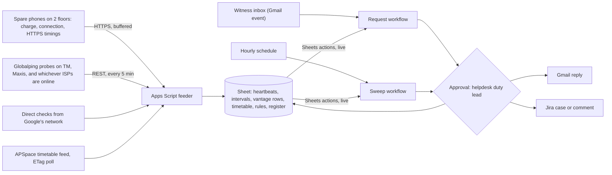

# Outage Witness

Outage Witness turns four plugged-in spare phones on two teaching floors, plus public network probes on Malaysian ISPs, into an independent, timestamped register of connectivity failures for APU's IT helpdesk at TechCentre, whose published SLA makes in-session classroom Wi-Fi an urgent matter. When a lecturer, a helpdesk agent, or a student emails the Witness inbox a site and a time window, a Gemini Enterprise workflow reads the live register and an editable rule Sheet and decides one thing: was a failure independently witnessed there and then? The answer is observed or degraded (at site or service scope, tagged in-session from the public timetable), not observed at a covered site, or no coverage, and the helpdesk duty lead approves the witness note before it goes out as a reply and a Jira case. When a fix is reported, the same decision runs over later in-session windows, and the case can't read "held" until comparable load has passed without a recurrence. Track: Intelligent Automation & Digital Transformation. Rank and score: see the [ranking](/docs/ideas/00-ranking.md).

Contents:

1.  [At a glance](#at-a-glance)
1.  [Origins](#origins)
1.  [Problem and evidence](#problem-and-evidence)
1.  [How it works](#how-it-works)
1.  [Why people will use it](#why-people-will-use-it)
1.  [Why the crowd won't build it](#why-the-crowd-wont-build-it)
1.  [Scores](#scores)
1.  [Research plan](#research-plan)
1.  [Time to impact](#time-to-impact)
1.  [Demo and review](#demo-and-review)
1.  [Build plan](#build-plan)
1.  [Risks and kill criteria](#risks-and-kill-criteria)
1.  [See also](#see-also)

## At a glance

| Item                  | Outage Witness                                                                                                                                                                                                                |
| --------------------- | ----------------------------------------------------------------------------------------------------------------------------------------------------------------------------------------------------------------------------- |
| Owner                 | APU's IT helpdesk, whose walk-in counter is TechCentre on Spine level 6, below the Technology Services Office ([campus guide][kb-guide]); it publishes the [SLA][kb-sla]. Not yet confirmed; it's the first interview         |
| First users           | Helpdesk agents handling in-session classroom cases; lecturers who receive "my connection failed" reports; students inside the 3-day EC window                                                                                |
| Track                 | Intelligent Automation & Digital Transformation                                                                                                                                                                               |
| Trigger               | An email to the Witness inbox naming a site and a window, or a fix time (Gmail "When an email is received"); an hourly schedule advances recovery watches and catches missed events                                           |
| Live signal           | 4 spare Android phones on chargers on 2 teaching floors (charge state, connection type, timed HTTPS fetches, buffered when offline); Globalping HTTP checks from Malaysian ISPs and direct checks from Google every 5 minutes |
| Connectors            | 1P Gmail (GA: trigger, label, send); 1P Drive with Sheets actions (GA: live cell reads, register writes); 3P Jira Cloud (GA: search, create, comment, change status). Globalping enters through the feeder; no MCP            |
| Decision              | Was a connectivity failure independently witnessed at this site or service in this window: observed, degradation window, not observed at a covered site, no coverage, or unknown                                              |
| Action and approval   | One witness note (reply, Jira case or comment, register row) behind one approval by the helpdesk duty lead in **Needs Review**; a named team steward approves until the helpdesk agrees                                       |
| Reviewer self-trigger | Email the inbox a site and window; or open the probe page on one phone and unplug it (refused), or on two phones and turn Wi-Fi off within 60 seconds (a labelled test episode)                                               |

[kb-guide]: https://apiit.atlassian.net/wiki/spaces/LNO/pages/3855974442

## Origins

- **[Outage Witness](/docs/ideas/opus-01/05-outage-witness.md), the lead:** **Kept** the name, the witness question and its answers, the quorum, no-self-witness, coverage and cross-network rules, buffered delivery as the visible network, the Gmail request trigger with **Request info**, the approved register, the spoof tests, and window-based scoring. **Changed** the owner from the EC office to the IT helpdesk: a note approved by an APU support service answers the rule's "independent ... support service", where a student-run register may not, and the helpdesk is reachable at a walk-in counter; the EC office becomes a reader of notes. Globalping now enters only through the feeder, because it isn't a workflow connector ([workflows][ge-wf]), and the 72-hour watch became the comparable-load recovery rule. **Dropped** residence sites, power-outage episodes, Accommodation custody, prepaid SIMs, iPhone Shortcuts, the Pico board, the TNB check, provider-outage episodes, and the Globalping MCP add-on: together they needed 8–12 phones, three offices, and wardens' consent. The provider rule also fails on its own terms (**Inference**): an ISP-wide outage takes that ISP's Globalping probes offline, so they can't report it.
- **[SpineDesk Pulse](/docs/ideas/argon/01-spinedesk-pulse.md):** **Kept** the owner and its SLA clause as the impact hook, the in-session join to the timetable, the editable rulebook, and folding repeat reports into one case. **Changed** the timetable join from a Cloud Run custom MCP server, which is preview, blocked by default by an organisation policy, and needs a card ([custom MCP](/docs/research/gemini-enterprise.md#requirements-and-registration)), to an Apps Script poll of the public feed into the Sheet. **Dropped** the MCP server, the duplicate ServiceNow incident, SharePoint and Calendar dispatch, the lecturer's QR page and one-tap flags (it sensed only while someone held a page open), KB troubleshooting scenarios as test items, and the dispatch decision itself, which is the saturated fault-to-ticket pattern.
- **[Recheck](/docs/ideas/astra/01-recheck.md):** **Kept** the comparability rule (same place, same endpoints, comparable load), "unknown never counts as recovered", separate source, receipt, and workflow times, proving the action inventory first, and the agent-against-rules baseline. **Changed** the retest from a person walking back to the spot to the same plugged-in probes over later in-session windows. **Dropped** student-run checks and student-typed context, which the EC rule would treat as self-certification, and the unnamed IT reviewer. Recheck calls Jira comments and status changes unproven; the research lists both as GA actions ([actions][ge-act]), and the 4 November test still proves them.
- **[OnBoard Airtime Guard](/docs/ideas/argon/05-onboard-airtime-guard.md):** **Kept** Teams airtime congestion as the expected source of degradation windows, and the per-floor congestion summary, now from fixed probes, as a 6-month by-product. **Dropped** the study-spot finder, the microphone check, Calendar holds, the vacant-room MCP server, and crowd participation: a crowded student-facing category with no owner, whose escalation never fires without a crowd.

## Problem and evidence

APU's rules, read through the public Confluence REST API without logging in on 4 November 2026:

- **In-session classroom Wi-Fi is urgent:** urgent requests include "Classroom teaching and learning (during session) including Wi-Fi connection, A/V, and streaming issues", and "All urgent matters during office hours will be responded immediately with the consideration of onsite assistance travel time"; other requests get a first response within 24 hours and resolution within 48, in office hours of 8:30 AM to 6:00 PM, Monday to Friday ([SLA][kb-sla], version 3 of 26 January 2021).
- **Closure follows status, not evidence:** a DONE ticket "has been solved by support staff and is waiting for your satisfaction feedback", and a CLOSED one "has been automatically closed due to inactivity of (2) two days" ([ticket status][kb-status]). Reports go through the Virtual Help Centre: pick a help desk, a request type, then the details ([Help Centre guide][kb-vhc]).
- **APU names the recurring degradation:** Wi-Fi is "a shared (and half-duplex) medium", Teams traffic can make airtime "run out (or reach 100% utilization)", and "only one device in a room or classroom needs to be connected" to a Teams call ([Teams Wi-Fi page][kb-teams]).
- **Assessment claims need timestamped, independent evidence:** a network-failure claim needs "evidence of the network issue with appropriate time stamp and screen shots ... along with any related engagement with the concerned lecturer or invigilation staff, without which the claim will be rejected", and where "a significant number of computers were out of action for several hours" the student "should request the Technical Assistant to countersign" ([IT equipment fails][kb-it]). "The University will not accept self-certification", and claims are "strengthened when supported by the University staff such as Academic Mentors, Programme Leaders or Lecturer" ([documents needed][kb-docs]); without evidence, "find an independent person, organization or support service that can provide verification" ([no evidence][kb-noevid]); claims go in "no more than 3 days after" ([submit EC][kb-submit]).

The pain behind the rules:

- **Students:** five APU Reddit threads from 2025–2026 complain about Wi-Fi, one commenter losing signal "around the cafeteria when there's a lot of people and near any of the stairs" ([Reddit][soc-red]); a former student named unstable Wi-Fi in rooms S0801 and E0903 ([S2][soc-s2]); 10 of 58 low-star reviews mention Wi-Fi, internet, systems, or sockets, including "Moodle and APspace constantly crashing" (2 stars, 18 June 2026) ([reviews][soc-wifi]). These are unverified symptoms, not diagnoses.
- **Helpdesks:** "help getting connected to the wireless network" is among the most common tier-1 calls at a large university ([helpdesk threads][soc-help]); facilities managers lose hours to "the follow-ups and status tracking … Why is this still open?" ([facilities threads][soc-fm]).
- **No citable record outside IT:** Technology Services says "Proactive monitoring of wireless networks is undertaken by TS on a regular basis" ([Wi-Fi policy][kb-wpol]), but publishes nothing: `status.apu.edu.my` doesn't resolve (01:48 MYT, 4 November), and 23 APU searches on X found no first-hand Wi-Fi, Moodle, or APSpace complaint ([X][soc-x]). A student's own screenshot is the self-certification the rule refuses.
- **Outage records count elsewhere:** the Australian National University accepts "evidence you are customer of an Internet Provider Service that experienced a wide-spread internet outage" ([ANU EC page]).
- **Volume is unknown:** neither in-session urgent cases per week nor network-failure claims are public; the first interview asks the helpdesk for the real count.

[kb-status]: https://apiit.atlassian.net/wiki/spaces/ITSM/pages/1530527755
[kb-vhc]: https://apiit.atlassian.net/wiki/spaces/ITSM/pages/1337360387
[kb-teams]: https://apiit.atlassian.net/wiki/spaces/ITSM/pages/2291695772
[kb-it]: https://apiit.atlassian.net/wiki/spaces/AA/pages/2229272659
[kb-docs]: https://apiit.atlassian.net/wiki/spaces/AA/pages/221152216
[kb-noevid]: https://apiit.atlassian.net/wiki/spaces/AA/pages/2229338213
[soc-red]: /docs/research/social.md#campus-wi-fi-and-network-filtering
[soc-wifi]: /docs/research/social.md#wi-fi-power-and-core-platforms
[soc-help]: /docs/research/social.md#it-helpdesk-tickets
[soc-fm]: /docs/research/social.md#facilities-approvals-follow-ups-and-proof-of-work
[soc-x]: /docs/research/social.md#apus-footprint-on-x
[ANU EC page]: https://anu.edu.au/students/program-administration/assessments-exams/extenuating-circumstances-application

## How it works

1.  **Probe (unattended, decides its own state):** a page on GitHub Pages, opened once on each spare phone and left on a charger with a wake lock, fetches `www.gstatic.com/generate_204` every 60 seconds and sends HEAD requests to Moodle's login page (`lms2.apiit.edu.my`) and APSpace every 5 minutes, never logging in. It reports a random probe ID, a floor label, charge state, connection type, and timings; offline readings queue on the phone and arrive later with their device time. Sites are two teaching floors the helpdesk picks, for example S-08 and E-09, where the [S2][soc-s2] rooms sit; floors are Block-Level codes from the [timetable room codes][apu-rooms].
1.  **Feeder (unattended, Apps Script):** `doPost` stamps receipt time. A 5-minute time trigger creates Globalping HTTP measurements of Moodle and APSpace on three probes from different Malaysian ISPs, checks both directly from Google's network, polls the timetable with `If-None-Match` ([change behaviour][apu-change]), and writes an error row for any failed call. It builds per-probe state intervals and per-slot vantage rows with measurement IDs, and never decides that an outage happened ([phone to Sheets][ge-sheets]).
1.  **Request (event):** a lecturer forwards a student's report, a helpdesk agent asks about a case, a student checks before filing, or anyone reports a fix time. Gmail's trigger starts the request workflow within 5–10 minutes ([triggers][ge-trig]); a **Request info** step asks for a missing site or window ([workflows][ge-wf]).
1.  **Decide (Gemini agent node):** reads the rule Sheet, intervals, vantage rows, and timetable rows live through Sheets **Get cell values** ([actions][ge-act]), applies the witness rules, searches Jira for an open case on the same site and window, and drafts a note with record, probe, and measurement IDs. It never says a claim is false and never names a cause.
1.  **Approve (the one gate):** connector writes from a workflow require human review anyway ([unattended runs][ge-un]); once the duty lead approves, the reply goes out, the case is created or commented, and the register row is written.
1.  **Sweep (hourly):** advances recovery watches, answers requests the event trigger missed (no `witness/answered` label), and at 08:00 drafts yesterday's episodes and probe-health lines ("probe S08-2 silent since 14:20") for the same approval.
1.  **Close the loop:** the helpdesk records each case outcome, and lecturers or the EC office may record whether a note was used; those outcomes label the monthly precision check.

**Witness rules,** in a versioned Sheet the helpdesk edits:

- **Quorum:** a site episode needs at least two enrolled probes, and every live probe at the site, in the same failed or degraded state with onsets within 60 seconds. Two probes on one power strip count as one; one device never corroborates.
- **Unplug check:** a probe that isn't charging is excluded from network episodes. If every probe at a site stops charging within 60 seconds, the steward gets a "site power loss, unverified" line, not a verdict.
- **Service scope:** Moodle or APSpace failing (error or over 10 seconds) on at least two Globalping probes on two different Malaysian networks in the same 5-minute slot, plus Google's network or a floor probe. Count networks, not probes.
- **Site scope:** the floor's quorum fails the control URL or both APU services while Globalping and Google see those services healthy.
- **Degradation window:** a check over three times its 3-day median for that hour, for two consecutive slots, on the quorum; a fixed 2-second threshold applies until 3 days of history exist.
- **Coverage and freshness:** a floor is covered only if at least two probes reported normally in the 10 minutes before the window and through it (late buffered rows count); otherwise "no coverage", never "not observed". A missing heartbeat, a failed check, or an error row makes that source "unknown", and unknown never yields "not observed" or "held".
- **SLA tag:** a site episode in office hours that overlaps timetabled sessions on that block and level is tagged "in session, urgent under the SLA", with the session count and the timetable version (ETag and fetch time) live during the window; if none was fetched in the 24 hours before, the tag reads unknown with the error.
- **Comparable recovery:** after a reported fix time, "held" needs three later 30-minute windows with at least as many timetabled sessions on that level as the original episode, full coverage, and no failure; any recurrence is "recurred", with its episode ID; seven days without three such windows is "not comparable yet". Nothing reopens APU's ticket; the duty lead decides.
- **No self-witness and no duplicates:** only enrolled probes count, nobody can upload screenshots or logs, and no requester ever holds a probe; a request overlapping an open case becomes a comment on it.

**States:** requests go received → info requested → drafted → **Needs Review** → sent or rejected. Verdicts are observed (service or site), degradation window, not observed at a covered site, no coverage, or unknown. Watches go watching → held, recurred, not comparable yet, or unknown. Probes are live, buffering, silent, or not charging.

**Failure handling:** a Globalping, direct-check, or timetable failure writes an error row with time and HTTP status, and its slot becomes unknown; nothing reuses an earlier value. Event runs that fail on quota aren't retried, so the hourly sweep picks them up ([unattended runs][ge-un]). Schedules run on the author's credentials, refreshed before 11 November and every 14 days after.

**Cloud, IoT, and network, each load-bearing:**

- **No verdict without all three:** phones' charge state and HTTPS reachability on the floor; Malaysian ISP vantage points, per-row delay from device time to receipt, and buffered backlogs; Apps Script feeding Gemini Enterprise workflows. ICMP to Moodle is blocked (100% ping loss from three probes in the source idea's 4 November check), so every check is HTTP.
- **Sensors:** the Battery Status API works in Chrome on Android, not in Safari or on iOS, and `navigator.connection.type` only in Chrome for Android (MDN browser-compat-data, checked in [the source idea](/docs/ideas/opus-01/05-outage-witness.md#cloud-iot-and-network)), so Android phones are the probes and iPhones only run network checks ([phone sensors][iot-phone]).
- **Vantage points:** at 01:48 MYT on 4 November the Globalping API listed 5,389 connected probes, 42 in Malaysia, 18 of them on home or mobile ISPs: 14 TM, 2 Maxis, 1 TIME, and 1 U Mobile; at about 02:15 MYT a recheck found 44, with 1 DiGi and 0 TIME ([Globalping API]); Moodle's login page answered HTTP 200 in 0.41 seconds and APSpace in 0.14.
- **Why dedicated plugged-in phones:** DumsorWatch's phones in Accra showed that simultaneous charge-state changes "correlate with ground truth grid reliability measurements", but participants uninstalled the app from their own phones while plug-in sensors "regularly remained plugged in" ([DumsorWatch chapter], [DumsorWatch]); hence spare phones on chargers, a foreground page, and a daily probe-health line.

[apu-rooms]: /docs/research/apu.md#timetable-room-codes
[apu-change]: /docs/research/apu.md#timetable-feed-change-behaviour
[ge-sheets]: /docs/research/gemini-enterprise.md#phone-or-board-to-google-sheets
[ge-trig]: /docs/research/gemini-enterprise.md#triggers-and-schedules
[ge-un]: /docs/research/gemini-enterprise.md#what-runs-without-anyone-signed-in
[iot-phone]: /docs/research/iot-and-network.md#phone-and-laptop-sensors-in-the-browser
[DumsorWatch chapter]: https://nline.io/docs/klugman22developmenteng.pdf

## Why people will use it

- **The helpdesk gets scope and end time without a site visit:** an urgent in-session case arrives with whether the floor, the service, or neither failed, when it began and ended, and how many timetabled sessions it hit, so "responded immediately" starts from evidence; closure waits for "held" under comparable load rather than the 2-day inactivity close.
- **Lecturers forward what already reaches them:** the EC rule expects "engagement with the concerned lecturer", so "my connection failed" emails land with lecturers; one forward returns an approved note they can attach to the supporting statement the rules say strengthens a claim.
- **Students check before filing:** within the 3-day window, a student looks up the published register and cites the record ID in the EC e-Form, which accepts PDF and image uploads ([submit EC][kb-submit]).
- **Zero install for askers:** email and a view-only Sheet; a probe host opens one page and leaves the phone on its charger.
- **Habit loop (Inference):** requests bunch up in assessment weeks and after in-class failures, and every approved outcome and every "held" or "recurred" result becomes a label for the monthly precision check.
- **After the team leaves:** the helpdesk owns the rule Sheet and the approvals, Technology Services holds the probes and the script, and a named steward refreshes credentials every 14 days.

## Why the crowd won't build it

- **It isn't the network watch:** Wi-Fi diagnosis (8.7% of 780 simulated ideas) and fault-to-ticket (7.6%) are saturated, built on access-point telemetry with auto-filed tickets ([saturation tiers][cb-sat]), and the IT helpdesk network watch is [CONTEXT's worked example](/docs/CONTEXT.md#recommended-shape). Outage Witness reads no access point, files no fault, and dispatches no one: it answers a question about a past window, refuses when one device is all it has, and blocks "held" until comparable load has passed.
- **No cluster covers evidence or recovery:** none of the 26 crowd clusters covers claims, evidence, or closure checks ([clusters][cb-clu]), and none of the briefing's examples does ([briefing ideas][cb-brief]).
- **The crowd fakes feeds and skips owners:** "simulate", "mock", "synthetic", or "dummy" appears in 98% of Claude responses, 3% of ideas use public feeds, 2 of 780 name Jira, ServiceNow, SharePoint, or MCP, and 1% combine an unattended run, a named owner, and a measured baseline ([crowd misses][cb-miss]).
- **Substitutes exist:** NetBeez sells client-perspective Wi-Fi sensors to universities, and Jira Service Management automates incidents and reopens closed alerts ([substitutes][cb-subs]). The untested contribution is a citable witness note and comparable recovery evidence under APU's own SLA and EC rules; if Technology Services already keeps client-side history, the workflow reads that instead (a kill criterion).
- **Nearest projects are single-device:** the source idea's 4 November check found two personal outage loggers on GitHub, both single-device self-evidence, and no Devpost project tying several probes to an institution's evidence rule ([crowd check](/docs/ideas/opus-01/05-outage-witness.md#why-the-crowd-wont-build-it)).
- **Honest limit (Inference):** the signal is still campus Wi-Fi reachability, so some reviewers will file it next to the helpdesk watch; the pitch opens on the SLA and EC rules and the refusal, never on a dashboard.

[cb-sat]: /docs/research/competition.md#saturation-tiers
[cb-clu]: /docs/research/competition.md#clusters-and-shares
[cb-brief]: /docs/research/competition.md#ideas-shown-at-the-briefing
[cb-miss]: /docs/research/competition.md#what-the-crowd-structurally-misses
[cb-subs]: /docs/research/competition.md#existing-substitutes

## Scores

**72.7 / 100, rank 3 of 8** in the [cross-set ranking](/docs/ideas/00-ranking.md). Three independent scorers rated this doc on the [unified matrix](/docs/ideas/00-ranking.md#scoring-matrix): an NTT DATA forward deployed engineer (FDE), an APU School of Technology IoT lecturer, and a Google Cloud advocate who is also an APU student. The used score is their mean, except day-to-day workflow and theme, which take the lowest. The reason shown is the lowest scorer's. Per-scorer totals: FDE 66.6, lecturer 82.8, advocate 78.2. All three passed it on every gate. The source ideas scored Outage Witness 72.4, SpineDesk Pulse 63.3, Recheck 58.4, OnBoard Airtime Guard 49.3 on the same matrix before the merge.

| Component           | Weight | FDE | Lecturer | Advocate | Used | Lowest scorer's reason                                                                                                                                                                          |
| ------------------- | -----: | --: | -------: | -------: | ---: | ----------------------------------------------------------------------------------------------------------------------------------------------------------------------------------------------- |
| Impact              |     14 |   3 |        4 |        3 | 3.33 | Helpdesk SLA and EC rule are cited from APU's own KB, but the weekly volume of in-session cases is unknown and the owner unconfirmed.                                                           |
| Connectors          |     14 |   4 |        5 |        4 | 4.33 | Gmail trigger and reply, Drive/Sheets live read and write, Jira search, create, comment, status; Globalping goes in via feeder, so the network connector is not used in the loop.               |
| Day-to-day workflow |     14 |   4 |        5 |        5 |    4 | Gmail request trigger, hourly sweep, recovery watch, versioned witness rules in a Sheet, and one approval, but requests are sporadic.                                                           |
| Research            |     14 |   3 |        4 |        4 | 3.67 | Strong APU KB evidence (SLA, EC no self-certification), yet student pain is symptom-level and eight interviews across helpdesk, Technology Services and EC office are hard by 10 Nov.           |
| Time to impact      |     14 |   3 |        3 |        3 |    3 | Needs Technology Services consent for probes on floors (policy says it can disable non-standard devices) and OnBoard@APU four-device limits; 6-month handover to a service account is credible. |
| Theme               |     10 |   4 |        5 |        5 |    4 | Four plugged-in phones with charge state and offline buffering plus Globalping ISP vantage points make IoT and network visible.                                                                 |
| Originality         |     10 |   2 |        3 |        3 | 2.67 | Reads as the IT-helpdesk network watch the brief lists as saturated; the evidence-witness framing is distinct but reviewers may fold it in.                                                     |
| Buildability        |      5 |   3 |        4 |        4 | 3.67 | Four phones, Globalping token, five-minute feeder and recovery rule in six days; no card.                                                                                                       |
| Demo                |      5 |   4 |        4 |        5 | 4.33 | Reviewer emails a site and window or unplugs a phone page; video shows a probe unplugged.                                                                                                       |

## Research plan

- **Round 1, the problem (5–6 November):**
  - P1: an IT helpdesk agent at TechCentre: the last urgent in-session case, how its scope and end were established, how closure was decided, the real weekly count of in-session Wi-Fi and A/V cases, and who the "Technical Assistant" who countersigns EC claims is.
  - P2: a Technology Services network engineer (Spine level 7): what the proactive monitoring shows and keeps, whether client-side checks exist, and consent for probes on two floors.
  - P3–P4: two School of Technology lecturers who have had an in-class Wi-Fi failure or a "my connection failed" email: what they did and what they would sign.
  - P5: a student who lost connection during an assessment: what evidence they had and what happened.
- **Round 2, the solution (7 November, and 9 November by video call on the Deepavali day in lieu):** P1 again with real witness notes; P6, the helpdesk duty lead, on approving notes and the "held" rule; P7, the Office of Extenuating Circumstances Claims through Academic Administration, on whether a helpdesk-approved note counts as independent (if unreachable, record the attempts); P8, an Academic Mentor or Programme Leader, on attaching a note to a supporting statement. Label quotes by role and keep consent records out of the repo ([consent](/docs/research/judging.md#consent-and-anonymised-quotes)).
- **Timed observation (6 November, with P1):** time how long it takes to answer "was Wi-Fi down on this floor between these times?" for three real failures from this week (team members' and volunteers' own, shared with consent) by today's means, then with the witness note; record minutes and confidence. No figure is assumed before it.
- **Scoring 30–50 real windows:**
  - Items are 30-minute windows: every site or service episode from 5 to 7 November, plus matched quiet windows (same site, same hour, another day). Classes run on 4–6 and 10 November and the timetable holds none on 8–9 November ([row counts](/docs/research/apu.md#timetable-row-counts)), so floor windows rest on two class days; if fewer than 30 exist by 8 November, report the real n.
  - Two team members label each window blind to the verdict, from evidence the register doesn't use: a teammate's non-enrolled laptop logging Moodle and the control URL while on the floor, a no-names site diary (site, time, what failed), and helpdesk records if shared. Record disagreements.
  - The positive class is "a failure or degradation affected this site or service in this window". Lead with precision, because a false "observed" could back a false claim; report recall, the confusion matrix, n, and a Wilson 95% interval per scope, with "no coverage" counted apart ([accuracy](/docs/research/judging.md#measuring-an-agents-accuracy-honestly)). Score the agent and a rule-only Sheet formula on the same set.
  - **Spoof tests, labelled and kept out:** 10 single-probe unplugs, 5 two-probe Wi-Fi-off tests more than 60 seconds apart, and 3 single-probe Wi-Fi-off tests; the expected number of episodes is zero.

## Time to impact

- **By 3 months (4 February 2027):** the helpdesk duty lead approves notes in office hours; probes cover 4–6 floors the helpdesk picks, spanning the 24 November 2026 intake; lecturers on those floors forward reports. **Measured:** requests a week, minutes per verification against the baseline, precision against the helpdesk's own records, the share of urgent in-session cases with a witnessed start and end, recurrences the recovery rule catches, and weekly probe uptime (target 80% or better).
- **By 6 months (4 May 2027, after the 25 March 2027 intake):** Technology Services holds the probes, enrolled under a service account instead of team members' four-device OnBoard@APU allowance ([campus Wi-Fi](/docs/research/iot-and-network.md#apu-campus-wi-fi)), and the Apps Script project; the inbox moves to an Outlook shared mailbox and cases to the Virtual Help Centre's own Jira site through GA connectors, the one change to an APU system, made with Technology Services' consent ([APU systems](/docs/research/apu.md#systems-apu-runs)); the EC office decides whether a helpdesk note counts as evidence. **Measured:** the share of urgent in-session cases closed with "held" evidence, the recurrence rate, EC claims citing a note, outage minutes per floor per month, and a quarterly per-floor degradation summary for the network team.
- **Owners:** business owner, the IT helpdesk lead at TechCentre; IT owner, Technology Services' network team; reader of notes, the Office of Extenuating Circumstances Claims; data protection, whoever answers for PDPA at APU ([owners](/docs/research/judging.md#owners-and-what-has-to-be-true)).
- **Assumptions:** the helpdesk agrees in writing; APU keeps or licenses Gemini Enterprise seats; the organisers grant written permission for KB text and the timetable feed; a named person refreshes schedule credentials.

## Demo and review

| Time      | Beat                          | On screen                                                                                                                          |
| --------- | ----------------------------- | ---------------------------------------------------------------------------------------------------------------------------------- |
| 0:00–0:10 | Slate                         | "Recorded from the live system", with the capture date                                                                             |
| 0:10–0:35 | Problem                       | The SLA's urgent clause; the EC rule's "without which the claim will be rejected"; the baseline minutes                            |
| 0:35–1:30 | One real request, end to end  | A forwarded real failure from the week; the Runs tab reading Sheets; the verdict with IDs and its SLA tag; approve; reply and case |
| 1:30–1:50 | One device never corroborates | A probe unplugged on camera, labelled as a test: the reading lands, no episode forms, and the rule line shows why                  |
| 1:50–2:15 | The network, visible          | A probe's Wi-Fi off and on: buffered readings arrive with their delay; Globalping rows from TM and Maxis                           |
| 2:15–2:40 | Fixed means held under load   | A real fix notice and the hourly "held", "recurred", or "not comparable yet" draft; if no real fix happened, it says "untested"    |
| 2:40–3:05 | Impact                        | Minutes before and after; precision and recall with n and interval; the agent against the rule-only formula                        |
| 3:05–3:30 | Research                      | Eight interviews and what changed because of them                                                                                  |
| 3:30–3:45 | Close                         | 3- and 6-month owners; repo, app, and video links; the capture date again                                                          |

- **A reviewer triggers it by email:** "Moodle from Block S level 8, 5 Nov 10:00–10:30", or "S-08 Wi-Fi fixed at 15:00 today", and the reply arrives once the steward approves; the team watches **Needs Review** from 8 AM to midnight MYT during 11–14 November.
- **Or by phone:** open the probe page as site "reviewer" and unplug it: the reading lands and no episode forms. With two phones, turn Wi-Fi off on both within 60 seconds: a real test episode forms at the reviewer site, labelled and kept out of the register and the scored set.
- **Access:** reviewers need a seat, the Gemini Enterprise User role, and the workflow shared with them; shared users see only their own runs, so the README and video show the owner's Runs tab over several days ([reviewer access](/docs/research/gemini-enterprise.md#reviewer-access)).

## Build plan

| Day        | Build, critical path first                                                                                                                                | Research and operations                                                                                              | Done when                                                                       |
| ---------- | --------------------------------------------------------------------------------------------------------------------------------------------------------- | -------------------------------------------------------------------------------------------------------------------- | ------------------------------------------------------------------------------- |
| Wed 4 Nov  | Action inventory in a draft workflow: Sheets cell read and write, Gmail send and label, Jira create, comment, status; the probe page on one Android phone | Permission asks: organisers (KB text, timetable feed), Technology Services (two floors); Globalping account; recruit | Each action ran once; a phone ran 2 hours and a Wi-Fi drop landed buffered rows |
| Thu 5 Nov  | 5-minute feeder: Globalping, direct checks, timetable poll, intervals, error rows; 4 probes on 2 floors; sweep workflow on                                | Round 1 begins; diary form and laptop loop live                                                                      | The Runs tab shows unattended hourly runs                                       |
| Fri 6 Nov  | Request workflow: Gmail trigger, **Request info**, verdict, **Approval**, reply, Jira case and dedup                                                      | Round 1 ends; timed observation with P1                                                                              | A forwarded request gets an approved reply within 15 minutes                    |
| Sat 7 Nov  | Recovery rule and the 08:00 register; spoof tests                                                                                                         | Round 2 begins                                                                                                       | A watch reaches held, recurred, or not comparable yet on its own                |
| Sun 8 Nov  | Label and score windows; the agent against the rule-only formula; tune the rule Sheet                                                                     | Deepavali, remote; confirm every member has registered                                                               | Precision and recall written down with n                                        |
| Mon 9 Nov  | Feature freeze; record the video; reviewer access from a non-team account; refresh schedule credentials                                                   | Round 2 video calls                                                                                                  | A non-team account triggers a reply                                             |
| Tue 10 Nov | README, deck, and diagram, including what Antigravity built (probe page and feeder); submit                                                               | Final probe-health check                                                                                             | Submitted before noon                                                           |

- **No card, little hardware:** GitHub Pages, Apps Script and Sheets in the licensed Workspace domain, Gmail, Jira Cloud Free, and a free Globalping account; no Cloud Run, Pub/Sub, MCP server, or billing account. The hardware is 4 team-owned spare Android phones with chargers: with 2 phones the pilot covers one floor, and with none it still witnesses service scope.

## Risks and kill criteria

- **Kill on 4 November:** if Sheets cell reads or Jira create fail in the action inventory, or the licence is consumer-only so Workspace connectors refuse it ([account limits][ge-acc]), move requests to Jira Cloud event triggers and the register to Supabase (preview), or stop; never fake the store.
- **Kill on 6 November:** if P1 and P2 show Technology Services already answers "was it down there then" from its own monitoring within minutes and shares the answer, drop the phones and run the recovery rule on its data, or stop. If no floor gets placement consent, ship service scope only and say the IoT layer shrank.
- **Kill on 8 November:** if the agent's verdicts are less precise than the rule-only formula, ship the rule-only verdict and keep the agent for reading requests and wording notes, as the [shared delivery contract](/docs/ideas/astra/00-ranking.md#shared-delivery-contract) requires.
- **Not independent yet:** until the helpdesk approves notes, each one is labelled a team observation with raw IDs, and lecturers decide whether to cite it.
- **Too few real failures:** degradation windows and matched quiet windows fill the set; staged tests stay separate; report the real n.
- **Probe drift and theft:** use the cheapest spare phones, labelled, where staff can see them; the daily probe-health line names silent probes, and a silent probe only ever counts as offline. Chrome may discard a tab, so the page stays top-level on HTTPS.
- **Globalping drift:** probes are volunteer-hosted and come and go (44 in Malaysia at 00:23 MYT in the source check, 42 at 01:48, and 44 again at about 02:15, when TIME had none and DiGi one), so a slot without two networks is unknown. The anonymous limit is 250 measurement creations an hour per IP ([Globalping API]); **Inference:** Apps Script shares Google's IP addresses with other scripts, so the feeder uses an account token for its 72 tests an hour.
- **Privacy (PDPA):** probes send a random ID, a floor label, charge state, connection type, and timings, never location, names, MAC addresses, or accounts; the timetable's `NAME`, `SAMACCOUNTNAME`, and `LECTID` are dropped at ingest ([timetable personal data][apu-pd]); requests keep only site, window, and requester role, forwarded emails are deleted after 30 days and heartbeats after 90 ([PDPA][jd-pdpa]).
- **Permissions and load:** APU's Terms of Use reserve copyright, so KB text and the timetable feed are used only with written permission ([terms][apu-terms]); Technology Services "has the right to disable any non-standard device" ([Wi-Fi policy][kb-wpol]), so ask before placing probes; each probe sends one HEAD request to each APU service every 5 minutes and never logs in.
- **Platform limits:** every write pauses for review; credentials expire after 14 days; quota failures on event runs aren't retried, which the sweep covers; about 24 sweep runs plus requests a day sit against one Standard seat's 160 queries, measured over ten runs and slowed above 80% ([limits][ge-lim]).
- **Read as the Wi-Fi watch:** the pitch opens on the SLA and EC rules and the refusal, and the product files no fault tickets.

[ge-acc]: /docs/research/gemini-enterprise.md#edition-and-account-limits
[apu-pd]: /docs/research/apu.md#personal-data-in-the-timetable-feed
[jd-pdpa]: /docs/research/judging.md#malaysias-pdpa-and-the-2024-amendment
[apu-terms]: /docs/research/apu.md#terms-of-use-and-robotstxt
[ge-lim]: /docs/research/gemini-enterprise.md#limits-that-bite-in-a-one-week-build

## See also

- [Gemini Enterprise](/docs/research/gemini-enterprise.md): triggers, approvals, actions, Globalping, live-data paths, and reviewer access.
- [APU](/docs/research/apu.md#apu-knowledge-base-on-confluence): the public KB, the timetable feed, APU's systems, and its terms.
- [IoT and network](/docs/research/iot-and-network.md#what-a-judge-can-see-of-the-network): what a judge can see of the network.
- [Competition](/docs/research/competition.md): the crowd map, saturation tiers, and existing substitutes.
- [Social](/docs/research/social.md#campus-wi-fi-and-network-filtering): the evidence of pain; [Judging](/docs/research/judging.md#minute-plan): the video minute plan.
- [Grid Watch: Mapping Blackouts with Smart Phones][Grid Watch] and [DumsorWatch in Accra][DumsorWatch]: the research behind charge-state outage sensing.

[kb-sla]: https://apiit.atlassian.net/wiki/spaces/ITSM/pages/491356161
[kb-submit]: https://apiit.atlassian.net/wiki/spaces/AA/pages/221152223
[kb-wpol]: https://apiit.atlassian.net/wiki/spaces/ITSM/pages/2215378997
[ge-wf]: /docs/research/gemini-enterprise.md#workflows
[ge-act]: /docs/research/gemini-enterprise.md#actions-and-write-back
[Grid Watch]: https://patpannuto.com/pubs/klugman14gridwatch.pdf
[DumsorWatch]: https://nline.io/docs/klugman19scale.pdf
[soc-s2]: /docs/research/social.md#s2-a-former-student-names-classrooms-and-several-service-failures
[Globalping API]: https://api.globalping.io/v1/spec.yaml
