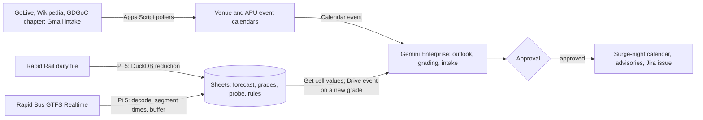

# Fanfall

Fanfall forecasts how hard each concert, match or expo night at the Bukit Jalil National Sports Complex will hit APU's evening, tells the organiser of each affected APU evening event what to do about it, and grades its own forecast the next day against Rapid Rail's gate taps at LRT Bukit Jalil. It is for organisers of APU evening events, starting with student clubs, under the proposed track **Data-Driven Research & Intelligent Decision Making**. Caveat: off campus the team runs no sensor of the crowd itself, no owner has agreed yet, and the phone-timed trips from APU to the platform need someone at APU, so they are deferred past 10 November. **Inference** marks conclusions no source states.

Contents:

1.  [At a glance](#at-a-glance)
1.  [Origins](#origins)
1.  [Problem and evidence](#problem-and-evidence)
1.  [How it works](#how-it-works)
    1.  [Signal to cloud path](#signal-to-cloud-path)
    1.  [Day-to-day workflows](#day-to-day-workflows)
    1.  [The rules sheet](#the-rules-sheet)
    1.  [States and failure handling](#states-and-failure-handling)
    1.  [Connectors and platform check](#connectors-and-platform-check)
    1.  [Cloud, IoT and network](#cloud-iot-and-network)
    1.  [Real data and privacy](#real-data-and-privacy)
1.  [Why people will use it](#why-people-will-use-it)
1.  [Why the crowd won't build it](#why-the-crowd-wont-build-it)
1.  [Off-campus fit](#off-campus-fit)
1.  [Scores](#scores)
1.  [Research plan](#research-plan)
1.  [Time to impact](#time-to-impact)
1.  [Demo and review](#demo-and-review)
1.  [Build plan](#build-plan)
1.  [Risks and kill criteria](#risks-and-kill-criteria)
1.  [Not verified](#not-verified)
1.  [See also](#see-also)

## At a glance

| Field                 | Plan                                                                                                                                                                                                                 |
| --------------------- | -------------------------------------------------------------------------------------------------------------------------------------------------------------------------------------------------------------------- |
| Owner                 | Proposed, not agreed: the events lead of an APU club with evening events, asking clubs other than GDGoC APU first because GDGoC APU co-runs this hackathon. Until one agrees, a teammate runs the desk and approves. |
| First users           | Organisers of APU evening events who opt in; students and lecturers who subscribe to the public surge-night calendar by URL                                                                                          |
| Track                 | Data-Driven Research & Intelligent Decision Making                                                                                                                                                                   |
| Trigger               | Calendar event trigger (new or changed venue listing or APU event); Gmail "When an email is received" (forwarded listing); 07:00 MYT schedule; Drive event (new grade file); Jira issue Done (event type unverified) |
| Live signal           | Rapid Rail daily gate taps at `SP17`; Rapid Bus GTFS Realtime positions every 30 s, decoded on the team's Pi 5; GoLive and Wikipedia venue listings; GDGoC APU's public chapter events                               |
| Connectors            | 1P: Google Calendar (trigger; Create and Update event), Gmail (trigger; Send), Drive and Sheets (trigger; Get cell values). 3P: Jira Cloud Free (Create issue; Done trigger). MCP: none on the critical path         |
| Decision              | Per APU evening event on a forecast surge night: keep with an advisory, shift its start or end out of the crowd window, or ask the shuttle desk for a run. Per graded night: in band, miss, or unlisted surge        |
| Action and approval   | One bundle per run (surge-night calendar entry, opted-in organiser advisories, any Jira issue) behind one **Approval**; forecasting, grading and miss detection run unattended                                       |
| Reviewer self-trigger | Add an event to the shared "APU evening events (review)" calendar on a surge night, or forward a listing URL to the intake inbox; a seated reviewer can run `@Fanfall` with a date for a read-only answer            |

## Origins

This product revises one source idea, [Fanfall](/docs/ideas/opus/01/03-fanfall.md), against three scorers' objections and the team's limits (nobody at APU before 10 November, no APU staff help, no users recruited, one Pi 5).

- **Kept:** the forecast written down before the night and graded against gate taps the next day; venue listings landing on a calendar with source URL and revision; the Gmail intake for shows the feeds miss; the public surge-night calendar; all arithmetic outside the model (now tested TypeScript, not Sheet formulas); one approval per bundle; Jira issues for misses and unlisted surges.
- **Changed, the sensing:** all three scorers said the "load-bearing" phone leg timer needs volunteers walking from APU to the faregate. It is off the critical path and deferred until someone can be at APU; advisories say "minutes unmeasured" instead of "budget +N minutes". The team's Pi 5 replaces the GitHub Actions job and the hand-written Apps Script protobuf decoder: it decodes GTFS Realtime with a library, reduces the ridership file with DuckDB, and posts only derived rows. That removes one build risk; it does not make the sensors the team's own (see [Cloud, IoT and network](#cloud-iot-and-network)).
- **Changed, the owner:** the source named GDGoC APU as owner. It hasn't agreed, and it supports this hackathon's coordination ([brief](/docs/BRIEF.md#at-a-glance)), so the doc asks other clubs first and lets a teammate run the desk until someone agrees.
- **Changed, APU content:** the source polled the timetable feed every 15 minutes and the shuttle JSON, which APU's Terms of Use require written permission for ([APU](/docs/research/apu.md#terms-of-use-and-robotstxt)). Neither is polled until permission arrives. The exposure counts below are a one-off count for this doc, and the shuttle times in the rules sheet are typed from APU's public schedule PDF with its URL.
- **Changed, the band:** the source's uplift percentiles held only 26 of 48 backtest nights. From 7 November the band is the backtest's own 10th–90th percentile relative error; both Weeknd nights are graded on the band as written.
- **Dropped:** Live Nation (its terms allow "personal and non-commercial use"), Wikidata (redundant with the Wikipedia pages), the FAM calendar (no home match at the complex in November in the source idea's check; fixtures come through the intake), the mid-evening night-watch update, and the custom MCP add-on.
- **Numbers re-checked on 5 November:** station distance 900 m → 880 m; stadium "87,000-seat" → 87,500 capacity (Wikipedia); 2026 weekday mean 3,804 → 3,809 (one more day); surge frequency 1.9 → 1.8 nights a month (plain eight-week median baseline); 20 November exposure 387 → 379 intake groups; GDGoC APU's surge-day events four → three (1 February logged 3,467 exits against a 1,836 Sunday median, under the 2,500 threshold) and completed events 35 → 36; the 23 May "2,067 normal" dropped (plain median 2,423); "T580 and 652 within 600 m of the station" → T580 is the only route within 500 m of campus; T580's scheduled leg "5 minutes" → 5 min 39 s; "GDGoC APU's NexConnect '26 final" → the hackathon's own final during NexConnect '26, whose organiser isn't known.

## Problem and evidence

APU sits about 880 m from LRT Bukit Jalil (`SP17`) ([data sources][ds gtfss]), the station for TM Stadium Nasional (87,500 capacity per its [Wikipedia page][wiki stadium]), Unifi Arena and the National Hockey Stadium. On a stadium night the crowd arrives as APU's afternoon classes let out.

- **The government named it this week:** Federal Territories minister Hannah Yeoh told the Dewan Rakyat on 2 November 2026, "We know there is congestion. Every weekend, whenever there is a concert, Bukit Jalil becomes extremely congested. Traffic builds up hours before the concert even begins." DBKL's consultants are running a Bukit Jalil micro-traffic study due in the first quarter of 2027, with a traffic management plan by February 2027 ([Malay Mail][malaymail], [paultan.org][paultan], both fetched 5 November).
- **Gate taps show the size**, recounted on 5 November from the [yearly files][od] by summing every origin into `SP17` and excluding the "A0: All Stations" rows ([data sources][ds od]): 2026 weekdays averaged 3,809 exits (219 days to 3 November). Stadium nights logged 38,447 (10 January), 32,929 (31 January) and 31,971 (17 October, when RapidKL kept the station open until 1 AM ([social research][x crowds])). Weekdays too: 19,640 on Tuesday 17 September 2024, 28,216 on Wednesday 28 May 2025 and 21,110 on Tuesday 10 June 2025.
- **How often:** from March 2024 to October 2026, 59 nights (1.8 a month) had at least 2,500 exits above the median of the same weekday over the previous eight weeks; 22 of them (0.7 a month) were weekdays. November 2026 is denser: GoLive and Wikipedia list The Weeknd (4–5 November), BABYMONSTER (14), 5 Seconds of Summer (17), My Chemical Romance (19–20) and Evanescence (28), and the source idea's 4 November fetch added arena shows on 7, 8 and 28–29 November and an expo on 13–15 November. Five of the concert nights are weekdays.
- **APU's exposure:** in a one-off count of the timetable feed on 5 November (unchanged since 28 October), physical classes (rooms not starting `ONL`) ending 16:45–19:30 cover 444 intake groups on 4 November, 468 on 5 November, 406 on 17 November, 384 on 19 November and 379 on 20 November. The weekday shuttle leaves APU for the LRT 12 times from 17:00 to 19:15, then at 20:45 and 21:45, both marked "Limited space only" ([shuttle PDF][shuttle pdf]).
- **Organisers already work around it by hand:** a cybersecurity meetup at APU warned "Expect major congestion in the Bukit Jalil area" for a match with "45k+ fans"; a hackathon posted its own "6:30 PM — APU → LRT Bukit Jalil" bus; a concert-goer asked RapidKL for longer hours because everyone "bertanya2 nak parking mana" (keeps asking where to park) ([social research][x crowds]). A landlord: "when's there concert or football matches The whole bukit jalil will be damn jam" ([social research](/docs/research/social.md#parking-supply-and-safety)).
- **Counterevidence:** GDGoC APU's chapter API lists 36 completed events since 18 October 2024 (with `status=Completed`; the unfiltered endpoint returns 26), 16 ending at 18:00 MYT or later. Three fell on surge days, and only one ran into the crowd: Friday 17 April 2026, a 16:00–19:00 workshop on a Sammi Cheng night (7,233 exits). The 31 January and 14 February events ended at 16:00 and 12:00, before the crowd. So one active club met one evening clash in two years. Surge nights are rare per organiser, RapidKL already extends hours, and DBKL's plan may fix the roads. **Inference:** the pain is real but intermittent; the product's value rests on months like November 2026 and on grading forecasts honestly enough that an organiser trusts the rare alert.
- **Today's workaround:** an organiser who thinks to check searches ticket sites and Instagram, guesses, and writes a notice or books a bus; nobody records whether the guess was right. **Inference:** most organisers don't check at all, because no APU calendar shows stadium nights; the interviews measure this.

[malaymail]: https://www.malaymail.com/news/malaysia/2026/11/03/hannah-yeoh-smart-city-solutions-bus-hub-among-plans-to-ease-bukit-jalil-concert-traffic/241750
[paultan]: https://paultan.org/2026/11/03/government-to-address-traffic-congestion-in-bukit-jalil-during-major-events/
[shuttle pdf]: https://publicwebsite-media.apu.edu.my/assets/2026-10/2026Oct22_APU-SHUTTLE-SERVICES.pdf

## How it works

### Signal to cloud path

The Pi 5 at a teammate's home posts rows over HTTPS to an Apps Script web app, which appends them to Sheets in the licensed Workspace domain ([IoT and network](/docs/research/iot-and-network.md#pi-to-apps-script-and-sheets)).

### Day-to-day workflows

1.  **Feeders (no card):** Apps Script time triggers poll GoLive hourly, Wikipedia's stadium and arena pages daily by revision ID, and GDGoC APU's chapter events daily. On surge nights and one matched normal night a week, the Pi polls Rapid Bus KL and MRT feeder positions every minute from 16:00 to 24:00, inside data.gov.my's 4 requests a minute ([data sources][ds gtfsr]). That is the pilot's probe; on the platform, the adapter polls every 60 s only in each night's arrival and exit periods ([TRD adapters](/docs/TRD.md#adapters-by-source)). Each row keeps source time, HTTP status and fetch latency; a failed poll writes an error row, never the last value.
1.  **Listings become calendar events:** each new or changed listing lands on a "Bukit Jalil venues" calendar with its source URL, show time and revision. APU events sit on an "APU evening events" calendar, filled by GDGoC APU's public feed and by organisers who opt in. In the P0 pilot, neither this calendar nor GDGoC APU's feed fills windows: they come only from the form ([WIN-1](/docs/PRD.md#windows-win)).
1.  **Forecast (tested TypeScript):** baseline = the median exits at `SP17` on the same weekday over the last eight weeks; uplift = the median extra exits for the event's class (stadium concert, stadium football, arena show) over two years; forecast = baseline + uplift, summed when two events share a night. The source idea wrote down 27,044 exits (band 19,315–32,100) for The Weeknd on 4 November at 01:07 MYT, against a 3,928 Wednesday baseline (re-checked). For 5 November, the same class uplift on a 3,881 Thursday baseline gives 26,997 (band 19,268–32,053), our arithmetic, written here at 07:25 MYT on 5 November, before the show. In the pilot, every forecast is appended to the `forecasts` tab before the night's arrival period, and a grade uses the latest one written before doors. These two predate the tab, so they go into it with the written-at times above and their provenance: the [source idea](/docs/ideas/opus/01/03-fanfall.md) for 4 November and this doc for 5 November (first on `main` at 01:15 MYT on 4 November and 08:11 MYT on 5 November).
1.  **Outlook run (Calendar event trigger and 07:00 schedule):** for the next 14 days the agent reads both calendars and the forecast and rules Sheets, decides which APU events overlap the arrival window (doors to show time) or exit window (show end plus 90 minutes), picks a recommendation from the rules sheet, and drafts one bundle: a surge-night calendar entry (forecast, band, windows) and one advisory per opted-in organiser.
1.  **One approval:** the desk approves the run's writes in one click; connector writes from a workflow need review anyway ([unattended runs](/docs/research/gemini-enterprise.md#what-runs-without-anyone-signed-in)).
1.  **The organiser decides:** a reply of "keep", "shift to 19:30" or "shuttle" is logged against the event, so every decision has a record. Logging replies is P1 ([CAL-17](/docs/PRD.md#calls-and-approvals-cal)), not in the pilot.
1.  **Grading (Drive event, daily):** Rapid Rail publishes night D's taps on D+1; on 5 November the [metadata][od meta] showed data to 3 November and the next update at 22:00. The Pi polls the metadata, reduces the file to that day's `SP17` exits and posts it; Apps Script writes actual, error and in-band flag and drops a dated file into a watched folder. The grading run ends with no writes when in band, and drafts a Jira issue when the night is out of band or a surge arrived that no listing explains ("Unlisted surge on 23 May 2026: 15,447 exits, over six times a normal Saturday"). These miss issues are P1, as review items ([ANL-4](/docs/PRD.md#grades-and-analysis-anl)); in the pilot, a grade opens no Jira issue.
1.  **Intake (Gmail trigger):** anyone forwards a listing URL; Gemini extracts venue, date, door and show times and event class, checks for duplicates, and drafts the calendar event for approval.

### The rules sheet

The desk edits it. Starting values come from the backtest's surge definition and APU's public shuttle PDF; round-one interviews set the rest.

| Rule                   | Fires when                                                                               | Recommends                                          |
| ---------------------- | ---------------------------------------------------------------------------------------- | --------------------------------------------------- |
| Surge night            | Forecast at least 5,000 exits above baseline                                             | Publish the calendar entry                          |
| Arrival clash          | An APU event ends between doors and show time                                            | Shift the end, or advise leaving before doors       |
| Exit clash             | An APU event ends within show end plus 90 minutes                                        | Shift the end, or advise waiting out the exit crowd |
| After the last shuttle | An APU event ends after 19:15, when the next runs are 20:45 and 21:45 with limited space | Ask the shuttle desk for a run                      |
| Single-source listing  | A listing comes from one undocumented source only                                        | Flag it in the bundle; the approver confirms        |

### States and failure handling

- **Listing:** proposed → approved → listed → changed or cancelled (needs approval). **Night:** forecast → drafted → **Needs Review** → sent → pending grade → in band, or out of band → Jira open → Done → re-forecast (the Jira steps are P1).
- **Late or changed ridership file:** the grade shows "pending" with the metadata's `next_update`, never an old number; a schema change fails the Pi job and writes an error row.
- **Pi offline:** the Apps Script auditor writes "Pi offline since HH:MM" within 5 minutes of posts stopping for 60 minutes ([SIG-12](/docs/PRD.md#signals-sig)); the Pi buffers rows on disk and uploads them on reconnect with their original timestamps. Missing bus positions mean missing telemetry, not a cancelled bus ([platform constraints](/docs/research/gemini-enterprise.md#platform-constraints-and-design-consequences)).
- **Failed feed or wrong listing:** an error row, and the outlook names the feed that is down. Cancelled shows can stay listed and Wikipedia can be vandalised, so every listing carries URL and revision and passes a person before it drives a bundle.
- **Quota or credentials:** event runs that fail on quota aren't retried, so the 07:00 run re-reads everything; schedule credentials are refreshed every 14 days ([limits](/docs/research/gemini-enterprise.md#limits-that-bite-in-a-one-week-build)).

### Connectors and platform check

| Connector               | 1P/3P | Mode                                      | Job                                                           |
| ----------------------- | ----- | ----------------------------------------- | ------------------------------------------------------------- |
| Google Calendar         | 1P    | Event trigger; Create and Update event    | Starts outlook runs; writes surge-night entries               |
| Gmail                   | 1P    | Event trigger (email received); Send      | Listing intake; advisories after approval                     |
| Google Drive and Sheets | 1P    | Event trigger (new file); Get cell values | Starts grading; reads forecast, grades, probe and rules       |
| Jira Cloud Free         | 3P    | Create issue; event trigger (issue Done)  | P1: miss and unlisted-surge issues; Done re-runs the forecast |

- All four are documented event-trigger connectors, polled every 5–10 minutes; there is no webhook trigger, so the feeders hand off through Drive files ([triggers](/docs/research/gemini-enterprise.md#triggers-and-schedules)). Sheets Get cell values (since 12 October 2026), Calendar events, Gmail send and Jira Create issue are listed actions ([actions](/docs/research/gemini-enterprise.md#actions-and-write-back)), read live, never from an ingested copy ([federated versus ingestion](/docs/research/gemini-enterprise.md#federated-search-versus-ingestion)).
- Drive, Gmail and Calendar need a Workspace account, not `@gmail.com` ([account limits](/docs/research/gemini-enterprise.md#edition-and-account-limits)). At APU, which runs Microsoft 365, Outlook mail and calendar would replace Gmail and Google Calendar ([context](/docs/CONTEXT.md#apus-own-documents-and-systems)).
- **Where Gemini decides:** intake extraction, duplicate checks, window matching, the rule choice, drafting and miss diagnosis. The Pi only moves data; tested TypeScript in Apps Script does the arithmetic, not Sheet formulas, and writes it to tabs the owner can read (`forecasts`, `crowd_shadow`).

### Cloud, IoT and network

- **Cloud:** Gemini Enterprise workflows reason and draft, with traces in the **Runs** tab ([run history](/docs/research/gemini-enterprise.md#run-history-as-evidence)); Apps Script and Sheets hold every row.
- **IoT, conceded as the weak layer:** the sensors are the city's. Rapid Bus GPS transponders report every 30 seconds ([data sources][ds gtfsr]); T580 is the only route within 500 m of campus ([data sources][ds gtfss]), with one bus every 50 minutes from 07:30 to 23:20 and a scheduled 5 min 39 s from LRT BKT JALIL (`KL149`) to TPM CARPARK (`KL2009`) in GTFS Static. That gives three or four measured legs an evening. To widen it, the Pi keeps every Rapid Bus KL and MRT feeder vehicle inside a polygon around the station and TPM, but at 07:18 MYT on 5 November, before T580's first run, only 1 of 230 vehicles was within 1.5 km of `SP17`. Rapid's faregates grade every night, a day late. The Pi 5 is the team's own edge device: it decodes, computes segment times and drops raw positions, but senses nothing physical.
- **Network:** each Pi row carries the feed header's age, the fetch latency and the post time, so latency shows per row; a pulled cable shows "Pi offline" and then a burst of buffered rows ([what a judge can see](/docs/research/iot-and-network.md#what-a-judge-can-see-of-the-network)); every grade shows the feed's lag (night D graded on D+1).

### Real data and privacy

| Source                                                          | Terms                                    | Check at 07:10–07:25 MYT, 5 November                                                 |
| --------------------------------------------------------------- | ---------------------------------------- | ------------------------------------------------------------------------------------ |
| [Rapid Rail daily file][od] and [metadata][od meta]             | CC BY 4.0                                | 200, 5,383,242 B, modified 4 Nov 16:03; data to 3 Nov; next update 5 Nov 22:00       |
| [Rapid Bus GTFS Realtime][gtfsr] and Static                     | CC BY 4.0                                | 200; header 27 s old; 90 Rapid Bus KL and 140 MRT feeder vehicles; T580 every 50 min |
| [GoLive event API][golive]                                      | Undocumented; terms ban only ticket bots | 200; 15 events; seven complex nights in November                                     |
| Wikipedia [stadium][wiki stadium] and [arena][wiki arena] pages | CC BY-SA 4.0                             | Revisions 1381307107 and 1381135293; list Weeknd, BABYMONSTER, 5SOS, MCR             |
| [GDGoC APU chapter][gdg] events                                 | Undocumented platform API                | 200; 36 completed, 0 upcoming                                                        |
| APU timetable and shuttle feeds                                 | APU's terms require written permission   | Not polled by the product; one-off count only; permission requested                  |

- **Not used:** Live Nation (personal-use terms); the stadium corporation's events page (empty in the source idea's check); Songkick, Ticketmaster and Bandsintown (scraper bans or keys).
- **Privacy:** no names, no attendee data, no positions of people; bus positions are vehicles and are dropped after segment times are computed. Organiser emails are their own and opt-in. If the timetable feed is permitted later, `NAME`, `SAMACCOUNTNAME` and `LECTID` are dropped before storage or any prompt ([APU](/docs/research/apu.md#personal-data-in-the-timetable-feed)), and only counts per window reach Gemini.

[golive]: https://www.golive-asia.com/api/event/list
[wiki arena]: https://en.wikipedia.org/wiki/Unifi_Arena
[gdg]: https://gdg.community.dev/gdg-on-campus-asia-pacific-university-of-technology-innovation-kuala-lumpur-malaysia/
[gtfsr]: https://api.data.gov.my/gtfs-realtime/vehicle-position/prasarana/?category=rapid-bus-kl

## Why people will use it

- **Revealed demand:** APU organisers already spend effort on this, posting congestion warnings and booking their own LRT buses ([social research][x crowds]); Fanfall turns that one-off guess into a checked, recorded call.
- **Habit loop:** an organiser adds an event to the APU evening calendar; within about ten minutes they hear whether it collides. If it does, they get one advisory before the night and one grade after. Alerts are rare and checked against real taps, which is what earns trust.
- **Channel:** Google Calendar and email, with nothing to install; anyone can subscribe to the surge-night calendar by URL.
- **Concession:** each organiser meets a surge night only a few times a term, so this is a club-scale tool until an office adopts it; the 6-month plan measures whether one does.

## Why the crowd won't build it

- **The simulated crowd:** city traffic is 3.8% of ideas, in the crowded off-campus tier; queues and crowds are 2.5%, thin and "often simulated" ([clusters](/docs/research/competition.md#clusters-and-shares), [tiers](/docs/research/competition.md#saturation-tiers)). Only 3% of ideas use public feeds, and no idea treats the timetable as a service students use ([what the crowd misses](/docs/research/competition.md#what-the-crowd-structurally-misses)).
- **GitHub, searched by the source idea on 4 November:** no repositories for "bukit jalil stadium" or "concert crowd transit forecast"; RapidKL ridership repositories such as [rapidkl-ridership-forecast] model plain time series; "Event-Driven-Congestion" repositories such as [Event-Driven-Congestion-Intelligence-System] predict city traffic with no campus and no grading. In this hackathon, `apu-smart-shuttle` is a shuttle tracker with traffic alerts ([public repositories](/docs/research/competition.md#public-repositories-so-far)).
- **Substitutes:** PredictHQ sells event-demand forecasts and has a [Bukit Jalil venue page][predicthq] behind a paid API; RapidKL announces extended hours. Neither hands an APU organiser a decision or publishes its own error the next day.
- **Inference:** a crowd team might build a stadium-traffic dashboard; the scarce part is the graded forecast tied to APU's own events.

[rapidkl-ridership-forecast]: https://github.com/Sara-2208/rapidkl-ridership-forecast
[Event-Driven-Congestion-Intelligence-System]: https://github.com/RamK2006/Event-Driven-Congestion-Intelligence-System
[predicthq]: https://www.predicthq.com/major-events/venues/bukit-jalil-national-stadium-my

## Off-campus fit

- **The critical path works off campus:** listings, forecast, outlook, approval, calendar entry and advisory, next-day grade and Jira issue all run from public feeds, the team's phones (approvals in the Gemini Enterprise app) and the Pi 5 at home, with nobody at APU and no APU staff action. It assumes the licence sits on a Workspace domain.
- **What needs campus presence:** the APU-to-faregate phone legs, the only measurement of minutes a student loses on a surge night. They need someone leaving APU on a surge night and a matched normal night, so they are deferred, and the off-campus version says "minutes unmeasured".
- **What needs APU action:** exposure counts per window need written permission for the timetable feed; until then the surge entry omits them. An owner needs a club to say yes; until then the team runs the desk.
- **The reduced version is not the full product:** it tells an organiser when the crowd comes and how big it will be, graded daily, but not how many minutes to budget or how many of their students leave class in the window.

## Scores

**68.3 / 100, rank 4 of 18** in the [cross-set ranking](/docs/ideas/00-ranking.md); it passes every gate with all three scorers. Scored on 5 November 2026 on the [matrix](/docs/ideas/00-ranking.md#scoring-matrix) by three independent scorers who read this doc and checked its claims: an NTT DATA forward deployed engineer (FDE), an APU School of Technology IoT lecturer, and a Google Cloud advocate who is also an APU student. Models: FDE (Claude Fable 5.1), Lecturer (Claude Opus 5.5), Advocate (Claude Sonnet 5.5). Day-to-day workflow and theme take the lowest score; the rest take the mean.

| Component           | Weight | FDE | Lecturer | Advocate | Used | Lowest scorer's reason                                                                                                                                                                                                                                                  |
| ------------------- | -----: | --: | -------: | -------: | ---: | ----------------------------------------------------------------------------------------------------------------------------------------------------------------------------------------------------------------------------------------------------------------------- |
| Impact              |     13 |   3 |        2 |        3 | 2.67 | No club has agreed to own it, and the doc's own count shows one active club hit one evening clash in two years, so the consequence is rare per organiser.                                                                                                               |
| Connectors          |     13 |   4 |        4 |        4 |    4 | Calendar (trigger, create, update), Gmail (trigger, send), Drive/Sheets (trigger, live read) and Jira (create, Done trigger) are all GA with a distinct job each; Calendar and Jira event types are unverified.                                                         |
| Day-to-day workflow |     13 |   4 |        5 |        4 |    4 | A Calendar event trigger plus 07:00 schedule, a Drive-event grading run every day as the ridership file lands, an editable rules sheet, error rows and one approval per bundle recur unattended whether or not an organiser acts.                                       |
| Research            |     13 |   4 |        4 |        4 |    4 | The Hannah Yeoh quote, the 2027 study dates, SP17 tap counts, the 3,809 weekday mean and the OWASP '45k+ fans' warning all check out, and the 48-night backtest is reachable; the organiser interviews and timed observation depend on clubs answering within two days. |
| Time to impact      |     13 |   3 |        4 |        4 | 3.67 | Advisories for 17–20 November arrive within weeks and the plan is dated with assumptions, but the named owner is a club that has not said yes and the team runs the desk meanwhile.                                                                                     |
| Theme               |     10 |   2 |        2 |        2 |    2 | The doc concedes the sensors are the city's: the Pi decodes GTFS-R and reduces the parquet but senses nothing, and only 1 of 230 vehicles was near the station when checked.                                                                                            |
| Originality         |      9 |   3 |        4 |        4 | 3.67 | City traffic and queues sit in the crowded off-campus and thin tiers, PredictHQ sells the forecast, and a stadium-traffic dashboard is an easy rival build; the next-day self-grading tied to APU events is the distinct part.                                          |
| Real use            |      6 |   3 |        3 |        4 | 3.33 | Two cited instances of organisers posting warnings or booking buses are revealed effort, and the calendar is a channel they use, but organisers must opt in by adding events and the doc concedes surge nights are rare per organiser.                                  |
| Buildability        |      5 |   3 |        2 |        2 | 2.33 | Pi GTFS-R decoder, DuckDB reduction, three Apps Script listing pollers, four triggers and several workflows: many moving parts for a week.                                                                                                                              |
| Demo                |      5 |   4 |        4 |        3 | 3.67 | A reviewer can add a calendar event and see an advisory, but the quiet 11-14 Nov window has only one show so the demo leans on recorded Weeknd nights.                                                                                                                  |

- **Gates:** G1 pass (3 pass, 0 conditional, 0 fail); G2 pass (3 pass, 0 conditional, 0 fail); G3 pass (3 pass, 0 conditional, 0 fail); G4 pass (3 pass, 0 conditional, 0 fail).
- **Off-campus gate, per the lowest scorer:** Pi at home, Apps Script and public feeds need nobody at APU; the APU-to-faregate phone legs are deferred and the timetable exposure count waits for permission.
- **What would help most, per the lowest scorer:** Sign one club events lead other than GDGoC before 9 November and have them act on and log the 17, 19 and 20 November advisories, so impact is a decision taken rather than a ledger.

## Research plan

- **Interviews, round one (Fri 6 November, online, three or four):** events leads of clubs with November evening events, reached through public club pages and the hackathon's channels, and a student who commutes by LRT. Goals: how they check for clashes today, what they did on the last stadium night, and what would change their plan.
- **Interviews, round two (Sat 7 November, online, three or four):** GDGoC APU's events lead, a second club, a student whose class ends in the 19 November arrival window, and Student Service by email if it replies. They test a drafted advisory and the rules sheet.
- **Timed observation:** three organisers each answer "What's on at Bukit Jalil on 17 November, and what should my attendees do?" with their usual tools over a screen share, timed, counting the sources they open; then the same from a Fanfall advisory, including reading and approval time.
- **30–50 real items:** the source idea's backtest of 48 listed event days from 1 January 2025 to 2 November 2026 (median absolute error 20%, mean 28%, 26 of 48 inside the old band) is re-run by the tested TypeScript forecast code. The surge-night flag over the same 671 days, positive at 5,000 or more extra exits, scored precision 0.88 (7 of 8) and recall 0.33 (7 of 21) from Wikipedia and national-team listings alone; Wilson 95% intervals 0.53–0.98 and 0.17–0.55, our arithmetic, per the [accuracy method](/docs/research/judging.md#measuring-an-agents-accuracy-honestly). Two teammates label each surge day's cause, and disagreements are counted. Live: every night from 3 November is graded as its file lands, six by submission.

## Time to impact

- **By 5 February 2027 (3 months):** the desk has run every surge night from 17 November: 5 Seconds of Summer (17 November and 4 December), My Chemical Romance (19–20 November), BTS and Dior on the same nights (12–13 December) and Westlife (13–14 January), for at least three clubs, with a monthly graded ledger. Owner: the agreeing club's events lead, with the team as desk operator. Student Service has been asked to add the surge-night calendar to its club-event guidance. Phone legs have run on at least two surge nights once a teammate is on campus.
- **By 5 May 2027 (6 months), measured:** organiser minutes per clash check against the baseline; the share of APU evening events on surge nights that got an advisory; decisions taken, from the reply log; forecast error and band coverage on at least 20 new events; intake recall against gate taps; calendar subscribers; phone-timed minutes by event class.
- **Outside hook, Inference:** DBKL's study may welcome a graded public record of event nights against station taps; nothing in the plan depends on it.
- **Assumptions:** a club agrees to own the pilot; the licence continues past the trial; Rapid Rail keeps publishing daily; at least one listing feed stays open; APU grants timetable permission for the exposure counts (the product runs without it).

## Demo and review

A 3:45 video recorded on 9 November from the live system, labelled with its capture date ([minute plan](/docs/research/judging.md#minute-plan)):

1.  **0:00–0:20:** "Tuesday 17 November: this hackathon's final at the APU Auditorium, 5 Seconds of Summer at Unifi Arena at 20:00." The surge-night calendar on screen.
1.  **0:20–1:05:** a teammate adds the final to the APU evening calendar; within ten minutes the **Runs** tab shows the Calendar trigger, the reads, the rule chosen and the bundle; the desk approves and the calendar entry and advisory appear.
1.  **1:05–1:50:** the grade: both Weeknd forecasts, written before the nights, against the real counts and the Drive-trigger runs.
1.  **1:50–2:30:** sensors and network: T580 legs on a Weeknd night against a normal night and the 5 min 39 s schedule; the Pi's latency column; the Pi's cable pulled, "Pi offline", then buffered rows arriving.
1.  **2:30–3:45:** impact (backtest error, precision and recall with n and intervals, organiser minutes before and after), seven days of runs, the one approval, privacy, what is deferred, and how to review.

A reviewer adds an event to the shared review calendar on any surge night, and the team approves 08:00–23:00 MYT during 11–14 November so the advisory arrives; forwards a listing URL to the intake inbox; or, holding a seat and the shared workflow, runs `@Fanfall` with a date for a read-only answer ([reviewer access](/docs/research/gemini-enterprise.md#reviewer-access)). Shared users see only their own runs, so the README carries the owner's Runs tab.

## Build plan

Three builders: **B1** the Pi and Apps Script feeders, **B2** the workflows and connectors, **B3** research, backtest and video.

| Day        | Build (critical path first)                                                                                                            | Research and checks                                                                                              |
| ---------- | -------------------------------------------------------------------------------------------------------------------------------------- | ---------------------------------------------------------------------------------------------------------------- |
| Thu 5 Nov  | B1: Pi GTFS-R poller live by 16:00 for the second Weeknd night; Pi ridership reduction posting to Apps Script; heartbeat check         | Grade 4 November when its file lands (due 22:00); ask `#help-desk` for timetable permission; message three clubs |
| Fri 6 Nov  | B1: listing pollers onto the venue calendar; the forecast code. B2: outlook (Calendar trigger and 07:00) and grading (Drive) workflows | Round one; freeze the problem and baseline                                                                       |
| Sat 7 Nov  | B2: Gmail intake; Jira Free project; miss issues and Done trigger test (P1); approval wiring. B3: re-run backtest; new band            | Round two; two labellers score the flag set; timed observation                                                   |
| Sun 8 Nov  | README, deck and diagram (Deepavali)                                                                                                   | Confirm every member registered before 23:59                                                                     |
| Mon 9 Nov  | Feature freeze; refresh schedule credentials; record the video                                                                         | Test reviewer access with a non-team account                                                                     |
| Tue 10 Nov | Submit early; keep feeders, Pi and grading running through 14 November                                                                 | Matched normal-night bus probe                                                                                   |

If the licence hasn't arrived by Friday, B2 builds the workflows on the first day it does, and the feeders and grades run meanwhile. Cut first: the Gmail intake (listings are added to the calendar by hand with their URL), then the Jira Done trigger.

In the pilot, Fanfall is the Crowd pack's fallback ([PRD scope](/docs/PRD.md#scope-and-release-phases)): the forecast and band, D+1 grading (pending while the file is late) and surge-night entries on the public conditions calendar follow the Sky path. The listing pollers, the Gmail intake, the 07:00 outlook and the bus probe are the stretch, built only if the Sky path works end to end by the end of 7 November; until then, listings are added by hand with their URL and revision.

## Risks and kill criteria

- **The forecast doesn't hold:** if both Weeknd nights land outside the band with errors above 40%, stop advisories and publish only the graded ledger until the event classes are revisited.
- **Nobody opts in:** if no club agrees by 9 November, the team runs the desk on GDGoC APU's public events and the hackathon final, and Impact is stated as unproven.
- **Organisers won't act:** if no round-one organiser would shift an event or forward an advisory, the product shrinks to the public calendar and ledger.
- **The Pi fails at home:** power cuts and SD corruption kill home deployments ([IoT and network](/docs/research/iot-and-network.md#what-kills-home-deployments)). If it drops out more than twice from 5 to 9 November, the ridership reduction moves to GitHub Actions and the bus probe leaves the video's claims.
- **Calendar and Jira event types are unverified:** Google names event types only for Gmail ([triggers](/docs/research/gemini-enterprise.md#triggers-and-schedules)). If a changed-listing or issue-Done trigger is missing, the 07:00 schedule picks up calendar changes and a Gmail notice from Jira replaces the Done trigger.
- **Feeds change or close:** GoLive is undocumented; Wikipedia is the licensed base, and a failed feed shows its error.
- **Owner conflict:** GDGoC APU supports this hackathon; clubs are asked first, and NTT DATA rates the entries.
- **A quiet assessment week:** 11–14 November has only BABYMONSTER (14 November, whose file lands on 15 November, after assessment) and the unverified expo. Daily grading still runs, and the video shows the Weeknd nights.

## Not verified

- The source idea's backtest (48 events) and precision and recall figures were not re-run for this doc; a plain eight-week median finds 20 nights at 5,000 or more extra exits where the source found 21.
- The 7, 8 and 28–29 November arena shows and the 13–15 November expo come from the source idea's fetch only; whether GoLive's `Z`-suffixed times are local show times; how many buses cross the polygon at event hours.
- Who runs NexConnect '26 and the final's start time ([judging](/docs/research/judging.md#nexconnect-26)); Student Service's remit; whether any club will own the pilot or act on an advisory.
- The licence's arrival, edition and account type; the Calendar and Jira event-trigger types; reviewer access for `@nttdata.com` accounts.

## See also

- [Cross-set ranking](/docs/ideas/00-ranking.md)
- [Social research][x crowds]: the Bukit Jalil event, parking and shuttle evidence.
- [Data sources](/docs/research/data-sources.md) and [APU](/docs/research/apu.md): ridership, GTFS, the timetable and shuttle feeds, personal data and terms.
- [Gemini Enterprise](/docs/research/gemini-enterprise.md): triggers, approvals, actions and limits.
- [IoT and network](/docs/research/iot-and-network.md), [competition](/docs/research/competition.md) and [judging](/docs/research/judging.md): the Pi, the crowd, and honest accuracy figures.

[x crowds]: /docs/research/social.md#event-crowds-and-flash-floods-around-bukit-jalil
[ds od]: /docs/research/data-sources.md#rapid-rail-origin-destination-ridership
[ds gtfsr]: /docs/research/data-sources.md#bus-and-train-positions-gtfs-realtime
[ds gtfss]: /docs/research/data-sources.md#routes-and-stops-near-apu-gtfs-static
[od]: https://storage.data.gov.my/transportation/rail/rapidrail_2026_daily.parquet
[od meta]: https://github.com/data-gov-my/datagovmy-meta/blob/main/data-catalogue/ridership_od_rapidrail_daily.json
[wiki stadium]: https://en.wikipedia.org/wiki/Bukit_Jalil_National_Stadium
