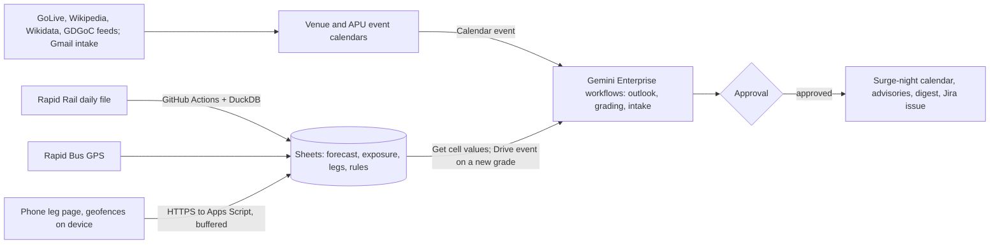

# Fanfall

Fanfall forecasts how hard each concert, match or expo night at the Bukit Jalil National Sports Complex will hit APU's evening, tells the organiser of every affected APU evening event what to do about it, and grades itself the next day against Rapid Rail's gate taps at LRT Bukit Jalil. The pilot owner is the GDGoC APU events lead, whose NexConnect '26 final on Tuesday 17 November shares the night with 5 Seconds of Summer at Unifi Arena next door; APU's Student Service department is the institutional home the team will ask for, not a confirmed owner. A new or changed venue listing or APU event (Calendar event trigger), a forwarded listing (Gmail), a 07:00 schedule, and the daily ridership file landing (Drive event) start Gemini Enterprise workflows. They read the venue and APU calendars, a forecast built from Sheet formulas, the timetable's exposure counts, phone-timed trips to the platform, and an editable rules sheet. The agent decides for each affected event whether to keep it with a timed travel advisory, move its start or end out of the crowd's window, or ask the shuttle desk for a run; after one approval, Calendar publishes the surge night and Gmail sends the advisories, and misses open Jira issues. Proposed track: Data-Driven Research & Intelligent Decision Making. Rank and score: see the [ranking](/docs/ideas/00-ranking.md).

Contents:

1.  [At a glance](#at-a-glance)
1.  [Origins](#origins)
1.  [Problem and evidence](#problem-and-evidence)
1.  [How it works](#how-it-works)
    1.  [Day-to-day loop](#day-to-day-loop)
    1.  [The rules sheet](#the-rules-sheet)
    1.  [States and failure handling](#states-and-failure-handling)
    1.  [Connectors and platform check](#connectors-and-platform-check)
    1.  [Cloud, IoT and network](#cloud-iot-and-network)
    1.  [Real data and privacy](#real-data-and-privacy)
1.  [Why people will use it](#why-people-will-use-it)
1.  [Why the crowd won't build it](#why-the-crowd-wont-build-it)
1.  [Scores](#scores)
1.  [Research plan](#research-plan)
1.  [Time to impact](#time-to-impact)
1.  [Demo and review](#demo-and-review)
1.  [Build plan](#build-plan)
1.  [Risks and kill criteria](#risks-and-kill-criteria)
1.  [See also](#see-also)

## At a glance

| Item                  | Fanfall                                                                                                                                                                                                                                      |
| --------------------- | -------------------------------------------------------------------------------------------------------------------------------------------------------------------------------------------------------------------------------------------- |
| Owner                 | GDGoC APU events lead (pilot); Student Service as the institutional home to ask for, unconfirmed                                                                                                                                             |
| First users           | Organisers of APU evening events (GDGoC APU and two or three clubs); then students and lecturers on an opt-in surge-night digest                                                                                                             |
| Track                 | Data-Driven Research & Intelligent Decision Making                                                                                                                                                                                           |
| Trigger               | Calendar event trigger (new or changed listing or APU event); Gmail (forwarded listing); 07:00 schedule; Drive event (daily ridership grade); Jira issue moved to Done                                                                       |
| Live signal           | Rapid Rail daily origin-destination gate taps; Rapid Bus GTFS Realtime positions; venue listings (GoLive, Wikipedia, Wikidata, GDGoC chapter); APU timetable and shuttle feeds; team phone legs                                              |
| Connectors            | 1P: Calendar (event trigger; create, update event), Gmail (event trigger; send), Drive and Sheets (event trigger; Get cell values). 3P: Jira Cloud Free (create issue; Done trigger). MCP: none; GitHub Actions is a feeder, not a connector |
| Decision              | For each APU evening event on a forecast surge night: keep with an advisory, shift, or ask for a shuttle run, from the rules sheet; for each graded night: in band, miss, or unlisted surge                                                  |
| Action and approval   | One bundle per run (surge-night calendar entry, organiser advisories, digest, any Jira issue) behind one **Approval**; grading and miss detection run unattended                                                                             |
| Reviewer self-trigger | Add an event to the shared "APU evening events (review)" calendar on a surge night, or email a listing URL to the inbox (advisory after approval, 08:00–23:00 MYT, 11–14 November); `@Fanfall`, read-only                                    |

## Origins

- **Source: [Fanfall](/docs/ideas/opus-01/03-fanfall.md),** the only idea merged here.
  - **Kept:** the forecast written down before the night and graded against gate taps the next day (all three scorers' strongest element), the listing intake with provenance and approval, the public surge-night calendar, Jira issues for misses and unlisted surges with a Done event that re-forecasts, and Sheet formulas for all arithmetic.
  - **Changed, the sensing:** one scorer called the phone layer a "human-tap sensor" and another called it thin. The leg page now runs foreground geolocation and detects the APU-exit and station-entrance geofence crossings on the phone, so two of three timestamps are automatic and positions never leave it; a fixed probe schedule replaces ad hoc trips. The bus probe widens from route T580 alone to every Rapid Bus vehicle inside a Bukit Jalil–TPM polygon, and a day-one count decides whether it stays.
  - **Changed, the band:** the uplift percentiles held only 26 of 48 backtest nights; from 5 November the band comes from the backtest's own error distribution. The 4 November forecast is graded on the band as written.
  - **Changed, the users:** the doc concedes organiser-scale impact and adds a second, countable audience: an opt-in surge-night digest for students and lecturers whose classes end in the arrival window.
  - **Dropped:** the Live Nation feed, whose clause 1.3 allows "personal and non-commercial use", because GoLive returned every listing Live Nation had in the source idea's smoke test; and the mid-evening night-watch update, a second decision needing a 19:00 approval, deferred until probe data show minutes vary within a night.
- **Kept separate from [Skyclause](/docs/ideas/opus-01/02-skyclause.md):** one scorer proposed merging the two as a "Bukit Jalil call" with Fanfall's listings as one clause; two kept them apart, and so does this doc. Fanfall's owner is an event organiser deciding one event's timing about ten nights in November; Skyclause's is a safety and welfare desk making a conditions call most monsoon afternoons. Fanfall's ground truth is gate taps a day late; Skyclause's is a gauge and the API within minutes. **Inference:** one approver for both would carry two unrelated rule sets, and a single accuracy figure would mix a daily weather call with a monthly event forecast. They share the timetable's exposure counts, the Apps Script feeder pattern, one approval per bundle, next-day grading and a subscribable calendar; if both run, each prints the other's entry for that evening as context.
- **Related, not merged:** the shuttle product built on [Kept](/docs/ideas/opus-01/01-kept.md) owns shuttle-desk decisions; Fanfall's "ask for a shuttle run" is a request to that desk, and its graded surge-night calendar can be a read-only input to Kept's "external cause" class, as two scorers suggested. [Kuyoh Shuttle Sentinel](/docs/ideas/argon-01/02-kuyoh-shuttle-sentinel.md) cited event congestion without grading it.

## Problem and evidence

APU sits about 880 m from LRT Bukit Jalil (`SP17`) ([data sources][ds gtfss]), the station for TM Stadium Nasional, Unifi Arena and the National Hockey Stadium. On a stadium night the crowd arrives as APU's afternoon classes let out.

- **The government named it this week:** Federal Territories minister Hannah Yeoh told the Dewan Rakyat on 2 November 2026, "Every weekend, whenever there is a concert, Bukit Jalil becomes extremely congested. Traffic builds up hours before the concert even begins"; DBKL's Bukit Jalil micro traffic study is due in the first quarter of 2027, with a traffic plan in February 2027 ([Malay Mail, 3 Nov][malaymail], [paultan.org][paultan]).
- **Gate taps show the size**, re-checked on 4 November from the [yearly files][od], summing every origin into `SP17` and excluding the "A0: All Stations" rows ([data sources](/docs/research/data-sources.md#rapid-rail-origin-destination-ridership)): 2026 weekdays averaged 3,804 exits (218 days); stadium nights logged 38,447 (10 January), 32,929 (31 January) and 31,971 (17 October, when RapidKL kept the station open until 1 AM ([X research][x crowds])). Weekday nights too: 19,640 on Tuesday 17 September 2024, 28,216 on Wednesday 28 May 2025 and 21,110 on Tuesday 10 June 2025.
- **How often:** from March 2024 to October 2026, 1.9 nights a month had at least 2,500 extra exits over that weekday's normal, 0.7 of them weekdays (source idea's count). November 2026 is denser: concerts on 4, 5, 7, 8, 14, 17, 19, 20, 28 and 29 November, five of them weekdays, plus an expo on 13–15 November (source idea's listing fetch on 4 November).
- **APU's exposure:** physical classes ending 16:45–19:30 cover 444 intake groups on Wednesday 4 November, 468 on 5 November, 406 on 17 November, 384 on 19 November and 379 on 20 November (intake groups in the timetable feed, recounted on 4 November). The weekday shuttle leaves APU for the LRT 12 times between 17:00 and 19:15, then only at 20:45 and 21:45, marked "limited space only" (shuttle feed in [APU research][apu endpoints]).
- **Organisers already work around it by hand:** a cybersecurity meetup at APU warned "Expect major congestion in the Bukit Jalil area" for a match with "45k+ fans"; a hackathon posted its own "6:30 PM — APU → LRT Bukit Jalil" bus; a concert-goer asked RapidKL for longer hours because everyone "bertanya2 nak parking mana" (keeps asking where to park) ([X research][x crowds]). A landlord: "when's there concert or football matches The whole bukit jalil will be damn jam" ([other platforms research](/docs/research/social.md#parking-supply-and-safety)).
- **GDGoC APU's own record:** its chapter page lists 35 completed events since October 2024, 16 running into the evening. Three fell on surge days: 31 January and 14 February 2026 (32,929 and 24,037 exits) and Friday 17 April 2026, a 16:00–19:00 workshop on a 7,233-exit night. The source idea named 1 February as a fourth, but that Sunday logged 3,467 exits, about 1,600 above that winter's Sunday median, under its own 2,500 threshold.
- **Today's workaround:** an organiser who thinks to check searches ticket sites and Instagram, guesses, and writes a notice or books a bus; nobody records whether the guess was right. **Inference:** most organisers don't check at all, because no APU calendar shows stadium nights; the interviews measure this.

[malaymail]: https://www.malaymail.com/news/malaysia/2026/11/03/hannah-yeoh-smart-city-solutions-bus-hub-among-plans-to-ease-bukit-jalil-concert-traffic/241750
[paultan]: https://paultan.org/2026/11/03/government-to-address-traffic-congestion-in-bukit-jalil-during-major-events/

## How it works

### Day-to-day loop

1.  **Feeder (Apps Script, no card):** time triggers poll GoLive hourly, Wikipedia's stadium and arena pages and Wikidata daily by revision ID, the GDGoC chapter feed daily, the FAM calendar weekly, and the timetable every 15 minutes with `If-None-Match` ([APU research](/docs/research/apu.md#timetable-feed-change-behaviour)); on surge nights, Rapid Bus positions every minute from 16:00 to 24:00, inside data.gov.my's 4 requests a minute ([data sources][ds gtfsr]). Each row keeps source time, HTTP status and latency; a failed poll writes an error row.
1.  **Listings become calendar events:** each new or changed listing lands on a "Bukit Jalil venues" calendar with its source URL, show time and revision. Shows the feeds miss arrive by email: anyone forwards a listing URL, Gemini extracts venue, date, door and show times and event class, checks for duplicates, and drafts the calendar event for approval. APU events sit on an "APU evening events" calendar; GDGoC's come in from its chapter feed.
1.  **Forecast (Sheet formulas):** baseline = the median exits at `SP17` on the same weekday over the last eight normal weeks; uplift = the median extra exits for the event's class (stadium concert, stadium football, arena show) over two years; forecast = baseline + uplift, summed when two events share a night. The band is the forecast scaled by the 10th and 90th percentiles of the backtest's relative errors. For The Weeknd on 4 November the source idea wrote down 27,044 exits (band 19,315–32,100) against a normal Wednesday's 3,928 at 01:07 MYT, before the night.
1.  **Outlook run (Gemini Enterprise; Calendar event trigger and 07:00 schedule):** for the next 14 days the agent reads both calendars and the forecast, exposure, legs and rules Sheets, decides which APU events overlap the arrival window (doors to show time) or exit window (show end plus 90 minutes), picks a recommendation from the rules sheet, and drafts one bundle: a surge-night calendar entry (forecast, windows, intake groups leaving class, last measured APU-to-platform minutes), one advisory per affected organiser, and the digest.
1.  **One approval:** the events lead approves the run's writes in one click; connector writes from a workflow need review anyway, so the design puts them all behind one ([unattended runs](/docs/research/gemini-enterprise.md#what-runs-without-anyone-signed-in)).
1.  **The organiser decides:** a reply of "keep", "shift to 19:30" or "shuttle" is logged by the feeder against the event, so every decision has a record.
1.  **Grading (Drive event, daily):** a GitHub Actions job polls the dataset's [metadata][od meta], reduces the 5.3 MB yearly file to the day's `SP17` exits with DuckDB, and posts to the feeder, which writes actual, error and in-band flag and drops a dated file into a watched folder. The grading run reads forecast against actual plus the night's legs, ends with no writes when in band, and drafts a Jira issue when the night is out of band or a surge arrived that no listing explains ("Unlisted surge on 23 May: 15,447 exits"). A Jira issue marked Done fires a re-forecast.

### The rules sheet

The events lead edits it. Starting values come from the backtest's surge definition and the shuttle schedule; the rest are set in round-one interviews.

| Rule                   | Fires when                                                                              | Recommends                                                      |
| ---------------------- | --------------------------------------------------------------------------------------- | --------------------------------------------------------------- |
| Surge night            | Forecast at least 5,000 exits above baseline (the backtest's surge definition)          | Publish the calendar entry and digest                           |
| Arrival clash          | An APU event ends between doors and show time on a surge night                          | Shift the end, or advise "budget +N minutes" from measured legs |
| Exit clash             | An APU event ends within show end plus 90 minutes                                       | Shift the end, or advise leaving before the exit crowd          |
| After the last shuttle | An APU event ends after 19:15, when the next shuttle is 20:45 with "limited space only" | Ask the shuttle desk for a run                                  |
| Single-source listing  | A listing from one undocumented source only                                             | Flag in the bundle; the approver confirms                       |

### States and failure handling

- **Listing:** proposed → approved → listed → changed or cancelled (needs approval). **Night:** forecast → drafted → **Needs Review** → sent → pending grade → in band, or out of band → Jira open → Done → re-forecast.
- **A late or changed ridership file:** the grade shows "pending" with the metadata's `next_update`, never an old number; a schema change fails the GitHub job visibly. **A failed feed:** an error row, and the outlook names the feed that is down. **Wrong listings:** a cancelled 3DIVA show (22 November) was still listed on two sites, and Wikipedia can be vandalised, so every listing carries URL and revision and passes a person before it drives a bundle.

### Connectors and platform check

| Connector               | 1P/3P | Mode                                      | Job                                                       |
| ----------------------- | ----- | ----------------------------------------- | --------------------------------------------------------- |
| Google Calendar         | 1P    | Event trigger; Create and Update event    | Starts outlook runs; writes surge-night entries           |
| Gmail                   | 1P    | Event trigger (email received); Send      | Listing intake; advisories and digest after approval      |
| Google Drive and Sheets | 1P    | Event trigger (new file); Get cell values | Starts grading; reads forecast, exposure, legs, rules     |
| Jira Cloud Free         | 3P    | Create issue; event trigger (issue Done)  | Miss and unlisted-surge issues; Done re-runs the forecast |

- Calendar, Gmail, Drive and Jira Cloud are documented event-trigger connectors, polled every 5–10 minutes; there is no webhook trigger, so the feeder hands off through Drive files ([triggers](/docs/research/gemini-enterprise.md#triggers-and-schedules)). Sheets reads have been GA since 12 October 2026, and Calendar, Gmail and Jira create issue are listed actions ([actions](/docs/research/gemini-enterprise.md#actions-and-write-back)); Sheets are read live, never from an ingested copy ([federated versus ingestion](/docs/research/gemini-enterprise.md#federated-search-versus-ingestion)).
- Drive, Gmail and Calendar need a Workspace account, not `@gmail.com` ([account limits](/docs/research/gemini-enterprise.md#edition-and-account-limits)). At APU, Outlook calendar and mail would replace Google Calendar and Gmail.
- **Where Gemini decides:** intake extraction, duplicate checks, window matching, the rule choice, drafting and miss diagnosis; Apps Script only moves data, and the arithmetic stays in Sheet formulas the owner can read.

### Cloud, IoT and network

- **Cloud:** Gemini Enterprise workflows reason and draft, with traces in the **Runs** tab ([run history](/docs/research/gemini-enterprise.md#run-history-as-evidence)); Apps Script polls and ingests; a GitHub Actions job with DuckDB handles the one file Apps Script can't parse.
- **IoT, layer 1, the team's phones:** a leg page served by the Apps Script web app over HTTPS, on iPhone and Android ([browser sensors](/docs/research/iot-and-network.md#phone-and-laptop-sensors-in-the-browser)). While the page is open it runs foreground geolocation, tests each fix against two geofences (the APU exit and the LRT Bukit Jalil entrance) on the phone, and keeps only the crossing times; the rider taps once at the faregate. Only three timestamps, two yes/no checks and the leg minutes leave the phone ([edge processing](/docs/research/iot-and-network.md#edge-versus-cloud-processing)). On each surge night and a matched normal night, teammates and opted-in volunteers leave APU at 17:45, 18:15, 18:45 and 19:15, aiming for at least ten legs a night. Concession: a person still carries the phone with the screen on; nothing counts the crowd passively.
- **IoT, layer 2, bus GPS as a road probe:** Rapid Bus KL positions arrive every 30 seconds ([data sources][ds gtfsr]). T580 is the only route stopping within 500 m of campus ([data sources][ds gtfss]), with one bus on a 50-minute loop (source idea's GTFS Static check), so the feeder keeps every Rapid Bus KL and MRT feeder vehicle inside a polygon around LRT Bukit Jalil and TPM and computes segment speeds. **Inference:** how many vehicles cross it each evening is unknown until the 4 November count; if fewer than six an hour, the probe falls back to T580 legs and is reported as thin. Missing positions mean missing telemetry, not a cancelled bus ([platform constraints](/docs/research/gemini-enterprise.md#platform-constraints-and-design-consequences)).
- **IoT, layer 3, Rapid's faregates:** the city's own sensor network, a day late; it grades every forecast.
- **Network:** each leg carries device time and receipt time, so latency shows per row; legs recorded with no signal buffer in the page and upload on reconnect, visible as a latency spike; every grade shows the feed's lag (night D graded on D+1 or later), and every bus row the age of the feed header ([what a judge can see](/docs/research/iot-and-network.md#what-a-judge-can-see-of-the-network)).

### Real data and privacy

- **Live:** the [Rapid Rail file][od] and its metadata (CC BY 4.0; at 01:49 MYT on 4 November the 2026 file was 5,299,106 bytes with data to 2 November); Rapid Bus GTFS Realtime and Static (CC BY 4.0) ([data sources][ds gtfsr]); the APU timetable and shuttle feeds (APU's Terms of Use require written permission) ([APU research][apu endpoints]); [GoLive's event API][golive] (undocumented; its terms ban only ticket-buying bots); Wikipedia's [stadium][wiki stadium] and [arena][wiki arena] pages (CC BY-SA 4.0) and [Wikidata] (CC0); the [GDGoC APU chapter][gdg] feed (undocumented); the [FAM calendar][fam]; team phone legs (opt-in).
- **Not used:** Live Nation (personal-use terms); Songkick, Ticketmaster and Bandsintown (scraper bans or keys); the stadium corporation's [events page][psm] (empty). The keyless feeds covered 5 of the 9 large November events in the source idea's check; the intake handles the rest (7–8 and 28–29 November arena shows, the 13–15 November expo).
- **Privacy:** positions never leave the phone; no names, no attendee data; organiser emails are their own. The timetable's `NAME`, `SAMACCOUNTNAME` and `LECTID` are dropped before storage or any prompt ([APU research](/docs/research/apu.md#personal-data-in-the-timetable-feed)); only counts per window reach Gemini.

[golive]: https://www.golive-asia.com/api/event/list
[wiki stadium]: https://en.wikipedia.org/wiki/Bukit_Jalil_National_Stadium
[wiki arena]: https://en.wikipedia.org/wiki/Unifi_Arena
[Wikidata]: https://query.wikidata.org/
[gdg]: https://gdg.community.dev/gdg-on-campus-asia-pacific-university-of-technology-innovation-kuala-lumpur-malaysia/
[fam]: https://fam.org.my/men-team/calendar
[psm]: https://www.stadium.gov.my/events.html

## Why people will use it

- **Habit loop:** an organiser adds an event to the APU evening calendar, or GDGoC's feed adds it; within about ten minutes they hear whether it collides. If it does, they get one advisory before the night and one grade after, saying whether the forecast held and how long the trip to the platform took. Alerts are rare and checked against real taps, which is what earns trust.
- **Channel:** Google Calendar and email, which organisers already use; students and lecturers subscribe to the surge-night calendar by URL or join the digest, so sign-ups are countable.
- **Concession:** each organiser meets a surge night only a few times a term, so this is a club-scale tool until an office adopts it; the 6-month plan measures whether one does.
- **After the team graduates:** the desk is a GDGoC APU committee role handed over yearly with the chapter; upkeep is a credential refresh every 14 days, the odd forwarded listing, and closing Jira issues.

## Why the crowd won't build it

- **The simulated crowd:** city traffic and smart-city dashboards are 3.8% of ideas, in the crowded off-campus tier; queue and crowd prediction is 2.5%, thin and "often simulated" ([clusters](/docs/research/competition.md#clusters-and-shares), [tiers](/docs/research/competition.md#saturation-tiers)). Only 3% use public feeds, and none treats APU's timetable as a service ([what the crowd misses](/docs/research/competition.md#what-the-crowd-structurally-misses)).
- **GitHub, searched by the source idea on 4 November:** no repositories for "bukit jalil stadium" or "concert crowd transit forecast"; RapidKL ridership repositories such as [rapidkl-ridership-forecast] model plain time series; "Event-Driven-Congestion" repositories such as [Event-Driven-Congestion-Intelligence-System] predict city traffic with no campus and no grading. In this hackathon, `apu-smart-shuttle` is a shuttle tracker with traffic alerts ([public repositories](/docs/research/competition.md#public-repositories-so-far)).
- **Existing substitutes:** PredictHQ sells event-demand forecasts and has a [Bukit Jalil venue page][predicthq] behind a paid API; crowdsourced transit apps already publish disruption notices to campuses ([substitutes](/docs/research/competition.md#existing-substitutes)); RapidKL announces extended hours ([X research][x crowds]). None hands an APU organiser a decision or publishes its own error the next day.
- **Inference:** a crowd team might build a stadium-traffic dashboard; the scarce part is the graded forecast tied to APU's own timetable and events.

[rapidkl-ridership-forecast]: https://github.com/Sara-2208/rapidkl-ridership-forecast
[Event-Driven-Congestion-Intelligence-System]: https://github.com/RamK2006/Event-Driven-Congestion-Intelligence-System
[predicthq]: https://www.predicthq.com/major-events/venues/bukit-jalil-national-stadium-my

## Scores

**72.7 / 100, rank 4 of 8** in the [cross-set ranking](/docs/ideas/00-ranking.md). Three independent scorers rated this doc on the [unified matrix](/docs/ideas/00-ranking.md#scoring-matrix): an NTT DATA forward deployed engineer (FDE), an APU School of Technology IoT lecturer, and a Google Cloud advocate who is also an APU student. The used score is their mean, except day-to-day workflow and theme, which take the lowest. The reason shown is the lowest scorer's. Per-scorer totals: FDE 68.6, lecturer 73.4, advocate 76.2. All three passed it on every gate. The source ideas scored Fanfall 71.7 on the same matrix before the merge.

| Component           | Weight | FDE | Lecturer | Advocate | Used | Lowest scorer's reason                                                                                                                                                  |
| ------------------- | -----: | --: | -------: | -------: | ---: | ----------------------------------------------------------------------------------------------------------------------------------------------------------------------- |
| Impact              |     14 |   3 |        3 |        3 |    3 | GDGoC events lead is the owner (also the hackathon organiser) with club-scale volume; the doc concedes impact is a few nights a term.                                   |
| Connectors          |     14 |   4 |        4 |        4 |    4 | Calendar event trigger and write, Gmail, Drive/Sheets event, Jira trigger and create; GitHub Actions and Apps Script feed and DuckDB sit outside the connector story.   |
| Day-to-day workflow |     14 |   4 |        4 |        4 |    4 | Calendar, Gmail, Drive events and 07:00 schedule, next-day grading against gate taps, rules sheet and one approval; grading unattended is strong.                       |
| Research            |     14 |   3 |        4 |        4 | 3.67 | Government statement and public gate-tap data are real, but organiser pain is inferred and interviews are with four clubs; Rapid Rail grading is solid.                 |
| Time to impact      |     14 |   3 |        3 |        4 | 3.33 | Pilot has a real event calendar from 17 Nov and no APU system change, but the owner is a club and Student Service is only asked; relevance beyond November is unproven. |
| Theme               |     10 |   3 |        3 |        3 |    3 | Phone geofence legs are human-carried and bus GPS is a public feed; the sensor layer is thin and staffed by teammates.                                                  |
| Originality         |     10 |   4 |        4 |        5 | 4.33 | Graded forecast of external event nights against APU's timetable is absent from the crowd baseline.                                                                     |
| Buildability        |      5 |   3 |        4 |        3 | 3.33 | Eight feeds, GitHub Actions job, backtest, ten legs a night staffed by teammates and three workflows is heavy.                                                          |
| Demo                |      5 |   4 |        5 |        4 | 4.33 | Reviewer adds an event to a shared calendar and gets a drafted bundle after approval; video shows a Weeknd grade.                                                       |

## Research plan

- **Round one, Thursday 5 November (four):** the GDGoC APU events lead; the GDGoC member who ran the 21 October 19:30 talk; the president of a club with a November evening event; a student whose physical class ends at 17:45 on a stadium night and who commutes by LRT. Goals: how they check for clashes today, what they last did on a stadium night, and what would change their plan.
- **Round two, 6–7 November (three or four):** a second club president; a Student Service staff member through `info@apu.edu.my`; a lecturer with a class ending at 17:45 on 19 November; the shuttle desk, if reachable, as a recipient. They test a drafted advisory and the rules sheet.
- **Timed observation:** three organisers each answer "What's on at Bukit Jalil on 17 November, and what should my attendees do?" with their usual tools while we time them and count the sources they open; then the same from a Fanfall advisory, including reading and approval time.
- **Commuter legs:** at least ten legs per night on The Weeknd nights (4–5 November) and matched normal nights (Friday 6 and Tuesday 10 November), repeated on 17 and 19 November.
- **30–50 real items, with ground truth independent of the inputs:** 48 listed event days from 1 January 2025 to 2 November 2026, each forecast from earlier history only and scored against real exits (median absolute error 20%, mean 28%, 26 of 48 inside the old band). Surge-night flag over the same 671 days, positive at 5,000 or more extra exits: precision 0.88 (7 of 8) and recall 0.33 (7 of 21) from Wikipedia and national-team listings alone; Wilson 95% intervals 0.53–0.98 and 0.17–0.55 (our arithmetic), per [accuracy method](/docs/research/judging.md#measuring-an-agents-accuracy-honestly). Two teammates independently label each surge day's cause from listings and news, and disagreements are counted. Live: every day from 3 November is graded as its file lands, about six by submission.

## Time to impact

- **By 3 months (early February 2027):** the desk has run every surge night from NexConnect '26 (17 November) through the listed My Chemical Romance (19–20 November), BTS and Dior (12–13 December), BigBang (9 January), Westlife (13–14 January) and Jay Chou (23 January) nights, for GDGoC APU and at least three clubs, with a monthly graded ledger. Owner: the GDGoC APU events lead. Student Service has been asked to add the surge-night calendar to its club-event guidance.
- **By 6 months (May 2027), measured:** organiser minutes per clash check against the baseline; the share of APU evening events on surge nights that got an advisory; decisions taken, from the reply log; forecast error on at least 20 new events and band coverage; intake recall against gate taps; digest sign-ups; phone-timed APU-to-platform minutes by event class.
- **Outside hook, Inference:** DBKL's study may welcome a graded public record of event nights against station taps; nothing in the plan depends on it.
- **Assumptions:** GDGoC APU agrees to own the pilot; APU gives written permission for the timetable and shuttle feeds; the licence continues past the trial; Rapid Rail keeps publishing daily; at least one event feed stays open.

## Demo and review

A 3:45 video recorded on 9 November from the live system, labelled with its capture date ([minute plan](/docs/research/judging.md#minute-plan)):

1.  **0:00–0:20:** "Tuesday 17 November: the NexConnect '26 final at APU, 5 Seconds of Summer next door, 406 intake groups leaving class as the crowd arrives." The surge-night calendar on screen.
1.  **0:20–1:05:** a teammate adds a club event on 19 November; within ten minutes the **Runs** tab shows the Calendar trigger, the reads, the rule chosen and the bundle; the events lead approves and the advisory and calendar entry appear.
1.  **1:05–1:50:** the grade: The Weeknd's forecast, written before the night, against the real count from the file that landed later, with the Drive-trigger run.
1.  **1:50–2:30:** the sensors: phone legs on a normal night against a Weeknd night, with geofence times, latency and a buffered upload; the bus polygon count.
1.  **2:30–3:45:** impact (backtest error, precision and recall with n, organiser minutes before and after), seven days of runs, the one approval, privacy, and how to review.

A reviewer adds an event to the shared review calendar on any surge night (a bundle drafts within about ten minutes, and the team approves 08:00–23:00 during 11–14 November), forwards a listing URL to the inbox, or runs `@Fanfall` with a date for a read-only answer once they hold a seat and the shared workflow ([reviewer access](/docs/research/gemini-enterprise.md#reviewer-access)).

## Build plan

| Day        | Build (critical path first)                                                                                                                                    | Research and checks                                                                            |
| ---------- | -------------------------------------------------------------------------------------------------------------------------------------------------------------- | ---------------------------------------------------------------------------------------------- |
| Wed 4 Nov  | GitHub Actions reduction and Drive drop; leg page with on-device geofences and the GTFS-R decoder with the polygon count, live before The Weeknd's first night | Two teammates run probes 17:45–19:15; ask for timetable permission; ask GDGoC to own the pilot |
| Thu 5 Nov  | Listing pollers onto the venue calendar; forecast and band formulas                                                                                            | Second Weeknd night probed; round one                                                          |
| Fri 6 Nov  | Workflows: outlook (Calendar trigger and 07:00), grading (Drive), intake (Gmail); rules sheet                                                                  | Round two; normal-night probes; freeze the problem and baseline                                |
| Sat 7 Nov  | Jira Free project, miss issues and the Done trigger; approval wiring; digest list                                                                              | Score backtest and flag sets with two labellers; intake the 7–8 November shows                 |
| Sun 8 Nov  | README, deck and diagram (Deepavali)                                                                                                                           | Confirm every member registered before midnight                                                |
| Mon 9 Nov  | Feature freeze; refresh schedule credentials; record the video                                                                                                 | Test reviewer access with a non-team account                                                   |
| Tue 10 Nov | Submit early; keep feeds and grading running                                                                                                                   | Normal-night probes                                                                            |

No card: Apps Script, Sheets, Calendar, Gmail, GitHub Actions on a public repository and Jira Cloud Free, on the sponsored licence in a Workspace domain.

## Risks and kill criteria

- **The forecast doesn't hold:** if both Weeknd nights land outside the new band with errors above 40%, stop adding recipients and revisit the event classes before any advisory goes out.
- **Organisers won't act:** if no round-one organiser would shift an event or forward an advisory, the product shrinks to the public surge-night calendar and graded ledger.
- **Probes go unstaffed:** if fewer than ten legs a night are recorded, advisories say "minutes unmeasured" instead of quoting a number, and the Theme claim rests on the bus probe and faregates.
- **Calendar and Jira event types are unverified:** Google lists Google Calendar and Jira Cloud as event-trigger connectors but names event types only for Gmail ([triggers](/docs/research/gemini-enterprise.md#triggers-and-schedules)). Test a changed-listing and an issue-Done trigger on 4–5 November; if either is missing, the 07:00 schedule picks up calendar changes and a Gmail notice from Jira replaces the Done trigger.
- **Feeds change or close:** GoLive is undocumented; Wikidata and Wikipedia are the licensed base, written permission is requested, and a failed feed shows its error.
- **Owner conflict:** GDGoC APU organises this hackathon; NTT DATA rates entries, and two other clubs join the pilot so the owner isn't only the organiser.
- **Platform limits:** credentials expire every 14 days (refresh on 9 November); writes wait in **Needs Review**, so a teammate watches approvals 08:00–23:00 during 11–14 November; Standard pools 160 assistant queries a day and quota failures aren't retried; the design uses 4–6 runs a day ([limits](/docs/research/gemini-enterprise.md#limits-that-bite-in-a-one-week-build)).
- **A quiet assessment week:** 11–14 November has BABYMONSTER (14 November) and the expo; daily grading still runs, and the recorded Weeknd nights show the full loop.

## See also

- [Social research][x crowds]: the Bukit Jalil event, parking and shuttle evidence.
- [Data sources](/docs/research/data-sources.md) and [APU](/docs/research/apu.md): ridership, GTFS, the timetable and shuttle feeds, personal data and terms.
- [Gemini Enterprise](/docs/research/gemini-enterprise.md): triggers, approvals, actions and limits.
- [IoT and network](/docs/research/iot-and-network.md), [competition](/docs/research/competition.md) and [judging](/docs/research/judging.md): phone sensors, the crowd, and honest accuracy figures.

[x crowds]: /docs/research/social.md#event-crowds-and-flash-floods-around-bukit-jalil
[ds gtfsr]: /docs/research/data-sources.md#bus-and-train-positions-gtfs-realtime
[ds gtfss]: /docs/research/data-sources.md#routes-and-stops-near-apu-gtfs-static
[apu endpoints]: /docs/research/apu.md#timetable-feed-endpoints
[od]: https://storage.data.gov.my/transportation/rail/rapidrail_2026_daily.parquet
[od meta]: https://github.com/data-gov-my/datagovmy-meta/blob/main/data-catalogue/ridership_od_rapidrail_daily.json
