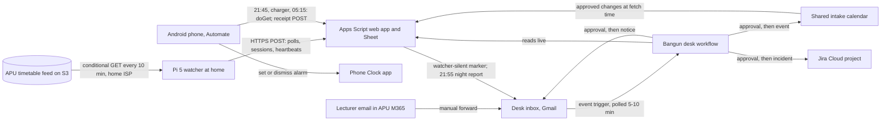

# Bangun

Bangun (Malay for "wake up") sets an APU student's Android phone alarm each night for tomorrow's real first class. It uses APU's public timetable feed plus any lecturer announcement a classmate forwards and a person approves, and every hop reports back, so a broken chain shows before it costs a class. It serves students whose first class moves, which the feed shows is nearly all of them, under the proposed track **Intelligent Automation & Digital Transformation**, whose listed ideas include "connecting devices with useful actions" and "automating repetitive campus workflows" ([challenge tracks](/docs/BRIEF.md#challenge-tracks)). Caveat: nothing is built yet, and the alarm path is deterministic on purpose, so Gemini Enterprise earns its place only on nights an announcement arrives or something breaks. **Inference** marks conclusions no source states.

Contents:

1.  [At a glance](#at-a-glance)
1.  [Origins](#origins)
1.  [Problem and evidence](#problem-and-evidence)
1.  [How it works](#how-it-works)
    1.  [Signal to cloud path](#signal-to-cloud-path)
    1.  [Workflow and rule set](#workflow-and-rule-set)
    1.  [States and failure handling](#states-and-failure-handling)
    1.  [Connectors and platform check](#connectors-and-platform-check)
    1.  [Cloud, IoT and network](#cloud-iot-and-network)
    1.  [Real data and privacy](#real-data-and-privacy)
1.  [Why people will use it](#why-people-will-use-it)
1.  [Why the crowd won't build it](#why-the-crowd-wont-build-it)
1.  [Off-campus fit](#off-campus-fit)
1.  [Scores](#scores)
1.  [Research plan](#research-plan)
1.  [Time to impact](#time-to-impact)
1.  [Demo and review](#demo-and-review)
1.  [Build plan](#build-plan)
1.  [Risks and kill criteria](#risks-and-kill-criteria)
1.  [Not verified](#not-verified)
1.  [See also](#see-also)

## At a glance

| Field                 | Plan                                                                                                                                                                                                                                                                         |
| --------------------- | ---------------------------------------------------------------------------------------------------------------------------------------------------------------------------------------------------------------------------------------------------------------------------- |
| Owner                 | No APU office. Each intake's class rep or a volunteer classmate forwards announcements; a teammate with a seat approves during the build; each student owns their alarm rule (intake, group, lead time, in person only or online too).                                       |
| First users           | The three teammates' intakes from 5 November, then recruits on Android from 8 November.                                                                                                                                                                                      |
| Track                 | Intelligent Automation & Digital Transformation.                                                                                                                                                                                                                             |
| Trigger               | Outside Gemini Enterprise, phones fetch tomorrow's alarm from Apps Script at 21:45, on charger connect and at 05:15. Inside it, one workflow starts on Gmail "When an email is received" at the desk inbox: a forward, a `watcher-silent` marker, or the 21:55 night report. |
| Live signal           | APU's public timetable feed, by conditional GET from a Pi 5 on a home line; forwarded announcements; phone receipts; the Pi's heartbeat and health (`get_throttled`, SoC temperature, uptime).                                                                               |
| Connectors            | GA 1P Gmail (trigger, read, send), Google Calendar (create, update, delete event), Drive and Sheets (Get cell values); GA 3P Jira Cloud (create issue).                                                                                                                      |
| Decision              | Is this forward a real change to exactly one session of this intake, and which? Is a silence a dead Pi, a dead feed or a drill? Which night exceptions need a notice?                                                                                                        |
| Action and approval   | After one approval, a Calendar event on the shared intake calendar, which the next phone fetch reads, and a Gmail notice; incidents become Jira issues. No alarm ever waits on a click.                                                                                      |
| Reviewer self-trigger | Install the free Automate flow on their own Android phone with any real intake code, or fire the tokenised drill link.                                                                                                                                                       |

## Origins

Bangun has one source, [opus-03 Bangun](/docs/ideas/opus-03/02-bangun.md). This version keeps its core loop and answers what its scorers objected to: too many moving parts, an agent that looks peripheral, an unverified iPhone path, and unlicensed feed use.

- **Kept:** the Pi's conditional-GET watcher, the Apps Script alarm service that never waits on a model, phone receipts and the missing-receipt rule, announcement rules R1–R7, exception-only approvals, the 6–7 November kill test, and 30–50 real past announcements as the accuracy set. Its feed measurements were re-run on 5 November at 07:14 MYT against the same file (ETag `c9d8d238…a24842dd`) and hold, except two corrections below.
- **Changed, to cut parts:** two workflows become one Gmail-triggered workflow, with Apps Script mailing a night report to start the nightly run. Android uses only Automate (free): Tasker costs RM19.99, the team has no payment card, and a 7-day trial started on 5 November ends on 12 November, mid-assessment ([Android apps](/docs/research/iot-and-network.md#android-automation-apps-and-termux)). iPhone leaves the critical path. The approved change lives only on the shared intake calendar, which Apps Script reads at fetch time, so the separate `changes` row write is gone. The rules move from workflow instructions into a `rules` tab the owner can edit.
- **Changed, because a claim failed:** GitHub incident issues become Jira Cloud issues, because GitHub isn't on Workflow Builder's connector list ([workflows]). "None starts at the same time every day" becomes 1 of 953 on recount. The 574 of 859 identical module sets becomes 572 of 859 on recount by module section. VariAlarm's 24 ratings are on the US App Store; Malaysia's shows none. The "≥ 95%" alarm target becomes wrong alarms as k of n with an upper bound, because 25–40 mornings can't show 95%.
- **Added:** a regex extractor scored on the same held-out announcements, so "the agent beats a script" is tested, not asserted; a written permission request in `#help-desk` in place of the optional courtesy note.
- **Dropped:** `left` events and the lead-time suggestion, the iPhone setup Shortcut as a build-week deliverable, the Pi's ntfy reverse watchdog and credential push (a Calendar reminder replaces the push), and the GitHub App.

## Problem and evidence

- **A single daily alarm is wrong for almost everyone.** The feed lists 1,045 intakes. For the 953 intake-groups with three or more in-person days from 2 to 6 November, the first class start spreads by a median of 315 minutes (25th percentile 270, 75th 420); 96% spread by 2 hours or more ([feed measurements]). Only 1 of 953 starts at the same time every day, by this doc's recount; the research says none.
- **A weekly alarm holds inside a block and fails across a break.** 26 October against 2 November kept 97.1% of 3,935 weekday slots, and 10.3% of 845 intake-groups had any change. 2 November against 16 November, across the week of 9 November, changed 87.7% of 4,181 slots (76.9% moved, 5.9% gained a class, 4.9% lost one) in 99.8% of 855 intake-groups ([feed measurements]). About two thirds of intake-groups kept an identical module set in both comparisons (587 of 850, then 572 of 859, this doc's recount), so **Inference:** classes were re-slotted, not replaced.
- **Holidays:** 8 and 9 November are empty, and 437 of the 449 intakes in session that week have classes on Monday 2 or 16 November, so **Inference:** a repeating Monday alarm rings for nothing on 9 November. The feed doesn't label the empty days; secondary listings name Deepavali and a Monday replacement day.
- **The cost of a missed class:** a student pass needs attendance that "should not fall below 80% each semester" ([student pass renewal](/docs/research/rules-and-guarantees.md#student-pass-renewal)), and an APU commenter says students get an email "after missing 4 classes in a row" ([attendance](/docs/research/social.md#attendance-moodle-locks-and-the-80-visa-rule)). A student given the wrong timetable wrote "I got marked absent because of this"; another wrote "The time table changes every week", with changes "announced by the lecturers or administrators" ([timetable churn](/docs/research/social.md#timetable-churn-and-a-compressed-calendar)).
- **Copies die quietly.** The feed was last written 28 October at 09:39:49 MYT and was unchanged at 07:14 MYT on 5 November ([change behaviour](/docs/research/apu.md#timetable-feed-change-behaviour)). Of the most-forked student sync and its 40 forks, 1 schedule was active on 5 November; 34 were `disabled_inactivity`, 3 `disabled_fork` and 3 had no workflow (re-counted for this doc that day). GitHub disables fork schedules by default, and public-repo schedules after 60 days without activity, with no promised warning ([GitHub rules](/docs/research/iot-and-network.md#github-disables-scheduled-workflows)).
- **Counterevidence:**
  - Students barely install these tools: APSync's latest release shows 1 download and APLife's 6 (GitHub release assets, re-checked 5 November); APLife also ships elsewhere, so these are floors.
  - No source counts lecturer announcements or says whether they come by email, Teams, Moodle or WhatsApp. If most come by Teams or WhatsApp, the forward becomes a copy-paste.
  - Inside a block a weekly alarm was right 97.1% of the time in the one pair of weeks measured, so **Inference:** Bangun's value concentrates at block changes, holidays and announced changes.
  - No source confirms that class reps exist at APU or how they relay changes.
  - The test window is thin: 7 November has no in-person session (2 intakes have a 09:00 online one), 8–9 November have none, 466 intakes have no classes from 9 to 15 November, and 10–13 November have 345–360 intakes in person a day against 818 on 6 November (this doc's count from the same file).

## How it works

### Signal to cloud path

- **Pi watcher:** a Pi 5 at a teammate's home on Ethernet and the official 27 W supply, a systemd unit with `Restart=always` and `WatchdogSec`, and the hardware watchdog at about 10 seconds ([services and watchdogs](/docs/research/iot-and-network.md#services-and-watchdogs)). Every 10 minutes it makes a conditional GET with `If-None-Match`, logging status (304, 200 or error), latency and ETag. On a 200 it downloads the 1.1 MB file, drops `NAME`, `SAMACCOUNTNAME` and `LECTID` in memory, keeps only subscribed intakes, and posts their sessions and a diff. A heartbeat every 10 minutes carries uptime, `vcgencmd get_throttled` and SoC temperature ([power and undervoltage]).
- **Apps Script and a Sheet** in the licensed Workspace domain, the no-card path connectors read live ([Pi to Apps Script](/docs/research/iot-and-network.md#pi-to-apps-script-and-sheets)). Tabs: `polls`, `heartbeats`, `sessions` (no lecturer fields), `subscribers`, `forwarders`, `receipts` and `rules`. `doGet` answers a phone with tomorrow's first session (in person, or online too if chosen), after approved changes on the shared intake calendar, minus lead time; it answers only if the Pi's last poll is under 20 minutes old, and otherwise returns the error and its time. A 10-minute trigger checks the heartbeat gap; past 25 minutes it makes one conditional GET itself, to tell a dead feed from a dead Pi, and mails a `watcher-silent` marker to the desk. At 21:55 it mails the night report. Both send from another teammate's account, so the Gmail trigger sees received mail ([triggers](/docs/research/gemini-enterprise.md#triggers-and-schedules)).
- **Android phone:** a free [Automate](https://llamalab.com/automate/doc/block/alarm_add.html) flow runs at 21:45, on charger connect and at 05:15. It calls `doGet` (intake, group, token), dismisses any `Bangun` alarm that no longer matches, keeping at most one because `ACTION_DISMISS_ALARM` prompts when several match, and with a class tomorrow sets a one-off alarm labelled `Bangun`. It then posts a receipt: alarm time or "none", source (feed or announcement), and fetch milliseconds or the error text. On a fetch error it shows "Bangun couldn't confirm tomorrow: …" and changes nothing ([alarm facts](/docs/research/iot-and-network.md#setting-alarms-from-a-phone-without-a-person)). Battery optimisation off and the charger on at night keep it out of Doze; Samsung, Xiaomi and OnePlus may still kill it, which the missing-receipt rule catches ([Android limits](/docs/research/iot-and-network.md#android-background-limits)).
- **iPhone, a stretch:** a Shortcuts Time of Day automation could toggle pre-made alarms, a median of 6 distinct first-class times per intake-group (8 at the 90th percentile, 11 at most). No Apple page says Toggle Alarm runs without a prompt inside an automation, and Apple's guide warns "You also may need to set individual actions to run automatically" ([Shortcuts automations](/docs/research/iot-and-network.md#ios-shortcuts-personal-automations)). Until a teammate's iPhone passes the kill test, iPhone users get the shared calendar only.
- **Forwards:** a lecturer's email reaches the student's APU Microsoft 365 mailbox; the student forwards it by hand to the desk inbox in the team's Workspace Gmail. The quoted original's sent time against the desk's receive time gives the announcement lag.

### Workflow and rule set

One workflow, Bangun desk, built in Workflow Builder, with the trigger and approval step added in the UI because natural language can't add them ([limits](/docs/research/gemini-enterprise.md#limits-that-bite-in-a-one-week-build)). Each run reads the `rules` and `forwarders` tabs live first, so the owner changes a threshold or a forwarder without editing the workflow. It branches on the message type:

- **A forward:** R1 extracts module, date, old and new time, room, and campus or online. R2 requires a match to exactly one session of that intake in the feed window, or one free slot for a replacement class. R3 holds a change that contradicts an approved one and asks the forwarder. R4 requires the sender to be in `forwarders`, which names the intake. R5 flags a session within 12 hours as urgent; one approved after 05:15 misses the next morning. R6 never writes a lecturer's name or address. R7 records whether the feed already shows the change. After one approval it writes a Calendar event in a fixed field format on the shared intake calendar and a Gmail notice to that intake's subscribers.
- **A `watcher-silent` marker:** it reads the last heartbeat, poll errors, Apps Script's own feed check and the drill flag; tells a dead Pi or home line from a dead feed and from a drill; and drafts "watcher silent since HH:MM" to subscribers plus a Jira issue, sent after approval, with drills labelled.
- **The night report:** N1 turns a heartbeat gap over 25 minutes into an incident line. N2 drafts an email to each subscriber with a class tomorrow and no receipt, with the phone's error if it sent one. N3 adds a status line when the feed is unchanged over 7 days. N4 opens a Jira issue on a feed shape change or 3 fetch errors in a row. N5 adds a health line for undervoltage or throttling. N6 lists a forward over an hour old with no event or hold as unprocessed, because event-triggered runs that fail on quota aren't retried ([unattended runs]). N7 sends a Sunday digest. Exceptions share one batched approval; a clean night completes with no writes, its findings in the run's trace.

**Clicks:** runs that affect other people pause for review, and connector writes from agent nodes require it ([unattended runs]). A clean night needs no click, an announced change one, a night with missing receipts one batched click, an incident one each. The seat holder checks **Needs Review** at 22:00 and 07:00; if drafts routinely wait past 23:00 during 6–9 November, the missing-receipt email moves to Apps Script and the workflow keeps the diagnosis.

**Where the agent earns its place:** a wake-up alarm mustn't wait on a model, a quota, a 5–10 minute trigger poll or a click, so the alarm runs outside Gemini Enterprise, and the agent reads free-text announcements and tells failures apart. Automation users draw the same line: "Real automation ... is deterministic", while "Using LLMs to parse unstructured text is their one actual killer feature" ([automation that survives](/docs/research/social.md#automation-that-survives-daily-use)). Whether the agent beats a script at that is measured against a regex baseline ([research plan](#research-plan)).

### States and failure handling

- **States:** a phone-night is `set HH:MM (feed)`, `set HH:MM (announcement)`, `none (no class)`, `error: <text>` with no change made, or a missing receipt, which N2 catches. A forward is received, held (contradiction, no match or unknown sender), awaiting review, approved and written, rejected, or unprocessed after an hour (N6). The watcher is ok, silent (Pi or home line), in feed error, or in a drill.
- **What a reviewer sees:** a Pi power cut or dead line shows "watcher silent since HH:MM" on the status page, the marker draft follows within 45 minutes, and phones fetching meanwhile get "can't confirm tomorrow" and set nothing. The Pi boots by itself when power returns, and the journal gap plus `power_reset` tell an outage from a watchdog reset ([power and undervoltage]). A feed error shows its HTTP status, and three in a row draft a Jira issue. Apps Script or the Sheet down shows as each phone's fetch error. A killed phone shows as a missing receipt.
- **Never:** a synthetic reading, a cached feed shown as current, or a default alarm; the student's own alarms stay as they set them.
- **Credentials and quota:** scheduled runs use the author's credentials, which expire 14 days after refresh ([unattended runs]); the docs don't say whether event-triggered runs do too, so the team refreshes on 9 November anyway, covering to 23 November, with a Calendar reminder on days 12 and 13. Standard allows 160 assistant queries per user a day, reset at 4:00 PM MYT ([CONTEXT](/docs/CONTEXT.md#workflows-and-unattended-runs)); **Inference:** one nightly run plus one per forward or marker stays far below it.

### Connectors and platform check

| Connector               | Type | Status | Mode                                 | Job                                                                       |
| ----------------------- | ---- | ------ | ------------------------------------ | ------------------------------------------------------------------------- |
| Gmail                   | 1P   | GA     | Event trigger (received); read; send | Starts every run; notices, missing-receipt emails, watcher alerts, digest |
| Google Calendar         | 1P   | GA     | Create, update, delete event         | The shared intake calendar of approved changes, read back by Apps Script  |
| Google Drive and Sheets | 1P   | GA     | Get cell values (live read)          | `rules`, `forwarders`, `sessions`, `receipts`, heartbeats and polls       |
| Jira Cloud (Free)       | 3P   | GA     | Create issue                         | Incidents: watcher down, feed shape change, repeated feed errors, drills  |

- **Platform check:** Gmail is an event-trigger connector, and Gmail, Google Calendar, Google Drive and Jira Cloud are on the workflow connector list; GitHub isn't ([workflows]). Sheets has no connector of its own; Get cell values is a Drive connector action, since 12 October 2026 ([actions](/docs/research/gemini-enterprise.md#actions-and-write-back)). Drive, Gmail and Calendar don't take consumer `@gmail.com` accounts ([connectors and live data](/docs/CONTEXT.md#connectors-and-live-data)).
- **Jira's job is thin:** it holds the watcher's incident log, not student-facing value.
- **Left out:** Outlook and Teams would read APU's Microsoft 365 tenant, which needs consent only APU IT can give. No preview feature or custom MCP server is on the path, and none is needed.

### Cloud, IoT and network

- **Cloud:** the workflow and its Runs tab in Gemini Enterprise; Apps Script as the feeder and the alarm service.
- **IoT:** phones are actuators (they set and dismiss real alarms) and report events (receipts, fetch errors, charger connect); the Pi reports its own health. Conceded: nothing measures the physical world; the sensing is phone events, Pi health and a web feed.
- **Network:** every hop is timestamped: feed latency and 304s over a home ISP, Pi-to-Sheet lag (device time against row time), each phone's fetch milliseconds, the announcement lag, the 5–10 minute trigger poll and the heartbeat gap. The heartbeat check and phone fetch errors make a silent hop visible within 45 minutes.

### Real data and privacy

- **Streams, all live:** feed polls and diffs; heartbeats and Pi health; alarm answers and receipts from teammates (5 November) and recruits (8 November), opt-in at install; forwarded announcements from teammates and recruited forwarders, from their own mail, with consent. The accuracy set is 30–50 past announcements from teammates' and volunteers' own inboxes, August to November 2026, scored in the workflow's Test tab and never shown as live. No mock GPS, sample or synthetic data anywhere.
- **PDPA** (Act 709 as amended by Act A1727, [PDPA](/docs/research/judging.md#malaysias-pdpa-and-the-2024-amendment)): per subscriber, an email address, intake, group, lead time and a random token; phone events are an event name and a timestamp, with no coordinates, SSID or device ID. A consent notice at install; "stop" by reply deletes the subscriber; receipts kept 30 days; forwards reduced to extracted fields and deleted from the inbox within 7 days; a named teammate as breach contact, inside the guidelines' 72-hour notice.
- **Lecturer data:** `NAME`, `SAMACCOUNTNAME` and `LECTID` are dropped in memory on the Pi before any storage, log or prompt ([personal data in the feed](/docs/research/apu.md#personal-data-in-the-timetable-feed)); R6 keeps names out of every output, and forwards are read only inside the licensed Workspace, never by a free-tier Gemini API.
- **APU's terms, flag conceded:** the Terms of Use reserve copyright and ask permission before "use of this Website or any of the Contents"; the feed isn't named and carries no licence ([terms](/docs/research/apu.md#terms-of-use-and-robotstxt)). Bangun keeps a filtered copy of subscribed intakes without written permission, so the bulk-ingest flag stands until permission arrives. On 5 November the team asks the organisers in `#help-desk`, naming the URL and the fields kept, as the research recommends; nothing waits on a reply. Meanwhile: conditional GETs only, no archive, no probing of other paths, "Source: APU APSpace public timetable feed" on every output, and a stop switch that halts the poller within 10 minutes. This is a reading of the terms, not legal advice.

## Why people will use it

- **Builders keep rebuilding it:** at least 12 independent timetable tools since 2013, five created in 2026 ([student-built tools](/docs/research/competition.md#apu-student-built-tools)). The Discord bot's author fielded "What time is your class starting for tomorrow?" though the schedule was already in a WhatsApp group ([bot README](https://github.com/notedwin-dev/ApSpace-Discord-Bot)); APLife has each student "Override date, start/end time, room" and "Add Replacement Classes" by hand ([APLife](https://github.com/osscv/APLife)); APSync "checks for changes every 12 hours". [VariAlarm](https://apps.apple.com/app/id6757322888) (iOS; 24 ratings on the US store, none on Malaysia's) already turns calendar events into alarms, so the alarm step is commodity and Bangun borrows it.
- **What nobody does:** one approved forward reaches a whole intake's alarms and calendars, and every hop reports, so silence shows. No substitute takes an announcement or reports its own death, and APSpace itself draws "no realtime updated class schedule timing" ([APSpace app](/docs/research/competition.md#the-official-apspace-app)).
- **Channels:** the phone's own Clock app and email; the shared calendar for iPhone users.
- **Against:** release downloads of 1 and 6 say students don't install these tools, and Bangun asks them to install Automate and leave the phone on its charger. **Inference:** the rep forwarding once for a whole intake is the part that could spread; the alarm may stay a feature for builders and their friends.

## Why the crowd won't build it

- **Absent tier:** student-facing timetable sync or change alerts appear in none of 780 simulated ideas; 6 mention rescheduling or room changes, mostly from the administrator's side, and APSpace appears in 3 ([saturation tiers](/docs/research/competition.md#saturation-tiers)).
- **The nearest rival is a chatbot:** NTT DATA's APU GenAI Assistant demo has a current-student persona covering the timetable ([NTT DATA demos](/docs/research/competition.md#demos-already-built-under-the-ntt-data-name)); it needs a typed prompt and sets nothing.
- **Real actuation is rare:** "simulate", "mock", "synthetic" or "dummy" appears in 98% of Claude, 78% of ChatGPT and 30% of Gemini answers in the crowd simulation ([what the crowd misses](/docs/research/competition.md#what-the-crowd-structurally-misses)); Bangun's proof is a real alarm on a real phone with a receipt.
- **Risk:** APU-savvy teams, perhaps the tool builders above, may enter timetable-to-calendar sync. The shield is "1 of 41" and the receipts, not the calendar.

## Off-campus fit

**Passes.** The critical path is a Pi at a teammate's home on a home ISP, the team's own Android phones at home, Apps Script and a Sheet in the licensed Workspace, one workflow, Jira Cloud Free, and forwards from teammates' own APU mailboxes, which they read off campus. It needs no team member at APU, no APU staff action, no campus network and no purchase. Recruits, interviews and the survey are remote, and the `#help-desk` permission request isn't on the path.

- **Conditions:** the licence must arrive on a Workspace domain, because the Gmail, Calendar and Drive connectors don't take consumer accounts; and a teammate's Android must pass the kill test. iPhone is unverified and off the path.
- **What off campus can't supply this week:** forwards from class reps (if none agree, the team forwards its own mail and says so), and many class mornings, since teammates' intakes may be among the 466 on a break from 9 to 15 November.

## Scores

**68.1 / 100, rank 5 of 18** in the [cross-set ranking](/docs/ideas/00-ranking.md); it passes every gate, with G2 and G3 conditional. Scored on 5 November 2026 on the [matrix](/docs/ideas/00-ranking.md#scoring-matrix) by three independent scorers who read this doc and checked its claims: an NTT DATA forward deployed engineer (FDE), an APU School of Technology IoT lecturer, and a Google Cloud advocate who is also an APU student. Models: FDE (Claude Fable 5.1), Lecturer (Claude Opus 5.5), Advocate (Claude Sonnet 5.5). Day-to-day workflow and theme take the lowest score; the rest take the mean.

| Component           | Weight | FDE | Lecturer | Advocate | Used | Lowest scorer's reason                                                                                                                                                                                                                                                     |
| ------------------- | -----: | --: | -------: | -------: | ---: | -------------------------------------------------------------------------------------------------------------------------------------------------------------------------------------------------------------------------------------------------------------------------- |
| Impact              |     13 |   3 |        3 |        3 |    3 | No APU office owns it and the user is 'nearly all students', but the volume (953 intake-groups with a 315-minute median spread, confirmed) and the consequence (80% attendance rule, confirmed) are real and wrong alarms as k of n with receipts is measurable this week. |
| Connectors          |     13 |   3 |        3 |        4 | 3.33 | Gmail trigger/read/send, Calendar create/update/delete and Drive/Sheets live read are GA and do real work, but the doc itself says Jira's job is thin (an incident log), so the 3P side is weak.                                                                           |
| Day-to-day workflow |     13 |   4 |        4 |        4 |    4 | One Gmail-triggered workflow with a nightly report, an editable rules tab, N6 recovery for unretried quota failures, a 9 November credential refresh and exception-only approvals runs unattended for days; clean nights complete with no writes.                          |
| Research            |     13 |   4 |        3 |        4 | 3.67 | The feed measurements are APU-specific and reproducible, and churn quotes are cited. But announcement volume and channel are unknown, and 30-50 past announcements may not be collected (the doc's kill line is 15).                                                       |
| Time to impact      |     13 |   3 |        4 |        4 | 3.67 | Alarms for the team's intakes run from 5 November and the plan is dated with team, reps and a society as owners, but two pillars are unverified: Automate setting an alarm with no tap, and class reps existing at APU.                                                    |
| Theme               |     10 |   3 |        3 |        3 |    3 | Phones are real actuators with receipts and the Pi reports its own health over a home ISP with every hop timestamped, which is more than polled feeds, but the doc concedes nothing senses the physical world.                                                             |
| Originality         |      9 |   4 |        3 |        4 | 3.67 | Student-facing timetable change alerts are in the Absent tier, but timetable-to-calendar sync has been rebuilt 12+ times and VariAlarm already turns calendar events into alarms.                                                                                          |
| Real use            |      6 |   3 |        3 |        3 |    3 | At least 12 rebuilt timetable tools and APSync's change alerts are checked revealed demand, but release downloads of 1 and 6 and the need to install Automate and sleep on a charger cut against it.                                                                       |
| Buildability        |      5 |   3 |        3 |        2 | 2.67 | Pi watcher, Apps Script alarm service, Automate flows on phones, one workflow, Jira and an accuracy test with a regex baseline are many moving parts and the Android path is unproven.                                                                                     |
| Demo                |      5 |   3 |        4 |        3 | 3.33 | The drill link and a real forward-to-alarm path land on video, but reviewer self-trigger needs their own Android with Automate installed, which NTT DATA reviewers may not have.                                                                                           |

- **Gates:** G1 pass (3 pass, 0 conditional, 0 fail); G2 conditional (2 pass, 1 conditional, 0 fail); G3 conditional (0 pass, 3 conditional, 0 fail); G4 pass (3 pass, 0 conditional, 0 fail).
- **Off-campus gate, per the lowest scorer:** Home Pi, the team's own Android phones and forwards from teammates' APU mailboxes read off campus; no campus presence or staff action. Needs the licence on a Workspace domain.
- **What would help most, per the lowest scorer:** Show by 7 November that two different Android brands set and dismiss the alarm unattended, with receipts, and collect at least 30 real past lecturer announcements. That proves the actuation and gives the Gemini step a fair test.

## Research plan

Remote, with no APU staff, 5–8 November:

- **Interviews (6–8, two rounds on 6 and 8 November):** 2–3 tool builders (APLife, APSync, the Discord bot and the one active fork), asked by a public issue on their repos; 2–3 class reps or volunteers through the hackathon Discord (about 212 members), the GDG on Campus APU chapter (3,128 members) and teammates' intake WhatsApp groups ([communities](/docs/research/everyday.md#communities-found)); 2 commuters by public replies in r/malaysiauni attendance and timetable threads ([recruiting](/docs/research/everyday.md#how-a-remote-team-could-use-them)). Asked: how announcements arrive, how many came last month, how long relaying takes, the last late or missed class. This gives the first count of announcement volume.
- **Timed observation (6–7 November):** on a call with consent, 5 students check tomorrow's first class and set their alarm their usual way: time from opening the app to the alarm set, and any wrong reading. A real announcement that arrives is timed through the relay and through Bangun.
- **30–50 real items:** past announcements, each labelled blind by the student who received it (module, date, old and new time, room, mode). The first 10 are a development split; on the rest, the workflow's extraction and a regex extractor written only from the development split are both scored. Precision, recall and F1 for both, with n, the number of intakes and every miss with its cause ([accuracy method](/docs/research/judging.md#measuring-an-agents-accuracy-honestly)); R2's match accuracy only for items dated 26 October to 22 November, the dates the feed covers.
- **Survey (6–8 November):** one post each in r/malaysiauni, the hackathon Discord, the GDG chapter and intake WhatsApp groups, offering a survey swap ([recruiting norms](/docs/research/everyday.md#what-recruiting-looks-like-there)). APU survey posts often draw almost nothing, so interviews carry the research.
- **Baselines:** sync liveness 1 of 41; feed age 8 days on 5 November, logged daily; fixed-alarm error from the feed figures above; evening check time from the observation.
- **After (6–14 November):** wrong alarms on class mornings as k of n with a one-sided 95% upper bound (3/n when k is 0, by the rule of three: 7.5% at 40 mornings, 12% at 25); no-class mornings reported apart, so holidays don't inflate the rate; receipts per subscribed phone per night (target 90%, every miss explained); drill detection delay over at least 2 drills (target 45 minutes); median minutes from forward to calendar; clicks per night (0 on clean nights); the share of announced changes the feed showed by the session date. **Inference:** class mornings will number about 25–40, from 6 November and 10–13 November.

## Time to impact

| By                     | What                                                                                                                                                                                                                                                                                                | Owner                                           | Rests on                                                                                                                               |
| ---------------------- | --------------------------------------------------------------------------------------------------------------------------------------------------------------------------------------------------------------------------------------------------------------------------------------------------- | ----------------------------------------------- | -------------------------------------------------------------------------------------------------------------------------------------- |
| 30 Nov 2026            | Running for the team's and recruits' intakes through the night of 15 November, when 99.8% of intake-groups get a first-class time that differs from the week of 2 November; the feed rewrite due by 22 November handled; the receipt endpoint offered to the APLife, APSync and Discord bot authors | Team                                            | The trial licence still active; the feed keeps its 18 fields, stable for at least 19 months ([row counts])                             |
| 10 Feb 2027 (3 months) | 10 intakes through class reps; wrong alarms reported as k of n over a full month, each explained; at least 90% receipts; the semester-start rewrite handled                                                                                                                                         | Team (operations), class reps (forwarders)      | Seats after the trial: Standard from $30 per seat a month, since a console-built app isn't Business ([editions]); reps exist and agree |
| 10 May 2027 (6 months) | 30+ intakes; reps approve their own intakes; the watcher run by the APU Student Developer Society, which runs GDG on Campus APU; the survey repeated against November                                                                                                                               | Society maintainers (not yet asked), class reps | A seat per approving rep, or one seat holder approving after reps' replies; APU hasn't objected to feed use                            |

No step changes APU's private systems or waits on an APU yes. If APU objects, the stop switch ends the feed half, and what remains is an announcement relay with no feed-based alarm: a much smaller product.

[row counts]: /docs/research/apu.md#timetable-row-counts
[editions]: /docs/research/gemini-enterprise.md#gemini-enterprise-editions-and-prices

## Demo and review

**Video, about 3:45, recorded from the live system and labelled with its capture date:**

1.  0:00–0:25, "1 of 41": the forks' workflow states, then APSpace and the feed both showing a file last written 28 October.
2.  0:25–1:05, the daily case: a teammate's real first-class times and the alarm following them each night, including the night of 8 November, which set no alarm for the 9 November holiday; receipts with hop timestamps.
3.  1:05–1:50, one real announcement end to end: the forward, the workflow run with the trigger lag visible, the approval click, the calendar event, the next 21:45 fetch moving the alarm, the receipt.
4.  1:50–2:35, failure made visible: the Pi's Ethernet pulled on camera and the measured delay to "watcher silent since HH:MM"; one phone in airplane mode at 21:44 and the missing-receipt draft; a clean night completing with no writes.
5.  2:35–3:20, the numbers: precision and recall for the agent and the regex baseline on n real announcements, wrong alarms as k of n with the bound, receipts, clicks per night, the Runs tab over the nights.
6.  3:20–3:45, the 3- and 6-month plan.

**Reviewer access and triggers:** the README's "How to review" gives the app URL, how to request a seat, the video, the status page and a `receipts` view without email addresses ([reviewer access](/docs/CONTEXT.md#reviewer-access)). Shared users see only their own runs, so the owner's Runs tab is captured there.

- **Their own Android phone:** install the Automate flow, enter any real intake code from APU's public intake listing and run it once. The receipt row appears, and that night's 21:45 run sets tomorrow's alarm if the intake has a class.
- **The drill link:** the Pi pauses heartbeats, not polls, for 60 minutes, labelled `drill`, at most once every 3 hours; the marker run and its draft follow within 45 minutes, and alarms are unaffected.

## Build plan

A builds the Pi and Apps Script, B the Android flow and research, C the workflow, Jira, README and video.

| Day        | Work                                                                                                                                                                                                                                                                                                                                           | Done when                                    |
| ---------- | ---------------------------------------------------------------------------------------------------------------------------------------------------------------------------------------------------------------------------------------------------------------------------------------------------------------------------------------------- | -------------------------------------------- |
| Thu 5 Nov  | A: Pi poller and heartbeat service; Apps Script tabs, `doGet` and `doPost`. B: Automate flow on 2 Android phones before 21:45, since 6 November is the last in-person class morning before 10 November; recruitment posts; issues to tool authors. C: licence and Workspace check; `#help-desk` permission request; collect past announcements | First 304 rows; first receipts at 21:45      |
| Fri 6 Nov  | A: gap trigger, `watcher-silent` marker, status page, drill link. B: one phone on an intake with a Saturday 09:00 online session, "online too"; interviews round 1; timed observation. C: workflow with the Gmail trigger, forward branch, `rules` and `forwarders` tabs, approval added in the UI                                             | First run on a real forward; night receipts  |
| Sat 7 Nov  | A: the 21:55 night report. B: one Android left unplugged overnight; an iPhone Toggle Alarm try if time allows. C: marker and night-report branches; Jira Cloud Free project and connector; accuracy test with the regex baseline. **Kill check at 23:59**                                                                                      | Precision and recall for both; kill decision |
| Sun 8 Nov  | A: 2 drills. B: interviews round 2; recruits install. C: Sunday digest; README sections. All: every member registered before registration closes at 23:59                                                                                                                                                                                      | At least 2 drills with measured delay        |
| Mon 9 Nov  | C: record the video from the live system; refresh credentials; test reviewer access from a non-team account. All: feature freeze                                                                                                                                                                                                               | Video labelled with its capture date         |
| Tue 10 Nov | C: deck PDF, diagram, "How to review"; a 10 November morning clip if a teammate or recruit has class. The leader submits early in the day                                                                                                                                                                                                      | Submitted                                    |

## Risks and kill criteria

1.  **Phone actuation fails unattended:** the Clock app ignores the skip-UI request, Automate's Alarm add prompts, dismissing needs a tap, or a vendor kills Automate. Receipts make each failure visible, and the README lists the setups that held.
2.  **The agent adds little over a script:** few live announcements arrive, and a clean night's run reads and writes nothing. Conceded: on most nights the visible product is an Apps Script alarm. Answered by the regex baseline kill below, by leading the pitch with nights something changed or broke, and by drills that exercise the marker branch at least twice.
3.  **Too little evidence:** no source counts announcements, the window is thin, and 25–40 class mornings can show only a bound, not a high success rate.
4.  **APU objects to feed use:** the stop switch ends the alarm's feed half ([real data and privacy](#real-data-and-privacy)).
5.  **Approvals, credentials and copycats:** see [states and failure handling](#states-and-failure-handling) and [why the crowd won't build it](#why-the-crowd-wont-build-it).

**Kill test, decided 7 November at 23:59.** On the night of 6 November one Android phone subscribes, with "online too", to one of the two intakes with a 09:00 online session on Saturday 7 November, and the other phones must switch everything off; on the night of 7 November every phone must switch off. The night of 5 November (818 intakes in person on 6 November) counts as an extra test if the flow is live.

- **Kill** if no teammate's Android gets both nights right unattended, with a receipt each night and the 7 November alarm ringing, confirmed by a one-tap reply. Without the phone half, Bangun is a calendar sync.
- **Kill** if fewer than 15 real past announcements are collected, because the accuracy test would have nothing honest to run on.
- **Kill** if the regex baseline's F1 matches or beats the workflow's on the held-out items: the deciding step then doesn't need Gemini Enterprise, and Bangun has no honest agent core.
- **Narrow the claim** if no class rep outside the team agrees to forward by 7 November, or fewer than 3 live forwards arrive by 10 November: the pitch says the workflow was measured on past announcements and fed by the team.
- **Doze check:** the unplugged Android's night is reported as it happened; if it missed and the night report didn't flag it, that is fixed before 9 November.

## Not verified

- Whether Automate's Alarm add block, or the Clock app it calls, sets an alarm without a tap, and whether dismissing an upcoming alarm needs one.
- Whether Toggle Alarm runs without a prompt inside an iOS automation.
- Whether an approval step can be assigned to a named user, and whether one review covers the Calendar event and the notice together.
- Whether event-triggered runs carry the 14-day credential expiry documented for schedules, and what the Gmail trigger passes to the agent for a forwarded message.
- Whether a manual forward from APU's Microsoft 365 mail reaches the desk. Microsoft's outbound policy blocks automatic external forwarding in many tenants with a 5.7.520 bounce and doesn't mention manual forwards ([Microsoft][ms-forward]); **Inference:** a manual forward gets through.
- Whether class reps exist at APU, how many announcements arrive, and by which channel.
- The licence's edition, domain and arrival date, whether reviewers' domains can be granted access, and APU's answer on feed use.

[ms-forward]: https://learn.microsoft.com/en-us/defender-office-365/outbound-spam-policies-external-email-forwarding

## See also

- [opus-03 Bangun](/docs/ideas/opus-03/02-bangun.md): the source idea.
- [Cross-set ranking](/docs/ideas/00-ranking.md).
- [APSpace timetable feed](/docs/research/apu.md#apspace-timetable-feed): endpoints, schema, change behaviour, personal data and the 5 November measurements.
- [IoT and network](/docs/research/iot-and-network.md): Android limits, Shortcuts, alarm actions, watchdogs and the Apps Script path.
- [Gemini Enterprise](/docs/research/gemini-enterprise.md): workflows, triggers, approvals, actions, quotas and reviewer access.
- [Competition](/docs/research/competition.md): saturation tiers and APU student-built tools.
- [Social research](/docs/research/social.md) and [everyday signals](/docs/research/everyday.md): student posts and where to recruit.
- [Judging](/docs/research/judging.md): the accuracy method and the PDPA.

[feed measurements]: /docs/research/apu.md#apspace-timetable-feed-measurements
[workflows]: /docs/research/gemini-enterprise.md#workflows
[power and undervoltage]: /docs/research/iot-and-network.md#power-undervoltage-and-the-rtc
[unattended runs]: /docs/research/gemini-enterprise.md#what-runs-without-anyone-signed-in
