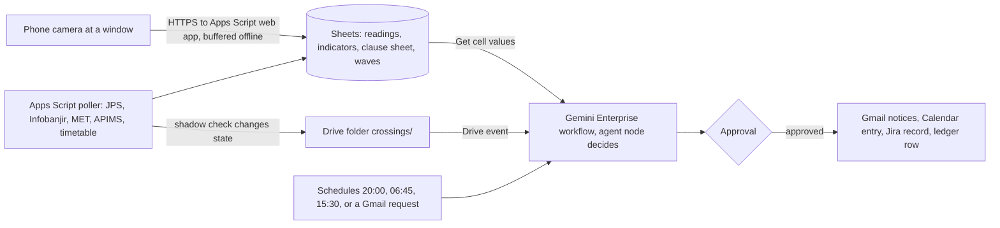

# Skyclause

Skyclause makes one logged, approved conditions call for each wave of physical classes that APU's timetable releases, so lecturers and event organisers act on measured haze and storm readings instead of guessing, and APU holds the monitoring record that the higher-education ministry's 7 October 2026 instruction asks for. Its target owner is APU's facilities, safety and welfare desk (FSSW); until FSSW agrees, a rostered teammate holds the approval seat. Schedules at 20:00, 06:45 and 15:30, a Drive event when a reading crosses a threshold in the editable clause sheet, and email requests start a Gemini Enterprise workflow. It reads the JPS rain gauge 0.9 km from campus, MET warnings and forecasts, DOE's hourly air pollutant index (API), the timetable's release waves and the team's own window camera. Its agent node decides the mode for each wave at risk (Normal, Outdoor-limited, Commute disruption or Hybrid recommended), and after one approval Gmail notifies the opted-in lecturers and organisers, Calendar publishes the period, and Jira Cloud files the decision record. Proposed track: Intelligent Automation & Digital Transformation. Rank and score: see the [ranking](/docs/ideas/00-ranking.md).

Contents:

1.  [At a glance](#at-a-glance)
1.  [Origins](#origins)
1.  [Problem and evidence](#problem-and-evidence)
    1.  [Haze: a ministry instruction with no university rule](#haze-a-ministry-instruction-with-no-university-rule)
    1.  [Storms: the exit wave meets the afternoon cell](#storms-the-exit-wave-meets-the-afternoon-cell)
    1.  [Who decides today, and with what record](#who-decides-today-and-with-what-record)
1.  [How it works](#how-it-works)
    1.  [Day-to-day loop](#day-to-day-loop)
    1.  [The clause sheet](#the-clause-sheet)
    1.  [States and failure handling](#states-and-failure-handling)
    1.  [Connectors and platform check](#connectors-and-platform-check)
    1.  [Cloud, IoT and network](#cloud-iot-and-network)
    1.  [Real data and privacy](#real-data-and-privacy)
1.  [Why people will use it](#why-people-will-use-it)
1.  [Why the crowd won't build it](#why-the-crowd-wont-build-it)
1.  [Scores](#scores)
1.  [Research plan](#research-plan)
1.  [Time to impact](#time-to-impact)
1.  [Demo and review](#demo-and-review)
1.  [Build plan](#build-plan)
1.  [Risks and kill criteria](#risks-and-kill-criteria)
1.  [See also](#see-also)

## At a glance

| Item                  | Skyclause                                                                                                                                                                                                                                                        |
| --------------------- | ---------------------------------------------------------------------------------------------------------------------------------------------------------------------------------------------------------------------------------------------------------------- |
| Owner                 | FSSW, the target owner and first interview, not confirmed; for the pilot, the teammate holding the workflow-owner seat on a published roster                                                                                                                     |
| First users           | Lecturers with sessions ending 16:30–19:15 or starting by 08:30; GDGoC APU and club organisers with outdoor or evening events                                                                                                                                    |
| Track                 | Intelligent Automation & Digital Transformation                                                                                                                                                                                                                  |
| Trigger               | Schedules at 20:00 (tomorrow), 06:45 (morning) and 15:30 (exit wave); Drive event on a new file in `crossings/`; Gmail request; `@Skyclause` manual run, read-only                                                                                               |
| Live signal           | JPS gauge `0232901RF` (5 min); Public Infobanjir table (15 min); MET warnings and KL forecast; DOE APIMS hourly API; APU timetable feed, counts only; team window camera, on probation; PM2.5 board if it arrives                                                |
| Connectors            | 1P: Drive (event trigger, read), Sheets through Drive actions (Get cell values; Update cell values after approval), Gmail (event trigger; send, reply), Calendar (create event). 3P: Jira Cloud Free (create issue, create comment, federated search). MCP: none |
| Decision              | The workflow's agent node picks the mode for each release wave at risk from the clause sheet and the readings with their ages, or returns "no call" when an input it needs is stale                                                                              |
| Action and approval   | A Normal call ends with no write, and its run trace is the record; any other call stops once at **Approval**, then sends notices, the calendar entry, the Jira record and the ledger row together                                                                |
| Reviewer self-trigger | Email "evidence for 12 Nov 17:00–19:00" or "call for tomorrow?" to the team inbox (reply after approval, staffed 08:00–22:00 MYT, 11–14 November); `@Skyclause` for a read-only answer; subscribe to the conditions calendar                                     |

## Origins

- **Source: [Skyclause](/docs/ideas/opus-01/02-skyclause.md),** the only idea merged here.
  - **Kept:** the clause sheet with published defaults, release waves instead of fixed windows, local confirmation before any storm call, the Jira decision register, evidence replies by email, nightly grading, error rows instead of stale values, and the window camera.
  - **Changed, the deciding step:** in the source, Apps Script evaluated every clause and Gemini applied a precedence lookup, which two scorers flagged as a borderline pass of the Gemini Enterprise core gate. Here the agent node evaluates the clause sheet against the raw indicators and decides each wave. The feeder still computes the same thresholds as a deterministic shadow check, but only to wake the workflow and to flag disagreement in the approval bundle; nothing is sent on its verdict.
  - **Changed, approver, labels and camera:** the source had an FSSW duty officer approve from day one, but no public source confirms FSSW's mandate, so the pilot approver is the workflow owner, a teammate, until FSSW takes the seat. One scorer noted that labels drawn from the gauge grade the rule against itself, so evaluation labels now come from people at the campus exit and from human-labelled camera frames. The camera stays on probation with a pass/fail test (see [Cloud, IoT and network](#cloud-iot-and-network)), and its Koschmieder visibility in kilometres is no longer a decision input.
  - **Dropped:** the claim that KL thunderstorm warnings covered the exit wave on 20 of 24 October weekdays, and the "5 warned weekdays" week. Both came from the source author's OCR of 282 MET graphics on X through a signed-in session. Neither appears in the research, and neither can be re-run, because MET's endpoint keeps only current warnings and X's API returned 402. The warnings-only false-alarm ratio is now measured from the team's own warning log from 4 November. Also dropped: the Registrar escalation (no source says the Registrar decides teaching mode; the ministry said vice-chancellors decide), and the Gemini API photo second opinion (a second model outside Gemini Enterprise, capped at 20 free requests a day).
- **Kept separate from [Fanfall](/docs/ideas/opus-01/03-fanfall.md):** one scorer proposed merging the two as a "Bukit Jalil call"; two kept them apart, and so does this doc. They differ in owner (a safety and welfare desk with lecturers, against event organisers), in what is decided (conditions for teaching sessions, against one event's timing), in cadence (storm afternoons most of the monsoon, against about ten stadium nights in November), and in ground truth (gauge and API within minutes, against gate taps a day late). **Inference:** a merged product would put two unrelated rule sets behind one approver and blend a daily weather call with a monthly event forecast into one accuracy figure. They share the timetable's release-wave counts, the Apps Script feeder pattern, one approval per bundle, next-day grading, and a public calendar people subscribe to; if both run, each can print the other's calendar entry as context.
- **Related, not merged: [Kuyoh Shuttle Sentinel](/docs/ideas/argon-01/02-kuyoh-shuttle-sentinel.md)** read the same MET warnings and Sungai Kuyoh gauge to dispatch shuttles; that decision belongs to the shuttle product. Skyclause reuses the public feeds and leaves out a river-level clause: the level read 26.37 m on 3 November against Normal at 28.00 m ([data sources](/docs/research/data-sources.md#river-level-at-lrt-bukit-jalil-public-infobanjir)), and the source idea logged 26.361–26.386 m all week, even on the 81.5 mm day.

## Problem and evidence

### Haze: a ministry instruction with no university rule

- On 7 October 2026 KPT told every university to monitor API readings in its own locality; on 9 October vice-chancellors were told they could decide class closures themselves; Universiti Malaya went hybrid from 12 October ([X research][x haze]).
- Schools got numbers and universities didn't: suspend outdoor activities above API 100 and close above 200 ([Malay Mail, 7 Oct][mm moe]), then close above 180 or after three days above 150 ([The Star, 8 Oct][star moe]); Reddit threads show the threshold moving again ([Reddit research][reddit haze]).
- Haze drew the highest engagement in the Reddit study (posts of 3,418, 2,226, 1,598 and 1,555 points). A lecturer: "I too wanna WFH but alas college management don't think like that"; at APU, most martial-arts clubs "are closed down … due to the Haze" ([Reddit research][reddit haze]). A student tagging the ministry: students "kena beratur tunggu bas dalam jerebu" (still have to queue for buses in the haze) ([X research][x haze]).
- **Frequency, replayed:** at Cheras (`CA16W`, the station nearest APU at about 5.9 km ([data sources][ds apims])), the API passed 100 on 20 of the 31 days with readings from 3 October to 3 November 2026 and passed 150 on 17, as the source idea counted from the [Malaysia Haze Monitor] log on 4 November. Since then KL skies cleared on 27 October, "Jerebu is back ni" was posted on 1 November, and Selangor reopened its schools on 4 November ([X research][x haze]), so the haze clauses will most likely be shown on replays this month.
- **The official index lags:** it uses 24-hour averages for PM2.5 and PM10 ([DOE API calculation]). On 25 October a public PMS5003 sensor read 0–8 µg/m³ from 06:00 while Batu Muda's official API stayed at 124 until 08:00 and 80–96 for the rest of the day ([Sensor.Community archive], via the source idea). A student: readings "could stay at like 80 even though the air quality is clearly in the unhealthy/very unhealthy range" ([Reddit research][reddit haze]).

[mm moe]: https://www.malaymail.com/news/malaysia/2026/10/07/haze-education-ministry-orders-state-and-district-education-offices-schools-to-monitor-haze-act-based-on-api-readings/238138
[star moe]: https://www.thestar.com.my/news/nation/2026/10/08/haze-schools-must-close-if-api-exceeds-150-for-three-days-says-education-ministry
[DOE API calculation]: https://eqms.doe.gov.my/Documents/APIMS/API_Calculation.pdf

### Storms: the exit wave meets the afternoon cell

- **The build week is wet:** MET's KL forecast, re-fetched at 01:49 MYT on 4 November, says "Ribut petir di beberapa tempat" (thunderstorms in places) every afternoon from 4 to 9 November, with morning rain on 5 November. A Thunderstorms Warning issued at 01:40 on 4 November named W.P. Kuala Lumpur until 05:00. The endpoint holds only current warnings ([data sources](/docs/research/data-sources.md#met-malaysia-warnings)), so no public warning history exists before the feeder's own log.
- **What fell at Bukit Jalil:** the Sg. Kuyoh di LRT Bukit Jalil gauge logged 7.5, 81.5, 0, 16.5, 65 and 39 mm on 29 October to 3 November (re-checked on [Public Infobanjir] at 01:45 on 4 November). The source idea's 5-minute [JPS KL gauge] series puts 76 mm of 30 October between 18:00 and 20:00 and 62.5 mm of 2 November between 14:00 and 16:00.
- **Who it hit:** on 2 November, 155 physical sessions ended between 14:00 and 16:30, 89 of them at 15:30 (source idea's count of the timetable feed), and a traffic account listed a flash flood "Bukit Jalil arah Puchong" ([X research](/docs/research/social.md#event-crowds-and-flash-floods-around-bukit-jalil)). LRT Bukit Jalil's fare gates went under at the evening peak on 6 May 2026, and a review says "the university is flooded during heavy rain" ([other platforms research][other rain]).
- **Volume:** in 2–6 November, 139–174 physical sessions end between 16:30 and 19:15 each weekday and 75–89 start by 08:30; the week of 28 October had 72 weekday release waves of at least 10 physical sessions, and heavy rain hit 4 of them, all on 2 November (source idea's counts from the feed described in [APU research][tt counts]). **Inference:** with thunderstorms forecast "in places" every afternoon, a warnings-only rule would fire most weekdays; how often it fires for nothing is measured from 4 November, not assumed.

[Public Infobanjir]: https://publicinfobanjir.water.gov.my/rainfalldata/Wilayah%20Persekutuan%20Kuala%20Lumpur
[JPS KL gauge]: https://infobanjirjpskl.water.gov.my/Rainfall/Station/75?districtId=0

### Who decides today, and with what record

- Student Handbook v8.0 requires 80% attendance per module; international students warn that missing it means "deportation or expel" (127 points) ([Reddit research](/docs/research/social.md#attendance-moodle-locks-and-the-80-visa-rule)). In AttendiX a lecturer marks Present, Absent, Absent With Reason or Late and can edit records 98 days back ([KB: How to Edit Attendance Record?][kb attendix]).
- The handbook has no weather, haze or flood provision, and the source idea's search of APU's public knowledge base on 4 November found no haze, thunderstorm or flood page. Workarounds: AirVisual or aqicn.org, ad hoc switches to online classes ([Reddit research][reddit haze]), and forum checks before travelling ([other platforms research][other rain]).
- The office named here is a guess with one public trace: a review mentions APU's "campus facilities, safety and welfare head" ([other platforms research](/docs/research/social.md#parking-supply-and-safety)); the source idea named FSSW without a link, and no page in APU's public knowledge base, including the campus facilities and navigation guide that lists office locations, mentions FSSW or a facilities, safety and welfare office.
- **Inference:** each lecturer, organiser and office decides alone, from different sources, with no shared record; nothing written answers "how did APU monitor local readings in October?".

[kb attendix]: https://apiit.atlassian.net/wiki/spaces/ITSM/pages/221218032

## How it works

### Day-to-day loop

1.  **Feeder (Apps Script, unattended):** time triggers poll the JPS gauge every 5 minutes, Infobanjir every 15, MET warnings every 10, the MET forecast daily, APIMS hourly, and the timetable hourly with `If-None-Match`; a web app receives the camera every 10 minutes. Each row keeps source time, receipt time, HTTP status and fetch latency, and a failed poll writes an error row, never the last value ([public feed path](/docs/research/gemini-enterprise.md#public-feed-polled-into-sheets)).
1.  **Indicators and shadow check:** the feeder turns rows into numbers (rain in the last 60 minutes and 2–4 hours, the highest API of three stations, the last three 06:00 readings, whether a warning is in force, each input's age, physical sessions per release wave) and evaluates each clause by formula. When a formula verdict changes, it drops a file into `crossings/`.
1.  **The call (Gemini Enterprise, agent node):** on a schedule or a crossing, the node reads the clause sheet, the indicators, the MET warning text verbatim and the waves in the window through **Get cell values**. For each wave of at least 10 physical sessions it decides the mode by the sheet's precedence, quotes each fired clause with its input's age, applies the sheet's written rules for stale or conflicting inputs ("no call: gauge silent 25 min"), picks the opted-in recipients with sessions or events in that wave, and drafts their notices. If its mode differs from the shadow verdict, the bundle says so first.
1.  **The one approval:** a non-normal call shows as **Needs Review**; the duty approver approves, edits or rejects it. A Normal call ends without writing anything.
1.  **Writes after approval:** Gmail notices, a Calendar entry on the public conditions calendar, a Jira issue (clauses, readings, waves, approver, times) and an **Update cell values** ledger row. Hybrid recommended goes only as a memo to the contact FSSW names; lecturers get no notice from it.
1.  **Requests:** an email fires a Gmail-triggered run that answers "evidence for <window>" or "call for <date>" from the ledger, Jira and camera frames, sent after approval; `@Skyclause` gives the same answer read-only in the asker's own run.
1.  **Grading:** each night the feeder grades every wave against what was observed (hit, miss, false alarm, correct Normal) and writes the grades to the Sheet; every call quotes yesterday's grades, and Monday's 06:45 run always asks for one approval to post the week's grades as a Jira comment. A wave where the shadow check fired but no approved call exists is listed as "no call" for the approver to explain (rejected, run failed, or disagreed).
1.  **Auditor (Apps Script):** emails the team when a feed or the camera goes silent, when the shadow check fires and no run follows within 20 minutes, and on day 12 of the 14-day schedule credentials ([unattended runs][ge unattended]).

### The clause sheet

The owner edits thresholds and wording in a Sheet; defaults come from published school rules and JPS rain classes, as the source idea set them. The highest mode wins, and every fired clause is listed on the call.

| Clause           | Reads                                          | Fires when (default)                                                                                                                                | Proposes                          |
| ---------------- | ---------------------------------------------- | --------------------------------------------------------------------------------------------------------------------------------------------------- | --------------------------------- |
| Haze watch       | API at Cheras, Petaling Jaya, Putrajaya; board | Official API 101 or more at any of the three, or the board's 1-hour PM2.5 above 75.5 µg/m³                                                          | Outdoor-limited                   |
| Haze severe      | API, last three 06:00 readings                 | API above 180, or above 150 at 06:00 on three consecutive days (the 8 October school rule)                                                          | Hybrid recommended, memo only     |
| Storm watch      | MET warnings                                   | A warning naming W.P. Kuala Lumpur is valid across a release wave                                                                                   | Nothing alone; printed as context |
| Storm confirmed  | JPS gauge; camera if it passed probation       | Storm watch plus at least 31 mm in 60 minutes (JPS "Lebat") from 30 minutes before to 60 minutes after a wave; camera only when the gauge is silent | Commute disruption                |
| Flash-flood risk | JPS gauge rain                                 | More than 60 mm in 2–4 hours (JPS's flash-flood note, per the source idea)                                                                          | Commute disruption, flood note    |
| Silent input     | Every feed                                     | No reading for two intervals, or an error row                                                                                                       | No call for clauses needing it    |

### States and failure handling

- **Per wave:** Normal → Watch (warning in force, context only) → Drafted → Needs Review → Approved, Edited or Rejected → Sent → Graded. **Per input:** fresh, stale (two intervals missed), error, recovered; a recovered input is named on the next call and needs one fresh reading before a clause uses it.
- **A failed source** shows as an error on the call and blocks only the clauses that need it; Infobanjir appears as its own input, never as a silent stand-in for the JPS series. Event-triggered runs that fail on quota aren't retried ([limits][ge limits]), which is why the auditor watches for a fired shadow check with no run. **Approval latency:** a crossing at 17:20 waits up to 5 minutes for the poll, 5–10 for the Drive trigger, then for a click; the roster covers 14:00–19:15 on storm afternoons, and the delay is measured on every call.

### Connectors and platform check

| Connector                | 1P/3P | Mode                                               | Job                                                      |
| ------------------------ | ----- | -------------------------------------------------- | -------------------------------------------------------- |
| Google Drive             | 1P    | Event trigger (new file in `crossings/`); read     | Starts crossing runs; holds the frames evidence links to |
| Sheets via Drive actions | 1P    | Get cell values; Update cell values after approval | Clause sheet, indicators, waves; the approved ledger row |
| Gmail                    | 1P    | Event trigger (email received); Send, Reply        | Requests in; notices and evidence replies out            |
| Google Calendar          | 1P    | Create event                                       | Public conditions calendar, subscribable from Outlook    |
| Jira Cloud Free          | 3P    | Create issue, Create comment; federated search     | Decision register and weekly grades                      |

- Schedules with cron and a time zone, Drive and Gmail event triggers polled every 5–10 minutes, and manual `@` runs are documented; there is no webhook trigger, hence the Drive hand-off ([triggers](/docs/research/gemini-enterprise.md#triggers-and-schedules)). Sheets cell reads and writes have been GA since 12 October 2026; Gmail, Calendar and Jira Cloud create issue and create comment are listed actions ([actions][ge actions]). At APU, Outlook (send mail, create event) and OneDrive or SharePoint triggers would replace Gmail, Calendar and Drive; all are GA.
- Connector writes from a workflow agent node require human review, and scheduled runs that email people pause for approval ([unattended runs][ge unattended]); **Inference:** the approval page doesn't say who may approve, so the workflow owner's seat is the approver.
- Sheets are read through actions at query time, never through an ingested copy that would answer from old data ([federated versus ingestion](/docs/research/gemini-enterprise.md#federated-search-versus-ingestion)). Drive, Gmail and Calendar connectors need a Workspace account, not `@gmail.com` ([account limits](/docs/research/gemini-enterprise.md#edition-and-account-limits)).

### Cloud, IoT and network

- **Cloud:** the Gemini Enterprise workflow decides, with step traces in the **Runs** tab ([run history](/docs/research/gemini-enterprise.md#run-history-as-evidence)); Apps Script polls and ingests; Sheets and Drive hold readings and frames; Jira Cloud holds the register.
- **IoT, the team's camera station, on probation:** an old Android phone on a charger at a high window keeps a Chrome page open with `getUserMedia` and a wake lock ([browser sensors](/docs/research/iot-and-network.md#phone-and-laptop-sensors-in-the-browser)). Every 10 minutes the phone masks the lower third of the frame, measures the contrast of a near landmark (about 1 km) and the far skyline against a clear-day reference, and posts two contrast ratios and a small JPEG; scoring happens on the phone ([edge processing](/docs/research/iot-and-network.md#edge-versus-cloud-processing)).
- **The probation test, 5–8 November:** two teammates label each daylight frame "landmark visible" or "obscured" by eye. The phone's flag must agree on at least 90% of at least 100 frames, including at least 10 obscured ones. If it passes, the camera can confirm a storm when the gauge is silent and corroborates it otherwise; if it fails, the camera keeps only evidence frames and the network proof, and the demo says so. **Inference:** after dusk the frames are dark, so the camera covers daylight waves only.
- **IoT, PM2.5 board, optional:** a Pico 2 W with the Grove HM3301 sensor (price taken from the source idea and not in the repo research; check Cytron before ordering), ordered on 4 November, likely arriving 6–10 November ([lead time](/docs/research/iot-and-network.md#hardware-lead-time)). The nearest public low-cost particulate sensor the research found is about 14 km from campus ([data sources](/docs/research/data-sources.md#other-air-quality-feeds)). Concession: without the board, the haze clauses run on the lagging official index alone.
- **Network:** each camera and board row carries device time and receipt time, so latency shows per reading; the page buffers frames in IndexedDB offline and uploads them with original timestamps; each poll logs status and latency; every call prints each input's age. The phone uses a 4G hotspot, because nothing public says headless devices can join OnBoard@APU ([campus Wi-Fi](/docs/research/iot-and-network.md#apu-campus-wi-fi)).

### Real data and privacy

- **Live:** JPS 5-minute JSON and Public Infobanjir (no terms found), MET warnings and forecast (CC BY 4.0), DOE APIMS (undocumented endpoint, no terms) ([data sources][ds apims]), the APU timetable feed (APU's Terms of Use require written permission; ask in `#help-desk`) ([APU research][tt privacy]), and the team's camera and board.
- **Replayed, labelled:** the Malaysia Haze Monitor hourly API log and the [Sensor.Community archive] (DbCL), only for the haze backtest; never shown when a live source fails ([data rulings](/docs/CONTEXT.md#decisions-so-far)).
- **Privacy:** the feeder drops `NAME`, `SAMACCOUNTNAME` and `LECTID` at ingest and keeps counts per wave ([APU research][tt privacy]); the camera masks the lower third and points at the skyline, so no faces are captured ([PDPA](/docs/research/judging.md#malaysias-pdpa-and-the-2024-amendment)); recipients opt in; frames are deleted after one semester.

## Why people will use it

- **Habit loop:** the cue is a notice or calendar entry in the inbox and calendar lecturers already open, before the wave; the action is a ten-second read and the lecturer's own choice; the reward is no surprise at 17:45 and a dated record to point at when marking Late or Absent With Reason.
- **No new mandate needed:** each recipient acts within authority they already hold (a lecturer over attendance codes, an organiser over an event); only Hybrid recommended needs someone with closure authority, and it goes as a memo.
- **Zero install:** recipients need no Gemini Enterprise seat; Outlook and Google Calendar subscribe to the calendar.
- **Asking is the second habit:** "evidence for <window>" costs one email and returns readings, not opinions.
- **After the team graduates:** FSSW keeps the seat and edits the clause sheet; the GDGoC APU committee inherits the feeder and camera as a yearly handover; hardware costs under RM200 and the software runs on free tiers.

## Why the crowd won't build it

- **The simulated crowd:** air quality is 2.2% of 780 simulated ideas, a thin tier, built on new sensors and LoRa; flood warning is 3.2%, in the crowded off-campus tier ([clusters](/docs/research/competition.md#clusters-and-shares), [tiers](/docs/research/competition.md#saturation-tiers)). Only 3% use public feeds, and 1% combine an unattended run, a named owner and a measured baseline ([what the crowd misses](/docs/research/competition.md#what-the-crowd-structurally-misses)).
- **This hackathon:** `apu-smart-shuttle` promises "traffic and rain alerts" inside a shuttle tracker ([public repositories](/docs/research/competition.md#public-repositories-so-far)); Skyclause tracks nothing and outputs a logged, approved call.
- **GitHub, searched by the source idea on 4 November:** 33 "haze malaysia" repositories, all trackers or dashboards; the closest, HazeLens ASEAN, follows hotspots towards communities, not an institution's call; 57 "snow day predictor" repositories guess closures for parents and none records the institution's decision.
- **Existing substitutes:** MET's own warnings, AirVisual and aqicn.org ([Reddit research][reddit haze]), and university statements like UM's ([X research][x haze]). Campus closure notices already exist elsewhere ([substitutes](/docs/research/competition.md#existing-substitutes)); the untested part is a graded per-wave call with evidence.
- **Inference:** the scarce combination is a ministry hook, the timetable's release waves, local confirmation that beats a warnings-only rule, and an approved record; the crowd stops at the alert.

## Scores

**68.5 / 100, rank 5 of 8** in the [cross-set ranking](/docs/ideas/00-ranking.md). Three independent scorers rated this doc on the [unified matrix](/docs/ideas/00-ranking.md#scoring-matrix): an NTT DATA forward deployed engineer (FDE), an APU School of Technology IoT lecturer, and a Google Cloud advocate who is also an APU student. The used score is their mean, except day-to-day workflow and theme, which take the lowest. The reason shown is the lowest scorer's. Per-scorer totals: FDE 70.4, lecturer 69.6, advocate 73.2. All three passed it on every gate. The source ideas scored Skyclause 73.9 on the same matrix before the merge.

| Component           | Weight | FDE | Lecturer | Advocate | Used | Lowest scorer's reason                                                                                                                                                                                                                                                                                                                                     |
| ------------------- | -----: | --: | -------: | -------: | ---: | ---------------------------------------------------------------------------------------------------------------------------------------------------------------------------------------------------------------------------------------------------------------------------------------------------------------------------------------------------------- |
| Impact              |     14 |   3 |        3 |        3 |    3 | Target owner FSSW is admitted to be a guess with one public trace, and a teammate holds the approval seat; waves are countable and ministry hook is real.                                                                                                                                                                                                  |
| Connectors          |     14 |   4 |        4 |        4 |    4 | Drive trigger, Sheets read and write, Gmail trigger and send, Calendar create, Jira create and comment all have a real role; no MCP, no preview on the critical path.                                                                                                                                                                                      |
| Day-to-day workflow |     14 |   5 |        4 |        5 |    4 | Three schedules plus a Drive crossing trigger and Gmail requests, a clause sheet with precedence, per-input freshness states, nightly grading and an auditor that emails on silent feeds; held at 4 because the doc's own latency arithmetic (poll, 5 to 10 minute trigger, then a click) means a storm crossing rarely reaches lecturers before the wave. |
| Research            |     14 |   3 |        3 |        4 | 3.33 | Haze and rain pain are real but not APU-specific; no APU rule exists, FSSW unreachable, and haze is mostly a replay (clear skies returned 27 Oct).                                                                                                                                                                                                         |
| Time to impact      |     14 |   3 |        3 |        3 |    3 | FSSW may never take the seat; fallback to GDGoC committee is a weak owner, and the haze clauses see a live season only in 2027.                                                                                                                                                                                                                            |
| Theme               |     10 |   4 |        3 |        3 |    3 | Public gauges and the API are real sensors but not the team's; the team's own sensor is a window camera on probation that the doc may demote to evidence frames, and the PM2.5 board arrives 6 to 10 November if at all, so the IoT layer risks being decorative even though per-poll latency and buffered frames keep the network visible.                |
| Originality         |     10 |   3 |        4 |        3 | 3.33 | Haze/flood trackers exist; an approved graded call per class wave is a different shape but weather/flood alerting sits in a crowded tier.                                                                                                                                                                                                                  |
| Buildability        |      5 |   2 |        4 |        4 | 3.33 | Contrast-ratio camera, board, six feeds, five workflows, grading and probation labelling is the heaviest build in the set.                                                                                                                                                                                                                                 |
| Demo                |      5 |   4 |        4 |        4 |    4 | Reviewer emails an evidence request or subscribes; video shows a real storm-afternoon run, but a reviewer cannot cause a storm.                                                                                                                                                                                                                            |

## Research plan

- **Round one, 5–6 November (four interviews):** two lecturers who teach 08:30 or 17:45 sessions (how they handled the October haze and the 2 November rain, how they mark Late); one GDGoC APU organiser (how the 17 November final and its transport are planned for rain); one president of an outdoor or martial-arts club (who decided the haze closures, on what reading).
- **Round two, 6–7 November (three or four):** two commuting students who use the LRT and shuttle; one lecturer shown a real call and evidence reply; the FSSW manager through APU's published contacts, or a Student Services counter officer. Ask each "would you act on this, and who else must agree?".
- **Timed observation:** three people (a lecturer, a student, a teammate) each assemble the evidence for 2 November 14:00–16:30 by hand from APIMS, MET, Infobanjir and X, timed with a stopwatch; then the same task by emailing Skyclause, timed including the approval wait.
- **Independent labels:** on storm afternoons a teammate stands at the main exit for each daylight wave and logs rain (none, light, heavy) and crowding at the shelter, without seeing the call.
- **30–50 real items:** about 40 weekday release waves of at least 10 physical sessions on 4–6 and 10–13 November (8–9 November have no classes ([APU research][tt counts])), all positives plus a random sample of negatives, labelled from the exit log and frames. Two teammates label each independently before the call is revealed and settle disagreements. Report precision, recall and false-alarm ratio with n and a Wilson interval ([accuracy method](/docs/research/judging.md#measuring-an-agents-accuracy-honestly)), plus the agent's agreement with the shadow check and the warnings-only rule's false-alarm ratio on the same waves. Haze: the 22 October weekday mornings, replayed from the API log and labelled as a replay.
- **Evidence replies:** 30 real windows; two teammates check every fact against the raw source and report the share correct.
- **What would change the design:** if lecturers say they ignore a 15:30 note, keep only crossing-triggered calls; if FSSW wants queue arrangements rather than modes, add a queue column to the clause sheet.

## Time to impact

- **By 3 months (early February 2027):** FSSW holds the seat and signs off the clause sheet; calls run through the monsoon to pilot lecturers and organisers; evidence replies answer attendance questions; the Jira register is the KPT record. Owner: the FSSW manager, with a School of Technology lecturer as academic sponsor. If FSSW declines, the GDGoC APU committee runs it for opted-in lecturers and organisers.
- **By 6 months (early May 2027), measured:** minutes from crossing to approved notice; precision, recall and false-alarm ratio on at least 300 graded waves; minutes to assemble evidence, before and after; the share of notified lecturers who acted, from a one-question survey; agent–shadow agreement. The haze clauses get their first live season only in the 2027 dry season, after this mark.
- **Owners:** FSSW (business), APU ITSM (accounts and connectors), APU's data protection officer (PDPA), the GDGoC APU committee (feeder and camera).
- **Assumptions:** the licence continues after the sponsored trial; APU gives written permission for the timetable feed and the camera position; FSSW agrees to a pilot and sets a false-alarm ceiling; the undocumented APIMS and JPS endpoints stay up.

## Demo and review

A 3:45 video recorded on 9 November from the live system, labelled with its capture date ([minute plan](/docs/research/judging.md#minute-plan)):

1.  **0:00–0:20:** slate; "Skyclause makes APU's haze-and-storm call for each wave of classes, with the record."
1.  **0:20–0:45:** the problem: the KPT instruction, no APU rule, 139–174 sessions in the exit wave, 62.5 mm in two hours on 2 November as 89 sessions ended at 15:30.
1.  **0:45–1:50:** a real storm-afternoon run from 4–6 November in the **Runs** tab: the crossing file, the agent's per-wave reasoning with input ages, the shadow-check line, **Needs Review**, approval, then the lecturer's email, the calendar entry and the Jira record.
1.  **1:50–2:20:** an email asking "evidence for 2 Nov 14:00–16:30" and its reply; then `@Skyclause` for tomorrow's call.
1.  **2:20–2:50:** the camera at the window, a frame beside its contrast row and latency, the probation verdict, and an error row from a failed feed.
1.  **2:50–3:45:** impact (timed baseline before and after, precision and recall with n, the warnings-only false-alarm ratio, the haze replay), what interviews changed, the 3- and 6-month plan, and how to review.

The reviewer fires it by emailing the team inbox (the dependable path, since a reviewer's own `@` run may not read a Sheet owned by another domain), by `@Skyclause` once they hold a seat, the role and the shared workflow ([reviewer access](/docs/research/gemini-enterprise.md#reviewer-access)), or by subscribing to the conditions calendar.

## Build plan

| Day        | Build (critical path first)                                                                                                                                          | Research and checks                                                               |
| ---------- | -------------------------------------------------------------------------------------------------------------------------------------------------------------------- | --------------------------------------------------------------------------------- |
| Wed 4 Nov  | Licence on a Workspace domain; one scheduled run whose agent node reads a Sheet, pauses at **Approval** and sends one Gmail; feeder with error rows; order the board | Ask organisers for timetable permission, reviewer emails, MCP policy; recruit 6–8 |
| Thu 5 Nov  | Clause sheet v1 and shadow check; 15:30 call with Jira, Calendar and ledger writes; camera page live at a window                                                     | Round one; exit log on the first storm afternoon                                  |
| Fri 6 Nov  | Drive crossing trigger; Gmail request and evidence workflow; `@` run; nightly grading                                                                                | Round two; timed evidence baseline; exit log                                      |
| Sat 7 Nov  | 20:00 and 06:45 calls; auditor; Monday grades approval                                                                                                               | Round two done; label waves and frames                                            |
| Sun 8 Nov  | Camera probation verdict; board on the window if it arrived; README, deck, diagram                                                                                   | Score items; confirm every member registered before midnight                      |
| Mon 9 Nov  | Feature freeze; refresh schedule credentials; record the video                                                                                                       | Test reviewer email path from a non-team account                                  |
| Tue 10 Nov | Submit early; keep everything running                                                                                                                                | Watch quota use and the auditor                                                   |

No card: Apps Script, Sheets, Drive, Gmail and Calendar on the licensed Workspace domain, Jira Cloud Free ([sandboxes](/docs/research/gemini-enterprise.md#free-sandboxes)), and the camera page on GitHub Pages. If the licence is late, the feeder, camera, clause sheet and grading log real data from 4 November and the workflow attaches to the same Sheets.

## Risks and kill criteria

- **No office owns it:** FSSW is a hypothesis with one public trace. Kill the office claim, not the product, if FSSW or a successor isn't reachable by the 3-month mark; it continues as the GDGoC APU committee's calendar for opted-in lecturers and organisers.
- **Nobody acts on a notice:** if fewer than four of the six or more people interviewed by 7 November say they would act on a call or use an evidence reply, drop notices and keep the record and evidence path only.
- **The agent and the shadow check disagree:** if they differ on more than 1 in 10 graded waves for reasons other than stale inputs, rewrite the clause wording before adding recipients; the disagreement count is published either way.
- **The camera fails probation:** it is demoted to evidence frames and network proof on 8 November, and the Theme claim rests on the board if it arrived, or concedes.
- **Haze stays away:** storms carry the live demo; haze clauses are shown on October's readings as a labelled replay.
- **Undocumented endpoints change:** APIMS and the JPS JSON may break without notice ([APIMS notes][ds apims]); each failure is an error on the call, with no fallback value.
- **Platform limits:** credentials expire every 14 days (refresh on 9 November); 160 assistant queries per user a day on Standard, so measure use over ten runs and slow the crossing trigger if projected use passes 80% ([limits][ge limits]); reviewers outside the organisation may need an IAM exception.
- **Permissions:** the timetable feed and a camera on campus need written permission; otherwise the camera uses a teammate's window in Bukit Jalil.

## See also

- [Brief](/docs/BRIEF.md) and [context](/docs/CONTEXT.md): rules, judging points, Gemini Enterprise limits.
- [Social research][x haze]: the haze, flood and attendance evidence.
- [Competition](/docs/research/competition.md) and [Gemini Enterprise](/docs/research/gemini-enterprise.md): the simulated crowd and substitutes; triggers, approvals, actions and live-data paths.
- [Data sources](/docs/research/data-sources.md), [IoT and network](/docs/research/iot-and-network.md) and [APU](/docs/research/apu.md): feeds, sensors and the timetable feed.
- [Judging](/docs/research/judging.md): baselines, accuracy, the video and privacy.

[x haze]: /docs/research/social.md#haze-and-air-quality-decisions
[reddit haze]: /docs/research/social.md#haze-heat-and-flash-floods
[other rain]: /docs/research/social.md#heat-rain-and-flash-floods
[ge unattended]: /docs/research/gemini-enterprise.md#what-runs-without-anyone-signed-in
[ge limits]: /docs/research/gemini-enterprise.md#limits-that-bite-in-a-one-week-build
[ge actions]: /docs/research/gemini-enterprise.md#actions-and-write-back
[ds apims]: /docs/research/data-sources.md#doe-apims-air-pollutant-index
[tt counts]: /docs/research/apu.md#timetable-row-counts
[tt privacy]: /docs/research/apu.md#personal-data-in-the-timetable-feed
[Malaysia Haze Monitor]: https://github.com/herr-hollis/Malaysia-Haze-Monitor
[Sensor.Community archive]: https://archive.sensor.community/
