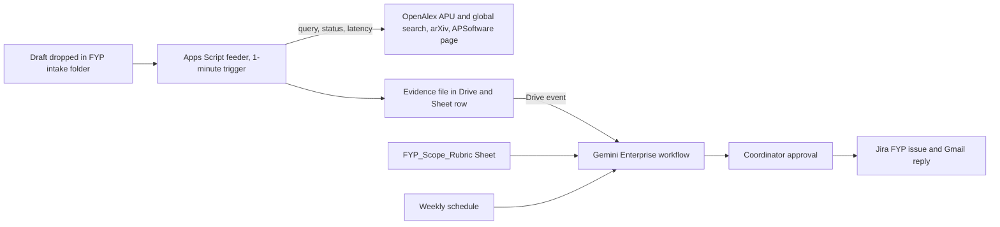

# Research & FYP Nexus

Research & FYP Nexus is an event-triggered Gemini Enterprise workflow for the School of Technology's final year project (FYP) coordinator. A student drops a draft title and abstract into a shared Drive folder. A feeder then pulls live evidence: APU's own OpenAlex works nearest the topic, recent overlapping work worldwide from OpenAlex and arXiv, and APU's free-software list. The workflow checks the draft against a rubric the coordinator edits and decides whether the scope is ready for a supervisor or needs revising first. It also names up to three APU authors whose recent works are nearest the topic. Once the coordinator approves, it files a Jira review issue and replies to the student with a pointer to iConsult. A weekly schedule re-checks approved projects for newly published overlap. The proposed track is Data-Driven Research & Intelligent Decision Making. It has no IoT layer and doesn't pretend to have one. Rank and score: see the [ranking](/docs/ideas/00-ranking.md).

Contents:

1.  [At a glance](#at-a-glance)
1.  [Origins](#origins)
1.  [Problem and evidence](#problem-and-evidence)
1.  [How it works](#how-it-works)
1.  [Why people will use it](#why-people-will-use-it)
1.  [Why the crowd won't build it](#why-the-crowd-wont-build-it)
1.  [Scores](#scores)
1.  [Research plan](#research-plan)
1.  [Time to impact](#time-to-impact)
1.  [Demo and review](#demo-and-review)
1.  [Build plan](#build-plan)
1.  [Risks and kill criteria](#risks-and-kill-criteria)
1.  [See also](#see-also)

## At a glance

| Field                 | Design                                                                                                                                                                  |
| --------------------- | ----------------------------------------------------------------------------------------------------------------------------------------------------------------------- |
| Owner                 | School of Technology FYP coordinator (proposed; no one is confirmed, and this is the first interview)                                                                   |
| First users           | Year 3 computing students drafting a title; the FYP supervisors who receive approved proposals                                                                          |
| Track                 | Data-Driven Research & Intelligent Decision Making                                                                                                                      |
| Trigger               | Drive event when the feeder writes an evidence file; weekly schedule for the overlap watch; nightly sweep for runs that failed                                          |
| Live signal           | OpenAlex and arXiv responses fetched when the draft lands, each stored with HTTP status, latency and time; no sensor                                                    |
| 1P connectors         | Drive: event trigger and file read (GA). Sheets: Get and Update cell values for rubric, evidence and status (GA since 12 October 2026). Gmail: Create draft, Send (GA)  |
| 3P connectors         | Jira Cloud Free: Create issue, Create comment, Assign issue, Change issue status (GA actions); federated search for active projects                                     |
| MCP                   | None on the path                                                                                                                                                        |
| Decision              | `ready for supervisor`, `revise scope first` (with the overlapping work quoted) or `evidence incomplete` (a source failed), plus a shortlist of up to three APU authors |
| Action and approval   | One coordinator approval, then the Jira issue and the reply to the student. Nothing goes to a lecturer except through the coordinator                                   |
| Reviewer self-trigger | Drop any real title and abstract (their own, or a published paper's) into the shared folder; the packet and the pending approval appear within about 15 minutes         |

Connector stages are from [actions and write-back](/docs/research/gemini-enterprise.md#actions-and-write-back) and [triggers](/docs/research/gemini-enterprise.md#triggers-and-schedules). They are documentation, not a run: no licence had arrived by 4 November. At APU the same design would switch to SharePoint or OneDrive as the trigger and Outlook for the reply ([systems APU runs](/docs/research/apu.md#systems-apu-runs)).

## Origins

The single source is [Research & FYP Nexus](/docs/ideas/argon-01/04-research-fyp-nexus.md). All three Pass A scorers kept it as a singleton: it is the only research-track idea and shares no owner or signal with the others.

- **Kept:** the APU-only OpenAlex corpus, the Drive-folder trigger, the APSoftware check, the pointer to iConsult rather than a new booking path, the masked-abstract Top-1/Top-3 test, and the intake-based rollout.
- **Changed:** "ranks the top three lecturers" became "lists APU works nearest the abstract, with their authors". Lecturers with few indexed papers would be under-ranked, and nothing suggests staff accept being scored, so the coordinator chooses. Matching now runs on OpenAlex's own APU-restricted search at call time instead of a weekly BigQuery copy. A weekly overlap watch on approved projects was added, so the workflow recurs between intakes; all three scorers marked the source down for running only when students submit.
- **Dropped:** the GitHub starter repo, because GitHub isn't a workflow connector ([workflows](/docs/research/gemini-enterprise.md#workflows)) and scorers called it decoration. SharePoint upload, because the team has no tenant; it is named as the APU switch instead. BigQuery federated query (preview, needs billing). The Cloud Run MCP server (preview, org-policy gated, needs a card). Semantic Scholar, because keyless calls returned `429` ([Crossref, Semantic Scholar, and arXiv](/docs/research/data-sources.md#crossref-semantic-scholar-and-arxiv)). Crossref, because its abstracts aren't reusable and OpenAlex already carries the DOIs. The Calendar slot, because iConsult already books supervisors. The curriculum-drift report, which belongs to a different owner (programme leaders) and a different decision.

## Problem and evidence

- **The FYP is a supervised degree requirement:** APU's KB FYP space says the FYP is part of "obtaining the honours bachelor degree", "with closed supervision on identified research area", and guides students "from the research topic identification" onward. The rest of the space needs an APU login: an anonymous API query on 4 November returned 2 pages ([KB FYP space]). Any supervisor allocation rules would sit behind that login. Past theses and final-year projects (APres) need an APKey too ([material that is not public](/docs/research/apu.md#material-that-is-not-public)), so the overlap check covers published literature only.
- **Finding a title and supervisor is informal:** a student near the end of an internship had no title, and their mentor "doesn't know what general IT requirements are for FYP". The advice was to contact "lecturers or researchers in your faculty that are undergoing research" ([FYP struggles thread]). The FYP is "a requirement under MQA", and external marking can stretch graduation from March finals to a November ceremony ([FYP mandatory thread]). In one commenter's module the Turnitin limit "was 20%" ([screwed FYP thread]). These are carried over from the source; Reddit refused automated re-checks on 4 November.
- **Students think the syllabus lags:** "the syllabus like no update", on a 194-point post ([Reddit research](/docs/research/social.md#reputation-and-safety-context)).
- **APU's research output is public, open and fresh:** OpenAlex held 3,711 APU works on 3 November, CC0, updated 2 November. The top 2024–2026 topics were Smart Agriculture and AI (58), Technology Adoption (52), AI in Healthcare (37), Tourism (31), Environmental Sustainability in Business (27) and Network Security (22) ([OpenAlex](/docs/research/data-sources.md#openalex)). Re-queried on 4 November, both the institution-ID and ROR filters returned 3,712 works, 1,575 of them from 2024–2026 with abstracts. Some works look misattributed, such as 2013–2014 spin-qubit papers.
- **The software rule is public:** APSoftware lists SPSS, SmartPLS 4, NVivo, MATLAB, Solidworks, NetSim Academic, SQL Server and Visual Studio as free to APU students (edited 14 March 2024, checked 4 November) ([KB APSoftware]).
- **Unknown, and must be measured:** how many proposals the school receives per intake, how the committee routes them today, and how long a student takes to find a supervisor.

[KB FYP space]: https://apiit.atlassian.net/wiki/spaces/FYP
[FYP struggles thread]: https://www.reddit.com/r/malaysiauni/comments/1v6s3e6/
[FYP mandatory thread]: https://www.reddit.com/r/malaysiauni/comments/1ib4taf/
[screwed FYP thread]: https://www.reddit.com/r/malaysiauni/comments/1m7drgn/
[KB APSoftware]: https://apiit.atlassian.net/wiki/spaces/ITSM/pages/993492993

## How it works

1.  **Signal:** a student or the coordinator drops a Doc or PDF with a title and an abstract into the `FYP intake` folder in the licensed Workspace domain. Only consenting students' drafts enter it.
1.  **Feeder:** an Apps Script time trigger (every minute) picks the file up and makes four live calls. The first is OpenAlex search restricted to APU (`authorships.institutions.id:I181397559`), top 10. The second is OpenAlex search over the last three years worldwide, top 10. The third is arXiv, top 5, at its one-request-per-3-seconds limit. The fourth fetches the public APSoftware page through Confluence's REST API. The feeder writes an evidence file into `Evidence` and a Sheet row holding each call's URL, HTTP status, latency, result count and time. OpenAlex costs $0.001 a search; keyless calls share $0.10 a day per IP ([OpenAlex](/docs/research/data-sources.md#openalex)). **Inference:** Apps Script calls leave from shared Google addresses, so use a free key ($1 a day).
1.  **Workflow:** the Drive event on `Evidence` starts the run 5–10 minutes later ([triggers](/docs/research/gemini-enterprise.md#triggers-and-schedules)). An agent node reads the draft, the evidence and `FYP_Scope_Rubric` through Sheets Get cell values. It applies the rubric and drafts the packet: the APU works nearest the topic with authors and years, any overlapping work quoted with its ID, and the software flags. An Approval step waits for the coordinator. On approval the run creates and assigns the Jira issue, writes the status back to the Sheet, and sends the student a reply that points to [iConsult][KB iConsult].
1.  **Rule set:** `FYP_Scope_Rubric` (table below) is a Sheet the coordinator edits. Its thresholds are team defaults until the coordinator replaces them. APU's own FYP rules are login-gated, so none is invented.
1.  **Weekly watch:** on Sunday night the feeder re-runs the global search for every approved title, limited to works since the last run. On Monday morning a scheduled run judges each new hit against the approved scope. It drafts one Jira comment per affected project, and the coordinator approves them as a batch.
1.  **States:** `received → evidence complete | evidence incomplete → ready for supervisor | revise scope first → approved → in supervision → new overlap noted`.
1.  **Failure handling:** a non-2xx response or a timeout is written as an error row with its status and message, never replaced by an earlier result. If the APU search fails, there is no shortlist and the state is `evidence incomplete: OpenAlex 4xx at 10:02`. Event-triggered runs that hit `RESOURCE_EXHAUSTED` aren't retried ([unattended runs](/docs/research/gemini-enterprise.md#what-runs-without-anyone-signed-in)), so a nightly sweep runs every evidence row that has no decision. Delegated credentials expire every 14 days and are refreshed before 11 November. If the licences are consumer `@gmail.com` accounts, Drive and Gmail connectors don't work ([account limits](/docs/research/gemini-enterprise.md#edition-and-account-limits)), and intake moves to a Jira issue created by the student, with a Jira event trigger.
1.  **Agent role:** OpenAlex relevance ranking is the matcher and deterministic code applies the thresholds. Gemini reads the draft against the evidence, judges "same aim and method", explains each flag and drafts both messages. It is compared with a template packet built from the same evidence, and the Gemini step is cut if it adds errors without saving coordinator time.
1.  **What the theme can and can't claim:** the cloud part is real: Apps Script, Workspace and a Gemini Enterprise workflow. The network part is thin but real: each draft's packet shows four public-API calls with status and latency, which is application reachability, not network infrastructure. There is no IoT. A phone or board attached to this product would be decorative, and APU's School of Technology judges teach an Edge TPU pipeline and are expected to spot a faked IoT layer ([sponsor lenses](/docs/CONTEXT.md#sponsor-and-organiser-lenses)). Expect the lowest theme score and choose this product only if the team accepts that.

| Rule         | Check                                                                                         | Outcome when it fires                                |
| ------------ | --------------------------------------------------------------------------------------------- | ---------------------------------------------------- |
| Completeness | Title, problem, aim and method are all present                                                | The reply asks the student for the missing part      |
| Overlap      | A work from the last three years shares aim and method, quoted with its ID                    | `revise scope first`                                 |
| Relevance    | No work on the topic in five years                                                            | `check relevance` note for the coordinator           |
| Software     | A paid tool the draft names isn't on the live APSoftware list                                 | "confirm access" flag                                |
| Shortlist    | Up to three APU authors with at least two works in the APU results, newest first              | Listed with their works; absence isn't unsuitability |
| Opt-out      | The author is on the coordinator's opt-out list                                               | Never shown                                          |
| Evidence     | Every statement cites a work ID or a call row; any failed call blocks the check that needs it | `evidence incomplete` for that check                 |

**Cost per draft:** two OpenAlex searches ($0.002), one arXiv call, one KB fetch, and about three assistant queries for the run and its approval. **Inference:** about 40 drafts a day would use 120 of one Standard seat's 160 queries ([limits](/docs/research/gemini-enterprise.md#limits-that-bite-in-a-one-week-build)), which is far above any likely volume. Measure ten real runs before relying on that.

[KB iConsult]: https://apiit.atlassian.net/wiki/spaces/ITSM/pages/219086947

## Why people will use it

- **Students:** within about 15 minutes of dropping a draft, a student learns whether someone already did their project and whose recent APU papers are closest, before committing a semester. Every revision dropped in the folder re-runs the check.
- **Coordinator:** gets one packet per proposal in a Jira queue, with sources and the software check, instead of an email thread. Approving is one click, and the opt-out list keeps staff from being exposed against their will.
- **Supervisors:** receive proposals already scoped near their own published work, and the weekly watch flags new overlapping papers while the project runs. **Inference:** that mid-project warning is the part no current habit provides.

## Why the crowd won't build it

The honest answer is that parts of it will be built. Research trend and literature analytics is a crowded tier (3.4% of simulated ideas), and the briefing's "research paper comparison" example used Deep Search over 20–25 IEEE papers to draft a scope ([briefing examples](/docs/research/competition.md#ideas-shown-at-the-briefing), [saturation tiers](/docs/research/competition.md#saturation-tiers)). A plain overlap checker will look like that example. What is thinner: lecturers and researchers are the primary users of only 4% of simulated ideas each, only 3% use public data feeds, and named connectors such as Jira appear in at most 2% of responses ([what the crowd misses](/docs/research/competition.md#what-the-crowd-structurally-misses)). The distinct part is APU-specific routing from APU's own CC0 corpus, plus a measured Top-k test and a watch that runs between intakes. Existing substitutes are the student's own Google Scholar or OpenAlex search, asking lecturers, the KB FYP space and iConsult. APU's AIDA assistant answers KB questions with citations and doesn't read OpenAlex or write to Jira ([KB AIDA]). Expect a middling originality score.

[KB AIDA]: https://apiit.atlassian.net/wiki/spaces/ITSM/pages/3791422495

## Scores

**60.8 / 100, rank 6 of 8** in the [cross-set ranking](/docs/ideas/00-ranking.md). Three independent scorers rated this doc on the [unified matrix](/docs/ideas/00-ranking.md#scoring-matrix): an NTT DATA forward deployed engineer (FDE), an APU School of Technology IoT lecturer, and a Google Cloud advocate who is also an APU student. The used score is their mean, except day-to-day workflow and theme, which take the lowest. The reason shown is the lowest scorer's. Per-scorer totals: FDE 60.8, lecturer 66.4, advocate 60.8. All three passed it on every gate. The source ideas scored Research & FYP Nexus 56.3 on the same matrix before the merge.

| Component           | Weight | FDE | Lecturer | Advocate | Used | Lowest scorer's reason                                                                                                                                                                                        |
| ------------------- | -----: | --: | -------: | -------: | ---: | ------------------------------------------------------------------------------------------------------------------------------------------------------------------------------------------------------------- |
| Impact              |     14 |   3 |        3 |        3 |    3 | FYP coordinator is a clear named owner but proposal volume per intake is unknown and seasonal.                                                                                                                |
| Connectors          |     14 |   4 |        4 |        4 |    4 | Drive trigger, Sheets, Gmail and Jira each do a real job with OpenAlex and arXiv through a feeder; no preview or card.                                                                                        |
| Day-to-day workflow |     14 |   3 |        4 |        4 |    3 | Drive event plus weekly overlap watch and nightly sweep recur and have an editable rubric and one approval, but runs depend on drafts arriving.                                                               |
| Research            |     14 |   3 |        3 |        3 |    3 | APU's OpenAlex corpus is real, but student pain evidence is a few Reddit threads and 8 interviews are reachable only if the coordinator answers.                                                              |
| Time to impact      |     14 |   3 |        4 |        2 |    3 | The 3-month plan depends on whether a proposal window falls in it ('ask P7'), the owner is 'proposed, not committed', and the 6-month step needs APU's SharePoint and Outlook, so impact may take a semester. |
| Theme               |     10 |   1 |        1 |        1 |    1 | No sensor and network is only API latency; the doc itself expects the lowest theme score.                                                                                                                     |
| Originality         |     10 |   2 |        2 |        2 |    2 | The briefing's research paper comparison example and AIDA overlap make this crowded.                                                                                                                          |
| Buildability        |      5 |   5 |        5 |        5 |    5 | No hardware, one feeder, three public APIs, workable in days.                                                                                                                                                 |
| Demo                |      5 |   5 |        5 |        5 |    5 | Reviewer drops any abstract in a folder and sees a packet in about 15 minutes.                                                                                                                                |

## Research plan

- **Round 1 (Thu 5 November):** P1–P3, Year 3 School of Technology students who fixed a title this year; P4, an FYP supervisor. Ask how the last title was found, who was asked, how long it took and what was rejected.
- **Round 2 (Fri 6 November):** P5–P6, students still without a title or supervisor; P7, the FYP coordinator or a committee member, to learn how proposals are routed today and how many arrive; P8, a second supervisor, optional. Say whether round 2 added new themes ([how many is enough](/docs/research/judging.md#how-many-people-is-enough)).
- **Timed observation:** P5 searches as usual for 20 minutes, using the KB, Google Scholar and messages. Record the time to the first named APU staff member with a relevant recent paper and the number of sources visited. Then repeat the search with the packet.
- **Evaluation items (50):** APU works from 2025–2026 with abstracts, each with an APU author who has at least two APU works. Feed each title and abstract with author names removed, and exclude the work itself from results. The label is the work's APU authors from OpenAlex. Two teammates check each affiliation and drop misattributed items, reporting how many. Report Top-1 and Top-3 recall with n and a Wilson 95% interval ([honest accuracy](/docs/research/judging.md#measuring-an-agents-accuracy-honestly)). On the same 50, two teammates independently label whether the top global hit shares aim and method, giving the precision of `revise scope first`. Consented real drafts from P1–P6, judged by P4 and P7, are a second, smaller set, reported at their real count. **Inference:** this measures OpenAlex relevance plus the rubric, not a new model.

## Time to impact

- **By 24 February 2027 (3 months):** the coordinator runs it for proposals in the semester after the 24 November 2026 intake ([intake dates](/docs/research/apu.md#intelligent-automation--digital-transformation)), if the proposal window falls there (ask P7). Measured: coordinator minutes per proposal against the round-2 baseline, the share of shortlists the coordinator accepts, overlap flags upheld by supervisors, and opt-outs.
- **By 25 May 2027 (6 months):** the second cohort, from the 25 March 2027 intake, runs on APU's Microsoft 365 (SharePoint trigger, Outlook reply) if the committee adopts it. Measured: days from draft to first supervisor meeting (iConsult booking date), weekly-watch comments acted on, and Top-3 recall re-run on new APU works. The owner is the coordinator, proposed and not committed.

## Demo and review

1.  **0:00–0:30:** the student quotes and the unknown baseline, stated as unknown.
1.  **0:30–1:30:** a real abstract dropped into the folder; the evidence row with four calls, statuses and latencies; the run appearing in **Runs**.
1.  **1:30–2:30:** the packet with nearest APU works, shortlist and a quoted overlap, then the coordinator's approval, the Jira issue and the reply pointing to iConsult.
1.  **2:30–3:00:** a labelled controlled failure (the feeder run with a revoked OpenAlex key) showing whatever error OpenAlex returns as `evidence incomplete`, with no shortlist.
1.  **3:00–3:30:** Top-1 and Top-3 recall with n and interval, the timed baseline, and the 3- and 6-month plan.

Reviewers get a seat, the role and the shared workflow ([reviewer access](/docs/research/gemini-enterprise.md#reviewer-access)). They drop any real abstract into the shared folder, and the owner's **Runs** history over 11–14 November is captured in the README.

## Build plan

1.  **Wed 4 November (critical path):** ask the organisers which account type the licences use. In a test workflow, prove the Drive event trigger, Sheets Get cell values, and Jira Create issue and Create comment. Get an OpenAlex key. Email the coordinator and recruit P1–P6.
1.  **Thu 5 November:** feeder: folder scan, both OpenAlex searches, arXiv, the APSoftware fetch, the evidence file and error rows. Round 1 interviews and the timed observation.
1.  **Fri 6 November:** workflow: Drive trigger, agent node with the rubric, Approval, then Jira, Gmail and the Sheet status. Round 2. Freeze the rubric with whatever P7 supplied.
1.  **Sat 7 November:** run the 50 items once with fixed settings, label them, and compute recall and precision; compare with the template baseline.
1.  **Sun 8 November:** weekly watch and nightly sweep turned on, so run history starts; README with connector modes and diagram.
1.  **Mon 9 November (reported holiday):** deck and a labelled recording from the live system.
1.  **Tue 10 November:** refresh credentials, write the reviewer instructions, run the portal checklist, submit. No card is needed at any step.

## Risks and kill criteria

- **Theme:** an accepted cost of up to 8 of 100 points against a full theme score. No sensor is added to hide it.
- **No owner:** kill by 6 November if neither P7 nor two supervisors find the packet more useful than asking around.
- **Weak matching:** if Top-3 recall falls under half on the 50 items, drop the shortlist and keep only the overlap and software checks. Report the number either way.
- **Fairness:** under-indexed staff are invisible to OpenAlex. Every packet says that absence from OpenAlex doesn't mean unsuitable, and the opt-out list is honoured.
- **Seasonality:** if P7 reports only a few dozen proposals a year, the impact claim shrinks to the watch and the per-proposal time saved, and the doc says so.
- **Rights:** drafts are students' work. Only consenting drafts are used, and none goes into free-tier AI tools. APU's Terms of Use ask permission for any use of KB content, so ask the organisers before fetching APSoftware ([terms](/docs/research/apu.md#terms-of-use-and-robotstxt)).

## See also

- [OpenAlex and other research feeds](/docs/research/data-sources.md#openalex)
- [APU's knowledge base](/docs/research/apu.md#apu-knowledge-base-on-confluence)
- [Connectors and live data](/docs/CONTEXT.md#connectors-and-live-data)
- [APU's ROR record](https://ror.org/03c52a632)
