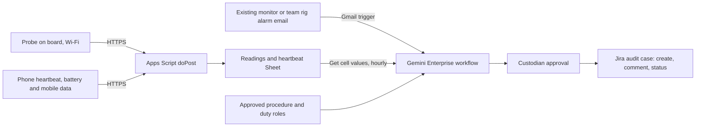

# LabRelay

LabRelay has a gate that comes first: no APU laboratory, temperature-controlled asset, custodian or temperature probe has been secured. If no APU custodian agrees to an interview by 4 November, the product stops. If one does, LabRelay is an acknowledgement-and-recovery audit for that lab equipment custodian. An alarm email from the asset's existing monitor starts a Gemini Enterprise workflow, which opens a Jira audit case after the custodian approves it. An hourly schedule then records who acknowledged the alarm, which approved procedure applies, and whether an independent reading supports recovery. The signal is a team-run temperature probe plus a separately powered, separately networked phone heartbeat. Together they let the workflow say "missing telemetry" instead of "normal". The custodian approves each Jira comment and status change. LabRelay never replaces the existing alarm or emergency response. The proposed track is Intelligent Automation & Digital Transformation. Rank and score: see the [ranking](/docs/ideas/00-ranking.md).

Contents:

1.  [At a glance](#at-a-glance)
1.  [Origins](#origins)
1.  [Problem and evidence](#problem-and-evidence)
1.  [How it works](#how-it-works)
1.  [Why people will use it](#why-people-will-use-it)
1.  [Why the crowd won't build it](#why-the-crowd-wont-build-it)
1.  [Scores](#scores)
1.  [Research plan](#research-plan)
1.  [Time to impact](#time-to-impact)
1.  [Demo and review](#demo-and-review)
1.  [Build plan](#build-plan)
1.  [Risks and kill criteria](#risks-and-kill-criteria)
1.  [See also](#see-also)

## At a glance

| Field                 | Design                                                                                                                                                                       |
| --------------------- | ---------------------------------------------------------------------------------------------------------------------------------------------------------------------------- |
| Gate                  | By 4 November: an APU custodian of a temperature-controlled asset with an existing alarm agrees to an interview, and probe hardware is ordered or borrowed. Otherwise stop   |
| Owner                 | Lab equipment custodian (none identified yet; candidates to ask are below)                                                                                                   |
| First users           | Duty staff on the custodian's rota, who receive alarms out of hours                                                                                                          |
| Track                 | Intelligent Automation & Digital Transformation                                                                                                                              |
| Trigger               | Gmail "When an email is received" for an alarm email or a duty reply; an hourly schedule for the audit; a manual `@LabRelay audit` run                                       |
| Live signal           | Probe temperature every 60 seconds from a board on Wi-Fi; a heartbeat every 60 seconds from a phone on battery and mobile data; per-row latency                              |
| 1P connectors         | Gmail: trigger, Reply, Send (GA). Sheets: Get cell values for readings, heartbeats, duty roles and procedure versions (GA since 12 October 2026)                             |
| 3P connectors         | Jira Cloud Free: Create issue, Create comment, Change issue status, Assign issue, Link issues (GA actions); federated search for open cases                                  |
| MCP                   | None                                                                                                                                                                         |
| Decision              | Per case: `acknowledged` (role and time), `acted` (procedure step recorded), `recovered` (fresh independent readings in range) or `unknown: investigate data path`           |
| Action and approval   | The custodian approves each case, comment and status change. LabRelay never pages anyone and never says "all clear"                                                          |
| Reviewer self-trigger | Open the heartbeat page on their own phone as a labelled reviewer heartbeat for the rig, close it, then run `@LabRelay audit` to see `heartbeat path missing, probe present` |

The Jira actions are in Google's documented GA list ([actions and write-back](/docs/research/gemini-enterprise.md#actions-and-write-back)), untested until a licence arrives. At APU the switch is Outlook as the trigger and Jira Service Management ([systems APU runs](/docs/research/apu.md#systems-apu-runs)).

## Origins

The single source is [LabRelay](/docs/ideas/astra/05-labrelay.md), and the parts of astra's [shared delivery contract](/docs/ideas/astra/00-ranking.md#shared-delivery-contract) it needs are folded in below.

- **Kept:** the chain in which delivered doesn't imply acknowledged, acknowledged doesn't imply acted, and acted doesn't imply recovered. A collector heartbeat whose independence is demonstrated, not assumed. The team's cold box as a transport-and-audit proof only. No model-made biological thresholds. The existing alarm stays outside the workflow.
- **Changed:** the source and the shared contract treated Jira comment and status actions as unverified and had a reviewer transition cases by hand. Google's list names them GA, and the merged research flags the old check ([platform constraints](/docs/research/gemini-enterprise.md#platform-constraints-and-design-consequences)), so the workflow writes them after approval. The trigger is now the existing monitor's own alarm email, so LabRelay consumes the alarm instead of competing with it. Duty staff acknowledge by replying to that email. Named APU candidates replace "a relevant APU owner".
- **Dropped:** manual transitions, and any "kitchen demonstration as a campus pilot" framing.
- **Not merged:** one scorer proposed an "asset acknowledgement loop" with [WashWitness](/docs/ideas/astra/04-washwitness.md). Others noted that the heartbeat idea also appears in [Outage Witness](/docs/ideas/opus/05-outage-witness.md) and that the fresh-evidence pattern appears in [Recheck](/docs/ideas/astra/01-recheck.md). It stays separate because the owners differ. Here the owner is a lab equipment custodian with a duty rota. WashWitness belongs to the residence office, the merged Outage Witness product to APU's IT helpdesk, and Recheck to IT support. None of them audits who responded to an equipment alarm.

## Problem and evidence

- **The gate, stated plainly:** no source shows that APU has a cold-storage lab. APU's facilities page names CREDIT, its Centre for Research and Development of IoT, and the AGRHI Hub glasshouse, whose IoT sensors collect "climatic conditioning data". No public feed or owner was found for either ([existing devices](/docs/research/iot-and-network.md#signals-from-devices-that-already-exist)). **Inference:** ask CREDIT, the glasshouse and School of Technology lab staff on 4 November whether any asset has an alarm and a duty owner. A technology campus may have none.
- **Alerts can fail silently:** after an electrical fault, neither the freezer nor separate monitors sent an alert, and the loss was found on return ([S11](/docs/research/social.md#s11-power-failure-disables-equipment-and-alerting)).
- **Delivered isn't acknowledged:** a lab manager received a midnight alert and ignored it ([S12](/docs/research/social.md#s12-an-alarm-arrives-but-no-one-acts)).
- **The person present lacks a procedure:** a worker found a warming freezer, no posted out-of-hours contacts, and no answer from their manager ([S13](/docs/research/social.md#s13-the-person-present-cannot-find-a-response-procedure)).
- **Limits:** all three accounts are from outside APU, with institutions and countries unstated. They don't show root cause or sample loss. Commercial monitors already provide thresholds, offline alarms and remote alerts, and one lab's first-person account describes intermittent Wi-Fi causing alerts ([C5](/docs/research/competition.md#existing-substitutes)).

## How it works

1.  **Signal:** a temperature probe on a board posts every 60 seconds over one network. A phone on battery and mobile data posts a heartbeat every 60 seconds over another. Each row carries device time and receipt time ([phone to Sheets](/docs/research/gemini-enterprise.md#phone-or-board-to-google-sheets)). The rig for the hackathon is the team's own cold box of ordinary water and ice. It warms naturally, and the rig's Apps Script emails an alarm when a team-defined, labelled-experimental threshold is crossed, the way an existing monitor would. It proves transport and audit, not freezer performance or biological safety. No campus freezer is touched.
1.  **Hardware:** a DHT22 temperature-and-humidity breakout (RM15.50) and a Pico 2 W (RM31.60–39.60) were both in stock at Cytron on 3 November, shipping from Penang in 2–3 working days, with Deepavali on 8 November ([boards](/docs/research/iot-and-network.md#cheap-boards-from-malaysian-retailers), [lead time](/docs/research/iot-and-network.md#hardware-lead-time)). Whether a DHT22 suits a cold, wet box must be checked on its datasheet first. A board alone isn't a probe.
1.  **Case intake:** an alarm email triggers the workflow. Gemini matches the email to the asset and its versioned approved procedure, then drafts a Jira case. After the custodian approves, the run creates and assigns the case to the duty role and links it to earlier cases on the same asset.
1.  **Acknowledgement:** a duty member replies to the case email. The Gmail trigger records the role and time as a Jira comment, so a delivered alarm is never counted as acknowledged.
1.  **Hourly audit:** reads open cases and fresh rows, then drafts comments and status changes for approval: `acknowledged`, `acted` (a procedure step quoted from a reply), `recovery evidence pending`, or `reviewed recovery` after the readings stay in range for the rule's window.
1.  **Independence rules:** see the table below. None of these states is ever "normal". The team demonstrates each one by really disconnecting its own devices, labelled as a controlled test.
1.  **Rule set (custodian-editable Sheet):** thresholds and recovery windows per asset come from the custodian's approved procedure. Until then they are the team's experimental values, labelled as not storage-safety limits. The sheet also holds the acknowledgement deadline per duty role and the stale-row limit (3 minutes).
1.  **Agent role:** deterministic code checks timestamps, thresholds, freshness and duplicate IDs. Gemini reconciles free-text replies with the procedure and names missing evidence, and it can't override those checks. It is compared with a rule-generated template, and the Gemini step is removed if it adds errors.
1.  **Cadence, operations and failures:** the hourly schedule makes 24 runs a day, well inside 160 queries on one Standard seat. Measure ten runs before trusting that ([limits](/docs/research/gemini-enterprise.md#limits-that-bite-in-a-one-week-build)). Approvals and connector polling take minutes, so this is an audit, never the urgent path ([unattended runs](/docs/research/gemini-enterprise.md#what-runs-without-anyone-signed-in)). A named team operator clears approvals in published hours, and outside them cases stay visibly pending. Credentials are refreshed before 11 November and **Runs** is inspected daily through 14 November. Quota errors are shown, never silently retried.
1.  **Sensor truth:** device time, receipt time and workflow time stay in separate columns. A stored reading is dated history, never current status.
1.  **Privacy and rights:** the team uses duty roles, not names, and needs no institutional contact details or research records. Sanitized rig logs are published with device, units, timestamps and conditions before any labelled replay.
1.  **Theme:** cloud is the Apps Script feeder plus the Gemini Enterprise workflow. IoT is a real probe the team runs. Network is the core of the decision: two independent paths, per-row latency, and explicit unknown states.

| Probe path (board, Wi-Fi) | Heartbeat path (phone, mobile data) | State                             | What the audit drafts                                  |
| ------------------------- | ----------------------------------- | --------------------------------- | ------------------------------------------------------ |
| Fresh, in range           | Fresh                               | `in range`                        | Recovery evidence, if a case is open                   |
| Fresh, out of range       | Fresh                               | `excursion observed`              | A case only if no alarm email arrived, flagged as such |
| Silent                    | Fresh                               | `probe path down, site reachable` | "Investigate probe, board or Wi-Fi"; recovery unproven |
| Fresh                     | Silent                              | `heartbeat path missing`          | "Independence lost"; readings still shown, dated       |
| Silent                    | Silent                              | `site unreachable: cause unknown` | "Power or network: unknown"; never "all clear"         |

## Why people will use it

- **Custodian:** gets an incident record that is already assembled (alarm, who acknowledged, which step, what recovery looks like) instead of piecing it together from phones and email after the fact. Shift handover reads the open cases.
- **Duty staff:** a reply is the whole acknowledgement. **Inference:** the habit exists only if alarms are frequent enough, and how often they occur is measured, not assumed.
- **The person who finds the problem:** the case thread carries the asset's approved procedure and the reachable duty role, which is the gap described in [S13](/docs/research/social.md#s13-the-person-present-cannot-find-a-response-procedure). Out of hours they reply to one thread instead of hunting for contacts.
- **Habit loop:** alarm → case → reply → hourly audit → reviewed recovery. Each closed case's acknowledgement time becomes the custodian's monthly measure, and the first is the 3-month baseline.

## Why the crowd won't build it

Temperature monitoring itself is crowded: "cold chain, logistics and industry" holds 3.5% of simulated ideas, and fault-to-ticket with temperature sensors 7.6% ([clusters](/docs/research/competition.md#clusters-and-shares), [saturation tiers](/docs/research/competition.md#saturation-tiers)). Reviewers may read LabRelay as freezer monitoring. The distinct part is auditing the response, not raising the alarm. Substitutes are strong: commercial monitors ([C5](/docs/research/competition.md#existing-substitutes)), call lists ([S12](/docs/research/social.md#s12-an-alarm-arrives-but-no-one-acts)), and Jira Service Management reopening alerts with history (C2). Whether an on-call tool's own acknowledgement feature already covers this wasn't researched, and that is the first question for the custodian.

## Scores

**50.8 / 100, rank 7 of 8** in the [cross-set ranking](/docs/ideas/00-ranking.md). Three independent scorers rated this doc on the [unified matrix](/docs/ideas/00-ranking.md#scoring-matrix): an NTT DATA forward deployed engineer (FDE), an APU School of Technology IoT lecturer, and a Google Cloud advocate who is also an APU student. The used score is their mean, except day-to-day workflow and theme, which take the lowest. The reason shown is the lowest scorer's. Per-scorer totals: FDE 52.6, lecturer 58.2, advocate 44.2. All three passed it on every gate. The source ideas scored LabRelay 42.5 on the same matrix before the merge.

| Component           | Weight | FDE | Lecturer | Advocate | Used | Lowest scorer's reason                                                                                                                                                                           |
| ------------------- | -----: | --: | -------: | -------: | ---: | ------------------------------------------------------------------------------------------------------------------------------------------------------------------------------------------------ |
| Impact              |     14 |   2 |        2 |        1 | 1.67 | No source shows APU has a temperature-controlled lab asset, custodian or alarm, and the doc says a technology campus may have none, so the impact rests on a dependency nobody has shown exists. |
| Connectors          |     14 |   3 |        4 |        3 | 3.33 | Gmail trigger/reply, Sheets read and Jira actions work, but nothing is connected to a real APU system.                                                                                           |
| Day-to-day workflow |     14 |   3 |        4 |        3 |    3 | Alarm email trigger and hourly audit are good design, but the alarm comes from the team's own cold box, so nothing recurs in a real office.                                                      |
| Research            |     14 |   2 |        2 |        1 | 1.67 | All three pain accounts (S11–S13) come from outside APU with institutions unstated, and the interviewees exist only if the 4 Nov gate passes.                                                    |
| Time to impact      |     14 |   2 |        2 |        1 | 1.67 | The plans are explicitly conditional, with no owner and no asset, and adding assets waits on 'dependable ownership'.                                                                             |
| Theme               |     10 |   4 |        4 |        4 |    4 | Probe path plus independent phone heartbeat makes network failure the decision input, which is the best use of theme.                                                                            |
| Originality         |     10 |   3 |        3 |        3 |    3 | Temperature monitoring is crowded; auditing acknowledgement is a distinct angle.                                                                                                                 |
| Buildability        |      5 |   2 |        2 |        2 |    2 | Board and probe ordered from Penang with Deepavali on the critical path; DHT22 in a cold box is unproven.                                                                                        |
| Demo                |      5 |   3 |        3 |        3 |    3 | Reviewer can open the heartbeat page and run an audit, but the interesting event is a cold-box excursion.                                                                                        |

## Research plan

Interviews run only if the gate passes. If it doesn't, interviewing overseas analogues adds nothing and the product stops.

- **Round 1 (Thu 5 November):** P1, the custodian; P2, a technician on the rota; P3, a lab user who has received an alarm. Ask them to walk through the last real alarm: who got it, who answered, what they did, and how recovery was decided.
- **Round 2 (Fri 6 November):** P4–P5, other rota members or users; P6, the facilities or safety contact for out-of-hours response.
- **Timed observation:** with permission, P1 reconstructs the last real alarm from monitor logs and messages while the team times it. Record alert time, first acknowledgement, action and recorded recovery, plus the minutes needed to assemble the record.
- **Items (30–50):** real observation windows from the team rig, labelled by two teammates as stable, above threshold, recovering or missing. Windows within one excursion are correlated, so excursion-level counts are reported separately. This can't establish detection accuracy for a real freezer.
- **Consent:** quotes are labelled by role ("P2, technician"). No lab records leave the custodian's systems without written permission ([consent](/docs/research/judging.md#consent-and-anonymised-quotes)).

## Time to impact

- **By 3 February 2027 (3 months):** a willing custodian runs the audit alongside the existing system on one noncritical supervised asset, with approved procedures. Measured: alert-to-acknowledgement time, cases closed with fresh recovery evidence or an explicit human override, zero "normal" outputs during a missing heartbeat, and record-assembly minutes against the round-2 baseline (target: 25% less).
- **By 3 May 2027 (6 months):** add assets only after dependable ownership and documented failure behaviour. These are conditional plans, not commitments from a lab.

## Demo and review

1.  **0:00–0:30:** the documented response gap and the access gate, stated plainly.
1.  **0:30–1:30:** live probe and heartbeat rows with latency; the cold box warming past the experimental threshold.
1.  **1:30–2:30:** the rig's alarm email, the drafted case, the custodian's approval, a duty reply recorded as `acknowledged`, and recovery still pending.
1.  **2:30–3:15:** the board unplugged for real, showing `probe path down, site reachable`, and then the phone off, showing `site unreachable: cause unknown`.
1.  **3:15–3:45:** metrics and the unvalidated deployment boundary.

Reviewers get a seat, the role and the shared workflow ([reviewer access](/docs/research/gemini-enterprise.md#reviewer-access)). They fire the self-trigger above, or reply to a live case if the team adds them to the rota as a reviewer role.

## Build plan

1.  **Wed 4 November (critical path):** the gate. Ask CREDIT, the glasshouse and School of Technology lab staff for a custodian, and decide whether to order or borrow the probe and board. In a test workflow, prove the Gmail trigger, Sheets Get cell values, and Jira Create issue, Create comment and Change issue status.
1.  **Thu 5 November:** phone heartbeat page and Apps Script web app; round 1 and the timed reconstruction.
1.  **Fri 6 November:** wire the probe if it has arrived; workflow with Gmail trigger, Approval, Jira and the hourly audit; round 2.
1.  **Sat 7 November:** real cold-box excursions and the controlled disconnects; label the windows; compare with the template baseline.
1.  **Sun 8 – Mon 9 November (Deepavali and reported holiday):** freeze scope, README, deck, labelled recording.
1.  **Tue 10 November:** refresh credentials, write the reviewer instructions, submit. No card is needed. The probe and board cost about RM47–55 if bought, and that purchase is the team's decision.

## Risks and kill criteria

- **No owner:** kill on 4 November if no APU custodian of a relevant asset exists. Don't relabel the cold box as a campus pilot.
- **Probe late:** kill the probe path if no reading arrives by 7 November. A heartbeat-only demo doesn't show recovery evidence.
- **Already solved:** kill on 6 November if the existing monitor and rota already show acknowledgement and recovery with less effort.
- **Shared failure:** if the team can't show the two paths failing independently, drop the independence claim.
- **Safety:** never weaken or delay the existing alarm to make a demo look useful.
- **Alarm fatigue:** another message to duty staff may be ignored like the first. The audit emails only the case thread they already reply to, and P1 decides whether that is acceptable.
- **Platform:** if the licence is late or the Jira action inventory differs from Google's list on 4 November, report exactly what failed, and don't hide it with duplicate cases.

## See also

- [Real versus simulated data](/docs/research/iot-and-network.md#real-versus-simulated-data)
- [Disconfirming signals and validation tests](/docs/research/social.md#disconfirming-signals-and-validation-tests)
- [Connectors and live data](/docs/CONTEXT.md#connectors-and-live-data)
