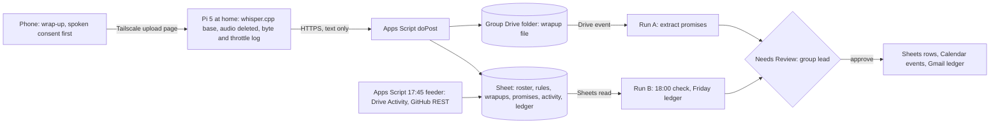

# Janji

Janji ("promise" in Malay) checks what a student project group said it would do in a five-minute wrap-up against what actually changed in the group's Google Drive folder and GitHub repo. It drafts a daily and a Friday ledger of said, shipped and slipped, which the group lead approves. Its first users are groups whose work is code or lives in Drive: this hackathon's own teams, which must each submit a repository ([brief][brief-submit]), and APU code and final-year-project groups. Proposed track: **Intelligent Automation & Digital Transformation**, which [CONTEXT](/docs/CONTEXT.md#recommended-shape) reads as the most direct fit for NTT DATA's "maximizing" agent. Caveat: most APU group work lives in Microsoft 365, which Janji can't read, so it serves a minority of groups. Nothing here has been built or run yet, and **Inference** marks conclusions no source states.

Contents:

1.  [At a glance](#at-a-glance)
1.  [Origins](#origins)
1.  [Problem and evidence](#problem-and-evidence)
1.  [How it works](#how-it-works)
    1.  [Signal to cloud path](#signal-to-cloud-path)
    1.  [Workflows](#workflows)
    1.  [Rule set](#rule-set)
    1.  [States and failure handling](#states-and-failure-handling)
    1.  [Connectors and platform check](#connectors-and-platform-check)
    1.  [Cloud, IoT and network](#cloud-iot-and-network)
    1.  [Real data and privacy](#real-data-and-privacy)
1.  [Why people will use it](#why-people-will-use-it)
1.  [Why the crowd won't build it](#why-the-crowd-wont-build-it)
1.  [Off-campus fit](#off-campus-fit)
1.  [Scores](#scores)
1.  [Research plan](#research-plan)
1.  [Time to impact](#time-to-impact)
1.  [Demo and review](#demo-and-review)
1.  [Build plan](#build-plan)
1.  [Risks and kill criteria](#risks-and-kill-criteria)
1.  [Not verified](#not-verified)
1.  [See also](#see-also)

## At a glance

| Field                 | Plan                                                                                                                                                                                         |
| --------------------- | -------------------------------------------------------------------------------------------------------------------------------------------------------------------------------------------- |
| Owner                 | Each group's lead, who owns the Sheet, Drive folder, repo and consent rows and approves every write. During the build, the team's own lead.                                                  |
| First users           | The team itself (three people, building Janji in its own GitHub repo), outside hackathon teams with a public repo that send a promise list, and a reviewer group.                            |
| Track                 | Intelligent Automation & Digital Transformation.                                                                                                                                             |
| Trigger               | A Drive event when a wrap-up file lands (polled every 5–10 minutes); a daily 18:00 MYT schedule that also drafts the weekly ledger on Fridays.                                               |
| Live signal           | Wrap-up audio from a phone, transcribed on the Pi 5 at home; Drive Activity per member and GitHub commits per author, fetched at 17:45 MYT by an Apps Script feeder.                         |
| Connectors            | Critical path, all 1P GA: Drive (event trigger, read), Sheets (cell read and write), Calendar (create event), Gmail (send). Add-ons: GitHub (3P GA, chat agent only) and Jira Cloud (3P GA). |
| Decision              | Whether each promise was met, late, slipped, thin or unverifiable, by matching its words to a revision or commit by that member before the due time.                                         |
| Action and approval   | Promise rows, Calendar events, ledger rows and emails all pause at Needs Review; the lead clears one batch per wrap-up and one each evening.                                                 |
| Reviewer self-trigger | Drop a one-line `wrapup-reviewer-<date>.txt` into a shared Drive folder, then edit (or don't) the named Doc before its due time.                                                             |

## Origins

Janji has one source, the [Janji idea doc](/docs/ideas/opus-03/03-janji.md); there is no earlier cross-set version.

- **Kept:** the wrap-up as the only input and no meeting notes as output; the said-versus-shipped ledger; rules R1–R5 and the rule that an unreadable artefact is never counted as slipped; artefact coverage printed on every ledger; home transcription on the Pi; consent and retention; and the three kill criteria.
- **Changed, because the source was wrong or unsupported:**
  - GitHub isn't on Workflow Builder's connector list ([workflows][ge-workflows]), so the source's daily run could neither read commits nor file issues. Commits now reach the workflow through an Apps Script feeder that writes them into the Sheet, and the GA GitHub connector moves to a companion chat agent as an add-on.
  - The build plan's weekdays were one day off (6 November 2026 is a Friday), so the plan is redated and the first Friday ledger falls on 6 November. "Five wrap-ups by 7 November" and "30 to 50 promises from the team alone by 10 November" don't fit the calendar. At the source's estimate of 3 to 5 promises a day, wrap-ups from 5 to 10 November give about 18 to 30 (**Inference**). The coverage kill test now uses the first 15 promises, and reaching 30–50 checked items needs outside groups and the reviewer group.
  - The lead Reddit post is on r/malaysiauni, but the research doesn't say the poster is at APU ([group work][r-group]). The "screenshots of the document editing history" advice is from r/college, and the 1,860-like contribution-log post is a global, unverified X anecdote; both are now labelled global.
  - Whisper timings: base takes 2.5–2.9 seconds per 30-second window and small 8.3–9.6 seconds ([speech to text][pp-stt]), so a 5-minute wrap-up costs 25–29 seconds on base and 83–96 on small; the source gave only the cooled base figure and "about 85" for small. The Microsoft Teams recap page loaded on 5 November 2026 and says intelligent recap is "part of Teams Premium, an add-on license" and "also available as part of the Microsoft Copilot license" ([Teams recap][teams]); the source had used a search summary after a 404.
  - Runs B and C merge into one daily workflow with a Friday branch. Standard allows one agent creation per licensed user per day ([CONTEXT](/docs/CONTEXT.md#workflows-and-unattended-runs)); **Inference:** if each workflow counts as one, fewer workflows save build days.
- **Dropped:** the untested Discord voice bot; the "about 5 MB per upload" figure, which had no source (the Pi logs real byte counts); the claim that the crowd will build meeting-notes agents, since the [crowd map][crowd] has no meeting-notes cluster; and the source's scores.

## Problem and evidence

Project groups make spoken promises ("who does what by when") that live in WhatsApp and memory. Effort stays invisible until the deadline, and the member who did the work assembles proof by hand ([unmet needs](/docs/research/everyday.md#unmet-needs-inference)).

- **Malaysia:** on r/malaysiauni, a student reported a free rider to the lecturer; the free rider failed and confronted them. The post drew 2,623 points and 327 comments (15 May 2026), and the top reply says "freeloaders never think about all the pain and burden we've endured to complete THEIR work" (454) ([group work][r-group]). A groupmate handed in "a whole paper full of AI" (415 points), and the top advice was to "keep your lecturer informed" (114). In "Getting sick and tired of AI-dependent people" (569 points, 16 October 2026), a group met four days before a proposal deadline. On X: "free rider or silent partner: we do everything, they get their name on it too" (Malay, 4 March 2026; 3 likes, 812 views) ([group work][r-group]).
- **Global workaround:** on r/college, students are told to keep "screenshots of the document editing history"; on X, an anecdote account (unverified) kept "every single unread receipt and empty contribution log" for a project worth 40% (1,860 likes, 519 replies, 11 May 2026) ([group work][r-group]).
- **Reach:** r/malaysiauni has 63,046 weekly active users and the hackathon Discord about 212 members; the share in group work isn't measured ([communities][r-communities]).

Counterevidence, which narrows the product:

- **Coverage, the fatal risk all three scorers named:** APU runs Teams, OneDrive and SharePoint for files, with 10 GB of OneDrive per student ([APU systems](/docs/research/apu.md#systems-apu-runs)). Most group documents therefore sit where Janji can't look. **Inference:** under half of a typical APU group's promises map to a Drive or GitHub artefact, so Janji starts with code groups, measures coverage before anything else, and doesn't claim the rest. Code groups do use GitHub: 26 public repositories, 17 of them pushed in 2026, use APSpace's timetable feed ([feed users](/docs/research/apu.md#who-already-uses-the-timetable-feed)). **Inference:** this shows APU students code on GitHub, not how much group coursework lives there.
- **Enforcement:** "Every workaround ends with the lecturer" ([disconfirming signals](/docs/research/everyday.md#disconfirming-signals-and-gaps)). Janji is group-first and never reports to a lecturer by default, so a ledger nobody enforces may change nothing.
- **Nudges don't move unwilling teammates:** in a Malaysian thread, members told three days ahead still don't turn up ([meeting notices](/docs/research/everyday.md#advance-meeting-notices-do-not-solve-participation-or-useful-preparation)). **Inference:** Janji's value is evidence for the member doing the work, not a reminder to the free rider.
- **No one asks for a tool:** posts ask for sympathy and individual grading. "Accused of being a freeloader by freeloaders" (76 points, October 2026) shows a ledger can be turned on the wrong person, and "It is so depressing when nobody wants you in group project" (391 points, March 2024) warns that scoring members may deepen exclusion ([group work][r-group]).

## How it works

### Signal to cloud path

1.  **Wrap-up:** at the end of a meeting the lead records five minutes on the phone's stock recorder, opening with spoken consent, and uploads it to a page the Pi serves on the team's Tailscale tailnet (free for up to 6 users, [remote access](/docs/research/iot-and-network.md#network-and-remote-access)). A lead who won't record types the promises into the Sheet or drops a text file, and the workflow is unchanged.
2.  **Pi 5:** an `inotify` job runs `whisper.cpp` base (multilingual; `ms`, `zh` and `id` are in Whisper's [language list][whisper-lang]), deletes the audio, and POSTs only the transcript to Apps Script with bytes in, bytes out, seconds, CPU temperature and `vcgencmd get_throttled`.
3.  **Apps Script:** writes the transcript to the wrapups tab and creates `wrapup-<group>-<date>.txt` in the group's Drive folder, which the Drive event trigger polls.
4.  **Feeder, 17:45 MYT:** a time trigger queries [Drive Activity][drive-activity] for the folder (`ancestorName` plus a `time` filter) and GitHub's [commits endpoint][gh-commits] per author and path, with a read-only token. It writes one row per artefact, or one error row per failed read, stamped with the fetch time.
5.  **Gemini Enterprise:** reads the tabs through Drive and Sheets, decides, and writes at Needs Review.

[whisper-lang]: https://github.com/openai/whisper/blob/main/whisper/tokenizer.py
[drive-activity]: https://developers.google.com/workspace/drive/activity/v2/reference/rest/v2/activity/query
[gh-commits]: https://docs.github.com/en/rest/commits/commits?apiVersion=2022-11-28

### Workflows

- **Run A, extract (Drive event):** reads the new transcript and drafts promise rows `{group, member_id, what, artefact_type, path_or_file, due}`, mapping first names to roster IDs, plus one Calendar event per promise on its due date. After the lead approves, the file moves to `processed`, and each member confirms their rows in the Sheet.
- **Run B, check (daily 18:00 MYT):** for each open promise due by now, reads the activity tab, decides whether an artefact by that member matches the promise's words, applies the rules, and drafts ledger rows plus a one-line Gmail to each member with a slipped promise. On Fridays it also drafts the weekly email to the group: per member, promised, met, late, slipped, thin and could not verify, each linked to its revision or commit, with artefact coverage and week-over-week change, and no transcript text.
- **Companion chat agent (add-on):** on request, the lead's agent files GitHub issues for the week's slipped code promises through the GA GitHub connector, which needs a GitHub App the team creates ([actions][ge-actions]). It's neither unattended nor on the critical path.

Gemini earns its place in the matching: deciding that "README section 3 by Thursday" is met by a commit touching `README.md`, or "slides draft" by a revision of `deck-v2`, is judgement; the rules make that judgement inspectable, which is the role the competition research gives Gemini ([takeaways][comp-takeaways]).

### Rule set

- **R1 Met and R2 Late:** a matching artefact by that member before, or after, the due time. All five rules sit in a rules tab the lead can edit.
- **R3 Slipped:** no matching artefact by due plus 24 hours; drafts the member email. Rows the member hasn't confirmed are labelled but never emailed.
- **R4 Thin:** a commit under the group's line threshold (default 5) or a Drive action that is only a comment or rename; never counted as met.
- **R5 Could not verify:** the artefact type is outside Drive and GitHub (Word, Canva, a local file), or the feeder row for that source is an error or older than 30 minutes; never counted as slipped.

### States and failure handling

- **Feeder fails:** the error row carries the HTTP status and text, and the promise shows "could not verify (error text)". No earlier snapshot is reused.
- **Pi offline:** the upload page is unreachable, so the lead types promises; Run B still runs, and the Pi's log shows the gap. The Pi runs with `Restart=always`, `StartLimitIntervalSec=0`, a hardware watchdog and updates frozen from 10 to 14 November ([keeping it alive](/docs/research/iot-and-network.md#keeping-it-alive-unattended)).
- **Missed event run:** event runs that fail on quota aren't retried ([unattended runs][ge-unattended]). Run B lists any wrap-up still outside `processed` at 18:00 so the lead can rerun Run A by hand. Without approval nothing is written or sent; the run waits in Needs Review.
- **Credentials:** schedules run on the author's credentials, which expire every 14 days ([unattended runs][ge-unattended]); refresh on 9 November to cover assessment and the 17 November final.

### Connectors and platform check

| Connector       | Stage, side | In workflows                   | Job in Janji                                                                  |
| --------------- | ----------- | ------------------------------ | ----------------------------------------------------------------------------- |
| Google Drive    | GA, 1P      | Yes, with event trigger        | A new wrap-up file starts Run A; reads the transcript                         |
| Sheets (Drive)  | GA, 1P      | Yes                            | Reads roster, rules and activity; writes promise and ledger rows after review |
| Google Calendar | GA, 1P      | Yes                            | One event per promise on its due date, after review                           |
| Gmail           | GA, 1P      | Yes                            | Slipped note to one member; Friday ledger to the group, after review          |
| GitHub          | GA, 3P      | No ([workflows][ge-workflows]) | Add-on: the lead's chat agent files issues for slipped code promises          |
| Jira Cloud      | GA, 3P      | Yes                            | Add-on for groups already on Jira: one issue per promise                      |
| OneDrive        | GA, 3P      | Yes                            | Not used: APU's tenant would have to consent; this is the reach limit         |

- **Account:** Drive, Gmail and Calendar connectors need a Google Workspace organisation account; consumer `@gmail.com` accounts get a `403` ([account limits](/docs/research/gemini-enterprise.md#edition-and-account-limits)). The plan assumes the sponsored licence lands on a supported domain.
- **Outside folders:** the Drive connector's federated search covers only documents owned by the searcher's domain, so outside groups' folders are read by the Apps Script feeder under shared access, never by the connector.
- **Conceded:** no 3P connector does a job unattended. Chat agents can run on a schedule ([triggers](/docs/research/gemini-enterprise.md#triggers-and-schedules)), so a 17:45 agent reading commits through the GitHub connector might replace the feeder's GitHub half; that is untested.

### Cloud, IoT and network

- **Cloud and IoT:** Gemini Enterprise extracts, decides and drafts; Apps Script and the Sheet feed and store. The phone microphone is the sensor, and the Pi 5 is the edge transcriber, so groupmates' voices never leave the house. Ten 30-second windows take 25–29 seconds of encoding on whisper base ([speech to text][pp-stt]); with only a heatsink, a Pi 5 at full load throttles after about 200 seconds ([thermal](/docs/research/iot-and-network.md#temperature-and-throttling)). This is bursty edge AI, not a continuous sensor ([takeaways](/docs/research/iot-and-network.md#takeaways-for-this-hackathon)). **Inference:** when leads type promises, the Pi and the network drop out and the theme weakens, which is why the recording path matters.
- **Network:** phone to Pi over Tailscale, then Pi to Apps Script over HTTPS. The per-wrap-up log beside the ledger shows audio bytes in and only text bytes out, so "audio stays home" is visible, not asserted.

### Real data and privacy

- **Data:** the team's own wrap-ups from 5 November; outside groups' typed promise lists; Drive Activity on folders shared with the team; commits from public repos or repos shared through a read-only token; the Pi's own readings. Nothing is replayed or synthetic.
- **Consent:** spoken consent opens every recording, and the roster holds a consent row per member. A member who declines isn't recorded; the lead types their promises. Audio is deleted on the Pi in the minute it is transcribed, the transcript file 7 days after Run A, and only promise rows survive.
- **PDPA:** no voiceprints are stored and Whisper's output is text ([PDPA](/docs/research/judging.md#malaysias-pdpa-and-the-2024-amendment)). The transcript carries first names to the cloud, so the README says "audio stays home, names go". No personal data goes to the Gemini API free tier ([tools](/docs/CONTEXT.md#tools-and-accounts)).
- **Never:** reading Microsoft 365, scraping, comparisons beyond ledger counts, or any lecturer-facing output unless the lead forwards it.

## Why people will use it

- **The workaround exists:** students already collect screenshots, contribution logs and lecturer updates by hand, at the end, as the member who did the work ([group work][r-group]). Janji builds the same record as work happens, with links to each revision and commit.
- **Existing channels:** the ledger arrives by email and Calendar, and the evidence comes from the Drive and GitHub the group already uses. The new habit is the five-minute wrap-up, which is real friction; typing promises is the fallback. **Conceded:** no post asks for a tool, and the free rider can decline to be recorded.
- **This week's teams:** every hackathon team must submit a repository and faces the same 10 November deadline ([brief][brief-submit]). **Inference:** a ledger of who shipped what is most useful exactly when a deadline is close and the code lives in one repo.

## Why the crowd won't build it

- **No cluster:** the crowd map's 26 clusters have none for group work, promise tracking or meeting follow-up, and one simulated idea in 780 fits no cluster ([crowd map][crowd]). The nearest are document processing (saturated, 5.5%) and student performance insights (crowded, 5.3%), which is lecturer-facing; Janji is group-facing ([tiers](/docs/research/competition.md#saturation-tiers)).
- **Unattended core:** only 19% of simulated ideas make an unattended workflow the main form ([structural gaps](/docs/research/competition.md#what-the-crowd-structurally-misses)). The briefing's GitHub example watches trending repositories, not promises ([briefing ideas](/docs/research/competition.md#ideas-shown-at-the-briefing)).
- **Incumbents capture action items but none verifies them** (vendor pages checked 5 November 2026):

| Tool                     | What it does                                                                                         | What it doesn't                                 |
| ------------------------ | ---------------------------------------------------------------------------------------------------- | ----------------------------------------------- |
| [Google Meet][meet]      | "Next steps" "lists the actionable items and assigned tasks"; needs an eligible Workspace or AI plan | Online Meet calls only; no artefact check       |
| [Microsoft Teams][teams] | AI notes and follow-up tasks; Teams Premium or a Copilot licence                                     | Licence students are unlikely to hold; no check |
| [Otter][otter]           | "Clear next steps are automatically captured and assigned from every meeting"                        | Audio goes to Otter's cloud; no check           |
| [Fireflies][fireflies]   | "Capture next steps, tasks, owners, and deadlines"; "Create tasks automatically"                     | Creates tasks, never checks them                |
| [Notion][notion]         | "identifies key points and action items"; Business or Enterprise plan only                           | Paid plan; no check against Drive or GitHub     |

**Inference:** reviewers will file Janji next to meeting-notes tools unless the first 30 seconds of the video show a promise matched to a real commit, not a transcript.

[meet]: https://support.google.com/meet/answer/14754931
[otter]: https://otter.ai/
[fireflies]: https://fireflies.ai/features
[notion]: https://www.notion.com/help/ai-meeting-notes

## Off-campus fit

It passes. The critical path runs on the team's phones, the Pi 5 at a teammate's home, Drive, GitHub and a Gemini Enterprise licence on a supported domain, with nobody at APU and no APU staff action. What the off-campus limits don't cover is outside users: if no outside group joins by 7 November, the honest reduced version is the team's own project plus the reviewer group, and the README says so.

## Scores

**64.5 / 100, rank 8 of 18** in the [cross-set ranking](/docs/ideas/00-ranking.md); it passes every gate, with G2 conditional. Scored on 5 November 2026 on the [matrix](/docs/ideas/00-ranking.md#scoring-matrix) by three independent scorers who read this doc and checked its claims: an NTT DATA forward deployed engineer (FDE), an APU School of Technology IoT lecturer, and a Google Cloud advocate who is also an APU student. Models: FDE (Claude Sonnet 5.5), Lecturer (Claude Fable 5.1), Advocate (Claude Opus 5.5). Day-to-day workflow and theme take the lowest score; the rest take the mean.

| Component           | Weight | FDE | Lecturer | Advocate | Used | Lowest scorer's reason                                                                                                                                                                                                                                                                |
| ------------------- | -----: | --: | -------: | -------: | ---: | ------------------------------------------------------------------------------------------------------------------------------------------------------------------------------------------------------------------------------------------------------------------------------------- |
| Impact              |     13 |   3 |        3 |        2 | 2.67 | The owner is each group's lead (today the team itself), APU group work lives mostly in Microsoft 365 where Janji can't read, and no volume is measured.                                                                                                                               |
| Connectors          |     13 |   3 |        3 |        3 |    3 | All four critical connectors are 1P GA doing real work, but the doc concedes no 3P connector works unattended and GitHub is not on the workflow list (confirmed).                                                                                                                     |
| Day-to-day workflow |     13 |   4 |        4 |        4 |    4 | Drive event plus 18:00 schedule, an editable rules tab, 'could not verify' never counted as slipped, but two daily lead approvals are a chore.                                                                                                                                        |
| Research            |     13 |   3 |        4 |        3 | 3.33 | Malaysian free-rider threads (2,623 points) are cited, but not shown to be APU, and the 6-8 interviews with coverage counts are only a plan.                                                                                                                                          |
| Time to impact      |     13 |   3 |        4 |        3 | 3.33 | First value the evening after a wrap-up; 3- and 6-month plan owned by the team and group leads, resting on a seat after the trial.                                                                                                                                                    |
| Theme               |     10 |   4 |        3 |        3 |    3 | A phone microphone and whisper.cpp base on the Pi (2.5-2.9 s per 30 s window confirmed) with bytes-in/bytes-out and throttle logs is honest edge processing run off campus, but it is a bursty voice memo rather than sensing, and the IoT layer vanishes when a lead types promises. |
| Originality         |      9 |   4 |        4 |        4 |    4 | No crowd cluster for promise tracking, and incumbents capture action items but none verify them against Drive or GitHub.                                                                                                                                                              |
| Real use            |      6 |   2 |        3 |        2 | 2.33 | Screenshot and contribution-log workarounds are real but global, no post asks for a tool, and a five-minute wrap-up is a new habit.                                                                                                                                                   |
| Buildability        |      5 |   2 |        3 |        3 | 2.67 | Pi transcription and upload page, Apps Script feeder for Drive Activity and GitHub, two workflows and calibration of Manglish is too much for three people.                                                                                                                           |
| Demo                |      5 |   3 |        4 |        3 | 3.33 | A reviewer can drop a text file and edit a Doc, but the result needs the next evening's run and a team approval.                                                                                                                                                                      |

- **Gates:** G1 pass (3 pass, 0 conditional, 0 fail); G2 conditional (2 pass, 1 conditional, 0 fail); G3 pass (3 pass, 0 conditional, 0 fail); G4 pass (3 pass, 0 conditional, 0 fail).
- **Off-campus gate, per the lowest scorer:** Phones and a home Pi, Drive and GitHub are enough, with no campus or APU staff involved.
- **What would help most, per the lowest scorer:** Make GitHub-centred hackathon and FYP code teams the explicit owner, and move the GitHub read into a GA 3P path (or Jira) so a 3P connector does a real unattended job.

## Research plan

Remote, with no APU staff ([recruiting][r-recruit]):

- **Interviews, 6–8, from 6 to 8 November:** reply in the free-rider threads on r/malaysiauni and in the hackathon Discord, then move to a 15-minute call. Ask how promises are tracked, hours spent chasing on the last project, whether they'd record a wrap-up, and who may see the ledger.
- **Coverage count, the test of the fatal risk:** each interviewee lists the last 10 promises from their latest group project and where each artefact lived (Drive, GitHub, OneDrive, Word, Canva, WhatsApp, a laptop). That gives 60–80 real items and the share Janji could check, by group type, with n stated.
- **Timed observation:** one real wrap-up timed from "so who's doing what?" to the approved ledger row, and one lead timed rebuilding the evidence for a past deadline by hand.
- **Survey, 8 questions:** posted once on r/malaysiauni and in team members' intake groups, with a swap or a small Touch 'n Go reward as the local norm; it asks where the group's work lives, to size the reach limit.
- **Accuracy on 30–50 promises:** extraction checked by the member who said each promise; Run B's labels checked against the member's answer and the lead's judgement; precision and recall per label with n; word error rate on promise lines, since Manglish code-switching is the likeliest failure.

## Time to impact

- **First value:** one group, the first evening after its first wrap-up; no APU system changes.
- **By 10 February 2027 (3 months), owner: the team:** 10 code or Drive groups in the January 2027 intake, recruited through r/malaysiauni and the GDG on Campus APU chapter ([communities][r-communities]), run from one team-held seat, with met-by-due rates and coverage published. Assumptions: a seat outlives the 30-day trial ([trials](/docs/research/gemini-enterprise.md#gemini-enterprise-trials-and-access)) from $30 per seat per month for Standard ([prices](/docs/research/gemini-enterprise.md#gemini-enterprise-editions-and-prices)); coverage in those groups stays at or above 60%; transcription moves to a shared Pi or stays typed.
- **By 10 May 2027 (6 months), owner: group leads:** 50 groups, each lead running their own approvals, with the ledger offered as the group's own evidence where a module uses peer evaluation (APU's practice isn't verified, and the plan doesn't depend on it). A OneDrive path would need APU's tenant consent, which isn't assumed.

## Demo and review

The video runs 3:45 from the live system, labelled as a recording with its capture date ([minute plan](/docs/research/judging.md#minute-plan)):

1.  **0:00** The free-rider thread and the screenshot workaround; Janji checks promises and writes no notes.
2.  **0:25** A real wrap-up: the consent line, the upload, and the Pi's log (bytes in, bytes out, seconds, throttle flags, audio deleted).
3.  **1:10** Run A's trace extracting promise rows, approved at Needs Review; Calendar events appear.
4.  **1:40** The 18:00 run: one promise met by a commit on the named path, one by a Drive revision, one thin, one slipped, one could not verify, with coverage beside them.
5.  **2:40** The Friday ledger email approved by the lead, with precision, recall and n; then what never leaves the house, the reach limit stated plainly, and how to review.

**Reviewer self-trigger:** a `reviewer` folder, shared with the reviewer's email, holds a `reviewer-notes` Doc and a read-only view of the ledger. The reviewer drops `wrapup-reviewer-<date>.txt` containing "Reviewer: add a line to reviewer-notes by 17:30". Run A picks it up within 5–10 minutes and waits for the team's approval, which the team targets within 2 hours between 08:00 and 23:00 MYT. An edit before 17:30 shows as met in the 18:00 run; no edit shows as slipped the next evening. Seated reviewers see only their own runs, so the README carries the owner's Runs tab over several days ([reviewer access](/docs/research/gemini-enterprise.md#reviewer-access)).

## Build plan

Three builders: **B1** Gemini Enterprise (Runs A and B, rules, approvals, chat agent); **B2** Apps Script and the Sheet (`doPost`, Drive Activity and GitHub feeder, error rows); **B3** Pi and research (whisper.cpp, upload page, logs, recruiting, interviews).

| Day                                        | Work                                                                                                                                                                      | Exit check                                                     |
| ------------------------------------------ | ------------------------------------------------------------------------------------------------------------------------------------------------------------------------- | -------------------------------------------------------------- |
| Thu 5 Nov                                  | B2: Sheet tabs, `doPost`, GitHub feeder. B3: whisper.cpp base, Tailscale upload page, log; recruiting posts. All: first team wrap-up tonight, typed if the Pi isn't ready | A real transcript row; a commit row and a forced error row     |
| Fri 6 Nov                                  | B1: Run A on the Drive event, if the licence is live. B2: Drive Activity export and roster mapping. B3: word error rate on two wrap-ups; interviews 1–3                   | Drive event fires on an Apps Script file, or the gap is logged |
| Sat 7 Nov                                  | B1: Run B with R1–R5, the Friday branch, Calendar and Gmail at Needs Review. All: coverage on the first 15 promises; onboard outside groups; kill decisions               | Kill decisions written in the README                           |
| Sun 8 Nov (Deepavali; registration closes) | B3: interviews 4–8 and coverage counts. B1: reviewer folder. All: accuracy sheet at 30 or more items; confirm every member is registered                                  | Registration confirmed; precision and recall per label with n  |
| Mon 9 Nov (reported replacement holiday)   | Feature freeze at 12:00; refresh schedule credentials; record the video; README, deck and diagram                                                                         | Video checked from a logged-out browser                        |
| Tue 10 Nov                                 | Recheck every cited number; leader submits by 18:00 MYT; Pi, feeder and workflows keep running through 14 November                                                        | Entry locked; 18:00 run completes                              |

## Risks and kill criteria

1.  **Coverage:** under half of real promises map to a Drive revision or commit, so the ledger reads as "could not verify" and the product looks like a transcription demo. **Kill** if fewer than 60% of the team's first 15 promises map to a checkable artefact by Saturday 7 November. If the interviewees' coverage counts show code groups below 60% by Sunday 8 November, drop every reach claim beyond hackathon teams.
2.  **The team auditing itself:** **kill the reach claim** if fewer than two outside groups whose repo or folder the feeder can read join by Saturday 7 November; the demo then shows the team and the reviewer group only, stated as such. Competing teams may not share promises in deadline week.
3.  **Transcription:** if more than 30% of promise lines are wrong on the team's wrap-ups of 5 and 6 November (n stated), drop recording and ship typed promises, accepting the weaker theme; if typed promises find no group either, kill.
4.  **Misuse:** trivial commits, resentment and exclusion. Mitigation: the thin label, links to each artefact, member-confirmed rows, and group-first with no lecturer output by default.
5.  **Platform:** a late licence or a consumer account breaks Drive, Gmail and Calendar with no fallback, and the lead's two daily approvals are a chore; if the lead skips them, nothing is sent. If the licence hasn't arrived by Saturday, the Pi and the feeder still run on real wrap-ups and commits, Runs A and B are built the day it lands, and the README states the run history as it stands.

## Not verified

- **Feeder and triggers:** whether the Drive event trigger fires for a file Apps Script creates under the same account; whether Drive Activity names members outside the licensed domain in a form the roster can map; GitHub REST reads from Apps Script with a read-only token, and their rate limits.
- **Platform:** whether workflow runs spend the assistant query quota, whether each workflow counts as an agent creation, and whether the licensed domain allows sharing the reviewer folder with outside reviewers.
- **Devices:** Whisper base accuracy on Manglish (the Pi 5 timings come from a 2023 benchmark), and uploading from iPhone Voice Memos or Files to the Pi's tailnet page.
- The source's 3 to 5 promises a day, APU's use of peer evaluation, and the share of APU group work in Drive or GitHub, which the research plan measures.

## See also

- [Janji source idea doc](/docs/ideas/opus-03/03-janji.md)
- [Cross-set ranking](/docs/ideas/00-ranking.md)
- [Everyday signals: group work, communities and recruiting](/docs/research/everyday.md)
- [Gemini Enterprise: workflows, connectors, approvals and reviewer access](/docs/research/gemini-enterprise.md)
- [IoT and network: whisper on the Pi, thermal limits and keeping it alive](/docs/research/iot-and-network.md)
- [Competition: crowd map, saturation tiers and takeaways](/docs/research/competition.md)

[brief-submit]: /docs/BRIEF.md#submission-requirements
[r-group]: /docs/research/everyday.md#group-assignments-and-free-riders
[r-communities]: /docs/research/everyday.md#communities-found
[r-recruit]: /docs/research/everyday.md#what-recruiting-looks-like-there
[ge-workflows]: /docs/research/gemini-enterprise.md#workflows
[ge-actions]: /docs/research/gemini-enterprise.md#actions-and-write-back
[ge-unattended]: /docs/research/gemini-enterprise.md#what-runs-without-anyone-signed-in
[pp-stt]: /docs/research/iot-and-network.md#speech-to-text
[crowd]: /docs/research/competition.md#clusters-and-shares
[comp-takeaways]: /docs/research/competition.md#takeaways-for-this-hackathon
[teams]: https://support.microsoft.com/en-us/office/recap-in-microsoft-teams-c2e3a0fe-504f-4b2c-bf85-504938f110ef
