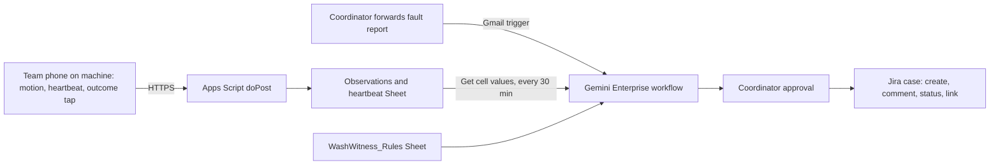

# WashWitness

WashWitness is a reviewed repair-acceptance workflow for one APU residence laundry room, owned by the residence office coordinator who handles machine complaints. A gate comes before any build: APU's own evidence points to queues and uncollected clothes, not broken machines, so a timed observation on 4–5 November decides whether this product exists at all. If it does, the coordinator forwards a resident's fault report to the WashWitness inbox. Gemini Enterprise opens a Jira case after approval, and a 30-minute schedule then watches for the next real cycle on that machine. The signal is a team phone's accelerometer, held on the machine during a supervised cycle, plus a one-tap outcome from the person present. The rule accepts a repair only when a full cycle under the original failure condition ends with a usable outcome. "Unable to reproduce" stays exactly that, never "fixed". The coordinator approves each Jira comment and status change. The proposed track is Intelligent Automation & Digital Transformation. Rank and score: see the [ranking](/docs/ideas/00-ranking.md).

Contents:

1.  [At a glance](#at-a-glance)
1.  [Origins](#origins)
1.  [Problem and evidence](#problem-and-evidence)
1.  [How it works](#how-it-works)
1.  [Why people will use it](#why-people-will-use-it)
1.  [Why the crowd won't build it](#why-the-crowd-wont-build-it)
1.  [Scores](#scores)
1.  [Research plan](#research-plan)
1.  [Time to impact](#time-to-impact)
1.  [Demo and review](#demo-and-review)
1.  [Build plan](#build-plan)
1.  [Risks and kill criteria](#risks-and-kill-criteria)
1.  [See also](#see-also)

## At a glance

| Field                 | Design                                                                                                                                                                                 |
| --------------------- | -------------------------------------------------------------------------------------------------------------------------------------------------------------------------------------- |
| Gate                  | By 4 November: residence office permission for supervised phone placement, one machine and a willing coordinator. By 6 November: an observation showing faults matter more than queues |
| Owner                 | Residence office (Accommodation) coordinator for one block's laundry room (proposed; no one is confirmed)                                                                              |
| First users           | Residents who report or keep hitting a faulty washer or dryer; the machine operator's technician, if one exists                                                                        |
| Track                 | Intelligent Automation & Digital Transformation                                                                                                                                        |
| Trigger               | Gmail "When an email is received" for a forwarded fault report; a 30-minute schedule for the verification watch; a manual `@WashWitness` run                                           |
| Live signal           | Phone accelerometer (DeviceMotion) during supervised cycles, a 30-second heartbeat, per-row latency, and an anonymous outcome tap                                                      |
| 1P connectors         | Gmail: trigger, Reply (GA). Sheets: Get cell values for observations, heartbeats and the rule sheet (GA since 12 October 2026)                                                         |
| 3P connectors         | Jira Cloud Free: Create issue, Create comment, Change issue status, Link issues, Assign issue (GA actions); federated search for open cases                                            |
| MCP                   | None                                                                                                                                                                                   |
| Decision              | `usable cycle witnessed`, `fault repeated` or `unable to verify yet`, judged against the case's original symptom                                                                       |
| Action and approval   | The coordinator approves each case, comment and status change. Nothing goes to residents or the vendor automatically                                                                   |
| Reviewer self-trigger | Open the collector page on their own phone as a labelled test asset, then run `@WashWitness status reviewer-1`: `running` or `idle`, then `telemetry unavailable` once the page closes |

Every Jira action above is in Google's documented Jira Cloud list ([actions and write-back](/docs/research/gemini-enterprise.md#actions-and-write-back)). Like everything on the platform, it is untested until a licence arrives. At APU the switch is Outlook as the trigger and Jira Service Management, which already runs the Virtual Help Centre ([systems APU runs](/docs/research/apu.md#systems-apu-runs)).

## Origins

The single source is [WashWitness](/docs/ideas/astra/04-washwitness.md), and the parts of astra's [shared delivery contract](/docs/ideas/astra/00-ranking.md#shared-delivery-contract) it needs are folded in below.

- **Kept:** repair acceptance under the original failure condition; "unable to reproduce" kept separate from "fixed"; vibration never read as "empty" or "clean"; the supervised team phone with no installation; one incident key per machine and unresolved episode; the 4 and 6 November kill rules.
- **Changed:** the source and the shared contract treated every Jira action beyond create as an unproven capability gate, with transitions done by hand. That is wrong: Google's action list names Change issue status, Create comment, Link issues and Assign issue for Jira Cloud as GA, and the merged research now flags the old check ([platform constraints](/docs/research/gemini-enterprise.md#platform-constraints-and-design-consequences)). The workflow writes those actions itself after approval. The 4 November check is the same inventory test every connector gets, not a design around missing actions. Intake is now the coordinator's own habit, forwarding a report by email, and the review batch is 30 minutes instead of 60. The dryer rule uses the paid durations from APU's own laundry FAQs, which the source didn't cite.
- **Dropped:** the manual Jira transitions and the "replay may illustrate an incident" beat, because a replay that looks like a repair record invites exactly the confusion the product exists to prevent.
- **Not merged:** one scorer proposed an "asset acknowledgement loop" with [LabRelay](/docs/ideas/astra/05-labrelay.md); another folded WashWitness into the phone-probe network witness built on [Outage Witness](/docs/ideas/opus/05-outage-witness.md). It stays separate because the owners differ. Here the owner is the residence office, and the decision is whether a vendor's repair to a laundry machine is accepted. LabRelay belongs to a lab equipment custodian. The merged [Outage Witness](/docs/ideas/00-ranking.md) product belongs to APU's IT helpdesk, and its probes on chargers can't see whether a dryer dried anything.

## Problem and evidence

- **APU's laundry pain is capacity and turnover:** at City of Green, "only about three washers and dryers for the whole building", with clothes left for hours, while the same writer says wardens are helpful ([S7](/docs/research/social.md#s7-city-of-green-laundry-is-blocked-by-uncollected-clothes)). Laundry queues appear in 2 of 37 APU accommodation threads, and an exchange student had heard of "long queues for washing machines" ([lifts, laundry and deposits](/docs/research/social.md#lifts-laundry-and-deposits)).
- **APU residences report faults that don't get closed, though none of these is laundry:** "despite reporting these problems, no one came to fix anything"; three whole-floor power cuts in seven months; a Virtual Help Centre request that went unanswered ([residence upkeep](/docs/research/social.md#residence-upkeep-and-theft)). At Universiti Malaya, repeated residence complaints preceded a fan fire ([X01 to X03](/docs/research/social.md#x01-to-x03-repeated-residence-repair-reports)).
- **Repair-acceptance analogues come from abroad:** a resident manager saw a washer keep leaking after a vendor's test found no leak ([S10](/docs/research/social.md#s10-a-repair-vendor-cannot-reproduce-a-recurring-fault)). Florida students reported unreliable availability, incomplete drying and ineffective reporting; another said broken machines are relatively rare ([D1 and D2](/docs/research/social.md#d1-and-d2-laundry-analogues-outside-malaysia)). The X sample found no firsthand Malaysian campus laundry-outage post ([X gaps](/docs/research/social.md#x-gaps-and-exclusions)).
- **APU's machines are already networked and paid through APSpace:** at City of Green and on campus (L1), residents scan a machine's QR code, pay with their APCard e-Token, and are told to check that the machine shows "Online and Vacant". The City of Green dryer runs 35 minutes by default, extendable in 5-minute blocks, and the on-campus dryer runs 24, 28 or 32 minutes. Transaction history covers the last 3 months. Neither FAQ describes reporting a faulty machine ([COG laundry FAQ], edited 3 October 2024; [L1 laundry FAQ], edited 17 February 2025; both checked 4 November). **Inference:** availability is already solved locally, and the operator's payment records would be a stronger signal than a phone, but the team can't access them.
- **Inference:** no source shows an APU laundry fault backlog. The machine inventory, operator and failure rate are unknown, and theft is common in the residences, so no phone is left unattended.

[L1 laundry FAQ]: https://apiit.atlassian.net/wiki/spaces/ITSM/pages/2423816226

## How it works

1.  **Signal:** a teammate holds or sets a team-owned phone on top of the machine during an ordinary paid cycle, with no wiring and nothing installed. The phone page reads DeviceMotion, which works on Android and iPhone; iOS asks permission ([browser sensors](/docs/research/iot-and-network.md#phone-and-laptop-sensors-in-the-browser)). It posts a vibration summary every 10 seconds and a heartbeat every 30. The person present taps "paid" at the start and the outcome at the end: dry or damp, no leak or leak. No names, audio or images are collected.
1.  **Feeder and storage:** an Apps Script web app appends each row with the device time and its own receipt time, so every row carries its latency ([phone to Sheets](/docs/research/gemini-enterprise.md#phone-or-board-to-google-sheets)). Offline, the page buffers rows and sends them on reconnect. Those rows keep their device time and are marked late, so they count as history and never as current state.
1.  **Case intake:** the Gmail trigger fires on a forwarded report. Gemini extracts the machine ID and the symptom, and a Request info step asks the coordinator for anything missing. After approval, Jira gets one case per machine and open episode. Repeat reports append comments instead of opening new cases, and a recurrence links to the earlier case.
1.  **Verification watch (every 30 minutes):** the run reads open cases through Jira federated search, plus the observation rows. When the coordinator moves a case to `Repair reported`, it becomes `verification pending`. The next supervised cycle on that machine is then judged against the rules, and an evidence comment and status change are drafted for approval.
1.  **Rule set:** `WashWitness_Rules` (table below) is a Sheet the coordinator edits. Each symptom family names its original condition and its proof. A heartbeat is stale after 90 seconds, and verification closes as `unable to verify yet` after 7 days. A vendor's "unable to reproduce" is stored verbatim. All thresholds are team-authored and labelled experimental until the coordinator changes them.
1.  **States:** `fault reported → case open → repair reported → verification pending → usable cycle witnessed | fault repeated | unable to verify yet`. Machine activity is tracked separately as `running`, `idle` or `telemetry unavailable`. A finished trace never means the drum is empty.
1.  **Agent role:** deterministic rules handle machine IDs, times, freshness and deduplication. Gemini reads free-text reports, asks for missing context, assembles the evidence and drafts the comment. It is compared with a form plus a template, and the Gemini step is removed if it adds errors without saving review time.
1.  **Cadence and quotas:** sampling is separate from model runs. The schedule makes 48 runs a day. A budget of two queries a run plus 24 for review is 120 a day against 160 on one Standard seat; that is arithmetic, not billing ([limits](/docs/research/gemini-enterprise.md#limits-that-bite-in-a-one-week-build)). Measure ten runs and slow down above 80% of the pool. Quota errors are shown, never silently retried.
1.  **Failure handling:** a missing heartbeat means `telemetry unavailable`. A past success stays visible only as dated history. A disconnected team collector is a labelled, controlled network test, never a campus outage. Delegated credentials are refreshed before 11 November and **Runs** is inspected daily through 14 November ([unattended runs](/docs/research/gemini-enterprise.md#what-runs-without-anyone-signed-in)). A named team operator clears approvals during published pilot hours; outside them, cases stay visibly pending. If the licences are consumer accounts, Gmail and Drive connectors fail ([account limits](/docs/research/gemini-enterprise.md#edition-and-account-limits)), and intake moves to Jira-created cases.
1.  **Sensor truth:** device time, receipt time and workflow time stay in separate columns. Unknown, stale, failed, recovered and approved are separate states. The team never tampers with a machine or with campus infrastructure to create an incident.
1.  **Privacy and rights:** only team-owned measurements and minimal case records are kept, with no identities, MAC addresses or account screenshots. Sanitized team logs are published with provenance only with consent. Social posts stay research citations, never training data.
1.  **Theme:** cloud is the Apps Script feeder plus the Gemini Enterprise workflow. IoT is a real sensor the team runs, though it measures only vibration: not water flow, dryness or repair quality. Network shows as per-row latency, heartbeat gaps and late buffered rows.

| Symptom family    | Original failure condition   | Accepted as `usable cycle witnessed` when                                                                      | Otherwise                                    |
| ----------------- | ---------------------------- | -------------------------------------------------------------------------------------------------------------- | -------------------------------------------- |
| Dryer leaves damp | A full paid dry cycle        | Trace close to the paid duration (35 minutes default at City of Green), after the repair time, and a "dry" tap | "damp" tap → `fault repeated`                |
| Washer leaks      | A full wash cycle            | Full-length trace and a "no leak" tap                                                                          | "leak" tap → `fault repeated`                |
| Won't start       | Payment made, no drum motion | Vibration within two minutes of the "paid" tap                                                                 | No vibration → `fault repeated`              |
| Stops mid-cycle   | A cycle that ended early     | Trace reaches the rule's minimum length with no gap                                                            | Short trace → `fault repeated` pending a tap |
| Any family        | No cycle observed for 7 days | Never                                                                                                          | `unable to verify yet`; the case stays open  |

## Why people will use it

- **Coordinator:** forwarding a complaint is already the habit. What comes back is a case that already holds the machine, the symptom and the proof needed, and that closes only on evidence, which cuts repeat complaints about a machine marked "fixed".
- **Residents:** a dated answer to "has this machine worked since that fault?" before they pay for a cycle. **Inference:** the outcome tap takes seconds, but whether residents keep tapping is unknown and is measured.
- **Machine operator:** a technician who couldn't reproduce a fault, as in [S10](/docs/research/social.md#s10-a-repair-vendor-cannot-reproduce-a-recurring-fault), gets the failing condition and a dated trace of the last bad cycle instead of a bare complaint. **Inference:** that may shorten repeat callouts, which the 3-month pilot measures.
- **Habit loop:** report → case → repair reported → the next ordinary cycle verifies or disputes it. Ordinary laundry supplies the evidence, so no special test cycle is needed.

## Why the crowd won't build it

On the surface it resembles the saturated "facilities or IT fault to maintenance ticket" cluster: 7.6% of simulated ideas, often vibration sensors on equipment ([clusters](/docs/research/competition.md#clusters-and-shares), [saturation tiers](/docs/research/competition.md#saturation-tiers)). The difference is that WashWitness never files a ticket from vibration. It only closes or reopens an existing case, on outcome evidence. Circuit Go and Scape already handle availability, payments and fault reporting, and Jira Service Management already reopens alerts with history ([C2 and C4](/docs/research/competition.md#existing-substitutes)). At APU, the APSpace laundry page already shows whether each machine is online and vacant ([COG laundry FAQ]). The strongest cheap competitor is a required "successful cycle" checkbox on the vendor's form. Expect a middling originality score.

## Scores

**46.2 / 100, rank 8 of 8** in the [cross-set ranking](/docs/ideas/00-ranking.md). Three independent scorers rated this doc on the [unified matrix](/docs/ideas/00-ranking.md#scoring-matrix): an NTT DATA forward deployed engineer (FDE), an APU School of Technology IoT lecturer, and a Google Cloud advocate who is also an APU student. The used score is their mean, except day-to-day workflow and theme, which take the lowest. The reason shown is the lowest scorer's. Per-scorer totals: FDE 47.8, lecturer 53.4, advocate 43.0. All three passed it on every gate. The source ideas scored WashWitness 47.9 on the same matrix before the merge.

| Component           | Weight | FDE | Lecturer | Advocate | Used | Lowest scorer's reason                                                                                                                                                                                            |
| ------------------- | -----: | --: | -------: | -------: | ---: | ----------------------------------------------------------------------------------------------------------------------------------------------------------------------------------------------------------------- |
| Impact              |     14 |   2 |        2 |        1 | 1.67 | The doc's own evidence says APU's laundry pain is queues and uncollected clothes, not faults, and repair-acceptance cases are expected to number zero to two, so the measurable benefit is near zero.             |
| Connectors          |     14 |   3 |        4 |        3 | 3.33 | Gmail, Sheets and Jira actions are real but chat-sized; no system outside the team's.                                                                                                                             |
| Day-to-day workflow |     14 |   2 |        3 |        3 |    2 | A teammate must hold the phone on the machine, so nothing runs unattended; the 30-minute watch has nothing to watch most days.                                                                                    |
| Research            |     14 |   2 |        2 |        2 |    2 | Pain is analogues from abroad; the doc admits no APU laundry fault backlog.                                                                                                                                       |
| Time to impact      |     14 |   2 |        2 |        1 | 1.67 | No owner, an untested acceptance path and an expansion only 'if residents return without being asked' give no credible dated impact.                                                                              |
| Theme               |     10 |   3 |        3 |        3 |    3 | Vibration is a real sensor but it cannot see dryness, leaks or repair quality.                                                                                                                                    |
| Originality         |     10 |   3 |        3 |        2 | 2.67 | On the surface it is the saturated fault-to-ticket cluster, and APSpace already shows each machine as 'Online and Vacant' (verified in APU's laundry FAQ); a required successful-cycle checkbox is a cheap rival. |
| Buildability        |      5 |   3 |        3 |        3 |    3 | Phone only, no card, simple build.                                                                                                                                                                                |
| Demo                |      5 |   2 |        2 |        2 |    2 | Reviewer cannot create a fault; acceptance path is probably untested in the video.                                                                                                                                |

## Research plan

- **Round 1 (Wed 4 – Thu 5 November):** P1, the residence coordinator or warden for the chosen block; P2–P4, residents who use the laundry room weekly. Ask about the last machine they gave up on, what they did, and who closed it.
- **Round 2 (Fri 6 November):** P5–P6, residents who reported a faulty machine last semester, recruited through P1; P7, the operator's technician or the residence maintenance contact, if reachable. Record refusals and contradictions.
- **Timed observation:** 60 minutes in one laundry room at a peak slot, with P1's permission. Count arrivals and wasted trips by cause (all busy, finished but uncollected, out of order, payment failed), and time each wait. This count decides the gate.
- **Items (30–50):** real 10-minute observation windows from supervised cycles. The teammate present labels each as `running`, `idle` or `cycle complete`, plus the cycle outcome, and two teammates review the labels. Windows within one cycle are correlated, so cycle counts are reported separately. Repair-acceptance cases are reported at their actual count, likely zero to two, and never padded.
- **Consent and quotes:** quotes are labelled by role ("P3, resident"), and consent records and raw notes stay out of the repo ([consent](/docs/research/judging.md#consent-and-anonymised-quotes)).

## Time to impact

- **By 3 February 2027 (3 months):** the coordinator and the machine operator pilot one room. Measured: repeat-fault reports per machine, coordinator minutes per case against the form baseline (target: 25% less), the share of closed cases with a witnessed usable cycle, and outcome-tap completion (target: 80% within a minute).
- **By 3 May 2027 (6 months):** expand to more rooms only if residents return without being asked and verified recovery beats the existing process. The owner of daily checks is decided at month 3. All of these are proposals, not partnerships.

## Demo and review

1.  **0:00–0:30:** the resident's question and the evidence gap, including that APU's pain may be queues.
1.  **0:30–1:30:** a live supervised cycle with its vibration trace, per-row latency, and the limits of what vibration shows.
1.  **1:30–2:30:** a forwarded real report, Gemini's evidence request, the coordinator's approval, and the Jira case moving to `verification pending`.
1.  **2:30–3:15:** the team's collector disconnected for real, showing `telemetry unavailable`, then late rows arriving on reconnect.
1.  **3:15–3:45:** measured review minutes and the plan. If no real fault occurred, say the acceptance path is untested and show healthy observations only.

Reviewers get a seat, the role and the shared workflow ([reviewer access](/docs/research/gemini-enterprise.md#reviewer-access)). They fire the self-trigger above; they never create a fault.

## Build plan

1.  **Wed 4 November (critical path):** gates: residence office permission, one machine and P1. In a test workflow, prove the Gmail trigger, Sheets Get cell values, and Jira Create issue, Create comment and Change issue status. Check which Jira events the trigger exposes.
1.  **Thu 5 November:** phone page (DeviceMotion, heartbeat, buffer, outcome tap), Apps Script web app and Sheet; the first supervised cycle; round 1 and the timed observation.
1.  **Fri 6 November:** gate decision. Then the workflow: Gmail trigger, Request info, Approval, Jira; the 30-minute schedule and the rule sheet. Round 2.
1.  **Sat 7 November:** label the windows; compare with the form-plus-template baseline; run the real collector disconnect.
1.  **Sun 8 – Mon 9 November (Deepavali and reported holiday):** freeze scope; README with connector modes and diagram; deck; labelled recording.
1.  **Tue 10 November:** refresh credentials, write the reviewer instructions, submit. No card or purchase is needed; normal wash fees are the team's own.

## Risks and kill criteria

- **Wrong problem:** kill by 6 November if the observation shows wasted trips are mostly full or uncollected machines and no out-of-order machine. In that case, recommend a collection rule instead, and don't rename it sensor-based repair verification.
- **No access:** kill by 4 November if the residence office refuses supervised placement or no coordinator will review a case.
- **No fault this week:** likely. Ship and say that the acceptance path is untested.
- **Contribution burden:** if residents won't tap outcomes, verification falls back on teammates, which doesn't scale. Report it.
- **Cheaper rival:** a required successful-cycle field on the vendor form may deliver the same benefit. Test it as the baseline.
- **Theft:** theft is common in the residences ([residence upkeep](/docs/research/social.md#residence-upkeep-and-theft)), so a teammate stays with the phone and nothing runs unattended. That also caps the daily volume.
- **Platform:** if the licence is late or the Jira action inventory differs from Google's list on 4 November, report exactly what failed, and don't hide it with duplicate cases.

## See also

- [Existing substitutes](/docs/research/competition.md#existing-substitutes)
- [Real versus simulated data](/docs/research/iot-and-network.md#real-versus-simulated-data)
- [Disconfirming signals and validation tests](/docs/research/social.md#disconfirming-signals-and-validation-tests)
- [APU's laundry FAQ for City of Green][COG laundry FAQ]

[COG laundry FAQ]: https://apiit.atlassian.net/wiki/spaces/ITSM/pages/2698182657
