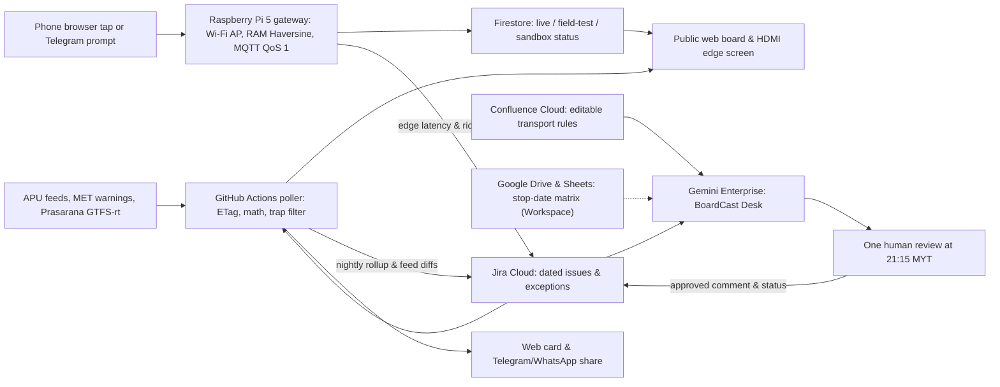

# BoardCast

BoardCast checks whether an Asia Pacific University (APU) shuttle rider's next week of classes connects with APU's published shuttle runs, warns when a timetable change breaks a student's bus routine, and lets riders on the same run or shared-bus corridor share one-tap boarding outcomes from their phones through a Raspberry Pi 5 edge gateway. It serves students at seven low-frequency residence stops and peak LRT Bukit Jalil riders with zero office dependency, under the proposed track **Smart Campus & Student Experience**. Nothing here has been built or run by a person yet, and the team has not picked its project; **Inference** marks conclusions no source states. Rank and score: see the [ranking](/docs/ideas/00-ranking.md).

Contents:

1.  [At a glance](#at-a-glance)
1.  [Origins](#origins)
1.  [Problem and evidence](#problem-and-evidence)
1.  [How it works](#how-it-works)
    1.  [The two features](#the-two-features)
    1.  [Day-to-day loop](#day-to-day-loop)
    1.  [States and failure handling](#states-and-failure-handling)
    1.  [Connectors and platform check](#connectors-and-platform-check)
    1.  [Cloud, IoT and network](#cloud-iot-and-network)
    1.  [Real data and privacy](#real-data-and-privacy)
1.  [Why people will use it](#why-people-will-use-it)
1.  [Why the crowd won't build it](#why-the-crowd-wont-build-it)
1.  [Scores](#scores)
1.  [Research plan](#research-plan)
1.  [Time to impact](#time-to-impact)
1.  [Demo and review](#demo-and-review)
1.  [Build plan](#build-plan)
1.  [Risks and kill criteria](#risks-and-kill-criteria)
1.  [Not verified](#not-verified)
1.  [See also](#see-also)

## At a glance

| Field                 | Plan                                                                                                                                                                                                       |
| --------------------- | ---------------------------------------------------------------------------------------------------------------------------------------------------------------------------------------------------------- |
| Owner                 | Student-run; one duty builder (later a residence volunteer) reviews one nightly card (`~5 min/day`). No APU office is required.                                                                            |
| First users           | Students riding from seven low-frequency residence stops (`M Vertica`, `Bloomsvale`, `Harmony`, `D'IVO`, `Kuchai Sentral`, `Maple`, `Bayu Jalil`) and peak `LRT - Bukit Jalil`.                            |
| Track                 | Smart Campus & Student Experience.                                                                                                                                                                         |
| Trigger               | Scheduled runs inside Gemini Enterprise (`06:30`, `13:00`, `21:15` MYT) plus a Jira Cloud issue event trigger when a feed changes, fails, or receives a reviewer test.                                     |
| Live signal           | APU's public timetable, shuttle schedule, locations, and holiday feeds polled, with ETags where the host supports them; MET Malaysia warnings; Prasarana GTFS-Realtime; phone taps through a Pi 5 gateway. |
| Connectors            | GA federated Jira Cloud and Confluence Cloud on any account; GA Google Drive and Sheets added if the sponsored licence sits on Google Workspace.                                                           |
| Decision              | Which weekly connection shifts, unscheduled LRT peak windows, shared-corridor bottlenecks, weather warnings, and conflicting witness notes to flag on tomorrow's board.                                    |
| Action and approval   | Code publishes deterministic connection math and live peer taps immediately; `BoardCast Desk` pauses at `21:15` MYT for one human approval before writing to Jira and squads.                              |
| Reviewer self-trigger | Without a seat: tap the public page for a real Haversine rejection against APU's coordinate stops, spawn a 50 m `/trystop` sandbox, or fire `[REVIEWER-TEST]` into Jira.                                   |

## Origins

This version revises the [BoardCast source doc](/docs/ideas/opus-02/07-boardcast.md) against its embedded [independent transit review](/docs/ideas/opus-02/07-boardcast.md#independent-review) and the team's off-campus limits:

- **Objections answered:** (1) _Miss cost isn't a departure decision:_ replaced the miss-cost headline with a personal class-connection check and stale-plan alert sized across all `94,598` weekday `intake-day × stop` pairs at the seven distant stops, giving immediate value to one student with zero other users. (2) _Three reports can't learn a cut-off (`63.2%` one-sided 95% failure bound) and one rider can't see everyone left behind:_ dropped the 3-report `"be there by"` cut-off until a fixed rule has zero failures across `n >= 59` independent comparable departures (`<5%` binomial bound), in month 6 at the earliest; the board shows individual reports with their age and source. (3) _Three workflows and noon grading waste approvals on an empty APU partition:_ merged `Night Desk`, `Grader`, and `Change Desk` into one daily `BoardCast Desk` with a single `21:15` MYT review click, keeping live peer taps on a fast Firestore path outside Gemini's 5–10 minute trigger delay. (4) _Telegram gets coordinates before the home Pi, and motion isn't boarding:_ made the one-tap web page served on the Pi 5 primary (with local Wi-Fi AP, MQTT `QoS 1`, and RAM-only Haversine checks), demoting phone/Telegram movement strictly to a tap prompt. (5) _Public delay slips aren't official certificates:_ replaced public slips with a private incident summary, and cut the 3D city and 07:45 bus animation (only 5 of the 7 distant stops leave at `07:45`) down to a cut-line 4–6 hour static tilted OpenStreetMap (OSM) view. (6) _Daily LRT exits don't falsify morning pressure:_ kept campus timetable wave counts as an unvalidated relative-pressure indicator rather than claiming the station-wide null settled the question.
- **Objections that still stand:** Because every teammate is away from APU until after the 10 November deadline, **zero `live` APU rider reports will exist by 10 November**, no on-site queue observation or six-rider interview round can happen before submission, and the Pi 5 runs at a builder's home and on local `field-test` bus rides rather than mounted at an APU stop.
- **Editorial choices where design options differed:** We size exposure primarily by `intake-day` (`13,514`) while stating `intake-group-day` (`15,055`) beside it so units stay explicit; we pair the 4-week timetable change check with the `117` intake-days (`149` intake-group-days) where an online class ends `<=60` minutes before the first physical class; and we make the Pi 5 a local Wi-Fi edge gateway and student-network latency probe rather than a passive Telegram cloud relay so its edge role is verifiable on camera.

## Problem and evidence

- **Team observation (unmeasured):** The user says some students skip lectures because they can't reach class in time. One friend at Parkhill Residence gave a second-hand account: nobody knows which weekday is busy, how long the queue is, or how many turns you'll wait. Neither is a measured figure, and no source links shuttle waits to lost attendance.
- **Team view on timetable changes:** The user says changes already reach students through Outlook and Teams, and that missed schedules are mostly a matter of diligence. So the weekly shift alert can't sell the news that a class moved. Its only claim is the bus consequence: which run now works. **Inference:** this makes the shift alert the weaker half of the first feature, and the connection check the stronger.
- **Public evidence:** [APU's shuttle page][apu-shuttle] states `"When the bus is full, it will depart"` and `"APU does not guarantee a seat"`. The [published schedule PDF][pdf] labels times `"Estimated Departure Time"`, assigns vans on three routes, runs Bloomsvale and Harmony as a single combined trip (`"7:45 [BV] / 7:55 [HM]"`), and states that LRT Bukit Jalil buses from `7:30` to `8:45` `"will not follow a schedule"` (`13` timed rows still appear in the API). Across [public social reviews](/docs/research/social.md#shuttle-buses-and-the-lrt-last-mile), `13` of `58` low-star reviews cite the bus, shuttle, taxi, or LRT (`"when on time it's always full"` at M Vertica), and the most specific public forecast found is a [Reddit reply](/docs/research/social.md#getting-to-campus-shuttle-lrt-bukit-jalil-and-traffic) advising riders with a 9am class to reach the LRT station by `8:20` or `8:30`.
- **Counterevidence:** One student reports morning waits are usually no more than `20` minutes ([S4](/docs/research/social.md#s4-a-rider-reports-bearable-morning-waits)), and a Parkhill resident describes `10–15` minute waits ([S6](/docs/research/social.md#s6-a-parkhill-resident-describes-an-alternative-commute)). Parkhill sits `684 m` (`~9` minutes on foot by OSM) from APU with `8` weekday runs to campus (`9` returning), where `13,514 / 13,514` (`100%`) of weekday intake-days have `>=2` workable runs at a 15-minute allowance—so Parkhill cannot carry the pitch.
- **Computed structural exposure (4 November snapshots of the [timetable][tt], [shuttle schedule][bus-sched], and [locations][api-loc]):**

| Metric                                              | Method (recomputed from 4 Nov snapshots)                                                                                                                             | Result                                                                                                                                                                                                                                  |
| --------------------------------------------------- | -------------------------------------------------------------------------------------------------------------------------------------------------------------------- | --------------------------------------------------------------------------------------------------------------------------------------------------------------------------------------------------------------------------------------- |
| Physical timetable scope (`26 Oct – 20 Nov`)        | Removed `2,714` online rows (`ROOM` starting `ONL` or `(Online)` in `MODID`) from `31,606` rows across `19` populated weekdays (`8–9 Nov` empty for Deepavali)       | `28,892` physical rows (`9,627` deduplicated sessions); `13,514` weekday `intake-days` (`15,055` `intake-group-days`). First physical starts peak at `08:30` (`3,650` intake-days, `27.0%`), `10:45` (`1,711`), `13:30` (`1,143`)       |
| Stop-days with `<=1` workable run (7 distant stops) | Joined `13,514` weekday `intake-days` against `253` scheduled trips (`id: 173`) across the 7 stops (`94,598` pairs) for door-to-class margins `M = 15 / 30 / 45` min | `44,781` (`47.3%`) / `47,911` (`50.6%`) / `49,929` (`52.8%`) of stop-days have `<=1` workable run (`45.8% / 49.1% / 51.3%` of `105,385` `intake-group-day` pairs). At `M=30` min, `3,650` (`3.9%`, Maple `08:05`) have `0` runs         |
| Forced early arrival & no-later-bus stranding       | Computed `t_first - (t_dep + M)` for the last workable run across workable pairs (`94,598 / 90,948 / 86,574`) and checked if any later shuttle runs that day         | `36,206` (`38.3%`) / `34,077` (`37.5%`) / `33,971` (`39.2%`) force arriving `>=60` min early (median `45 / 40 / 30` min). Missing that last workable bus leaves no later shuttle in `20.8% / 18.3% / 18.0%` of workable pairs           |
| Timetable changes & stale-plan failure              | Compared each intake's first physical start per weekday across `W1 (26–30 Oct)`, `W2 (2–6 Nov)`, and `W4 (16–20 Nov)`                                                | `W1→W2`: `78 / 3,541` (`2.2%`) shift. `W2→W4`: `2,904 / 3,395` (`85.5%`) shift. This is one large reset, not steady weekly churn, and its cause is unknown. Reusing a `W2` bus in `W4` fails on `61.7%` of stop-days (about `32%` late) |
| Data traps: `ONLMCO3`, online gaps, missing pins    | Audited raw `LOCATION`, `ROOM`, `bus_assigned`, and `locations` coordinates across all `31,606` timetable rows, `253` shuttle trips, and `15` stop records           | `2,692` `ONLMCO3-*` online rows say `LOCATION: "APU CAMPUS"`, corrupting `574` intake-days (`812` intake-group-days); `117` intake-days (`149` group-days, `5–20 Nov`) have `<=60` min online-to-physical gaps; `12/15` lack GPS        |
| Morning campus wave on final pitch day (`17 Nov`)   | Counted distinct intakes (and `INTAKE`+`GROUPING` pairs) with first physical start at `08:30` and before `10:00` across all Tuesdays in the 4-week snapshot          | `Tue 17 Nov` has `264` intakes (`272` groups) at `08:30` and `394` (`419` groups) before `10:00`—the highest in the window (vs `169` and `181` at `08:30` on `27 Oct` and `3 Nov`, and `61` during the `10–13 Nov` low-load week)       |

[apu-shuttle]: https://www.apu.edu.my/shuttle-services-campus-connect
[pdf]: https://publicwebsite-media.apu.edu.my/assets/2026-10/2026Oct22_APU-SHUTTLE-SERVICES.pdf
[tt]: https://s3-ap-southeast-1.amazonaws.com/open-ws/weektimetable
[bus-sched]: https://api.apiit.edu.my/transix-v2/schedule/active
[api-loc]: https://api.apiit.edu.my/transix-v2/locations

## How it works

### The two features

1.  **Personal class-connection check and timetable shift alert (works for one student with zero other users):** A student picks their stop, intake group, and travel-plus-walk margin (`15`, `30`, or `45` minutes) with no login. Deterministic code filters out the `2,692` `ONLMCO3-*` online-room traps, flags the `117` intake-days (`149` intake-group-days) where an online class ends `<=60` minutes before the first physical class, identifies the last workable shuttle departure, and compares next week's timetable against this week's routine. For example, on `Tue 17 Nov` from `M Vertica` (`08:30` class, `M=30` min), the card shows `07:45` as the only workable run (`09:30` is `105` minutes later and, with the `30`-minute allowance, reaches class at `10:00`, `90` minutes late), displays the relative campus wave (`394` intakes starting before `10:00`, explicitly labelled as campus-wide eligible intakes rather than route headcount), and states `Live APU rider reports: 0`.
1.  **1-to-1 peer queue co-op (real on the team's phones in `field-test` by 10 Nov; zero `live` APU reports claimed before 10 Nov):** The one-tap web page is the main path (`At stop`, `Boarded`, `Bus left full`, `Walked away`). Leaving a stop geofence triggers a motion-assisted browser or Telegram prompt to tap, never an automatic boarding verdict. One verified tap updates subscribed peers' connection cards in under `2` seconds with the individual report's age and provenance badge (`1 report, 12s ago: Bus left full`), warns downstream stops on sequential shared-plate runs (such as Bloomsvale `07:45` → Harmony `07:55` on the PDF's shared van, and `WUS 9003` on Bloomsvale `09:30/11:00/13:30` → Harmony `09:40/11:10/13:40`), and logs a private rider-reported incident summary (`Confirmed`, `Disputed`, or `Unverified`). No learned `"be there by"` cut-off or public delay slip is shown.

### Day-to-day loop

1.  **06:30 and 13:00 MYT (read-only checks):** `BoardCast Desk` runs inside Gemini Enterprise using federated `Search For Data` over Jira Cloud and Confluence Cloud to check morning [MET Malaysia warnings](/docs/research/data-sources.md#met-malaysia-warnings) and midday feed diffs without pausing for human review unless an urgent dispute is flagged.
1.  **07:00–18:45 MYT (edge sensing and fast peer loop):** Phones submit taps through the Pi 5 gateway directly to Firestore so peers see updates in seconds without waiting for Gemini Enterprise's 5–10 minute event polling.
1.  **21:00 MYT (deterministic rollup):** GitHub Actions polls APU's feeds, using `If-None-Match` where the host supports it, computes all connection and shift math, updates the public board, and files one dated Jira rollup issue (`BC-YYYYMMDD`).
1.  **21:15 MYT (one reviewed decision):** `BoardCast Desk` reads the Jira rollup and the editable Confluence rulebook. Code does all arithmetic; Gemini (`Gemini 3.1 Pro` or `Gemini 4 Argon`) decides what code cannot: reconciling timetable shifts against unstructured PDF rules (unscheduled `07:30–08:45` LRT loops, combined Bloomsvale/Harmony capacity, and the unexplained `10–13 Nov` drop to `345–360` active intakes/day), judging whether bilingual weather warnings hit morning departure windows, and adjudicating conflicting free-text rider notes from `field-test` trips as `Confirmed`, `Disputed`, or `Unverified`. It pauses at a single **Approval** step; one builder click transitions the Jira issue to `Reviewed` and publishes the bilingual advisory.

### States and failure handling

- **Loud feed errors, zero fallback:** If any APU, MET, or GTFS-Realtime endpoint returns an error status or times out (a `304` from an ETag check means unchanged, not failed), the poller writes the HTTP status and timestamp to Jira and the card, showing no cached or last-known values ([project conventions](/docs/references/project-conventions.md)).
- **Unapproved or unlicensed desk:** If the `21:15` MYT run is unapproved after `30` minutes, hits the `160` query/day quota, or awaits the sponsored licence, the deterministic connection numbers stay live with `"Advisory pending review"` or `"Awaiting Gemini Enterprise licence"`.
- **Gateway offline:** After the Pi 5's WAN cable is pulled, the cloud side notices the lost heartbeat within a set timeout, and the board reads `"Gateway offline since HH:MM"`. The Pi's local Wi-Fi AP and SQLite/Mosquitto broker (`QoS 1`) keep accepting taps and updating its local HDMI screen, flushing rows with `(t_device, t_edge, t_cloud)` timestamps upon reconnect.
- **Empty or low-accuracy reports:** Zero reports always reads `"0 rider reports"`, never `"Clear"`. Only `3` of `15` stops in `transix-v2/locations` carry coordinates (`LRT - Bukit Jalil`, `Mosque`, `APU`); the `12` residence stops are marked `"Unverified polygon"` until `3` real `live` reports pin the curb. Rider free-text notes are treated strictly as untrusted data, never prompt instructions.

### Connectors and platform check

| Connector / tool                      | Status  | Role in BoardCast                                                                | Platform constraint ([Gemini Enterprise research](/docs/research/gemini-enterprise.md))                       |
| ------------------------------------- | ------- | -------------------------------------------------------------------------------- | ------------------------------------------------------------------------------------------------------------- |
| Jira Cloud                            | GA      | Nightly rollup (`BC-YYYYMMDD`), exception register, approved advisory write-back | Listed for [workflows][workflows] and [event triggers][event-triggers] (`5–10` min poll delay); free up to 10 |
| Confluence Cloud                      | GA      | Editable transport rulebook (LRT continuous window, shared vans, holiday rules)  | Federated live read in workflows; mirrors APU's own `apiit.atlassian.net` stack                               |
| Google Drive and Sheets (conditional) | GA      | Stop × date connection and shift matrix (`Get/Update cell values`)               | Requires a Google Workspace domain with Customer ID; returns `403` on consumer `@gmail.com` accounts          |
| Antigravity                           | Tooling | Scaffolds the ETag poller, Jira/Confluence schemas, and ground-truth test runner | Free Individuals plan (`Gemini 3.8 Flash`) used if trial Enterprise seats exclude AI developer tools          |

[workflows]: https://docs.cloud.google.com/gemini/enterprise/docs/workflow-builder/workflows
[event-triggers]: https://docs.cloud.google.com/gemini/enterprise/docs/workflow-builder/configure-event-trigger

### Cloud, IoT and network

- **Cloud:** Gemini Enterprise Workflow Builder runs `BoardCast Desk` (`1` agent creation/user/day on Standard, `14`-day schedule credentials refreshed on `10 Nov`); GitHub Actions runs the ETag poller; Firebase Spark (no card) hosts Firestore and the web board.
- **IoT:** Phones act as GPS and motion sensors. The Raspberry Pi 5 (8GB) is a local-first edge gateway (`hostapd` Wi-Fi AP, Mosquitto `QoS 1`, SQLite, HDMI status screen) that performs RAM-only Haversine distance checks and drops raw coordinates before any cloud hop, matching NTT DATA's edge pattern ([judging research](/docs/research/judging.md#ntt-data)). Honest limit: before 10 November it sits at a builder's home and on local `field-test` rides, not at an APU stop. Its Wi-Fi AP only reaches phones near it, so it serves bench tests, filmed rides, and the final. Riders elsewhere tap through a public HTTPS route, and the build must pick that route.
- **Network:** Every tap records `(t_device, t_edge, t_cloud)` hop latencies, while a Pi cron job probes last-mile RTT and HTTP status from a student network to `api.apiit.edu.my` and `open-ws/weektimetable` ([IoT and network](/docs/research/iot-and-network.md#what-a-judge-can-see-of-the-network)).

### Real data and privacy

- **Four strict data partitions:** `live` (real GPS at APU stops—visibly `0` before 10 November, and the only partition used for campus claims), `field-test` (builders' real public bus rides near home, cross-checked against 30-second [Prasarana GTFS-Realtime](/docs/research/data-sources.md#bus-and-train-positions-gtfs-realtime)), `rehearsal` (mock GPS allowed only for testing and demo recording, never counted as evidence), and `sandbox` (isolated 50 m reviewer `/trystop` tests).
- **Privacy and PDPA hygiene:** The poller strips lecturer `NAME`, `SAMACCOUNTNAME`, and `LECTID` before storage and never re-hosts raw APU feeds ([APU data](/docs/research/apu.md#personal-data-in-the-timetable-feed)). On the web path, raw GPS coordinates stay in Pi RAM only for the distance check and never touch disk, Telegram, or Gemini prompts. If a rider opts into Telegram location prompting, the `/start` bilingual notice states that Telegram's cloud receives coordinates under its own terms and instructs riders to stop sharing explicitly rather than defaulting to indefinite sharing. Events carry a daily rotating hash and delete after `14` days; under-18s are excluded.

## Why people will use it

- **Immediate solo utility on day one:** A student needs zero peers to catch a broken class connection, filter out `ONLMCO3-*` online rooms disguised as `APU CAMPUS`, or see on Sunday night that Week 4 shifted their Tuesday class to `08:30`—where reusing their Week 2 bus arrives late on about `32%` of continuing stop-days at `M=30` minutes.
- **Two-phone co-op with no 59-day wait:** Instead of waiting months for a statistical cut-off, two friends in the same residence WhatsApp or Telegram chat get value on the first tap: when the earlier rider taps `Bus left full`, the second rider's card flips immediately so they can switch to e-hailing or LRT before leaving their room.

## Why the crowd won't build it

Shuttle and transit ideas represent just `0.5%` ("Absent" tier) of the `780`-idea [crowd baseline](/docs/research/competition.md#saturation-tiers), whereas campus energy, Wi-Fi/IT ticket bots, and Q&A chatbots are saturated. Existing local and commercial tools leave this exact gap open ([student tools](/docs/research/competition.md#apu-student-built-tools)):

- **`nacyng-netizen/apu-smart-shuttle` and `BUSSYSTEM`:** The first is a README-only repo promising bus GPS that APU does not publish; the second is a simulated camera dashboard whose `20` plates do not match APU's feed (`141` of `253` scheduled trips in `transix-v2/schedule/active` have `null`, `'NA'`, or empty `bus_assigned`, leaving `112` trips with actual plates).
- **APSpace, APLife, APRide, and Transit GO:** APSpace's shuttle chunks (`3530`, `8413`) hold no queue or capacity fields and show one student's timetable without cross-intake waves; APLife exports static schedules to a calendar without checking shuttle feasibility; APRide matches pre-planned carpools on Teams (`BoardCast` never matches drivers); and Transit GO tracks continuous vehicle dots rather than full-bus early departures against shifting university class starts.

## Scores

**60.7 / 100, rank 7 of 10** in the [cross-set ranking](/docs/ideas/00-ranking.md), scored on 5 November 2026 on the [unified matrix](/docs/ideas/00-ranking.md#scoring-matrix). Three independent scorers rated this doc: an NTT DATA forward deployed engineer (FDE, `gpt-6-astra` at xhigh), an APU School of Technology IoT lecturer (`gemini-3.8-flash` at high), and a Google Cloud advocate who is also an APU student (`gpt-6-astra` at xhigh). Two share a model, so they are less independent than the earlier products' three models. None of them wrote this doc. The used score is their mean, except day-to-day workflow and theme, which take the lowest. The reason shown is the lowest scorer's. Per-scorer totals: FDE 64.0, lecturer 61.2, advocate 61.0. The same scorers gave the [source doc](/docs/ideas/opus-02/07-boardcast.md) 48.7, so this version gained 12.0 points.

| Component           | Weight | FDE | Lecturer | Advocate | Used | Lowest scorer's reason                                                                                                                                                              |
| ------------------- | -----: | --: | -------: | -------: | ---: | ----------------------------------------------------------------------------------------------------------------------------------------------------------------------------------- |
| Impact              |     14 |   3 |        3 |        3 |    3 | The 47,911 constrained pairs reproduce at a 30-minute allowance, but they are hypothetical intake-stop combinations rather than affected riders or demonstrated savings.            |
| Connectors          |     14 |   3 |        3 |        3 |    3 | Jira and Confluence support useful live decisions and reviewed writes, but no first-party connector is assured and the actual account remains unknown.                              |
| Day-to-day workflow |     14 |   3 |        3 |        3 |    3 | Scheduled checks, editable rules and one nightly approval are credible, but no runs exist and the specified handling of HTTP 304 and WAN loss needs correction.                     |
| Research            |     14 |   3 |        2 |        3 | 2.67 | Rigorous programmatic benchmarking of 50 timetable trap items, but zero on-site campus queue observations or rider interviews exist.                                                |
| Time to impact      |     14 |   3 |        3 |        3 |    3 | A builder-owned connection card can use existing chats without private-system changes, but continued approvals, seat funding and returning peer users remain commitments to secure. |
| Theme               |     10 |   4 |        3 |        4 |    3 | Implements an edge telemetry architecture with MQTT QoS 1 and hop-latency tracking, though the Pi remains off campus.                                                               |
| Originality         |     10 |   4 |        4 |        3 | 3.67 | The schedule-to-class join adds specificity, but transit planning, peer status and a competing APU shuttle project limit novelty despite the thin simulated crowd.                  |
| Buildability        |      5 |   2 |        4 |        2 | 2.67 | The no-card stack is plausible, but local HTTPS, Wi-Fi, MQTT, cloud sync, multiple feeds and field trials overload the window before licence integration is known.                  |
| Demo                |      5 |   4 |        4 |        3 | 3.67 | The sandbox and WAN test are controllable, but the scripted full-bus event is not guaranteed and remote reviewers cannot reproduce the local edge setup.                            |

These scores assume the team's real limits: nobody on campus, no recruited riders or lecturers, and no licence yet. The eight earlier products in the ranking were scored without those limits, so the comparison isn't like for like. **Gate G3:** the FDE and the advocate failed it because no licence exists today, while the lecturer passed the design. This doc treats G3 as a design check, because no earlier product had a licence either. The scores predate the fixes the scorers' factual errors led to. Nothing here has been run, so every score is a hypothesis.

**What would help most, per the scorers:** cut the build to one verified class-connection check and one real Gemini Enterprise read, approve, and write flow before adding feeds, Telegram prompts, or the wider edge stack; and lead with door-to-class feasibility rather than shift alerts.

## Research plan

Nothing below has been executed by a person yet; each item is a plan executable by 10 November with nobody on campus:

1.  **50-item stratified ground-truth benchmark (by Sat 7 Nov, 3 person-hours):** Hand-verify `50` `(intake-group, stop, date)` cases against APU's 5-page shuttle PDF and raw timetable JSON across `7` verified traps: `0`-workable-run pairs (Maple `08:05`, Fortune Park One South `08:30`), single-run pairs, the `2,692` `ONLMCO3-*` online rows tagged `APU CAMPUS`, sequential shared-plate runs (`WUS 9003` on Bloomsvale `09:30` → Harmony `09:40`), the `07:30–08:45` LRT unscheduled loop, Deepavali/Friday rules, and `W2→W4` start shifts. **Pass line:** `>=48/50` (`96.0%`, 95% Wilson CI `[86.5%, 98.9%]`; `50/50` gives `[92.9%, 100.0%]`).
1.  **Counterbalanced teammate stopwatch crossover (by Sun 8 Nov, 2 person-hours):** Two builders each complete `10` seeded `(intake-group, stop, W2→W4)` weekly plans (`100` weekday lookups total): `5` by hand using APSpace, the 5-page shuttle PDF, and a calculator vs `5` using BoardCast, logging lookup seconds and errors. **Pass line:** median lookup time reduced by `>=50%` and zero missed `W4` late-arrival shifts on the BoardCast arm.
1.  **20–30 real off-campus bus rides in `field-test` (Fri 6 – Mon 9 Nov, 8–10 person-hours):** Ride public Rapid Bus KL or MRT feeder routes near builders' homes, plus negative controls (walking away, car ride, bus passing). Record hand-noted stopwatch truth (`t_arrive`, `t_depart`, outcome) and cross-check phone departure prompts against live 30-second Prasarana GTFS-Realtime vehicle transponders (`vehicle.id`), split by Android Chrome, iOS Safari, and Telegram. **Pass line:** `>=0.80` prompt precision and `>=0.70` recall; otherwise drop motion prompting and keep manual one-tap buttons only.
1.  **Bounded `n=1` Parkhill walkthrough (Thu 5 Nov, 1.5 person-hours):** Ask the Parkhill friend three past-tense questions on their manual APSpace-to-PDF workflow and why residents pay RM70/month rather than walking `684 m`, then run a live usability check on the connection card. **Bound:** never cite `n=1` as distant-stop queue evidence.

## Time to impact

- **By 17 February 2027 (3 months, across Nov/Jan/Feb intakes after the 21 Dec – 2 Jan break):** The unattended GitHub Actions ETag poller and `BoardCast Desk` log every timetable change and `transix-v2` schedule revision (`schedule_set_id: 173`, `79` distinct `CLASS_CODE` effective dates in the current snapshot), publishing Sunday stale-plan alerts for all intakes with zero rider reports needed. Co-op runs in **1-to-1 pair mode** on `M Vertica`, `Bloomsvale → Harmony`, and `LRT - Bukit Jalil`, where `1` upstream tap warns `1` subscribed peer on the same run or shared vehicle (`n=1` useful threshold).
- **By 17 May 2027 (6 months):** Publish a full-semester open coverage ledger of structural `(intake, stop, date)` gaps (`0` workable runs or `>=60` min forced early arrival) and unlock historical boarding bands **only** on stop-runs where a fixed rule has zero failures across `n >= 59` independent comparable departures (`1 - 0.05^(1/59) < 5%` one-sided 95% failure bound), keeping raw timestamped reports everywhere else.
- **What must be true:** APU leaves `open-ws/weektimetable` and `transix-v2/schedule/active` publicly readable (or grants written permission); one duty builder approves the nightly `21:15` MYT Jira run (`~5 min/day`) and funds `$30/month` for one Standard seat after the trial—or the Gemini commentary pauses and the deterministic connection board and peer co-op continue at `$0/month`.

## Demo and review

- **90-second live prototype script (two features only):**
  1.  **0:00–0:25 — Class-connection and shift check (No mock GPS; real APU feeds):** Pick `M Vertica → APU` for an `08:30` class on `Tue 17 Nov` (`M=30` min). Show `07:45` as the only workable run (`09:30` reaches class `90` min late), the `W2 → W4` shift warning (`85.5%` of continuing intake-weekdays shift first starts), `394` campus intakes starting before `10:00`, and `live: 0 rider reports` alongside the static tilted OSM corridor view (if kept above the cut line).
  1.  **0:25–1:00 — Two-phone co-op and Pi 5 WAN blackout (Real GPS on `field-test` ride; mock GPS allowed only in an optional `rehearsal` split-screen, never claimed as a real place):** Show a filmed `field-test` bus ride where Phone 1 taps `Bus left full` and Phone 2's card flips in `<2` seconds with report age. Unplug the Pi 5's WAN Ethernet cable on camera: Phone 1 (on the Pi's Wi-Fi AP) taps again, the Pi's local HDMI screen updates (`Queued on edge: 1`), the cloud page flips to `Gateway offline`, and reconnecting WAN flushes the row with `(t_device, t_edge, t_cloud)` hop latencies.
  1.  **1:00–1:30 — Reviewer self-trigger and `BoardCast Desk` approval (No mock GPS; reviewer's real location):** Tap `"Report at LRT Bukit Jalil"` to show the real Haversine rejection against `(3.058954, 101.691717)`, tap `"Spawn 50m sandbox stop here"` to submit a live edge-to-cloud report, and show `BoardCast Desk` in Gemini Enterprise pausing at **Approval** before writing the bilingual verdict to Jira.
- **Recorded 3:45 video:** Follows the [briefing minute plan](/docs/research/judging.md#minute-plan), labelled as a recording with its capture date. If any scene uses mock GPS in `rehearsal`, the script never states that a rider was at a named APU stop, and reports the station-wide LRT gate-exit null (`Spearman rho = -0.04`) honestly alongside the 50-item benchmark and `field-test` GTFS-Realtime cross-check.
- **17 November live final (only if selected for the top 5):** `Tue 17 Nov` has the highest `08:30` physical intake wave in the 4-week feed (`264` intakes, `394` before `10:00`). On `Mon 16 Nov 21:15`, commit the reviewed forecast for `17 Nov`. On `Tue 17 Nov` (`07:30–08:30`), the in-person presenter rides the shuttle from `LRT - Bukit Jalil` (`3.058954, 101.691717`) to `APU` (`3.055899, 101.699959`) carrying the Pi 5 on a power bank and phone hotspot to log BoardCast's **first real `live` APU commute** before taking the stage, then displays an audience QR (`"Rode a shuttle this morning? Tap your wait"`, showing `0 audience reports` honestly if nobody scans).
- **Reviewer path (11–14 Nov):** Unseated judges use the public board's Haversine check, the 50 m `/trystop` sandbox, and the `[REVIEWER-TEST]` button (which files a tagged Jira issue to trigger `BoardCast Desk`), plus screenshots and video of the owner's `Agents → Runs` tab in the README ([reviewer access](/docs/research/gemini-enterprise.md#reviewer-access)). Seated judges also run `@BoardCast Desk` directly.

## Build plan

Three builders: **B1** (ETag poller, Jira/Confluence, `BoardCast Desk`), **B2** (class-connection & shift card, one-tap web UI, Firestore, optional OSM view), **B3** (Pi 5 Wi-Fi/MQTT gateway, Telegram prompt, `field-test` rides, benchmark & video).

| Day                              | Critical path (in order)                                                                                                                                                                                                                                                                                                            | Exit check                                                                                                      |
| -------------------------------- | ----------------------------------------------------------------------------------------------------------------------------------------------------------------------------------------------------------------------------------------------------------------------------------------------------------------------------------- | --------------------------------------------------------------------------------------------------------------- |
| **Thu 5 Nov**                    | **B1:** set up Jira Cloud Free + Confluence rulebook; ship GitHub Actions poller (ETag, PII strip, `ONLMCO3` filter, `BC-20261105` Jira issue); send organiser questions. **B2:** deploy class-connection & `W2→W4` shift card (`M=15/30/45` min). **B3:** wire Pi 5 Wi-Fi AP, Mosquitto, RAM Haversine; ask Parkhill friend.       | Live connection board online; `BC-20261105` created in Jira at `21:00`; broken-URL error state verified.        |
| **Fri 6 Nov**                    | **B1:** if licensed, build `BoardCast Desk` (`3`/day cron + Jira trigger + `21:15` Approval); if unlicensed, test prompt on `BC-20261105`. **B2:** ship one-tap co-op (`live`/`field-test`/`rehearsal`/`sandbox`), `/trystop`, `[REVIEWER-TEST]`. **B3:** test Android/iOS GPS gaps + Pi WAN pull; run `10` `field-test` rides.     | One reviewed Jira transition updates the board (or pre-licence dry run logged); Pi WAN pull timed by `22:00`.   |
| **Sat 7 Nov**                    | **B1:** add Workspace Drive/Sheets if supported; tune Confluence rules for shared `WUS 9003` runs and `10–13 Nov` drop. **B2:** add peer report age badges and downstream Bloomsvale → Harmony warning. **B3:** hand-check 50-item benchmark; complete `20` cumulative `field-test` rides against Prasarana GTFS-rt.                | 50-item benchmark scored (`>=48/50`); conflicting `field-test` notes marked `Disputed` in Jira after one click. |
| **Sun 8 Nov (Deepavali)**        | **Light holiday schedule; portal registration closes `23:59` MYT.** **All:** confirm individual and team portal registration by `12:00`; run 2-builder 10-task stopwatch crossover (`100` lookups). **B1:** audit unattended runs and quota. **B3:** log `5–10` more `field-test` rides during normal travel.                       | Portal registration locked by `12:00`; stopwatch crossover logged; `BC-20261108` reviewed in one click.         |
| **Mon 9 Nov (Holiday)**          | **Feature freeze at `12:00` MYT.** **B1:** if licence arrives today, wire `6`-hour cron (`7–8` runs by `11 Nov`) and run `5–8 Nov` Jira backlog issues (labelled as `9 Nov` replays); test logged-out reviewer path. **B2:** add 4–6 h static tilted OSM view only if green. **B2/B3:** record `3:45` video, README, `<=10` MB PDF. | Feature freeze held; video uploaded unlisted and checked logged-out; owner's `Runs` tab captured in README.     |
| **Tue 10 Nov (Due `23:59` MYT)** | **B1:** refresh `14`-day schedule credentials (valid through `24 Nov`); verify `[REVIEWER-TEST]` and loud error states; recheck all cited numbers. **B2/B3:** final lint and link check; leader submits on portal by `18:00` MYT; leave `BoardCast Desk`, Pi 5 gateway, and poller running through `14 Nov`.                        | Credentials refreshed; portal entry locked by `18:00` MYT; `21:15` MYT run completes cleanly.                   |

**Cut lines, in order:** (1) static tilted 3D OSM corridor view (capped at 4–6 hours, cut first if core slips), (2) Google Drive and Sheets connector if the sponsored licence sits on a consumer `@gmail.com` account, (3) motion-assisted browser/Telegram tap prompts if Friday's phone test shows `>120` s background gaps or `<0.80` precision (keep manual one-tap web buttons). **Never cut:** deterministic class-connection and shift card, single `BoardCast Desk` workflow with one-click Jira review, Pi 5 WAN-disconnect edge proof, 50-item benchmark + `field-test` evaluation, strict partitions, and loud feed-error states.

## Risks and kill criteria

- **Gemini Enterprise licence arrival and account type:** If no licence arrives by `Mon 9 Nov 12:00` MYT, Gate G3 (`Gemini Enterprise core`) cannot be passed on a live tenant; wire the `6`-hour cron immediately if it arrives on `9 Nov`, or state plainly in the README that the Jira/Confluence feeder ran unattended while awaiting licence provisioning. If issued on consumer `@gmail.com`, drop Drive/Sheets (`403`) on Day 2 and keep Jira + Confluence.
- **Phone background location and prompt accuracy:** By `Fri 6 Nov 22:00` MYT, if screen-locked location updates on one Android and one iPhone exceed `120` seconds, or if `field-test` prompt precision falls below `0.80` or recall below `0.70` across `20–30` rides, **kill passive movement prompting** and ship the manual one-tap web page only.
- **50-item connection benchmark and stopwatch trial:** By `Sun 8 Nov 18:00` MYT, if the deterministic engine scores `<48/50` (`96%`) on the hand-checked PDF/timetable benchmark or fails to cut lookup time by `>=50%` in the 10-task teammate crossover, fix the parser before recording any demo.
- **APU feed terms and home Pi uptime:** APU's [Terms of Use](/docs/research/apu.md#terms-of-use-and-robotstxt) request written permission; the team has chosen not to wait for that. Keep lecturer fields stripped, never re-host raw feeds, never claim permission, and if APU objects, take the public board down at once. Keep the Pi 5 on a UPS/power bank with a phone hotspot fallback during `11–14 Nov` judging; if WAN drops, the cloud board shows `"Gateway offline"` with no fake heartbeat.
- **Herding and sybil reports after launch:** Fixed vehicle capacity means a shared warning can shift demand earlier, and two accounts can belong to one person. Rate-limit taps to one per account per run, never sum overlapping queue counts, suggest alternative runs only when class times permit, and keep conflicting reports marked `Disputed`.

## Not verified

- **No human or hardware execution yet:** All figures in this document come from programmatic recomputation on the 4 November feed snapshots and published documentation; no Gemini Enterprise run, phone GPS ride test, Pi 5 `hostapd`/MQTT failover test, 50-item hand check, stopwatch crossover, or friend interview has been run by a person yet.
- **Campus ground truth:** Actual student headcounts per intake and residence stop, physical queue lengths, denied-boarding frequency, true road travel times by hour of day, exact pickup coordinates at the `12` stops missing lat/lon in `transix-v2/locations`, and whether Parkhill's `684 m` walk has open gates, pavement, and shade are unverified.
- **Platform and organisational unknowns:** Sponsored licence arrival date, edition (`Standard` vs `Plus`), Workspace vs consumer `@gmail.com` account type, exact Jira/Confluence event trigger names in the Workflow Builder UI, whether `@nttdata.com` reviewers can be granted IAM access if domain restriction is active, written permission from APU to query the public feeds, why `10–13 Nov` drops to `345–360` active intakes/day while the holiday feed lists only `8–9 Nov`, why first-class starts barely move from 26 October to 6 November and then reset for 16–20 November, and whether that later week stays as published on 28 October.

## See also

- [BoardCast source proposal and independent review](/docs/ideas/opus-02/07-boardcast.md)
- [APU public documents, timetable feed, and systems](/docs/research/apu.md)
- [Gemini Enterprise workflows, connectors, quotas, and reviewer access](/docs/research/gemini-enterprise.md)
- [IoT, edge gateways, phone sensors, and network visibility](/docs/research/iot-and-network.md)
- [Public data sources: GTFS-Realtime, Rapid Rail, OSM, and MET Malaysia](/docs/research/data-sources.md)
- [Social research: shuttle reviews, LRT last mile, and attendance rules](/docs/research/social.md)
- [Competition, crowd saturation tiers, and APU student-built tools](/docs/research/competition.md)
- [Judging criteria, NTT DATA briefing, and pitch structure](/docs/research/judging.md)
