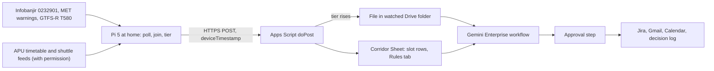

# KuyohGuard

KuyohGuard watches the LRT Bukit Jalil to APU corridor from one Raspberry Pi 5 at a teammate's home. Every 15 minutes it reads rainfall and river level at the Sungai Kuyoh gauge by LRT Bukit Jalil, MET Malaysia warnings, and Rapid Bus KL route T580 positions. It sets that corridor state against APU's class dismissals and shuttle departures, and a Gemini Enterprise workflow drafts a commute advisory that a coordinator approves before anything is sent. It is built for APU's Logistics & Operations (`LNO`) office and the students who ride the afternoon LRT shuttle or the morning peak. Proposed track: **Intelligent Automation & Digital Transformation** ("connecting devices with useful actions", see [challenge tracks](/docs/BRIEF.md#challenge-tracks)). Caveat: no APU office has agreed to own it, the team runs no sensor of its own, and the river may never reach an alert level this week, so most of what reviewers see will be Green decisions, failure handling, and a labelled test rule. Nothing here has been built or run yet; **Inference** marks conclusions no source states.

Contents:

1.  [At a glance](#at-a-glance)
1.  [Origins](#origins)
1.  [Problem and evidence](#problem-and-evidence)
1.  [How it works](#how-it-works)
    1.  [Signal to cloud path](#signal-to-cloud-path)
    1.  [Workflow](#workflow)
    1.  [Rule set](#rule-set)
    1.  [States and failure handling](#states-and-failure-handling)
    1.  [Connectors and platform check](#connectors-and-platform-check)
    1.  [Cloud, IoT and network](#cloud-iot-and-network)
    1.  [Real data and privacy](#real-data-and-privacy)
1.  [Why people will use it](#why-people-will-use-it)
1.  [Why the crowd won't build it](#why-the-crowd-wont-build-it)
1.  [Off-campus fit](#off-campus-fit)
1.  [Scores](#scores)
1.  [Research plan](#research-plan)
1.  [Time to impact](#time-to-impact)
1.  [Demo and review](#demo-and-review)
1.  [Build plan](#build-plan)
1.  [Risks and kill criteria](#risks-and-kill-criteria)
1.  [Not verified](#not-verified)
1.  [See also](#see-also)

## At a glance

| Field                 | Plan                                                                                                                                                                                                                                                                      |
| --------------------- | ------------------------------------------------------------------------------------------------------------------------------------------------------------------------------------------------------------------------------------------------------------------------- |
| Owner                 | `LNO`'s duty coordinator, unconfirmed: no public source names the office that runs Campus Connect. Until an office agrees, a teammate approves and advisories go only to the team's own inboxes.                                                                          |
| First users           | Afternoon riders leaving APU for LRT Bukit Jalil (22 of the 39 weekday APU → LRT departures fall between 15:00 and 19:15), and morning riders in the 07:30–08:45 LRT → APU peak.                                                                                          |
| Track                 | Intelligent Automation & Digital Transformation.                                                                                                                                                                                                                          |
| Trigger               | A Drive event trigger on a file the Pi's Apps Script endpoint creates when the tier rises to Amber or Red inside a decision window (5–10 minutes' delay); weekday schedules at 07:00 and 14:45 MYT; Gmail "When an email is received" for reviewer commands.              |
| Live signal           | Pi 5 polls JPS Infobanjir station `0232901` (rain and river, 15-minute rows), MET warnings, and GTFS Realtime for T580. With written permission, it also polls APU's timetable and shuttle feeds. It writes one Sheet row per slot with source times and per-hop latency. |
| Connectors            | GA only: Google Drive and Sheets, Gmail, Google Calendar (1P); Jira Cloud Free (3P). No preview feature or custom MCP.                                                                                                                                                    |
| Decision              | Green, Amber, or Red for the corridor, and whether that tier meets a dismissal wave or the morning peak closely enough to warrant an advisory.                                                                                                                            |
| Action and approval   | One Approval step, then a Jira issue per episode, a Gmail advisory, a Calendar hold block for a possible relief run, and a decision-log row. An optional attendance grace-window draft for Academic Administration (AA) is never sent by the workflow.                    |
| Reviewer self-trigger | Email `STATUS` for the live verdict (the reply is approved at posted times) or `REPLAY <slot>` for a labelled re-run on a recorded real slot. Seated reviewers run `@KuyohGuard status` in chat, read-only.                                                               |

## Origins

KuyohGuard merges two ideas with the same owner, the same public feeds, and the same corridor decision, so one Pi poller, one rule set, and one approval step serve both.

- **Lead, [KuyohGuard (argon-02)](/docs/ideas/argon-02/02-kuyohguard.md):** kept the Pi doing the dismissal-wave join, the corridor Sheet, the Drive-file workaround for the missing webhook trigger, the Approval step, loud failure (`-9,999.00`, stale rows, `TELEMETRY_UNAVAILABLE`), and its own corrected evidence. Its numbers were re-checked live on 5 November 2026 at about 07:25 MYT: 253 trips, 39 weekday APU → LRT departures with 22 between 15:00 and 19:15, the ten 16:15–18:00 slots, T580 every 50 minutes from 07:30 to 23:20 in GTFS Static, 26 current `LNO` pages, and the shuttle page's wording and pass prices. All held.
- **Merged in, [Kuyoh Shuttle Sentinel (argon-01)](/docs/ideas/argon-01/02-kuyoh-shuttle-sentinel.md):** kept the Green/Amber/Red rulebook on Infobanjir's published thresholds, a Jira incident per Amber or Red event, the Calendar relief-shuttle block, the morning-peak window, and the 15-minute grace-window proposal, now an optional draft for AA instead of the core, because a grace window is an AA policy change.
- **Changed, the cloud path:** the lead sent each reading through Cloud Run in `asia-southeast1`, Pub/Sub, and BigQuery streaming. All three need billing, and the team has no card ([BigQuery](/docs/research/google-cloud.md#bigquery)). The Pi now POSTs to an Apps Script web app that writes the Sheet, with latency carried in the row ([phone or board to Sheets](/docs/research/gemini-enterprise.md#phone-or-board-to-google-sheets)).
- **Changed, the connectors:** seven became four, all GA. Dropped: BigQuery federated query and Google Chat (both preview); SharePoint and Outlook, whose "team-owned stand-ins" don't exist, because the Microsoft 365 developer sandbox is closed to most students and ships sample data ([free sandboxes](/docs/research/gemini-enterprise.md#free-sandboxes)); Confluence, which grounded advice in APU shuttle rules copied without permission; and Sentinel's custom MCP (preview, org-policy gated), ServiceNow, and Slack.
- **Changed, the rules:** Red on rain now uses the gauge page's own note that more than 60 mm in 2 to 4 hours can usually cause flash floods, because the river sat 4.79 m below Waspada on 5 November. Sentinel's "corridor stoppage over 15 minutes" rule is gone: one T580 bus every 50 minutes can't show a stoppage. T580 travel time is now an outcome label, not a trigger.
- **Changed, cadence and window:** the lead's hourly schedule and Sentinel's 07:30–21:45 sweep became two daily schedule runs plus tier-change events, to stay inside workflow quotas ([limits](/docs/research/gemini-enterprise.md#limits-that-bite-in-a-one-week-build)). The window is 07:00–09:00 and 14:45–19:15.
- **Fixed numbers:** the river now reads 26.36 m (07:15 MYT, 5 November), where the lead read 26.37 m at 04:30. The lead's "the rainfall HTML has no rows" held at 04:30 but not at 07:15, when the rows were in the HTML, so the parser accepts both. Sentinel's "gauge about 0.9 km from campus" is dropped: 880 m is the `SP17` station, and the gauge page gives no coordinates. The lead's "2,020 intake codes on 5 November" is dropped because it wasn't rechecked, and the research count of 2,021 on 4 November stays. Sentinel's "40 windows from 4 to 7 November" became about 39 slots from 5 to 9 November, because capture can't start before today. Its rollout dates for the 24 November 2026 and 25 March 2027 intakes are dropped as unverified. The research applies the "up to 5 minutes late" schedule delay to chat agents only, so it's dropped for workflows.
- **Dropped:** the phones' Geolocation and DeviceMotion feed, which off campus only tested "ETA and transfer-window maths"; Sentinel's phone probe at the LRT queue and its timed LRT observation, both of which need campus presence; Sentinel's Reddit quotes that no research doc carries ("November is usually rainy season", the 79% thread); and both sources' scores and ranks.

## Problem and evidence

- **APU makes no timing promise.** The shuttle page says students board "on a first come first serve basis", "When the bus is full, it will depart", APU "does not guarantee a seat at all times on every trip", and "during peak times and unusual traffic patterns, the buses may not be able to arrive or depart following the published schedules" ([shuttle page][shuttle_page], re-read 5 November 2026). The schedule PDF (`V1_20261022`) names a morning peak of 7.30–8.45 a.m. ([schedule PDF][shuttle_pdf]).
- **Rain hits the corridor at the evening peak.** LRT Bukit Jalil station flooded on 6 May 2026, with floodwater past the fare gates during the evening peak (SAYS, 34,157 likes). A Bukit Jalil group reported "Flood at LRT Awan Besar", T580's other terminus, the same day, and a traffic account listed a flash flood "Bukit Jalil arah Puchong" on 2 November 2026 ([heat, rain and flash floods](/docs/research/social.md#heat-rain-and-flash-floods), [Bukit Jalil floods](/docs/research/social.md#event-crowds-and-flash-floods-around-bukit-jalil)).
- **The gauge sees it.** At 07:15 MYT on 5 November, station `0232901RF` showed daily totals of 81.50 mm (30 October), 0.00, 16.50, 65.00 (2 November), 39.00 and 18.50 mm ([rainfall page][pib_rf]). **Inference:** the 65 mm day matches the 2 November flash-flood report.
- **Queues peak at both ends of the day.** A Google Maps reviewer wrote "expect long queue times at 8am and 5pm"; a first-week student wrote "bus queues are insane in peak hour"; one former student described peak waits of 30 minutes to an hour ([last mile](/docs/research/social.md#shuttle-buses-and-the-lrt-last-mile), [getting to campus](/docs/research/social.md#getting-to-campus-shuttle-lrt-bukit-jalil-and-traffic), [S2](/docs/research/social.md#s2-a-former-student-names-classrooms-and-several-service-failures)).
- **Rain raises the cost of the alternative.** A Parkhill resident put Grab at RM6–9 a ride (28 October 2026) ([off-campus housing](/docs/research/everyday.md#off-campus-housing-deposits-and-housemates)); the lead source read "RM30+ if it's raining heavily" in the same comment. A reviewer wrote "if it is raining, fare will increase up to 50%" ([last mile](/docs/research/social.md#shuttle-buses-and-the-lrt-last-mile)).
- **The morning stake is attendance.** Student-pass renewal needs attendance that "should not fall below 80% each semester" ([student pass renewal](/docs/research/rules-and-guarantees.md#student-pass-renewal)), and students already ask lecturers or the visa office for support letters ([80% rule](/docs/research/social.md#attendance-moodle-locks-and-the-80-visa-rule)).
- **Nobody issues an advisory today.** The `LNO` Knowledge Base space had 26 current pages on 5 November: parking, smart meters, food, navigation, and a "RapidKL Bus & LRT" page that only links to Rapid KL ([LNO space][kb_lno]). Neither it nor the shuttle page describes a rain or dismissal advisory.
- **Counterevidence:** one rider reports morning waits of "20mins max" and a Parkhill resident occasional 10–15 minutes ([S4](/docs/research/social.md#s4-a-rider-reports-bearable-morning-waits), [S6](/docs/research/social.md#s6-a-parkhill-resident-describes-an-alternative-commute)). The PDF names no afternoon peak. The river read 26.36 m on 5 November, under even its Normal mark of 28.00 m. No source links rain to a delayed APU shuttle, and nobody has asked for an advisory.

## How it works

### Signal to cloud path

- **Rain and river, every 15 minutes:** the Pi reads rows `0232901RF` (daily totals, since midnight, latest hour) and `0232901WL` from Infobanjir's Kuala Lumpur pages, which have no documented API or terms ([river level](/docs/research/data-sources.md#river-level-at-lrt-bukit-jalil-public-infobanjir)). It keeps a rolling 4-hour rain sum from the hourly totals.
- **Warnings, every 15 minutes:** `api.data.gov.my/weather/warning/`, keyless, CC BY 4.0 ([MET warnings](/docs/research/data-sources.md#met-malaysia-warnings)).
- **T580, every 60 seconds:** the GTFS Realtime vehicle feed for `rapid-bus-kl`, which updates every 30 seconds under a 4-requests-a-minute limit. The Pi keeps `T5800` inside the TPM box (3.045–3.065 N, 101.690–101.712 E) in memory and drops points outside it (validator error `E028`). It computes the distance to `KL2009 TPM CARPARK` (about 360 m from campus), `KL1540` (about 400 m), and `SP17` (about 880 m) ([GTFS Realtime](/docs/research/data-sources.md#bus-and-train-positions-gtfs-realtime), [stops near APU](/docs/research/data-sources.md#routes-and-stops-near-apu-gtfs-static)).
- **Dismissals, hourly ETag check:** `open-ws/weektimetable` with `If-None-Match`, so the 1.1 MB file downloads only when it changes ([change behaviour](/docs/research/apu.md#timetable-feed-change-behaviour)). The Pi keeps physical sessions (room not prefixed `ONL`) and counts those ending in each 15-minute slot.
- **Departures, daily:** `transix-v2/schedule/active` (set "WEF 22 Oct 2026") and `transix-v2/locations` ([endpoints](/docs/research/apu.md#timetable-feed-endpoints)).
- **Slot row:** every 15 minutes the Pi writes the tier, each input with its source timestamp and HTTP status, the sessions ending in the next 45 minutes, the next three APU → LRT departures, and the nearest T580.

### Workflow

1.  **Start:** a tier-change file in the watched Drive folder (5–10 minutes after the Pi writes it, [triggers](/docs/research/gemini-enterprise.md#triggers-and-schedules)), a weekday schedule at 07:00 or 14:45 MYT, or a reviewer email.
2.  **Read:** a Gemini Agent node calls **Get cell values** on the current and previous four slot rows and the `Rules` tab. It checks every source's age and re-applies the rules to confirm the Pi's tier.
3.  **Decide and draft:** on Green it ends with the reasons, which are visible in the Runs tab, and writes nothing. On Amber or Red with a dismissal wave, it drafts a rider advisory with three options: hold on campus (20 minutes is a team-set default, to tune), take one of the next three free LRT shuttles, or T580 from `KL2009`. It also drafts a Jira issue, a Calendar hold block, and, in the morning window only, the AA grace-window note.
4.  **Approve:** an Approval step shows the readings with their timestamps and the drafts to the duty approver ([HITL steps](/docs/research/gemini-enterprise.md#workflows)). Connector writes require review anyway ([what runs unattended](/docs/research/gemini-enterprise.md#what-runs-without-anyone-signed-in)).
5.  **Write:** Jira **Create issue**, or **Create comment** on the open episode; Gmail **Send message** to the recipient list; Calendar **Create event**; Sheets **Update cell values** for the decision, the approver, and the time. The AA note stays a Gmail draft.

The 5–10-minute trigger delay rules out emergency dispatch ([platform constraints](/docs/research/gemini-enterprise.md#platform-constraints-and-design-consequences)). KuyohGuard coordinates commutes before a dismissal; it is not a flood siren.

### Rule set

The `Rules` tab is editable, and each rule names its source. Thresholds marked team-set are starting points the pilot will tune.

| Rule | Input                                                   | Fires at                     | Tier  | Source                       |
| ---- | ------------------------------------------------------- | ---------------------------- | ----- | ---------------------------- |
| R1   | `0232901WL` level                                       | ≥ 31.15 m (Waspada)          | Red   | [water-level page][pib_wl]   |
| R2   | Rolling 4-hour rain at `0232901RF`                      | ≥ 60 mm                      | Red   | [rainfall page][pib_rf] note |
| R3   | `0232901WL` level                                       | ≥ 28.00 m (Normal mark)      | Amber | [water-level page][pib_wl]   |
| R4   | Latest 1-hour rain at `0232901RF`                       | ≥ 10 mm                      | Amber | Team-set                     |
| R5   | MET thunderstorm or heavy-rain warning valid now        | Text names Kuala Lumpur      | Amber | MET warnings                 |
| G1   | Afternoon gate: physical sessions ending in next 45 min | ≥ that slot's weekday median | Gate  | Team-set, on the timetable   |
| G2   | Morning gate: slot inside 07:30–08:45                   | Always open                  | Gate  | [schedule PDF][shuttle_pdf]  |

An advisory is drafted only when the tier is Amber or Red and a gate is open. A labelled test rule set (R4 at ≥ 0.5 mm) exists only to show the Amber path on a real drizzle reading. Its runs are tagged `TEST` and never counted.

### States and failure handling

- **Green:** no rule fires. A heartbeat row is written, and only the scheduled runs read it.
- **Amber or Red:** the Pi creates the trigger file once per episode, and later slots add Jira comments. The episode ends after two Green slots, and a human closes the issue.
- **Unknown:** a source returns an HTTP error, a parse error, empty rows, the `-9,999.00` marker, or a timestamp older than 30 minutes (5 minutes for the GTFS header). The cell shows that source's error and fetch time, the tier is `UNKNOWN`, never Green, and no cached value or default is used.
- **No T580:** a response with no `T5800` vehicle is `TELEMETRY_UNAVAILABLE`, not a cancelled bus. On 5 November at 07:26 MYT the feed held 92 vehicles on 49 routes and none on T580, inside a scheduled gap (06:40 to 07:30).
- **Pi silent:** an Apps Script time trigger every 5 minutes writes `PI_SILENT` when the newest row is over 20 minutes old, because a dead Pi can't report its own silence. A systemd watchdog restarts the poller ([keeping it alive](/docs/research/iot-and-network.md#services-and-watchdogs)).
- **Layout drift:** Infobanjir's rainfall page served its rows by script at 04:30 and in the HTML at 07:15 on 5 November. The parser accepts both and errors on anything else.

### Connectors and platform check

| Connector               | Type | Job                                                                     | Status                                                                                                          |
| ----------------------- | ---- | ----------------------------------------------------------------------- | --------------------------------------------------------------------------------------------------------------- |
| Google Drive and Sheets | 1P   | Event trigger on the watched folder; **Get** and **Update cell values** | GA; needs a Workspace domain ([account limits](/docs/research/gemini-enterprise.md#edition-and-account-limits)) |
| Gmail                   | 1P   | Advisory **Send message**; AA **Create draft**; `STATUS` trigger        | GA; Workspace domain                                                                                            |
| Google Calendar         | 1P   | **Create event**: relief-run hold block on the coordinator's calendar   | GA; Workspace domain                                                                                            |
| Jira Cloud Free         | 3P   | **Create issue** per episode, **Create comment** per update             | GA; free for 10 users; any account                                                                              |

All four are on the workflow connector list ([workflows](/docs/research/gemini-enterprise.md#workflows), [actions](/docs/research/gemini-enterprise.md#actions-and-write-back)). BigQuery isn't, which is one more reason it left the path. Two daily schedules plus a few event runs sit well inside Standard's 160 assistant queries per user per day, though one run isn't necessarily one query. Schedules run on the author's credentials, which expire every 14 days, so refresh them on 10 November. **Fallback if the licence lands on a consumer account:** the Pi opens the Jira issue through Jira's REST API, a Jira event trigger starts the workflow, and Jira holds both the rules page and the log.

### Cloud, IoT and network

- **Cloud:** Apps Script, the Sheet, and the Gemini Enterprise workflow. Nothing needs a card ([no-card paths](/docs/research/google-cloud.md#paths-that-need-no-payment-card)).
- **IoT, conceded as weak:** the sensors are government telemetry, JPS's rain and river gauges and the bus GPS transponders, polled by the team's Pi as an edge gateway that does the join and the tiering. The team runs no sensor of its own. The Pi has no add-on sensors, and putting a phone on the corridor would need campus presence.
- **Network, visible per row:** feed age (the source timestamp against the Pi's fetch time), each fetch's HTTP status and response time, Pi → Sheet transit (`deviceTimestamp` against `receivedAt` in `doPost`), trigger delay (file time against run start), and approval → inbox. A Pi network drop at home shows as `PI_SILENT` followed by the late rows ([what a judge sees](/docs/research/iot-and-network.md#what-a-judge-can-see-of-the-network)).

### Real data and privacy

- **Real only:** every row comes from a live public feed or the Pi's own fetch log. A failed source shows its error, and `REPLAY` re-runs a recorded real slot, labelled as a replay ([decisions so far](/docs/CONTEXT.md#decisions-so-far)).
- **Personal data:** `NAME`, `SAMACCOUNTNAME`, and `LECTID` are dropped at ingest, and only counts per slot are stored ([personal data](/docs/research/apu.md#personal-data-in-the-timetable-feed)). No student is named anywhere, recipients are the team's addresses in the pilot, and no personal data enters a prompt.
- **APU content:** the Terms of Use reserve copyright and ask permission for "use of this Website or any of the Contents", and the timetable feed carries no licence ([terms](/docs/research/apu.md#terms-of-use-and-robotstxt)). On 5 November the team asks the organisers in `#help-desk` for written permission. The request names the timetable, schedule, and locations URLs and the fields kept. Advisories link to APU's shuttle page instead of quoting it. Until permission arrives, the APU feeds stay off the critical path.
- **Attribution:** data.gov.my under CC BY 4.0; Infobanjir publishes no terms, which the README states.

## Why people will use it

- **Revealed effort:** KL commuters check forum threads for flood reports on rainy mornings before deciding to travel; Bukit Jalil residents swap flood reports in local groups ([heat, rain and flash floods](/docs/research/social.md#heat-rain-and-flash-floods), [Bukit Jalil floods](/docs/research/social.md#event-crowds-and-flash-floods-around-bukit-jalil)); riders leave early, "at the station by 820 or 830" for a 9 a.m. class; and students run APRide, a peer ride board, for gaps in the shuttle rhythm ([last mile](/docs/research/social.md#shuttle-buses-and-the-lrt-last-mile)).
- **Channel:** advisories arrive by email, the channel APU already uses (Microsoft 365, [systems](/docs/research/apu.md#systems-apu-runs)), with no new app.
- **Concession:** no cited rider or `LNO` staff member has asked for a pre-dismissal advisory. The flood-thread habit is a general KL behaviour, not an APU one, and students mostly talk in intake WhatsApp groups, which the workflow can't post to.

## Why the crowd won't build it

Shuttle, bus, or parking ideas are 0.5% of 780 simulated ideas, in the Absent tier, while flood warning (3.2%) is Crowded ([saturation tiers](/docs/research/competition.md#saturation-tiers)). Only 3% of the simulated ideas use public feeds, and most answers tell teams to simulate data ([what the crowd misses](/docs/research/competition.md#what-the-crowd-structurally-misses)). The visible rival, `nacyng-netizen/apu-smart-shuttle`, is a README for a Flutter tracker with rain alerts and no Gemini Enterprise part ([public repositories](/docs/research/competition.md#public-repositories-so-far)). APU publishes no shuttle positions, so a fleet tracker needs hardware on the buses. Incumbent apps already give vehicle positions and disruption notices ([substitutes](/docs/research/competition.md#existing-substitutes)). **Inference:** rain alerts alone don't set KuyohGuard apart. The defensible part is the approval-gated join of dismissal waves, shuttle departures, and corridor state for one office.

## Off-campus fit

**It passes, with three conditions.** The critical path needs nobody at APU and no APU staff action: one Pi 5 at a teammate's home, public feeds over home broadband, Apps Script, Jira Cloud Free, and the Gemini Enterprise licence. Dropping Cloud Run, Pub/Sub, and BigQuery removed the only billing dependency. The conditions:

1. **The licence sits on a Workspace domain.** If it doesn't, the Jira-only fallback runs.
2. **The organisers grant written permission for APU's feeds.** If they don't, the reduced version runs: a corridor-state advisory from government feeds only, with fixed 07:30–08:45 and 15:00–19:15 windows and a link to APU's shuttle page. It loses the dismissal join, its main distinction.
3. **Nobody pretends the pilot reaches riders.** The approver is a teammate and the recipients are team inboxes, so no real rider gets an advisory before 10 November.

## Scores

**64.2 / 100, rank 9 of 18** in the [cross-set ranking](/docs/ideas/00-ranking.md); it passes every gate, with G4 conditional. Scored on 5 November 2026 on the [matrix](/docs/ideas/00-ranking.md#scoring-matrix) by three independent scorers who read this doc and checked its claims: an NTT DATA forward deployed engineer (FDE), an APU School of Technology IoT lecturer, and a Google Cloud advocate who is also an APU student. Models: FDE (Claude Sonnet 5.5), Lecturer (Claude Fable 5.1), Advocate (Claude Opus 5.5). Day-to-day workflow and theme take the lowest score; the rest take the mean.

| Component           | Weight | FDE | Lecturer | Advocate | Used | Lowest scorer's reason                                                                                                                                                                                   |
| ------------------- | -----: | --: | -------: | -------: | ---: | -------------------------------------------------------------------------------------------------------------------------------------------------------------------------------------------------------- |
| Impact              |     13 |   3 |        3 |        2 | 2.67 | LNO is a guessed owner nobody has agreed to, advisories go only to team inboxes, and the baseline is a teammate timing a decision, not rider outcomes.                                                   |
| Connectors          |     13 |   4 |        4 |        4 |    4 | Drive event trigger, Sheets, Gmail, Calendar and Jira all GA with distinct jobs; the Calendar hold block is minor.                                                                                       |
| Day-to-day workflow |     13 |   4 |        5 |        4 |    4 | Two weekday schedules, a Drive tier-change event and Gmail command start runs over an editable Rules tab with UNKNOWN-not-Green handling and one approval.                                               |
| Research            |     13 |   4 |        4 |        3 | 3.67 | The LRT Bukit Jalil flood and the shuttle page's no-guarantee wording are cited, but no source ties rain to a late shuttle, and recruiting relies on r/malaysiauni, where APU requests draw 0-1 replies. |
| Time to impact      |     13 |   3 |        4 |        3 | 3.33 | Dated plan with LNO or an opt-in rider list as owner, but the dismissal join needs unrequested permission to read APU feeds.                                                                             |
| Theme               |     10 |   2 |        2 |        2 |    2 | Only third-party government feeds are polled by the Pi, with no team-run sensor; the doc concedes this and leans on per-hop latency.                                                                     |
| Originality         |      9 |   3 |        3 |        3 |    3 | Shuttle ideas are an absent tier, but flood warning is crowded and the doc admits rain alerts alone do not differentiate it.                                                                             |
| Real use            |      6 |   3 |        3 |        2 | 2.67 | The cited workarounds (KL flood threads, APRide) are general, nobody has asked for an advisory, and students talk in WhatsApp, which the workflow can't reach.                                           |
| Buildability        |      5 |   2 |        3 |        3 | 2.67 | Pi poller over Infobanjir, MET, GTFS-R and timetable, Apps Script, Drive trigger, workflow, Jira and Calendar is a lot of moving parts.                                                                  |
| Demo                |      5 |   3 |        3 |        3 |    3 | Reviewer STATUS email works but waits for approval and most runs end Green; Amber relies on a labelled test rule.                                                                                        |

- **Gates:** G1 pass (3 pass, 0 conditional, 0 fail); G2 pass (3 pass, 0 conditional, 0 fail); G3 pass (3 pass, 0 conditional, 0 fail); G4 conditional (2 pass, 1 conditional, 0 fail).
- **Off-campus gate, per the lowest scorer:** The Pi stays at home and the feeds are public; APU feed permission is an organiser reply kept off the critical path (the reduced version runs on government feeds), and nothing needs campus presence.
- **What would help most, per the lowest scorer:** Get one APU rider group, such as a residence or LRT-route WhatsApp admin, to approve and receive real advisories this week, so the before and after is measured on riders rather than a teammate.

## Research plan

All remote, with no APU staff ([reaching students](/docs/research/everyday.md#communities-found), [recruiting](/docs/research/everyday.md#what-recruiting-looks-like-there)).

- **Recruit from 5 November:** one r/malaysiauni post (63,046 weekly active users, though APU requests draw 0 or 1 replies, so offer a survey swap), the hackathon Discord (about 212 members), and the teammates' intake WhatsApp groups.
- **6–8 interviews, 6–7 November, 15 minutes by call:** riders on the LRT and residence routes. Ask about the last time rain met their dismissal, what they checked, what they did (waited, took Grab, walked), what it cost, and whether an emailed advisory 30 minutes earlier would have changed it. `LNO` staff can't be interviewed this week, which is conceded.
- **Timed observation, 6 November:** for three real afternoon slots, a teammate who hasn't seen KuyohGuard's output assembles the same decision from the Infobanjir pages, the MET warning page, the shuttle PDF, and Google Maps, and is timed. That is the baseline, minutes to an informed decision, compared with the approved advisory. It doesn't measure rider outcomes.
- **About 39 real slots by 9 November:** the afternoon of 5 November from 15:00 (17 slots), plus the morning (5) and afternoon (17) of 6 November, and more through 13 November. 8 and 9 November have no classes. Labels come from what happened after each slot, not from the inputs: T580 corridor travel time where a bus ran, public flood or jam reports for Bukit Jalil, and the next hour's gauge rain. Precision and recall are reported with n and the count of positives, which will likely be few ([accuracy](/docs/research/judging.md#measuring-an-agents-accuracy-honestly)).

## Time to impact

- **Weeks 1–2 (to 17 November 2026):** the Pi and workflow run through the 11–14 November assessment. Ask the organisers to introduce `LNO` after the final. Owners: B1 (Pi), B2 (workflow).
- **3 months (by 5 February 2027):** either `LNO` approves advisories for the LRT, City of Green, Parkhill, and Fortune Park routes in the afternoon window, or, if it declines, the team sends approved advisories to an opt-in list of riders recruited through r/malaysiauni and intake groups. Measure lead time before each slot, precision and recall on every weekday slot, and opt-ins. Owners: B2, B3 (recruiting).
- **6 months (by 5 May 2027):** join the decision log with Rapid Rail daily origin-destination ridership for `SP17` (CC BY 4.0) to test whether Amber days shift exits, and offer AA the grace-window note only if `LNO` has run the morning window for a term ([ridership](/docs/research/data-sources.md#rapid-rail-origin-destination-ridership)). Owner: the whole team.
- **Assumptions:** a Gemini Enterprise seat continues after the hackathon (Standard starts at $30 a seat a month, [editions](/docs/research/gemini-enterprise.md#gemini-enterprise-editions-and-prices)); APU grants the feed permission; the timetable feed stays public, though it holds only 1,045 of 2,021 intakes, so dismissal counts undercount ([row counts](/docs/research/apu.md#timetable-row-counts)); and the Infobanjir layout holds. No APU system changes.

## Demo and review

A 3:30 recording from the live system, labelled with its capture date:

1.  **0:00** The 6 May 2026 evening-peak flood at LRT Bukit Jalil and the shuttle page's "When the bus is full, it will depart".
1.  **0:30** The live Sheet: slot rows with source timestamps, HTTP status, and per-hop latency.
1.  **1:00** The Runs tab over several days: scheduled runs ending Green with their real reasons.
1.  **1:45** The Amber path: a real Amber slot if one occurs. If none does, the labelled test rule fires on a real drizzle reading, then the Approval step, the Jira issue, the advisory in a teammate's inbox, and the Calendar block, with the gauge timestamp → inbox latency.
1.  **2:45** Failure: the Pi's home link is unplugged (real, labelled induced) and `PI_SILENT` appears; any real source error shows with no cached value.
1.  **3:15** Results: precision and recall with n, and baseline minutes against the advisory.

**Reviewer path, 11–14 November:** email `STATUS` to the alert inbox. The reply, the live tier with reasons, waits for a teammate's approval at 09:00, 13:00, and 17:00 MYT. `REPLAY <slot>` re-runs the decision on a recorded real row, labelled replay. Seated reviewers run `@KuyohGuard status` read-only. Reviewers can't make it rain, so the README carries the owner's Runs tab ([reviewer access](/docs/research/gemini-enterprise.md#reviewer-access)).

## Build plan

- **Thu 5 Nov:** B1 builds the Pi poller (Infobanjir, MET, GTFS-R) and the Apps Script `doPost`, with rows live by 15:00. B2 asks the organisers for feed permission and the licence domain, and sets up Jira Cloud Free. B3 posts the recruiting call and writes the interview guide.
- **Fri 6 Nov:** B1 adds the timetable ETag poll and shuttle departures (behind the permission flag) and the heartbeat trigger. B2 builds the Drive trigger, the cell reads, the Approval step, Jira, and Gmail, and runs the first reviewed run. B3 runs interviews 1–4 and the timed observation.
- **Sat 7 Nov:** B2 adds the `Rules` tab, Calendar, the AA draft, the schedules, and the `STATUS` path. B3 runs interviews 5–8. Kill check at 21:00.
- **Sun 8 Nov (Deepavali; registration closes 23:59):** everyone confirms registration. B1 runs the induced Pi outage. B3 labels slots against outcomes.
- **Mon 9 Nov:** score the slots, refresh the credentials, freeze Pi updates, record the video.
- **Tue 10 Nov:** README and deck; the leader submits by 18:00 MYT, and everything keeps running to 14 November.

## Risks and kill criteria

1.  **No real Amber or Red in the window:** likely for Red. Show Green decisions, failure handling, and the labelled test rule, and state the counts.
2.  **Permission refused or unanswered:** run the reduced version and say so in the README.
3.  **No owner:** `LNO`'s role is unconfirmed and no staff member has agreed. Conceded, with the opt-in fallback in the 3-month plan.
4.  **Weak IoT:** the team runs no sensor. Conceded; the per-hop network evidence and the edge join carry the theme.
5.  **Source drift:** Infobanjir's layout already varied within one morning, and T580 may be missing. Both fail loudly; drop T580 from advisories if it never appears during the 6 November afternoon.

**Kill by 7 November at 21:00** if any of these holds:

- Fewer than 3 of 6 interviewed riders changed plans because of rain at a dismissal in the last 3 months.
- The Pi → Sheet → Drive trigger → workflow path fails to start a run within 15 minutes on the first test.
- Permission is refused and interviews show the government-feed-only advisory adds nothing over MET's own warnings.

## Not verified

- Whether a Drive event trigger can watch one folder, and how many queries one run uses.
- Whether a reviewer from another domain can read the Sheet through **Get cell values**.
- Live T580 coverage in the afternoon window: none was seen at 07:26 MYT on 5 November.
- Whether MET warning texts name Kuala Lumpur reliably for land thunderstorms. The endpoint keeps only current warnings, so how often R5 fires is unknown.
- The "RM30+ if it's raining heavily" wording: Reddit returned 403 here.
- Which office runs Campus Connect.

## See also

- [KuyohGuard source doc (argon-02)](/docs/ideas/argon-02/02-kuyohguard.md) and [Kuyoh Shuttle Sentinel source doc (argon-01)](/docs/ideas/argon-01/02-kuyoh-shuttle-sentinel.md)
- [Cross-set ranking](/docs/ideas/00-ranking.md)
- [Public data sources](/docs/research/data-sources.md) and [APU's public documents and feeds](/docs/research/apu.md)
- [Social research: corridor, floods, attendance](/docs/research/social.md)
- [Gemini Enterprise: triggers, connectors, limits, reviewer access](/docs/research/gemini-enterprise.md)
- [IoT and network](/docs/research/iot-and-network.md) and [Google Cloud](/docs/research/google-cloud.md)
- [Competition](/docs/research/competition.md)
- [Brief](/docs/BRIEF.md) and [context](/docs/CONTEXT.md)

[shuttle_page]: https://www.apu.edu.my/shuttle-services-campus-connect
[shuttle_pdf]: https://publicwebsite-media.apu.edu.my/assets/2026-10/2026Oct22_APU-SHUTTLE-SERVICES.pdf
[pib_rf]: https://publicinfobanjir.water.gov.my/rainfalldata/Wilayah%20Persekutuan%20Kuala%20Lumpur
[pib_wl]: https://publicinfobanjir.water.gov.my/waterleveldata/Wilayah%20Persekutuan%20Kuala%20Lumpur
[kb_lno]: https://apiit.atlassian.net/wiki/spaces/LNO/overview
