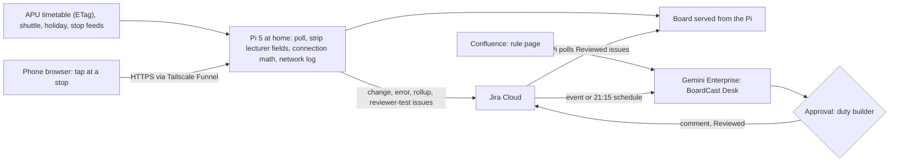

# BoardCast

BoardCast tells an Asia Pacific University (APU) shuttle rider, for each day of next week, which published run still gets them to their first class, what missing it costs, and when a timetable change breaks last week's routine. It works for one student with no other users, from APU's public timetable and shuttle feeds, and a Gemini Enterprise workflow reviews every feed change before an advisory goes out. Its first users are riders at seven residence stops with two to six runs a day, and peak riders at LRT Bukit Jalil. Proposed track: **Smart Campus & Student Experience**. Caveat: the rider co-op that would learn real queue cut-offs needs riders at APU stops, which the team can't reach before 10 November, so the prototype is the connection board and its change desk, and no APU queue result will exist. Nothing here has been built or run yet; **Inference** marks conclusions no source states.

Contents:

1.  [At a glance](#at-a-glance)
1.  [Origins](#origins)
1.  [Problem and evidence](#problem-and-evidence)
1.  [How it works](#how-it-works)
    1.  [Signal to cloud path](#signal-to-cloud-path)
    1.  [Workflows](#workflows)
    1.  [Rule set](#rule-set)
    1.  [States and failure handling](#states-and-failure-handling)
    1.  [Connectors and platform check](#connectors-and-platform-check)
    1.  [Cloud, IoT and network](#cloud-iot-and-network)
    1.  [Real data and privacy](#real-data-and-privacy)
1.  [Why people will use it](#why-people-will-use-it)
1.  [Why the crowd won't build it](#why-the-crowd-wont-build-it)
1.  [Off-campus fit](#off-campus-fit)
1.  [Scores](#scores)
1.  [Research plan](#research-plan)
1.  [Time to impact](#time-to-impact)
1.  [Demo and review](#demo-and-review)
1.  [Build plan](#build-plan)
1.  [Risks and kill criteria](#risks-and-kill-criteria)
1.  [Not verified](#not-verified)
1.  [See also](#see-also)

## At a glance

| Field                 | Plan                                                                                                                                                                                                      |
| --------------------- | --------------------------------------------------------------------------------------------------------------------------------------------------------------------------------------------------------- |
| Owner                 | The team: a duty builder approves one nightly desk run (about 5 minutes). No APU office or student group has agreed to own it; a residence route captain is the post-launch owner.                        |
| First users           | Riders at M Vertica, Bloomsvale, Harmony, D'IVO, Kuchai Sentral, Maple and Bayu Jalil, and peak riders at LRT Bukit Jalil. Parkhill gets a card but isn't the lead user.                                  |
| Track                 | Smart Campus & Student Experience.                                                                                                                                                                        |
| Trigger               | A Jira Cloud issue the Pi files when a feed changes or fails, or a reviewer asks (event trigger, 5–10 minute poll); a 21:15 MYT daily schedule over the nightly rollup.                                   |
| Live signal           | APU's timetable feed polled with ETags every 15 minutes; its shuttle, holiday and stop feeds hourly; phone taps checked on the Pi 5; the Pi's per-request network log.                                    |
| Connectors            | Critical path, 3P GA: Jira Cloud (event, read, approved write) and Confluence Cloud (rule page). Add-ons: Google Sheets and Calendar (1P GA) only if the licence sits on Workspace; custom MCP (preview). |
| Decision              | Which timetable and shuttle changes break riders' plans and deserve an advisory, which anomalies stay "unexplained", and whether a feed change looks like a real revision or a feed fault.                |
| Action and approval   | Code publishes the connection numbers at once. The desk drafts an English and Malay advisory as a Jira comment and pauses at Approval; after one click the Pi publishes it on the board.                  |
| Reviewer self-trigger | Without a seat: open the board for any stop, intake and date; press "Ask the desk" to file a `reviewer-test` issue that starts the workflow; tap "I'm at a stop" for a real distance rejection.           |

## Origins

BoardCast has one source, the [BoardCast idea doc][src], whose own [independent review](/docs/ideas/opus/02/02-boardcast.md#independent-review) said where the design was wrong. This version replaces an earlier cross-set version of the same idea; every number kept was rerun on 5 November 2026 against the live feeds, the shuttle PDF, the Rapid Rail parquet files and OSM routing.

- **Kept:** the miss-cost arithmetic, the campus-wave counts with their caveats, Parkhill's demotion, arrival bands at LRT Bukit Jalil, the `live`, `field-test` and `rehearsal` partitions, the request for written permission, the licence kill, reporting the failed weekday test, and the review's privacy, herding and fraud warnings.
- **Changed, following the review and the scorers:**
  - The lead feature is now a class-connection check with a stale-plan alert, not the miss-cost board. The review's point: a 105-minute gap isn't lateness and doesn't say when to leave.
  - Three desks (Night Desk, Grader, Change Desk) become one workflow with one nightly approval, because the Grader had nothing to grade.
  - The co-op leaves the critical path. Before launch it runs only as `field-test` taps on the team's phones; the learned "be there by" cut-off and public run slips are dropped. The review showed 3 reports can't bracket a queue (zero failures in 3 still allows a 63.2% failure rate at a one-sided 95% bound) and a slip isn't a delay certificate.
  - Telegram Live Location is dropped for a tap page: Telegram gets coordinates before the Pi, movement isn't boarding, and the source's 8-hour sharing limit was outdated (Telegram now allows indefinite sharing).
  - To cut parts, the Pi 5 becomes the poller and the board's server over Tailscale Funnel, replacing GitHub Actions, Firestore and Firebase Hosting.
- **Numbers fixed:**
  - "264 intake groups" counted distinct `INTAKE` values, so it is now 264 intakes (272 intake-groups); every count names its unit.
  - "Seven routes leave at exactly 07:45" holds across the feed only because it includes City of Green and Parkhill. Of the seven far stops, five leave at 07:45, Harmony at 07:55 and Maple at 08:05.
  - For a 13:30 class the source said far-stop riders "arrive 120–150 minutes early". That is the gap from boarding to class; at its own 15-minute allowance they arrive 105–135 minutes early.
  - Parkhill's "684 m and about 9 minutes on foot, 536 m and 89 seconds by car" didn't reproduce. OSM foot routing to APU's feed pin gives 779 m from the residence polygon's east corner but 4.1–4.2 km from its other corners and centroid (2.7 km by car from the centroid). Which applies depends on an exit nobody has checked.
- **Dropped:** "14 reports a morning give full coverage" (14 stop-departures aren't coverage; one boarded rider can't see who was left behind); the 6.5–13.3 km stop distances, which weren't rerun; the Overpass building counts, the 3D city, the ghost columns and the 07:45 launch replay; JR East's certificate figures; APSpace's chunk numbers and BUSSYSTEM's plate details; squads, game and split-flap board; and the source's scores.

## Problem and evidence

At the far stops a rider has few runs, and APU publishes no capacity or queue data: "When the bus is full, it will depart" and "APU does not guarantee a seat" ([shuttle page](https://www.apu.edu.my/shuttle-services-campus-connect)). The [schedule PDF][pdf] labels times "Estimated Departure Time", boards "on a first come first serve basis", runs vans on three routes, and runs Bloomsvale and Harmony as one trip ("7:45 [BV] / 7:55 [HM]"). Weekday runs to APU in the [shuttle feed](https://api.apiit.edu.my/transix-v2/schedule/active) on 5 November:

| Stop                      | Runs | First run, then next | Miss cost | Intake-days with at most one workable run |
| ------------------------- | ---: | -------------------- | --------: | ----------------------------------------: |
| M Vertica                 |    6 | 07:45, 09:30         |   105 min |                                     43.2% |
| Bloomsvale                |    4 | 07:45, 09:30         |   105 min |                                     43.2% |
| Harmony (same trip as BV) |    4 | 07:55, 09:40         |   105 min |                                     44.3% |
| D'IVO                     |    4 | 07:45, 09:45         |   120 min |                                     44.3% |
| Kuchai Sentral            |    4 | 07:45, 10:00         |   135 min |                                     48.2% |
| Maple                     |    4 | 08:05, 10:20         |   135 min |                   64.2% (27.0% have none) |
| Bayu Jalil                |    2 | 07:45, 11:00         |   195 min |                                     67.1% |
| Parkhill, for contrast    |    8 | 07:45, 08:15         |    30 min |                                     27.0% |

The last column joins the 13,514 weekday intake-days in the [timetable feed](https://s3-ap-southeast-1.amazonaws.com/open-ws/weektimetable) (26 October to 20 November, first physical class per intake per day, 2,714 online rows removed) with each stop's runs, assuming 30 minutes from departure to classroom. It is exposure if an intake lived at that stop, not a count of riders. First physical classes cluster at 08:30 (3,650 intake-days, 27.0%), which is why Maple's 08:05 run fails every 08:30 class at that allowance. For a 13:30 class, riders at Bloomsvale, Harmony, D'IVO and M Vertica must board 120–150 minutes before it starts.

- **Changes break routines:** comparing each intake's first physical start on the same weekday, 78 of 3,541 shift between the weeks of 26 October and 2 November (2.2%), but 2,904 of 3,395 (85.5%) shift between 2 November and 16 November. This is one large reset, not weekly churn; its cause is unknown, and the feed was last written on 28 October. The week of 10–13 November has 345–360 intakes on campus a day against 720–881 on other weekdays, and the [holiday feed](https://api.apiit.edu.my/transix-v2/holiday/active) explains only 8–9 November.
- **Campus wave, with units:** Tue 17 November has 264 intakes (272 intake-groups) starting at 08:30 and 394 (419) before 10:00, against 169 and 181 at 08:30, and 287 and 325 before 10:00, on the two earlier Tuesdays. On Thu 19 November, 95 intakes start at 09:00 against 11 and 12. Intakes aren't headcounts and aren't per route.
- **LRT Bukit Jalil:** 51 weekday runs to campus, but the PDF says that from 7:30 to 8:45 buses "will go on a continuous pattern ... and will not follow a schedule", while the feed lists 13 timed entries in that window. BoardCast shows arrival bands there, never per-run times.
- **Public accounts:** 13 of 58 low-star Google Maps texts mention the bus, shuttle, taxi or LRT; "expect long queue times at 8am and 5pm"; at M Vertica "when on time it's always full", though a later update says times were added; students describe being late "even during exam season" ([shuttle reviews][r-shuttle]). The most precise public forecast found is a Reddit reply: "if you have to be on campus at 9, make sure you're at the station by 820 or 830" ([getting to campus](/docs/research/social.md#getting-to-campus-shuttle-lrt-bukit-jalil-and-traffic)). Lateness matters because attendance feeds the [80% visa rule](/docs/research/social.md#attendance-moodle-locks-and-the-80-visa-rule).
- **Team observation:** one friend at Parkhill gave a second-hand account of the queues, and the user says some students skip lectures they can't reach in time. Neither is measured, and no source ties shuttle waits to lost attendance.
- **Counterevidence:** a rider usually waits no more than 20 minutes and calls it bearable ([S4](/docs/research/social.md#s4-a-rider-reports-bearable-morning-waits)); a Parkhill resident reports occasional 10–15 minute waits ([S6](/docs/research/social.md#s6-a-parkhill-resident-describes-an-alternative-commute)); the 30–60 minute waits come from one former student ([S2](/docs/research/social.md#s2-a-former-student-names-classrooms-and-several-service-failures)). No source records a denied boarding. **Inference:** the case rests on the schedule's structure (few runs, long gaps, a large timetable reset), not on proven queues.
- **The weekday forecast failed its one test:** across 35 weekdays in three timetable windows, the source found a Spearman of −0.04 between 08:30 intakes and daily exits at LRT Bukit Jalil, and +0.30 for all physical sessions. Exits barely vary by weekday: medians for September to 3 November 2026 are Mon 3,925, Tue 3,914, Wed 3,906, Thu 3,834 and Fri 3,777, and 3,825 across 480 weekdays since January 2025 ([Rapid Rail data](/docs/research/data-sources.md#rapid-rail-origin-destination-ridership), rerun 5 November). The review called this the wrong test: non-APU riders and all-day totals. So timetable load stays an unvalidated predictor, shown with its units and never sold as "which day is busy".

## How it works

### Signal to cloud path

1.  **Poll:** a systemd timer on the Pi fetches the timetable feed with `If-None-Match` every 15 minutes (S3 answers `304` when unchanged) and the shuttle, holiday and stop feeds hourly; API Gateway sends no ETag ([feed endpoints](/docs/research/apu.md#timetable-feed-endpoints)). Each request logs DNS, connect, TLS and first-byte times, status and bytes.
2.  **Edge:** the Pi drops `NAME`, `SAMACCOUNTNAME` and `LECTID` before anything is stored, diffs each version, and computes every stop, intake, date and allowance (15, 30 or 45 minutes) into the board.
3.  **Jira:** on a changed version, a failed fetch, a reviewer's request, or at 21:00 MYT, the Pi files one issue in project `BC` with the diff in counts, never raw rows.
4.  **Tap:** a phone opens the tap page, the browser reads its position while visible ([phone sensors](/docs/research/iot-and-network.md#phone-and-laptop-sensors-in-the-browser)), and the Pi checks the distance in memory, keeps only stop, run, outcome and times, and drops the coordinates.

### Workflows

There is one workflow, `BoardCast Desk`, because Standard allows one agent creation per user per day ([CONTEXT](/docs/CONTEXT.md#workflows-and-unattended-runs)).

- **Event branch:** a new `BC` issue starts a run within 5–10 minutes. The agent reads the issue and the rule page through Search For Data, classifies the change (real revision, feed fault, or unexplained), lists the stops and intakes whose last workable run moved, drafts the advisory in English and Malay, and stops at Approval. A `feed-error` issue gets a one-line notice and no advisory.
- **Nightly branch, 21:15 MYT:** reads the 21:00 rollup (tomorrow's changed plans, the poll log, field-test taps), drafts the night's advisory, and stops at Approval. A missing rollup becomes a "gateway sent nothing tonight" comment.
- **Why Gemini:** code does every sum. The desk judges what code can't: whether an 85.5% reset is a new teaching pattern or a feed fault, how the PDF's prose rules (continuous LRT window, shared van, Friday-only trips) bear on a change, and conflicting free-text notes on taps. **Conceded:** the source's own critic said a cron and if-statements could do part of this; the desk's value is the judgement on changes and the reviewed wording.

### Rule set

The rules live on one Confluence page the duty builder (later a route captain) can edit; the desk cites a rule ID in every advisory.

- **R1 Workable run:** departure plus the rider's allowance is at or before their first physical class. Code applies it; the desk never recomputes it.
- **R2 Stale plan:** when an intake's first physical start on a weekday changes between this week and next, and its last workable run at a stop changes with it, flag that intake and stop.
- **R3 LRT window:** from 07:30 to 08:45, show arrival bands only, quoting the PDF.
- **R4 Shared trip:** the PDF lists Harmony's 07:55 as the same trip as Bloomsvale's 07:45, so Harmony riders see "same vehicle as Bloomsvale 07:45". **Inference:** Harmony boards what Bloomsvale leaves.
- **R5 Calendar:** a holiday-feed day blanks the board; a weekday with under half the usual intakes and no holiday entry is "unexplained", never explained.
- **R6 Online rows:** a room starting `ONL` is online even when `LOCATION` says `APU CAMPUS`, as the `ONLMCO3-*` rows do ([room codes](/docs/research/apu.md#timetable-room-codes)).
- **R7 Reports:** zero reports reads "0 rider reports", never "clear"; each report shows its age and partition; no cut-off is inferred.

### States and failure handling

- **Feed fails:** the board shows that feed, its HTTP status or timeout, and the time, with no last-known values; the Pi files one `feed-error` issue per outage. A `304` is unchanged, not a failure.
- **Desk not run, not approved, or unlicensed:** the numbers stay up with "Advisory pending review" or "Awaiting Gemini Enterprise licence". Event runs that fail on quota aren't retried ([unattended runs][ge-unattended]), so the nightly branch lists any `BC` issue still unreviewed.
- **Pi or home broadband down:** the board URL fails to load; nothing else serves old numbers. The service runs with `Restart=always` and a hardware watchdog ([watchdogs](/docs/research/iot-and-network.md#services-and-watchdogs)).
- **Phone offline:** the tap page keeps unsent taps in the browser and sends them on reconnect with their original device time, so the delay shows.
- **Weak position:** accuracy worse than the stop's radius marks a tap "unverified". Only 3 of 15 stops in the [stop feed](https://api.apiit.edu.my/transix-v2/locations) have coordinates (LRT Bukit Jalil, APU and a mosque), so the seven far stops start as "unpinned" and accept no `live` taps until a rider pins them.

### Connectors and platform check

| Connector or tool    | Stage, side | Job                                                                            | Platform check                                                                                                              |
| -------------------- | ----------- | ------------------------------------------------------------------------------ | --------------------------------------------------------------------------------------------------------------------------- |
| Jira Cloud           | GA, 3P      | Event trigger; reads change and rollup issues; approved comment and transition | Workflow and event-trigger connector ([triggers][ge-triggers]); Jira Cloud Free has 10 users                                |
| Confluence Cloud     | GA, 3P      | Rule page R1–R7                                                                | Workflow connector; APU runs Confluence and Jira itself ([APU systems](/docs/research/apu.md#systems-apu-runs))             |
| Google Sheets        | GA, 1P      | Add-on: stop-by-date matrix as a second decision input                         | Needs a Workspace domain; consumer accounts get `403` ([account limits][ge-accounts])                                       |
| Google Calendar      | GA, 1P      | Add-on: approved advisories on a public per-stop calendar                      | Same Workspace limit; writes affecting others pause for review                                                              |
| Custom MCP on the Pi | Preview     | Add-on: a read-only `board_status` tool for a chat agent                       | Blocked by default by organisation policy ([custom MCP](/docs/research/gemini-enterprise.md#requirements-and-registration)) |

- **Live, not indexed:** the agent reads Jira and Confluence through the workflow's Search For Data actions, never an ingested copy, so a failed source fails the run ([federation](/docs/research/gemini-enterprise.md#federated-search-versus-ingestion)).
- **Conceded:** no 1P connector is assured. On a consumer account, the critical path is two 3P connectors.
- **Limits:** schedules run on the author's credentials, which expire every 14 days ([unattended runs][ge-unattended]); refresh on 10 November, which covers assessment and the 17 November final. Antigravity scaffolds the poller and connector setup; free-trial seats exclude it, so a personal plan may be needed ([licensing](/docs/research/gemini-enterprise.md#surfaces-and-licensing)).

### Cloud, IoT and network

- **Cloud:** the Gemini Enterprise workflow decides; Jira Cloud and Confluence Cloud hold the record and the rules; Tailscale Funnel gives the Pi a stable public HTTPS name on the free Personal plan ([public HTTPS](/docs/research/iot-and-network.md#public-https-without-a-card)).
- **IoT:** phones are the position sensors and the Pi 5 is the edge: it strips lecturer data and rider coordinates before any cloud hop, the pattern NTT DATA Malaysia [describes](/docs/research/judging.md#ntt-data) as triggering workflows "without sending raw data elsewhere". **Conceded:** before 10 November nothing senses an APU stop, and taps come from public bus stops near the builders, so the IoT layer is thin.
- **Network:** a Network tab shows every poll's timings, status, bytes and `304` hits from a residential line to S3 and API Gateway, and every tap's device-to-Pi delay. Blocking the feed host on the Pi shows a real failure on the board.

### Real data and privacy

- **Partitions:** `live` (real taps at APU stops, empty before 10 November, the only partition behind any APU claim), `field-test` (builders' real taps at public stops near home, for the tap path only), and `rehearsal` (mock GPS for tests and the recording, never in a metric). The team never says a mocked run happened at a real place ([ruling](/docs/CONTEXT.md#decisions-so-far)).
- **Feeds:** lecturer fields are dropped on the Pi at ingest ([personal data](/docs/research/apu.md#personal-data-in-the-timetable-feed)). The repo holds code and the team's own measurements, never a copy of APU's feeds.
- **Taps:** a notice on first open; no names or TP numbers; coordinates never touch disk; events carry a daily rotating hash and are deleted after 14 days; under-18s are excluded; no personal data reaches a prompt. Small counts at one stop can still reveal routines, so the board shows counts per run, not trails. Whether the PDPA covers a student prototype isn't settled ([PDPA](/docs/research/judging.md#malaysias-pdpa-and-the-2024-amendment)).

## Why people will use it

- **Revealed effort around the gap:** students built APRide, a ride board between eight pickup points, around the shuttle gap, and its guide says late classes and weekends break "the weekday shuttle rhythm" ([shuttle reviews][r-shuttle]). Riders pass on their own rule of thumb ("at the station by 820 or 830").
- **Timetable workarounds already exist:** 26 public repositories use APSpace's timetable feed ([feed users](/docs/research/apu.md#who-already-uses-the-timetable-feed)), and students have rebuilt timetable sync and change alerts 12+ times over 13 years ([unmet needs](/docs/research/competition.md#unmet-needs-these-tools-point-to)). Those tools stop when nobody tends them: of the most-forked sync and its 40 forks, 34 had their schedules disabled for inactivity ([GitHub schedules](/docs/research/iot-and-network.md#github-disables-scheduled-workflows)).
- **Value on day one:** one student, no peers, no login: pick a stop, intake and allowance, and see next week's workable runs.
- **Conceded:** the board is a new page to open, not a channel riders use. The advisory is a share-ready card for residence chats, and Calendar subscriptions come only with Workspace. No rider has asked for this tool.

## Why the crowd won't build it

- **Absent tiers:** shuttle, bus or parking ideas hold 0.5% of 780 simulated ideas, and no idea offers student-facing timetable change alerts ([tiers](/docs/research/competition.md#saturation-tiers)). Devpost has 79 `campus shuttle` and 11 `timetable change notification` matches ([crowding counts](/docs/research/competition.md#crowding-counts)).
- **The nearest rivals do something else:** this hackathon's [apu-smart-shuttle](https://github.com/nacyng-netizen/apu-smart-shuttle) is a README promising GPS tracking, which APU doesn't publish; BUSSYSTEM is a staff-side demand forecast with camera occupancy; APLife syncs classes, exams, holidays and shuttles to a calendar, and whether it checks connections isn't verified ([student tools](/docs/research/competition.md#apu-student-built-tools)). APU's orientation guide lists "bus tracking" in APSpace ([APU systems](/docs/research/apu.md#systems-apu-runs)), and a store review says its shuttle timings page "keeps on loading with no end". Transit GO already crowdsources vehicle positions ([substitutes](/docs/research/competition.md#substitutes-for-the-campus-service-shortlist)), which is why BoardCast's co-op waits for real riders.
- **Inference:** a rival's shuttle tracker needs a GPS feed that doesn't exist; BoardCast needs only the schedule and timetable APU already publishes.

## Off-campus fit

The reduced version passes; the full product doesn't. With nobody at APU, no staff action, the team's phones and the one Pi 5, the team can build and run the connection board, the stale-plan alerts, the change desk on Jira and Confluence, the network log, and the tap path tested at public stops near home. The co-op, BoardCast's original core, needs riders at the seven APU stops and a route captain: neither exists, so `live` stays at 0 reports, no queue or cut-off is measured, and the 12 unpinned stops can't be pinned. The written permission the board needs is an organiser's reply, not a build step; without it the board stays unlisted. What reviewers see on 10 November is a schedule-and-timetable checker with a reviewed change desk, and the doc doesn't claim more.

## Scores

**63.1 / 100, rank 10 of 18** in the [cross-set ranking](/docs/ideas/00-ranking.md); it passes every gate, with G1, G3 and G4 conditional. Scored on 5 November 2026 on the [matrix](/docs/ideas/00-ranking.md#scoring-matrix) by three independent scorers who read this doc and checked its claims: an NTT DATA forward deployed engineer (FDE), an APU School of Technology IoT lecturer, and a Google Cloud advocate who is also an APU student. Models: FDE (Claude Sonnet 5.5), Lecturer (Claude Fable 5.1), Advocate (Claude Opus 5.5). Day-to-day workflow and theme take the lowest score; the rest take the mean.

| Component           | Weight | FDE | Lecturer | Advocate | Used | Lowest scorer's reason                                                                                                                                                        |
| ------------------- | -----: | --: | -------: | -------: | ---: | ----------------------------------------------------------------------------------------------------------------------------------------------------------------------------- |
| Impact              |     13 |   3 |        3 |        2 | 2.67 | The owner is the team, the exposure figures are intake-days rather than riders, and the baseline is a teammate timing comparison.                                             |
| Connectors          |     13 |   3 |        4 |        3 | 3.33 | Critical path is Jira and Confluence (3P GA) with real event, read and approved-write jobs; no 1P connector is assured, as the doc concedes.                                  |
| Day-to-day workflow |     13 |   4 |        4 |        4 |    4 | Jira event plus 21:15 schedule, a Confluence rule page, loud feed errors and one nightly approval, though the Pi files its own trigger issues.                                |
| Research            |     13 |   3 |        3 |        3 |    3 | Run counts, 07:45/09:30 for M Vertica, 6/4/4/4/4/4/2 runs per stop match the live feed, but the weekday forecast failed its test and 6-8 interviews are admitted unreachable. |
| Time to impact      |     13 |   3 |        3 |        3 |    3 | First value the night the board goes live, 3- and 6-month plan owned by team and route captains, gated on APU's written permission.                                           |
| Theme               |     10 |   2 |        3 |        2 |    2 | Nothing senses an APU stop before 10 November; taps at public stops and a feed-polling Pi leave IoT thin, though the per-poll network tab is real.                            |
| Originality         |      9 |   4 |        4 |        4 |    4 | Student-facing timetable change alerts and shuttle are absent tiers, and the rivals named do something else.                                                                  |
| Real use            |      6 |   3 |        3 |        3 |    3 | APRide and 26 timetable-feed repositories show effort around the gap, but the board is a new page nobody asked for.                                                           |
| Buildability        |      5 |   2 |        3 |        3 | 2.67 | Pi poller, connection engine, board on Funnel, tap page, workflow, benchmark and mock-GPS partitions is too wide for three people.                                            |
| Demo                |      5 |   4 |        4 |        4 |    4 | A reviewer opens the board for any stop, intake and date and asks the desk, which files a real issue; the approval click is the only wait.                                    |

- **Gates:** G1 conditional (2 pass, 1 conditional, 0 fail); G2 pass (3 pass, 0 conditional, 0 fail); G3 conditional (1 pass, 2 conditional, 0 fail); G4 conditional (0 pass, 3 conditional, 0 fail).
- **Off-campus gate, per the lowest scorer:** No campus presence is needed for the reduced board, but it rests on APU feeds whose use needs written permission from the organisers or APU; a refusal stops the build.
- **What would help most, per the lowest scorer:** Get written permission from the organisers for the APU feeds before 9 November and recruit one residence-stop rider group to receive the Sunday advisory, which removes the kill risk and adds real users.

## Research plan

1.  **Thu 5 Nov:** ask the Parkhill friend three past-tense questions: which exit you use and why you ride rather than walk; what happened on your last morning ride; what you did. Ask `#help-desk` for written permission, naming the feed URLs and the fields kept ([terms][terms]).
2.  **Form, Thu 5 to Sun 8 Nov 12:00, in the hackathon Discord and course chats:** stop, date and run of the last ride, time at the stop, boarded or left behind, on time for class, how they pick a run, and which chat their building uses. No names or TP numbers; an under-18 check. Reported per route as n of N and labelled recall. Six to eight rider interviews aren't reachable this week; any form respondent who offers a call is interviewed, and the count is stated.
3.  **50 real items, by Sat 7 Nov:** hand-check 50 (intake, stop, date, allowance) cases against the PDF and the raw feed, stratified across Maple's 08:05, Bayu Jalil's two runs, the shared van, the LRT window, online rows marked `APU CAMPUS`, Friday-only trips, 9 November, and the 16 November reset. Pass at 48 of 50.
4.  **Timed comparison, by Sun 8 Nov:** two builders each plan 10 intake-and-stop weeks, half by hand from APSpace and the PDF and half with BoardCast, counterbalanced, logging seconds and errors. This is a teammate baseline, not riders, and is labelled so.
5.  **Tap path, Fri 6 to Mon 9 Nov:** 30 real `field-test` taps on one Android phone and one iPhone, at stops, 200 m away and at home, scoring accept and reject and the device-to-Pi delay.
6.  **After launch:** the review's prospective test: per stop, run and date, record arrival, departure and boarded or denied, including uneventful days, and test timetable load against held-out dates.

## Time to impact

- **First value:** the night the board goes live, for one student. The first large real alert is the 16 November reset, due in the Sunday 15 November advisory if the feed holds.
- **By 17 February 2027 (3 months), owner: the team, with one duty builder per week:** the board and Sunday advisories for every route through the January 2027 intake, around the 21 December to 2 January break in the holiday feed. A co-op pilot runs at M Vertica's 07:45 with one route captain recruited at or after the final. Target: a report on at least 3 of 5 weekdays, and benchmark errors kept at or under 2 in 50 on each new feed version.
- **By 17 May 2027 (6 months), owner: route captains, with the team maintaining the desk:** the co-op at all seven stops if the pilot met its target. Measured: denied boardings observed, plans the advisory changed (rider-reported), and reporting burden. A "board by" time appears only on a run with zero failures across at least 59 independent comparable departures (under a 5% one-sided bound). An export for APU's logistics team stays optional.
- **What must be true:** APU's written permission; the feeds stay public; a seat after the trial from $30 a month ([prices](/docs/research/gemini-enterprise.md#gemini-enterprise-editions-and-prices)), or the desk pauses and the board runs alone; someone approves each night.

## Demo and review

**Video, 3:45, labelled as a recording with its capture date ([minute plan](/docs/research/judging.md#minute-plan)):**

1.  **0:00** M Vertica's 07:45 and 09:30: for an 08:30 class at a 30-minute allowance, the 09:30 reaches class at 10:00, 90 minutes late. Bayu Jalil's miss costs 195 minutes. `live: 0 rider reports` stays visible.
2.  **0:40** The board for a real intake, then the stale-plan alert for the week of 16 November, with the wave in its units.
3.  **1:20** The desk: a Jira issue from a real feed diff, the run's trace, the Approval click, the comment written back, and the board updating. Then a blocked feed showing its error.
4.  **2:10** A `field-test` tap at a public stop with its device-to-Pi delay; an airplane-mode tap arriving late; the benchmark and the teammate timing, with n.
5.  **2:40** The failed weekday test, the empty co-op, and the 3- and 6-month plan. Any mock GPS scene stays in `rehearsal`, and the script never says a rider was at an APU stop.

**Reviewer self-trigger:** without a seat, the reviewer opens the board for any stop, intake and date in the feed and presses "Ask the desk" (rate-limited to protect the 160 daily queries). That files a `reviewer-test` issue; the workflow runs within 5–10 minutes and pauses at Approval, which the team targets within 2 hours between 08:00 and 23:00 MYT, and the reviewed answer appears on the board. "I'm at a stop" checks their real position against LRT Bukit Jalil's coordinates and rejects it with the distance. With a seat, they run `@BoardCast Desk` for any date. Shared users see only their own runs, so the README carries the owner's Runs tab over several days ([reviewer access](/docs/research/gemini-enterprise.md#reviewer-access)).

**Final, 17 November, if selected:** that morning is the window's largest 08:30 wave (264 intakes), so the advisory committed on 16 November is graded against an audience QR: "Rode a shuttle this morning? Which run, and did you board?" Answers are tagged recall, and an empty result is shown as empty.

## Build plan

Three builders: **B1** the desk (Jira, Confluence, workflow); **B2** the Pi poller, connection engine and board; **B3** the tap page, research, video.

| Day                          | Critical path                                                                                                                                               | Exit check                                                      |
| ---------------------------- | ----------------------------------------------------------------------------------------------------------------------------------------------------------- | --------------------------------------------------------------- |
| Thu 5 Nov                    | B2: poller with ETags, lecturer-field strip, connection math, board on Funnel. B1: Jira `BC`, rule page, permission and licence questions. B3: form, friend | Real board online for all stops; a blocked feed shows its error |
| Fri 6 Nov                    | B1: desk on the Jira event and 21:15 schedule, if licensed. B2: diffs and Jira filing. B3: tap page, first 10 taps on both phones                           | One real run at Needs Review, or the licence gap logged         |
| Sat 7 Nov                    | B1: approved write published by the Pi; reviewer-test button. B2: 50-item benchmark. B3: 20 more taps with negatives                                        | Benchmark at 48 of 50 or better; one approved advisory live     |
| Sun 8 Nov (Deepavali)        | All: confirm registration by 12:00; form closes at 12:00; kill check; timed comparison. B1: audit unattended runs and quota                                 | Kill criteria read; registration confirmed                      |
| Mon 9 Nov (reported holiday) | Freeze at 12:00; video, README with the Runs tab, deck; logged-out reviewer test                                                                            | Video checked from a logged-out browser                         |
| Tue 10 Nov                   | Refresh credentials; recheck every number against the live feeds; leader submits by 18:00; Pi and desk keep running through 14 November                     | Entry locked; 21:15 run completes                               |

Cut in this order: custom MCP, Sheets and Calendar without Workspace, Malay wording, the Network tab's charts, the tap page if both phones fail. Never cut: the board with its error states, one desk run with approval, the benchmark, and the partitions.

## Risks and kill criteria

- **Permission (flagged):** the board republishes results derived from APU's feeds, and APU's [Terms of Use][terms] ask for written permission. **Kill** on a refusal: stop using the feeds, since the board can't run. With no reply by Mon 9 Nov 12:00, the board stays unlisted, the repo holds no feed copies, and the README says permission is pending.
- **Licence:** with no licence by Mon 9 Nov 12:00, the Gemini Enterprise core fails; say so, keep the Pi and Jira running on real feeds, and build the desk the day a seat lands.
- **No decision value:** **kill the stale-plan pitch** if, by Sun 8 Nov 12:00, at least 15 answers come back and fewer than 1 in 5 report a miss, a late arrival, or a plan broken by a timetable change in the last 14 days. Report counts per route, since a rare 195-minute gap can still matter; under 15 answers, say so.
- **Wrong answers:** under 48 of 50 on the benchmark, fix the parser before recording; any stop still failing by Mon 9 Nov 12:00 leaves the board.
- **Home Pi during assessment:** a power or broadband cut takes the board offline. Use a power bank and a phone hotspot, and restart `tailscaled` on a failed self-check, since users report Funnel stopping after a reconnect.
- **After launch:** a shared "board by" time can pull arrivals earlier with fixed seats, and two accounts can be one person. Version advice, rate-limit to one report per account per run, never sum overlapping reports, and keep conflicts `Disputed`.
- **Final in person:** the team is away and a remote option is unconfirmed; ask now and decide who travels by 15 November.

## Not verified

- Every Gemini Enterprise step, since no licence has arrived: Jira and Confluence event names, whether Confluence reads are federated in workflows, whether workflow runs spend the 160 daily queries, and how Approval behaves in scheduled runs.
- The source's 35-weekday Spearman test and its exclusions; only the exit medians were rerun.
- Travel times from each stop, vehicle capacities, pickup points for the 12 unpinned stops, denied-boarding frequency, and whether riders take the latest workable run.
- Which Parkhill exit residents use and whether that walk is usable; why 10–13 November is half-empty and first starts reset for 16 November, and whether the feed holds when next written.
- Whether APLife joins classes to shuttle runs; browser position accuracy under bus shelters; Funnel's uptime over four unattended days.

## See also

- [BoardCast source idea doc and its independent review][src]
- [Cross-set ranking](/docs/ideas/00-ranking.md)
- [APU public documents, feeds and terms](/docs/research/apu.md)
- [Gemini Enterprise: workflows, connectors and reviewer access](/docs/research/gemini-enterprise.md)
- [IoT and network: phones, the Pi and public HTTPS](/docs/research/iot-and-network.md)

[src]: /docs/ideas/opus/02/02-boardcast.md
[pdf]: https://publicwebsite-media.apu.edu.my/assets/2026-10/2026Oct22_APU-SHUTTLE-SERVICES.pdf
[r-shuttle]: /docs/research/social.md#shuttle-buses-and-the-lrt-last-mile
[terms]: /docs/research/apu.md#terms-of-use-and-robotstxt
[ge-unattended]: /docs/research/gemini-enterprise.md#what-runs-without-anyone-signed-in
[ge-triggers]: /docs/research/gemini-enterprise.md#triggers-and-schedules
[ge-accounts]: /docs/research/gemini-enterprise.md#edition-and-account-limits
