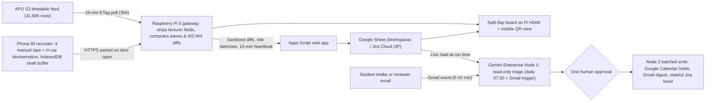

# LiftBoard

LiftBoard is a candidate Smart Campus & Student Experience entry (with Intelligent Automation & Digital Transformation as a fallback) that turns APU's public timetable feed and a tap-referenced phone recorder into a per-block directional pressure board and a daily Gemini Enterprise changeover desk for intake-subscribed students. A Raspberry Pi 5 strips lecturer identifiers and computes up-peak, down-peak, and two-way changeover waves per block with no predicted wait times, while a daily Gemini Enterprise workflow resolves timetable changes, online-to-physical traps, and lift-ride telemetry behind one human approval. Nothing in this document has been built or run by a person yet. Rank and score: see the [ranking](/docs/ideas/00-ranking.md).

Contents:

1.  [At a glance](#at-a-glance)
1.  [Origins](#origins)
1.  [Problem and evidence](#problem-and-evidence)
1.  [How it works](#how-it-works)
    1.  [The two features](#the-two-features)
    1.  [Day-to-day loop](#day-to-day-loop)
    1.  [States and failure handling](#states-and-failure-handling)
    1.  [Connectors and platform check](#connectors-and-platform-check)
    1.  [Cloud, IoT and network](#cloud-iot-and-network)
    1.  [Real data and privacy](#real-data-and-privacy)
1.  [Why people will use it](#why-people-will-use-it)
1.  [Why the crowd won't build it](#why-the-crowd-wont-build-it)
1.  [Scores](#scores)
1.  [Research plan](#research-plan)
1.  [Time to impact](#time-to-impact)
1.  [Demo and review](#demo-and-review)
1.  [Build plan](#build-plan)
1.  [Risks and kill criteria](#risks-and-kill-criteria)
1.  [Not verified](#not-verified)
1.  [See also](#see-also)

## At a glance

| Aspect                | Plan                                                                                                                                                                                          |
| --------------------- | --------------------------------------------------------------------------------------------------------------------------------------------------------------------------------------------- |
| Owner                 | The 3–4 teammates running the Pi 5 gateway, public board, and approval rota; no APU office or club is assumed                                                                                 |
| First users           | Intake-subscribed APU students (`INTAKE + GROUPING`), starting with the teammates' own intakes across 1,045 intakes (`1,162` cohorts)                                                         |
| Track                 | Smart Campus & Student Experience (**Inference:** Intelligent Automation & Digital Transformation is a fallback if judges prefer an operations angle; prizes share one pool)                  |
| Trigger               | One daily schedule at 07:30 MYT over a rolling next-class-day horizon, plus the Gmail "When an email is received" event (5–10 min poll)                                                       |
| Live signal           | APU's public S3 timetable feed polled every 15 minutes (`If-None-Match` `304`), plus real off-campus lift rides logged by manual taps with `devicemotion` assistance                          |
| Connectors            | Workspace: Google Drive and Sheets, Gmail, and Google Calendar (1P GA), plus Jira Cloud (3P GA). Consumer `@gmail.com` fallback: Jira Cloud, Confluence Cloud, and Slack (all 3P GA)          |
| Decision              | Code on the Pi does all arithmetic; Gemini reconciles timetable changes, online-to-physical traps, natural-language subscriber rules (`lift-only`), and ride-telemetry threshold shifts       |
| Action and approval   | One UI-added human approval step per daily run gates a single batched write: updating Google Calendar transition holds, sending one Gmail intake digest, and updating one stateful Jira issue |
| Reviewer self-trigger | Open the public recorder (`?mode=reviewer`) to land a real lift ride or four-tap packet on the live board, or email any intake or module code to the desk inbox                               |

## Origins

Teammate `kymil4` first raised APU's class-change lift queues, matching the team's first-hand experience of waiting 1–3 turns at the main entrance, carpark, and cafeteria lobbies and spending 2–3 minutes in the car across intermediate stops. The [earlier LiftBoard proposal](/docs/ideas/opus/06-liftboard.md) pitched a 5-minute early-finish ask to lecturers before "far" room changes (cutting Thursday's 10:30 upper-floor release from 56 to 35 rooms on paper), a blanket prompt telling free students to ride up before 10:30, and automatic browser accelerometer stop-counting. Its [independent review](/docs/ideas/opus/06-liftboard.md#independent-review) gave the verdict **"don't build as pitched"**: early finishes shift 60–640 trips without proving spare bank capacity; the room parser missed named upper-floor labs, auditoriums, lunch returns, and online classes; 174 of 201 coded "far" lecturer moves cross blocks (33 on the same level) where a Spine bridge may avoid lifts; a single early-arrival deadline risks a new peak outside occupied rooms; browser accelerometers cannot detect queuing, boarding, or destination stops reliably; per-reminder Jira tickets are connector padding; and sensor readings did not govern workflow actions.

**What this version changes, keeps, and drops:**

- **Kept:** The LiftBoard name, the Raspberry Pi 5 split-flap board and mobile QR canvas, ETag (`304`) polling with edge redaction of lecturer fields, and the honest `0 APU rides measured` boundary while the team is off campus.
- **Changed:** Recipients switch from lecturers to intake-subscribed students (`INTAKE + GROUPING`). The board replaces predicted waits and the 56-to-35 chart with repaired directional schedule pressure per block (up-waves, down-waves, two-way counterflow, and 30-minute target-room vacancy). Manual `Join queue`, `Missed car`, `Boarded`, and `Alighted` taps become the recorder's reference clock, with `devicemotion` scoped strictly inside `[t_board, t_alight]` as assistance. Real ride rows feed the daily Gemini Enterprise workflow so sensor thresholds govern block status and drift alerts behind one daily approval. Recalled lift spots are tagged as team memory, and the room-continuity audit becomes an optional export.
- **Dropped:** The lecturer 5-minute early-finish ask, the 56-to-35 payoff chart, unconditional "go up before 10:30" prompts, cross-block walking advice, per-reminder Jira tickets, Pi Wi-Fi/BLE sniffing, and unassisted accelerometer queue or stop claims.
- **Where internal drafts disagreed and why we chose one:** (1) _Workflow cadence:_ we chose **one daily 07:30 MYT desk run** (targeting the next active physical class day so the 7–9 Nov holiday stretch still processes `Tue 10 Nov` and week-to-week diffs) over 4–8 daily runs or per-ride workflow triggers, because connector writes pause for human approval and Standard pools 160 queries per user per day without event-trigger retry. (2) _Pre-wave staggers:_ we kept staggered pre-wave boarding windows **conditional on measured spare bank capacity** (surfacing only factual 30-minute room vacancy and same-block `0–2` floor proximity now) rather than assigning pre-wave boarding times from schedule data alone, because off-campus data cannot prove spare capacity at `10:25`. (3) _Continuity tickets:_ we kept the room-continuity audit (`149` same-cohort and `168` lecturer back-to-back pairs) as an **optional CSV/Sheet export** rather than active Jira tickets for APU's timetable office, because success cannot depend on an unreachable office.

**What objections still stand, and whether this earns a different verdict:** Nobody on the team can visit APU before 10 November, so APU lift counts, car speeds, served floors, class sizes, actual dismissal times, and baseline wait times remain unmeasured (`0` APU rides until the 17 Nov final, which happens only if the team reaches the top 5). As a campus queue-reduction proof before 10 November, the review's verdict still stands. This revision earns a different answer only as an honest, off-campus-testable schedule-pressure desk and tap-referenced lift recorder (**Inference**). The team has not picked LiftBoard; it is evaluated alongside the rest of the [ranking](/docs/ideas/00-ranking.md).

## Problem and evidence

**Team observation (memory, not a measurement):** First raised by `kymil4` and shared by the team: from morning to afternoon at APU, riders wait 1–3 turns depending on the spot (`Main entrance`, `Carpark`, or `Cafeteria` in team memory) and spend 2–3 minutes in the car because of intermediate stops, delaying upper-floor classes when students and lecturers hit the same changeover.

**Public evidence and lift traffic physics:** APU students post `"A block have 9 floor 15classes a floor only two lift. Lift always full"` (Instagram, 27 Oct 2026, 18 likes; [other platforms](/docs/research/social.md#lifts-stairs-and-crowding)), `"APU if you're reading this fix your damn elevators lah"` (Reddit, 28 Sep 2025, 54 points; [Reddit lifts](/docs/research/social.md#lifts-laundry-and-deposits)), and classroom complaints naming `E-09-03` and `S-08-01` (Reddit, 3 Jun 2025; [S2](/docs/research/social.md#s2-a-former-student-names-classrooms-and-several-service-failures)). A KU Leuven study links timetable changeover flows directly to `"long queues at elevators or at stairwells, which might lead to delays in lecture starts"` ([Vermuyten et al., 2016](https://repub.eur.nl/pub/124530)). In standard lift traffic equations (`RTT = 2H(d/v) + (S+1)t_s + 2Pt_p`, `HC_5 = 300LP/RTT`; [Swinarski, 2020](https://journals.sagepub.com/doi/10.1177/0143624420966257); [CIBSE Guide D](https://cibse.org/knowledge-research/knowledge-portal/guide-d-transportation-systems-in-buildings-2025/)), across plausible bounds (`L=2–4` cars, `P=8–16` passengers, `H=7–8` floors, `d=3.6–4.0 m`, `v=1.0–2.0 m/s`, `t_s=8–12 s`, `t_p=1.0–1.2 s`), stops and passenger transfers `(S+1)t_s + 2Pt_p` drive `68.1%–75.2%` of round-trip time (`56.0–194.4 s` of `81.2–258.4 s`). Under mid assumptions (`H=8, d=3.8 m, v=1.5 m/s, t_s=10 s, t_p=1.1 s`), switching from one-way up-peak (`S=5, P=12`, `RTT = 126.9 s`) to two-way counterflow (`S=9`, `10` up + `10` down transfers) raises `RTT` to `184.5 s` (`+45.4%`), cutting directional throughput per car by about `42.7%` (`12` per trip to `10`), or `31.2%` if passengers per direction stayed equal (**Inference**).

**Computed timetable figures** (recomputed from the 4 Nov 2026 snapshot of [`open-ws/weektimetable`](/docs/research/apu.md#apspace-timetable-feed), `31,606` raw rows across 26 Oct – 22 Nov 2026; dropping lecturer fields and co-taught duplicates leaves `31,569` rows across `1,045` intakes and `1,162` `INTAKE + GROUPING` cohorts; week of 2–6 Nov has `9,339` raw → `9,328` deduplicated rows: `8,730` physical, `598` online):

| Wave (2–6 Nov, level 5+ repaired) | Cohort rows out (rooms) | Tight next (`<=15m`, diff room) | Cohort rows in (rooms) | Incoming mix (`<=15m` tight / prior-1h online / `60m` free: room vacant vs busy)   |
| --------------------------------- | ----------------------: | ------------------------------: | ---------------------: | ---------------------------------------------------------------------------------- |
| `08:30` up-peak                   |                 0 (`0`) |                          0 (0%) |          1,046 (`352`) | `0` tight / `0` online / `1,046` free (`1,046` vacant 30m prior, `0` busy)         |
| `10:30 → 10:45` two-way           |             962 (`307`) |                     482 (50.1%) |          1,014 (`329`) | `472` tight (`+16` same rm) / `10` online / `490` free (`192` vacant, `298` busy)  |
| `12:45 → 13:30` lunch down / up   |           1,020 (`309`) |                       47 (4.6%) |            972 (`306`) | `15` tight / `4` online / `953` free (`604` morning returns, `349` first arrivals) |
| `15:30 → 15:45` two-way           |             894 (`300`) |                     423 (47.3%) |            879 (`290`) | `384` tight (`+21` same rm) / `20` online / `388` free (`129` vacant, `259` busy)  |
| `17:45` down-peak                 |             975 (`330`) |                          0 (0%) |                0 (`0`) | `975` leaving physical rooms (`88` have an online class within 60 min)             |

- **Named upper-floor rooms and block concentration:** Across all 4 weeks, `4,905` physical rows sit in `48` cleaned rooms (`49` raw strings before stripping a stray `U+FFFD` on `Tech Lab 6-16 (iMac Suite)`) that fail a `Block-Level-Room` (`B-LL-RR`) regex (`43` named labs/auditoriums/library rooms plus `5` `B-01/03-*` labs), and `532` rows have `"null"` as `MODULE_NAME` across `43` `MODID`s. For 2–6 Nov, parsing `Tech Lab` levels 5–7 and `Auditorium 1–3` (levels 7, 6, 9) adds `895` level 5+ cohort rows (`6,602` coded to `7,497` across `2,356` room-sessions). Blocks B (`2,242`), D (`2,059`), and E (`1,369`) hold `5,670/7,497` (`75.6%`) of level 5+ rows (`1,786/2,356 = 75.8%` of room-sessions).
- **Vertical moves vs flat moves and room-continuity candidates:** Of `1,881` tight (`0–15 min`) physical cohort room changes in 2–6 Nov (`786` cohorts), `1,377` connect standard `B-LL-RR` rooms: `419` stay in the same block (`87` on the exact same floor needing zero stairs or lifts, `129` down 1–2 levels, `117` up 1–2 levels, `86` moving 3+ levels) and `958` cross blocks (`177` at the same level). Across `326` lecturer tight room changes (`323` with parsed levels; `240` in `B-LL-RR` rooms), `155` cross `>=2` vertical floors (`32` same-block, `123` cross-block), `107` cross `1` floor, and `61` are on the exact same floor (`16` same-block, `45` cross-block; `33` of `201` coded "far" moves are flat). In `149` back-to-back session pairs with the identical cohort set (`103` in `B-LL-RR` rooms, `84` crossing blocks or `>=2` levels) and `168/326` (`51.5%`) lecturer tight moves (`116/240 = 48.3%` in `B-LL-RR` rooms), the origin (`90`) or destination (`105`) room is already empty in the adjacent slot (across all 4 weeks without lecturer fields, `329` of `2,537` tight session pairs move identical cohorts between non-lab rooms where one room is free, `276` crossing blocks or `>=2` levels).
- **Timetable changes and hybrid traps:** From Week 1 to Week 2, only `95` of `7,672` repeating cohort-module pairs change (`1.2%`), so the large Week 4 change below is one reset, not steady weekly churn, and its cause is unknown. Between Week 2 (`2–6 Nov`) and Week 3 (`9–13 Nov`, Deepavali week), `1,800` of `1,841` Monday cohort-module rows drop while `41` shift onto Tue–Fri; across Tue–Fri, `4,412` of `7,485` cohort-module pairs pause, `532` appear only in Week 3, and `403` change room or time, cutting tight physical transfers from `1,881` to `657` (`434` matching Week 2). Between Week 2 and Week 4 (`16–20 Nov`), `7,286` of `7,745` repeating cohort-module pairs (`94.1%`) change day or time and `0` of `1,783` tight room changes keep the same `(intake, group, day, time, room1, room2)`. Across all 4 weeks, `341` tight (`0–15 min`) cohort transitions switch between an online class and a physical room (`192` Online-to-Physical, `149` Physical-to-Online, `260` involving level 5+ across `224` cohorts).

**Team view on timetable changes:** The user says changes already reach students through Outlook and Teams, and that missed schedules are mostly a matter of diligence. So the desk can't sell the news that a class moved. Its only claim is what the move does to a student's changeover. **Inference:** this limits the churn figures below as a selling point.

**Counterevidence:** Lifts rank 10th of 15 themes on other platforms ([theme ranking](/docs/research/social.md#other-platforms-theme-ranking)), appear only in passing on Reddit with no timed wait, and returned zero first-hand 2025–2026 APU lift complaints across 23 X queries ([X footprint](/docs/research/social.md#apus-footprint-on-x)). APU's [LNO campus guide](https://apiit.atlassian.net/wiki/spaces/LNO/pages/3855974442) and [ITSM spine note](https://apiit.atlassian.net/wiki/spaces/ITSM/pages/2272296980) describe a multi-level Spine (including level 6) and name three elevator groups (`Glass`, `Block C`, `Block E`) without listing every lift, so cross-block moves may not use lifts. Because `20–40` students/class, `50–100%` attendance, and `30–80%` lift share give a `10×` demand band (`126–1,288` trips/15 min in Block B or D) overlapping the `8×` bank capacity band (`60–480` passengers/15 min), schedule counts cannot prove queue length or spare capacity.

## How it works

### The two features

Only these two features appear in the demo and pitch:

1.  **Per-block directional pressure board and tap-assisted flight recorder:** The Pi 5 screen and mobile QR view show each block's (`B`, `D`, `E`, `S`, `A`, `C`, `TechLab`) next up-wave, down-wave, and two-way changeover in cohort rows and rooms releasing/starting, 30-minute target-room vacancy, edge heartbeat, and `APU rides measured` (strictly `0` off campus, with no predicted wait times and no 56-to-35 chart). Riders pick a source-tagged bank (`Glass lift`, `Block C lift`, `Block E lift` from the [LNO campus guide](https://apiit.atlassian.net/wiki/spaces/LNO/pages/3855974442); `Main entrance spot`, `Carpark spot`, `Cafeteria spot` labelled `team memory — served floors & access unverified`; or `Off-campus bench (test mode)`) and tap four buttons (`Join queue`, `Missed car`, `Boarded`, `Alighted`) as the reference clock for wait (`t_board - t_queue`), refusals (`missed_cars`), ride duration (`t_alight - t_board`), and upload delay (`t_upload - t_alight`). Browser `DeviceMotionEvent` (with [Screen Wake Lock](https://developer.mozilla.org/en-US/docs/Web/API/Screen_Wake_Lock_API)) runs strictly inside `[t_board, t_alight]` as assistance to estimate motor-start delay and experimental stops (hidden until validated).
1.  **Intake changeover desk in Gemini Enterprise:** Students subscribe by `INTAKE + GROUPING` (starting with the teammates' own APU intakes). Python on the Pi computes all arithmetic and room-occupancy flags; the daily Gemini Agent node handles what plain code cannot: reconciling timetable changes (`94.1%` of repeating cohort-module pairs shift in the Week 4 reset), flagging `0–15 min` hybrid traps (`192` online-to-physical and `149` physical-to-online across 4 weeks, advising students to take the online class on campus before the release wave), applying natural-language subscriber rules (such as `lift-only`, which suppresses the `246` standard same-block `1–2` floor walk prompts while keeping the `87` zero-floor same-level notices), and shifting a block's advisory tier when ride telemetry crosses the rule sheet's wait or drift bounds. One human approval click executes the batched Calendar, Gmail, and Jira writes. (An optional CSV/Sheet export lists the `149` same-cohort and `168` lecturer room-continuity pairs; it stays out of the pitch.)

### Day-to-day loop

1.  **Every 15 minutes (Pi 5 edge):** Polls S3 with `If-None-Match` (receiving `304` when unchanged; [feed behaviour](/docs/research/apu.md#timetable-feed-change-behaviour)). On a new version, it parses `31,606` rows in RAM, drops `NAME`, `SAMACCOUNTNAME`, and `LECTID`, computes per-block directional waves and next-class-day diffs for subscribed cohorts, and posts sanitized rows plus a heartbeat to Google Sheets and Jira REST.
1.  **On every lift ride (Phone → Pi → Sheet):** Tapping `Alighted` flushes the buffered summary (`wait_sec`, `missed_cars`, `ride_sec`, `upload_delay_ms`, `motion_assist_sec`, `mode`) over HTTPS to the Pi 5, which stamps edge-to-Sheet latency and appends the row to the Sheet. Real rides do two load-bearing jobs in the workflow: (a) off-campus `calibration_bench` rides feed the daily sensor-drift audit, where the workflow compares `devicemotion` `[t_board, t_alight]` duration against manual tap duration and adds a Jira drift comment if median error exceeds `3.0 s` or missed-stop rate exceeds `30%`; and (b) `campus_verified` rides govern block state—while a block has `n < 3` real APU rides, the workflow locks its advisories to `Schedule-Only Exposure (0 APU rides measured)` and keeps staggered pre-wave boarding windows disabled; once `n >= 3` real APU rides log `missed_cars >= 1` or `wait_sec >= 120` (and once `10:15–10:25` rides show lower waits than `10:30–10:45`), the workflow flips the block to `Queue seen (n=…)` and enables staggered pre-wave boarding windows (`-30 to -15 min`) for free cohorts whose target room is vacant 30 minutes prior. Three rides only show a queue was seen, not how often, so this is a starting rule to tighten.
1.  **Daily at 07:30 MYT (Desk workflow):** Evaluates the **next active physical class day** (`Fri 6 Nov` with `508` physical sessions and `290` tight transfers, advancing on Friday evening to `Tue 10 Nov` with `356` sessions and `143` tight transfers so the `7–9 Nov` holiday stretch still produces real diff runs, plus `W2 → W3 → W4` churn). Node 1 (read-only) checks the Pi heartbeat, reads cohort diffs, subscriber rules, and new ride rows, and exits as **Completed** with zero clicks if nothing changed. When actionable diffs or ride thresholds exist, Node 1 bundles all updates before **one UI-added Approval step**; one click runs Node 2's consolidated writes to Calendar, Gmail, and Jira.
1.  **On email (Inbox event trigger, 5–10 min poll):** Reads intake subscriptions, natural-language exceptions (`"on crutches this week, lift-only"`), and reviewer module/intake queries, writing the full analysis into the run trace before the single approval step.

### States and failure handling

- **Feed unreachable or Pi heartbeat stale (`> 30 min`):** Board and mobile view show `ERROR: UPSTREAM_STALE` with the HTTP status and hide wave tables; the Desk workflow halts at its condition check with no cached fallback ([project conventions](/docs/references/project-conventions.md)).
- **Lift-shaft or cloud outage during a ride:** The page buffers taps and motion in `IndexedDB` while signal drops; if Sheets is unreachable on exit, the Pi 5 buffers the packet in local SQLite with its original capture timestamp and flushes on reconnect, displaying the measured delay.
- **Motion denied or corrupted by hand movement:** Manual taps (`t_board - t_queue`, `t_alight - t_board`) still record the ride; the motion field logs `motion_rejected` with no guessed stop count.
- **Zero APU rides (`campus_verified = 0`) or unapproved run:** The board states `0 APU rides measured` and suppresses wait estimates and pre-wave staggers. Unapproved workflow writes stay paused in **Needs Review** and lapse once the target class day passes.

### Connectors and platform check

Checked against the [Gemini Enterprise connector rules](/docs/research/gemini-enterprise.md#connector-catalogue); none has run in the app yet.

| Connector                                | Stage | Job in the loop                                                                                                    | Platform check and account constraint                                                            |
| ---------------------------------------- | ----- | ------------------------------------------------------------------------------------------------------------------ | ------------------------------------------------------------------------------------------------ |
| Google Drive and Sheets (1P)             | GA    | Live read (`Get cell values`) and write (`Update cell values`) of heartbeat, wave diffs, rules, and ride summaries | Requires a Google Workspace domain; consumer `@gmail.com` accounts get `403`                     |
| Gmail (1P)                               | GA    | `When an email is received` trigger (5–10 min poll) and `Send message` for batched intake digests                  | Self-sent mail needs the "sent" trigger; scheduled/external sends pause for human review         |
| Google Calendar (1P)                     | GA    | `Create`, `Update`, and `Delete event` to place and shift cohort transition holds as W2–W4 classes move            | Requires Workspace; writes affecting others pause behind the UI approval step                    |
| Jira Cloud (3P)                          | GA    | `Search For Data`, `Create issue`, `Create comment`, and `Change issue status` on stateful exception/drift issues  | Free up to 10 users; comment/status writes in unattended runs stay unverified until tested       |
| Confluence Cloud and Slack (3P fallback) | GA    | Consumer `@gmail.com` fallback: Confluence holds the rule page; Slack replaces Gmail/Calendar intake digests       | Used only if the licence sits on consumer accounts (`Supabase` and Custom MCP are preview & cut) |

**Late-licence contingency:** Standard allows `1` agent creation per user per day, pooled, and `160` assistant queries per user per day (resetting at 16:00 MYT), while schedule credentials expire after 14 days ([limits](/docs/research/gemini-enterprise.md#limits-that-bite-in-a-one-week-build)). If the sponsored licence arrives on Mon 9 Nov, the pre-populated Sheet/Jira stores and pre-tested prompt connect in under 2 hours and switch to a 3-hour schedule (`8 runs/day`) through Wed 11 Nov, logging real unattended runs on 9–10 Nov for submission, and more through 11 Nov for assessment.

### Cloud, IoT and network

- **Cloud:** Gemini Enterprise Workflow Builder, Google Sheets + Apps Script web app, Jira Cloud Free, and GitHub Pages for the HTTPS phone recorder (zero billing card required).
- **IoT (what the Pi 5 does that a cloud job can't, and what it can't do):** Be blunt: because `open-ws/weektimetable` sits on public Amazon S3, a paid cloud job could also strip lecturer names in RAM, and because the Pi 5 is off campus it **cannot** sense APU lifts, count lobby devices by Wi-Fi/BLE (blocked by MAC randomisation and zero campus access; [device signals](/docs/research/iot-and-network.md#signals-from-devices-that-already-exist)), or measure queues. What the Pi 5 adds on the zero-card path is: (1) an always-on daemon polling S3 every 15 minutes with `If-None-Match` (`304`) and parsing the `17.2 MB` (`31,606`-row) JSON in RAM with no billing card (Apps Script's published limits might allow this too, so it isn't unique); (2) stripping the `492` lecturers' `NAME`, `SAMACCOUNTNAME`, and `LECTID` fields before Google Workspace ingest; (3) receiving phone ride packets over HTTPS, stamping edge lag (`t_edge - t_alight`) and Sheet lag (`t_sheet - t_edge`), and buffering rides in local SQLite during cloud outages; and (4) driving the physical split-flap board over HDMI.
- **Network:** The board surfaces three real network measurements: S3 `304` check latency (`ms`), upload delay after alighting (`t_upload - t_alight`, buffered in `IndexedDB`), which hints at signal loss in the car without measuring it, and phone-to-Pi-to-Sheet round-trip latency (`ms`).

### Real data and privacy

All timetable rows come from APU's live S3 feed and all sensor rows come from real physical lift rides ([decisions so far](/docs/CONTEXT.md#decisions-so-far)). The `492` lecturers' `NAME`, `SAMACCOUNTNAME`, and `LECTID` fields are stripped in RAM on the Pi 5 and never stored, logged, or sent to any model ([personal data](/docs/research/apu.md#personal-data-in-the-timetable-feed)). Phone ride packets send only timestamps, tap counts, summary motion duration, mode tag (`campus_verified`, `calibration_bench`, `reviewer_test`), and the user-selected bank tag—never raw GPS coordinates or personal identifiers.

## Why people will use it

- **Builds on a need students already act on, which single-user timetable tools leave open:** APU students have built at least 12 timetable sync or alert tools on GitHub (`cron-apu-timetable` has 40 forks, and `APSync` polls every 12 hours because schedules shift; [student tools](/docs/research/competition.md#apu-student-built-tools)), while APSpace is rated 3.27 on Google Play and 3.62 on the App Store ([APSpace reviews](/docs/research/competition.md#the-official-apspace-app)). Every existing tool reads one student's classes in isolation; none joins all `31,606` rows to warn an intake when its `10:45` class meets a `962`-row release wave, when Week 4 shifts `94.1%` (`7,286/7,745`) of repeating cohort-module sessions, when a `0–15 min` hybrid transition (`192` online-to-physical and `149` physical-to-online across 4 weeks) requires taking the online class on campus, or when a tight move is on the exact same floor (`87` coded moves) or `1–2` floors away in the same block (`246` moves).
- **Zero-install delivery and accessibility:** Subscribed cohorts receive transition holds on Google Calendar and weekly digests by email (or Slack), with a local `Lift-only` setting that suppresses stair prompts without requiring disability disclosure.
- **Low-friction recorder:** Recording a ride takes four taps on a mobile web page with no login or install, and early campus collection relies on the 3–4 teammates rather than unrecruited strangers.

## Why the crowd won't build it

- **Sits in a thin 2.5% cluster and an absent 0% alert niche:** In the 780-idea crowd simulation ([crowd map](/docs/research/competition.md#crowd-map)), queue and crowd ideas hold 2.5% and student-facing timetable change alerts hold 0% (`0` of `780`), whereas campus energy (10.5%), Wi-Fi diagnosis (8.7%), fault-to-ticket (7.6%), and department chatbots (already built on sample data in the [NTT DATA demos](/docs/research/competition.md#demos-already-built-under-the-ntt-data-name)) are saturated.
- **Real public feed and real lift rides against 30–98% mocked data:** Across simulated answers, 98% of Claude, 78% of ChatGPT, and 30% of Gemini responses advise simulating sensor data ([what the crowd misses](/docs/research/competition.md#what-the-crowd-structurally-misses)), only 3% use a public feed, and `<=2%` name Jira, Gmail, or Calendar connectors.
- **Existing substitutes stop short:** [Line@Dartmouth](https://thedartmouth.com/article/2022/04/new-linedartmouth-app-displays-wait-times-at-campus-hotspots) estimates dining/study crowding from Wi-Fi, [Cal State San Marcos](https://news.csusm.edu/new-mechanism-provides-notification-of--operational-status-of--campus-elevators/) and [Virginia Tech](https://news.vt.edu/notices/facilities/2026/09/08-01.html) post lift outages rather than changeover pressure, and APSpace's live bundle (`54` route paths) has no lift or building-wave view.

## Scores

**55.0 / 100, rank 8 of 10** in the [cross-set ranking](/docs/ideas/00-ranking.md), scored on 5 November 2026 on the [unified matrix](/docs/ideas/00-ranking.md#scoring-matrix). Three independent scorers rated this doc: an NTT DATA forward deployed engineer (FDE, `gpt-6-astra` at xhigh), an APU School of Technology IoT lecturer (`gemini-3.8-flash` at high), and a Google Cloud advocate who is also an APU student (`gpt-6-astra` at xhigh). Two share a model, so they are less independent than the earlier products' three models. None of them wrote this doc. The used score is their mean, except day-to-day workflow and theme, which take the lowest. The reason shown is the lowest scorer's. Per-scorer totals: FDE 53.4, lecturer 53.6, advocate 62.0. The same scorers gave the [source doc](/docs/ideas/opus/06-liftboard.md) 39.8, so this version gained 15.2 points.

| Component           | Weight | FDE | Lecturer | Advocate | Used | Lowest scorer's reason                                                                                                                                                  |
| ------------------- | -----: | --: | -------: | -------: | ---: | ----------------------------------------------------------------------------------------------------------------------------------------------------------------------- |
| Impact              |     14 |   2 |        2 |        3 | 2.33 | Repaired timetable counts show exposure, but neither the pressure board nor extra changeover alerts demonstrate benefit beyond existing Outlook and Teams notices.      |
| Connectors          |     14 |   3 |        3 |        3 |    3 | The proposed live reads and stateful Jira writes have clear roles, but first-party access and a single approval across providers remain unverified.                     |
| Day-to-day workflow |     14 |   3 |        3 |        3 |    3 | Daily triage, editable rules, quiet exits and drift handling are credible, but no unattended run or consolidated approval has been tested.                              |
| Research            |     14 |   3 |        2 |        3 | 2.67 | Replaces unreachable interviews with parser checks on their own JSON data, leaving APU elevator queues unmeasured.                                                      |
| Time to impact      |     14 |   2 |        2 |        3 | 2.33 | Teammates offer a plausible future operator, but returning to campus is assumed and replacing Enterprise with the free Gemini API leaves the deployment plan unproven.  |
| Theme               |     10 |   3 |        2 |        3 |    2 | The Pi 5 remains a desktop PC polling public S3, and manual button taps on a phone do not constitute an IoT sensor.                                                     |
| Originality         |     10 |   3 |        4 |        4 | 3.67 | Directional lift exposure is distinctive, but much of the delivered value resembles timetable alerts and dashboards already documented in docs/research/competition.md. |
| Buildability        |      5 |   2 |        4 |        2 | 2.67 | The parser, recorder, dual stores, multiple write actions and benchmarks stretch six days, especially with an unknown licence and untested phone access.                |
| Demo                |      5 |   3 |        4 |        4 | 3.67 | The recorder and reviewer test are controllable, but the promised three-service approval sequence and campus advisory state are not demonstrated.                       |

These scores assume the team's real limits: nobody on campus, no recruited riders or lecturers, and no licence yet. The eight earlier products in the ranking were scored without those limits, so the comparison isn't like for like. **Gate G3:** the FDE and the advocate failed it because no licence exists today, while the lecturer passed the design. This doc treats G3 as a design check, because no earlier product had a licence either. The scores predate the fixes the scorers' factual errors led to. Nothing here has been run, so every score is a hypothesis.

**What would help most, per the scorers:** test whether changeover advice improves real decisions compared with the Outlook and Teams notices students already get, before building the wider board or the recorder; treat the Pi as signage unless it does more; and connect directional pressure to a decision those notices don't cover.

## Research plan

All four steps run off campus before 10 November with zero recruited riders, lecturers, interviews, or office access; none has been run by a person yet:

1.  **Independent team memory log (`n = 3–4`, Thu 5 Nov):** Before viewing model outputs, each teammate independently writes down their last recalled upper-floor APU wait (spot used among `Main entrance`, `Carpark`, `Cafeteria`, or `Block C/E/Glass`, missed cars, approximate wait and ride duration, and whether class started late). _Pass/stop line:_ used strictly as labelled context and bank tags (`team memory — unverified`), never as baseline wait accuracy or vacancy proof.
1.  **50-item human-labelled parser and workflow benchmark (by Sun 8 Nov):** In a machine dry run (not yet checked by a person), the old `B-LL-RR`-only rule matched the repaired 6-class transition schema (`same-room`, `tight-up`, `tight-down`, `tight-same-level`, `online-conflict`, `free-up`) on `1,527/1,893` (`80.7%`) of Week 2 `10:45`/`15:45` upper-floor cohort starts (`38/50 = 76.0%` on a 50-item Thu `10:45` sample). To produce a genuine human-verified result ([measuring accuracy](/docs/research/judging.md#measuring-an-agents-accuracy-honestly)), two teammates will independently hand-label a stratified 50-item sample of real cohort transitions and natural-language exception prompts from the 4 Nov feed before scoring the Gemini workflow once with [Wilson 95% confidence intervals](https://www.itl.nist.gov/div898/handbook/prc/section2/prc241.htm). _Pass/stop line:_ if single-run Gemini workflow accuracy falls below `40/50` (`80.0%`, Wilson 95% CI `67.0%–88.8%`), move the failing transition rule into Python on the Pi and restrict Gemini to free-text exception replies and digest drafting.
1.  **10-item manual APSpace lookup vs LiftBoard stopwatch trial (by Sun 8 Nov):** Time a teammate manually checking 10 subscribed cohorts' Week 2 → Week 3 → Week 4 changeover diffs, 30-minute room vacancies, and online-to-physical traps across raw timetable views, against reviewing LiftBoard's pre-computed exception batch and clicking Approve once in Gemini Enterprise. _Pass/stop line:_ report both median times in seconds (`n = 10` tasks); drop any lookup-speed claim if LiftBoard is not at least `3×` faster.
1.  **48-trial off-campus lift recorder benchmark (by Sat 7 Nov):** Run `24` trials on Android Chrome and `24` on iPhone Safari in reachable lifts in the teammates' own buildings (no mock GPS): `12` real multi-floor rides and `12` non-ride trials (walking, stairs, standing, active phone use) per OS, split 50/50 into tuning and held-out sets against a second phone's stopwatch log and native [phyphox Elevator](https://phyphox.org/wiki/index.php/Experiment%3A_Elevator) barometer trace. Report per-OS Wilson 95% intervals, median timestamp error (`s`) for manual taps vs `devicemotion` `[t_board, t_alight]` start/stop detection, Wake Lock survival, and `n of N` signal drops. _Pass/stop line:_ manual taps stay the reference clock regardless; if held-out `devicemotion` ride start/end recall or precision is `< 0.80` (`< 5/6` held-out rides per OS) or median error exceeds `3.0 s`, disable motion start/end assistance; if exact stop-count match is `< 70%`, hide stop counts on the board. (An optional anonymous form in student chats may collect recalled stories reported as `n of N` or `0 by 10 Nov`; nothing on the critical path depends on it.)

## Time to impact

- **By 3 months (February 2027, private beta):** When the 3–4 teammates return to campus, they operate the Pi 5 poller, public board, and intake Calendar/email digests for their own and peer intakes (`cron-apu-timetable`'s 40 forks show student pull without office approval; [delivery phases](/docs/research/judging.md#mapping-3-and-6-months-to-delivery-phases)) and log `2` stopwatch-referenced rides each per class day across Blocks B, D, and E (`75.6%` of upper-floor rows), building `30–40` real APU rides per week (`300+` rides in 10 weeks) with zero stranger adoption required. Those rides test the feed's built-in `2.2×–2.5×` cross-day room-turnover ratio at `10:30–10:45` (`65` upper-floor rooms turning over on Fri 6 Nov and `75` on Tue 10 Nov, against `144` on Thu 5 Nov and `163` on Mon 16 Nov) where unknown lift specs (`L, v, d`) cancel out (**Inference**). Staggered pre-wave arrival windows (`-30 to -15 min` for free cohorts whose target room is vacant 30 min prior) activate only at lift banks where measured `10:15–10:25` waits beat `10:30–10:45`.
- **By 6 months (May 2027, one intake cycle):** Publish one full semester of per-block wait distributions (`median`, `p90`, `n` per bank and wave), evaluate whether cohorts using pre-wave holds and same-block `0–2` floor walk prompts report fewer missed cars, and hand the optional room-continuity audit (`149` same-cohort and `168` lecturer weekly pairs; `329` non-lab same-cohort pairs across 4 weeks) to Academic Administration as an evidence pack requiring zero software integration.
- **What must be true:** APU's public S3 timetable feed stays readable and APU does not object to aggregated display (if APU objects, the public board comes down at once); teammates return to campus in early 2027; measured `10:15–10:25` waits confirm spare bank capacity before arrival staggers turn on; and after the 30-day Gemini Enterprise trial, the daily diff and digest loop runs on the zero-card stack (Pi 5 + Apps Script + Sheets + free Gemini API on sanitized aggregates).

## Demo and review

**Mock GPS note (team-internal doc only):** The main recorded lift ride and the reviewer trigger use **no mock GPS**; they run in explicit `Off-campus bench` mode with real coordinates so `APU rides measured` stays at `0`. If a 5-second developer clip is recorded to demonstrate the campus geofence filter accepting versus rejecting coordinates, that clip uses mock GPS on a phone set to `test_mode=true` (writing only to a `Dev_Test` Sheet tab that no metric reads), and the narration states it is a geofence unit test and never claims the ride happened at APU.

**90-second prototype script (two features only):**

1.  **0:00–0:15 (Wave table and the zero):** Show the Pi 5 split-flap board displaying `APU rides measured: 0` beside the repaired per-block wave table. Highlight that `12:45` is the largest upper-floor release (`1,020` cohort rows) but `95.4%` (`973`) have no class within 15 minutes, whereas `10:30` (`50.1%` tight, `482/962`) and `15:30` (`47.3%` tight, `423/894`) collide with `1,014` and `879` incoming rows. State within the first minute: _"We are off campus this week and have timed zero APU lifts."_
1.  **0:15–0:50 (Feature 1 — Tap-referenced flight recorder to Pi board):** Split screen on a real ride in a reachable off-campus lift (`Off-campus bench` mode). A teammate selects an intake cohort, taps `Join queue`, `Missed car (1)`, and `Boarded`. Inside the moving car, the `devicemotion` trace runs as assistance while network status shows `IndexedDB` buffering. At the doors, they tap `Alighted`; the packet flushes over HTTPS to the Pi 5, which stamps edge-to-Sheet latency (`ms`) and flips the physical board row while `APU rides measured` stays at `0`.
1.  **0:50–1:30 (Feature 2 — Daily Gemini Enterprise intake desk with one approval):** Open the Gemini Enterprise `Runs` tab and a pending **Needs Review** batch combining a subscribed intake's Week 2 → Week 3/4 room shift, an Online-to-Physical trap warning, and the sensor-drift check from that off-campus ride. Click **Approve** once: the updated Google Calendar transition hold, Gmail intake digest, and stateful Jira Cloud issue appear live. Force a failed feed poll so the board flashes `ERROR: UPSTREAM_STALE — NO FALLBACK`.

**Video (about 3:45):** Recorded from the live system on real data and labelled with its capture date ([minute plan](/docs/research/judging.md#minute-plan)). Covers the problem evidence (`kymil4`'s observation, public posts, repaired directional waves), the 90-second two-feature live run above, the 48-trial sensor benchmark and 50-item workflow benchmark results with `n` and Wilson CIs, what remains unmeasured, and the 3- and 6-month plan.

**17 Nov final (first-data moment on real APU lifts, only if in the top 5):** If selected for the top 5, the attending teammate(s) arrive at APU on Tue 17 Nov morning (`574` physical sessions and `1,778` deduplicated cohort rows: `60` level 5+ rooms release at `10:30` into `61` starting at `10:45`—`55` and `54` in standard `B-LL-RR` codes—and `75` release at `12:45` into `70` starting at `13:30`). With `test_mode=off`, they log LiftBoard's first real `campus_verified` rides during the `10:30` and `12:45` waves, comparing `Cafeteria`/`Main entrance` against `Block C`/`Block E` and logging served floor buttons. On stage at the Auditorium, the Pi 5 runs on a dedicated phone hotspot (bypassing `OnBoard@APU`'s 4-device limit; [demo connectivity](/docs/research/iot-and-network.md#demo-day-connectivity)) to show those first `n` real APU rides and the workflow run they triggered. If the final is remote or a source fails live, a remote teammate rides their local building lift labelled as off-campus, and any upstream error stays on screen with no recorded stand-in.

**Reviewer path (11–14 Nov):** The submission link opens the README's "How to review" section ([reviewer access](/docs/CONTEXT.md#reviewer-access)). Without a Gemini Enterprise seat, a reviewer can (1) open the public recorder (`?mode=reviewer`), pick any of the `1,045` APU intakes, and ride a local lift or tap `Queue → Missed car → Boarded → Alighted` at a desk to flip the live board (`Reviewer_Runs` tab, keeping APU's counter at `0`), or (2) email any intake or module code to the desk inbox to fire the Gmail event trigger (`5–10 min` poll), viewing the live read-only Sheet and captured owner `Runs` traces in the README. Seated reviewers can also trigger the workflow manually.

## Build plan

Assumes 3 builders (`A`: Pi 5 edge and dual-store feeder; `B`: phone recorder and split-flap board; `C`: Gemini Enterprise workflows, benchmarks, and packaging). Critical path: Pi S3 parser to Sheet/Jira, manual-tap recorder to board, and one-approval Desk workflow.

| Day                   | Critical path (A: edge & data / B: recorder & board / C: Gemini, benchmarks & pitch)                                                                                                         | Exit check                                                                                                                                           |
| --------------------- | -------------------------------------------------------------------------------------------------------------------------------------------------------------------------------------------- | ---------------------------------------------------------------------------------------------------------------------------------------------------- |
| Thu 5 Nov             | A: Pi ETag poller strips lecturer fields, parses all 235 cleaned rooms, computes directional waves & W2–W4 diffs. B: 4-tap + motion HTTPS page. C: Sheet/Jira schemas; memory log (`n=3–4`). | Pi writes sanitized wave tables and W2–W4 diffs; 5 real local lift rides land with manual + motion rows; `#help-desk` questions sent.                |
| Fri 6 Nov             | A: Apps Script `doPost`/`doGet` + 15-min heartbeat. B: split-flap board reads Sheet; 10 real rides across Android & iOS. C: test Agent prompt on sanitized rows; wire licence if live.       | Pulling Pi network shows `UPSTREAM_STALE` on board within 30 min; teammates' intakes return W2→W3 advisories; **go/no-go gate at 22:00 MYT**.        |
| Sat 7 Nov             | A: hybrid transitions (`341`) and room-vacancy flags (`192` at 10:45). B: complete 48-trial off-campus ride/non-ride benchmark. C: Inbox trigger + daily 07:30 rolling schedule on.          | 48 bench trials logged with per-OS Wilson CIs; if `devicemotion` stop accuracy `< 70%`, hide stop counts and keep manual tap timestamps.             |
| Sun 8 Nov (Deepavali) | Light holiday load (2 h max): C verifies all teammates registered before 23:59 MYT; two teammates label 50-item benchmark & run 10-item lookup stopwatch test; A/B off.                      | Team registration locked before 23:59 MYT; 50-item workflow accuracy and 10-item lookup stopwatch ratios recorded; scheduled run advances to 10 Nov. |
| Mon 9 Nov (Deepavali) | Holiday contingency: if licence arrives today, C connects populated Sheet/Jira (Workspace) or Jira/Confluence/Slack (consumer) in 2 h and sets 3-hour cron (`8 runs/day`).                   | Feature freeze 18:00 MYT; live video recorded showing off-campus ride, stale-feed error, and 1-click batch approval; non-team access tested.         |
| Tue 10 Nov            | A/B: verify live Tue 10 Nov class-day runs (`356` sessions, `143` tight transfers). C: refresh 14-day schedule credentials; export owner `Runs` screenshots; compress PDF (`< 10 MB`).       | Repo public with zero secrets, unattended runs captured in README, leader submits before 18:00 MYT; approval rota set for 11–14 Nov.                 |

**Cut lines, in order:** (1) automatic `devicemotion` stop counter (keep 4 manual taps + ride duration), (2) block cross-section animation, (3) optional room-continuity CSV/Sheet export (`149` cohort / `168` lecturer pairs), (4) Confluence rule page on Workspace (keep rules in a Sheet tab). **Never cut:** real error state on stale heartbeat, 4-tap lift recorder to board, one-click batched workflow approval, and the README table of what is measured versus unverified.

## Risks and kill criteria

Every threshold below is checkable off campus by the 3–4 teammates without recruited riders, lecturers, or office access.

| Risk                                                       | Check by              | Pass or kill / switch line                                                                                                                                                                                  |
| ---------------------------------------------------------- | --------------------- | ----------------------------------------------------------------------------------------------------------------------------------------------------------------------------------------------------------- |
| Manual tap + upload loop fails on Android or iPhone        | Fri 6 Nov, 22:00 MYT  | On 10 real local rides (`5` per OS), if `IndexedDB` buffer or HTTPS POST fails on `> 1` ride after stripping raw motion, kill LiftBoard and switch ideas.                                                   |
| Browser `devicemotion` inaccurate in reachable lifts       | Sat 7 Nov, 22:00 MYT  | On 48 bench trials (`12` rides + `12` non-rides per OS), if start/end recall or precision `< 0.80` or median error `> 3.0 s`, disable motion start/end assist; if stops `< 70%`, hide stops.                |
| Gemini Enterprise licence late or on consumer `@gmail.com` | Sat 7 Nov & Mon 9 Nov | Consumer `@gmail.com`: switch to GA 3P connectors (Jira, Confluence, Slack). Arrives 9 Nov: run 3-hour schedule (`8/day`) through 11 Nov. No licence by 10 Nov 12:00: submit rest and state it did not run. |
| Gemini Agent node misclassifies churn or hybrid traps      | Sun 8 Nov, 18:00 MYT  | On the 50-item human-labelled benchmark, if single-run workflow accuracy `< 40/50` (`80.0%`), move transition rules into Pi Python and keep Gemini for free-text exceptions and digests.                    |
| LiftBoard slower than manual APSpace lookup                | Sun 8 Nov, 18:00 MYT  | On the 10-item stopwatch test, if LiftBoard batch review + approval is not at least `3×` faster than manual timetable lookup, drop the time-saving claim.                                                   |
| Connector writes pause per item instead of once per batch  | Within 2 h of licence | Keep Node 1 strictly read-only (`Get cell values` / `Search For Data`) and consolidate all outbound writes into one digest, one Calendar update, and one Jira write after one Approval step.                |
| APU objects to public timetable feed use                   | Whenever answered     | Take the public board down immediately and run only on local sanitized snapshots for judges; never re-host the raw S3 feed or expose lecturer fields.                                                       |

## Not verified

- APU lift counts per bank, car capacities, rated speeds, control logic, served floor ranges, and which blocks `Tech Lab` and unlabelled `Auditorium 1–2` connect to.
- Actual class headcounts, attendance rates, true dismissal times, stair-versus-lift modal share, and accessible Spine bridge levels beyond level 6.
- Any real APU lift wait time, ride duration, or contemporaneous lobby vacancy before the Tue 17 Nov final.
- Human results for the planned 48-trial off-campus lift benchmark, the 10-item APSpace lookup stopwatch trial, and the 50-item human-labelled exception benchmark (only the `1,527/1,893 = 80.7%` and `38/50 = 76.0%` parser comparison has run as a machine dry run, not yet checked by a person).
- Sponsored Gemini Enterprise licence delivery date, edition (`Standard`, `Plus`, `Pay-as-you-go`), account type (Workspace vs consumer `@gmail.com`), external `@nttdata.com` IAM sharing policy, and unattended approval behaviour on connector event triggers.
- Written permission from APU to use the public timetable feed, why the week of 16–20 Nov looks so different from 26 Oct–6 Nov, and whether it (including Tue 17 Nov's `574` physical sessions) stays as published on 28 Oct 2026.

## See also

- [Original LiftBoard proposal and independent review](/docs/ideas/opus/06-liftboard.md)
- [Hackathon brief](/docs/BRIEF.md) and [hackathon context](/docs/CONTEXT.md)
- [APU public documents, data, and systems](/docs/research/apu.md)
- [Gemini Enterprise platform and connectors](/docs/research/gemini-enterprise.md)
- [IoT and network architecture](/docs/research/iot-and-network.md)
- [Social listening and campus evidence](/docs/research/social.md)
- [Competition and substitutes](/docs/research/competition.md)
- [Judging, evidence, and packaging](/docs/research/judging.md)
