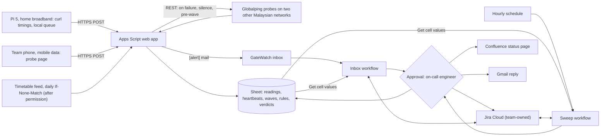

# GateWatch

GateWatch checks APU's student-facing sign-in and portal hosts from outside campus, from three vantages: a Raspberry Pi 5 on a teammate's home broadband, a team phone on mobile data, and Globalping's public probes on other Malaysian networks. It adds checks before class-start waves in APU's public timetable and tells APU's IT Helpdesk (ITSM) whether a failure is local to one network or seen from all three. Its distinct job is repair acceptance: before a portal ticket is resolved, a Gemini Enterprise workflow re-runs the same checks under comparable class-wave load and returns recovered, retest needed, or unknown, and an engineer approves every write. It is proposed for ITSM and the [Centre of Technology and Innovation](https://cti.my/) (CTI), which built APSpace, in the [Intelligent Automation & Digital Transformation](/docs/BRIEF.md#challenge-tracks) track. Caveat: nothing is built, nobody at APU has agreed to anything, and APU's portals may not fail between 5 and 14 November, so the ticket and acceptance loop may only ever run on reviewer-filed claims. **Inference** marks conclusions no source states.

Contents:

1.  [At a glance](#at-a-glance)
1.  [Origins](#origins)
1.  [Problem and evidence](#problem-and-evidence)
1.  [How it works](#how-it-works)
    1.  [Signal to cloud path](#signal-to-cloud-path)
    1.  [Workflows](#workflows)
    1.  [Rule set](#rule-set)
    1.  [States and failure handling](#states-and-failure-handling)
    1.  [Connectors and platform check](#connectors-and-platform-check)
    1.  [Cloud, IoT and network](#cloud-iot-and-network)
    1.  [Real data and privacy](#real-data-and-privacy)
1.  [Why people will use it](#why-people-will-use-it)
1.  [Why the crowd won't build it](#why-the-crowd-wont-build-it)
1.  [Off-campus fit](#off-campus-fit)
1.  [Scores](#scores)
1.  [Research plan](#research-plan)
1.  [Time to impact](#time-to-impact)
1.  [Demo and review](#demo-and-review)
1.  [Build plan](#build-plan)
1.  [Risks and kill criteria](#risks-and-kill-criteria)
1.  [Not verified](#not-verified)
1.  [See also](#see-also)

## At a glance

| Field                 | GateWatch                                                                                                                                                                                                                                        |
| --------------------- | ------------------------------------------------------------------------------------------------------------------------------------------------------------------------------------------------------------------------------------------------ |
| Owner                 | Proposed: ITSM, which runs the Virtual Help Centre and the "Is is down right now?" FAQ, with CTI as IT owner of APSpace. Unconfirmed; nobody at APU acts this week, so a named team steward approves until ITSM agrees                           |
| First users           | ITSM's on-call engineer, who approves notices and closures; students who email a portal fault and get a verdict back                                                                                                                             |
| Track                 | Intelligent Automation & Digital Transformation                                                                                                                                                                                                  |
| Trigger               | An hourly Schedule (cron, Malaysia time) sweeps every endpoint and open ticket; a Gmail "When an email is received" trigger takes vantage fault alerts, students' reports, and fix notices                                                       |
| Live signal           | Pi 5 and phone time seven APU endpoints every 10 minutes (DNS, TCP, TLS, first byte, total, status); Globalping HTTP tests from two other Malaysian networks on any failure and before each wave; timetable start counts daily, after permission |
| Connectors            | 1P Drive and Sheets (GA: live cell reads and writes), 1P Gmail (GA: trigger, send); 3P Jira Cloud (GA: search, create, attach, comment, status), 3P Confluence Cloud (GA: update page). No MCP on the critical path                              |
| Decision              | Per endpoint and window: healthy, local to one vantage, wide (all three vantages), or unknown. Per ticket: recovered, retest needed, or unknown under the comparability rule                                                                     |
| Action and approval   | One **Approval** step before any write: the Jira issue with the three-vantage table, the status page, and the reply. Closing a ticket needs a second approval with the before-and-after table                                                    |
| Reviewer self-trigger | Email the inbox "CAS failed at 08:20 today" or "Moodle fixed at 10:00" and get a verdict from live readings; or open the probe page on your own phone and turn on airplane mode: one vantage fails, and no ticket forms                          |

## Origins

- **[GateWatch](/docs/ideas/argon/02/04-gatewatch.md), the lead:** **Kept** the name, the three off-campus vantages, the seven endpoints and timing fields, the `HEAD` check on the S3 feed, the daily `If-None-Match` feed read, the local-versus-wide labels that never name a server cause, the repair-acceptance re-run, the Approval step, failure with no fallback, and the lecturer-field drop. **Changed** ingest from Cloud Run, Pub/Sub, and a BigQuery subscription, which need a billing card the team lacks ([Cloud](/docs/CONTEXT.md#cloud)), to Pi and phone → Apps Script → Sheet. Globalping on-demand tests moved from the Globalping MCP server (preview, blocked by default by an organisation policy) to the feeder calling Globalping's REST API (the lead's fallback had the Pi call it), so a silent Pi still triggers outside checks. The Drive-file event trigger became a Gmail alert, so one inbox workflow serves alerts and people. The request budget counted only the Pi; with the phone it is 12 an hour per endpoint, not 6. The timetable join now waits for written permission. The lead said the S3 feed sends `Access-Control-Allow-Origin: *`; that holds for `GET` ([feed endpoints]), but a `HEAD` with an `Origin` header got none on 5 November, so the phone records only completion and time for it. The 3- and 6-month lines are now dated, and ITSM's closure rule is ITSM's own decision. **Dropped** SharePoint and Outlook writes, because a team-owned tenant needs the Microsoft 365 Developer Program, closed to students without a Visual Studio subscription ([free sandboxes](/docs/research/gemini-enterprise.md#free-sandboxes)); BigQuery federated query (preview, card); MQTT; the Globalping data store from the critical path (now an add-on); ITSM's 725 and 621 page counts, which nothing here uses; and S1–S3 as evidence, because they are Wi-Fi complaints GateWatch doesn't measure.
- **[Recheck](/docs/ideas/astra/01/01-recheck.md):** **Kept** the comparability rule (same endpoint, same device or vantage, comparable time and load), the "retest needed" and "unknown" states, sparse evidence staying "retest needed", the reporter's task confirmation before a fix is accepted, the heartbeat rule that a silent collector blocks recovery, the create-once Jira rule where a second create never poses as an update, and the honesty that HTTPS elapsed time measures application reachability, not RF strength or packet loss. **Changed** the retest from a team phone at the reported APU spot to the same three off-campus vantages, and the IT reviewer to ITSM's on-call engineer, played by the steward. **Dropped** retests at campus locations (they need campus presence; see [Off-campus fit](#off-campus-fit)), its score, the 25% review-time target (no baseline exists), the 60-person-hour and RM0–RM30 budget (the team is three, with no card), the 30-minute batch cadence (now 10-minute cycles and an hourly sweep), and its 4 November kill gate, now past.
- **[SpineDesk Pulse](/docs/ideas/argon/01/01-spinedesk-pulse.md):** **Kept** APU's SLA clause that in-session teaching problems are urgent, re-read live, the in-session tag from the timetable, the editable rulebook Sheet, folding repeat reports into one open issue, APU's ticket-status definitions, a hand-picked ITSM KB link per endpoint (only after written permission), and the lectern QR browser probe as a later campus extension. **Changed** the subject from classroom Wi-Fi to portal reachability, which can be measured from off campus. **Dropped** ServiceNow, SharePoint, Calendar dispatch, the custom MCP server (preview, blocked by default, needs a card), Globalping as a critical-path connector, the 45-item set collected on campus, its 90% recall and 85% precision targets, the 10-second probe and jitter thresholds, TechCentre interviews, the score, and the November 2026 and March 2027 intake dates, which no research doc confirms.

## Problem and evidence

- **APSpace's users report access failures:** of the 119 newest Google Play reviews (2018 to 2 November 2026), 17 mention login, crashes, loading, or errors, 18 attendance, and 15 the timetable; a 2 November review says frequent re-login is annoying "when i have to take attendance, check timetable last minute" ([APSpace reviews]). A Google Maps reviewer wrote "Moodle and APspace constantly crashing. Need for better/New servers." (2 stars, 18 June 2026) ([core platforms](/docs/research/social.md#wi-fi-power-and-core-platforms)).
- **ITSM's answer to "is it down?" is stale:** the first FAQ on the [ITSM overview](https://apiit.atlassian.net/wiki/spaces/ITSM/overview) is "Is is down right now?", asking "Do you have any doubt if a service is a widescale issue that is acknowledged by the technical team?" It links [Availability of Services](https://apiit.atlassian.net/wiki/spaces/ITSM/pages/2810216477), which says "This page is work in progress", lists only software licences and VirtualLab@APU, and was last edited on 6 February 2025 (read through Confluence's REST API, 5 November 2026). `status.apu.edu.my` doesn't resolve (DNS lookup, 5 November).
- **Closure follows status, not a re-test:** DONE means "Your issue has been solved by support staff and is waiting for your satisfaction feedback", and CLOSED that the ticket "has been automatically closed due to inactivity of (2) two days" ([ticket status](https://apiit.atlassian.net/wiki/spaces/ITSM/pages/1530527755)). **Inference:** no published step re-checks the original failure before closure.
- **In-session faults are urgent under APU's SLA:** urgent requests include "Classroom teaching and learning (during session) including Wi-Fi connection, A/V, and streaming issues", "responded immediately" in office hours (8:30 AM to 6:00 PM, Monday to Friday); other requests get a first response within 24 hours and resolution within 48 ([SLA], version 3, 26 January 2021). **Inference:** a CAS or Moodle failure that blocks attendance mid-class may fall under that clause; ITSM decides.
- **Attendance depends on sign-in:** APSpace's 2023 public source signs AttendiX attendance requests with a CAS ticket for the service `https://api.apiit.edu.my/attendix` ([AttendiX client](https://github.com/ctiteam/apspace/blob/master/src/app/graphql.module.ts)). Sign-in runs on CAS at `cas.apiit.edu.my` and Microsoft single sign-on, Moodle on `lms2.apiit.edu.my`, and the Koha catalogue on `opac.apu.edu.my` ([Systems APU runs]).
- **Class starts cluster:** from 09:00 to 17:00 on weekdays in the week of 2 November, a mean of 107 of 222 physical rooms held a class in each 15-minute slot (range 5 to 159) ([row counts](/docs/research/apu.md#timetable-row-counts)). The feed is a 1.1 MB file on Amazon S3 with no CDN in front; `api.apiit.edu.my` is Amazon API Gateway behind CloudFront, its replies cache misses ([feed endpoints], [feed users](/docs/research/apu.md#who-already-uses-the-timetable-feed)). 10–13 November hold 309 to 390 sessions a day, and 8–9 November none ([feed measurements](/docs/research/apu.md#apspace-timetable-feed-measurements)).
- **Repair acceptance is a hypothesis:** a property manager's washer and lift fail again after a vendor finds no fault ([S10](/docs/research/social.md#s10-a-repair-vendor-cannot-reproduce-a-recurring-fault)), a non-APU analogue. S1's close read infers the need to repeat endpoint tests before and after a fix, and says the source "does not establish that IT closes tickets prematurely" ([S1]).
- **Counterevidence:** 23 APU searches on X returned 550 posts and no first-hand 2025–2026 complaint about APSpace, Moodle, or Wi-Fi ([APU on X](/docs/research/social.md#apus-footprint-on-x)); all seven endpoints answered `200` on 5 November; no public record of APU portal outages exists, so how often they fail is unknown. The strongest APU complaints are about Wi-Fi ([S1]), which GateWatch doesn't measure.

[S1]: /docs/research/social.md#s1-apu-wi-fi-loss-has-specific-locations

## How it works

### Signal to cloud path

1.  **Pi 5 (unattended):** a systemd timer every 10 minutes, and again 15 minutes before each class-start wave (wave times from the feeder), sends one unauthenticated request to each of `open-ws/weektimetable` (a `HEAD`), `transix-v2/holiday/active`, `transix-v2/locations`, `sso.apu.edu.my`, `cas.apiit.edu.my`, `lms2.apiit.edu.my`, and `opac.apu.edu.my`, using public URLs from [feed endpoints] and [Systems APU runs]. It logs DNS lookup, TCP connect, TLS handshake, time to first byte, total time, HTTP status, and `x-cache`, queues each reading on disk, and POSTs it with its device time; a failed POST stays queued and flushes on reconnect.
2.  **Globalping (on demand):** when a vantage reports a failure or slowdown or goes silent (at most once per endpoint per 30 minutes), and 15 minutes before each wave, the feeder asks Globalping's REST API for one HTTP test of that endpoint from each of two Malaysian probes on networks other than the Pi's, chosen by ASN, and stores the results with their measurement IDs. On 5 November at 07:24 MYT the probe list showed 45 probes in Malaysia, 19 tagged as eyeball networks, including TM, Binariang, U Mobile, and DiGi ([Globalping probes](https://api.globalping.io/v1/probes)). Free use is 250 tests an hour without an account and 500 with one ([Globalping credits](https://globalping.io/credits)); the team uses an account token.
3.  **Phone (unattended while in front):** a probe page on GitHub Pages, on a team phone on mobile data with Wi-Fi off, on a charger, with a wake lock, times the same seven URLs every 10 minutes and, like the Pi, queues readings it can't send. Of the seven URLs as probed, only `api.apiit.edu.my` returned `Access-Control-Allow-Origin: *` on 5 November, so for the other hosts the phone records total time and whether the request completed, not the status. A page only reports while it is visible ([pages left running](/docs/research/iot-and-network.md#web-pages-and-pwas-left-running)).
4.  **Feeder:** the Apps Script `doPost` stamps receipt time beside device time and appends the row to a Sheet in the licensed Workspace domain ([Sheets path](/docs/research/gemini-enterprise.md#phone-or-board-to-google-sheets)). After written permission, a daily time trigger reads the timetable with `If-None-Match` ([change behaviour](/docs/research/apu.md#timetable-feed-change-behaviour)), drops lecturer fields in memory, and keeps only physical session starts per 15-minute slot. When a vantage fails, the script mails the GateWatch inbox a `[alert]`, at most once per endpoint per 30 minutes.

### Workflows

1.  **Sweep (Schedule, hourly 07:00–22:00 MYT):** a Gemini Agent step reads the rule Sheet, the last hour's labelled cycles, heartbeats, the next wave's session count, and open GateWatch issues in Jira through Search For Data. It decides whether a wide fault needs a new issue or a comment on the open one, advances each acceptance watch, and drafts one daily vantage-health line ("phone silent since 14:20"). Scheduled runs can start up to 5 minutes late and need a multi-region location ([Workflow Builder limits](https://docs.cloud.google.com/gemini/enterprise/docs/workflow-builder/quotas-and-limits)).
2.  **Inbox (Gmail "When an email is received"):** takes `[alert]` mails, students' free-text reports ("couldn't take attendance at 8:25"), and fix notices. The agent maps the text to an endpoint and window (attendance maps to CAS), attaches the three-vantage rows for that window, and drafts the reply, the issue or comment, and the status-page line. Event triggers poll every 5–10 minutes, and there is no webhook trigger ([triggers](/docs/research/gemini-enterprise.md#triggers-and-schedules)).
3.  **Approve and write:** an **Approval** step pauses at **Needs Review** with the table, the wave's session count, and the proposed writes; connector writes from a workflow agent step need human review anyway ([unattended runs]). On approval: Jira Create issue, Upload attachment, or Create comment; Confluence Update page; Gmail send; and the verdict row through Update cell values.
4.  **Accept a repair:** when an issue reaches "Fix reported" (the engineer's status, or a fix email), the sweep compares the same checks from the same vantages at the next comparable waves. When the evidence holds, it asks the reporter by email whether the task works now, then drafts Change issue status to Resolved with the before-and-after table for a second approval.

### Rule set

The rules sit in a versioned `GateWatch_Rules` Sheet that ITSM can edit; the values below are starting values, not findings. Apps Script computes per-cycle labels deterministically; the agent applies the rules across cycles, reads free text, and words the verdict.

- **Fail and slow:** a check fails on an error, a status outside 200–399, or no answer within 10 seconds; it is slow when total time exceeds three times that vantage's median for the endpoint and hour over the last 3 days, for two cycles running.
- **Local:** one vantage fails or slows while the other two pass in the same 10-minute slot. Never a ticket; it goes in the health line.
- **Wide:** the Pi, the phone, and Globalping probes on two different networks all fail or slow on the same endpoint within one slot. Count networks, not probes. Wide is "seen from all three vantages", never a named server cause.
- **Class-start wave:** a 15-minute slot whose physical session starts fall in the top quarter of that weekday's slots. A wide fault within 30 minutes before a wave, in office hours, is tagged "before a wave: may be urgent under the SLA", leaving the call to ITSM. Without feed permission, there is no wave tag and the checks run on the fixed 10-minute cadence.
- **Comparable recovery:** after a fix time, "recovered" needs three later pre-wave windows with at least as many session starts as the failing window (or the same weekday and hour without the feed), all three vantages fresh, every check passing, and the reporter's confirmation where a reporter exists. Anything less stays "retest needed", however long it takes.
- **One issue per endpoint:** before any create, a JQL search finds the open issue for that endpoint; a new report becomes a comment on it. If Create comment fails in the action test, the steward comments by hand, and a second create never stands in for an update.
- **KB link (after permission only):** each endpoint row may carry one hand-picked public ITSM article, such as CAS or APKey help, linked in the reply. No KB text is ingested.

### States and failure handling

- **Endpoint labels:** healthy, local, wide, or unknown per slot. **Tickets:** reported → evidence attached → **Needs Review** → open → fix reported → retest needed → recovery evidence ready → **Needs Review** → resolved. A failed retest returns to retest needed.
- **Unknown blocks everything:** a vantage silent for two cycles, a Globalping error, a failed Sheet read, or a stale row (receipt time more than 20 minutes old) makes that slot unknown. Unknown never yields healthy, local, or recovered, and a slot missing a vantage proposes no ticket.
- **Loud failure:** every failed source writes an error row with time and HTTP status, shown in the run and the approval card. There is no cached reading, earlier value, or default. A failed feed fetch makes the wave tag "unknown (fetch failed at 06:00, 503)", not last week's waves.
- **Platform failures:** event runs that fail with `RESOURCE_EXHAUSTED` aren't retried, so the hourly sweep re-reads unanswered mail. Schedules pause unless the author refreshes credentials every 14 days ([unattended runs]).

### Connectors and platform check

| Connector               | Stage and type          | Job in GateWatch                                                                   | Platform check                                                                             |
| ----------------------- | ----------------------- | ---------------------------------------------------------------------------------- | ------------------------------------------------------------------------------------------ |
| Google Drive and Sheets | 1P, GA                  | Get cell values on readings, rules, and waves; Update cell values on verdict rows  | Workspace domain only; consumer accounts get `403` ([account limits])                      |
| Gmail                   | 1P, GA                  | Inbox trigger; approved replies, reporter questions, duty notices                  | Workspace only; the feeder mails from another account in the domain, so "received" fires   |
| Jira Cloud              | 3P, GA                  | Search open issues; Create issue, Upload attachment, Create comment, Change status | Team-owned Jira Cloud Free, 10 users; comment and status are listed but unproven ([F1–F5]) |
| Confluence Cloud        | 3P, GA                  | Update page: a public status page modelled on ITSM's Availability of Services      | Team-owned Confluence Free; APU's own site needs its admin rights ([source routes])        |
| Globalping data store   | 3P, preview, **add-on** | Lets the engineer search the team's measurements by ID in chat                     | Read-only; nothing on the critical path reads it ([Globalping connector])                  |
| Custom MCP              | Preview, **not used**   | None                                                                               | Blocked by default; only an Organization Policy Administrator can lift it ([custom MCP])   |

Write actions are taken from [actions](/docs/research/gemini-enterprise.md#actions-and-write-back). The action inventory on day one runs each action once; anything that fails is cut, and the README says so.

[account limits]: /docs/research/gemini-enterprise.md#edition-and-account-limits
[source routes]: /docs/research/apu.md#how-each-source-reaches-an-agent
[Globalping connector]: /docs/research/gemini-enterprise.md#network-measurements-through-globalping
[custom MCP]: /docs/research/gemini-enterprise.md#requirements-and-registration

### Cloud, IoT and network

- **Cloud:** Apps Script and a Sheet in the licensed domain, two Gemini Enterprise workflows, team-owned Jira and Confluence, and GitHub Pages; no card, Cloud Run, Pub/Sub, or BigQuery.
- **IoT:** the Pi 5 is the unattended probe; the phone is a second probe on a different network. Optionally the Pi also hosts a Globalping probe, which earns 150 credits a day; the rules allow one probe per public IPv4 address ([Pi as probe](/docs/research/iot-and-network.md#globalping-probe)).
- **Network, per reading:** DNS, TCP, TLS, and first-byte times show where a slow request stalls; device-to-receipt delay shows each hop; and an unplugged Pi's queued rows arrive late with their own timestamps ([offline links](/docs/research/iot-and-network.md#offline-and-intermittent-links)).
- **Honest limits:** these are external HTTPS timings. They say whether APU's public endpoints answer from outside, and how fast. They don't measure campus Wi-Fi, RF strength, or packet loss, and a `200` on CAS's page doesn't prove sign-in works, because GateWatch never logs in.

### Real data and privacy

- **Real readings only:** every row is a real request from a team device or a real Globalping measurement. Reviewer tests and airplane-mode tests are real readings of real failures, labelled `test` and kept out of the scored set.
- **Polite load:** the Pi and phone each send 6 requests an hour per endpoint, 12 together and 24 on `api.apiit.edu.my`, which serves two of the seven; Globalping adds at most 2 per endpoint per wave and 4 per failure (2 for triage, 2 for labelling). GateWatch never logs in, never calls AttendiX or staff-keyed paths, and the feed is fetched in full only once a day.
- **Personal data:** readings hold no personal data. The feed's `NAME`, `SAMACCOUNTNAME`, and `LECTID` are dropped in memory ([personal data](/docs/research/apu.md#personal-data-in-the-timetable-feed)). Report mails keep only the endpoint, the window, and the thread for the reply, and are deleted after 30 days.

## Why people will use it

- **It answers the question ITSM already publishes:** the FAQ asks whether a problem is "a widescale issue", and GateWatch's public status page answers per endpoint, from three networks, with times. **Inference:** students can tell "my network" from "APU's host" without filing a ticket.
- **It works in channels ITSM already uses:** ITSM takes mail at `assist@apu.edu.my` ([SLA]) and runs its Virtual Help Centre on Jira Service Management ([Systems APU runs]); GateWatch writes a Jira issue and an email, not a new app.
- **Fewer false alarms reach the desk:** a local failure on one line never becomes a ticket, and an engineer sees a wide fault with the next wave's session count beside it.
- **Closure carries evidence:** a "Resolved" comes with the before-and-after table and the reporter's confirmation instead of the two-day inactivity close.
- **What is missing:** no cited workaround shows students or ITSM spending effort on portal-outage checks today; the evidence is complaints and an abandoned page. **Inference:** students' stated workaround for bad campus Wi-Fi, their own mobile data ([campus Wi-Fi](/docs/research/social.md#campus-wi-fi-and-network-filtering)), is a second vantage by hand, but that is about Wi-Fi, not portals.

## Why the crowd won't build it

- **The crowd builds inside the building:** "Wi-Fi and network diagnosis or capacity" averages 8.7% of 780 simulated ideas (16.0% of Claude's), on access-point telemetry with an auto-filed ticket, and fault-to-ticket adds 7.6%; both are saturated ([clusters](/docs/research/competition.md#clusters-and-shares), [tiers](/docs/research/competition.md#saturation-tiers)). **Inference:** none of APU's public sources is access-point data, so off-campus entries in that cluster would need simulated readings; "simulate", "mock", "synthetic", or "dummy" appears in 98% of Claude's responses ([crowd misses]).
- **Few name the stack or the owner:** 2 of 780 ideas name Jira, ServiceNow, SharePoint, OneDrive, Salesforce, SAP, or MCP, 1% combine an unattended run, a named owner, and a measured baseline, and APSpace appears in 3 ([crowd misses]).
- **Incumbents already monitor reachability:** [Uptime Kuma](https://github.com/louislam/uptime-kuma) is self-hosted, checks at 20-second intervals, and alerts through 90+ notification services with status pages. [Pingdom](https://www.pingdom.com/product/uptime-monitoring/) checks from "over 100+ servers worldwide", performs "a second check on every incident" before alerting, and offers root cause analysis and public status pages. NetBeez sells client-perspective sensors to universities, and Atlassian automates incidents and reopens closed alerts ([substitutes](/docs/research/competition.md#substitutes-for-the-campus-service-shortlist)).
- **What is left:** neither monitor's page describes timing checks to a university timetable's class-start waves, or holding a helpdesk ticket open until the original failing check passes under comparable load. Absence from a page doesn't prove absence from the product. If ITSM already runs a monitor with history, GateWatch should run the acceptance rule on that data instead (a kill criterion).
- **Conceded:** this sits next to the IT-helpdesk network watch, and reviewers may file it there. The pitch opens on the acceptance verdict and the refusal to call one line's failure an outage, never on a dashboard of `200`s.

[crowd misses]: /docs/research/competition.md#what-the-crowd-structurally-misses

## Off-campus fit

**Passes.** The critical path needs nobody at APU, no APU staff action, and only the team's own devices: the Pi 5 at a teammate's home, one team phone on mobile data, Globalping's public probes, a free Globalping account, Jira Cloud Free and Confluence Free sites the team owns, and Apps Script with a Sheet in the licensed domain. The steward plays ITSM's approver until ITSM agrees. The one outside dependency is written permission: the timetable join waits for it, and probing continues unless the organisers refuse ([terms]).

What needs campus presence, and isn't built: Recheck's same-spot phone retests and SpineDesk's lectern QR probe for in-room Wi-Fi tickets. Both need a phone at the reported APU location and ITSM's consent. They are the campus extension in [Time to impact](#time-to-impact), not part of this build.

## Scores

**61.3 / 100, rank 11 of 18** in the [cross-set ranking](/docs/ideas/00-ranking.md); it passes every gate, with G3 conditional. Scored on 5 November 2026 on the [matrix](/docs/ideas/00-ranking.md#scoring-matrix) by three independent scorers who read this doc and checked its claims: an NTT DATA forward deployed engineer (FDE), an APU School of Technology IoT lecturer, and a Google Cloud advocate who is also an APU student. Models: FDE (Claude Fable 5.1), Lecturer (Claude Opus 5.5), Advocate (Claude Sonnet 5.5). Day-to-day workflow and theme take the lowest score; the rest take the mean.

| Component           | Weight | FDE | Lecturer | Advocate | Used | Lowest scorer's reason                                                                                                                                                                                                                                                                                       |
| ------------------- | -----: | --: | -------: | -------: | ---: | ------------------------------------------------------------------------------------------------------------------------------------------------------------------------------------------------------------------------------------------------------------------------------------------------------------ |
| Impact              |     13 |   2 |        2 |        2 |    2 | ITSM and CTI are proposed but uncontacted, no public outage history exists, all seven endpoints answered 200 when I probed them, and the doc itself says the most likely outcome is no wide fault, so no office-level volume or baseline is measurable this week.                                            |
| Connectors          |     13 |   4 |        5 |        4 | 4.33 | Drive/Sheets live read and write, Gmail trigger and send, and Jira search/create/attach/comment/status are GA with real jobs (checked in gemini-enterprise.md); Confluence 'Update page' is not listed in the research doc and Globalping is reached by REST in the feeder, not a connector.                 |
| Day-to-day workflow |     13 |   4 |        5 |        4 |    4 | An hourly cron sweep plus a Gmail inbox trigger, a versioned rules Sheet, 'unknown blocks recovery', RESOURCE_EXHAUSTED re-reads, credential refresh and an Approval before every write is a genuinely unattended loop that recurs whether or not anyone reports.                                            |
| Research            |     13 |   3 |        3 |        3 |    3 | The stale 'Is is down right now?' page (last edited 6 Feb 2025, confirmed), the SLA clause and the two-day auto-close are checked APU facts, but 23 X queries found no first-hand APSpace complaint, the office baseline is unreachable, and fewer than 30 non-healthy windows is the doc's own expectation. |
| Time to impact      |     13 |   3 |        4 |        3 | 3.33 | A status page and verdict replies run from 11 November and the 3- and 6-month lines are dated with proposed owners, but anything beyond a public page needs ITSM's written agreement and its Jira site's admin consent.                                                                                      |
| Theme               |     10 |   3 |        4 |        3 |    3 | Per-reading DNS, TCP, TLS and first-byte times from the Pi and a phone on a second network, plus Globalping probes, make the network the most visible of the eight, but the devices sense only HTTP reachability, not the world.                                                                             |
| Originality         |      9 |   2 |        2 |        2 |    2 | The doc concedes it sits beside the IT-helpdesk network watch (8.7% network diagnosis plus 7.6% fault-to-ticket, both saturated) and Pingdom already does a second check on every incident (confirmed live); the acceptance rule is the only distinct part.                                                  |
| Real use            |      6 |   2 |        2 |        2 |    2 | The doc states no cited workaround shows students or ITSM spending effort on portal-outage checks today; the mobile-data workaround is about Wi-Fi.                                                                                                                                                          |
| Buildability        |      5 |   3 |        3 |        2 | 2.67 | Pi timer, phone probe page, Globalping calls, Apps Script feeder, two workflows, Jira and Confluence is a lot of parts.                                                                                                                                                                                      |
| Demo                |      5 |   4 |        3 |        3 | 3.33 | A reviewer can email a claim or put a phone in airplane mode to get 'local, no ticket'. But the headline repair-acceptance verdict needs a real APU outage that probably won't happen.                                                                                                                       |

- **Gates:** G1 pass (3 pass, 0 conditional, 0 fail); G2 pass (3 pass, 0 conditional, 0 fail); G3 conditional (2 pass, 1 conditional, 0 fail); G4 pass (3 pass, 0 conditional, 0 fail).
- **Off-campus gate, per the lowest scorer:** Home Pi, a phone on mobile data, public Globalping probes and free accounts suffice; campus-only retests are explicitly excluded, and nothing needs APU staff beyond a permission request that is not awaited.
- **What would help most, per the lowest scorer:** Drop the dashboard framing and prove one real recovered-versus-retest verdict on a labelled claim, since the acceptance rule is the only thing the crowd and Uptime Kuma lack.

## Research plan

- **Round 1, students (5–6 November, video calls):** 6–8 APU students reached through teammates' own networks, none of them staff. The question: "Think of the last time APSpace, Moodle, or sign-in failed right before a class or attendance. What did you do in the first five minutes, how did you find out whether it was you or APU, and did you report it?" Label quotes by role and keep consent records out of the repo ([consent](/docs/research/judging.md#consent-and-anonymised-quotes)).
- **Round 2 (8–9 November):** show the same students a real verdict email and the status page; record what they would trust and what changed in the README.
- **Office questions, not counted as interviews:** on 5 November, email `assist@apu.edu.my` and CTI three written questions: whether ITSM runs an external monitor, how a portal ticket is closed, and who is on call. Report replies or the lack of them; nobody at APU is expected to act this week.
- **Scored items:** 30–50 real 10-minute windows from 5–9 November: every window where at least one vantage failed or slowed, plus matched healthy windows (same endpoint, same hour, another day). Two teammates label each window healthy, local, or wide, blind to the verdict, from evidence the triage doesn't use: Globalping probes on two further Malaysian networks, requested by a separate script only for windows where a vantage failed. Report precision and recall for "wide" and "local", the confusion matrix, n, and a Wilson 95% interval, and score a rule-only Sheet formula on the same set ([accuracy](/docs/research/judging.md#measuring-an-agents-accuracy-honestly)). If fewer than 30 non-healthy windows occur, report the real n.
- **Timed observation:** two teammates take 10 real windows each and decide local or wide from the raw rows by hand, then from GateWatch's label; record seconds and errors. This times the team's task, not ITSM's; there is no reachable office baseline this week.

## Time to impact

- **First value, from 11 November:** the public status page and verdict replies run unattended on the team's devices, with no APU system changed.
- **By 3 months (5 February 2027):** ITSM's duty lead approves notices and closures in office hours; approved notices go to `assist@apu.edu.my` with a link to the team-owned issue; CTI adds endpoints it cares about to the rule Sheet. **Measured:** wide faults per week, local faults kept off the desk, minutes from first failed cycle to approved notice, the share of resolved tickets with full comparable evidence, and the precision of "wide" against ITSM's own records.
- **By 6 months (5 May 2027):** ITSM decides whether portal tickets in its own Virtual Help Centre wait for a "recovered" verdict, and whether to connect that site, which needs its admin consent. With ITSM's consent and someone on campus, the campus extension adds same-spot phone retests and lectern QR probes for in-session Wi-Fi tickets under the SLA. **Measured:** recurrences caught after "fix reported", and the reopen rate on portal tickets.
- **Owners:** interim, the team steward (B1), who refreshes credentials every 14 days; proposed business owner, ITSM's duty lead; proposed IT owner, CTI ([owners](/docs/research/judging.md#owners-and-what-has-to-be-true)).
- **Assumptions:** ITSM and CTI agree in writing; the organisers grant written permission for the feed and the probes; Gemini Enterprise seats continue after the event; the home Pi and phone stay powered; Globalping keeps at least two Malaysian networks online.

## Demo and review

| Time      | Beat                  | On screen                                                                                                                         |
| --------- | --------------------- | --------------------------------------------------------------------------------------------------------------------------------- |
| 0:00–0:10 | Slate                 | "Recorded from the live system", with the capture date                                                                            |
| 0:10–0:35 | Problem               | "Is is down right now?" and the page last edited 6 February 2025; the two-day inactivity close                                    |
| 0:35–1:15 | Three vantages, live  | Sheet rows from the Pi, the phone, and Globalping with DNS, TLS, and first-byte times, device-to-receipt delay, the next wave     |
| 1:15–1:45 | One line is not APU   | The Pi's Ethernet pulled on camera: the slot reads unknown; queued failures land on reconnect, and it becomes local, no ticket    |
| 1:45–2:25 | A report, end to end  | A real report email; the Runs tab reading Sheets and Jira; Approval; the issue, status page, and reply                            |
| 2:25–3:00 | Fixed means re-tested | Fix notice → retest needed → comparable windows → evidence ready → approve Resolved; "untested on a real outage" if none occurred |
| 3:00–3:30 | Impact and research   | Precision and recall with n and interval, agent against rule-only, timed observation, what students said                          |
| 3:30–3:45 | Close                 | 3- and 6-month owners; repo, app, and video links; the capture date again                                                         |

- **Reviewer, by email:** send "CAS failed at 08:20 today" or "Moodle fixed at 10:00" to the inbox. The run attaches that window's real rows and replies once the steward approves; the team watches **Needs Review** from 8 AM to midnight MYT during 11–14 November. Claims from reviewers are labelled `test`.
- **Reviewer, by phone:** open the probe page as vantage "reviewer" and turn on airplane mode for two cycles. The slot reads unknown while the phone is silent; when its queued failures land, the other vantages have passed, and the probe page's status panel, served by the feeder, shows "local, no ticket".
- **Reviewer, in the app:** with a seat and the workflow shared, type `@GateWatch` with an endpoint and window. Shared users see only their own runs, so the README and video show the owner's Runs tab over several days ([reviewer access](/docs/research/gemini-enterprise.md#reviewer-access)).
- **Conceded:** a reviewer can't make an APU portal fail. If no wide fault occurs, the video says so, and the ticket path is shown on labelled claims.

## Build plan

Three builders: **B1** (workflows, Jira, Confluence, steward), **B2** (Pi timer, Globalping calls, Apps Script feeder), **B3** (phone page, research, labelling, video).

| Day        | Build, critical path first                                                                                                          | Research and operations                                                                    | Done when                                                    |
| ---------- | ----------------------------------------------------------------------------------------------------------------------------------- | ------------------------------------------------------------------------------------------ | ------------------------------------------------------------ |
| Thu 5 Nov  | B2: Pi timer, on-disk queue, `doPost` feeder, error rows. B3: phone page. B1: Jira Cloud Free and Confluence Free sites, rule Sheet | Ask the organisers in `#help-desk` for written permission; office emails; recruit students | Pi and phone rows land every 10 minutes with both timestamps |
| Fri 6 Nov  | B2: Globalping REST calls and `[alert]` mail. B1: action inventory once the licence lands; Sweep workflow on                        | Round 1 calls                                                                              | Each action ran once; the Runs tab shows hourly sweeps       |
| Sat 7 Nov  | B1: Inbox workflow, Approval, dedup, acceptance rule. B2: feed join if permitted                                                    | Round 1 ends; start labelling windows                                                      | A report email gets an approved reply and a Jira issue       |
| Sun 8 Nov  | B3: label and score windows; agent against rule-only; tune the rule Sheet                                                           | Deepavali, remote; confirm every member's registration by noon                             | Precision and recall written down with n                     |
| Mon 9 Nov  | Feature freeze; record the video; reviewer access from a non-team account                                                           | Round 2 calls; timed observation                                                           | A non-team email gets a verdict                              |
| Tue 10 Nov | README, deck, diagram, and what Antigravity built; refresh credentials (valid to 24 November); submit                               | Final vantage-health check                                                                 | Submitted before noon                                        |

**Cut line, in order:** the Globalping data store add-on, the KB link, the Confluence status page. **Never cut:** the three vantages, unknown blocking recovery, the one Approval, and loud errors.

## Risks and kill criteria

- **Permission (5–7 November):** if the organisers refuse probing, stop: GateWatch has no subject without APU's endpoints. If they don't answer, run the fixed cadence without the feed join and state in the README that permission is pending.
- **Action inventory (day the licence lands):** if Sheets Get cell values or Jira Create issue fails, or the licence sits on a consumer account, stop building workflows on that path; never fake the store.
- **No real wide fault:** the most likely outcome in a quiet week. Report it plainly, score the triage on local and slow windows, and label every ticket a test.
- **Agent no better than rules (8 November):** ship the rule-only labels and keep the agent for reading reports, dedup, and wording.
- **ITSM already monitors:** if a reply shows ITSM runs an external monitor with history, drop the probes and run the acceptance rule on its data, or stop.
- **Home devices:** a power cut or ISP drop at the Pi's home is a real local event, so it reads silent and unknown, never healthy. Freeze OS updates from 10 to 14 November, and keep the phone page in front on a charger ([home deployments](/docs/research/iot-and-network.md#what-kills-home-deployments)).
- **Globalping drift:** probes are volunteer-hosted and come and go; a slot without two other networks is unknown.
- **Platform limits:** about 16 sweeps plus inbox runs a day against 160 queries per Standard seat. One run may use more than one query, so measure over ten runs ([limits](/docs/research/gemini-enterprise.md#limits-that-bite-in-a-one-week-build)). Every write waits in **Needs Review**.
- **Terms:** APU's Terms of Use reserve copyright and ask permission before "use of this Website or any of the Contents" ([terms]); GateWatch republishes nothing and keeps only timings and session counts.

## Not verified

- Whether Jira Create comment and Change issue status work from a workflow in the team's app; the research lists them, but the platform check treats them as unproven ([F1–F5]).
- Whether a mail sent by the feeder's account fires the inbox's "When an email is received" trigger.
- Whether Globalping's Malaysian probes reach APU hosts as the Pi does, and whether the home line sits behind carrier-grade NAT that would refuse an adopted probe.
- How often APU's portals fail; no public outage history exists.
- The 119 Play reviews and their counts, taken from [APSpace reviews], not recounted.
- Whether ITSM already runs an external monitor, and who is on call.
- Mobile-data cost and battery of a phone page left running for days.
- Pingdom's probe locations in Malaysia.

## See also

- [Cross-set ranking](/docs/ideas/00-ranking.md)
- [APU's public documents, timetable feed, systems, and terms](/docs/research/apu.md)
- [Gemini Enterprise: workflows, triggers, actions, and reviewer access](/docs/research/gemini-enterprise.md)
- [IoT and network: the Pi as a probe and the Sheets path](/docs/research/iot-and-network.md)
- [Competition: saturation tiers and existing substitutes](/docs/research/competition.md)
- [Social research: APU Wi-Fi, platforms, and the close reads](/docs/research/social.md)
- [Judging: research, accuracy, and the minute plan](/docs/research/judging.md#minute-plan)

[feed endpoints]: /docs/research/apu.md#timetable-feed-endpoints
[Systems APU runs]: /docs/research/apu.md#systems-apu-runs
[terms]: /docs/research/apu.md#terms-of-use-and-robotstxt
[SLA]: https://apiit.atlassian.net/wiki/spaces/ITSM/pages/491356161
[APSpace reviews]: /docs/research/competition.md#the-official-apspace-app
[unattended runs]: /docs/research/gemini-enterprise.md#what-runs-without-anyone-signed-in
[F1–F5]: /docs/research/gemini-enterprise.md#platform-constraints-and-design-consequences
