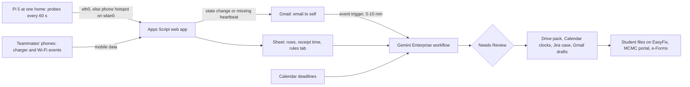

# Cap Masa

Cap Masa ("time stamp") watches an off-campus APU student's own home line and power from one Raspberry Pi 5 and their phones. When the connection or the power drops, it says whose side the fault is on, starts the clocks that matter (Unifi's 24-hour restoration clock, which the page's FAQ starts at the ticket and its main text at the official downtime report, so the ticket time is the safe assumption, and APU's 3-day extenuating-circumstances (EC) window), and drafts a dated evidence pack the student files themselves. Proposed track: **Intelligent Automation & Digital Transformation** ("connecting devices with useful actions", see [challenge tracks](/docs/BRIEF.md#challenge-tracks)). Caveat: no APU office owns it, Unifi's own alerts already cover the plain TM-side line fault, and a natural outage before 10 November is unlikely, so most of what a reviewer sees will be labelled induced events and a quiet log. Nothing here has been built or run yet; **Inference** marks conclusions no source states.

Contents:

1.  [At a glance](#at-a-glance)
1.  [Origins](#origins)
1.  [Problem and evidence](#problem-and-evidence)
1.  [How it works](#how-it-works)
    1.  [Signal to cloud path](#signal-to-cloud-path)
    1.  [Workflow](#workflow)
    1.  [Rule set](#rule-set)
    1.  [States and failure handling](#states-and-failure-handling)
    1.  [Connectors and platform check](#connectors-and-platform-check)
    1.  [Cloud, IoT and network](#cloud-iot-and-network)
    1.  [Real data and privacy](#real-data-and-privacy)
1.  [Why people will use it](#why-people-will-use-it)
1.  [Why the crowd won't build it](#why-the-crowd-wont-build-it)
1.  [Off-campus fit](#off-campus-fit)
1.  [Scores](#scores)
1.  [Research plan](#research-plan)
1.  [Time to impact](#time-to-impact)
1.  [Demo and review](#demo-and-review)
1.  [Build plan](#build-plan)
1.  [Risks and kill criteria](#risks-and-kill-criteria)
1.  [Not verified](#not-verified)
1.  [See also](#see-also)

## At a glance

| Field                 | Plan                                                                                                                                                                                                                                                                                                                  |
| --------------------- | --------------------------------------------------------------------------------------------------------------------------------------------------------------------------------------------------------------------------------------------------------------------------------------------------------------------- |
| Owner                 | The individual student whose home is watched. No APU office is involved, and none is claimed. In the build, the teammate with the Pi authors the workflow and approves its outputs. For the other homes, that teammate approves the evidence pack and the student sends it.                                           |
| First users           | The three teammates at their own homes: one with the Pi, two with phones only. Then off-campus APU students recruited remotely. The Unifi rebate covers only Unifi plans of 100 Mbps and above; other ISPs get the record, the MCMC route and the EC pack.                                                            |
| Track                 | Intelligent Automation & Digital Transformation.                                                                                                                                                                                                                                                                      |
| Trigger               | A Gmail "When an email is sent" event on a state-change email that Apps Script sends to the licensed account (polled every 5–10 minutes), plus one nightly schedule at 23:00 MYT. The promise is "within 15 minutes", never seconds.                                                                                  |
| Live signal           | The one Pi 5, wired to a teammate's router, probes the gateway, DNS, public anchors and APU's public login pages every 60 s, with a phone hotspot as backup uplink. Teammates' phones report charger and Wi-Fi events over mobile data.                                                                               |
| Connectors            | GA: Gmail, Google Drive (Sheets actions), Google Calendar, Jira Cloud. Add-on only: Globalping (preview).                                                                                                                                                                                                             |
| Decision              | Which verdict an outage gets (premises, line or ISP side, power cut (inferred), APU-side, device fault), whether a deadline falls inside it, and which filing route and clocks apply.                                                                                                                                 |
| Action and approval   | The workflow writes a Drive evidence pack, Calendar clock events, one Jira case per outage, and Gmail drafts (ISP follow-up, MCMC complaint, lecturer notice, EC statement). Each write pauses at **Needs Review**. Cap Masa never files anything: the student files on EasyFix, MyUnifi, the MCMC portal or e-Forms. |
| Reviewer self-trigger | A seated reviewer runs `@Cap Masa status` in chat and gets the live verdict from the Sheet; a read needs no approval. Anyone else emails `STATUS` to the alert mailbox, and the reply waits at Needs Review until a teammate approves it at a posted check time.                                                      |

## Origins

Cap Masa is a single-source product: it revises [Cap Masa](/docs/ideas/opus/03/04-cap-masa.md) (opus-03, lead and only source) against the scorers' objections and the team's real limits.

- **Kept:** the home-side receipt that ends in a claim the student sends, the three rule sources (Unifi Promise, MCMC, APU EC), the aim at cases Unifi's alerts leave uncovered, power read as "inferred", the hotspot failover, the GA connector set, every draft behind Needs Review, induced events labelled and kept out of the impact outcome, and the kill test on whether a gap remains after Unifi's alerts.
- **Changed, cross-home view:** the source had teammates on other ISPs run "the same Pi script". The team owns one Pi 5, so the other homes are phone-only, with charger and Wi-Fi events and no line-versus-premises split. The "all homes on one ISP down" rule is gone. Its action was the same as for a line fault (file your own ticket, because your 24 hours start at your ticket), and the "APU-side" rule now has one vantage point instead of two or more homes.
- **Changed, the line-fault verdict:** a Pi behind the router can't tell a TM line fault from a pulled cable between the fibre box and the router. So the first prompt is now a check of the box's LOS light before filing (a Malaysian X post reports "LOS red blinking" during an outage), and the verdict reads "line or ISP side" until the student confirms.
- **Changed, the rebate:** the live [Unifi Promise page](https://unifi.com.my/unifipromise) (fetched 5 November 2026) says eligible customers "will receive an SMS and MyUnifi in-app notification", with redemption steps. The source's rebate-claim draft is dropped. Cap Masa records the ticket time and puts the 30-day redemption deadline on the calendar once the SMS arrives.
- **Changed, the measured outcome:** the source's "minutes to a filed ticket" can't be measured on an induced event, because filing one would be a false report. This week's measure is minutes from first failure to a verified verdict and a ready-to-file pack. Minutes to a ticket counts only for natural outages.
- **Changed, phones and feeder:** Home Assistant Companion needs a server (the Pi, which is off in a power cut), and MacroDroid's HTTP action is unconfirmed, so Android uses Automate, whose HTTP request block is documented ([Android apps](/docs/research/iot-and-network.md#android-automation-apps-and-termux)). An Apps Script time trigger was added, because a dead Pi can't report its own silence.
- **Changed, recruiting and review:** "APU Discord" becomes the hackathon Discord, because no APU-wide Discord was found ([communities](/docs/research/everyday.md#communities-found)). The source's "within 15 minutes the workflow replies" to a reviewer's `STATUS` was wrong: the reply affects another person, so it waits for approval.
- **Changed, numbers:** "about 5 days of probe rows from 2 to 4 homes" becomes one Pi home plus two phone-only homes, with about 4 days of rows by 10 November and 8 by 14 November (logs start 6 November). The month-3 "20-home cohort", which assumed a Pi in each home, becomes 10 homes, mostly phone-only. The 30–50 accuracy items now name their mix, with induced events counted for accuracy but never for impact.
- **Dropped:** the Slack class-rep notice (no class rep exists to approve it), the "fewer than 2 non-team homes logging by 7 November" kill line (it assumed more Pis), and the source's scores.

## Problem and evidence

- **Outages recur in Malaysian homes.** A Lowyat member paying RM136 a month wrote that "almost every week will have outage that would last randomly from half an hour to entire day" (82 posts, 2–10 December 2025). On X, the theme drew 69 relevant posts across 13 queries, mostly Malaysian: "Unifi down almost 2 days" (22 June 2026); "day 13 broken since last month, called 100 nine times… wanted to report to MCMC, the website doesn't work either" (1 June 2026) ([outages](/docs/research/everyday.md#water-power-and-home-internet-outages)).
- **The lived question is "is it just me?"** "Is my house blacked out? can't find a thread" (3 November 2026); a Kerala developer built a PIN-code tracker for "is it only my house, or the whole area?" (320 points); the Johor Jaya substation fire of 16 October 2026 drew 216 points (same section).
- **Escalation asks for a timeline.** Under "Anyway to sue TM Unifi?", replies advise reporting to MCMC with "all your evidence and timeline" (43 and 34 points). A premises dispute drew 643 likes and 81,926 views: "Unifi says the cable outside isn't its responsibility" (same section).
- **The rules that make a timestamp worth something** ([rules and guarantees](/docs/research/rules-and-guarantees.md), checked 5 November 2026):
  - **Unifi Promise:** restore "within 24 hours"; the FAQ counts the hours "from the time an official complaint or trouble ticket is made". Otherwise a RM50 rebate, redeemable in MyUnifi within 30 days, on plans of 100 Mbps and above only ([Unifi Promise](/docs/research/rules-and-guarantees.md#unifi-promise)). Faults in "the customer's own equipment or premise" incur "the existing On-Site Support Charges".
  - **MCMC:** the Consumer Redress Portal requires "the complaint ID / reference number / ticket number issued by the service provider", sets "no strict time limit", and refuses anonymous complaints ([MCMC](/docs/research/rules-and-guarantees.md#mcmc-complaints-for-telco-and-broadband-issues)).
  - **APU EC:** network-failure evidence needs an "appropriate time stamp and screen shots", plus any engagement with the lecturer or invigilator, "without which the claim will be rejected". A claim is due through e-Forms "no more than 3 days after" the event ([EC](/docs/research/rules-and-guarantees.md#extenuating-circumstances-for-it-or-network-failure)). **Inference:** the log has to exist before the claim does.
- **Counterevidence, stated first-class:**
  - **Unifi already alerts.** "If a network fault is detected on TM side", Unifi sends a WhatsApp or MyUnifi alert, and replying "Y" means the "Report will be auto-created". A Malaysian user learned of an outage at home through such an alert (22 October 2026). The alert goes out only if "There are no open trouble ticket / reports" and "The downtime is not affecting multiple customers in the same area" (live page, 5 November 2026). For the plain single-customer line fault, Unifi has the job covered.
  - **The money is small:** RM50, on one ISP's faster plans only, and Unifi notifies eligible customers itself.
  - **No APU-specific loss is on record.** No thread describes classes or exams lost to a home outage, and no APU post describes a rejected connectivity EC claim ([gaps](/docs/research/everyday.md#disconfirming-signals-and-gaps)).
  - **Outages may be rare per home.** Lowyat replies to "Is unifi down today?" are often "No issue"; a Maxis user's fibre "has only gone down once in the 1–2 years"; Malaysian outage posts rarely pass 25 likes; and a global thread calls reporting a blackout to a crowd site "the last thing I'd think about doing" (same section).
- **Inference, where Cap Masa aims:** at the parts Unifi's alert leaves open. These are premises faults, which get no TM-side alert and can bring an on-site charge; area-wide or already-reported faults, where no alert is sent and the student's own clock still needs their own ticket; other ISPs; power cuts; and the 3-day EC window, which no ISP tracks.

## How it works

### Signal to cloud path

- **Pi 5 (8 GB):** a systemd service (`Restart=always`) probes over `eth0` every 60 s: gateway ping, a DNS lookup, HTTPS to two ISP-neutral anchors, and a GET of APU's public Moodle and APSpace login pages, keeping only the status code and timing, never page content or credentials. It POSTs each row over `eth0`, retrying over `wlan0` (a phone hotspot) when that fails, so a "line down" row still lands. Each row records which path carried it.
- **Phones:** on Android, Automate flows on charger connected or disconnected and on Wi-Fi disconnect, with battery optimisation off. On iPhone, a Shortcuts personal automation on "Charger Is Disconnected" that runs without asking. Both send events only, since iOS has no interval trigger ([Shortcuts](/docs/research/iot-and-network.md#ios-shortcuts-personal-automations)).
- **Apps Script:** `doPost` appends under `LockService` and stamps the receipt time with `new Date()`. That time is authoritative, because without an RTC battery the Pi's clock is wrong until network time syncs after a reboot ([power and the RTC](/docs/research/iot-and-network.md#power-undervoltage-and-the-rtc)). On a state change it emails the licensed account itself. A 5-minute time trigger raises "no Pi rows since HH:MM" when the heartbeat is older than 3 minutes. Workflows have no webhook trigger, so this email is the bridge ([triggers](/docs/research/gemini-enterprise.md#triggers-and-schedules)).

### Workflow

One workflow, **Cap Masa**:

- **Trigger:** Gmail "When an email is sent" (Google's documented choice for mail to oneself), plus a nightly 23:00 MYT schedule that sweeps open cases and clocks. A 15-minute schedule is ruled out: it can't be made conditional on an open outage, and 96 runs a day would strain the pool of 160 queries per user per day ([limits](/docs/research/gemini-enterprise.md#limits-that-bite-in-a-one-week-build)).
- **Reads:** **Get cell values** on the window's rows and the rules tab; Calendar events from the outage start to 3 days after; the open Jira case, where the student pastes their ticket reference.
- **Decides:** applies the rules tab. Durations and clock end times are Sheet formulas, not model arithmetic. Gemini writes the timeline and the drafts and picks the route when signals conflict, such as a charger event during an Ethernet failure.
- **Writes, all at Needs Review** ([approval rules](/docs/research/gemini-enterprise.md#what-runs-without-anyone-signed-in)): the Drive evidence pack (timeline, verdict, row extract, screenshot index); Calendar "ticket clock ends HH:MM" (ticket time plus 24 h), "EC window closes DD Mon" and "rebate redeem by DD Mon"; one Jira issue per outage; Gmail drafts.
- **First prompt on "line or ISP side":** "Check the LOS light on the fibre box. Red: file on EasyFix now; your 24 h clock starts at your ticket. Not red: check the cable from the box to the router."

### Rule set

The rules live in an editable Sheet tab, so a student can read why a verdict was given.

| Pattern                                                                   | Verdict                       | Route                                                                                                              |
| ------------------------------------------------------------------------- | ----------------------------- | ------------------------------------------------------------------------------------------------------------------ |
| Pi Ethernet link down or gateway unreachable; phone still on charger      | Premises (router or LAN)      | No ISP ticket; restart the router; Unifi charges on-site support for customer-side faults; log kept for EC         |
| Gateway reachable; anchors fail over `eth0`; row arrives over the hotspot | Line or ISP side, pending LOS | LOS check, then a ticket on EasyFix or MyUnifi; 24 h clock from the ticket; MCMC draft once a ticket number exists |
| No Pi rows for 3 min and a charger-disconnected event within 5 min        | Power cut (inferred)          | No ISP ticket; dated note for a TNB report or EC; confirmed after reboot by the log gap and `power_reset`          |
| No Pi rows; phone charger still connected                                 | Device fault                  | Shows "no probe rows since HH:MM"; never counted as an outage                                                      |
| Anchors fine; APU login page failing for 10 min from the Pi               | APU-side (one vantage point)  | A supporting fact for an EC statement only if a deadline fell inside it; never a stated ground                     |
| Any verdict with a Calendar deadline inside the window                    | Adds the EC route             | "EC window closes" event (event + 3 days); lecturer notice and EC statement drafts                                 |

Phone-only homes get only the power hint ("charger disconnected", unconfirmed, since a phone can be unplugged by hand) and Wi-Fi-lost events. They never get a line or premises verdict.

### States and failure handling

- **Case states:** open, verdict, drafted (Needs Review), filed (the student pastes a ticket reference), restored, closed. The Jira issue mirrors them, and the EC window is shown as open or closed beside them.
- **Loud failures, no fallback:** no rows shows "no probe rows since HH:MM"; a failed Sheet read errors the run in the Runs tab; a dead hotspot during a line fault shows as the same "no rows" error. Nothing is cached, defaulted or filled in.
- **Platform:** event runs that fail with `RESOURCE_EXHAUSTED` aren't retried, so the nightly sweep re-reads open cases. Schedule credentials expire every 14 days, so they are refreshed on 9 November.
- **Pi power:** on default EEPROM settings the Pi boots by itself when power returns. Rows leave the Pi at once and the overlay file system stays off, because a power cut can corrupt the SD card and an overlay loses buffered logs ([power cuts](/docs/research/iot-and-network.md#power-cuts-and-sd-cards)).
- **Untrusted input:** a `STATUS` email body is data. Only that keyword triggers a reply draft, and nothing in the body is followed.

### Connectors and platform check

| Connector                     | Type | Stage   | Job                                                                                            |
| ----------------------------- | ---- | ------- | ---------------------------------------------------------------------------------------------- |
| Gmail                         | 1P   | GA      | Event trigger on the state-change and `STATUS` emails; Create draft                            |
| Google Drive (Sheets actions) | 1P   | GA      | Live read of rows and the rules tab (Get cell values); evidence pack (Create file, Share file) |
| Google Calendar               | 1P   | GA      | Deadlines in; ticket, EC and rebate clock events out                                           |
| Jira Cloud (Free)             | 3P   | GA      | One case per outage with status changes and comments; the cohort's case register               |
| Globalping                    | 3P   | Preview | Add-on only: outside probes on the same ISP; no verdict rests on it                            |

Drive, Gmail and Calendar need a Google Workspace domain: a consumer `@gmail.com` account gets `403` ([account limits](/docs/research/gemini-enterprise.md#edition-and-account-limits)). The first test is one live Sheet read and one reviewed Jira create. Globalping's public API has no "list my measurements" endpoint, so the connector stays off the critical path until tested ([Globalping](/docs/research/gemini-enterprise.md#network-measurements-through-globalping)).

### Cloud, IoT and network

- **Cloud:** Apps Script lands the rows. The Gemini Enterprise workflow is the deciding step that reads, classifies and drafts; without it there are only rows.
- **IoT:** real readings from the team's own Pi and phones, and they flip the verdict: an Ethernet failure with the charger connected means premises, while a silent Pi with a charger-disconnected event means power.
- **Network:** every row carries its path (`eth0` or hotspot) and its latency (device time against receipt time). When the router is switched off, a reviewer sees rows switch to the hotspot path.

### Real data and privacy

- **Real only:** live readings from the team's own devices. Induced events (router or power strip switched off, cable pulled) are labelled "induced". Outages a student recalls are labelled "recalled, no timestamps" and are never evidence. Mock GPS has no role here.
- **PDPA 2010, as amended in 2024:** only each owner's own consented data. The Pi logs reachability only, never traffic or browsing. Rows and drafts stay in the licensed tenant, and none goes to a free-tier prompt.
- **APU:** only public login pages are probed, and only the status code and timing are stored. The team contacts no APU staff, and KB pages are quoted briefly and stay APU's ([terms of use](/docs/research/apu.md#terms-of-use-and-robotstxt)).

## Why people will use it

- **Revealed demand:** people already self-host ISP loggers: Uptime Kuma has 93,264 GitHub stars and Speedtest Tracker 6,056, run so that "Is the internet down?!" has an answer at a glance. Builders also leave a phone with Home Assistant plugged in at a parent's house to catch power cuts ([tools that survive](/docs/research/everyday.md#tools-that-survive-months-of-use), [outages](/docs/research/everyday.md#water-power-and-home-internet-outages)).
- **It fits habits that last:** the research infers that phone triggers people keep are tied to physical moments such as plugging in, not to opening an app; an unplug is the moment Cap Masa listens for (same section).
- **Concession:** the Pi path is a hobbyist's setup, and most students have no Pi, so the reach today is the team's homes plus phone-only users. The student also needs a mailbox on the licensed domain for the drafts. Nobody has asked for this tool in an APU channel.

## Why the crowd won't build it

The probe half is saturated: Wi-Fi and network diagnosis is 8.7% of the simulated crowd, and network diagnosis plus fault-to-ticket, the "telemetry to ticket" crowd, is 16.3% ([saturation tiers](/docs/research/competition.md#saturation-tiers), [crowd map](/docs/research/competition.md#crowd-map)). The crowd's version watches the campus network and files IT tickets for APU. Cap Masa watches a student's own home, files nothing itself, and ends in a claim the student sends to an ISP, MCMC or APU. **Inference:** the crowd is unlikely to build the clock-and-claim part, but reviewers will pattern-match the probe, so the demo opens on the filing and the uncovered cases, never on a latency chart. The simulated crowd also barely names Gmail or Jira (at most 2% of any family's responses).

## Off-campus fit

**It passes.** The critical path needs nobody at APU and no APU staff action. It uses one Pi 5 at a teammate's home, the team's own phones, Apps Script, Jira Cloud Free and the Gemini Enterprise licence. APU's public pages are probed from home over the public internet. One condition: the licence must sit on a Google Workspace domain for Gmail, Drive and Calendar. If it arrives on a consumer account, the fallback has Apps Script open the Jira issue through Jira's REST API, with a Jira event trigger, Jira for the case register and a rules page in Confluence Cloud (GA). The constraint that bites is not campus access but the calendar: a natural outage at the Pi home before 10 November is unlikely.

## Scores

**59.1 / 100, rank 12 of 18** in the [cross-set ranking](/docs/ideas/00-ranking.md); it passes every gate with all three scorers. Scored on 5 November 2026 on the [matrix](/docs/ideas/00-ranking.md#scoring-matrix) by three independent scorers who read this doc and checked its claims: an NTT DATA forward deployed engineer (FDE), an APU School of Technology IoT lecturer, and a Google Cloud advocate who is also an APU student. Models: FDE (Claude Fable 5.1), Lecturer (Claude Opus 5.5), Advocate (Claude Sonnet 5.5). Day-to-day workflow and theme take the lowest score; the rest take the mean.

| Component           | Weight | FDE | Lecturer | Advocate | Used | Lowest scorer's reason                                                                                                                                                                                                                                           |
| ------------------- | -----: | --: | -------: | -------: | ---: | ---------------------------------------------------------------------------------------------------------------------------------------------------------------------------------------------------------------------------------------------------------------- |
| Impact              |     13 |   2 |        2 |        2 |    2 | The owner is an individual student, no APU-specific loss is on record, Unifi already alerts on the main case, and the only measurable this week is minutes to a verdict on induced events at one teammate's home.                                                |
| Connectors          |     13 |   4 |        4 |        3 | 3.67 | GA Gmail, Drive/Sheets, Calendar and Jira are used but Gmail-to-self is a bridge for a missing webhook and Jira is a case register.                                                                                                                              |
| Day-to-day workflow |     13 |   3 |        4 |        4 |    3 | A Gmail event bridge plus a 23:00 schedule, an editable rules tab, a 5-minute heartbeat watchdog in Apps Script and Needs Review on every write are sound, but the deciding step fires only on outages, which the doc says are unlikely in the window.           |
| Research            |     13 |   3 |        2 |        3 | 2.67 | Pain is Malaysian, not APU (Lowyat, X), and the doc says no APU loss is recorded. 30-50 items are mostly induced events, and r/malaysiauni APU requests draw 0-1 replies.                                                                                        |
| Time to impact      |     13 |   2 |        3 |        3 | 2.67 | The teammates' homes log from 6 November and the plan is dated with team owners, but growth to 10 mostly phone-only homes gives those users only an unconfirmed 'charger disconnected' hint.                                                                     |
| Theme               |     10 |   4 |        4 |        5 |    4 | The Pi probes over eth0 with a hotspot failover that shows the path per row, and phone charger events flip the verdict between premises, line and power; this is the most load-bearing team-device IoT and network layer in the batch, though power is inferred. |
| Originality         |      9 |   2 |        3 |        3 | 2.67 | The probe half sits in the saturated network-diagnosis tier (8.7%, 16.3% with fault-to-ticket) and Unifi's own alert plus Uptime Kuma cover the core case; the clock-and-claim pack is the only distinct part.                                                   |
| Real use            |      6 |   3 |        3 |        3 |    3 | Self-hosted ISP loggers are real revealed demand (Uptime Kuma 93,264 stars confirmed) and plug-in triggers are habits people keep, but nobody has asked for this in an APU channel and most students have no Pi.                                                 |
| Buildability        |      5 |   3 |        4 |        3 | 3.33 | Pi probe with hotspot retry, Automate and Shortcuts flows, Apps Script, one workflow, Calendar clocks, Jira and a Drive pack are moderate for three people.                                                                                                      |
| Demo                |      5 |   3 |        3 |        3 |    3 | Router-off and power-strip-off induced events land on video, but a reviewer cannot induce an outage; they get a STATUS reply after approval or a read-only chat verdict.                                                                                         |

- **Gates:** G1 pass (3 pass, 0 conditional, 0 fail); G2 pass (3 pass, 0 conditional, 0 fail); G3 pass (3 pass, 0 conditional, 0 fail); G4 pass (3 pass, 0 conditional, 0 fail).
- **Off-campus gate, per the lowest scorer:** One Pi at a teammate's home with the team's phones and Apps Script; APU is only probed as public login pages from home, and no APU staff are contacted.
- **What would help most, per the lowest scorer:** Drop the cases Unifi already alerts on and lead with the EC evidence pack tied to a real APU deadline, backed by two interviewees who filed or were refused a connectivity EC claim.

## Research plan

All remote, with no APU staff ([reaching students](/docs/research/everyday.md#reaching-apu-students-remotely)).

- **Recruit (from 5 November):** reply in public outage threads and post once in r/malaysiauni (63,046 weekly active users, but APU requests there get 0 or 1 replies, so offer a swap or a small Touch 'n Go payment). Also the hackathon Discord's `#general` (about 212 members) and teammates' intake WhatsApp groups.
- **6–8 interviews (7 and 8 November, 15 minutes):** off-campus APU students, ideally on Unifi. Ask about the last drop near a deadline and what they had to show, whether they got Unifi's alert, whether any outage in the last 3 months went unticketed, whether they have filed an EC, and whether they know the 24 h rule.
- **Timed observation (8 November):** a household member switches the Pi home's router off at an unannounced time. The teammate answers "is it just me, and what do I file?" by their usual methods, and is timed; then again with Cap Masa. Both runs are labelled induced.
- **Survey (2 days, 10 questions):** ISP, plan speed, outages per month, ever reported one, ever got Unifi's alert, ever filed an EC for connectivity, and whether they would set up a phone automation.
- **30–50 labelled items by 9 November:** 12 induced events at the Pi home (4 each of router off, fibre-to-router cable pulled, power strip off), 6 hand unplugs of a charger at the phone-only homes (should read as unconfirmed hints), and 6-hour quiet windows, plus any natural outage. Precision and recall are reported per verdict with the count, and the induced and natural results are never pooled.

## Time to impact

- **Weeks 1–4 (to 3 December 2026):** the three teammate homes keep logging. The Pi image, the Automate flow and the Shortcuts recipe go on GitHub with a setup sheet. Owners: B1 (Pi and feeder), B3 (guides).
- **3 months (by 5 February 2027):** 10 homes, mostly phone-only, recruited through r/malaysiauni and intake groups, with every natural outage logged and any real ticket, MCMC or EC outcome recorded. Owner: B3 (recruiting), B2 (workflow).
- **6 months (by 5 May 2027):** publish the rules tab and filing guide for any Malaysian renter on any ISP, with the measured time to verdict and to ticket from natural outages. Owner: the whole team.
- **Assumptions:** a Gemini Enterprise seat continues after the hackathon trial (Standard starts at $30 a seat a month, and the team has no card today); students install a phone automation; the Unifi, MCMC and EC rules stay as published. Nothing needs APU staff.

## Demo and review

The recorded video is about 3:30, labelled with its capture date, and comes from the live system:

1.  **0:00** A teammate's real upcoming deadline sits in Calendar; the Sheet shows three days of real rows and the quiet-window false-positive count.
1.  **0:30** The router is switched off at the Pi home (labelled induced). Rows switch to the hotspot path, and the state-change email lands.
1.  **1:15** The Runs tab shows the verdict "premises (induced)", a case Unifi sends no alert for, with the pack: "router side, no ISP ticket, on-site charges apply to customer faults".
1.  **2:00** The power strip is switched off (induced): the phone's charger event arrives over mobile data, the heartbeat goes missing, and "power cut (inferred)" is confirmed after reboot.
1.  **2:45** The EC and lecturer drafts appear at Needs Review, the approval is given, and the Calendar shows "EC window closes".
1.  **3:10** A `STATUS` email is sent, showing the polling delay.

**Reviewer path (11–14 November):** seated reviewers run `@Cap Masa status` for a live, read-only verdict. Others email `STATUS`; a teammate approves replies at 09:00, 13:00 and 21:00 MYT, and the reply is usually the real answer "line up, no open case". Outages are never simulated by email. The README carries the owner's Runs tab over the logging days ([reviewer access](/docs/research/gemini-enterprise.md#reviewer-access)).

## Build plan

- **Thu 5 Nov:** B1 builds the Pi probe service, the hotspot retry, and the Apps Script `doPost` with its heartbeat trigger. B2 asks the organisers which domain the licence is on and sets up Jira Cloud Free. B3 builds the Automate and Shortcuts flows on three phones and starts recruiting.
- **Fri 6 Nov:** logs start at 00:00. B2 tests the Gmail trigger, the first live Sheet read and a reviewed Jira create, and measures queries per run. B1 runs the first 4 induced events.
- **Sat 7 Nov:** B2 builds the rules tab and the workflow drafts and adds the Calendar clocks. B3 runs interviews 1–4. The kill check is at 21:00.
- **Sun 8 Nov (Deepavali; registration closes at 23:59):** everyone confirms registration by noon. B2 finishes the evidence pack and the MCMC and EC drafts. B3 runs interviews 5–8 and the timed observation.
- **Mon 9 Nov:** label the 30–50 items, refresh the credentials, freeze updates, record the video.
- **Tue 10 Nov:** README and deck; the leader submits by 18:00 MYT; the Pi, phones and workflow keep running to 14 November.

## Risks and kill criteria

1.  **No natural outage in the window (likely):** then the result is a quiet log, labelled induced events and an honest false-positive rate. Stated, not hidden.
2.  **Read as a saturated network monitor or a copy of Unifi's alert:** lead with the premises, power and EC cases Unifi doesn't cover, and with the filing.
3.  **Impact owner:** the owner is a student, not an office, and APU volume is unknown. This is conceded; the survey sizes it.
4.  **Weak EC value for a purely personal fault:** lead with the ISP and MCMC routes, and use EC only where a deadline fell inside a logged outage.
5.  **Licence late or on a consumer account:** use the Jira-and-Confluence fallback; if no licence arrives by 9 November, say so in the README.

**Kill by 7 November at 21:00** if any of these holds:

- Fewer than 2 of 6 off-campus interviewees had an outage in the last 3 months that went unticketed despite Unifi's alert, or that needed a timeline for MCMC or EC. Then no gap remains after the incumbent.
- The Pi to Apps Script to Gmail path fails to start a workflow within 15 minutes on the first test.
- The router-off induced event is misclassified twice in the first 4 runs.

## Not verified

- Whether mail Apps Script sends fires the Gmail "When an email is sent" trigger (the fallback is a Drive file trigger), and whether "When an email is received" fires on a reviewer's outside mail.
- Whether Automate's charger and Wi-Fi blocks fire reliably on the team's Android phones under vendor battery killers, and how long the hotspot stays on unattended.
- Whether a seated reviewer from another domain can read the Sheet through Get cell values.
- How many queries one workflow run consumes.
- The 2018 EC policy that reportedly excludes purely personal network faults: its PDF returned 404, and the claim came from a search summary.
- How many APU students live off campus on their own broadband, and on which ISPs.

## See also

- [Cap Masa source doc (opus-03)](/docs/ideas/opus/03/04-cap-masa.md)
- [Cross-set ranking](/docs/ideas/00-ranking.md)
- [Rules and guarantees: Unifi, MCMC, APU EC](/docs/research/rules-and-guarantees.md)
- [Everyday signals: outages, tools people keep, recruiting](/docs/research/everyday.md)
- [IoT and network: phones, Pi 5, Apps Script path](/docs/research/iot-and-network.md)
- [Gemini Enterprise: triggers, connectors, limits, reviewer access](/docs/research/gemini-enterprise.md)
- [Competition: crowd map and saturation tiers](/docs/research/competition.md)
- [Brief](/docs/BRIEF.md) and [context](/docs/CONTEXT.md)
