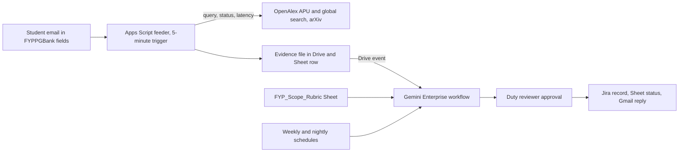

# Research & FYP Nexus

Research & FYP Nexus checks a final-year student's draft project title before it goes into FYPPGBank, APU's system for FYP title proposals. The student emails the fields FYPPGBank asks for to an intake address, and a feeder fetches live evidence from OpenAlex and arXiv: APU's own works nearest the topic, and recent overlapping work worldwide. A Gemini Enterprise workflow checks the draft against an editable rubric, decides whether it's ready to submit or needs its scope revised, and names up to three APU authors whose recent works sit nearest the topic, to inform the student's "Preferred Supervisor" choice. After one human approval it files a Jira record and replies to the student; a weekly run re-checks approved titles for new overlapping papers. It serves final-year undergraduates first, with APU's FYP Project Manager as the target owner, under the proposed track **Data-Driven Research & Intelligent Decision Making**. Caveat: it has no IoT layer and only a thin network one, so it concedes the theme. Nothing here has been built or run, and **Inference** marks conclusions no source states.

Contents:

1.  [At a glance](#at-a-glance)
1.  [Origins](#origins)
1.  [Problem and evidence](#problem-and-evidence)
1.  [How it works](#how-it-works)
    1.  [Signal to cloud path](#signal-to-cloud-path)
    1.  [Workflows and agent role](#workflows-and-agent-role)
    1.  [Rule set](#rule-set)
    1.  [States and failure handling](#states-and-failure-handling)
    1.  [Connectors and platform check](#connectors-and-platform-check)
    1.  [Cloud, IoT and network](#cloud-iot-and-network)
    1.  [Real data and privacy](#real-data-and-privacy)
1.  [Why people will use it](#why-people-will-use-it)
1.  [Why the crowd won't build it](#why-the-crowd-wont-build-it)
1.  [Off-campus fit](#off-campus-fit)
1.  [Scores](#scores)
1.  [Research plan](#research-plan)
1.  [Time to impact](#time-to-impact)
1.  [Demo and review](#demo-and-review)
1.  [Build plan](#build-plan)
1.  [Risks and kill criteria](#risks-and-kill-criteria)
1.  [Not verified](#not-verified)
1.  [See also](#see-also)

## At a glance

| Field                 | Plan                                                                                                                                                                                                      |
| --------------------- | --------------------------------------------------------------------------------------------------------------------------------------------------------------------------------------------------------- |
| Owner                 | To month 3: the team, with one duty reviewer approving packets; no APU office needed. From month 4: APU's FYP Project Manager, the FYPPGBank role that approves titles (proposed, not contacted)          |
| First users           | Final-year undergraduates writing an FYPPGBank title proposal, starting with computing topics, where APU's OpenAlex record is densest                                                                     |
| Track                 | Data-Driven Research & Intelligent Decision Making                                                                                                                                                        |
| Trigger               | Drive event when the feeder writes an evidence file (5–10 minute poll); weekly schedule for the overlap watch; nightly schedule that sweeps failed runs                                                   |
| Live signal           | Real student emails; OpenAlex and arXiv responses fetched per draft, each stored with HTTP status, latency and time. No sensor                                                                            |
| Connectors            | Drive event trigger and file read, Sheets Get and Update cell values, Gmail Send (GA, 1P); Jira Cloud Create issue, Assign issue, Create comment, Change issue status (GA, 3P). No MCP or preview on path |
| Decision              | `ready to submit`, `revise scope first` (the overlapping work quoted) or `evidence incomplete` (a source failed), plus up to three APU authors with their nearest works                                   |
| Action and approval   | One approval by the duty reviewer releases the Jira record, the Sheet status and the reply to the student. Nothing goes to a lecturer                                                                     |
| Reviewer self-trigger | Email any real title and abstract (their own or a published paper's) to the intake address; the evidence row appears in a shared status Sheet within about 5 minutes and the run within about 15          |

Connector stages are from [actions and write-back] and [triggers]. They are documentation, not a run: no licence has arrived. At APU the design would switch to Outlook and SharePoint (both GA) ([systems APU runs]), but the team can't stand up a Microsoft 365 tenant: the developer sandbox is closed to most students and ships sample data ([free sandboxes]).

## Origins

The single source is [Research & FYP Nexus](/docs/ideas/argon/01/04-research-fyp-nexus.md) from the argon-01 set; nothing else merges into it.

- **Kept:** APU's CC0 OpenAlex corpus as the matching base, a draft-arrives trigger, the overlap check, iConsult as the booking path, the masked-abstract Top-1/Top-3 test, and a dated 3- and 6-month rollout.
- **Changed:** APU's KB shows that FYPPGBank already routes titles to an FYP Project Manager, so the source's supervisor-routing ticket became a team case record and the product a pre-submission check. No APU staff will act before 10 November, so the team owns the first three months, and the FYP committee's owner role went to APU's FYP Project Manager as a month-4 target. "Ranks the top three lecturers" became "lists APU works nearest the draft, with their authors", since under-indexed lecturers would rank low and nothing suggests staff accept being scored. Intake moved from a monitored folder to email in FYPPGBank's own fields. Matching runs on OpenAlex's APU-restricted search at call time instead of a weekly BigQuery copy. A weekly overlap watch makes the workflow recur between submissions. The APSoftware check left the critical path: it reads APU's KB, which APU's Terms of Use reserve, so it waits for written permission.
- **Dropped:** BigQuery federated query (preview) and the `apu-openalex-mcp` server on Cloud Run (custom MCP is preview and blocked by default by an org policy, and Cloud Run needs a card the team doesn't have); both sat on the source's critical path. SharePoint, for the tenant reason above. The GitHub starter repo, since GitHub isn't a workflow connector ([workflows]). The Calendar slot, since iConsult already books supervisors. Semantic Scholar, whose keyless calls returned `429`, and Crossref, whose abstracts aren't reusable and whose DOIs OpenAlex already carries ([Crossref, Semantic Scholar, and arXiv]). The curriculum-drift report, which has a different owner. The two supervisor interviews, which need APU staff this week.
- **Numbers re-checked:** the source's 3,712 APU works doesn't hold. The research doc recorded 3,711 on 3 November, and both the ROR and institution-ID filters returned 3,660 on 5 November, so this doc cites a dated live count and doesn't depend on it. The source's Turnitin "20%" and its MQA and marking quotes are dropped: Reddit blocked re-checks on 5 November, and the KB FYP space states the degree requirement directly. The "syllabus like no update" quote is attributed as the research doc has it, to a 2022 entrant rather than a Software Engineering student. The "literally from 2024" slides quote is dropped because it couldn't be checked. The APSoftware titles were re-checked and hold.

## Problem and evidence

- **APU already runs the proposal step, in FYPPGBank:** a student either submits their own title, giving a "Project Title (128 characters limit)", a description that includes "an introduction, Aim, Objectives, and Targeted users", one SDG goal, up to 5 keywords and a "Preferred Supervisor" ([proposal guide][fyppg-proposal]), or picks an existing title from a bank and adds "4 other supervisors" from a list of preferred supervisors ([existing-title guide][fyppg-existing]). The title stays "Pending Approval" until the "FYP Project Manager" approves it, "Assigning the Supervisor and Second Marker", or reverts it ([approval guide][fyppg-approval]). The guides were read anonymously on 5 November 2026 (last edited 1 October 2026); the system itself needs Microsoft sign-in ([ethics forms](/docs/research/rules-and-guarantees.md#research-ethics-forms-for-final-year-students)).
- **The FYP is a supervised degree requirement:** the KB FYP space says it is part of "obtaining the honours bachelor degree", "with closed supervision on identified research area", and guides students "from the research topic identification" onward. The rest of the space needs a login: an anonymous API query on 5 November returned 2 pages ([KB FYP space]). Past theses and final-year projects (APres) need an APKey too ([material that is not public]), so the overlap check covers published literature only.
- **Finding a title and supervisor is informal:** a student near the end of an internship had no title, and their mentor "doesn't know what general IT requirements are for FYP". The advice was to contact "lecturers or researchers in your faculty that are undergoing research" ([FYP struggles thread]). This is carried from the source and couldn't be re-checked; it is the only workaround cited.
- **Students think the syllabus lags:** a 2022 entrant wrote "the syllabus like no update" on a 194-point post ([Reddit research](/docs/research/social.md#reputation-and-safety-context)).
- **APU's research output is public, open and fresh:** OpenAlex data is CC0 ([OpenAlex]). On 5 November both the ROR (`03c52a632`) and institution-ID (`I181397559`) filters returned 3,660 APU works, 1,568 of them from 2024–2026 with abstracts, and the record was updated on 4 November. The top 2024–2026 topics were Smart Agriculture and AI (58), Technology Adoption and User Behaviour (52) and AI in Healthcare (37). The count was 3,711 on 3 November; it moves as OpenAlex re-attributes works, and some look misattributed, such as 2013–2014 spin-qubit papers.
- **Volume is unknown:** APU's FYP Showcase 2026 had over 100 students from 17 programmes ([APU footprint](/docs/research/everyday.md#apu-and-bukit-jalil-footprint)). **Inference:** at least that many finish an FYP each year. How many proposals FYPPGBank receives, how many are reverted, and how long a student takes to settle a title are unknown and login-gated.
- **Counterevidence:** FYPPGBank already gives students a title bank and a preferred-supervisor list, and iConsult books consultations with "staff, lecturers, supervisors, and Academic Mentors" ([KB iConsult]). What FYPPGBank shows behind login may already answer "who works on this". **Inference:** what its public guides don't show is a literature-overlap check or evidence of who at APU published on the topic recently.

[fyppg-proposal]: https://apiit.atlassian.net/wiki/spaces/ITSM/pages/2686582800
[fyppg-existing]: https://apiit.atlassian.net/wiki/spaces/ITSM/pages/2783346689
[fyppg-approval]: https://apiit.atlassian.net/wiki/spaces/ITSM/pages/2716303383
[KB FYP space]: https://apiit.atlassian.net/wiki/spaces/FYP
[FYP struggles thread]: https://www.reddit.com/r/malaysiauni/comments/1v6s3e6/

## How it works

### Signal to cloud path

1.  **Signal:** a student emails the intake address in the licensed Workspace domain, with the title as the subject and the description and keywords in the body, as FYPPGBank asks for them. The address's public instructions say what is stored and for how long. Reviewers and the team send real published abstracts.
1.  **Feeder:** an Apps Script time trigger every 5 minutes reads unread intake mail and makes three live calls: OpenAlex search restricted to APU (`authorships.institutions.id:I181397559`), top 10; OpenAlex search over the last three years worldwide, top 10; and arXiv, top 5, inside its one-request-per-3-seconds limit ([Crossref, Semantic Scholar, and arXiv]). It writes an evidence file into `Evidence` and a Sheet row with each call's URL, HTTP status, latency, result count and time. A search cost $0.001 when tested on 5 November; keyless calls share $0.10 a day per IP, and a free key gives $1 a day ([OpenAlex]). **Inference:** Apps Script calls leave from shared Google addresses, so use a key.

### Workflows and agent role

1.  **Per draft:** the Drive event on `Evidence` starts the run 5–10 minutes later ([triggers]). An agent node reads the draft, the evidence and `FYP_Scope_Rubric` through Sheets Get cell values. It applies the rubric and drafts the packet: the APU works nearest the topic with authors and years, any overlapping work quoted with its ID, and what to fix before FYPPGBank. An Approval step waits for the duty reviewer. On approval the run creates and assigns a Jira issue, writes the status to the Sheet, and emails the student, pointing to FYPPGBank's Preferred Supervisor field and to [iConsult][KB iConsult] for a first meeting.
1.  **Weekly watch:** on Sunday night the feeder re-runs the global search for every approved title, limited to works since the last run. On Monday at 08:00 MYT a scheduled run judges each new hit against the approved scope and drafts one Jira comment and one student email per affected title, which the reviewer approves as a batch.
1.  **Nightly sweep:** at 02:00 MYT a scheduled run takes every evidence row that has no decision, because event-triggered runs that fail with `RESOURCE_EXHAUSTED` aren't retried ([unattended runs]).
1.  **Agent role:** OpenAlex relevance ranking is the matcher, and deterministic code applies the thresholds. Gemini makes the deciding call: whether a hit shares the draft's aim and method, which decision applies, and how to explain each flag. It is compared with a template packet built from the same evidence, and the Gemini step is cut if it adds errors without saving reviewer time.

### Rule set

`FYP_Scope_Rubric` is a Sheet the owner edits. The completeness rule copies FYPPGBank's public form; the other thresholds are team defaults until an owner replaces them, and no APU rule is invented.

| Rule         | Check                                                                                                                | Outcome when it fires                                |
| ------------ | -------------------------------------------------------------------------------------------------------------------- | ---------------------------------------------------- |
| Completeness | Title within 128 characters; description with introduction, aim, objectives and targeted users; one SDG; ≤5 keywords | The reply names the missing field                    |
| Overlap      | A work from the last three years shares aim and method, quoted with its ID                                           | `revise scope first`                                 |
| Relevance    | No work on the topic in five years                                                                                   | A `check relevance` note in the reply                |
| Shortlist    | Up to three APU authors with at least two works in the APU results, newest first                                     | Listed with their works; absence isn't unsuitability |
| Opt-out      | The author has asked not to be shown                                                                                 | Never shown                                          |
| Evidence     | Every statement cites a work ID or a call row; a failed call blocks the check that needs it                          | `evidence incomplete` for that check                 |

**Cost per draft:** two OpenAlex searches ($0.002) and one arXiv call. Gemini queries per run must be measured, because one run isn't necessarily one query ([platform constraints]), against Standard's 160 per seat a day ([limits]).

### States and failure handling

- **States:** `received → evidence complete | evidence incomplete → awaiting review → approved → replied → new overlap noted`. The decision (`ready to submit` or `revise scope first`) is attached at `awaiting review`.
- **Loud failures:** a non-2xx response or a timeout is written as an error row with its status and message, never replaced by an earlier result. If the APU search fails there is no shortlist, and the state reads, for example, `evidence incomplete: OpenAlex 429 at 10:02`.
- **Platform failures:** quota failures go to the nightly sweep. Delegated credentials expire every 14 days, so they are refreshed on 10 November, valid through 24 November. A packet nobody approves stays `awaiting review`; nothing reaches a student unapproved.
- **Wrong account type:** if the licences are consumer `@gmail.com` accounts, Drive and Gmail connectors don't work ([account limits]). The feeder then files the evidence as a Jira issue, a Jira event trigger starts the run, and the approved reply goes out as a Jira comment that the feeder forwards by email.

### Connectors and platform check

| Connector or tool               | Stage   | Job                                                                                   |
| ------------------------------- | ------- | ------------------------------------------------------------------------------------- |
| Google Drive                    | GA      | Event trigger on `Evidence`; reads the draft and evidence files                       |
| Sheets, via the Drive connector | GA      | Get cell values for rubric and evidence; Update cell values for status (since 12 Oct) |
| Gmail                           | GA      | Sends the approved reply and weekly-watch emails to the student                       |
| Jira Cloud Free                 | GA      | Create and assign the case, comment weekly hits, change status; search approved cases |
| Apps Script                     | Tooling | The feeder; not a connector                                                           |
| APSoftware page fetch           | Add-on  | "Confirm access" flag for paid tools, only after APU's written permission             |
| Custom MCP, BigQuery federated  | Preview | Not used; an add-on only if the org policy is lifted                                  |

Drive, Gmail and Sheets need a Workspace organisation account with a Customer ID, and federated Drive search only covers files owned by the searcher's domain, so the feeder runs under the licensed account ([account limits]). Connector writes from a workflow require human review ([unattended runs]). Jira comments and transitions are listed actions but stay unproven until they work in the app ([platform constraints]).

### Cloud, IoT and network

- **Cloud:** real: Apps Script, Workspace, Jira Cloud and a Gemini Enterprise workflow.
- **Network:** thin but real: each packet shows three public-API calls with status and latency. That is application reachability, not network infrastructure.
- **IoT:** none. The phones and the Pi 5 aren't used, and attaching them would be decorative: APU's School of Technology judges teach an Edge TPU pipeline and are expected to spot a faked IoT layer ([sponsor lenses]). The product concedes the theme criterion rather than fake it.

### Real data and privacy

- **Real only:** student emails, live OpenAlex and arXiv responses, and records the system creates. The evaluation uses published APU works; no draft is made up.
- **Drafts:** only those students choose to send are processed. Unapproved ones are deleted after 30 days, and none goes into free-tier AI tools.
- **Lecturers:** names appear only as authors of public CC0 works, with links, and no person is scored. Opt-out requests to the intake address are honoured. **Inference:** processing names still falls under the PDPA, which is why no staff profile is built.
- **APU content:** no KB page is ingested. The APSoftware add-on fetches one page per draft at call time, only after written permission ([terms]).

## Why people will use it

- **Students:** they must write these fields for FYPPGBank anyway, and email is a channel they already use. Within about 15 minutes plus review they learn whether someone already did their project and whose recent APU papers are nearest, before naming a Preferred Supervisor. Each revised email re-runs the check.
- **FYP Project Manager (target):** **Inference:** proposals that arrive already checked for overlap should be reverted less often. Unmeasured; the revert rate is login-gated.
- **Supervisors:** the weekly watch flags newly published overlapping papers while the project runs. **Inference:** no current habit provides that.
- **What's missing:** revealed demand is thin. The evidence is one forum thread's advice to approach research-active lecturers; no student-built tool or repeated request was found.

## Why the crowd won't build it

Parts of it will be built. Research trend and literature analytics is a crowded tier (3.4% of simulated ideas, a Discord and briefing example), and the briefing's "research paper comparison" example used Deep Search over 20–25 IEEE papers to draft a scope ([briefing examples], [saturation tiers]). A plain overlap checker looks like that example. What is thinner: lecturers and researchers are the primary users of 4% of simulated ideas each, only 3% use public data feeds, and only 2 of 780 ideas name Jira, ServiceNow, SharePoint, OneDrive, Salesforce, SAP or MCP ([what the crowd misses]). The distinct part is APU-specific author evidence from APU's own corpus, shaped to FYPPGBank's form, plus a measured Top-k test and a watch between submissions. Incumbents cover the rest: FYPPGBank's title bank and supervisor list, iConsult for meetings, Google Scholar, and APU's AIDA assistant, which "retrieves answers from APU's official Knowledge Base" with references but doesn't read OpenAlex or write to Jira ([KB AIDA]). Expect reviewers to judge its originality as middling.

[KB AIDA]: https://apiit.atlassian.net/wiki/spaces/ITSM/pages/3791422495

## Off-campus fit

Yes. The critical path needs nobody at APU, no APU staff action, and no device: OpenAlex and arXiv are public, the Workspace, Sheet and Jira project are the team's, and students email from anywhere. The phones and the Pi 5 aren't needed. Two things need APU and are off the build path: the FYP Project Manager as owner, which the doc doesn't claim before month 4, and written permission for the APSoftware add-on, asked through the organisers. The build-week version is the reduced product: student-run, approved by a teammate, with no staff input. The full product, packets the FYP Project Manager uses alongside FYPPGBank, needs APU to adopt it.

## Scores

**57.1 / 100, rank 13 of 18** in the [cross-set ranking](/docs/ideas/00-ranking.md); it passes every gate, with G2 conditional. Scored on 5 November 2026 on the [matrix](/docs/ideas/00-ranking.md#scoring-matrix) by three independent scorers who read this doc and checked its claims: an NTT DATA forward deployed engineer (FDE), an APU School of Technology IoT lecturer, and a Google Cloud advocate who is also an APU student. Models: FDE (Claude Fable 5.1), Lecturer (Claude Opus 5.5), Advocate (Claude Sonnet 5.5). Day-to-day workflow and theme take the lowest score; the rest take the mean.

| Component           | Weight | FDE | Lecturer | Advocate | Used | Lowest scorer's reason                                                                                                                                                                                                                                                                                |
| ------------------- | -----: | --: | -------: | -------: | ---: | ----------------------------------------------------------------------------------------------------------------------------------------------------------------------------------------------------------------------------------------------------------------------------------------------------- |
| Impact              |     13 |   2 |        3 |        3 | 2.67 | The FYP Project Manager is a month-4 target nobody has contacted, proposal volume and revert rate are login-gated and unknown, and the only measurable this week is a Top-k recall on published abstracts, not a change for an owner.                                                                 |
| Connectors          |     13 |   4 |        4 |        4 |    4 | Drive event trigger and file read, Sheets Get/Update cell values, Gmail send and Jira create/assign/comment/status are all GA listed actions doing distinct jobs on a real packet; Jira comments and transitions remain unproven in-app.                                                              |
| Day-to-day workflow |     13 |   3 |        4 |        4 |    3 | A Drive event per draft, a weekly overlap watch and a nightly sweep with an editable rubric and one approval are well specified, but without real student drafts the per-draft loop processes only published abstracts the team sends itself.                                                         |
| Research            |     13 |   3 |        3 |        3 |    3 | FYPPGBank's '128 characters limit' form and AIDA's KB scope are confirmed live and OpenAlex's 3,660 works confirmed, but the pain rests on one uncheckable Reddit thread, the doc concedes thin demand, and the 6–8 final-year interviewees must come from channels where APU posts draw 0–1 replies. |
| Time to impact      |     13 |   3 |        3 |        3 |    3 | Students who email get a packet within weeks and the 3- and 6-month lines are dated with the team as owner and a proposed handover, but anything beyond a student-run service needs APU to adopt it and approve Microsoft 365 connectors.                                                             |
| Theme               |     10 |   1 |        1 |        1 |    1 | The doc concedes no IoT and a thin network layer (three public API calls with status and latency); phones and the Pi are unused.                                                                                                                                                                      |
| Originality         |      9 |   2 |        2 |        2 |    2 | Research trend analytics is a crowded tier, the briefing itself demoed a Deep Search paper-comparison scope draft, and FYPPGBank already supplies a title bank and supervisor list; the APU-corpus shortlist is the only thin seam.                                                                   |
| Real use            |      6 |   2 |        2 |        2 |    2 | The sole cited workaround is one forum reply to approach research-active lecturers; emailing a draft to a team address before FYPPGBank is a new habit with no evidence anyone wants it.                                                                                                              |
| Buildability        |      5 |   4 |        5 |        4 | 4.33 | One Apps Script feeder, one workflow, a rubric Sheet and Jira Free is the smallest build in the batch.                                                                                                                                                                                                |
| Demo                |      5 |   4 |        4 |        4 |    4 | A reviewer emails any real abstract and sees the evidence row within minutes and the reply after an approval at fixed times; the revoked-key failure is a clean labelled demo.                                                                                                                        |

- **Gates:** G1 pass (3 pass, 0 conditional, 0 fail); G2 conditional (2 pass, 1 conditional, 0 fail); G3 pass (3 pass, 0 conditional, 0 fail); G4 pass (3 pass, 0 conditional, 0 fail).
- **Off-campus gate, per the lowest scorer:** OpenAlex, arXiv, Apps Script, Jira Free and a team inbox need nobody at APU; the FYP Project Manager handover and the APSoftware KB add-on are off the build path.
- **What would help most, per the lowest scorer:** Find five real final-year students willing to email actual draft titles this week; without real drafts the workflow only ever processes published abstracts and no impact claim survives.

## Research plan

- **Interviews (6–8 students, two rounds):** final-year students who have submitted an FYPPGBank title or are about to, recruited off campus through r/malaysiauni and the hackathon Discord. Round 1 (Fri 6 November): how they chose the title and Preferred Supervisor, which sources they used, how long it took, and whether a title was reverted and why. Round 2 (Sat 7 November) tests the packet, and the README says whether it added new themes ([how many is enough]). No supervisor or FYP Project Manager is reachable this week, so the doc claims no staff demand.
- **Timed observation:** one interviewee, on a screen share, searches as usual for 20 minutes for a supervisor for their own abstract; record the time to the first named APU staff member with a relevant recent paper and the number of sources visited, then repeat with the packet. If no interviewee is free, two teammates each time 5 published APU abstracts by hand and with the packet ([baseline]).
- **Evaluation (50 real items):** APU works from 2025–2026 with abstracts, each with an APU author who has at least two APU works. Each title and abstract is fed with author names removed and the work itself excluded from results; the label is the work's APU authors in OpenAlex. Two teammates check affiliations and drop misattributed items, reporting how many. Report Top-1 and Top-3 recall with n and a Wilson 95% interval ([honest accuracy]). On the same 50, two teammates independently label whether the top global hit shares aim and method, giving the precision of `revise scope first`. **Inference:** this measures OpenAlex relevance plus the rubric as a proxy for "APU people who work on this", not supervisor fit.

## Time to impact

- **By 5 February 2027 (3 months):** the student-run service stays live, promoted where interviewees were found. Owner: the team lead, with a rotating duty reviewer. Measured: real drafts received, the share of `revise scope first` flags students agree with, how often a shortlisted author became the Preferred Supervisor (self-reported), minutes to a supervisor shortlist against the round-1 baseline, and Top-3 recall re-run on new APU works.
- **By 5 May 2027 (6 months):** the team asks APU's FYP Project Manager, through the School of Technology after the hackathon, to take ownership. If they accept, intake and replies move to Outlook, they approve packets, and the measures become the revert rate and days from first draft to approved title, if APU shares them. Owner: the FYP Project Manager, proposed and not committed.
- **Assumptions:** a Gemini Enterprise seat continues after the trial (Standard is from $30 a seat a month ([editions](/docs/research/gemini-enterprise.md#gemini-enterprise-editions-and-prices))), or the workflow pauses and the README says so; OpenAlex stays CC0 with a free key; at least 20 real drafts arrive by February; APU doesn't object; and, for month 6, APU IT approves connectors to its Microsoft 365 tenant and a PDPA notice is in place ([owners](/docs/research/judging.md#owners-and-what-has-to-be-true)).

## Demo and review

1.  **0:00–0:30:** FYPPGBank's form, the forum advice, and the unknown volume stated as unknown.
1.  **0:30–1:30:** a real published abstract emailed in; the Sheet row with three calls, statuses and latencies; the run appearing in **Runs**.
1.  **1:30–2:30:** the packet with nearest APU works, shortlist and a quoted overlap; the approval; the Jira issue and the reply.
1.  **2:30–3:00:** a labelled controlled failure: the feeder run with a revoked OpenAlex key, showing whatever error OpenAlex returns as `evidence incomplete`, with no shortlist.
1.  **3:00–3:30:** Top-1 and Top-3 recall with n and interval, the timed baseline, and the 3- and 6-month plan.

Reviewers get a seat, the role and the shared workflow ([reviewer access]). They email any real abstract to the intake address and watch the view-only status Sheet; the reply follows once the duty reviewer approves at 09:00, 13:00 or 21:00 MYT over 11–14 November. Shared users see their own runs, not the owner's, so the owner's **Runs** history is captured in the README.

## Build plan

1.  **Thu 5 November:** ask the organisers which account type the licences use and for written permission on the APSoftware page. Get an OpenAlex key, set up Jira Cloud Free and the intake address, and build the feeder: mail read, both OpenAlex searches, arXiv, the evidence file and error rows. Post the interview call.
1.  **Fri 6 November:** if the licence is live, build the workflow: Drive trigger, agent node with the rubric, Approval, then Jira, Gmail and the Sheet status. Round 1 interviews.
1.  **Sat 7 November:** run the 50 items once with fixed settings, label them, and compute recall and precision; compare with the template packet. Round 2 and the timed observation.
1.  **Sun 8 November (Deepavali):** confirm every member's registration before it closes at 23:59 MYT. Turn on the weekly watch and nightly sweep so run history starts; draft the README.
1.  **Mon 9 November (reported holiday):** feature freeze at noon; record the labelled video from the live system; write the reviewer instructions.
1.  **Tue 10 November:** refresh credentials, run the portal checklist, and submit early in the day. No card is needed at any step.

## Risks and kill criteria

- **Theme:** an accepted loss on the theme criterion; no sensor is added to hide it. If the official criteria make IoT a requirement, drop this product.
- **Incumbent:** if interviewees say FYPPGBank already shows supervisors' research areas, cut the shortlist and keep the overlap check; if they also say they wouldn't use the overlap check, kill it by 7 November.
- **No demand:** kill by 7 November if fewer than half of round 1 would have used the packet before submitting.
- **Weak matching:** if Top-3 recall falls under half on the 50 items, drop the shortlist and report the number either way.
- **Fairness:** under-indexed staff are invisible to OpenAlex. Every packet says absence isn't unsuitability, and opt-outs are honoured.
- **Licence:** if none arrives by noon on 9 November, the decision step can't run live; the README says so, and the feeder and evaluation stand as the evidence.

## Not verified

- What FYPPGBank shows behind its login, how many proposals it receives, its revert rate, and when proposal windows fall.
- The Reddit thread quoted above, which blocked automated re-checks on 5 November.
- Whether one Approval step releases several connector writes or asks per write, and whether Jira comments and transitions work in the app.
- The licence's account type and edition, and whether Apps Script's shared addresses exhaust OpenAlex's keyless budget.
- Whether students will email a draft to a team address before FYPPGBank.

## See also

- [Research & FYP Nexus source idea](/docs/ideas/argon/01/04-research-fyp-nexus.md)
- [Cross-set ranking](/docs/ideas/00-ranking.md)
- [OpenAlex and other research feeds](/docs/research/data-sources.md#openalex)
- [APU's knowledge base](/docs/research/apu.md#apu-knowledge-base-on-confluence)
- [Connectors and live data](/docs/CONTEXT.md#connectors-and-live-data)
- [APU's ROR record](https://ror.org/03c52a632)

[actions and write-back]: /docs/research/gemini-enterprise.md#actions-and-write-back
[triggers]: /docs/research/gemini-enterprise.md#triggers-and-schedules
[unattended runs]: /docs/research/gemini-enterprise.md#what-runs-without-anyone-signed-in
[account limits]: /docs/research/gemini-enterprise.md#edition-and-account-limits
[workflows]: /docs/research/gemini-enterprise.md#workflows
[free sandboxes]: /docs/research/gemini-enterprise.md#free-sandboxes
[limits]: /docs/research/gemini-enterprise.md#limits-that-bite-in-a-one-week-build
[platform constraints]: /docs/research/gemini-enterprise.md#platform-constraints-and-design-consequences
[reviewer access]: /docs/research/gemini-enterprise.md#reviewer-access
[systems APU runs]: /docs/research/apu.md#systems-apu-runs
[material that is not public]: /docs/research/apu.md#material-that-is-not-public
[terms]: /docs/research/apu.md#terms-of-use-and-robotstxt
[OpenAlex]: /docs/research/data-sources.md#openalex
[Crossref, Semantic Scholar, and arXiv]: /docs/research/data-sources.md#crossref-semantic-scholar-and-arxiv
[briefing examples]: /docs/research/competition.md#ideas-shown-at-the-briefing
[saturation tiers]: /docs/research/competition.md#saturation-tiers
[what the crowd misses]: /docs/research/competition.md#what-the-crowd-structurally-misses
[how many is enough]: /docs/research/judging.md#how-many-people-is-enough
[baseline]: /docs/research/judging.md#baseline-and-before-and-after-metric
[honest accuracy]: /docs/research/judging.md#measuring-an-agents-accuracy-honestly
[sponsor lenses]: /docs/CONTEXT.md#sponsor-and-organiser-lenses
[KB iConsult]: https://apiit.atlassian.net/wiki/spaces/ITSM/pages/219086947
