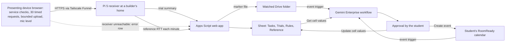

# RoomReady

RoomReady helps an Asia Pacific University (APU) student who joins online classes or presents from an off-campus room choose, for one upcoming session, a room, device and connection they have actually tested at that hour, and close what would stop the session before it starts. A two-minute foreground check on the presenting device measures the student's own options; a Gemini Enterprise workflow, started from the student's calendar, reconciles those readings with constraints only the student knows and proposes one next step for the student to approve. A household-noise branch, merged from QuietPact, drafts a consented quiet-slot request the student sends personally. Proposed track: **Smart Campus & Student Experience**. Caveat: nothing has been built or run, the pain evidence is a handful of anecdotes, and Zoom's own test plus a checklist may answer the same question, which the kill criteria test first. **Inference** marks conclusions no source states. Rank and score: see the [ranking](/docs/ideas/00-ranking.md).

Contents:

1.  [At a glance](#at-a-glance)
1.  [Origins](#origins)
1.  [Problem and evidence](#problem-and-evidence)
1.  [How it works](#how-it-works)
    1.  [Signal to cloud path](#signal-to-cloud-path)
    1.  [Workflows](#workflows)
    1.  [Rule set](#rule-set)
    1.  [States and failure handling](#states-and-failure-handling)
    1.  [Connectors and platform check](#connectors-and-platform-check)
    1.  [Cloud, IoT and network](#cloud-iot-and-network)
    1.  [Real data and privacy](#real-data-and-privacy)
1.  [Why people will use it](#why-people-will-use-it)
1.  [Why the crowd won't build it](#why-the-crowd-wont-build-it)
1.  [Off-campus fit](#off-campus-fit)
1.  [Scores](#scores)
1.  [Research plan](#research-plan)
1.  [Time to impact](#time-to-impact)
1.  [Demo and review](#demo-and-review)
1.  [Build plan](#build-plan)
1.  [Risks and kill criteria](#risks-and-kill-criteria)
1.  [Not verified](#not-verified)
1.  [See also](#see-also)

## At a glance

| Field                 | Plan                                                                                                                                                                                                                                     |
| --------------------- | ---------------------------------------------------------------------------------------------------------------------------------------------------------------------------------------------------------------------------------------- |
| Owner                 | The individual student who attends or presents; one team builder maintains the rules tab and the receiver. No APU office or student group owns it, and none is claimed.                                                                  |
| First users           | The three team members, all APU students, for their own real online sessions, if any fall before 10 November, and the hackathon video recording on 9 November; then 6–8 off-campus APU students recruited remotely (none recruited yet). |
| Track                 | Smart Campus & Student Experience.                                                                                                                                                                                                       |
| Trigger               | Google Calendar event trigger on the student's `RoomReady` calendar; Google Drive event trigger when a trial lands; a schedule at `07:00` and `17:00` MYT that sweeps sessions in the next 36 hours.                                     |
| Live signal           | A foreground check on the presenting device: required-service checks, 30 timed HTTPS requests and one bounded upload to the team's Pi 5 receiver, and a same-device relative microphone level.                                           |
| Connectors            | GA Google Drive and Sheets, and GA Google Calendar, both first party. No third-party connector does a real job for one student, so none is added.                                                                                        |
| Decision              | Which of the student's own declared options to use for this session, what to retest and when, whether to ask a willing housemate for a quiet slot, or `unknown`.                                                                         |
| Action and approval   | The student approves every Sheet status write and Calendar event at the workflow's Approval step. A housemate request is only a draft the student sends. Nothing turns ready without a fresh passing trial.                              |
| Reviewer self-trigger | Open the public check page on any device, declare a review task, and run the two-minute check against the live Pi receiver; seated reviewers then run `@RoomReady` on that row and approve their own write.                              |

## Origins

RoomReady merges two ideas from the sol set. Two scorers' merge notes found the same user, task, same-phone microphone level and Sheet-and-Calendar loop in both, so QuietPact becomes RoomReady's household-noise branch. RoomReady leads because one student gets value without a counterpart, and its device checks and transfers are measurable; QuietPact's own doc says its evidence shows noise, not willingness to negotiate.

- **[RoomReady](/docs/ideas/sol/02-roomready.md) (lead):** **Kept:** task-specific resolution across constraints; the foreground session on the actual presenting device; phone readings labelled as phone observations; opaque cross-origin results never called success; `unknown` as a valid answer; approved writes only; no landlord, router or restriction bypass; the baseline of Zoom test plus checklist plus reminder; the go thresholds and kill list. **Changed:** (1) the source started from a typed declaration around one presentation; tasks now arrive by Calendar event, a Drive event closes each trial, and a twice-daily schedule sweeps upcoming sessions, so recurring online classes count, which the research rates as more plausible recurring value than a one-off ([everyday](/docs/research/everyday.md#a-personal-trial-of-a-rented-desk-for-the-next-online-class)); (2) the source left the Pi unused, and a scorer marked the theme weak because of that and the single transfer, so the Pi 5 is now the receiver and a reference probe that separates receiver faults from the student's line, with a cut line back to Apps Script; (3) one transfer became a 30-request timed series plus one bounded upload; (4) the 3–4 remote participants became a 6–8 interview target with a recruiting path, plus 30 real trials as the item set; (5) the optional Jira integration is dropped rather than parked. **Dropped:** the source's rank, score and its comparison with another product, and its 6 November milestone, replaced by the build plan below.
- **[QuietPact](/docs/ideas/sol/04-quietpact.md):** **Kept:** the explicit accept, decline or counter-propose step with silence never counted as consent; the same-phone relative-level session with stop and delete controls; no cross-phone ranking or calibrated dBA claim; the neutral renegotiated-slot draft when an agreed plan failed; closure by the participants' stated outcome; never scoring or messaging a housemate automatically. **Changed:** from a standalone product that needs a willing household to a branch offered only when household noise is the blocker and the student names a housemate who agreed to be asked. **Dropped:** the standalone MVP, its "three willing households" target, its builder-hour estimate, and its rank and score.
- **Numbers re-checked:** the source totals hold (RoomReady's `6–8 + 4–6 + 4–5 + 4–5 = 18–24` hours, QuietPact's `18–26`), but the Pi receiver and the branch add work, so the estimate is now `21–28` hours (see [Build plan](#build-plan)). The `25%` preparation-time threshold and the 3-month "ten willing students" target are kept as proposals, not results. Every anecdote below was re-checked against the research record; Reddit served an HTML page instead of JSON when re-fetched on 5 November, so the posts weren't re-read live.

## Problem and evidence

- **APU, residence:** a [City of Green resident][cog] (June 2025) describes balcony shouting sometimes at 3–4 AM, and separates decent internet speed from services that won't load, naming YouTube comments and some websites. One commenter suggests mobile data; another says using it continuously is expensive ([everyday](/docs/research/everyday.md#an-apu-residence-can-be-fast-enough-yet-unsuitable-for-work)). **Inference:** a speed number doesn't answer whether the student's required services work from that desk.
- **Malaysia, time of day:** a UM KK12 resident (3 September 2026) says the room is noisy beside a highway and Wi-Fi quality depends on the time of day ([everyday](/docs/research/everyday.md#a-malaysian-resident-describes-both-highway-noise-and-time-dependent-wi-fi)). **Inference:** a midday test can't certify an evening class, so trials must match the session's hour.
- **Malaysia, choosing a connection:** a student planning night psychology classes asks whether an RM50 hotspot will hold, fearing a two-year fixed-line contract (27 June 2024) ([everyday](/docs/research/everyday.md#a-malaysian-student-needs-a-connection-without-a-long-commitment)). A KL tenant can't get the landlord to upgrade a shared line (1 June 2024) ([everyday](/docs/research/everyday.md#a-kl-tenant-cannot-change-the-shared-connection)). **Inference:** a student tool must choose among workarounds the student already has, not repair a network they don't control.
- **Malaysia, the required path:** during a 2020 Celcom disruption, one X post described messaging working while email, Google Meet and YouTube failed in class time, and another appealed to Celcom before a 10 AM class. Both originals are now unavailable and survive only in a news article's embeds ([everyday](/docs/research/everyday.md#online-class-connectivity-during-a-2020-celcom-disruption)).
- **Speaking, not just quiet:** two overseas Reddit threads separate silent listening from needing to speak, and quiet from permitted, private and reachable ([everyday](/docs/research/everyday.md#a-good-call-location-must-permit-speaking-as-well-as-be-quiet)). Those constraints need the student's own declaration; no sensor can infer them.
- **Volume at APU:** APU's public timetable feed lists `14` online rooms holding `227` sessions in the four weeks from 26 October, and `2,692` rows whose module section ends in ` (Online)` ([APU timetable](/docs/research/apu.md#timetable-room-codes)). **Inference:** online sessions recur weekly, but the feed doesn't say where students join them from, so this is exposure, not affected users.
- **Counterevidence:** a student on X finished group assignments at McDonald's because their university had no 24-hour place, accepting the noise, so quietest is not automatically best ([everyday](/docs/research/everyday.md#after-hours-places-for-group-assignments)). Zoom already documents speaker and microphone checks, a test meeting, and in-call latency, jitter and packet-loss statistics ([competition](/docs/research/competition.md#incumbents-checked-against-official-documentation)). Noise cancellation may make a room acceptable. No post asks for a tool, no APU original was verified on X, and household quiet-slot negotiation has no verified request at all ([everyday](/docs/research/everyday.md#what-remains-unsupported)).
- **Inference:** the pain is real for some students with two or more workable options and a history of failed sessions, but its prevalence is unknown: one APU anecdote, three Malaysian posts, one preserved 2020 outage discussion, and no measurement.

[cog]: https://www.reddit.com/r/malaysiauni/comments/1l4ub3h/dont_ever_come_to_apus_offcampus_city_of_green/

## How it works

### Signal to cloud path

The device-to-Sheet path is the no-card path the research recommends: HTTPS to an Apps Script web app, a Sheet in the licensed Workspace domain, and a live cell read, with device and receipt timestamps in separate columns so each row carries its own latency ([Gemini Enterprise](/docs/research/gemini-enterprise.md#phone-or-board-to-google-sheets)).

### Workflows

1.  **Task arrives (Calendar event trigger):** the student adds a session to a dedicated `RoomReady` calendar, once for a recurring class, listing required service domains (for example `zoom.us` or `lms2.apiit.edu.my`), the presenting device, and the options they can really use ("bedroom, home Wi-Fi", "bedroom, phone hotspot", "café downstairs, speaking allowed, closes 22:00"). Event triggers poll every 5–10 minutes ([triggers][ge-triggers]). A form on the check page writes the same row for a student without a calendar on the licensed domain.
1.  **Sweep (schedule, `07:00` and `17:00` MYT):** for each session in the next 36 hours, the workflow lists options without a fresh trial at the session's hour and drafts a check reminder at that clock time the day before.
1.  **Trial (foreground, about two minutes):** on the device they will present from, the student picks an option and runs the required-domain checks, 30 timed requests to the Pi at one a second, one upload capped at a proposed 1 MB (shown first, cancellable), a microphone level window, and a 10-second self-recording played back locally and rated by the student, never uploaded. They answer two declared questions: speaking permitted, private enough. Deterministic results show at once.
1.  **Reconcile (Drive event trigger):** when the trial row lands, Apps Script drops a marker file in a watched folder, since workflows have no webhook trigger ([triggers][ge-triggers]). The workflow reads the task, the latest trial per option, the Pi's reference rows and the rules live, and a Gemini agent node proposes one next step from the student's own options: use option B; retest A at 20:30; open the slide file on the laptop; ask the housemate; or `unknown`. It cites the rows it used.
1.  **Approve and close:** connector writes from a workflow require human review ([unattended runs][ge-unattended]), so the Approval step shows the proposal and the student approves the status write and any Calendar event. A blocker closes only when a new trial at the right hour passes; if the student declines or time runs out, the task stays `unresolved`. After the session the student records one outcome (fine, or what went wrong), which the research plan scores.

**Quiet-slot branch:** offered only when the student marks household noise as the blocker at that hour and has named a housemate who agreed to be asked. Gemini drafts a short, neutral request with the slot and one alternative; the student sends it through their own chat; the housemate answers on a one-tap page (accept, decline, or propose another time), and no answer is recorded as `no answer`, never as consent. An accepted slot becomes an approved event on the student's own calendar. During it, a same-device level session runs with stop and delete controls. If the student reports the slot failed, Gemini drafts a neutral new slot. A level change never assigns blame, and RoomReady never messages, scores or ranks a housemate.

### Rule set

An editable `Rules` tab the workflow reads on every run. The values are proposed defaults to tune on real trials, not findings:

- **Fresh trial:** same option, within 60 minutes of the session's clock time, in the last 7 days. Older trials appear dated and never count as current.
- **Ready option:** every required domain confirmed, the upload acknowledged by the receiver, at most 1 of 30 timed requests failed, the self-recording rated acceptable, and speaking declared permitted.
- **Receiver health:** if the Pi's own reference probe failed, or its median round trip doubled, in the 10 minutes around a trial, the trial is marked `receiver-side` and not held against the option.
- **Agent limits:** choose only among declared options and cite rows; never infer a firewall cause from a timeout, predict tonight from one trial, or compare two devices' microphone levels. The quiet-slot branch is off by default.

**What Gemini decides:** rules alone handle one option failing. The agent earns its place only where measured results conflict with the student's free-text constraints: the hotspot passes but the student noted a data cap, the quiet room passes but speaking isn't allowed after 22:00, or the class moved. **Inference:** if, across the first 10 real reconciliations, the rules-only pick always matches the agent's and no draft is used, the Gemini step only adds delay; RoomReady then fails gate G3 and should be dropped, not shipped as a rules app.

### States and failure handling

- **Microphone:** a denied or unanswered prompt shows `permission denied`, with no reading invented; the page records the track's reported automatic gain control and noise suppression settings, which alter levels ([phone sensors][iot-phone]).
- **Opaque service check:** a cross-origin check that returns an opaque response reads `needs confirmation` until the student opens the service on that device and confirms; it is never `pass`.
- **Receiver down:** if the Pi or Funnel is unreachable, the page posts the error straight to Apps Script and the trial shows `receiver unavailable` with the time; no earlier result is reused.
- **Upload not acknowledged:** shown as `unknown`, never as a pass.
- **Agent delayed:** a run waiting at Approval reads `awaiting approval since HH:MM`; expired 14-day schedule credentials read `agent paused`; an event run that fails on quota isn't retried by the platform ([unattended runs][ge-unattended]), so the next sweep picks the task up and the page says so.
- **Housemate silent:** `no answer`, and the branch proposes the student's next own option instead.

### Connectors and platform check

| Connector or tool                | Status   | Job in RoomReady                                                                                                                                                        | Platform constraint                                                                                           |
| -------------------------------- | -------- | ----------------------------------------------------------------------------------------------------------------------------------------------------------------------- | ------------------------------------------------------------------------------------------------------------- |
| Google Drive and Sheets          | GA, 1P   | Live `Get cell values` on Tasks, Trials, Rules, Reference; approved `Update cell values`; Drive event trigger                                                           | Needs a Workspace domain with a Customer ID; consumer `@gmail.com` gets `403` ([account limits][ge-accounts]) |
| Google Calendar                  | GA, 1P   | Event trigger on new or changed sessions; approved `Create event` for retests and accepted quiet slots                                                                  | Same Workspace requirement; 5–10 minute polling, so no instant alarm                                          |
| Third-party connectors           | None     | Conceded: no 3P system holds a solo student's sessions. APU's Outlook would need an app registration in APU's Entra tenant, which only APU IT can grant (**Inference**) | Jira was dropped rather than added as decoration                                                              |
| Globalping (preview), custom MCP | Not used | Globalping measures from public probes, not the student's line; no MCP step is needed                                                                                   | Both are preview and stay off the critical path                                                               |

RoomReady doesn't read APU's timetable feed: APU's Terms of Use reserve copyright and ask permission for any use ([APU](/docs/research/apu.md#terms-of-use-and-robotstxt)), so the student's own calendar is the task source.

### Cloud, IoT and network

- **Cloud:** Apps Script and a Sheet land each trial where a GA connector reads it live; the Gemini Enterprise workflow carries the triggers, rules, reconciliation and approval.
- **IoT:** the presenting device's browser is the sensor, with microphone and network access over HTTPS. The Pi 5 is the receiver, behind Tailscale Funnel's stable hostname and trusted certificate ([public HTTPS][iot-https]), and a reference probe that pings public targets each minute to separate "receiver's line degraded" from "student's line failed" ([latency logging](/docs/research/iot-and-network.md#latency-logging)).
- **Network:** the network is the thing measured. Each trial row carries device start time, Pi receipt times, median and 90th-percentile round trip, failed requests, bytes uploaded, and Sheet append time. Honest limit: a short HTTPS test is evidence about that request to that endpoint, not Zoom or Teams call quality, and a phone's reading can't certify a laptop ([network visibility][iot-network]). Funnel's bandwidth limits are unpublished, so the upload result is about Funnel's path too.

### Real data and privacy

- **Real data only:** every trial is a live reading from a real option the student has; if neither option fails, the result shows the measured comparison and no bad connection is staged. Reviewer rows sit in a separate `reviewer` partition and never count as evidence.
- **Audio:** levels are computed on the device; the self-recording stays local and is discarded; no raw audio, speech text or speaker identity is uploaded. Same-device relative levels are not calibrated dBA or legal findings ([NIOSH note](/docs/research/competition.md#incumbents-checked-against-official-documentation)).
- **What is stored:** option labels the student chooses, service domains rather than meeting links or tokens, no addresses, and a housemate only as a label ("Housemate A") with their accept, decline or counter time. Stop and delete controls cover every session.

## Why people will use it

- **Solo value on the first two trials:** a student needs no crowd, map, landlord or campus booking; two real trials of options they already have produce a dated comparison at the hour that matters.
- **The strongest objection, answered in part:** Zoom's test plus a checklist answers "do my mic and connection work right now" ([competition](/docs/research/competition.md#incumbents-checked-against-official-documentation)). RoomReady's claimed difference is narrower: it tests the alternatives before they're needed, at the session's hour, checks the services the class needs (the City of Green failure), keeps the student's own dated history, and holds a blocker open until a retest passes. For a student with one reliable connection, Zoom's test is enough, and RoomReady adds nothing.
- **Conceded:** the only cited workarounds are hotspots and Zoom's test, and RoomReady asks for a new preflight habit, so revealed demand is unproven.

## Why the crowd won't build it

Across the `780`-idea crowd baseline, Wi-Fi and network diagnosis is saturated (`8.7%`) and study-space finders are crowded (`4.8%`) ([saturation tiers](/docs/research/competition.md#saturation-tiers)). RoomReady sits beside both, so its originality is moderate. What separates it is the job: those clusters watch campus access points or map rooms, while RoomReady makes one student's decision among their own options. The research's takeaway favours exactly this kind of student-owned, decision-changing workflow, including "which mutually agreed quiet period remains achievable" ([takeaways](/docs/research/competition.md#takeaways-for-this-hackathon)). **Inference:** most rival demos will run on simulated readings ([crowd misses](/docs/research/competition.md#what-the-crowd-structurally-misses)), while RoomReady's only input is the student's real line.

## Off-campus fit

**Pass.** The critical path needs nobody at APU, no APU staff action, and only the team's phones at home (a laptop runs the same page where a student presents from one), the one Pi 5 at a builder's home, and free accounts plus the sponsored licence. The quiet-slot branch is conditional: it works only if a team member lives with a housemate willing to be asked; otherwise it is shown as untested, never staged.

## Scores

**51.7 / 100, rank 15 of 18** in the [cross-set ranking](/docs/ideas/00-ranking.md); it passes every gate, with G3 conditional. Scored on 5 November 2026 on the [matrix](/docs/ideas/00-ranking.md#scoring-matrix) by three independent scorers who read this doc and checked its claims: an NTT DATA forward deployed engineer (FDE), an APU School of Technology IoT lecturer, and a Google Cloud advocate who is also an APU student. Models: FDE (Claude Opus 5.5), Lecturer (Claude Sonnet 5.5), Advocate (Claude Fable 5.1). Day-to-day workflow and theme take the lowest score; the rest take the mean.

| Component           | Weight | FDE | Lecturer | Advocate | Used | Lowest scorer's reason                                                                                                                                                                                                                                   |
| ------------------- | -----: | --: | -------: | -------: | ---: | -------------------------------------------------------------------------------------------------------------------------------------------------------------------------------------------------------------------------------------------------------- |
| Impact              |     13 |   2 |        2 |        2 |    2 | The owner is the individual student and no APU office or group is claimed; the 227 online sessions (checked in apu.md) measure exposure, not affected users, and the baseline is the team timing itself.                                                 |
| Connectors          |     13 |   2 |        3 |        3 | 2.67 | Only two 1P connectors (Drive/Sheets, Calendar) do real jobs; the doc concedes no 3P connector, which NTT DATA named as half the technical focus.                                                                                                        |
| Day-to-day workflow |     13 |   3 |        3 |        3 |    3 | The Calendar and Drive event triggers, twice-daily sweep, Rules tab and Approval are real, but every reading needs the student to run a two-minute foreground check, so nothing useful happens unattended.                                               |
| Research            |     13 |   2 |        2 |        2 |    2 | The evidence is one APU anecdote, three Malaysian posts and a 2020 outage (all checked in everyday.md), with no prevalence data; the 30 trials are the team's own and the doc expects fewer than 6 interviews.                                           |
| Time to impact      |     13 |   3 |        3 |        2 | 2.67 | Value for the team is immediate, but each approving student needs a Gemini Enterprise seat at $30 a month after the trial (confirmed in gemini-enterprise.md), so the 3-month 'ten students' plan has no funding path.                                   |
| Theme               |     10 |   4 |        3 |        4 |    3 | A browser on the presenting device measures its own network and mic and the Pi receiver and reference probe make the network visible per trial, but timings to a single home Pi through Funnel say little about Zoom and the mic level is relative only. |
| Originality         |      9 |   2 |        3 |        2 | 2.33 | It sits beside the saturated Wi-Fi-diagnosis tier, and Zoom's test meeting and latency/jitter stats (checked in competition.md incumbents) already ship the core check.                                                                                  |
| Real use            |      6 |   2 |        2 |        2 |    2 | The doc concedes the only cited workarounds are hotspots and Zoom's test, and the product needs a new preflight habit.                                                                                                                                   |
| Buildability        |      5 |   3 |        3 |        3 |    3 | It runs to 21-28 hours across a check page, Pi plus Funnel, Apps Script, a Drive marker, a Calendar trigger, a workflow and a branch page, with cut lines.                                                                                               |
| Demo                |      5 |   4 |        4 |        4 |    4 | A reviewer can open the public check page and run a live check from anywhere, and taking the Pi offline on camera shows the loud failure.                                                                                                                |

- **Gates:** G1 pass (3 pass, 0 conditional, 0 fail); G2 pass (3 pass, 0 conditional, 0 fail); G3 conditional (0 pass, 3 conditional, 0 fail); G4 pass (3 pass, 0 conditional, 0 fail).
- **Off-campus gate, per the lowest scorer:** Nothing needs campus presence or APU staff: phones at home, the Pi at a builder's home, free accounts. The quiet-slot branch needs only a willing housemate.
- **What would help most, per the lowest scorer:** Find a named cohort with recurring online sessions (for example a part-time or online-module intake whose rep agrees to own it) to supply countable real sessions and a before/after failure rate, and give it a 3P connector that does real work.

## Research plan

Nothing below has been run. Everything is reachable from home by 10 November:

1.  **Team baseline (Sun 8 Nov, 3 person-hours):** each team member prepares for a real spoken task, the hackathon video recording on 9 November, first with Zoom's test plus a checklist, timed, then with RoomReady, logging minutes to a justified choice, unresolved checks and any changed choice.
1.  **30 real trials (5–9 Nov):** across three homes, each available option, and the hours of real sessions. Each trial plus the student's outcome after the session is one item; count how often RoomReady's verdict matched what happened, and how often a Zoom test at the same time agreed.
1.  **6–8 interviews (recruit 5–7 Nov):** reply in public threads where students already posted about housing or connections, then ask past-tense questions about their last failed or risky online session and what they did ([recruiting](/docs/research/everyday.md#how-a-remote-team-could-use-them)). APU survey requests draw almost no replies ([everyday](/docs/research/everyday.md#what-recruiting-looks-like-there)), so expect fewer than 6 by 10 November and report the real count.
1.  **Quiet-slot check (only with a willing household):** one real request through accept, decline or counter, with both sides interviewed separately.

## Time to impact

- **By 5 February 2027 (3 months), owner: the team's product lead:** ten willing off-campus APU students use RoomReady for at least two real sessions each; count repeat sessions and choices changed and confirmed by a retest, not app opens. The quiet-slot branch reports however many real requests occur, with no target.
- **By 5 May 2027 (6 months), owner: a student maintainer:** continue only if repeat benefit beats preparation time, data cost, battery and licence cost, and the agent's pick differs usefully from rules alone.
- **Assumptions:** the licence sits on a Workspace domain; each approving student has a seat; the Pi stays online at a builder's home; no APU system change is needed. Conceded: after the trial, seats start at `$30` per seat per month ([editions](/docs/research/gemini-enterprise.md#gemini-enterprise-editions-and-prices)), which no student will pay, so the 6-month plan depends on a sponsored or education licence (no public EDU price was found), or RoomReady stays a team-internal tool.

## Demo and review

- **Recorded 3:45 video (captured 9 Nov, labelled with its date):** a team member adds the real recording session to the `RoomReady` calendar; the workflow's run appears; two real options are checked from that member's room; a real failure is shown only if one happens. Taking the Pi offline on camera turns the next trial into `receiver unavailable`, not a failed connection. The Approval step writes the retest event; the retest closes the blocker. The video follows the [minute plan](/docs/research/judging.md#minute-plan).
- **Reviewer path (11–14 Nov):** any reviewer opens the public check page, declares a review task, and runs the check from wherever they are, seeing deterministic results at once. Seated reviewers run `@RoomReady` on their row, which starts their own run, and approve their own write. Everyone else sees the owner's Runs tab captured over several days in the README ([reviewer access](/docs/research/gemini-enterprise.md#reviewer-access)).

## Build plan

Three builders: **B1** (Sheet, Apps Script, workflow, rules), **B2** (check page, branch page), **B3** (Pi receiver and reference probe, trials, research, video). Estimate `21–28` combined hours: 8–10 for the page and receiver, 4–6 for the workflow and rules, 2–3 for the branch, 4–5 for trials, 3–4 for reviewer access and the video.

| Day        | Critical path                                                                                                                                                                                                                                                                                           | Exit check                                                                   |
| ---------- | ------------------------------------------------------------------------------------------------------------------------------------------------------------------------------------------------------------------------------------------------------------------------------------------------------- | ---------------------------------------------------------------------------- |
| Thu 5 Nov  | **B1:** Sheet tabs and Apps Script `doPost` with device and receipt timestamps; ask organisers which domain holds the licence. **B2:** task form, microphone states, service checks. **B3:** Pi receiver behind Funnel, reference probe timer.                                                          | One real trial row from a team member's home; Pi offline shows its error.    |
| Fri 6 Nov  | **B1:** if licensed, Calendar and Drive triggers, schedule, Gemini node, Approval, Calendar write; if not, run the reconciliation by hand on real rows, labelled pre-licence. **B2:** timed series, capped upload, cancel, opaque handling. **B3:** first trials at real session hours; start outreach. | One approved retest event from a real task, or a logged pre-licence dry run. |
| Sat 7 Nov  | **B1:** rules tab live; decide by 12:00 whether a willing housemate exists. **B2:** branch page, or cut it. **B3:** 15 cumulative trials; judge Funnel stability.                                                                                                                                       | Receiver choice fixed: Pi or Apps Script.                                    |
| Sun 8 Nov  | Deepavali; registration closes `23:59`. **All:** confirm registration by 12:00; run the team baseline. **B3:** 30 cumulative trials.                                                                                                                                                                    | Baseline and 30 items logged.                                                |
| Mon 9 Nov  | Holiday; feature freeze at 12:00. Record the video on the real recording session; README, deck, logged-out check of the reviewer page.                                                                                                                                                                  | Video uploaded unlisted; owner's Runs tab captured.                          |
| Tue 10 Nov | Refresh schedule credentials; re-check every cited number; the leader submits by 18:00; leave the Pi and workflow running through 14 Nov.                                                                                                                                                               | Entry locked; a sweep run completes cleanly.                                 |

**Cut lines, in order:** (1) the quiet-slot branch; (2) the Pi receiver, replaced by an Apps Script receiver if Funnel drops during Friday's trials, with the Pi then stated as unused; (3) the Calendar trigger, leaving the form and schedule. **Never cut:** live Sheet reads, the Gemini reconciliation with Approval, loud failure states, and real trials.

## Risks and kill criteria

- **Go thresholds (proposed, from the lead source):** at least two participants with a recurring blocker the Zoom checklist didn't resolve; three comparable task trials; at least one real changed choice confirmed by a retest; `25%` lower median preparation time without more false-ready decisions; at least two voluntary repeat sessions. "Usable in this trial" is never a guarantee about tonight's class.
- **Fatal: Zoom's test plus a checklist is equally useful.** Kill if the team baseline and interviews find no blocker the Zoom test missed, or if no recommendation changes a choice that a retest then confirms.
- **The Gemini layer adds only delay:** kill on the rule in [Rule set](#rule-set); without a deciding Gemini step, the product fails gate G3.
- **Licence on a consumer account:** Drive and Calendar return `403`, and no GA path remains without a card. Supabase is preview, so RoomReady would lose its critical path; choose another product rather than move it onto a preview connector.
- **Seats:** if seats are per team, only the owner approves, and other students see deterministic results only.
- **Privacy and coercion:** microphone burden may deter repeats; a housemate request can carry pressure. The branch stays off by default, drafts only, and records silence as `no answer`.
- **Funnel and home uptime:** users report Funnel stopping after a control-plane reconnect until `tailscaled` restarts ([public HTTPS][iot-https]); a home power cut takes the receiver down during judging, which the page shows as an error.

## Not verified

- **Nothing executed:** no trial, workflow run, Funnel test, interview or baseline has been run by a person. The thresholds and defaults above are proposals.
- **Platform:** whether licences are per person or per team, which domain holds them, whether a seated reviewer from another domain can read the team's Sheet through Drive's federated mode, whether each Sheet write in one run pauses separately, and Apps Script's own latency.
- **Evidence:** the anecdotes were checked against the research record, not re-read live; prevalence among APU students, where they join online sessions from, and whether any household will accept a quiet-slot request are unknown.

## See also

- [RoomReady source idea](/docs/ideas/sol/02-roomready.md) and [QuietPact source idea](/docs/ideas/sol/04-quietpact.md)
- [Cross-set ranking](/docs/ideas/00-ranking.md)
- [Everyday signals: study places and working conditions](/docs/research/everyday.md#study-places-and-working-conditions)
- [Competition: incumbents and saturation tiers](/docs/research/competition.md)
- [Gemini Enterprise: triggers, connectors, approvals and reviewer access](/docs/research/gemini-enterprise.md)
- [IoT and network: phone sensors, Pi receiver and network visibility](/docs/research/iot-and-network.md)
- [APU: timetable feed and terms of use](/docs/research/apu.md)

[ge-triggers]: /docs/research/gemini-enterprise.md#triggers-and-schedules
[ge-unattended]: /docs/research/gemini-enterprise.md#what-runs-without-anyone-signed-in
[ge-accounts]: /docs/research/gemini-enterprise.md#edition-and-account-limits
[iot-phone]: /docs/research/iot-and-network.md#phone-and-laptop-sensors-in-the-browser
[iot-https]: /docs/research/iot-and-network.md#public-https-without-a-card
[iot-network]: /docs/research/iot-and-network.md#what-a-judge-can-see-of-the-network
