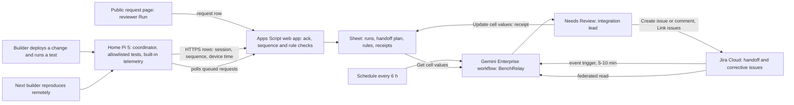

# BenchRelay

BenchRelay tells the next member of a remote student team what is actually running on the team's one shared Raspberry Pi, which real test observations belong to that revision, and what must be resolved before a handoff is ready. When something isn't ready, it drafts the one corrective task for the team's integration lead to approve. It is for a 2–5 person student team whose only board sits at one member's home, under the proposed track **Intelligent Automation & Digital Transformation**. Caveat: the only such team found is this hackathon team itself. No APU student group, office or measured pain has been found, so the impact this week is limited to the team's own handoffs. Nothing here has been built or run by a person yet; **Inference** marks conclusions no source states.

Contents:

1.  [At a glance](#at-a-glance)
1.  [Origins](#origins)
1.  [Problem and evidence](#problem-and-evidence)
1.  [How it works](#how-it-works)
    1.  [Day-to-day loop](#day-to-day-loop)
    1.  [Handoff rule set](#handoff-rule-set)
    1.  [States and failure handling](#states-and-failure-handling)
    1.  [Connectors and platform check](#connectors-and-platform-check)
    1.  [Cloud, IoT and network](#cloud-iot-and-network)
    1.  [Real data and privacy](#real-data-and-privacy)
1.  [Why people will use it](#why-people-will-use-it)
1.  [Why the crowd won't build it](#why-the-crowd-wont-build-it)
1.  [Off-campus fit](#off-campus-fit)
1.  [Scores](#scores)
1.  [Research plan](#research-plan)
1.  [Time to impact](#time-to-impact)
1.  [Demo and review](#demo-and-review)
1.  [Build plan](#build-plan)
1.  [Risks and kill criteria](#risks-and-kill-criteria)
1.  [Not verified](#not-verified)
1.  [See also](#see-also)

## At a glance

| Field                 | Plan                                                                                                                                                                                                                                                     |
| --------------------- | -------------------------------------------------------------------------------------------------------------------------------------------------------------------------------------------------------------------------------------------------------- |
| Owner                 | The integration lead of a student team that shares one Pi. Today that is this team's own integration builder. No APU office or outside group owns anything, and none has been recruited.                                                                 |
| First users           | This hackathon team: three builders and one Raspberry Pi 5 (8 GB) at one builder's home, so two of the three work on it remotely. No other team has been identified.                                                                                     |
| Track                 | Intelligent Automation & Digital Transformation, whose listed ideas include "connecting devices with useful actions" ([brief](/docs/BRIEF.md#challenge-tracks)).                                                                                         |
| Trigger               | A Jira Cloud event trigger when a handoff issue is created or moved to `Handoff requested` (5–10 minute poll), plus a schedule every 6 hours that sweeps for stale receipts and for runs that have no decision.                                          |
| Live signal           | Real runs of a small allowlisted test set on the Pi. Each records the running Git revision, test version, session nonce and result, plus SoC temperature, `get_throttled` flags, supply voltage, boot ID, sequence number, and device and receipt times. |
| Connectors            | GA Google Drive and Sheets (run rows, handoff plan, rule tab; Workspace domain only) and GA Jira Cloud (handoff and corrective issues). GitHub, MCP and preview features stay off the critical path.                                                     |
| Decision              | Whether the handoff is `ready`, `stale`, `not comparable` or `unknown`. If it isn't ready: which contradiction or missing check blocks it, and the one request that would close it.                                                                      |
| Action and approval   | The workflow drafts one Jira issue or comment with evidence IDs and the acceptance condition. The integration lead approves at **Needs Review** before anything is written to Jira or the receipt row.                                                   |
| Reviewer self-trigger | Without a seat: press `Run` on the public request page. One allowlisted test runs on the real Pi (rate-limited), and the run, its rows and its receipt state appear on the status page. With a seat: run `@BenchRelay` on that run.                      |

## Origins

This product has one source, the [BenchRelay source doc](/docs/ideas/sol/01-benchrelay.md). This version revises it against three independent scorers' objections and the team's limits:

- **Kept:** the job (reproduce the last trusted observation and see what the teammate left unresolved); the handoff receipt and its fields, which go stale when the revision or declared configuration changes; sensed facts kept apart from human declarations; `unknown` instead of a diagnosis when telemetry is missing, and readings that arrive after a reconnect marked as historical backlog; a local coordinator that gives one session exclusive use of the Pi, runs only allowlisted tests and never runs shell commands an agent wrote; the baseline of README, Git/CI, remote shell and a shared checklist; Drive and Sheets plus Jira; the go thresholds and kill criteria; the 20–28 builder-hour estimate; and the dated plan.
- **Changed:**
  1.  _No trigger was named (the source said only "a low-frequency workflow"):_ added a Jira event trigger on the handoff issue and a 6-hourly sweep.
  2.  _The rule set was implicit:_ made it a Sheet tab the lead edits, covering acceptance conditions, required tests, the hardware flags that invalidate a run, and freshness limits.
  3.  _A reviewer can't reproduce anything on the team's Pi:_ added a public, rate-limited request page that queues one allowlisted test on the real Pi.
  4.  _The Pi senses only itself:_ kept that, and argued that the Pi is the right subject here, because it is the device under test. Added the undervoltage flags, supply voltage and boot ID the Pi already reports, so a run made while throttled or after a brownout is marked `not comparable`.
  5.  _Only the team uses it:_ conceded in the intro, the at-a-glance table and the risks, not answered. Added six interviews and a recruiting post aimed at outside teams to the research plan.
  6.  Added a Jira-only path in case the licence lands on a consumer account.
- **Dropped:** the source's rank-and-score line, and its link to its own set's submission gates (replaced by the build plan below).
- **Facts re-checked:** the Raspberry Pi Connect for Organisations page was read live on 5 November. It confirms device access shared among several members, a 90-day audit log and a four-week free trial, and states no per-device price. The Reddit comment couldn't be re-fetched, because Reddit refused the automated request on 5 November. Its details rest on the [everyday record](/docs/research/everyday.md#a-student-directly-asks-how-a-group-should-keep-testing-on-one-pi).

## Problem and evidence

- **The only direct demand signal is overseas and old:** in the 23 November 2020 r/raspberry_pi helpdesk thread, a student in a programming-class group project asks a question about one physical Pi with sensors attached. Members code on their own machines and use GitHub, and the student asks how they can keep testing revisions on the Pi without huddling around it, and whether they must repeatedly compile, transfer and run code ([comment](https://www.reddit.com/r/raspberry_pi/comments/jzubxl/comment/ge6vrc3/), [everyday](/docs/research/everyday.md#a-student-directly-asks-how-a-group-should-keep-testing-on-one-pi)). The research labels it overseas transfer evidence and partly a beginner tooling question. It notes that the post reports no conflicting deployments, no lost evidence and no wish for an agent.
- **A bundled task, also old:** a master's student (about 2022, location unspecified) wants an ESP32 group project with sensor data, control, a camera, Git and a shared dashboard ([everyday](/docs/research/everyday.md#a-masters-student-wants-code-device-data-control-and-visual-evidence-together)). It shows that code and device evidence belong in one record, not that current tools fail.
- **Adjacent Malaysian behaviour:** r/malaysiauni and X threads list "document everything" and keeping the lecturer informed as workarounds against free riders, and an overseas reply recommends "screenshots of the document editing history" ([group assignments](/docs/research/everyday.md#group-assignments-and-free-riders)). **Inference:** students already spend effort keeping records of who did what in group work. Those threads are about written assignments, not hardware, and don't show that anyone would adopt a receipt.
- **The team's own case:** the team's devices are phones and one Pi 5 at a member's home with no add-on sensors ([team's devices](/docs/research/iot-and-network.md#the-teams-devices)), so every change made to that Pi this week is a real handoff between a home and two remote builders. **Inference:** this is a genuine instance of the job, but a circular one: the builders are the users, and the prototype on the Pi is BenchRelay's own collector.
- **Counterevidence:** current tools cover most of the job ([incumbents](/docs/research/competition.md#incumbents-checked-against-official-documentation)). Raspberry Pi Connect gives a browser shell and screen sharing over the internet, and its Organisations plan adds several members and an audit log; GitHub self-hosted runners support Linux ARM64, so CI already runs on a Pi; labgrid already gives exclusive remote access to boards; and Arduino Cloud covers shared telemetry, dashboards and triggers. The research's own kill test says Pi Connect plus a GitHub runner plus a short README "may be enough" ([test receipt direction](/docs/research/everyday.md#a-test-receipt-for-the-one-shared-prototype)).

- **What's missing:** there is no APU or Malaysian higher-education evidence of handoff pain around a shared board, no measured volume, no timed baseline and no willing outside team ([what remains unsupported](/docs/research/everyday.md#what-remains-unsupported)). **Inference:** NTT DATA's first criterion, impact on "students, the university, or operations", is this product's weakest point, and nothing this week can fix it.

## How it works

### Day-to-day loop

1.  **Handoff request:** the outgoing builder creates the device's handoff issue in Jira, or moves it to `Handoff requested`, with a free-text note on what changed and what is unresolved. They also fill in the declared configuration row in the plan tab: what is wired, which branch is deployed, and any manual step. Declarations are shown as declared, never as sensed.
1.  **Run:** the builder deploys over the remote shell and runs one allowlisted test. The coordinator on the Pi takes the exclusive session lock and records the test, its version, the running revision, the nonce and the start and end evidence, along with the built-in telemetry before and after the run. Locks and leases live on the Pi in deterministic code, never in the workflow or a model ([F2](/docs/research/gemini-enterprise.md#platform-constraints-and-design-consequences)).
1.  **Upload:** the collector POSTs numbered rows, and Apps Script acknowledges each one with its receipt time. Rows that weren't acknowledged stay buffered and upload on reconnect, marked `historical`. Apps Script then runs the fixed checks: the revision matches the declared plan, the required tests are present, no invalidating flag is set, and the sequence is complete.
1.  **Decision (Gemini Enterprise):** the Jira event, or the sweep, starts `BenchRelay`. It reads the run range and the plan and rules tabs through `Get cell values`, plus the device's open Jira issues. The interpretive part is what code can't do:
    - checking the outgoing note and the Jira comments against the observed runs, for example a note that says a timeout is fixed while the last run on that revision still fails that test, or a declared wiring change that no run has exercised;
    - deciding which open issue a failure belongs to;
    - drafting the one request, with evidence IDs and the acceptance condition, or a `ready` verdict that needs no action.
1.  **Approval:** the lead approves the draft. Jira gets the issue or comment, deduplicated on a device, session and reason key, and the receipt row in the Sheet is updated.
1.  **Reproduction:** the next builder runs the same test remotely. A receipt is accepted only after a matching real result on the same revision and that builder's explicit acceptance; closing a ticket isn't proof. A later revision or declared-configuration change reopens the readiness review.
1.  **Sweep every 6 hours:** one digest draft lists stale receipts, runs with no decision, and locks held past their lease.

### Handoff rule set

The Sheet's `rules` tab is the editable rule set, with one row per test family. Each row holds the allowlisted test IDs and versions and which of them must pass for `ready`; the maximum observation age; which `get_throttled` bits, or a boot ID change during a run, make a run `not comparable`; which configuration fields are declared and which are sensed; the acceptance condition text; and the reviewer request rate limit and sweep cadence. The integration lead sets every value, and the workflow never edits the tab. Each run is checked against the rule version that was current when it was captured.

### States and failure handling

- **Receipt states:** `draft` → `pending review` → `accepted` once a matching reproduction arrives, then `stale` when the revision or declared configuration changes. A required run that was throttled, undervolted or interrupted by a reboot makes the receipt `not comparable`. A newest reading older than the rules' limit gives `unknown`, never "failed hardware".
- **Delivery:** every row carries a sequence number, a device time and a receipt time. Gaps show as `missing seq 41–44`, and backlog rows keep both times and the `historical` mark. A latest status never reuses an old success after a failure.
- **Ingest errors:** the status page shows the HTTP status, and the rows stay in the Pi's local buffer. No cached value is shown in their place.
- **Workflow failures:** event runs that fail with `RESOURCE_EXHAUSTED` aren't retried, so the sweep picks up any run with no decision. Schedule credentials expire every 14 days, so a builder refreshes them on 10 November ([unattended runs](/docs/research/gemini-enterprise.md#what-runs-without-anyone-signed-in)).
- **Lock conflicts:** a second session or reviewer request while the Pi is locked is refused on the Pi, which shows `device busy: session S until HH:MM`.
- **Home Pi:** systemd units use `Restart=always`, a hardware watchdog is on, and OS updates are frozen from 10 to 14 November ([keeping it alive](/docs/research/iot-and-network.md#keeping-it-alive-unattended)). When the Pi stops reporting, the status page reads `Pi offline since HH:MM`, never a fake heartbeat.

### Connectors and platform check

| Connector or tool           | Status   | Role in BenchRelay                                                                                           | Platform constraint ([Gemini Enterprise](/docs/research/gemini-enterprise.md))                                    |
| --------------------------- | -------- | ------------------------------------------------------------------------------------------------------------ | ----------------------------------------------------------------------------------------------------------------- |
| Google Drive and Sheets     | GA (1P)  | `Get cell values` on runs, plan and rules; `Update cell values` on the receipt row after review              | Workspace domain with Customer ID only; consumer `@gmail.com` gets `403` ([account limits][acct])                 |
| Jira Cloud                  | GA (3P)  | Event trigger on handoff issues; federated read of blockers; `Create issue`, `Create comment`, `Link issues` | Connector writes need human review ([actions][actions]); Jira Cloud Free covers 10 users ([sandboxes][sandboxes]) |
| Apps Script web app         | Feeder   | Acknowledgements, sequence and rule checks, request queue, status page                                       | No card; clients must follow the redirect (`curl -L`) ([Pi to Sheets][pi-sheets])                                 |
| GitHub                      | Off path | None; each reading carries the revision ID instead                                                           | Not on the workflow connector list, checked 5 November ([F4][f4])                                                 |
| Tailscale SSH or Pi Connect | Tooling  | Remote shell for the next builder                                                                            | Pi Connect's personal account provides a single user ([remote access][remote])                                    |
| Antigravity                 | Tooling  | Builds the collector, coordinator and Apps Script                                                            | Free-trial seats exclude it; the free Individuals plan is the fallback                                            |

Proving one live Sheet read and one reviewed Jira create comes before any other build work ([F4][f4]). Jira's `Change issue status` is listed but stays unproven until it works in the app, so the critical path uses create, comment and link only.

If the licence lands on a consumer account, Drive and Sheets fail with `403`. In that case, Apps Script mirrors each run summary as a comment on the handoff issue through Jira's REST API, and the workflow reads Jira alone. That keeps a GA connector on the critical path but loses the 1P one.

[acct]: /docs/research/gemini-enterprise.md#edition-and-account-limits
[actions]: /docs/research/gemini-enterprise.md#actions-and-write-back
[sandboxes]: /docs/research/gemini-enterprise.md#free-sandboxes
[pi-sheets]: /docs/research/iot-and-network.md#pi-to-apps-script-and-sheets
[f4]: /docs/research/gemini-enterprise.md#platform-constraints-and-design-consequences
[remote]: /docs/research/iot-and-network.md#network-and-remote-access

### Cloud, IoT and network

- **Cloud:** Gemini Enterprise runs the deciding step, and Apps Script, Sheets and Jira Cloud Free need no card. Four sweeps a day and a few events should fit inside 160 queries per seat a day on Standard. One run isn't necessarily one query, so the team measures actual use ([F3](/docs/research/gemini-enterprise.md#platform-constraints-and-design-consequences)).
- **IoT:** the Pi is the device under test, so its built-in readings are the physical state that matters at a handoff: `measure_temp`; `get_throttled`, which reports undervoltage, a capped frequency and throttling, both now and since boot; `pmic_read_adc` for the `EXT5V_V` supply voltage; and the boot ID ([power and throttling](/docs/research/iot-and-network.md#power-undervoltage-and-the-rtc)). Raspberry Pi measured a bare Pi 5 throttling from 2.4 GHz to 1.5 GHz under sustained four-core load ([temperature](/docs/research/iot-and-network.md#temperature-and-throttling)), so a result taken while throttled isn't comparable to one taken cool. Honest limit: these readings sense the board, not the room or anything wired to it, and declared wiring stays a declaration. Phones have no role, and adding one would be decoration.

- **Network:** two remote builders must agree on which run arrived and what state it describes. Sequence numbers, per-row latency (device time against receipt time), and a real upstream disconnect make the network visible: the disconnect shows `unknown`, and the backlog arrives as `historical` after reconnect ([network visibility](/docs/research/iot-and-network.md#what-a-judge-can-see-of-the-network)). The Pi makes only outbound HTTPS calls, including its 30-second request poll, so no inbound port opens at a home.

### Real data and privacy

- **Partitions:** `handoff` holds the team's real runs and handoffs and is the only evidence counted. `reviewer` holds runs that reviewers request and is never counted. There are no mock, sample or replayed runs, and nothing needs mock GPS.
- **Data:** Pi hardware readings, test output, Git revisions and pseudonymous builder IDs. No location, audio, camera or personal records. The public page holds no secrets, and the Jira API token stays in Apps Script's Script Properties.

## Why people will use it

- **The claimed gain:** the next builder starts from an accepted receipt instead of reconstructing the revision, the device state and the last working test. One builder gets a reproducible run history before any teammate joins. The source's go line is a median reconstruction time at least 30% lower across at least three handoffs. **Inference:** none of this has been measured.
- **The concession:** there's no revealed demand beyond the team. The only cited workaround is general group-work record-keeping, and using a receipt is a new habit. **Inference:** Jira suits builders better than it suits most student users, but that is a guess about this team, not evidence of uptake.

## Why the crowd won't build it

No cluster in the 780-idea [crowd map](/docs/research/competition.md#crowd-map) covers shared-prototype handoffs or developer tooling. The nearest pattern is the telemetry-to-ticket agent: network diagnosis plus facilities fault-to-ticket hold 16.3% of simulated ideas, and both sit in the saturated tier ([saturation tiers](/docs/research/competition.md#saturation-tiers)). BenchRelay looks like that pattern on the surface, because it files Jira tasks from device telemetry. It differs in its trigger and its owner: a handoff starts it, not a threshold alert, and the task goes to the team's own corrective queue, not an IT queue. Reviewers may still pattern-match it.

Elsewhere in the simulation, 48% of ideas deploy new sensors, and only 1% combine an unattended run, a named owner and a measured baseline ([crowd misses](/docs/research/competition.md#what-the-crowd-structurally-misses)). The crowd is thin here, but the incumbents aren't: labgrid, Pi Connect, GitHub runners and Arduino Cloud cover access, exclusivity, CI and telemetry. BenchRelay's only seam is tying revision, device state, unresolved task and accepted reproduction into one receipt, and the rules-only version of that seam is a strong baseline.

## Off-campus fit

The critical path passes. It needs the Pi at a builder's home, the builders' own computers, Apps Script, Sheets, Jira Cloud Free and Gemini Enterprise. It needs nobody at APU, no APU staff action, and no phone on campus. The gap is a missing user, not a missing campus: no outside team exists. So what the team can build now is the full mechanism used only by its own builders, which is a reduced version of the product. It claims no outside impact, and this doc counts none of its use as demand. If the team is picked for the live final, the Pi stays at home, and the stage only sends a request across the network.

## Scores

**50.8 / 100, rank 16 of 18** in the [cross-set ranking](/docs/ideas/00-ranking.md); it passes every gate, with G3 conditional. Scored on 5 November 2026 on the [matrix](/docs/ideas/00-ranking.md#scoring-matrix) by three independent scorers who read this doc and checked its claims: an NTT DATA forward deployed engineer (FDE), an APU School of Technology IoT lecturer, and a Google Cloud advocate who is also an APU student. Models: FDE (Claude Sonnet 5.5), Lecturer (Claude Fable 5.1), Advocate (Claude Sonnet 5.5). Day-to-day workflow and theme take the lowest score; the rest take the mean.

| Component           | Weight | FDE | Lecturer | Advocate | Used | Lowest scorer's reason                                                                                                                                                                                                  |
| ------------------- | -----: | --: | -------: | -------: | ---: | ----------------------------------------------------------------------------------------------------------------------------------------------------------------------------------------------------------------------- |
| Impact              |     13 |   1 |      1.5 |      1.5 | 1.33 | The doc itself says the only user found is this team, with no APU group, volume or measured pain.                                                                                                                       |
| Connectors          |     13 | 3.5 |      3.5 |      3.5 |  3.5 | Drive/Sheets reads and approved writes (1P) and Jira Cloud event trigger, comment and link (3P) are GA and do real jobs, with GitHub correctly off the critical path.                                                   |
| Day-to-day workflow |     13 |   3 |        4 |        4 |    3 | Jira event and 6-hourly sweep with an editable rules tab and one approval, but handoffs are rare and the rules-only version may do the whole job.                                                                       |
| Research            |     13 |   2 |      1.5 |        2 | 1.83 | The only demand signal is a 23 November 2020 r/raspberry_pi comment, confirmed in everyday.md as overseas and old; APU interviewees who share a board are unrecruited; 30-50 labelled runs come from the team's own Pi. |
| Time to impact      |     13 |   2 |        2 |      2.5 | 2.17 | Team-only value this week and the 3-month plan needs three outside teams that have not been found.                                                                                                                      |
| Theme               |     10 |   3 |        3 |      3.5 |    3 | The Pi is the device under test and its throttle, voltage and sequence-gap readings are real and visible, but it is self-referential.                                                                                   |
| Originality         |      9 |   3 |      2.5 |        3 | 2.83 | No crowd cluster covers it, but labgrid, Pi Connect Organisations and GitHub ARM runners cover access, exclusivity and CI per competition.md, and it pattern-matches the saturated telemetry-to-ticket shape.           |
| Real use            |      6 |   1 |        1 |      1.5 | 1.17 | No revealed demand beyond the team, as the doc concedes; a receipt is a new habit.                                                                                                                                      |
| Buildability        |      5 |   3 |        4 |      3.5 |  3.5 | Collector, coordinator lock, Apps Script, request and status pages, workflow and baseline in one week is a lot.                                                                                                         |
| Demo                |      5 |   4 |        4 |        4 |    4 | A reviewer presses Run and a real allowlisted test executes on the home Pi with live rows, though the decision follows the poll and approval.                                                                           |

- **Gates:** G1 pass (6 pass, 0 conditional, 0 fail); G2 pass (6 pass, 0 conditional, 0 fail); G3 conditional (0 pass, 6 conditional, 0 fail); G4 pass (6 pass, 0 conditional, 0 fail).
- **Off-campus gate, per the lowest scorer:** Pi at a builder's home, builders' laptops, Jira Free; no campus or APU staff action.
- **What would help most, per the lowest scorer:** Find and interview one outside APU team that shares a board by 8 November, otherwise relabel it a team dev tool and stop.

## Research plan

Nothing below has been run. Each item fits by 10 November with nobody on campus:

1.  **Timed baseline handoff (5–6 November, 2 person-hours):** one real handoff between two remote builders using README, Git, a remote shell and a shared checklist. Record the minutes spent reconstructing the revision, device state and last working test, the failed reproduction attempts, whether the final state description was correct, and whether the next builder knew what to do.
1.  **Outside recruiting and six interviews (5–8 November, 5 person-hours):** post once in the hackathon Discord's `#general`, where competing teams will also see it, and in the course and club groups teammates already belong to ([reaching students](/docs/research/everyday.md#reaching-apu-students-remotely)). Ask APU students who have shared one board or kit in a group (a module assignment, a final-year project, a club or an earlier hackathon) about the last time a teammate's change broke it. Six interviews follow the small-sample guidance ([judging](/docs/research/judging.md#how-many-people-is-enough)). **Pass line:** at least two describe a handoff failure that their README, CI or checklist didn't prevent.
1.  **30–50 labelled runs (6–9 November, 4 person-hours):** label every allowlisted run made on the Pi during the build, including real stale, throttled and offline cases as they occur. None is induced to look like a failure, except the labelled upstream pull. Two builders label each run's receipt state from the raw rows independently and record their disagreements. Then score the rules-only checks and the workflow against those labels. Report denominators, every false `ready` (the costly error), and any correct request the rules missed ([accuracy](/docs/research/judging.md#measuring-an-agents-accuracy-honestly)).
1.  **Candidate handoffs (7–9 November, 3 person-hours):** at least three real handoffs across two builders using BenchRelay. The source's go lines: at least two actual failures that CI or the README alone didn't resolve; median reconstruction time at least 30% lower than the baseline; no accepted receipt on the wrong revision; and a teammate using it again unprompted. **Bound:** this is team-on-team testing with order effects, so it is directional, not user impact.

## Time to impact

| Date             | Owner                                    | Milestone and measure                                                                                                                              |
| ---------------- | ---------------------------------------- | -------------------------------------------------------------------------------------------------------------------------------------------------- |
| 6 November 2026  | Integration lead                         | Baseline handoff timed; one live Sheet read and one reviewed Jira create proven                                                                    |
| 10 November 2026 | Workflow owner                           | One complete loop on real runs: handoff request, decision, approved Jira task, accepted reproduction; reviewer page live                           |
| 5 February 2027  | Student maintainer (integration builder) | Three willing outside teams that share one board; compare setup burden, repeat use and reconstruction time against their own baselines             |
| 5 May 2027       | Student maintainer                       | Continue only if teams keep returning and the licence cost per completed handoff is sustainable; otherwise publish the rules-only checker and stop |

**What must be true:** outside teams exist and keep sharing one board for months; each has a Workspace domain for the 1P path or uses the Jira-only path (**Inference:** most won't have one, since APU runs Microsoft 365 for mail and files, per [context](/docs/CONTEXT.md#apus-own-documents-and-systems)); the sponsored seat outlives its trial, or someone pays from $30 per seat per month for Standard ([prices](/docs/research/gemini-enterprise.md#gemini-enterprise-editions-and-prices)); and no APU system changes are needed.

## Demo and review

- **Recorded 3:45 video:** labelled with its capture date, following the [minute plan](/docs/research/judging.md#minute-plan). From the live system, it shows the baseline handoff minutes; a builder's real commit turning the receipt `stale`; the run with its telemetry and sequence rows; the workflow's **Runs** tab, its decision naming the missing check with evidence IDs, the **Needs Review** click and the resulting Jira issue; the second builder's remote reproduction and acceptance; and the upstream cable pulled on camera, showing `unknown` and `Pi offline since`, then the backlog arriving as `historical` after reconnect. If no real failure occurs, the video shows the no-action `ready` verdict instead. It never stages a crash, a false ticket or a fake reading. Any manual `@BenchRelay` run is labelled manual, and the scheduled and event runs are shown separately with their real delays.

- **Reviewer path (11–14 November):** an unseated reviewer presses `Run` on the request page. Within about a minute, one allowlisted test runs on the real Pi, and the status page shows the lock, the rows and their latency. When the run ends, Apps Script files a `[REVIEWER-RUN]` Jira issue, which starts the workflow after the 5–10 minute poll. Its decision lands after a builder's twice-daily review click. A seated reviewer runs `@BenchRelay` on that run directly ([reviewer access](/docs/research/gemini-enterprise.md#reviewer-access)). The builder who hosts the Pi keeps it running at home throughout.
- **Live final (if selected):** the presenter requests a run from the stage, and the audience watches the home Pi's rows arrive over the auditorium network or a phone hotspot.

## Build plan

Three builders: **B1** integration (licence, Sheets, Jira, workflow), **B2** Pi and feeder (collector, coordinator, Apps Script, request page), **B3** research and video (baseline, interviews, labels, video). The source estimates 20–28 builder-hours after access; account provisioning comes on top of that.

| Day        | Critical path                                                                                                                                                                                                      | Exit check                                                                |
| ---------- | ------------------------------------------------------------------------------------------------------------------------------------------------------------------------------------------------------------------ | ------------------------------------------------------------------------- |
| Thu 5 Nov  | **B1:** confirm licence and account type; one live Sheet read and one reviewed Jira create. **B2:** collector with revision, telemetry, sequence and buffer; Apps Script acknowledgement. **B3:** recruiting post. | A real run row read in Gemini Enterprise, or the actual error recorded    |
| Fri 6 Nov  | **B2:** coordinator lock, allowlist and backlog upload. **B1:** rules tab and Jira event trigger. **B3:** timed baseline handoff; first interviews.                                                                | Baseline minutes logged; one honest `unknown` after a real upstream pull  |
| Sat 7 Nov  | **B1:** decision step, dedup key, Needs Review, Jira create and comment, receipt write. **B2:** request page, status page, `[REVIEWER-RUN]` filing. **B3:** interviews; first candidate handoff.                   | One approved Jira task and one accepted reproduction on the same revision |
| Sun 8 Nov  | **B1:** 6-hourly sweep. **B3:** independent labels and rules-versus-workflow scoring; handoffs two and three. **All:** confirm registration before `23:59` MYT.                                                    | Scored run set with denominators; every member registered                 |
| Mon 9 Nov  | Feature freeze at `12:00` MYT; README, diagram, deck and video; logged-out check of the reviewer path.                                                                                                             | Video uploaded unlisted; a reviewer request lands in `reviewer`           |
| Tue 10 Nov | Refresh schedule credentials; freeze OS updates; recheck every cited number; leader submits by `18:00` MYT; leave the Pi, Apps Script and workflow running through 14 November.                                    | Portal entry locked; the sweep completes cleanly                          |

**Cut lines, in order:** the sweep's lease check, then the live-final request, then the status page's latency view (reviewers fall back to the video). **Never cut:** real runs only, acknowledgements and sequence numbers, the local lock, the approval step, accepted reproduction, and the timed baseline.

## Risks and kill criteria

- **No users beyond the team (fatal, unresolved):** if recruiting finds no APU group that shares one board by 8 November, BenchRelay is this team's own development tool. The team can still build it, but pitching it as a student or university product would misstate it, and the scorers' central objection stands.
- **A checklist does as well:** this is the source's own kill criterion. If README, CI and a checklist solve the observed failures equally well, or if review takes longer than the reconstruction it saves, stop.
- **Rules do the whole job:** if the rules-only checks match the workflow on the labelled runs, Gemini adds nothing, and the product fails the Gemini Enterprise core in substance. Say so rather than claim AI value.
- **Account and licence:** if no licence arrives by 9 November `12:00` MYT, the product fails the Gemini Enterprise core. A consumer account drops Drive and Sheets in favour of the Jira-only path.
- **Home uptime:** power cuts, SD corruption or an update during assessment can take the Pi down. Use watchdogs and the update freeze, and keep the host builder on site.
- **Public request page:** the Pi only polls outbound and runs only allowlisted tests, at most one request per 10 minutes, with no free-text input. Take the page down if anyone abuses it.
- **Misleading receipts:** a receipt is a team record, not proof of physical truth. A hash links bytes, not wiring. Declared configuration is never shown as sensed; if a receipt ever misleads a builder about unsensed state, stop (the source's criterion).

## Not verified

- No collector, Apps Script deployment, workflow run, Jira write, handoff or interview has been run by a person.
- The Reddit comment wasn't re-read on 5 November.
- Three platform details: the Jira event trigger's names in the Workflow Builder UI; whether a Jira-triggered run can read a Sheet range with `Get cell values` in the same run; and whether `Change issue status` works in the app.
- Pi Connect for Organisations' price, which its documentation page doesn't state.
- Whether any APU student group shares one board remotely, and the licence's edition, account type and arrival date.

## See also

- [BenchRelay source proposal](/docs/ideas/sol/01-benchrelay.md)
- [Cross-set idea ranking](/docs/ideas/00-ranking.md)
- [Everyday signals: shared hardware and the test-receipt direction](/docs/research/everyday.md#shared-hardware-and-prototypes)
- [Competition: crowd map, saturation tiers and incumbents](/docs/research/competition.md)
- [Gemini Enterprise: triggers, connectors, actions and reviewer access](/docs/research/gemini-enterprise.md)
- [IoT and network: the team's devices, Pi telemetry and keeping it alive](/docs/research/iot-and-network.md)
- [Judging: research, accuracy and the video minute plan](/docs/research/judging.md)
