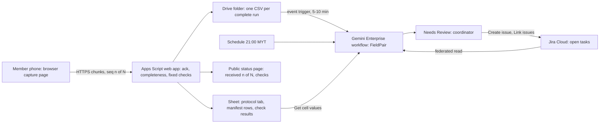

# FieldPair

FieldPair checks every phone-sensor run that a remote student team uploads against the team's own versioned protocol. It tells the coordinator which runs can be compared and why the rest can't, then drafts one specific recollection task for the member who can fix it, leaving the original run untouched. It is for a student who coordinates a small experiment whose members record phone accelerometer data at their own homes, under the proposed track **Data-Driven Research & Intelligent Decision Making**. Caveat: no such student, group or experiment has been found, the source's own kill date is 6 November, and without one the team can build only a reduced version on its own phones. Nothing here has been built or run by a person yet; **Inference** marks conclusions no source states.

Contents:

1.  [At a glance](#at-a-glance)
1.  [Origins](#origins)
1.  [Problem and evidence](#problem-and-evidence)
1.  [How it works](#how-it-works)
    1.  [Day-to-day loop](#day-to-day-loop)
    1.  [Protocol rule set](#protocol-rule-set)
    1.  [States and failure handling](#states-and-failure-handling)
    1.  [Connectors and platform check](#connectors-and-platform-check)
    1.  [Cloud, IoT and network](#cloud-iot-and-network)
    1.  [Real data and privacy](#real-data-and-privacy)
1.  [Why people will use it](#why-people-will-use-it)
1.  [Why the crowd won't build it](#why-the-crowd-wont-build-it)
1.  [Off-campus fit](#off-campus-fit)
1.  [Scores](#scores)
1.  [Research plan](#research-plan)
1.  [Time to impact](#time-to-impact)
1.  [Demo and review](#demo-and-review)
1.  [Build plan](#build-plan)
1.  [Risks and kill criteria](#risks-and-kill-criteria)
1.  [Not verified](#not-verified)
1.  [See also](#see-also)

## At a glance

| Field                 | Plan                                                                                                                                                                                                                                      |
| --------------------- | ----------------------------------------------------------------------------------------------------------------------------------------------------------------------------------------------------------------------------------------- |
| Owner                 | The student coordinating a real multi-phone experiment. **None recruited as of 5 November.** Until one is, the team's integration builder owns the reduced version, and no APU office or group owns anything.                             |
| First users           | One remote group of 2–4 students running an experiment that already exists, each phone at the member's home. None identified.                                                                                                             |
| Track                 | Data-Driven Research & Intelligent Decision Making.                                                                                                                                                                                       |
| Trigger               | Google Drive event trigger when a completed run file lands in the experiment folder (5–10 minute poll), plus a scheduled `21:00` MYT sweep of stalled uploads, stale protocol versions and open tasks.                                    |
| Live signal           | Accelerometer runs from the members' own phones through a browser capture page (`DeviceMotion`), with per-sample device timestamps, upload chunk sequence and server receipt time.                                                        |
| Connectors            | GA Google Drive and Sheets (protocol tab, manifest rows; Workspace domain only) and GA Jira Cloud (recollection tasks). No MCP and no preview feature on the critical path.                                                               |
| Decision              | Which runs are comparable under the current protocol version and, for each one that isn't, whether the cause is a protocol mismatch, a device limit, an incomplete upload or an unexpected but valid result, plus the minimum correction. |
| Action and approval   | The workflow drafts one Jira issue per run and reason; the coordinator approves at **Needs Review**. A replacement run links to the original and never overwrites it.                                                                     |
| Reviewer self-trigger | Without a seat: open the capture page on any phone, record a 30-second run under the published protocol into the `reviewer` partition, and watch its checks on the status page. With a seat: run `@FieldPair` on that run.                |

## Origins

This product has one source, the [FieldPair source doc](/docs/ideas/sol/03-fieldpair.md), revised against three independent scorers' objections and the team's limits:

- **Kept:** the job (find incompatible runs before a merge, then organise the specific recollection), the separation of protocol mismatch, measurement uncertainty, scientific anomaly and transport failure, the rule that no run is rejected for an unexpected value alone, replacements that link to originals, the non-AI baseline (phyphox, a versioned protocol, schema validation and a shared checklist), Drive and Sheets plus Jira, no clock-synchronisation promise, and the kill criteria, including no genuine experiment by 6 November.
- **Changed:** (1) _Nothing recurs and no trigger is named:_ added a Drive event trigger per completed run and a nightly sweep. Recurrence still depends on a live experiment; between experiments FieldPair does nothing, and this doc says so. (2) _The rule set was only a protocol file:_ made the protocol and its thresholds a versioned, coordinator-editable Sheet tab. (3) _No genuine experiment exists:_ added a plainly labelled reduced version, a device-support survey on the team's phones, that tests the pipeline but claims neither users nor impact. (4) Capture moved from phyphox exports to a team-built browser page, so the manifest is machine-made and the network leg is visible, with phyphox import kept for after the hackathon. (5) Research items rose from the source's ten-capture floor to 30–50 runs to match the research bar.
- **Dropped:** the source's rank-and-score line (this doc states none), its link to its own set's submission gates (replaced by the build plan below), and "the research score remains low" (a score claim).
- **Facts re-checked:** the phyphox thread was re-read live on 5 November, so this doc adds its exact rates and dates; it also adds phyphox's own collaborative-experiment paper and MDN's `DeviceMotionEvent` page as primary sources.

## Problem and evidence

- **Transfer evidence, not APU:** a [home magnetic-dipole experiment](https://www.reddit.com/r/AskPhysics/comments/mgblbj/) (March 2021) disagreed with an expected relationship until the author measured farther from the magnet, and a [phyphox discussion](https://www.reddit.com/r/codyslab/comments/xhn85m/) (September 2022) asks for simultaneous sensor outputs and says accuracy is unknown. These show setup context matters, not that schema checks or an LLM would have helped ([everyday](/docs/research/everyday.md#phone-sensor-experiment-threads)).
- **The sharpest case:** in a [phyphox forum thread](https://phyphox.org/forums/showthread.php?pid=4887&tid=2356) (10 June – 13 July 2026, re-read 5 November), a user on an iPhone 12 Pro Max requested 50 Hz and sometimes got a start at 33 Hz rising to about 45 Hz; a requested 80 Hz always delivered 50 Hz. An experiment file then loaded on two iPhones but a Sony Xperia rejected it as an uninterpretable file version, until the user corrected the version field. In September another user offered a converter they had built to resample phyphox data onto even spacing. **Inference:** actual rate, file version and device belong in every run's manifest, and resampling is a workaround people build.
- **Browser capture has its own trap:** MDN warns that Firefox and Chrome "do not handle the coordinates the same way" for `DeviceMotionEvent` ([MDN](https://developer.mozilla.org/en-US/docs/Web/API/DeviceMotionEvent)), so runs from different browsers can disagree in sign without any setup error.
- **Counterevidence:** existing support solved the forum case without a new product. phyphox already runs [collaborative experiments](https://arxiv.org/abs/2206.07157) through a network interface that collects live data on site or remote submissions, used with 350 undergraduates in one lecture hall and in a global experiment. KoboToolbox validates forms, ODK logs audit events, QField syncs offline fieldwork, and FizziQ teaches phone-sensor uncertainty ([incumbents](/docs/research/competition.md#incumbents-checked-against-official-documentation)).
- **What's missing:** no APU or Malaysian higher-education evidence of this pain, no measured volume, no timed baseline, and no willing group. The forum user's student status and location are unknown. **Inference:** the mismatches are real wherever several phones feed one analysis, but how often APU students run such experiments is unknown and may be close to never.

## How it works

### Day-to-day loop

1.  **Protocol:** the coordinator writes a protocol version in the Sheet and approves it (name and time columns). The workflow never edits it.
1.  **Capture:** a member opens the capture page, picks the experiment, and fills the fixed declarations (placement, surface, case on or off) plus an optional note. The page first checks motion permission and which acceleration fields arrive, then records for the protocol's duration. It computes a manifest: sample count, actual mean rate and longest gap from event timestamps, null-field count, browser and OS, and the protocol version shown at capture.
1.  **Delivery:** the page sends numbered chunks; Apps Script acknowledges each with its receipt time, and buffered chunks resend on reconnect. A run is `complete` only when all `N` chunks and the sample count match; then Apps Script writes the CSV to Drive and the manifest row with the fixed check results.
1.  **Decision (Gemini Enterprise):** the new Drive file triggers `FieldPair`. It reads the protocol tab with its change notes, the run's manifest and checks, the other runs in the experiment, and open Jira tasks. It marks each run `comparable`, `comparable with caveat`, `needs recollection`, `exclude: device limit` or `unexpected but valid`, and drafts the minimum correction. What code can't do is the interpretive part: deciding which runs taken under an older version stay usable for which analysis given the coordinator's free-text change note, whether a member's free-text declaration breaks a placement rule, and whether a rerun would help at all on that device.
1.  **Approval and closure:** the coordinator approves the draft; Jira creates and assigns the issue. The replacement run carries `replaces: <run ID>`, and the coordinator closes the issue as accepted or rejected with a reason. Valid unexpected observations stay in the set.
1.  **Nightly sweep (`21:00` MYT):** one digest draft lists runs `incomplete` past the stall timeout, tasks open past their age limit, and runs captured under a superseded version.

### Protocol rule set

The Sheet's `protocol` tab is the editable rule set, one row per version: experiment ID, version, acceleration field (`accelerationIncludingGravity` or `acceleration`), minimum actual rate, maximum gap, duration and tolerance, required declarations, allowed browsers, change note, approver and approval time. A `rules` tab holds the operating limits (stall timeout, open-task age, digest time). The coordinator sets every value; none is a default the team invented, and a run is checked against the version it was captured under.

### States and failure handling

- **Run states:** `capturing` → `uploading n/N` → `complete` or `incomplete since HH:MM`. Missing chunks are never filled or interpolated, and an incomplete run is a transport finding, not a scientific one.
- **Sensor refusals:** a denied motion permission or a field that never arrives gives `no data: permission denied` or `field unavailable`, never a run of zeros.
- **Ingest errors:** if Apps Script returns an error, the page shows the HTTP status and keeps the chunks; the status page shows the last receipt time, never a reused value.
- **Workflow failures:** event runs that fail on quota (`RESOURCE_EXHAUSTED`) aren't retried, so the nightly sweep picks up any manifest row with no decision. Schedule credentials expire every 14 days, so a builder refreshes them on 10 November ([triggers](/docs/research/gemini-enterprise.md#what-runs-without-anyone-signed-in)).
- **Duplicates:** the Jira dedup key is run ID plus reason; a second draft for the same key is suppressed.

### Connectors and platform check

| Connector or tool       | Status  | Role in FieldPair                                                                        | Platform constraint ([Gemini Enterprise](/docs/research/gemini-enterprise.md))                                    |
| ----------------------- | ------- | ---------------------------------------------------------------------------------------- | ----------------------------------------------------------------------------------------------------------------- |
| Google Drive and Sheets | GA (1P) | Event trigger on new run files; live `Get cell values` on protocol and manifest          | Workspace domain with Customer ID only; consumer `@gmail.com` gets `403` ([account limits][acct])                 |
| Jira Cloud              | GA (3P) | Federated read of open tasks; `Create issue`, `Assign issue`, `Link issues` after review | Connector writes need human review ([actions][actions]); Jira Cloud Free covers 10 users ([sandboxes][sandboxes]) |
| Apps Script web app     | Feeder  | Chunk acknowledgement, completeness, fixed checks, status page                           | No card; `doPost` appends rows; clients must follow redirects ([Sheets path][sheets])                             |
| Antigravity             | Tooling | Scaffolds the capture page and Apps Script                                               | Free-trial seats exclude it; the free Individuals plan is the fallback                                            |

If the licence lands on a consumer account, Drive and Sheets fail with `403`; Apps Script then files each completed manifest as a Jira issue, and the workflow triggers on Jira events instead, which keeps a GA connector on the critical path but loses the 1P one. Proving one live Sheet read and one reviewed Jira create comes before any other build work ([F4](/docs/research/gemini-enterprise.md#platform-constraints-and-design-consequences)).

[acct]: /docs/research/gemini-enterprise.md#edition-and-account-limits
[actions]: /docs/research/gemini-enterprise.md#actions-and-write-back
[sheets]: /docs/research/gemini-enterprise.md#phone-or-board-to-google-sheets
[sandboxes]: /docs/research/gemini-enterprise.md#free-sandboxes

### Cloud, IoT and network

- **Cloud:** Gemini Enterprise runs the deciding step; Apps Script, Sheets, Drive and a static capture page on GitHub Pages need no card.
- **IoT:** the members' phones are the only sensors. `DeviceMotion` works in Android and iOS browsers, with a permission prompt on iOS ([phone sensors](/docs/research/iot-and-network.md#phone-and-laptop-sensors-in-the-browser)). The Pi 5 has no role: it has no accelerometer, and putting it in the path would be decoration. Phone accuracy and calibration are not assumed.
- **Network:** every chunk carries a device time and a receipt time, so per-chunk latency and gaps are visible; a run that drops offline shows `uploading 3/6` until reconnect ([network visibility](/docs/research/iot-and-network.md#what-a-judge-can-see-of-the-network)). Independent phone clocks don't establish simultaneous events, so FieldPair compares runs, never their timing to each other.

### Real data and privacy

- **Partitions:** `experiment` (a recruited group's real runs, empty today), `device-survey` (the team's own phones, the reduced version), and `reviewer` (reviewers' own runs). Nothing from `device-survey` or `reviewer` counts as user evidence.
- **Data:** phone acceleration on a table or in ordinary safe motion, with no location, audio or camera. Members appear as pseudonymous IDs. Runs are published with provenance in the repo, as [context](/docs/CONTEXT.md#decisions-so-far) allows for team-recorded logs. No grades, lecture data or institutional datasets, and no personal data in any free-tier prompt.

## Why people will use it

- **The claimed gain:** the coordinator learns that a run can't be compared while the member still has the phone and setup, instead of at analysis time; the forum case took from 18 June to 13 July to resolve the file-version problem. **Inference:** a specific correction sent the same day could shorten that loop, but nothing measured shows it.
- **The concession:** there is no revealed demand for the coordination step. The only cited workaround (a resampling converter) addresses uneven sampling, which a manifest flags but doesn't fix. Students who aren't developers don't live in Jira, so the task is a new habit; Jira's email notification is the only bridge to a channel they already use, and that is weak.

## Why the crowd won't build it

No cluster in the 780-idea [crowd map](/docs/research/competition.md#crowd-map) covers multi-phone experiment coordination; the nearest Data-track cluster, research trend analytics, is a different job and sits in the crowded tier ([saturation tiers](/docs/research/competition.md#saturation-tiers)). Researchers are the primary user of 4% of simulated ideas, and simulated or mock data appears in 30–98% of each model family's responses ([crowd misses](/docs/research/competition.md#what-the-crowd-structurally-misses)), which a real multi-phone run set rules out. The crowd is thin; the incumbents are not. phyphox, KoboToolbox, ODK, QField and FizziQ already cover capture, collaborative collection, validation, audit and uncertainty teaching ([incumbents](/docs/research/competition.md#incumbents-checked-against-official-documentation)). FieldPair's only seam is cross-run protocol compatibility with a corrective closure, and the rules-only version of that seam is a strong baseline.

## Off-campus fit

The build passes: phones at teammates' homes, Apps Script, Sheets, Jira and Gemini Enterprise need nobody at APU, no APU staff action, and not even the Pi. The product fails on a different gate: its critical path needs a genuine experiment run by a real group, and none exists. That is a missing user, not a missing campus. The **reduced version** the team can build now is a device-support survey: each teammate records stationary runs on their own phones and browsers under one written protocol, and FieldPair reports which devices meet it. It answers a real question the source makes step one ("sensor support is checked first") with real readings. It is the team checking its own tool, not a student experiment, and the doc counts none of it as impact or demand.

## Scores

**46.7 / 100, rank 17 of 18** in the [cross-set ranking](/docs/ideas/00-ranking.md); it passes every gate, with G3 conditional. Scored on 5 November 2026 on the [matrix](/docs/ideas/00-ranking.md#scoring-matrix) by three independent scorers who read this doc and checked its claims: an NTT DATA forward deployed engineer (FDE), an APU School of Technology IoT lecturer, and a Google Cloud advocate who is also an APU student. Models: FDE (Claude Opus 5.5), Lecturer (Claude Sonnet 5.5), Advocate (Claude Fable 5.1). Day-to-day workflow and theme take the lowest score; the rest take the mean.

| Component           | Weight | FDE | Lecturer | Advocate | Used | Lowest scorer's reason                                                                                                                                                                                |
| ------------------- | -----: | --: | -------: | -------: | ---: | ----------------------------------------------------------------------------------------------------------------------------------------------------------------------------------------------------- |
| Impact              |     13 |   1 |        1 |        1 |    1 | No owner, group or experiment exists, and the reduced version is the team checking its own phones, which the doc says counts as no impact.                                                            |
| Connectors          |     13 |   3 |        3 |        4 | 3.33 | Drive/Sheets (event trigger, live read) and Jira Cloud (federated read; Create, Assign and Link issue, checked GA) are well chosen, but Jira's job has no real user, and students don't live in Jira. |
| Day-to-day workflow |     13 |   2 |        3 |        3 |    2 | The Drive event trigger, 21:00 sweep, editable protocol tab and Needs Review step are designed, but the doc concedes that between experiments it does nothing and no experiment exists.               |
| Research            |     13 |   1 |        1 |        2 | 1.33 | The only evidence is transfer evidence (the phyphox thread, checked live), with no APU or Malaysian pain, and the 30-50 runs are the team's own device survey.                                        |
| Time to impact      |     13 |   2 |        2 |        2 |    2 | There is a dated plan with a 6 November go/kill, but every milestone after it depends on a group that hasn't been found.                                                                              |
| Theme               |     10 |   4 |        4 |        4 |    4 | The phones' accelerometers (DeviceMotion, checked on MDN) are real off-campus sensors, and per-chunk device and receipt times make the network visible; the Pi is honestly left out.                  |
| Originality         |      9 |   3 |        3 |        3 |    3 | No crowd cluster covers multi-phone experiment coordination, but phyphox already runs collaborative experiments with remote submission (checked on arXiv 2206.07157).                                 |
| Real use            |      6 |   1 |        1 |        1 |    1 | The doc concedes no revealed demand for the coordination step; the only workaround cited is a resampling converter.                                                                                   |
| Buildability        |      5 |   3 |        3 |        3 |    3 | The parts are few (a capture page, chunked Apps Script ingest, a Sheet, Jira, one workflow), but chunk resend, cross-origin reads and Drive CSV reads are unverified.                                 |
| Demo                |      5 |   4 |        4 |        4 |    4 | A reviewer records a 30-second run on any phone and sees the checks within seconds, and the airplane-mode drop shows recovery on video.                                                               |

- **Gates:** G1 pass (3 pass, 0 conditional, 0 fail); G2 pass (3 pass, 0 conditional, 0 fail); G3 conditional (0 pass, 3 conditional, 0 fail); G4 pass (3 pass, 0 conditional, 0 fail).
- **Off-campus gate, per the lowest scorer:** Nothing needs campus presence or APU staff action; the missing piece is a real experiment group, not campus access.
- **What would help most, per the lowest scorer:** Before 6 November, find one real APU group (a physics or engineering lab module, or an FYP team) that already collects data on several members' phones. Without one there is no owner, workflow recurrence or research.

## Research plan

Nothing below has been run. Each item fits by 10 November with nobody on campus:

1.  **Recruit a genuine group (5–6 November, 2 person-hours):** post one plain request in the course and club chats teammates already belong to, asking for a group that already collects data on several members' phones or devices. **Kill:** no group by 6 November `23:59` MYT (see [Risks and kill criteria](#risks-and-kill-criteria)).
1.  **Six past-tense interviews (6–8 November, 4 person-hours):** remote calls with APU students who have merged data several people collected (lab, survey or final-year project), on the last time a teammate's data couldn't be used: what broke, how they found out, how long the fix took. Six follows the small-sample guidance in [judging](/docs/research/judging.md#how-many-people-is-enough). **Pass line:** at least two recurring cross-run problems that ordinary form or schema constraints wouldn't catch.
1.  **Device-support survey, 30–50 real runs (6–8 November, 4 person-hours):** every teammate phone and browser records stationary 30-second runs under one protocol. One builder hand-labels each run from its raw CSV, and the rules-only checks and the workflow are then scored against those labels. Report denominators, every false rejection, and whether the workflow added any correction the rules didn't ([accuracy](/docs/research/judging.md#measuring-an-agents-accuracy-honestly)).
1.  **Timed baseline (8 November, 1 person-hour):** a teammate who didn't build the checks finds the incomparable runs in the survey set by hand with a checklist, then with FieldPair. **Bound:** team-on-team timing is a usability check, not user impact.

## Time to impact

| Date            | Owner                                    | Milestone and measure                                                                                                              |
| --------------- | ---------------------------------------- | ---------------------------------------------------------------------------------------------------------------------------------- |
| 6 November 2026 | Research builder                         | Go or kill: a genuine group with an existing experiment, or FieldPair stays a device-survey tool and is not pitched as a product   |
| 10 November     | Integration builder                      | One traceable loop on real runs: capture, check, decision, approved Jira task, linked replacement, original unchanged              |
| 5 February 2027 | Student maintainer (integration builder) | Two willing groups; count avoided invalid merges, false rejections and time to a usable replacement against the checklist baseline |
| 5 May 2027      | Student maintainer                       | Continue only for protocols where recurring benefit beats setup cost; otherwise publish the rules-only checker and stop            |

**What must be true:** a group with a real multi-phone experiment exists and keeps running it; the sponsored seat outlives its 30-day trial or someone pays from $30 per seat per month for Standard ([prices](/docs/research/gemini-enterprise.md#gemini-enterprise-editions-and-prices)), or else the Gemini step stops and FieldPair is just the rules-only checker; no APU system changes are needed.

## Demo and review

- **Recorded 3:45 video** (labelled with its capture date, per the [minute plan](/docs/research/judging.md#minute-plan)): the protocol tab and its approval; two teammates recording at their own homes; the manifest and fixed checks; one deliberately caused, labelled connection drop (airplane mode mid-upload) showing `uploading 3/6` and recovery with per-chunk latency; the workflow's **Runs** tab, its decision, the **Needs Review** click, and the Jira issue. If a real run fails a check, it shows the correction and the linked replacement; if every run complies, it shows the no-action decision. A valid run is never labelled bad to make a task.
- **Reviewer path (11–14 November):** an unseated reviewer records a run into `reviewer` and sees its fixed checks on the status page within seconds; the workflow's decision follows after the 5–10 minute poll and a builder's twice-daily review click. A seated reviewer runs `@FieldPair` on their run directly ([reviewer access](/docs/research/gemini-enterprise.md#reviewer-access)).
- **Live final (if selected):** the presenter records one run on stage and the audience watches it arrive chunk by chunk.

## Build plan

Three builders: **B1** integration (licence, Sheets, Jira, workflow), **B2** capture page and Apps Script, **B3** research, survey and video. Estimate from the source: 22–30 builder-hours after access.

| Day        | Critical path                                                                                                                                                                          | Exit check                                                                  |
| ---------- | -------------------------------------------------------------------------------------------------------------------------------------------------------------------------------------- | --------------------------------------------------------------------------- |
| Thu 5 Nov  | **B1:** confirm licence and account type; one live Sheet read and one reviewed Jira create. **B2:** capture page with permission check and manifest. **B3:** send the recruiting post. | Real Sheet row read in Gemini Enterprise, or the actual error recorded      |
| Fri 6 Nov  | **B2:** chunked upload, acknowledgements, completeness, fixed checks, status page. **B1:** protocol tab and Drive trigger. **B3:** go or kill call at `23:59` MYT.                     | One complete and one honestly incomplete run in the Sheet; go/kill recorded |
| Sat 7 Nov  | **B1:** decision step, dedup key, Needs Review, Jira create and link. **B3:** survey runs and interviews.                                                                              | One approved Jira task linked to a replacement run                          |
| Sun 8 Nov  | **B1:** `21:00` sweep. **B3:** hand labels, rules-versus-workflow scoring, timed baseline. **All:** confirm registration before `23:59` MYT.                                           | Scored survey with denominators; every member registered                    |
| Mon 9 Nov  | Feature freeze at `12:00` MYT; README, diagram, deck, video; logged-out check of the reviewer path.                                                                                    | Video uploaded unlisted; reviewer run lands in `reviewer`                   |
| Tue 10 Nov | Refresh schedule credentials; recheck every cited number; leader submits by `18:00` MYT; leave everything running through 14 November.                                                 | Portal entry locked; `21:00` sweep completes cleanly                        |

**Cut lines, in order:** the nightly digest's open-task ageing, then browser-coordinate normalisation notes, then the public status page (reviewers fall back to the video). **Never cut:** real runs only, completeness acknowledgements, the approval step, and linked replacements.

## Risks and kill criteria

- **No genuine experiment (fatal, unresolved):** if no group by 6 November, FieldPair is not a product this week. Building the reduced version is still possible, but pitching it as a student coordination tool would misstate it, and the scorers' central objection stands.
- **Rules do the whole job:** if every useful instruction in the survey is a fixed validator message, Gemini adds nothing; ship the rules-only checker and say so.
- **Account and licence:** no licence by 9 November `12:00` MYT fails the Gemini Enterprise core; a consumer account drops Drive and Sheets for the Jira-only path.
- **Device support:** if iOS permission or missing fields block more than one teammate's phone by 6 November, narrow the protocol to the browsers that work and report the failures.
- **False scientific authority:** FieldPair judges comparability against a human-written protocol, never physics; it makes no clinical, structural or environmental claim.

## Not verified

- No phone run, Apps Script deployment, Gemini Enterprise workflow, Jira write, interview or survey has been run by a person.
- The Drive event trigger's exact event names in the Workflow Builder UI; whether a Workflow Builder step can read a Drive CSV's contents rather than only Sheet ranges; whether Apps Script responses can be read cross-origin from a GitHub Pages page.
- Actual `DeviceMotion` rates and field availability on the team's phones and browsers, and how far Chrome and Firefox coordinates differ in practice.
- Whether any APU student group runs multi-phone experiments at all, and the licence's edition, account type and arrival date.

## See also

- [FieldPair source proposal](/docs/ideas/sol/03-fieldpair.md)
- [Cross-set idea ranking](/docs/ideas/00-ranking.md)
- [Everyday signals: phone-sensor experiment threads](/docs/research/everyday.md#phone-sensor-experiment-threads)
- [Competition: crowd map, saturation tiers and incumbents](/docs/research/competition.md)
- [Gemini Enterprise: triggers, connectors, actions and reviewer access](/docs/research/gemini-enterprise.md)
- [IoT and network: phone sensors and network visibility](/docs/research/iot-and-network.md)
- [Judging: research, accuracy and the video minute plan](/docs/research/judging.md)
