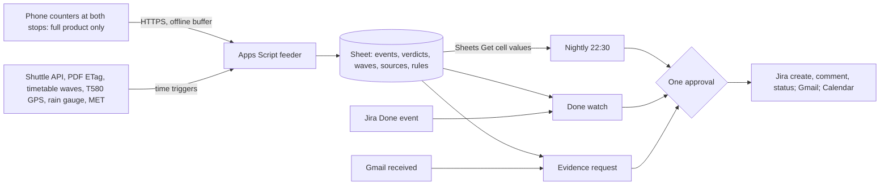

# Kept

Kept grades APU's Campus Connect LRT shuttle against its own published schedule, departure by departure, and hands the Logistics & Operations (LNO) shuttle desk dated evidence for each gap that recurs. Phones at the two boarding points detect buses on-device and send only counts and timestamps. Every weekday night a Gemini Enterprise workflow decides whether each recurring failure is the operator's miss, a gap in the schedule's design, or external. It then raises or updates a Jira issue (a fix request, or a service-change packet for the next schedule revision) and watches every issue the desk closes until the fix holds or fails. Proposed track: Intelligent Automation & Digital Transformation. Caveat: the full product needs a phone at APU's boarding bay, which nobody can place before 10 November, so it fails the off-campus gate; what the team can build now is the published-schedule half in [Off-campus fit](#off-campus-fit).

Contents:

1.  [At a glance](#at-a-glance)
1.  [Origins](#origins)
1.  [Problem and evidence](#problem-and-evidence)
1.  [How it works](#how-it-works)
    1.  [Signal to Sheet](#signal-to-sheet)
    1.  [Workflows](#workflows)
    1.  [Rule set](#rule-set)
    1.  [States and failure handling](#states-and-failure-handling)
    1.  [Connectors and platform check](#connectors-and-platform-check)
    1.  [Cloud, IoT and network](#cloud-iot-and-network)
    1.  [Real data and privacy](#real-data-and-privacy)
1.  [Why people will use it](#why-people-will-use-it)
1.  [Why the crowd won't build it](#why-the-crowd-wont-build-it)
1.  [Off-campus fit](#off-campus-fit)
1.  [Scores](#scores)
1.  [Research plan](#research-plan)
1.  [Time to impact](#time-to-impact)
1.  [Demo and review](#demo-and-review)
1.  [Build plan](#build-plan)
1.  [Risks and kill criteria](#risks-and-kill-criteria)
1.  [Not verified](#not-verified)
1.  [See also](#see-also)

## At a glance

| Field                 | Plan                                                                                                                                                                                                                                                                                                               |
| --------------------- | ------------------------------------------------------------------------------------------------------------------------------------------------------------------------------------------------------------------------------------------------------------------------------------------------------------------ |
| Owner                 | LNO shuttle desk, unconfirmed and not contacted. **Inference:** LNO's public KB space covers APCard parking and prepaid smart meters, not the shuttle ([APU KB](/docs/research/apu.md#apu-knowledge-base-on-confluence)), so who manages the Campus Connect contract is the first question once staff can be asked |
| First users           | LNO desk staff; LRT Bukit Jalil commuters in the 07:30–09:00 and 16:45–18:45 waves                                                                                                                                                                                                                                 |
| Track                 | Intelligent Automation & Digital Transformation: "connecting devices with useful actions" ([tracks](/docs/BRIEF.md#challenge-tracks))                                                                                                                                                                              |
| Trigger               | Schedule, weekdays 22:30 MYT; Jira Cloud event when a Kept issue moves to Done; Gmail "When an email is received" for evidence requests ([GE triggers])                                                                                                                                                            |
| Live signal           | Full product: on-device bus detections and 60-second heartbeats from two phones. Both versions: the shuttle API's trips, the PDF's ETag and timetable release waves daily; T580 GPS each minute in the windows; a rain gauge and MET warnings every 15 minutes                                                     |
| Connectors            | 1P Google Drive (Sheets Get cell values, live read); 1P Gmail (event trigger; Send, Reply); 1P Google Calendar (Create event); 3P Jira Cloud Free (Done event; search; Create issue, Create comment, Change issue status). All GA; no MCP; Apps Script is the feeder                                               |
| Decision              | Per recurring failed departure: operator miss, design gap, external, or unattributed; then raise, add evidence, or leave. Per Done issue: held or reopened                                                                                                                                                         |
| Action and approval   | Jira issues, comments and reopens; one Gmail digest and evidence replies; Calendar no-shuttle notices. One Approval step per writing run; runs that find nothing write nothing                                                                                                                                     |
| Reviewer self-trigger | Move an open Kept issue to Done on an invited Jira seat, with a resolution note, or email "evidence 17:40" to the Kept inbox                                                                                                                                                                                       |

## Origins

Kept leads because its automated count, nightly grade and Done watch close the loop that LastLink leaves manual. Neither escapes the need for someone at an APU stop.

- **[Kept](/docs/ideas/opus/01/01-kept.md), the lead:**
  - Kept: the on-device stop counter, the Sheet ledger and its deterministic match, the nightly grade and three-way attribution, Done → watch → reopen, Gmail evidence requests, the Friday late-and-weekend rule, and the Microsoft 365 mapping.
  - Changed: three workflows, not four. The seven daily peak checks are gone, because each alert still waits for an approval click, the desk acts on patterns rather than single buses, and the scorers called the build heavy for three people. The feeder emails the team when a counter goes silent. The late-and-weekend rule (R8) is demoted, because a recount shows nearly all those sessions belong to one intake.
  - Numbers fixed: the 17:45 release covers 190 to 257 distinct intakes a day, not "193 to 260 intake groups" (recounted on 5 Nov). The "820 or 830" advice is a 20 Apr 2026 reply in an 18 Apr thread. BUSSYSTEM is described as the research describes it, without model names it doesn't cite.
  - Dropped: the 4 Nov stopwatch baseline at the bay and the 36 items by 7 Nov, because nobody can be at APU; the crowd-check and name-collision claims, which cite no source.
- **[LastLink](/docs/ideas/astra/02-lastlink.md):**
  - Kept: its decision (which stop and time merits a service-change request) as the design-gap packet (R5). Its evidence states, so an observation becomes a verified candidate only with recurrence and corroboration, and a reviewer can reject one. Its stop record (arrival, vehicle arrival, boarding outcome, departure, corroboration) as the ground-truth label and the fallback sensor if no camera is allowed.
  - Also kept: its source rules. T580 is not the campus shuttle; a missing position is unavailable telemetry, never a cancellation; GPS can't establish load or boarding; repeated samples of one departure are one item; a failed feed blocks the conclusions that depend on it (R4). Plus per-source fresh, stale, failed or unknown, its counterevidence, and its kill gate and strongest objection.
  - Dropped: volunteers logging by hand as the main sensor, because a counter sees every departure in its window without them (both still need someone at the stop, every scorer's fatal risk); phone GPS at the stop; the unnamed transport liaison; 30-minute operator batches; the 72-hour budget for four students (the team is three); and the 25% preparation-time target, which has no baseline to be measured against.

## Problem and evidence

- **Reviews:** 13 of 58 low-star texts about APU mention the bus, shuttle, taxi or LRT ([shuttle research]). Examples: "the bus either doesn't come, comes too early, comes too late or when on time it's always full" (M Vertica, 1 star, 13 Nov 2024); "expect long queue times at 8am and 5pm" (2 stars, 12 Nov 2024); "Bus Service absolutely tak boleh pakai" (Malay: unusable; 1 star, 25 Sep 2026).
- **Students:** "bus queues are insane in peak hour" (19 Jul 2025), and "if you have to be on campus at 9, make sure you're at the station by 820 or 830" (a 20 Apr 2026 reply) ([Reddit commute](/docs/research/social.md#getting-to-campus-shuttle-lrt-bukit-jalil-and-traffic)). A former student describes waits of 30 minutes to an hour (June 2025, [S2](/docs/research/social.md#s2-a-former-student-names-classrooms-and-several-service-failures)), and new students can't tell which route or boarding rule applies ([S5](/docs/research/social.md#s5-new-students-cannot-confidently-identify-the-correct-shuttle-procedure)). APRide, a ride board for verified APU students and staff, exists because late classes and weekends break "the weekday shuttle rhythm" ([shuttle research]).
- **Counterevidence:** a January 2026 rider calls morning waits bearable, usually no more than 20 minutes ([S4](/docs/research/social.md#s4-a-rider-reports-bearable-morning-waits)), and a Parkhill resident reports occasional 10–15 minute waits (September 2026, [S6](/docs/research/social.md#s6-a-parkhill-resident-describes-an-alternative-commute)). All are single, unverified accounts, not service statistics. **Inference:** the pain is peak capacity and uncertainty, not universal delay, so Kept measures departures, riders left behind and time to board separately, and claims nothing it hasn't measured.
- **APU's own schedule disclaims the peaks** ([shuttle PDF], V1_20261022, effective 22 Oct 2026, Last-Modified 23 Oct and unchanged on 5 Nov): "When the bus is full, it will depart"; "APU does not guarantee a seat at all times on every trip"; at peaks "the buses may not be able to arrive or depart following the published schedules"; LRT → APU buses from 7:30 to 8:45 "will not follow a schedule"; the 20:45 and 21:45 APU → LRT buses carry "Limited space only".
- **Where the promise meets demand,** recounted at 07:28 MYT on 5 Nov 2026 from the [timetable feed](https://s3-ap-southeast-1.amazonaws.com/open-ws/weektimetable) (ETag `c9d8d238…`, unchanged since 28 Oct; lecturer fields dropped; `ONL` rooms excluded ([room codes](/docs/research/apu.md#timetable-room-codes))) against the [shuttle API](https://api.apiit.edu.my/transix-v2/schedule/active)'s 39 weekday APU → LRT trips:
  - 79, 77, 89 and 86 rooms release at 17:45 from Monday to Thursday this week, 190 to 257 intakes a day: 5 minutes after the 17:40 bus and 15 before the 18:00. The big release waves on those days are at 10:30, 12:45, 15:30 and 17:45; the next bus leaves 5 minutes after the first two and 15 minutes after the last two.
  - 75 to 89 rooms start at 08:30 on the same days, inside the morning window the PDF gives no times for; the API lists 11 nominal ones from 07:35 to 08:35.
  - From 26 Oct to 22 Nov, 134 on-campus sessions end at 20:30 or later (130 at 21:30, leaving only the limited 21:45 bus), and 122 fall on weekends, when no shuttle runs. But 132 of the 134 and all 122 belong to one intake, `APUMP2610`, booked into about 30 rooms at once with module names "null". **Inference:** that looks like a block booking, not 30 classes, so the late and weekend gap is small until someone confirms who those students are and how they travel.
- **What exists:** APSpace offers bus tracking ([APU systems]); a 2023 review says its shuttle timings page "keeps on loading with no end" ([APSpace](/docs/research/competition.md#the-official-apspace-app)). **Inference:** the desk has complaints and star ratings, not a dated record of which departure failed, how often, and why. No source shows the desk compiling such a record today.

## How it works

The feeder measures, the Sheet matches, and Gemini decides; no rider has to run anything.

### Signal to Sheet

- **Counters (full product, unattended once clamped):** an old Android phone runs a GitHub Pages page with MediaPipe's EfficientDet-Lite0 detector, `categoryAllowlist: ["bus"]`, at about 2 frames a second ([MediaPipe](https://developers.google.com/edge/mediapipe/solutions/vision/object_detector/web_js)). A box that stays in the bay zone for 30 seconds is an arrival, and its exit a departure; passing buses are ignored. Frames stay in memory; the page posts `{stop, arrived_at, departed_at, dwell_s, confidence, device_time}` and a 60-second heartbeat ([edge split]).
  - APU bay, 16:45–18:45: 12 published APU → LRT departures. LRT Bukit Jalil pick-up, 07:30–09:00: six 15-minute slots graded by gaps. That makes 18 verdicts a weekday.
- **Stop record (LastLink's form):** whoever is at the stop confirms a detection as "LRT shuttle" or "other bus" and records arrival, vehicle arrival, boarding outcome ("boarded" or "left full"), departure and a corroborating source. Riders can tap "joined queue" and "boarded" from a QR card, with no location permission and a random token that rotates daily.
- **Feeder (both versions, no Gemini):** daily, the shuttle API's trips and schedule-set name, the PDF's ETag, and the timetable reduced to rooms released and started per 5 minutes. Each minute in the windows, T580 positions, within data.gov.my's 4 requests a minute ([GTFS-R](/docs/research/data-sources.md#bus-and-train-positions-gtfs-realtime)). Every 15 minutes, the Sungai Kuyoh rain gauge `0232901RF` at LRT Bukit Jalil (live at 07:15 on 5 Nov, [Infobanjir rainfall](https://publicinfobanjir.water.gov.my/rainfalldata/Wilayah%20Persekutuan%20Kuala%20Lumpur)) and MET warnings ([MET](/docs/research/data-sources.md#met-malaysia-warnings)). A failed fetch writes an error row with its HTTP status, never the last value.
- **Ledger:** a Sheet formula labels each published departure kept, late, early (full), missed or not observed, so the desk can audit the measurement. A road column marks each 15 minutes normal, slow (T580 under the rule tab's speed on the Bukit Jalil–TPM segment), wet, or unknown. T580 runs every 50 minutes from 07:30 in the static feed ([GTFS static](/docs/research/data-sources.md#routes-and-stops-near-apu-gtfs-static)), and the live feed carried no T580 at 07:31 or 07:34 MYT on 5 Nov, so "unknown" will be common.

### Workflows

1.  **Nightly decision (schedule, weekdays 22:30):** reads the day's verdicts, the last ten observed weekdays, the waves, the road and rain rows, the rule tab and open Kept issues; applies R2–R8; drafts every write behind one Approval step. Gemini decides attribution where rows conflict, whether a gap is new or evidence for an open issue, what the packet says and which counterexamples it shows, and whether a desk's resolution note matches what the ledger or the published schedule shows.
2.  **Done watch (Jira event, polled every 5–10 minutes):** when the desk moves a Kept issue to Done, the workflow drafts "Watch opened" with the last five observed days as the baseline; the nightly run then checks the departure each night (R7).
3.  **Evidence request (Gmail event):** the desk forwards a complaint ("the 5:40 never came yesterday") or writes "evidence 5 Nov 17:00–18:45". Gemini maps the text to departures and dates and drafts the verdict table with coverage and attribution; one approval sends it.

### Rule set

The rule tab is editable; its starting values are proposals for the desk to change. R1 is a Sheet formula; R2–R8 are the workflow's decisions.

| Rule         | What it decides                                                                                                                                                                                       |
| ------------ | ----------------------------------------------------------------------------------------------------------------------------------------------------------------------------------------------------- |
| R1 Match     | Late after +5 minutes, missed after +15, and a gap over 15 minutes in the continuous window                                                                                                           |
| R2 Recur     | A slot recurs when it failed on 3 of its last 5 observed days; not-observed days don't count, and one departure on one day is one item however many riders tapped                                     |
| R3 Attribute | Operator miss: absent or late on a normal, dry road. Design gap: on time, or early and full, while a release wave (50 rooms within 10 minutes) was still arriving. External: slow road or rain        |
| R4 Halt      | A failed or stale rain feed, or a failed T580 feed, leaves the slot unattributed; no T580 on the segment marks an operator miss "road unverified"; T580 never stands in for the shuttle               |
| R5 Packet    | A verified design gap becomes one service-change packet: days observed out of published, waves, left-behind records with n, counterexample days, and what remains uncertain                           |
| R6 Dedupe    | One open issue per slot and kind; new evidence becomes a comment; nothing new, no write                                                                                                               |
| R7 Watch     | Under watch, one observed failure reopens the issue; five observed passes close it as held                                                                                                            |
| R8 Gaps      | Fridays: next week's on-campus sessions ending after 19:15 or on weekends get one service-gap issue and Calendar notices naming T580 from TPM Carpark; a new PDF ETag or schedule set pauses verdicts |

### States and failure handling

- **Departure:** kept, late, early (full), missed, not observed, or counter down. "Not observed" never counts as kept, and the report prints coverage as observed out of published.
- **Evidence (LastLink's states):** observation → candidate → verified candidate (R2 met and corroborated by a stop record or tap) → review pending → raised → Done → watching → held or reopened. Healthy windows stay observations, a reviewer can reject a candidate, and unattributed slots stay candidates.
- **Source:** each feed is fresh, stale, failed or unknown at read time. A failure blocks only the conclusions that depend on it, and witnessed events keep their original provenance.
- **Counter offline:** events queue in IndexedDB and arrive flagged "late upload" with their device time. Every row carries device and server time, so latency shows ([network visibility](/docs/research/iot-and-network.md#what-a-judge-can-see-of-the-network)). A heartbeat gap writes "counter down 17:52–18:04", never "missed". Counters use mobile data, since campus Wi-Fi enrolment for headless devices is unknown ([campus Wi-Fi](/docs/research/iot-and-network.md#apu-campus-wi-fi)).
- **Calendar:** the rule tab lists no-service days. The timetable's empty 8 and 9 November match the holiday feed's Deepavali and its day in lieu ([timetable counts](/docs/research/apu.md#timetable-row-counts)), so 9 November isn't graded as 39 misses.

### Connectors and platform check

- **All GA, no MCP:** Drive with Sheets Get cell values (GA since 12 October 2026) reads the ledger, waves and rule tab live, with nothing ingested; Gmail gives the event trigger, Send and Reply; Calendar gives Create event; Jira Cloud gives the event trigger, search, Create issue, Create comment and Change issue status ([GE actions](/docs/research/gemini-enterprise.md#actions-and-write-back), [GE triggers]). The Custom MCP Server store is a preview feature, blocked by a default organisation policy, so it stays out ([GE MCP](/docs/research/gemini-enterprise.md#requirements-and-registration)).
- **Day-one gate (LastLink's, F4):** prove one live Sheet read and one reviewed Jira create first, and treat comment and status change as unproven until they work on this licence ([platform constraints](/docs/research/gemini-enterprise.md#platform-constraints-and-design-consequences)). If status change is missing, Kept comments and a person reopens.
- **Event trigger:** Jira's event names aren't listed, so check **Preview results** on day one. Event runs that fail with `RESOURCE_EXHAUSTED` aren't retried, so the nightly run also searches Jira for Kept issues resolved since its last run, and the watch never depends on the event ([GE unattended](/docs/research/gemini-enterprise.md#what-runs-without-anyone-signed-in)).
- **Unattended limits:** schedules need a multi-region location; credentials expire every 14 days, so a refresh on 10 Nov covers 11–24 Nov; connector writes need review, and the Approval step goes in through the visual editor, because natural language can't add one ([GE limits](/docs/research/gemini-enterprise.md#limits-that-bite-in-a-one-week-build)). One nightly run plus a few event runs a weekday sits inside 160 assistant queries per user per day on Standard, but one run isn't one query, so measure it (F3).
- **Accounts:** Drive, Gmail and Calendar need a Workspace organisation account, and federated Drive search covers only the searcher's domain ([GE accounts]).
- **On APU's Microsoft 365 stack:** Outlook replaces Gmail and Google Calendar, a SharePoint list replaces the Sheet, Teams carries the digest, and an LNO request type in the Jira Service Management that runs APU's Virtual Help Centre ([APU systems]) replaces Jira Free. **Inference:** that is configuration plus one ingest function; it can't be shown this week, since the Microsoft 365 developer sandbox is closed to most students and ships sample data ([sandboxes](/docs/research/gemini-enterprise.md#free-sandboxes)).

### Cloud, IoT and network

- **Cloud:** three Gemini Enterprise workflows with their Runs tabs, the Apps Script feeder, and the Sheet.
- **IoT, full product:** the stop counter is the instrument: edge inference with a bus-only allowlist, so the phone detects and the cloud decides ([edge split]). T580's GPS transponders and DID's telemetry rain gauge add context; neither proves boarding or load, and T580 is not the shuttle.
- **IoT, reduced version:** only those third-party sensors, polled. Conceded: that is the weak form the theme criterion warns about.
- **Network:** per-row device and server time, an airplane-mode buffer test, "counter down" rows, and feed error rows with their HTTP status.

### Real data and privacy

- **Real data:** every row is a live public feed or a team phone, with no replays, as the [data ruling] allows; a failed source shows its error, never a cached value.
- **APU content:** the shuttle API, PDF and timetable fall under APU's Terms of Use, which ask for permission before "use of this Website or any of the Contents" ([APU terms]). Kept stores only derived counts and published times, never feed rows or lecturer fields, and republishes nothing. That narrows the use but doesn't replace written permission, which the team doesn't hold.
- **Privacy:** frames never leave the phone, the allowlist keeps only `bus`, and nothing detects faces or people, so no biometrics. A printed notice sits at each counter, framed on the bay, not the queue. Taps are anonymous, raw taps are deleted after 30 days, and prompts carry no personal data ([timetable privacy](/docs/research/apu.md#personal-data-in-the-timetable-feed)). **Inference:** a student prototype likely falls outside PDPA's commercial scope, but an APU deployment wouldn't, so APU's data protection officer signs off before month 3 ([PDPA](/docs/research/judging.md#malaysias-pdpa-and-the-2024-amendment)).

## Why people will use it

- **The desk's loop:** forward a complaint and get a dated verdict reply for one click; a Monday digest of recurring gaps; a Jira queue shaped like APU's Virtual Help Centre; a watch that says whether a fix held. **Inference:** no source shows the desk doing this work by hand today, so the loop is a hypothesis until the desk is interviewed.
- **Schedules do change:** the 2024 M Vertica reviewer later updated the review to say more shuttle times were added ([shuttle research]). **Inference:** the version after V1_20261022 could cite packets rather than reviews.
- **Riders already spend effort:** reaching the station 30–40 minutes before a 9:00 class, APRide's ride board, two student-built shuttle projects ([APU tools], [rival repos]), and APSpace's tracking. That is revealed demand from riders, not from the desk, and the competition research rates shuttle reliability as an unmet need of "low to medium" strength ([unmet needs](/docs/research/competition.md#unmet-needs-these-tools-point-to)).
- **The riders' loop (full product):** nothing to install. A QR scan shows "last LRT shuttle left 6 min ago; 2 of the last 5 left full", read live from the ledger, and one calendar subscription carries "no shuttle for this session" notices with the T580 fallback, in Google Calendar or Outlook.

## Why the crowd won't build it

- **Absent tier:** "Shuttle, bus or parking" is 0.5% of 780 simulated ideas, and those are GPS trackers on Pub/Sub and BigQuery ([crowd clusters](/docs/research/competition.md#clusters-and-shares), [crowd tiers](/docs/research/competition.md#saturation-tiers)). Devpost holds 79 `campus shuttle` and 15 `shuttle tracker` matches ([crowd counts](/docs/research/competition.md#crowding-counts)), and none of the briefing's examples touches transport ([briefing ideas](/docs/research/competition.md#ideas-shown-at-the-briefing)).
- **Structural misses:** only 1% of simulated ideas combine an unattended run, a named owner and a measured baseline, and 3% use public feeds ([crowd misses](/docs/research/competition.md#what-the-crowd-structurally-misses)).
- **Substitutes answer "where is the bus", not "did the promise hold":** APSpace's tracking; `nacyng-netizen/apu-smart-shuttle`, created 1 November 2026, a README for a GPS tracker with ETAs and rain alerts and no Gemini Enterprise part ([rival repos]); `Kibbs-dibs/BUSSYSTEM`, with demand forecasting, camera occupancy and complaint triage ([APU tools]); and Transit's crowdsourced positions and disruption notices ([substitutes](/docs/research/competition.md#existing-substitutes), C3). None reopens an issue because a bus was seen failing at the stop. A spreadsheet log is the other substitute, and the research plan tests against it.
- **Conceded:** without counters, the reduced version sits closer to the crowd: a schedule-and-timetable checker on public feeds.

## Off-campus fit

- **The full product fails.** Its critical path needs a phone clamped at APU's LRT-route boarding bay from 16:45 to 18:45, which is on campus; a phone at the LRT Bukit Jalil pick-up from 07:30 to 09:00; two observers logging ground truth at both; and an LNO desk that answers. The first breaks the rule that nobody is at APU, and the last breaks the rule that no APU office acts. Without the counters, the ledger has no departures, and every verdict, packet and watch is empty.
- **What the team can build now: the published-schedule half.** The feeder, the Sheet, the three workflows, Jira, Gmail and Calendar all run in the cloud, with nobody at APU and approvals from the team's phones; the Pi 5 isn't needed. With no observed departures, the nightly run applies only what published data supports: R3's design-gap test against the release waves (the 17:40 bus against the 17:45 release), R8's late-and-weekend list, and change detection on the shuttle API and PDF. Each packet says "observed: 0 of N published departures", and no kept rate is computed. The Done watch checks only whether a fix the desk describes appears in the published schedule; an operational fix reads "unverifiable without a counter".
- **What that version isn't:** it grades no bus. It can tell the desk that the published 17:40 leaves five minutes before up to 89 rooms release, which the desk can read off its own schedule; it can't say whether the 17:40 left full, late or at all. Its IoT is third-party sensors polled, and its decisions are thin, because published data rarely conflicts.
- **Conditional add:** the LRT Bukit Jalil pick-up is a public station about 1 km from campus by the API's coordinates, so the team limits don't rule it out on their face. It still needs a teammate there from 07:30 to 09:00 on weekdays, and nothing says anyone can be. If one can, the morning counter grades six slots a day, the only real shuttle observation possible before 10 November.
- **Open in both versions:** APU's written permission for the shuttle API, PDF and timetable. Under the team limits, assume it doesn't arrive before 10 November.

## Scores

**54.5 / 100, rank 18 of 18** in the [cross-set ranking](/docs/ideas/00-ranking.md); it fails G4, so it ranks below every product that passes, and G3 is conditional. Scored on 5 November 2026 on the [matrix](/docs/ideas/00-ranking.md#scoring-matrix) by three independent scorers who read this doc and checked its claims: an NTT DATA forward deployed engineer (FDE), an APU School of Technology IoT lecturer, and a Google Cloud advocate who is also an APU student. Models: FDE (Claude Fable 5.1), Lecturer (Claude Opus 5.5), Advocate (Claude Sonnet 5.5). Day-to-day workflow and theme take the lowest score; the rest take the mean.

| Component           | Weight | FDE | Lecturer | Advocate | Used | Lowest scorer's reason                                                                                                                                                                                                                                                     |
| ------------------- | -----: | --: | -------: | -------: | ---: | -------------------------------------------------------------------------------------------------------------------------------------------------------------------------------------------------------------------------------------------------------------------------- |
| Impact              |     13 |   2 |        2 |        2 |    2 | As this team can build it, the reduced version grades no bus ('observed: 0 of N'), the LNO desk is uncontacted and the desk baseline is explicitly unmeasured; the real volume (39 weekday APU→LRT trips, 190–257 intakes releasing at 17:45) is confirmed but unobserved. |
| Connectors          |     13 |   4 |        4 |        3 | 3.67 | GA Sheets, Gmail, Calendar and Jira are named, but the reduced version has little live data for them to act on.                                                                                                                                                            |
| Day-to-day workflow |     13 |   3 |        4 |        3 |    3 | A 22:30 weekday schedule, a Jira Done event and a Gmail evidence trigger with an editable rule tab, dedupe and one approval are specified, but the doc admits published data rarely conflicts, so the nightly decision is thin until counters exist.                       |
| Research            |     13 |   3 |        2 |        3 | 2.67 | APU pain is well cited (13 of 58 reviews, the shuttle PDF's own disclaimers, confirmed live), but the doc concedes no timed observation and no 30-50 labelled items are reachable before 10 Nov.                                                                           |
| Time to impact      |     13 |   2 |        2 |        2 |    2 | First value is 'within five observed weekdays of the counters starting', which needs campus access after 10 November, an LNO yes and a mount; the dated plan and owners are good but rest on that.                                                                         |
| Theme               |     10 |   2 |        2 |        2 |    2 | The reduced version polls third-party sensors only (T580 GPS, often absent, and a rain gauge) with feed error rows; the edge bus detector that would make this a 5 is not buildable this week.                                                                             |
| Originality         |      9 |   4 |        3 |        4 | 3.67 | Shuttle ideas are in the Absent tier (0.5%) and grading the promise differs from tracking, but the reduced version is closer to a schedule checker, and the apu-smart-shuttle rival exists.                                                                                |
| Real use            |      6 |   3 |        3 |        3 |    3 | Riders demonstrably spend effort (APRide, arriving 30–40 minutes early, two student shuttle projects, confirmed), but the desk's loop is a hypothesis and the riders' QR loop needs the full product.                                                                      |
| Buildability        |      5 |   3 |        3 |        2 | 2.67 | The reduced version still needs a feeder for five sources, three workflows, rules R2-R8 and a T580 decoder, and the full product adds a camera detector.                                                                                                                   |
| Demo                |      5 |   3 |        3 |        3 |    3 | A reviewer can move a Jira issue to Done or email 'evidence 17:40' and see the watch and reply, and the video is honest about 'no counter at APU yet', but what they trigger is a check against a static published schedule.                                               |

- **Gates:** G1 pass (3 pass, 0 conditional, 0 fail); G2 pass (3 pass, 0 conditional, 0 fail); G3 conditional (1 pass, 2 conditional, 0 fail); G4 fail (0 pass, 0 conditional, 3 fail).
- **Off-campus gate, per the lowest scorer:** The full product needs a phone clamped at APU's boarding bay and observers, and needs the LNO desk to answer; only the published-schedule reduced version passes, and it grades no bus.
- **What would help most, per the lowest scorer:** Place one teammate at LRT Bukit Jalil for the 07:30-09:00 window if anyone can, since that is the only real shuttle observation possible before 10 November.

## Research plan

- **Interviews, 6–8, remote, about the last real time it happened** ([interviews](/docs/research/judging.md#interviews)): riders who have posted about the shuttle, reached by replying in their own threads ([remote recruiting](/docs/research/everyday.md#how-a-remote-team-could-use-them)); APRide's maintainers, who built a board around the gap; and the BUSSYSTEM author, an APU student who built a shuttle project ([APU tools]). Ask: when did you last wait for the LRT shuttle, how long, did you board the first bus, and what did you do instead? Record refusals and contradictions.
- **The desk, deferred:** under the team limits LNO can't be interviewed before 10 November. Its questions wait: "The last complaint about a departure: how did you check it, how long did it take, what did you tell the operator?", and whether the morning promise is the PDF's continuous window or the API's 11 times. The desk baseline, minutes to verify one complaint, stays unmeasured until then ([baseline](/docs/research/judging.md#baseline-and-before-and-after-metric)).
- **Conceded:** no timed observation and no 30–50 labelled shuttle items are reachable before 10 November, and the reduced version's rules are deterministic over published data, so there is nothing for precision and recall to measure yet.
- **First counted days after campus access:** two observers per window log LastLink's stop record independently, with disagreements kept; 12 evening departures and 6 morning slots a day give 36 items in two days and 54 in three ([accuracy](/docs/research/judging.md#measuring-an-agents-accuracy-honestly)).
  - Positive class: "failed" means missed after +15 minutes, left full with riders behind, or a gap over 15 minutes in the continuous window. Recall leads, because a missed failure costs more than a false alarm.
  - Detector events are scored apart from verdicts, so counter errors and rule errors don't mix. A rules-only baseline with no Gemini step runs on the same items; Gemini's classification and packet stay only if they save desk review time without adding errors.
  - Report: confusion matrix, precision, recall, n and Wilson 95% intervals with the test date; with few positives in 36 items, say how wide the intervals are.

## Time to impact

The plan maps to GOV.UK's discovery, alpha and beta phases ([phases](/docs/research/judging.md#mapping-3-and-6-months-to-delivery-phases)). First value comes within five observed weekdays of the counters starting, when R2 can first fire.

- **By 5 Feb 2027:** LNO owns the workflow and rule tab and reads the weekly digest. A fixed counter at the bay grades 36 of the 39 APU → LRT departures, from 10:35 to 18:55; the 19:15, 20:45 and 21:45 stay "not observed" until a dusk and after-dark test passes (sunset is 18:57 on 5 Nov, [sun times](https://api.sunrise-sunset.org/json?lat=3.0559&lng=101.7000&date=2026-11-05&formatted=0&tzid=Asia/Kuala_Lumpur)). Complaints are verified by forwarding, and the next schedule revision carries a packet for at least the 17:40/17:45 collision.
- **Measured by 5 May 2027, against the first counted week:** the kept rate of observed departures; riders left behind per evening peak; the median join-to-board wait in the 17:45 wave; desk minutes per complaint verified; the share of Done issues still held after the watch; precision and recall, re-measured monthly on 30 departures. The stack runs on Outlook, SharePoint and APU's Jira Service Management.
- **Owners:** the LNO shuttle desk (business owner, unconfirmed), APU ICT (seats, connectors, Microsoft 365), APU's data protection officer (notice and retention), and the team, then GDGoC APU (counter page).
- **Assumptions:** the team can reach campus after 10 November; LNO says yes and facilities allow a mount; APU grants written permission for the PDF, shuttle API and timetable; a Gemini Enterprise seat continues after the trial.

## Demo and review

The video shows the reduced version, because that is what will exist: about 3:45, recorded from the live system and labelled with capture dates ([minute plan](/docs/research/judging.md#minute-plan)). Nothing in it claims an observation at APU.

1.  **0:00–0:15:** slate "Recorded 6–9 Nov 2026 from the live system; no counter at APU yet" and the one-liner.
2.  **0:15–0:45:** 89 rooms release at 17:45 on 4 Nov against the 17:40 bus; a rider quote and the counterevidence.
3.  **0:45–1:20:** feeder rows landing with fetch time and HTTP status; a labelled, controlled cut of the T580 fetch turns the source "failed" and the road "unknown", never "bus cancelled".
4.  **1:20–2:00:** the nightly Runs trace reads the waves and the published schedule and drafts the 17:40 design-gap packet ("observed: 0 of N"); the approval; the Jira issue and the digest.
5.  **2:00–2:30:** the issue moves to Done with a labelled test note, "added a 17:50 departure"; "Watch opened" minutes later; that night the run finds no 17:50 in schedule set "WEF 22 Oct 2026" and reopens it.
6.  **2:30–3:00:** an evidence email and its reply; then, plainly, what is unbuilt: the counters and every observed verdict.
7.  **3:00–3:45:** the dated plan with owners, what the interviews changed, how the team worked, the app URL, the access request and the repo.

How reviewers fire it during 11–14 Nov, with approvals answered 08:00–24:00 MYT by a published rota. No reviewer can make a bus fail; these are the events they can create:

- **Jira:** invited to the team's Jira Free site (2 of 10 seats) and the Gemini Enterprise app, a reviewer moves an open Kept issue to Done with a resolution note. "Watch opened" is drafted within about 10 minutes, and that night's run checks the note against the published schedule, then comments or reopens.
- **Email, no seat needed:** "evidence 17:40", or a forwarded complaint, sent to the Kept inbox returns the published departures, waves, road and rain context, and "observed: none", after one approval.
- **Run history:** shared users see only their own runs, so the README and video carry the owner's Runs tab ([GE runs](/docs/research/gemini-enterprise.md#run-history-as-evidence)). Test access with a non-team account on 9 Nov, because federated Drive search covers only the searcher's domain ([GE accounts]).

## Build plan

The reduced version, riskiest first: permission and the licence, then the Jira actions, then the workflows. No card: Apps Script, a Sheet in the licensed Workspace domain, Jira Cloud Free and GitHub Pages.

| Day        | Work                                                                                                                                                                                                                                       |
| ---------- | ------------------------------------------------------------------------------------------------------------------------------------------------------------------------------------------------------------------------------------------ |
| Thu 5 Nov  | Ask the organisers in `#help-desk` for written permission on the shuttle API, PDF and timetable, and about the licence's account type. Create the Jira site. Feeder for the shuttle API, PDF ETag, timetable waves, rain and MET; rule tab |
| Fri 6 Nov  | When the licence lands: one live Sheet read and one reviewed Jira create, then the Jira trigger's **Preview results** and action list. Nightly workflow v1 reads and drafts only. Reply in riders' threads to recruit interviewees         |
| Sat 7 Nov  | Approval step; Jira create and comment; the digest; R8 with Calendar; Done → watch → reopen end to end on a real issue; interview round 1                                                                                                  |
| Sun 8 Nov  | Deepavali. Evidence-request workflow; the T580 decoder last, because every rule runs without it; README, deck and diagram; confirm every member has registered before registration closes                                                  |
| Mon 9 Nov  | Holiday, with no classes in the timetable, treated as no service. Interview round 2; record the video; test reviewer access with a non-team account                                                                                        |
| Tue 10 Nov | Refresh schedule credentials; submit early in the day; approval rota through 14 Nov                                                                                                                                                        |

- **Counter page, only if a day frees up:** the GitHub Pages detector page posting to the same endpoint, but into a separate bench tab, pointed at a public bus route near a teammate's home, if one overlooks one, and labelled as a bench test. Its detections never enter the ledger. Camera access inside Apps Script's sandboxed iframe is unverified, so the page lives on GitHub Pages and posts `text/plain` to `doPost` to avoid a CORS preflight (**Inference**).
- **Timetable fallback:** if Apps Script can't reduce the 17 MB feed in one run, a free GitHub Actions job in a private repository computes the waves and writes only the counts to the Sheet.

## Risks and kill criteria

- **Campus presence, the scorers' fatal risk:** conceded. The reduced version is what ships, and the full product waits for campus access and LNO.
- **APU permission:** the flag stays open until the organisers answer in writing. Store only derived counts, keep each source's URL and fetch time, and republish nothing ([APU terms]).
- **The owner never engages:** without LNO's mount and ownership, Kept stops when the team does. LastLink's strongest objection also stands untested: if the shortfall is capacity or funding that staff already understand, dated evidence changes no decision, only adds review work, and there is no adoption case.
- **Kill criteria:**
  - **7 Nov:** if the organisers refuse the shuttle API, PDF or timetable, the reduced version has nothing to read; if the licence sits on consumer accounts, or a reviewed Jira create fails, the GA path is gone. Either way, stop.
  - **First two counted days after access:** if every departure is kept and nobody is left behind, the problem isn't there that week; stop.
  - **Then:** if no camera position is allowed at either stop, the IoT core fails; keep LastLink's stop record only as labels and drop the product claim. If detector recall on bus events is under 0.9 (a proposed bar), grade only confirmed detections; if those cover under half of published departures, publish observer counts and no kept rate.
  - **First LNO interview:** if the desk says departure evidence would change no decision, stop pitching the service-change packet.
- **Detector errors:** both windows are in daylight, which leaves rain and glare; wet windows grade only confirmed detections, the bay zone and dwell threshold ignore passing buses, and detector precision and recall are published apart from verdicts.
- **Fairness to the operator:** the PDF calls its times estimated and lets full buses leave, so early-and-full is a capacity signal, never an operator fault; R3 and R4 keep rain and road out of the operator's column.
- **A rival shuttle entry:** at least one tracker is coming ([rival repos]), so the first 15 seconds say "Kept grades the promise and closes the loop with the desk".

## Not verified

- Whether a licence arrives on a Workspace domain, and whether Jira Create comment and Change issue status work on it; Jira Cloud's Done event name and filters; whether each write after the Approval step asks again; whether APU will grant written permission for its schedule and timetable.
- Camera access from GitHub Pages on the team's phones, and detector accuracy on Campus Connect buses, which has never been tested.
- Who at LNO owns the shuttle, whether the desk compiles any departure evidence today, and whether riders would subscribe to the calendar.
- What `APUMP2610`'s evening and weekend block is, and whether its students ride the shuttle.
- T580's live coverage, absent at 07:31 and 07:34 MYT on 5 Nov despite a 50-minute headway from 07:30 in the static feed; and whether any teammate can reach LRT Bukit Jalil, or campus, on a weekday before or after 10 November.

## See also

- Source ideas: [Kept](/docs/ideas/opus/01/01-kept.md) and [LastLink](/docs/ideas/astra/02-lastlink.md); the cross-set [ranking](/docs/ideas/00-ranking.md).
- [Social research](/docs/research/social.md), [competition](/docs/research/competition.md), [APU documents and systems](/docs/research/apu.md), [public data sources](/docs/research/data-sources.md), [Gemini Enterprise](/docs/research/gemini-enterprise.md), [IoT and network](/docs/research/iot-and-network.md), [judging](/docs/research/judging.md), and [everyday signals](/docs/research/everyday.md).
- The [Campus Connect schedule V1_20261022][shuttle PDF], the [shuttle page](https://www.apu.edu.my/shuttle-services-campus-connect), and the [data ruling].

[GE triggers]: /docs/research/gemini-enterprise.md#triggers-and-schedules
[GE accounts]: /docs/research/gemini-enterprise.md#edition-and-account-limits
[shuttle research]: /docs/research/social.md#shuttle-buses-and-the-lrt-last-mile
[shuttle PDF]: https://publicwebsite-media.apu.edu.my/assets/2026-10/2026Oct22_APU-SHUTTLE-SERVICES.pdf
[APU systems]: /docs/research/apu.md#systems-apu-runs
[APU terms]: /docs/research/apu.md#terms-of-use-and-robotstxt
[APU tools]: /docs/research/competition.md#repositories-and-adoption
[rival repos]: /docs/research/competition.md#public-repositories-so-far
[data ruling]: /docs/CONTEXT.md#decisions-so-far
[edge split]: /docs/research/iot-and-network.md#edge-versus-cloud-processing
