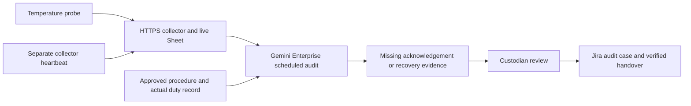

# LabRelay: account for the response after the alarm

**Rank 5, 70/100; access-gated research option.** An equipment custodian can see who acknowledged an equipment incident, what approved procedure applies, and whether an independent reading supports recovery. The proposed track is Intelligent Automation & Digital Transformation. It is an operational audit and handover tool, not a replacement for freezer alarms or emergency response. Dated 3 November 2026; unbuilt and subject to the [shared delivery contract](00-ranking.md#shared-delivery-contract).

Contents:

1. [User and evidence](#user-and-evidence)
1. [Distinct value and existing tools](#distinct-value-and-existing-tools)
1. [Signal and accountable workflow](#signal-and-accountable-workflow)
1. [One-week proof and limits](#one-week-proof-and-limits)
1. [Scoring rationale](#scoring-rationale)
1. [Measurement and demo](#measurement-and-demo)
1. [Adoption and rollout gates](#adoption-and-rollout-gates)

## User and evidence

The user is a lab equipment custodian maintaining a duty rota and reviewing incident outcomes. The current workaround is the existing monitor, phone/email contact list, printed procedure and a follow-up conversation.

Three distinct firsthand lab accounts motivate the hypothesis: [S11](/docs/research/social.md#s11-power-failure-disables-equipment-and-alerting) reports power loss without notifications from either monitoring system; [S12](/docs/research/social.md#s12-an-alarm-arrives-but-no-one-acts) reports an alarm received but not acted on at midnight; [S13](/docs/research/social.md#s13-the-person-present-cannot-find-a-response-procedure) reports missing out-of-hours contacts and uncertainty about the next action. These accounts do not prove root cause, sample damage or an APU problem.

**No APU laboratory, freezer, duty owner or physical probe has been secured.** A technology campus need not have the particular cold-storage workflow described by these posts. This is why a compelling problem ranks below easier local observation opportunities.

## Distinct value and existing tools

Existing freezer monitors already supply thresholds, offline alarms and remote alerts; [C5](/docs/research/competition.md#existing-substitutes) documents these substitutes. Pager/rota tools and an approved response sheet may fully solve the task. A model-generated temperature warning is not a novelty claim.

The proposed contribution is a compact **acknowledgement and recovery record** across the existing monitor, procedure and incident queue: delivered does not imply acknowledged; acknowledged does not imply acted; acted does not imply recovered. Gemini helps reconcile an incident's free-text notes with the asset's approved procedure and highlight missing evidence. It does not invent safe biological thresholds or prescribe sample handling.

## Signal and accountable workflow

A real temperature probe records physical temperature; an independently powered/networked collector heartbeat helps distinguish missing telemetry from a normal reading. Independence must be demonstrated, not assumed because there are two software processes. The team's own cold box containing ordinary water can prove data transport and workflow states; it cannot prove freezer performance or biological safety.

The existing equipment alarm and emergency response remain outside this diagram and continue to operate. Gemini's review queue is for follow-through and periodic audit; connector latency and human approvals make it unsuitable as the only urgent notification path.

1P Sheets provides fresh temperature, heartbeat and versioned team-approved procedure. 3P Jira receives an approved audit case linked to the real observed event. Restrict the sandbox to team-owned real events. Actual institutional contact details and research records are unnecessary for the hackathon. A reviewer records acknowledgement and transitions manually until those connector actions are verified.

States are `observed event → existing response invoked → acknowledgement recorded → recovery evidence pending → reviewed recovery`. Missing temperature or heartbeat yields `unknown / investigate data path`, never “all clear.” If both communication paths disappear, the cloud cannot distinguish power from network loss; it can only observe missing heartbeat. The feeder validates timestamps, thresholds and duplicate IDs; the model explains evidence gaps without overriding those checks. Acknowledgement auditing can run hourly; it cannot guarantee an emergency response interval.

## One-week proof and limits

On 4 November, secure a real probe, an equipment custodian interview and a safe supervised collection setup. If no relevant APU owner exists, stop this candidate; do not relabel a kitchen demonstration as a campus research pilot. On 5–6 November, collect the real cold-box temperature trace, let the water change temperature naturally, and temporarily disconnect only the team's collector to demonstrate actual missing telemetry. No campus freezer is disturbed and no samples are put at risk.

Use team-defined observation thresholds explicitly labelled as experimental, with no claim they are storage-safety limits. Publish the sanitized measured trace with device, units, timestamps and conditions before any labelled replay. On 7 November, compare evidence assembly with a simple rule-generated template and manually labelled events. If no operational incident is observed, the result is a transport-and-audit proof only.

Budget assumption: two builders, 32–48 person-hours, borrowed temperature hardware and phone/collector. Sensor purchase cost is unknown until a compatible in-stock probe and delivery are verified; the [hardware research](/docs/research/iot-and-network.md) warns of lead-time risk. A board alone is not a temperature probe. No hardware purchase or laboratory access is implied by this idea document.

## Scoring rationale

| Criterion       | Score | Reason and evidence gap                                                                                  |
| --------------- | ----- | -------------------------------------------------------------------------------------------------------- |
| Impact          | 4     | Missing response can have large consequences in the cited accounts; local loss and incidence are unknown |
| Technical build | 4     | Temperature, independent heartbeat, procedure grounding and incident records have distinct jobs          |
| Research        | 3     | Three concrete failure mechanisms, but no APU validation                                                 |
| Time to impact  | 2     | Equipment access, appropriate sensor and a responsible custodian are substantial gates                   |
| Daily workflow  | 4     | Shift handover and recovery audit recur, provided they complement an existing response system            |

## Measurement and demo

Targets, not measured results: every audit case has an owner or explicitly says unassigned; every closed case has fresh recovery evidence or an explicit human override; zero normal-status outputs during a missing heartbeat. Aim to cut preparation-plus-review time by 25% versus a rule-generated packet. Measure false unresolved flags, missed evidence gaps, correction time and actual acknowledgement delay; notification count is not impact.

Evaluate 30–50 real observation windows where available, retaining timestamps and manual labels. Windows from one temperature excursion are correlated; report event-level denominators separately. This test cannot establish detection accuracy for real freezer failure, saved samples or economic benefit.

The 3:45 demo spends 30 seconds on the documented response gap, 60 on real temperature and heartbeat input, 60 on the approved-procedure evidence packet and reviewed Jira action, 45 on a real collector disconnect and explicit unknown state, and 30 on metrics and the unvalidated deployment boundary. A recording is labelled with its date and supplements live reviewer access.

## Adoption and rollout gates

Kill by **4 November** if no physical sensor or locally relevant owner can be secured. Kill by **6 November** if the existing monitor and rota already expose the same acknowledgement/recovery evidence with less effort, or if the team cannot demonstrate independent heartbeat behavior. Never weaken the existing alarm to make a demo look useful.

At **three months, 3 February 2027**, a willing equipment custodian would run the audit alongside the existing system on one noncritical supervised asset, with approved procedures and measured review burden. At **six months, 3 May 2027**, consider additional assets only after proving dependable ownership, documented failure behavior and a useful improvement over existing records. These are conditional plans, not commitments from a lab. The strongest objection is that an established monitor plus a maintained duty rota may be the better solution.
