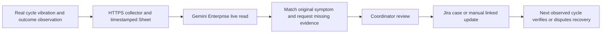

# WashWitness: verify the next usable laundry cycle

**Rank 4, 71/100; conditional alternative.** A residence facilities coordinator receives a small evidence packet linking a reported machine fault, the inspection, and the next observed useful wash or dry. The resident sees whether the machine is reported faulty, awaiting a check, occupied, or recently verified. The proposed track is Intelligent Automation & Digital Transformation. This is an unbuilt hypothesis, dated 3 November 2026; it inherits the [shared delivery contract](00-ranking.md#shared-delivery-contract).

Contents:

1. [User and evidence](#user-and-evidence)
1. [Why this could earn repeat use](#why-this-could-earn-repeat-use)
1. [Physical signal and workflow](#physical-signal-and-workflow)
1. [One-week prototype](#one-week-prototype)
1. [Scoring rationale](#scoring-rationale)
1. [Evaluation and demo](#evaluation-and-demo)
1. [Rollout and kill criteria](#rollout-and-kill-criteria)

## User and evidence

The first user is a residence coordinator handling repeated machine complaints; the beneficiary is a resident deciding whether to spend time and money on a cycle. The current substitute is a vendor app, fault form, email and a sign on the machine.

[S10](/docs/research/astra-social-demand.md#s10-a-repair-vendor-cannot-reproduce-a-recurring-fault) describes a property manager repeatedly observing a washer leak that a repair visit failed to reproduce. [D1–D2](/docs/research/astra-feasibility-and-substitutes.md#additional-demand-evidence) contain overseas student reports of misleading availability and unsuccessful drying. These are specific analogues, not Malaysian equipment statistics.

The strongest local account, [S7](/docs/research/astra-social-demand.md#s7-city-of-green-laundry-is-blocked-by-uncollected-clothes), concerns clothes left in completed machines and also says wardens are helpful. **Inference:** repair verification may be the wrong local problem. First observe one laundry room with permission; if most wasted trips arise from uncollected clothes, a collection agreement and reminder could outperform this idea. No local vendor, machine inventory or failure rate is confirmed.

## Why this could earn repeat use

The desired reason to return is a credible answer to “has this machine worked since that fault?” A coordinator should spend less time forwarding the same incomplete complaint; a resident should avoid repeating an unsuccessful cycle. Actual retention and willingness to contribute remain unknown.

[Circuit Go and fault reporting already exist](/docs/research/astra-feasibility-and-substitutes.md#existing-substitutes). Availability, payments, cycle timers and AI diagnosis provide no defensible novelty. The narrower hypothesis is **repair acceptance under the original failure condition**, preserving “unable to reproduce” rather than converting it into “fixed.” A simple vendor form with a required successful-cycle checkbox is the strongest low-cost competitor.

## Physical signal and workflow

With vendor permission, use a secured team-owned phone's accelerometer during a supervised ordinary cycle, with no wiring changes or installation inside the appliance. If physical placement is unsafe or not permitted, this sensor path fails the gate. The measured signal is vibration/activity, not water flow, cleanliness, dryness or repair quality. The resident or supervisor records the useful outcome separately; no audio or images of people's clothes are needed.

The 1P Sheets action reads current observations, collector health and the team-authored check rule. The 3P Jira create action records an approved real fault packet. Jira updates or transitions are manually performed unless the exact connector capability has been proven. One incident key combines machine and unresolved episode; repeated readings append evidence, not new tickets.

State transitions are `observed fault → assigned check → repair reported → verification pending → usable cycle witnessed` or `fault repeated`. Occupied/empty is a separate state. A completed vibration trace never means the drum is empty. A missing heartbeat means `telemetry unavailable`; previous success stays visible only as dated history, never as current healthy status. Gemini extracts symptoms from free text and prepares the handoff; deterministic rules handle time, identity and freshness.

## One-week prototype

By 4 November, obtain one permitted machine, one actual cycle and a coordinator willing to review. On 5–6 November, build capture and one live Sheets-to-Gemini-to-Jira path; observe normal cycles without manufacturing failures. Record a real fault only if one occurs. By 7 November, compare packet review against the current form and test a real disconnection of the team's collector. If no fault/recovery episode occurs, report that the acceptance path is unvalidated; demonstrate healthy observations, not invented repair records.

Scope is one room, one machine type, one symptom family and one reviewer. Exclude payments, refunds, reservations, predictive maintenance, identifying owners of clothes and automatic control. A 60-minute review batch is sufficient for a nonurgent maintenance pilot; this cannot protect against dangerous equipment faults, which follow the existing operator process.

Planning budget: two builders, approximately 24–36 person-hours including observation and packaging; borrowed phone, existing accounts and permission assumed. Normal wash fees and any safe mounting equipment are unpriced until the local vendor is known. No purchase is authorised or required by this document. Cloud/seat cost depends on the sponsored licence, as described in the ranking.

## Scoring rationale

| Criterion       | Score | Reason and evidence gap                                                                             |
| --------------- | ----- | --------------------------------------------------------------------------------------------------- |
| Impact          | 3     | Wasted cycles and trips are tangible, but local repair pain may be minor                            |
| Technical build | 4     | Physical activity, outcome witness, network freshness and two connector jobs fit one traceable case |
| Research        | 3     | Specific firsthand analogues and contradictory local evidence; no local observation yet             |
| Time to impact  | 4     | One-machine pilot can be small if permission exists; this score drops if vendor access fails        |
| Daily workflow  | 4     | Repeated cycles naturally supply verification; contribution burden could undermine it               |

## Evaluation and demo

Targets, not results: reduce coordinator preparation-plus-review time by 25% against the existing form; avoid any claim of “usable” from vibration alone; have at least 80% of participating users complete an outcome check within a minute. Count abandoned checks and corrective edits. Record actual distinct cycles and incidents; 30–50 windows can assess signal/freshness handling, but windows from one cycle cannot establish repair success rates. Report the smaller actual sample if necessary.

The 3:45 demo allocates 30 seconds to the resident's task, 60 to a live reading and explicit limitations, 60 to Gemini's evidence request and approved case, 45 to a disconnected collector producing unknown status, and 30 to measured review effort and rollout. A separate real-log replay may illustrate a previously recorded incident with its date; it never replaces failed live access.

## Rollout and kill criteria

**By 4 November:** reject if no permitted sensor placement, willing coordinator or useful distinction from the existing vendor app. **By 6 November:** reject the repair thesis if observation shows the dominant problem is abandoned clothes or if users will not provide the outcome check. Choose the simpler collection intervention if warranted; do not rename it sensor-based repair verification.

At **three months, 3 February 2027**, a willing residence coordinator and vendor would pilot one room, compare repeated-fault frequency and review effort, and decide who owns daily checks. At **six months, 3 May 2027**, expand only if residents return voluntarily and verified recovery improves over the existing vendor process. These are proposed owners and dates, not partnerships. The strongest objection remains that one required field in a vendor form may deliver the same benefit more cheaply.
