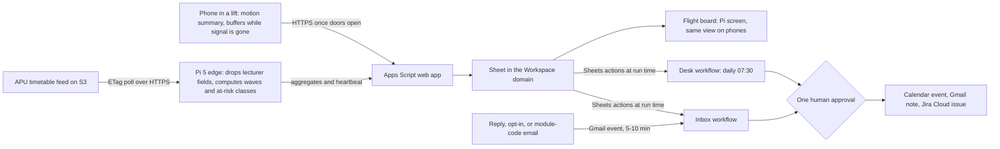

# LiftBoard

LiftBoard finds the APU classes that a lift queue can make late, then pulls apart the two crowds that meet at the lifts at each changeover. It asks only the lecturers who must cross the building to wrap up five minutes early, and it tells students with no class in the previous hour to go up before the release. Any phone in any lift works as a flight recorder, so the board can show measured waits as soon as someone on campus rides.

This is a plan, not a result. Figures are aggregates from APU's public timetable feed, fetched on 4 November 2026. No APU lift has been timed, nobody has been asked, and no Gemini Enterprise step has run. The author's score climbed from 47.5 to 68.5 of 100, and an independent review then scored it 49. The weak point is still there: nobody has shown that a lift made a class late, and this team can't time one before the deadline.

Contents:

1.  [Read this first](#read-this-first)
1.  [Pitch and proposed track](#pitch-and-proposed-track)
1.  [At a glance](#at-a-glance)
1.  [Problem and evidence](#problem-and-evidence)
1.  [How it works](#how-it-works)
1.  [Fit with the team's circumstances](#fit-with-the-teams-circumstances)
1.  [Hill-climb log](#hill-climb-log)
1.  [Scores by component](#scores-by-component)
1.  [Research plan with nobody on campus](#research-plan-with-nobody-on-campus)
1.  [Time to impact at 3 and 6 months](#time-to-impact-at-3-and-6-months)
1.  [Demo, video, final pitch, and reviewer path](#demo-video-final-pitch-and-reviewer-path)
1.  [Build plan, Thu 5 to Tue 10 Nov](#build-plan-thu-5-to-tue-10-nov)
1.  [Risks and kill criteria](#risks-and-kill-criteria)
1.  [Independent review](#independent-review)
    1.  [Claims that hold](#claims-that-hold)
    1.  [Claims that fail or lack support](#claims-that-fail-or-lack-support)
    1.  [What the reviewer would change](#what-the-reviewer-would-change)
    1.  [Domain risks the doc misses](#domain-risks-the-doc-misses)
    1.  [Rescore](#rescore)
    1.  [Flashy yet practical](#flashy-yet-practical)
    1.  [Cheapest test by Fri 6 Nov 22:00](#cheapest-test-by-fri-6-nov-2200)
    1.  [Not verified by the reviewer](#not-verified-by-the-reviewer)
1.  [Not verified](#not-verified)

## Read this first

**Verdict:** an independent lift traffic review says **don't build this as pitched** and scores it 49 of 100, against the 68.5 below. Its full text is under [Independent review](#independent-review). Where the two disagree, treat the review as the current position.

**What the review changes:**

1.  **Early finishes move trips but don't remove them.** Relief depends on spare capacity at each lift bank, which nobody can check from off campus. So 56 to 35 rooms isn't a queue result and shouldn't be the payoff.
1.  **12:45 still matters.** Lunch traffic loads the lifts, and 875 upper-floor cohort rows start at 13:30. 10:30 and 15:30 lead for tight connections only.
1.  **"Far" moves don't prove lift use.** 174 of the 201 cross blocks, 33 of them on the same level, and the connecting levels are unknown.
1.  **The leave-by advice could create a new peak.** Test capacity before advising it.
1.  **Manual timing is the reference.** Motion detection stays experimental until it's validated.

**What stays open:** the reviewer's best fix, a room-continuity audit, needs timetable office approval, which conflicts with the team's no-office limit. Its cheapest test needs calls with six students and two lecturers. **Inference:** the limit the team recorded for the shuttle idea on 5 November, no reachable riders or interviews, probably applies here too, though the team hasn't said so for lifts.

## Pitch and proposed track

**Pitch:** The biggest wave leaving APU's upper floors is at 12:45, and only 4% of those groups are in a hurry. The waves that can make classes late are 10:30 and 15:30: half of those groups have another class within 15 minutes. At the changeovers that follow, 129 lecturer moves a week cross blocks or 2+ levels in 15 minutes or less. LiftBoard finds those classes each week, asks only those lecturers for five minutes, tells everyone else when to go up, and measures what the lift really did.

**Track:** Smart Campus & Student Experience, because the users are students and lecturers and no office has to act. **Inference:** Intelligent Automation is a fair fallback if the organisers want an operations angle; the build doesn't change, and prizes share one pool.

## At a glance

- **Users:** lecturers with a tight room change, and students with classes on level 5+. An office may read the output; nothing depends on it.
- **Track:** Smart Campus & Student Experience.
- **Trigger:** a daily schedule at 07:30 MYT, and the Gmail "When an email is received" event.
- **Live signal:** APU's public timetable feed, polled by the Pi; phone motion during real lift rides.
- **Connectors:** Drive and Sheets, Gmail, and Google Calendar (1P); Jira Cloud (3P). Custom MCP only if the organisers lift the policy.
- **Decision:** which classes get a wrap-up ask under an editable rule sheet, which asks to cancel when a class moves, and whether to stop because the feed check is stale.
- **Action and approval:** a Calendar event and a Gmail note to an opted-in lecturer, and a Jira issue, behind one human approval.
- **Reviewer self-trigger:** ride any lift with the public page open, or email the desk a module code.

## Problem and evidence

**Team observation, not a measurement:** from morning to afternoon you wait 1–3 turns depending on the spot (main entrance, carpark, near the cafeteria), then take 2–3 minutes to reach your floor because of the stops. Classes start late because lecturers are stuck too. The team's hunch is that people keep using the same spots while other lifts stay vacant. That hunch is untested.

**Public posts:** "A block have 9 floor 15classes a floor only two lift. Lift always full" (Instagram, 27 October 2026, 18 likes) and "APU if you're reading this fix your damn elevators lah" (Reddit, 28 September 2025, 54 points) ([other platforms](/docs/research/social.md#lifts-stairs-and-crowding), [Reddit](/docs/research/social.md#lifts-laundry-and-deposits)). A timetabling paper from KU Leuven describes the same chain: crowding causes "long queues at elevators or at stairwells, which might lead to delays in lecture starts" ([Vermuyten et al., 2016](https://repub.eur.nl/pub/124530)).

**Counterevidence:** lifts rank 10th of 15 themes on other platforms ([ranking](/docs/research/social.md#other-platforms-theme-ranking)) and come up "in passing" on Reddit, where no thread measured a wait. On X, 23 APU queries found no first-hand 2025–2026 lift complaint ([X](/docs/research/social.md#apus-footprint-on-x)). APU's [campus guide](https://apiit.atlassian.net/wiki/spaces/LNO/pages/3855974442) describes a multi-level spine, so a move across blocks may not need a lift.

**What the feed shows** (fetched 4 November at 23:50 MYT, last written 28 October, week of 2–6 November unless stated). A cohort row is one intake and group in one physical class. It isn't a headcount: the feed has no class sizes. Lecturer fields stayed in memory and were never printed or stored.

| Release from level 5+ | Cohort rows | Next class within 15 min, elsewhere | Share |
| --------------------- | ----------: | ----------------------------------: | ----: |
| 10:30                 |         831 |                                 433 |   52% |
| 12:45                 |         866 |                                  34 |    4% |
| 15:30                 |         801 |                                 392 |   49% |
| 17:45                 |         842 |                                   0 |    0% |

- **The seed flattened the wrong wave.** Its headline cut (Thu 5 Nov, 71 rooms to 40 by moving 31 classes) sits at 12:45, which leads to lunch or home. **Inference:** those people still queue, but they aren't late.
- **Two crowds meet at each changeover.** Of 883 cohort rows starting on level 5+ at 10:45, 46% left another room within 15 minutes and 49% had no class in the previous hour. At 15:45 it is 44% and 47% of 747. Across 08:30, 10:45, 13:30, and 15:45, 64% of 3,400 rows had no class in the previous hour. **Inference:** that crowd can choose when to go up. Of 1,024 tight cohort moves into 10:45 and 15:45, 19% stay within 2 levels of the same block; whether they ride today is unknown.
- **Lecturers hit the same changeovers.** There are 326 room changes with a gap of 15 minutes or less, by 215 of 468 lecturers, and 211 land at 10:45 or 15:45. Of the 240 with coded rooms on both sides, 201 cross blocks or move 2+ levels, by 155 lecturers. This doc calls those far moves. They lead into rooms holding 626 cohort rows. **Inference:** lifts are one cause among several.
- **The problem recurs but the classes don't.** Far moves number 177, 201, and 194 in the three full weeks, and 77 in the holiday week. Only 21 of 2,880 room sessions in the week of 16 November match the week of 2 November on weekday, time, room, and module, though the wave shape holds (Pearson 0.875 on counts by block, weekday, and end time). That later week may be republished. **Inference:** a one-off audit goes stale, but a poster of wave times doesn't.
- **A small ask works at the right wave, on paper.** Moving only the classes before a far move cuts Thu 5 Nov's level 5+ release from 56 to 35 rooms at 10:30 (21 classes) and from 58 to 38 at 15:30 (20 classes). Other days cut less: 16–25% Monday to Wednesday and 10–19% Friday. In cohort rows, Thursday is 37–41% and other days 5–19%. This is arithmetic at full opt-in, with no people measured.

**Precedent and substitutes:** a Fordham simulation found that shortening classes by five minutes and staggering half the starts cut average waits by 43% at six passengers per car, against 6% for pairing passengers by destination; it never measured Fordham's own lifts ([Swinarski, 2020](https://www.insidehighered.com/node/46333)). [Line@Dartmouth](https://thedartmouth.com/article/2022/04/new-linedartmouth-app-displays-wait-times-at-campus-hotspots) estimates dining and study-space crowding from Wi-Fi, and [Cal State San Marcos](https://news.csusm.edu/new-mechanism-provides-notification-of--operational-status-of--campus-elevators/) publishes lift outages, not queues. No app that times lift queues with phone sensors turned up; the search wasn't exhaustive. APSpace's live main bundle has 54 distinct route paths on a recount (48 in the earlier count), none about lifts or crowding; lazy-loaded chunks weren't checked. In the crowd baseline, queues and crowds are a thin 2.5% and often simulated ([crowd map](/docs/research/competition.md#crowd-map)).

## How it works

**Features to show.** Two features on one canvas. The canvas is a flip-style flight board on a Pi screen, with the same view on phones by QR. Each block's row shows its next wave, rooms out, rooms in, classes at risk, APU rides measured, and edge status, and a block cross-section lights up as real rooms release. The phone view adds an intake code and one line: "No class before 10:45: go up before 10:30", or "Next room is 2 levels away: walk", with a lift-only setting. The seed's "which lift for which floors" stays cut until a lift map exists.

1.  **Flight recorder.** A student picks their class, taps **In queue**, and holds the phone flat. The page reads `devicemotion`, detects the ride start, each stop, and the ride end, and keeps the screen on with [Wake Lock](https://developer.mozilla.org/en-US/docs/Web/API/Screen_Wake_Lock_API). An optional **Missed a car** tap counts turns. Only a summary leaves the phone: wait, turns, ride time, stops, signal gap, and upload delay. Browsers expose [no barometer](https://developer.mozilla.org/en-US/docs/Web/API/Sensor_APIs), and a [2014 study](https://microsoft.com/en-us/research/wp-content/uploads/2016/02/hotmobile14b.pdf) found accelerometer accuracy "dropped significantly" when the phone was in use, though it nearly matched the barometer when held still. So the page says "hold flat", and stops are the first thing to cut.
1.  **Late-start desk.** Each morning a workflow picks asks for opted-in lecturers, waits for one approval, and sends "Wrap up by 10:25: your 10:45 is in another block". The board's chart then shows the 10:30 wave at full opt-in, labelled as arithmetic. Gemini handles free-text replies, rule exceptions, and drafts, while the Pi does the arithmetic. **Inference:** that is the honest answer to "why an agent?", and only part of the loop needs one.

**Day-to-day loop.**

1.  **Every 15 minutes:** the Pi sends `If-None-Match` and usually gets a `304` ([feed behaviour](/docs/research/apu.md#timetable-feed-change-behaviour)). On a new version it joins lecturer moves in memory, drops the three personal fields, and posts aggregates and a heartbeat to the Sheet.
1.  **Daily at 07:30 (Desk):** read the heartbeat and stop on a stale or failed check. Otherwise read the at-risk list, opt-ins, and rule sheet; pick asks; cancel any whose class moved; draft each note; wait for approval; then write to Calendar, Gmail, and Jira. A quiet day logs "0 asks" and why. The feed holds no physical classes on 7–9 November, so those runs prove the quiet path.
1.  **On email (Inbox):** read opt-ins, free-text replies such as "not this week, it's a lab", and module-code questions, then draft the reply behind the same approval.
1.  **On every ride:** the summary lands in the Sheet. It counts as an APU ride only if it's inside the campus geofence and the phone isn't in test mode.
1.  **Each Sunday:** the run adds a weekly line: asks sent and accepted, APU rides with n, and form results. A teammate clears **Needs Review** morning and evening, and refreshes schedule credentials by 10 November.

**Failure handling.**

- **Feed fails or the Pi goes offline:** the heartbeat carries the HTTP status or goes stale after 30 minutes. The board and phones show the error and no forecast, and Desk stops. No cached copy.
- **No signal in the lift:** expected. The page buffers, uploads when signal returns, and shows the delay.
- **Motion denied, or the phone shaken or pocketed:** the page says the ride wasn't recorded. No guessed value.
- **No APU rides yet:** the board says "none yet", never an estimate. **No approval:** nothing reaches anyone, and the ask lapses once its class has passed.

**Connectors and platform checks.** Checked against the [Gemini Enterprise research](/docs/research/gemini-enterprise.md#actions-and-write-back). None has run yet.

| Connector             | Stage | Job in the loop                              | Platform check                                                                         |
| --------------------- | ----- | -------------------------------------------- | -------------------------------------------------------------------------------------- |
| Drive and Sheets (1P) | GA    | Read heartbeat, at-risk list, opt-ins, rules | Needs a Workspace domain; consumer accounts get a `403`                                |
| Gmail (1P)            | GA    | Event on received mail; send notes           | 5–10 minute polling delay; self-sent mail needs the "sent" trigger                     |
| Google Calendar (1P)  | GA    | Create or cancel a wrap-up event             | Scheduled actions that affect others pause for approval                                |
| Jira Cloud (3P)       | GA    | One issue per ask; comment per reply         | Free for 10 users; comments and status changes stay unproven until they run in the app |

- **Limits:** Standard allows 1 agent creation per user per day, pooled, and approval steps must be added in the UI ([limits](/docs/research/gemini-enterprise.md#limits-that-bite-in-a-one-week-build)). Two workflows fit. The docs are silent on whether one workflow can hold two triggers, so assume it can't. A [custom MCP](/docs/research/gemini-enterprise.md#custom-mcp-servers) on the Pi, where Gemini asks the device for the next wave, is preview and blocked by default: cut unless lifted.
- **If the licence sits on consumer accounts:** swap the Sheet for [Supabase](/docs/research/gemini-enterprise.md#device-to-supabase) (preview) and use Jira alone for actions. Calendar and Gmail drop out, and the connector score falls.

**Cloud, IoT, and network.**

- **Cloud:** Gemini Enterprise workflows, the Sheet read at run time, and the Apps Script web app. The data side needs no card: Apps Script, Sheets, a public page on GitHub Pages, and Jira Free.
- **IoT:** phones sense real rides and send only a summary. The Pi is the always-on edge: it polls, computes, drives the board, and stops 492 lecturers' names from reaching any cloud ([personal data](/docs/research/apu.md#personal-data-in-the-timetable-feed)). **Inference:** that fits the School's interest in privacy-conscious edge work ([lenses](/docs/CONTEXT.md#sponsor-and-organiser-lenses)), but a paid cloud job could also do it. The Pi is not a lift sensor. Per-class flags stay in the private Sheet because the public feed links them to a named person; the public board shows counts only.
- **Network:** three hops are visible: feed to Pi with `304` timing; the lift car as a dead zone, with buffered upload on exit; and phone to Sheet to board delay. Whether signal really dies in a lift is a test, reported as n of N rides.

## Fit with the team's circumstances

**Works with nobody on campus:** feed analysis, the Pi at a teammate's home, recorder tests in the team's own building lifts, workflows, lecturer opt-in by email, remote research, and the reviewer path. Nothing needs buying, so Deepavali delivery delays don't matter.

**Doesn't work with nobody on campus:** timing any APU lift, so there is no baseline and no before-and-after; testing the vacant-lift hunch or which lift reaches which floor (the guide names the glass, Block C, and Block E elevators and has no floor plan file); and a board in an APU lobby, which needs permission and an installer. The board stays on the team's own screen.

**Rules it keeps:**

- **Real data:** feed and rides are real. Mock GPS appears only in tests and the recorded demo, to pass the geofence. Those phones run in test mode, which writes to a separate tab that no metric reads, and no script says where those rides happened ([data ruling](/docs/CONTEXT.md#decisions-so-far)). No ride is arranged on campus; an open link in the form's chats may return real rides or none.
- **Recipients:** until a real lecturer opts in, asks go to a teammate's test inbox, and the video says so. Lecturers give their own address and module codes, so feed names never reach anyone.
- **Permission:** APU's [Terms of Use](/docs/research/apu.md#terms-of-use-and-robotstxt) mean the feed needs written permission. Ask through `#help-desk` on Thu 5 Nov.

## Hill-climb log

Weights and gates come from the [scoring matrix](00-ranking.md#scoring-matrix), unchanged so this score stays comparable within the set. **Inference:** Demo at weight 5 understates the final, since KitaHack 2026's final gave presentation 40% ([judging](/docs/research/judging.md#structure-and-timing)); the pitch plan handles that outside the total. The seed scored **47.5** and failed three gates: IoT real (the Pi was a display), reachable (no real items to score), and self-trigger. Scores below rate each mutation alone, on top of the previous round's result.

|  Rd | Mutation                                                          | Check                                                                                                                                          | Score | Outcome                                                    |
| --: | ----------------------------------------------------------------- | ---------------------------------------------------------------------------------------------------------------------------------------------- | ----: | ---------------------------------------------------------- |
|   1 | Right wave (attacks the seed's metric): rank by groups in a hurry | 12:45 is 4% urgent; 10:30 is 52%                                                                                                               |  50.0 | Adopted as a free correction                               |
|   1 | Flight recorder: phones time wait, ride, stops, and signal gap    | Motion works on Android and iPhone; 30–50 real rides possible anywhere                                                                         |  53.0 | **Won.** The only sensor this team can actually run        |
|   1 | Pi lobby counter: the Pi's radio counts nearby devices            | Nobody on campus; [MAC randomisation](/docs/research/iot-and-network.md#signals-from-devices-that-already-exist); a device count isn't a queue |  49.5 | Died: can't run at APU                                     |
|   1 | Changeover audit, no lifts (attacks the premise)                  | 201 far moves, 155 lecturers; no sensor                                                                                                        |  56.5 | Top raw score but fails the IoT gate; its ask returns next |
|   1 | Human zoning: the board calls which floors board next             | Fordham: pairing 6% against stagger 43%; needs a marshal; untestable                                                                           |  49.0 | Died                                                       |
|   2 | Self-interest ask: only lecturers with a far move get a note      | 21 of 56 rooms, Thu 10:30. **Inference:** each lecturer gains alone, with no coordination                                                      |  62.5 | **Won.** Calendar, Gmail, and Jira do real work            |
|   2 | Lateness league (attacks asking): publish the worst changeovers   | Depends on an office reacting; flags identify lecturers through the public feed                                                                |  53.5 | Died                                                       |
|   2 | Lecturer express car at changeovers                               | Fordham simulated express cars, no figure in the article; needs Facilities                                                                     |  55.0 | Died: needs an office                                      |
|   2 | Room-swap proposals to the Schedulers office                      | Re-timetabling can cut flows (Vermuyten); the office is out of reach                                                                           |  57.5 | Optional output only                                       |
|   3 | Daily desk and reply loop                                         | Week of 16 Nov repeats 21 of 2,880 sessions; 7–9 Nov give real no-class runs                                                                   |  64.0 | **Won**                                                    |
|   3 | Pi as privacy edge, with a heartbeat that stops the desk          | Names stop at the Pi; `304` polling                                                                                                            |  63.5 | Adopted: half a day's work                                 |
|   3 | Late-start check: join recalled late starts to feed flags         | Allowed as a remote form; recall bias; expect tens of answers                                                                                  |  63.5 | Adopted: tests the link nobody has shown                   |
|   3 | Cron only (attacks the Gemini core)                               | Fails the Gemini gate                                                                                                                          |  58.0 | Died, but it set Gemini's job: replies, rules, drafts      |
|   4 | Two-crowd leave-by, keyed by intake                               | At 10:45, 49% had no class in the last hour; needs no lecturer or office                                                                       |  68.0 | **Won**                                                    |
|   4 | Poster (attacks the board): a per-block image in chats            | Wave shape is stable; can't show errors, rides, or personal advice                                                                             |  66.0 | Not built, but conceded: the board alone earns little      |
|   4 | Spare-lift map: map lifts to floors, test the hunch               | Three lifts named, no plan; can't be checked remotely                                                                                          |  66.0 | Research output until answers agree                        |
|   4 | Reviewer email: send a module code, get its waves                 | Gmail event in 5–10 minutes; the reply may pause for approval                                                                                  |  66.5 | Adopted                                                    |
|   5 | First rides on final day, if the team attends in person           | Tue 17 Nov: 55 rooms end at 10:30 and 54 start at 10:45, as published                                                                          |  68.5 | Adopted: the first real number, but only after the top 5   |
|   5 | Open link in course chats                                         | Not arranged logging; may return nothing                                                                                                       |  68.5 | Adopted as upside, off the critical path                   |
|   5 | Live remote rider if the final is remote                          | Needs no campus; a dropped call at the doors shows the gap                                                                                     |  68.5 | Adopted for the remote case                                |
|   5 | Lead with the zero (attacks flash): open on "never timed"         | [YC](/docs/research/judging.md#qa-preparation) calls exaggeration fatal, but it's a weak opening                                               |  68.5 | Partly: open on 12:45, say the zero within a minute        |

Adversarial critique of each round's result, fed into the next round:

- **Round 1, 54.5.** FDE: one weekly email with one connector is not a technical build. IoT lecturer: a ride in your condo says nothing about Block D, and the Pi is an HDMI stick. Student: I won't hold my phone up for your dataset, and nobody needs 31 classes to end early for lunch.
- **Round 2, 62.5.** FDE: arithmetic needs no agent, a weekly run isn't day to day, and you can't say a flagged class starts late. IoT lecturer: what does the Pi do that a laptop can't? Student: my lecturer wrapping up helps one class, and I'm coming from the cafeteria.
- **Round 3, 66.0.** FDE: what can a reviewer touch? Your approvals sit in your own chat history. IoT lecturer: prove the stop counter, because accelerometers fail when the phone moves. Student: there's still nothing for me, and a poster tells me the same times.
- **Round 4, 68.5.** FDE: your board says zero rides at APU. IoT lecturer: show me one number from my building. Student: I'll believe it when you've stood in my queue.
- **Round 5, 68.5, a gain of 0.** The climb stops at the five-round limit. Round 4's critiques stand, and only a trip to the final can answer them. The seed's core is replaced: the rush countdown and the level 8+ ask are gone as the product, and the board survives as the canvas.

## Scores by component

| Component           | Weight | Seed | Final | Lowest honest reason                                                                         |
| ------------------- | -----: | ---: | ----: | -------------------------------------------------------------------------------------------- |
| Impact              |     15 |  2.0 |   3.0 | Real volume, but no before-and-after, and no class is shown to start on time because of this |
| Connectors          |     15 |  2.5 |   3.5 | Four connectors work on paper; none has run, and the licence is unconfirmed                  |
| Research            |     10 |  2.0 |   3.5 | No timed APU baseline is possible; the late-start check rests on recall and isn't in hand    |
| Time to impact      |     10 |  2.0 |   3.0 | Needs APU's permission, opt-ins, and riders; no owner beyond the team                        |
| Day-to-day workflow |     15 |  2.5 |   3.5 | Daily with one approval, but most runs may be quiet until lecturers opt in                   |
| Theme               |     10 |  2.0 |   3.5 | The Pi and phones are real, but no sensor has read an APU lift                               |
| Originality         |     10 |  3.5 |   4.0 | The recorder and targeted ask are rare, but a lift board sits beside the thin queues cluster |
| Usage               |     10 |  2.0 |   3.0 | Lecturers keep their calendar; holding a phone flat in a queue is real friction              |
| Demo                |      5 |  3.5 |   4.5 | Any lift fires it, but the ride on screen can't be called APU's                              |
| **Weighted**        |    100 | 47.5 |  68.5 |                                                                                              |

**Gates** (these and the scores rate a plan, since nothing has run):

- **Pass:** real data and self-trigger. **Conditional on a licence in a Workspace domain:** Gemini Enterprise core and buildable on the no-card path.
- **IoT real, conditional:** the team runs real sensors in real lifts, and the Pi's heartbeat is load-bearing. A strict lecturer could still fail it, because nothing reads an APU lift until someone on campus rides.
- **Reachable, conditional:** people can be reached remotely, and 30–50 real rides are possible by 7 November. The 30–50 class items depend on form answers. No owner exists.

## Research plan with nobody on campus

1.  **Form, live Thu 5 Nov, in Discord and course chats.** It is anonymous, with a consent line and an under-18 check. For your last class on level 5+: block, level, day, and start time from APSpace; did it start late and by how much; the main cause (lift, last class overran, walking, other, don't know); when the class before really ended; which lift you used, and whether you saw another standing idle. **Inference:** expect tens of answers, so report "n of N", never a share of APU ([surveys](/docs/research/judging.md#short-surveys-and-desk-research)).
1.  **Late-start check.** Join those answers to feed flags. Compare late starts in classes after a far move with all others, and give precision and recall on 30–50 class items if they arrive. Label it recalled and self-selected.
1.  **Interviews, 6–8 by call, in two rounds on Thu–Sat.** 4–5 students (at least 2 on levels 8–9) and 2–3 lecturers (at least 1 with a far move). Ask about the last time, not the idea: when did you reach the room, when did your last class end, do you ever finish early, and what stops you? Label quotes by role ([consent](/docs/research/judging.md#consent-and-anonymised-quotes)).
1.  **Recorder bench, 30–50 real rides in the team's own buildings, without mock GPS.** Riders note true stops, and a second phone runs [phyphox's Elevator experiment](https://phyphox.org/expdb/a9bc91393d87df6ddaea56fbbc9d60b723b4e7cd/instructions/elevator), which reads the barometer. Report precision and recall for ride start, ride end, and stops, held still and in use, plus n of N rides with a signal gap. This scores the sensor and says nothing about APU's waits.

## Time to impact at 3 and 6 months

- **By 3 months (February 2027):** written feed permission; asks live for opted-in lecturers in one block (on Thu 5 Nov, Block D had 6 of 15 rooms at 10:30 and 7 of 15 at 15:30 before a far move); the phone view and recorder link in course chats; first measured waits per block, with n. A lecturer notices a calendar note, and a student's phone says when to go up.
- **By 6 months (May 2027):** one semester of data: share of far moves with an accepted ask, late starts flagged against unflagged, and measured waits. The feed gives a free test: as published, 31 level 5+ rooms end at 10:30 on Tue 10 Nov and 74 on Mon 16 Nov, so rides can show whether load drives the queue before anyone is asked to change. Then stop or widen. The Schedulers office may receive the evidence.
- **What must be true:** APU allows the feed; lecturers accept five fewer minutes; enough students ride; a student group takes it on (none is confirmed); and seats outlast the trial (unknown). **Inference:** GOV.UK's phases put 10–16 weeks before beta ([phases](/docs/research/judging.md#mapping-3-and-6-months-to-delivery-phases)), so 3 months is tight and only works because no office has to act.

## Demo, video, final pitch, and reviewer path

**Video, about 3:45,** following the [minute plan](/docs/research/judging.md#minute-plan), labelled as a recording with its capture date. It opens on the 12:45 table and one quote. From 0:40 to 1:25, the ride: split screen, doors close, signal gap opens, doors open, the card lands on the Pi's board. The script never says where the lift is, and the APU counter doesn't move. From 1:25 to 2:10, the desk: the Runs tab over several days, a real approval, a calendar event in the test inbox, and Thu 5 Nov's 10:30 chart falling from 56 to 35, labelled as arithmetic at full opt-in. Then recorder accuracy with n, the form as n of N, what isn't known, the 3- and 6-month plan, and the team.

**Final pitch (format unannounced; rehearse 3, 5, and 10 minutes, one speaker):**

1.  **Open:** the live board's next wave and a show of hands. Then the surprise: the biggest wave isn't the one that makes you late. Say "we have never timed one of your lifts" within a minute.
1.  **Prototype, 60–90 seconds, two features:** a teammate rides a real lift and the card lands as the doors open; then approve a real waiting ask on stage. The reference advice (two features, 1–1.5 minutes) fits. The one departure from "big flashy" is stating the zero.
1.  **If in person:** ride at that day's 10:30 wave, with test mode off, so the counter shows real APU rides with n. **If remote:** a teammate rides at their own building, live on a call, with no APU claim. **If it fails:** a hotspot and second device are the [backup](/docs/research/judging.md#live-demo-risk-and-backups). A failed source shows its error, and no recording stands in.
1.  **Prepare answers:** how many lecturers said yes? Is ending early allowed? Why not a poster? Why Gemini?

**Reviewer path:** the demo link opens the README's "How to review". With no seat, open the public page and ride any lift. Or email the desk a module code: the Inbox fires in 5–10 minutes, and the reply may wait for the duty approver. With a seat, run Desk by hand. Shared users see only their own runs, so the README captures the owner's Runs tab ([reviewer access](/docs/CONTEXT.md#reviewer-access)).

## Build plan, Thu 5 to Tue 10 Nov

This assumes 3 builders, since team size isn't confirmed. Critical path: licence thin slice, Pi to Sheet, ride to board, Desk with approval and Calendar, then form answers.

| Day        | A: edge and data                                  | B: phone and board                                         | C: Gemini, research, pitch                                                                                  |
| ---------- | ------------------------------------------------- | ---------------------------------------------------------- | ----------------------------------------------------------------------------------------------------------- |
| Thu 5 Nov  | Pi polls, drops fields, computes waves and flags  | Log raw motion beside phyphox on 5 real rides              | Ask about licence, account type, MCP, remote final, feed permission; form live; Sheet → approval → Calendar |
| Fri 6 Nov  | Apps Script ingest, Sheet, heartbeat              | Ride detector v1, buffer, upload; board on the Pi          | Desk workflow; schedules on; 3–4 interviews; **go or no-go at 22:00**                                       |
| Sat 7 Nov  | Phone view by intake; 10:30 and 15:30 chart       | 30–50 bench rides; precision and recall; tune or cut stops | Inbox and Jira; 3–4 interviews; lecturer outreach closes                                                    |
| Sun 8 Nov  | Deepavali: one light task, or off                 | Deepavali: board polish, or off                            | Everyone registered before 23:59; README and deck drafts                                                    |
| Mon 9 Nov  | Holiday; test error states by pulling the network | Feature freeze at 18:00; record the ride                   | Record the desk; test reviewer access from a non-team account                                               |
| Tue 10 Nov | Check the first class day since Friday            | Fix only what broke                                        | Refresh credentials; compress the PDF; leader submits by 18:00                                              |

**Cut lines, in order:** MCP on the Pi; shareable ride receipt; student calendar feed; block cross-section animation; stop count (keep ride time); Jira comment loop (keep create). **Never cut:** the error state, the approval, ride to board, and the README's table of what is real and what isn't. After submission, run a duty rota for 11–14 November.

## Risks and kill criteria

Thresholds are proposed here, not sourced. Agree them now so nobody argues them later.

| Risk                                     | Check by         | Kill or switch                                                                                                 |
| ---------------------------------------- | ---------------- | -------------------------------------------------------------------------------------------------------------- |
| Lifts aren't why classes start late      | Fri 6 Nov, 22:00 | With 20+ answers, if under a third name a lift for a late start, drop LiftBoard and build another idea         |
| Classes already end early                | Fri 6 Nov, 22:00 | If most answers say so, feed end times mislead: drop the chart, keep the recorder and leave-by                 |
| No lecturer will try it                  | Sat 7 Nov        | 0 of 8+ contacted: drop the ask as the hero, and accept that the workflow score falls                          |
| Licence or Workspace late                | Sat 7 Nov, 12:00 | Consumer accounts: Supabase path. No licence: submit the rest, say Gemini Enterprise did not run               |
| Recorder unreliable                      | Sat 7 Nov        | On 30+ rides, ride precision or recall under 0.8: use manual taps and say so. Stops under 70% exact: hide them |
| APU refuses the feed                     | When answered    | Take the public board down. There is no product without the feed                                               |
| Final is in person and nobody can travel | Ask Thu 5 Nov    | Tell the organisers early; the submission still stands                                                         |

## Independent review

Review by `gpt-6-astra` at xhigh through Codex, 5 November 2026. "I" in this section is the reviewer, and its text is unchanged apart from headings and the marked note. Coordinator's check: the 13:30 count and the far-move breakdown (201, 174, 33, 27) recompute exactly from the same feed copy. The review says the Inside Higher Ed article failed to load, but it opened on recheck and its 43% and 6% figures match. The Sage paper returned HTTP 403 on recheck, so the review's description of that paper isn't independently confirmed.

### Claims that hold

I recomputed the supplied 31,606-row snapshot, captured **4 November 2026, 22:33 MYT**. For 2–6 November, I excluded rooms starting `ONL` and modules containing `(Online)`, then deduplicated records ignoring the lecturer hash: 8,741 physical rows became 8,730. A cohort is `INTAKE + GROUPING`; a tight connection means another physical room starting 0–15 minutes after release that day. These are timetable proxies, not people or observed journeys.

| Claim                                          | How I checked                                                            | Result                                                                                                                                                                               |
| ---------------------------------------------- | ------------------------------------------------------------------------ | ------------------------------------------------------------------------------------------------------------------------------------------------------------------------------------ |
| 10:30 release: 831 rows, 433 tight connections | Parsed block-level-room codes, level ≥5                                  | Reproduced: **52.1%**.                                                                                                                                                               |
| 12:45 release: 866 rows, 34 tight connections  | Same filters and cohort join                                             | Reproduced: **3.9%**.                                                                                                                                                                |
| 15:30 release: 801 rows, 392 tight connections | Same filters and cohort join                                             | Reproduced: **48.9%**.                                                                                                                                                               |
| 17:45 release: 842 rows, no tight connections  | Same filters; remove co-teaching duplication                             | Reproduced: **0%**. Without deduplication, 850 incorrectly counts some cohorts twice.                                                                                                |
| Lecturer changes and Thursday reductions       | Deduplicated each lecturer's room sessions; checked consecutive sessions | Reproduced **326** tight room changes, **201** coded “far” moves, **129** into 10:45/15:45; Thursday's selected classes give **56→35** and **58→38** room releases. Arithmetic only. |
| KU Leuven links scheduling to congestion       | Checked the [Vermuyten et al. abstract](https://repub.eur.nl/pub/124530) | The quoted motivation is accurate. The intervention optimizes classroom assignments and student flows; it does not validate early release or measure APU lateness.                   |

### Claims that fail or lack support

| Claim                                                          | Problem                                                                                                                                                                                                                                          | Correction                                                                                                                                                                                                                                                                                                                                             |
| -------------------------------------------------------------- | ------------------------------------------------------------------------------------------------------------------------------------------------------------------------------------------------------------------------------------------------ | ------------------------------------------------------------------------------------------------------------------------------------------------------------------------------------------------------------------------------------------------------------------------------------------------------------------------------------------------------ |
| 10:30 and 15:30 matter instead of 12:45                        | Tight connections measure urgency, not traffic. Lunch/home departures still require downward transport; **875** coded upper-floor cohort rows start at 13:30.                                                                                    | Prioritize 10:30/15:30 for short academic connections, but measure lunchtime down-peak and return up-peak too. The 45-minute lunch gap may let queues clear; it does not establish that they do.                                                                                                                                                       |
| The table covers upper-floor classes                           | Its room-code parser omits named labs and auditoriums with explicit levels.                                                                                                                                                                      | Including those gives release totals **962, 1,020, 894, 975**, with **482, 47, 423, 0** tight connections respectively. The shares remain roughly 50%, 5%, 47%, 0%. Upper-floor starts at 13:30 become **972**. Still no headcounts.                                                                                                                   |
| “Far” lecturer moves identify lift-dependent classes           | Of 201, **174 cross blocks**, including **33 at the same coded level**; only 27 are same-block moves of ≥2 levels. Block changes do not establish vertical travel.                                                                               | Establish connecting levels and actual routes before calling these lift risks. APU documents a [level-6 Spine location](https://apiit.atlassian.net/wiki/spaces/ITSM/pages/2272296980); that is not a complete accessible route map.                                                                                                                   |
| Fordham establishes the benefit of this five-minute ask        | The [primary paper](https://journals.sagepub.com/doi/10.1177/0143624420966257) models an **unnamed university**, not an identified Fordham campus. Its six-car, 12-floor model uses COVID capacity restrictions and reduced classroom occupancy. | The 43% versus 6% average-wait reductions are correctly quoted at six passengers/car: 19.5→11.0 seconds versus 18.4 seconds. But it shortens **every** class and staggers half the starts, expanding changeover **15→25 minutes**. Supplied lift timings inform a simulation, not an intervention field trial. Its percentages do not transfer to APU. |
| Tell everyone without an earlier class to go up before release | At 10:45, **435/883** coded upper-floor rows have no physical class ending in the previous hour; at 15:45, **351/747**. This does not mean they are free, downstairs, or able to arrive earlier.                                                 | Early arrivals help only if spread into spare capacity. A common deadline can create another peak, especially against the proposed **10:25/15:25 early release**. Use differentiated arrival windows only after testing capacity; occupied classrooms can push early arrivals into corridors.                                                          |
| Any browser can measure waits, rides and stops automatically   | Motion senses acceleration, not boarding, queue entry, destination or constant-speed travel. Hand movement can resemble starts/stops; an intermediate stop can resemble the final stop.                                                          | Android Chrome and iPhone Safari can provide motion events, but API support is not detector validity. Use manual queue/board/alight taps as the reference; treat motion as experimental assistance. Details below.                                                                                                                                     |
| Precision and recall ≥0.8 make the recorder good enough        | This is an unsourced minimum, permitting roughly one missed ride in five at 80% recall. Finding a ride says nothing about timestamp accuracy.                                                                                                    | Suitable as an early rejection screen, not acceptance for published wait estimates. Illustratively, **24/30** successes gives a Wilson 95% interval of approximately **63–90%**. Report each OS separately, timing errors, non-ride false positives, rejected recordings and sample sizes.                                                             |
| Vacant lifts imply wasted usable capacity                      | A quiet lobby does not prove an idle car, spare capacity in the right direction, or service to the required floor. Extra walking and lost queue position also matter.                                                                            | [Field/virtual route-choice research](https://arxiv.org/abs/1912.08432) finds effects of distance and congestion. Visibility and habit are plausible explanations here, not findings. Verify served floors and access before publishing alternatives; never label a bank “quicker” from recollection.                                                  |

**Traffic calculation, explicitly illustrative.** Standard up-peak reasoning uses `RTT = 2H(d/v) + (S+1)t_s + 2P t_p`, with highest reversal floor H, floor height d, speed v, destination stops S, stop penalty t_s, carried passengers P and passenger transfer time t_p. Five-minute handling capacity is `300 × cars × P / RTT`; interval is `RTT / cars`. See the [university traffic paper's equations](https://journals.sagepub.com/doi/10.1177/0143624420966257). More loading can add stops and lengthen RTT; the nameplate passenger limit is not the achieved load.

**Assumptions, not APU specifications:** 2–4 cars per bank, 8–16 actual passengers per car, 1–2 m/s rated speed and 120–240 seconds RTT including travel, several stops, doors and passenger transfer. This scenario envelope gives **20–160 passengers per bank per five minutes**, and **30–120-second intervals**. Interval is not waiting time under a burst. The team's recalled 2–3-minute ride is not a complete round trip.

For 20 classes, **assume** 20–40 attendees/class, 50–100% class participation and 30–80% lift use: **60–640 passenger trips move earlier; none disappear**. Allocation across banks is unknown. Full separation requires the shifted demand at each bank to fit its spare five-minute throughput. Example fluid estimate: two cars carrying 12 each with 180-second RTT provide 40 people/five minutes; shifting 60 people there leaves approximately 20 outstanding without competing demand. Actual results depend on car positions and departure times. If already saturated, advancing release mainly relocates waiting. If previously idle, it can materially reduce the later queue by using that spare service time.

Up-peak distributes entrance arrivals upward; down-peak collects passengers from several floors; class changes combine both with interfloor trips. Mixed traffic adds pickup stops, direction constraints and refusals at intermediate floors. Separate banks cannot pool capacity merely because their totals add up. [CIBSE Guide D](https://cibse.org/knowledge-research/knowledge-portal/guide-d-transportation-systems-in-buildings-2025/) distinguishes mixed-traffic calculation and simulation. [ISO 8100-32](https://www.iso.org/standard/73084.html) covers offices, hotels and residences; its design targets are not university class-change acceptance criteria.

**Browser reality.** Require HTTPS and actual non-null readings. On iPhone Safari, request motion permission from a user gesture; feature-detect that method on Android rather than assuming the same permission flow. [WebKit's guidance](https://bugs.webkit.org/show_bug.cgi?id=201676) and the [W3C specification](https://w3c.github.io/deviceorientation/) establish the permission/visibility constraints. A [screen wake lock](https://developer.mozilla.org/en-US/docs/Web/API/Screen_Wake_Lock_API) can be released and does not keep a background page sampling. Network loss and missing sensor events are different faults. The [2014 experiment](https://www.microsoft.com/en-us/research/wp-content/uploads/2016/02/hotmobile14b.pdf) supports the disturbance concern, not modern browser accuracy. A stationary phone can reveal acceleration/braking pairs; robust segmentation needs filtering, orientation handling and real validation. Native [phyphox Elevator](https://phyphox.org/wiki/index.php/Experiment%3A_Elevator) uses pressure for height: useful corroboration, not browser capability or a substitute for observed boarding timestamps.

### What the reviewer would change

Ranked salvage options, not a recommendation to build all five. **Effort assumptions:** person-hours total, with approximate elapsed hours if three students can divide the work; external approval delays excluded.

1. **Replace early release with a room-continuity audit.** Rank same-room retention or compatible room swaps that reduce vertical transfers, checking all affected cohorts and room occupancy. This removes demand without sacrificing teaching time. Show a real timetable candidate by 10 November; flag capacity, lab equipment and accessibility as unverified and require scheduler approval. The proposal rejected this for office access, but early dismissal also needs academic acceptance. **18–24 person-hours / 6–8 hours for three; impact, time to impact, workflow.** KU Leuven supports this mechanism, not an APU saving estimate.
2. **Repair the demand model.** Include named rooms, lunch returns, online commitments, duplicate handling and uncertainty; show arrivals/departures by block and direction, not predicted waits. Keep bank assignments unknown until verified. **6–9 person-hours / 2–3 hours; research, impact.**
3. **Make manual timing the recorder's backbone.** Separate queue wait, boarding-to-alighting and motion time; retain raw local traces for validation, publish aggregates only, and hide automatic stop counts until tested. **12–18 person-hours / 4–6 hours; research, theme, demo.**
4. **Prove one useful Enterprise workflow immediately.** A real timetable exception → reviewed action → tracked outcome, with the accounts actually available. A Jira ticket for every reminder is connector padding unless someone resolves it. No licence means the proposal's own Enterprise gate fails. **6–9 person-hours / 2–3 hours; connectors, day-to-day workflow.**
5. **Test adoption before polishing the board.** Remote interviews must establish actual class end times, room-change friction and a willing academic owner. A recall survey cannot supply precision/recall for lift-caused lateness. **6–9 person-hours / 2–3 hours; research, usage.**

### Domain risks the doc misses

- **Teaching and fairness:** finishing five minutes early may remove instruction without changing students' departures. Prioritizing selected lecturers can worsen waits for other cohorts; evaluate total delay and the worst-served floors.
- **Accessibility and route validity:** “two levels: walk” is not universally usable. Stairs, cross-block links, locked doors and lift service ranges need verification; retain a lift-only option without requiring disability disclosure.
- **Unequal car service:** full cars can bypass intermediate queues. Outages, door dwell, control logic and lobby geometry may dominate timetable effects; a campus-wide release total hides them.
- **Biased measurement:** volunteers may record unusually bad waits; discarded motion traces can hide the busiest rides. Include abandonment, missed cars, invalid recordings and time-of-day coverage. Indoor GPS cannot establish the lift bank or reliably authenticate an APU ride.
- **No control loop or owner:** ride measurements currently do not change the selected asks. A sensor display is not a load-bearing intervention, and a licence plus daily runs does not establish a service owner or sustained adoption.

### Rescore

Same 1–5 scale and weights as the proposal's matrix; these are the team's weights, **not published judging criteria**. Scores assess this proposal under the stated constraints, not a completed replacement.

| Component           | Weight | Doc's score | Your score | Reason                                                                                           |
| ------------------- | -----: | ----------: | ---------: | ------------------------------------------------------------------------------------------------ |
| Impact              |     15 |         3.0 |        2.0 | No measured demand, causal lateness evidence or credible queue-reduction estimate.               |
| Connectors          |     15 |         3.5 |        2.5 | Plausible integration plan; no executed loop or confirmed licence.                               |
| Research            |     10 |         3.5 |        3.0 | Reproducible timetable work and relevant literature; missing traffic baseline and room coverage. |
| Time to impact      |     10 |         3.0 |        2.0 | Academic acceptance, owner and operating data remain prerequisites.                              |
| Day-to-day workflow |     15 |         3.5 |        2.5 | Schedule exists; recipients, sustained action and outcomes do not.                               |
| Theme               |     10 |         3.5 |        2.5 | Real sensor path is possible, but does not yet govern an intervention.                           |
| Originality         |     10 |         4.0 |        3.0 | Distinctive packaging of established scheduling and sensing methods.                             |
| Usage               |     10 |         3.0 |        2.0 | Holding phones still and changing academic habits are substantial friction.                      |
| Demo                |      5 |         4.5 |        3.0 | Remote ride is showable; campus benefit and universal detection are not.                         |

**Weighted total: 49.0/100**, versus 68.5/100 (`Σ weight × score / 5`). Enterprise, load-bearing IoT and a reachable owner remain unresolved gates; a numeric score cannot waive them.

### Flashy yet practical

**Keep:** a real off-campus ride reaching the Pi board, with manual timestamps beside the motion trace and a visible upload delay. Show buffering only if a real disconnection occurs; label the building context and keep APU measurements at zero.

**Cut:** the 56→35 animation presented as the payoff. It subtracts scheduled rooms, not passengers waiting. Labelled arithmetic is permissible, but it still does not demonstrate impact.

### Cheapest test by Fri 6 Nov 22:00

**Coordinator's note:** see [What stays open](#read-this-first). The calls in step 1 may not be possible for this team.

**Proposed off-campus test: 9–12 person-hours across three students, no new kit.** This can reject assumptions; it cannot establish spare APU lift capacity.

1. **Student A: six student and two lecturer calls, about 10 minutes each.** Ask for the last concrete late class, actual previous release time, route, missed cars and cause uncertainty. Independently ask students to name alternative lift banks and served floors before sharing answers. Agreement supports a map/awareness hypothesis only; recollection is not contemporaneous vacancy evidence.
2. **Student B: Android Chrome and iPhone Safari in accessible local lifts.** Target 12 real rides per OS plus 12 non-ride trials per OS: standing, walking, stairs and phone handling. Include short/multi-stop rides and a background/lock attempt. Use an observer's timestamped queue/board/alight log; separate tuning and held-out trials. Missing devices or lift access is a failed test prerequisite, not a simulated substitute.
3. **Student C: run one actual Enterprise action and audit lunchtime demand.** Verify the licence, reviewer access and approval path; record a real schedule-derived exception. Publish ride detection/timing results by device with failures included. Mock-GPS runs contribute no evidence. Keep manual timing unless validation justifies automation.
4. **At 22:00, choose on evidence.** Without a working Enterprise path and a willing academic owner, do not select LiftBoard. Even with both, claim only a tested recorder and timetable audit. Testing the vacant-lift claim ultimately requires simultaneous, time-stamped queue, car-loading and service observations at alternative banks; nobody off campus can supply those now.

### Not verified by the reviewer

- **Live web search worked.** I read the Swinarski paper and the 2014 sensor paper; KU Leuven's repository abstract was accessible, not its full evaluation. The linked Inside Higher Ed page failed, so the primary paper supplied the check. CIBSE/ISO checks used public descriptions, not their complete paid texts.
- No APU lift inventory, speeds, rated/actual loads, control settings, served floors, complete route map, class sizes, observed waits, actual dismissal times or before/after results were available. No hardware trials, interviews or Enterprise actions were performed for this review.
- The supplied snapshot is the data basis; the proposal cites a later fetch time. The computed figures describe schedules, not attendance. Room-change feasibility, academic permission, feed reuse permission, licence access and a campus owner remain unverified. The suggested room intervention is a demonstrable candidate audit, not a deployment promised by 10 November.

## Not verified

- The licence's edition, account type, and seats, and every Gemini Enterprise step here, which rest on documentation.
- Whether event-triggered writes pause for approval, and whether each Jira comment or Calendar cancel needs its own review.
- Ride and stop detection in a browser: untested. The cited study dates from 2014 and doesn't cover browsers. phyphox.org refused connections on 5 November, so its Elevator details come from a search result.
- iPhone behaviour (motion permission, Wake Lock, and the page surviving a signal drop), and signal loss in lifts: no lift-specific measurement was found.
- How many lifts each block has, which floors each serves, and where the spine links blocks.
- Real class end times and class sizes, and any rule on ending five minutes early.
- Whether a Workspace domain allows a public Apps Script web app, and the `text/plain` POST from GitHub Pages.
- Whether the week of 16 November stays as published on 28 October, and the final's format and any remote option.
