# Tukar

Tukar ("swap" in Malay) is a free survey-swap panel for Malaysian final-year and research-methods students: members earn respondents for their own Google Form by answering other members' surveys, and a Raspberry Pi gateway notes the network and country each response session started from, then drops the address. Every survey leaves with a provenance statement its owner can attach to the methodology chapter. Track: Data-Driven Research & Intelligent Decision Making ("supporting evidence-based decisions"), where the decision is which responses a student keeps and whether the sample is fit to report.

Contents:

1.  [Tukar at a glance](#tukar-at-a-glance)
1.  [The survey-respondent problem](#the-survey-respondent-problem)
1.  [What FYP students do today](#what-fyp-students-do-today)
    1.  [Workarounds in public posts](#workarounds-in-public-posts)
    1.  [Existing swap panels and checkers](#existing-swap-panels-and-checkers)
    1.  [What SurveySwap's pages say about Google Forms](#what-surveyswaps-pages-say-about-google-forms)
    1.  [What is left for Tukar](#what-is-left-for-tukar)
1.  [How Tukar works](#how-tukar-works)
    1.  [Devices and setup per OS](#devices-and-setup-per-os)
    1.  [Network path, hop by hop](#network-path-hop-by-hop)
    1.  [What the gateway sees and what it can't](#what-the-gateway-sees-and-what-it-cant)
    1.  [Tukar's rules, version 1](#tukars-rules-version-1)
    1.  [Gemini Enterprise workflows in Tukar](#gemini-enterprise-workflows-in-tukar)
    1.  [The provenance statement](#the-provenance-statement)
    1.  [Tukar architecture diagram](#tukar-architecture-diagram)
1.  [Tukar's connectors](#tukars-connectors)
1.  [Cloud, IoT, and network in Tukar](#cloud-iot-and-network-in-tukar)
1.  [Real data in Tukar](#real-data-in-tukar)
1.  [Research plan for Tukar](#research-plan-for-tukar)
1.  [Impact and measurement](#impact-and-measurement)
1.  [Time to impact](#time-to-impact)
1.  [Day-to-day operation](#day-to-day-operation)
1.  [Demo and review](#demo-and-review)
1.  [Privacy and rules](#privacy-and-rules)
1.  [Build plan to 10 November](#build-plan-to-10-november)
1.  [Risks and kill criteria](#risks-and-kill-criteria)
    1.  [Main risks](#main-risks)
    1.  [Kill criteria](#kill-criteria)
1.  [Tukar's scores](#tukars-scores)
1.  [See also](#see-also)

## Tukar at a glance

- **User:** Malaysian final-year project (FYP) and research-methods students who need 40 to 400 respondents, APU first. Respondents are members answering for credits.
- **Owner:** the team's exchange operator, a team member, who approves each night's batch; from month 2, a co-operator from the student-run GDG on Campus APU chapter. Survey owners decide which flagged rows to drop; supervisors and examiners only read what students attach.
- **Signal:** each respondent phone's network when it opens a session (ASN, country, network class), read by the Pi from the client address Tailscale Funnel forwards, plus a server-side start time; and the Pi's own heartbeat and undervoltage state. No sensor is read.
- **Triggers:** a nightly schedule at 23:00 MYT, and a Gmail event when an owner emails the Tukar inbox to enrol.
- **Connectors:** 1P Google Drive with Sheets actions, Gmail and Google Calendar; 3P Slack (GA); a custom MCP server only as an add-on.
- **Measured outcome:** responses per day and days to target against each owner's own 7-day baseline; flags per rule with n; the Pi's country and VPN classes against respondents' self-reports; precision and recall on 40 labelled responses.
- **Live on 10 November:** the team's own research survey, running through Tukar since 6 November; any outside owners' surveys; about 5 nightly runs in the Runs tab; one statement per survey.
- **Score:** 82.0 of 100, the panel's mean (80, 85 and 81), with 45.6 of 55 on the stated criteria ([scores](#tukars-scores)).

## The survey-respondent problem

APU has "over 13,000 students ... from more than 130 countries" ([QAA review, March 2024][qaa]); its FYP share isn't published (**Inference:** a final-year cohort in the low thousands). r/malaysiauni, where the requests appear, has 63,046 weekly active users ([communities](/docs/research/everyday-reddit.md#communities-found)).

Verified evidence:

- **How often:** the 100 newest r/malaysiauni posts matching "survey" span 17 October to 4 November 2026, about five a day, and 77 of their titles ask for respondents ([recruiting](/docs/research/everyday-reddit.md#what-recruiting-looks-like-there)).
- **APU requests go unanswered:** "I need at least 40 responders for ARS assignment" (31 October 2026, 0 comments); an APU event survey got one reply, itself a request to fill in another survey; an APU FYP offering a Touch 'n Go reward drew mostly swap offers (July 2026) (same source).
- **Stakes and padding:** "my lecturer need 100 responders for my fyp survey plsss help me I only have 2 days" (13 June 2026, 181 points, 133 comments); the top reply, at 41 points, was "U could just fill it up urselves lol" ([FYP survey](/docs/research/social.md#survey-respondents-for-final-year-projects)).
- **On X:** "If I don't get enough respondents, I won't be able to graduate" (3 November 2026; 0 likes, 7 views); "aiming to collect 150 respondents for my fyp" (13 March 2026; 13 likes, 17 reposts, 1,300 views); a Philippine commission for 300 responses where "All answers will be provided. No need to analyze" (15 May 2026; 3,041 views); an Indonesian thesis-respondent service (11 August 2026; 21,053 views) ([X survey posts](/docs/research/everyday-x.md#group-assignments-and-survey-respondents)).
- **The threat to the data is measured:** a 2025 PNAS study built an LLM respondent that passed attention checks at "a 99.8% pass rate on 6,000 trials"; "a typical survey can be completed for approximately $0.05", and "completion times, straight-lining detection, and even standard attention checks are insufficient countermeasures" ([PNAS 2025][pnas]).

Strongest disconfirming evidence:

- Most requests get little engagement (0 to 17 likes on X), so many students may put up with the pain rather than adopt a tool.
- No Malaysian post asks for a quality check; the stated demand is for respondents. Students will join Tukar for respondents, and the statement is what sets it apart, not why they come.
- No source shows an APU supervisor or examiner rejecting data over quality. The reader's need is **Inference** from the padding norm and from PNAS, and it can't be tested with APU staff (G2).
- PNAS advises that "Data from low-barrier convenience samples should be treated with skepticism until shown to be trustworthy", and ranks panels that "simply route traffic to third-party survey platforms like Qualtrics, where it is not possible to observe respondent behavior" below integrated panels ([PNAS 2025][pnas]). Tukar is a convenience sample that routes traffic to Google Forms: it holds a panel's ledger but can't observe the answering. It can disclose that, not fix it.
- PNAS's own conclusion is that no check proves a human answered.

## What FYP students do today

### Workarounds in public posts

- Begging posts in r/malaysiauni, on X and in intake WhatsApp groups, about five a day on Reddit alone (above).
- Swaps promised in comments ("I will be open to survey swapping"), RM5 per response paid "around December-ish" (3 November 2026), and an RM50 lucky draw that commenters suspected was a scam ([recruiting](/docs/research/everyday-reddit.md#what-recruiting-looks-like-there)).
- Padding with one's own answers, and paid respondent services in neighbouring countries (above).
- Global swap subreddits: [r/SampleSize] has 22,856 weekly active users, [r/SurveyExchange] 4,029 (5,627 weekly contributions) and [r/SurveySwap] 730 (Reddit subreddit details through ScrapeCreators, 5 November 2026). Malaysian FYP students post there too: "Survey questionnaire fyp, pls help me to graduate" in r/SurveyExchange (2 June 2024, [search snippet][rd-surveyexchange]).

[r/SampleSize]: https://www.reddit.com/r/SampleSize/
[r/SurveyExchange]: https://www.reddit.com/r/SurveyExchange/
[r/SurveySwap]: https://www.reddit.com/r/SurveySwap/
[rd-surveyexchange]: https://www.reddit.com/r/SurveyExchange/comments/1d6ekdt/

### Existing swap panels and checkers

All checked on 5 November 2026.

| Substitute                                              | What it offers                                                                                                                                                                                   | Gap for a Malaysian FYP student on Google Forms                                                                                     |
| ------------------------------------------------------- | ------------------------------------------------------------------------------------------------------------------------------------------------------------------------------------------------ | ----------------------------------------------------------------------------------------------------------------------------------- |
| [SurveySwap free exchange][surveyswap-free]             | Karma, "the currency of the exchange"; "1,500+" weekly active; "Works with Google Forms, Qualtrics, and any other survey tool"; checks [below](#what-surveyswaps-pages-say-about-google-forms)   | Peers in "20+ countries, mainly from the US, UK, DE, FR, PT, IT, ES, IN, and NL"; Malaysia not mentioned                            |
| [SampleLabs Protect][protect], from the SurveySwap team | A check page in front of any survey link; "Rented servers" in its check list; flags a second response "from the same browser or IP address"; $0.05 per person checked after the first 10 a month | Paid; flags per response, with no country distribution or panel history described; notes "timings and positions on the survey page" |
| [SurveyCircle][surveycircle]                            | Points and SmartRank; "Over 150,000 Survey Managers"; rule: "Do not use multiple accounts"                                                                                                       | No verification process described; six European interface languages                                                                 |
| [PollPool][pollpool]                                    | "Get survey participants for every answer you give"                                                                                                                                              | No checks described; partner universities mostly European                                                                           |
| Reddit swap subreddits                                  | Swaps promised in comments                                                                                                                                                                       | No checks; global                                                                                                                   |
| Malaysian exchanges                                     | None found: searches for "cari responden", "tukar survey" and Malaysian swap groups found one Indonesian Telegram group (search snippet)                                                         | WhatsApp, Telegram and Facebook groups can't be searched, so a local group may exist                                                |
| [Timer for Google Forms][formtimer]                     | 5M+ installs, 4.8 stars, listing updated 2 November 2026; "start time and duration next to each response"; free trial, then paid                                                                 | Timing only; no network or country                                                                                                  |
| Microsoft Forms                                         | Excel export carries "ID, Start time, Completion time, Email and Name" ([Microsoft Q&A][msforms])                                                                                                | Most posts link Google Forms, which records only the submission timestamp ([Forms help][gforms])                                    |

[surveycircle]: https://www.surveycircle.com/en/
[pollpool]: https://poll-pool.com/
[formtimer]: https://workspace.google.com/marketplace/app/timer_for_google_forms/341515549984
[msforms]: https://learn.microsoft.com/en-us/answers/questions/1167846/excel-data-file-of-office365-form-shows-additional
[gforms]: https://support.google.com/docs/answer/2839588

### What SurveySwap's pages say about Google Forms

SurveySwap's pages, re-read on 5 November 2026, say both "free swap with bot checks" and "no checks on a Google Form", depending on where the survey lives:

- The free exchange page advertises "Attention and AI-bot checks built in", and its comparison lists "Basic quality & AI checks" for the free tier ([free exchange][surveyswap-free]).
- The same page ties those checks to its own tool: "If you copy your survey with 2 clicks to our survey tool, we build in high quality attention and AI bot checks." Its free builder can "Import existing surveys from Google Forms" ([builder][surveyswap-builder]). The pages describe no check on a Form linked from the exchange and left on Google.
- For a Form left on Google, the same team's paid Protect puts a check page in front of the link, which "runs the bot trap, rushed answers, duplicates and the attention check", then sends people on to the Form. Its general check list adds "Rented servers" ("AI agents and bot tools mostly run on cloud servers"), but its Google Forms answer doesn't say whether that check runs there. It keeps "The network address ... rough, with its last part dropped" ([Protect][protect]).

So a Malaysian student can already get a free swap with bot checks by moving the survey into SurveySwap's builder, and a Google Form can already sit behind a paid gateway that catches repeat addresses. **Inference:** the gateway and the duplicate check aren't new, and a hosting check may not be either. Tukar has to win on who answers and on what it discloses.

[surveyswap-builder]: https://surveyswap.io/free-survey-builder

### What is left for Tukar

1. **A Malaysian pool,** so respondents come from the population most FYP surveys target. No exchange found recruits there.
2. **A disclosure per survey, not only flags per response:** the country and network-class distribution, and the ledger facts PNAS asks panels to disclose: throttling ("surveys per day or week"), professionalism ("How many surveys has the panelist completed in the last 1, 7, and 30 d?"), prior quality flags, and location checks ("Is the panelist starting a survey from the state/region/country registered to the account? Is a VPN being used?") ([PNAS 2025][pnas]). No substitute page describes reporting these.
3. **A statement written for the methodology chapter,** with each rule's text, version and n.
4. **No move and no behavioural recording:** the Form stays where the owner built it (and where their ethics paperwork may name it, **Inference**), and Tukar keeps no mouse, keystroke or page-position data, where Protect notes "timings and positions on the survey page" and offers session recordings.
5. **Free,** though Protect's $0.05 a person (about $5 for a 100-response survey) makes price a weak argument on its own.

Not left: timing (Timer for Google Forms, Microsoft Forms), a gateway in front of the Form, and repeat-address checks (Protect). Speeding is a supporting rule, not the pitch.

## How Tukar works

### Devices and setup per OS

- **Respondent phones (Android or iPhone), nothing installed:** a member taps their personal queue link (sent by email), picks a survey and answers it in the browser. Everything happens in the foreground, so nothing depends on background execution, which neither OS gives a web page ([web pages](/docs/research/phones-and-pi.md#web-pages-and-pwas-left-running)). The phone contributes only its network at the moment it opens the session.
- **One Pi 5 at a teammate's home,** on Ethernet if possible, on the official 27 W supply ([power](/docs/research/phones-and-pi.md#power-undervoltage-and-the-rtc)):
  - Tailscale Funnel on port 443 (`tailscale funnel --bg 8080`; with `--bg`, Funnel "will automatically resume" after a reboot) ([public HTTPS](/docs/research/phones-and-pi.md#public-https-without-a-card)).
  - A small Python app: the queue page and a `/go/<member>/<survey>` redirect, rate-limited per member link.
  - Local lookup tables: the [iptoasn][iptoasn] IPv4 and IPv6 files (public domain under PDDL; the IPv4 file was last modified 1 November 2026, with 540,291 ranges), refreshed daily; the [X4BNet][x4bnet] datacenter and VPN ASN list (948 entries); and a nine-ASN list of Malaysian consumer networks checked against iptoasn (TM AS4788, AS17971, AS18206; TIME AS9930; Maxis AS9534; DiGi AS4818; Celcom AS10030; U Mobile AS38466; YTL AS45960). X4BNet catches AWS, Google, DigitalOcean and Gigabit Hosting MY but misses Malaysian hosts such as Evoxt, IP ServerOne and Exabytes, which is why the consumer list exists. [IPinfo Lite][ipinfo] (free, CC BY-SA 4.0) is a cross-check.
  - Keep-alive: `Restart=always` with `StartLimitIntervalSec=0`, `RuntimeWatchdogSec=10` and Wi-Fi power saving off ([services](/docs/research/phones-and-pi.md#services-and-watchdogs)); a 5-minute self-check that fetches the public Funnel URL and restarts `tailscaled` after two failures, since users report Funnel stopping "after control-plane reconnect until tailscaled restart" ([what kills deployments](/docs/research/phones-and-pi.md#what-kills-home-deployments)); a heartbeat with `vcgencmd get_throttled` every 5 minutes.
- **Survey owners, Google Forms only at first:** add one short-answer item, "Tukar code", and share the Form's response Sheet as Viewer with Tukar's Workspace account. Or share the Form as Editor, and Tukar's Apps Script adds the item and builds the prefilled link with `toPrefilledUrl()`, "a URL for the form in which the answers are pre-filled" ([FormResponse][as-formresponse]).
- **Operators:** the Gemini Enterprise app for approvals, and a Slack channel for the nightly summary.

[iptoasn]: https://iptoasn.com/
[x4bnet]: https://github.com/X4BNet/lists_vpn
[ipinfo]: https://ipinfo.io/lite
[as-formresponse]: https://developers.google.com/apps-script/reference/forms/form-response

### Network path, hop by hop

1. The phone, on mobile data or home Wi-Fi, opens HTTPS to the Tailscale Funnel ingress at `<pi>.<tailnet>.ts.net`, with a Let's Encrypt certificate.
2. The ingress forwards over the tailnet to `tailscaled` on the Pi with `Tailscale-Ingress-Src: <client ip:port>`; the source says "srcAddr represents the source AddrPort and not that of the ingressPeer" ([serve.go at `e19eb27`][ts-serve]).
3. `tailscaled` terminates TLS and proxies to `127.0.0.1:8080`, overwriting `X-Forwarded-For` with the client address and adding `Tailscale-Funnel-Request: ?1` (same source). Tailscale's docs say only that Funnel traffic carries no identity headers ([Funnel and the client address](/docs/research/rules-and-guarantees.md#tailscale-funnel-and-the-client-address)).
4. The app rejects requests without the Funnel header, looks up ASN and country locally, classes the network (Malaysian consumer, hosting or VPN, other), computes an HMAC of the /24 (IPv4) or /64 (IPv6) with a per-survey salt, and drops the address. It issues a one-time code and redirects (302) to the owner's prefilled Form.
5. The app POSTs to an Apps Script `doPost`, following its redirect ([Pi to Sheets](/docs/research/phones-and-pi.md#pi-to-apps-script-and-sheets)), which appends to the ledger's `sessions` tab: member, survey, code, `opened_at` (Pi clock, NTP-synced), ASN, AS name, country, network class and prefix hash.
6. The phone submits its answers straight to Google Forms; Tukar never sees the submission.
7. At 22:30 MYT an Apps Script time trigger opens each enrolled response Sheet (Viewer) or Form (Editor) and reads only new rows' submission timestamp, Tukar code, declared attention-check item and Likert grid. It writes features to the `responses` tab (code, `submitted_at`, `duration_s = submitted_at − opened_at`, attention pass, longest identical run) and a deterministic `script_flags` column. Answers are never copied.
8. Gemini Enterprise reads the ledger through the Drive connector, which only searches files owned by the searching user's domain ([account limits](/docs/research/gemini-enterprise.md#edition-and-account-limits)); hence a ledger Tukar owns rather than the owners' Sheets.

### What the gateway sees and what it can't

- **Where the session started, not where the survey was answered.** The Pi serves only the queue page and the redirect; the Form is hosted by Google, and the answers go straight there. A row records the network the browser was on when it opened the session. A respondent can open the link on mobile data and finish on a laptop on a VPN, and a copied link submitted elsewhere carries the first network. The statement says so in those words. PNAS words its location check the same way: is the panelist "starting a survey from" the registered country?
- **Not who answered.** Nothing here proves a human answered.
- **Speeding errs towards misses:** a respondent who opens a session and waits only lengthens the measured duration, so R1 can miss speeders but can't flag a slow respondent.
- **Shared addresses:** whether Malaysian ISPs and mobile carriers use carrier-grade NAT is unverified ([not verified](/docs/research/phones-and-pi.md#not-verified)). **Inference:** if they do, a shared prefix on a mobile ASN is weak evidence, so R4 marks rows for review, never exclusion.
- **A public front door:** Funnel hostnames appear in public certificate logs ([public HTTPS](/docs/research/phones-and-pi.md#public-https-without-a-card)), so the gateway is an abuse surface. It answers only valid member links, rate-limits each link and prefix, and logs refusals.

### Tukar's rules, version 1

| ID    | Rule                                                                                                                  | Catches                                   | Basis                                                                  |
| ----- | --------------------------------------------------------------------------------------------------------------------- | ----------------------------------------- | ---------------------------------------------------------------------- |
| R1    | Duration under one third of the survey's median, once it has 10 or more completed Tukar responses                     | Inattentive humans, not bots              | Standard speeding check; PNAS shows bots defeat it                     |
| R2    | ASN on the X4BNet datacenter and VPN list, or a Malaysian ASN not on the consumer list                                | Hosting, VPN and farmed sessions          | PNAS location check: "Is a VPN being used?"                            |
| R3    | Country differs from the owner's stated target (only if one is set)                                                   | Out-of-population respondents             | PNAS location check                                                    |
| R4    | Two or more members start the same survey from the same prefix hash and ASN within 10 minutes                         | Multi-account credit farming; review only | SurveyCircle's own "Do not use multiple accounts" rule, made checkable |
| Panel | At most 6 surveys per member per day; 3 or more flags in a member's last 10 responses costs queue priority for 7 days | Professionalised answering                | PNAS throttling and professionalism disclosures                        |

Attention-check pass rate and straight-lining are reported, not exclusion rules, because PNAS shows LLM respondents pass them; owners may switch them on. Each rule can be switched off per survey in the `rules` tab.

### Gemini Enterprise workflows in Tukar

**Workflow A, "Tukar nightly":** a schedule trigger, daily at 23:00, `Asia/Kuala_Lumpur` ([triggers](/docs/research/gemini-enterprise.md#triggers-and-schedules)).

1. **Read** (Gemini agent node): Drive connector Search plus the Sheets action Get cell values on the `surveys`, `sessions`, `responses`, `members`, `heartbeat` and `rules` tabs.
2. **Decide** (Gemini agent node): apply each survey's enabled rules, checking applicability (n of 10 or more for R1; R3 only with a target); list every disagreement with `script_flags`; compute credits (the survey's median minutes for each unflagged response a member gave) and tomorrow's queue order (credit balance, then the owner's deadline); turn heartbeat gaps into unobserved windows; draft each survey's statement, the owner emails and an ops summary.
3. **Approval** (human-in-the-loop step): the operator approves the whole batch once. Connector writes from a workflow "require human review", and scheduled runs that email other people pause for approval ([unattended runs](/docs/research/gemini-enterprise.md#what-runs-without-anyone-signed-in)), so one batched approval is the design, not a bolt-on.
4. **Write** (Gemini agent node): Sheets Update cell values for flags, credits and the queue; Drive Update document for each statement Doc; Gmail Send message to each owner with the statement link; Slack Send message with the ops summary, disagreements, unobserved windows and tomorrow's queue.

**Workflow B, "Tukar enrol":** a Gmail event trigger, "When an email is received", polled every 5 to 10 minutes. An owner enrols by emailing the Tukar inbox from their own address with the Form link, the target population ("Malaysian K-pop fans aged 18 to 30"), target n and deadline, following a template on the queue page. Mail sent from the Tukar account itself wouldn't suit this trigger, since the trigger docs route self-sent mail to "When an email is sent" (same source).

1. **Read and decide:** the agent extracts the fields and the target country for R3. A mail that isn't an enrolment, such as an owner's reply, ends the run with no writes.
2. **Approval:** the operator.
3. **Write:** the `surveys` row (Update cell values); Calendar Create event for the owner's deadline with reminders; Gmail Send for onboarding (the Viewer-share step, the prefilled-link status and the information-sheet paragraph from [privacy and rules](#privacy-and-rules)).

### The provenance statement

Each survey's statement Doc carries:

- **Sample source:** a convenience sample recruited through a student exchange in return for credits.
- **PNAS's five disclosures for this survey:** validation (email-confirmed members), throttle, respondents' 1-, 7- and 30-day survey counts, prior-flag share, and the country and network-class distribution.
- **What the network facts mean:** "Network and country describe where each response session started, not where the answers were entered."
- **Exclusions:** n per rule, with the rule text and version. The owner decides which rows to drop; Tukar never edits their Form.
- **Unobserved windows:** times the gateway was offline.
- **Run IDs** from the Runs tab, so the record can be audited ([run history](/docs/research/gemini-enterprise.md#run-history-as-evidence)).
- **Limits:** "No check here proves a human answered."

### Tukar architecture diagram

```mermaid
flowchart LR
  P[Respondent phone, mobile data or Wi-Fi] -->|HTTPS| F[Tailscale Funnel ingress]
  F -->|Tailscale-Ingress-Src| T[tailscaled on Pi 5]
  T -->|X-Forwarded-For, Tailscale-Funnel-Request| A[Pi queue app: ASN lookup, prefix hash, address dropped]
  A -->|302 to prefilled Form with code| G[Owner's Google Form, hosted by Google]
  P -->|answers submitted| G
  A -->|doPost: sessions, heartbeat| S[(Tukar ledger Sheet in Workspace Drive)]
  G --> R[Owner's response Sheet, Viewer share]
  R -->|Apps Script 22:30, features only| S
  O[Survey owner] -->|enrolment email| M[Tukar Gmail inbox]
  subgraph GE[Gemini Enterprise]
    W1[Workflow A: nightly 23:00, read, decide, approve, write]
    W2[Workflow B: enrol, Gmail event trigger]
  end
  S -->|Drive connector, Get cell values| W1
  M -->|When an email is received| W2
  W1 -->|Update cell values, Update document| S
  W1 -->|Gmail send| O
  W1 -->|Slack send| K[Operators' Slack channel]
  W2 -->|Update cell values| S
  W2 -->|Calendar create event, Gmail send| O
```

## Tukar's connectors

| Connector                         | 1P or 3P | Stage                                              | Mode                                                                         | Job                                                                            |
| --------------------------------- | -------- | -------------------------------------------------- | ---------------------------------------------------------------------------- | ------------------------------------------------------------------------------ |
| Google Drive, with Sheets actions | 1P       | GA                                                 | Read (Search, Get cell values); action (Update cell values, Update document) | Read the ledger; write flags, credits and the queue; update each statement Doc |
| Gmail                             | 1P       | GA                                                 | Event trigger (When an email is received); action (Send message)             | Start enrolment; send onboarding and nightly progress mail                     |
| Google Calendar                   | 1P       | GA                                                 | Action (Create event)                                                        | The owner's collection deadline, with reminders                                |
| Slack                             | 3P       | GA                                                 | Action (Send message)                                                        | Operators' summary, disagreements, unobserved windows and queue                |
| Custom MCP server on the Pi       | 3P       | Preview; blocked by organisation policy by default | Add-on only                                                                  | A read-only `lookup_network(code)` tool, if the organisers lift the policy     |
| Jira Cloud                        | 3P       | GA                                                 | Not in the first week                                                        | Disputes, from month 2                                                         |

Stages are from [third-party sources](/docs/research/gemini-enterprise.md#third-party-data-sources) and [actions](/docs/research/gemini-enterprise.md#actions-and-write-back); Slack and Jira are on the workflow connector list ([workflows](/docs/research/gemini-enterprise.md#workflows)). Reading operator notes from Slack with Search for data is a possible extra, not yet confirmed inside workflow agent nodes.

## Cloud, IoT, and network in Tukar

- **Network, load-bearing:** the Funnel path is the only hop that sees the respondent's address, and only the Pi turns it into ASN, country and network class before dropping it. Without it, a Google Form has a submission timestamp and nothing else. The demo shows a Pi log line with `Tailscale-Funnel-Request: ?1` and the address dropped, and the reviewer's own carrier landing in the ledger.
- **IoT, stated honestly:** no sensor is read. The phones contribute their network at session start, not a reading, and the Pi is a gateway, not a sensor; its own readings are its heartbeat and `vcgencmd get_throttled` power state, which mark unobserved windows in each statement. Phone motion and keystroke paradata are left out on purpose: PNAS's respondent "simulates realistic reading times ... mouse movements, and keystrokes", so behaviour a bot can fake isn't evidence. A strict IoT reviewer will score this 3, and bolting on a sensor wouldn't change that.
- **Cloud, load-bearing:** Apps Script lands sessions and features in a Workspace ledger; Gemini Enterprise reads it, applies the rules, drafts the statements and writes back after one approval; the Runs tab is the audit trail.

## Real data in Tukar

| Data                                                                | Source                                                                                 | Live or replayed           | Licence or consent                              |
| ------------------------------------------------------------------- | -------------------------------------------------------------------------------------- | -------------------------- | ----------------------------------------------- |
| Sessions: ASN, country, network class, prefix hash, `opened_at`     | Members' own phones, through the Pi                                                    | Live from 6 November       | Join Form notice and consent                    |
| Response features: `submitted_at`, code, attention item, Likert run | Owners' response Sheets (Viewer share)                                                 | Live, nightly              | Owner's enrolment; members consented on joining |
| Heartbeat and `get_throttled`                                       | The team's Pi                                                                          | Live, every 5 minutes      | Team device                                     |
| ASN and country tables                                              | iptoasn (PDDL), X4BNet (no licence file in the repository), IPinfo Lite (CC BY-SA 4.0) | Fetched live, daily        | Used as lookups, not republished                |
| Baselines                                                           | Each owner's own Form timestamps for the 7 days before joining                         | Read once                  | Owner's consent                                 |
| Problem evidence                                                    | Public Reddit and X posts in `/docs/research/`                                         | Cited, never replayed      | Public; posters labelled by role                |
| Team test sessions                                                  | A teammate's laptop on a VPN: a real session from a real hosting network               | Live, marked `tester=true` | Excluded from every outcome figure              |

Nothing is replayed, and no GPS is used. A failed table download shows its error in the Pi log and the Slack summary, and lookups report "unknown" rather than use the previous day's copy. A gateway outage appears as an unobserved window, and a night with no new rows says so.

Expected by 11 November (**Inference**): 5 nightly runs (6 to 10 November) and 3 to 6 enrolment runs. With 3 outside owners, 30 to 80 joined responses is likelier than the 200 an optimistic count gives, because respondents have to come from the pool first.

## Research plan for Tukar

All remote, with no APU staff:

- **Interviews (6 to 8), 6 to 8 November:** reply in the newest r/malaysiauni and X survey threads (about five new a day), answer the poster's survey first and ask for a 15-minute call. Prioritise APU posters, such as the ARS assignment needing 40. Ask how many respondents are required and by whom, days spent recruiting, what they do with suspicious answers, what their supervisor asked about the sample, and how their methodology chapter describes recruitment. Add 2 regular swappers for the respondents' side.
- **Timed observation, 7 November:** with consent, watch one FYP student's normal 30-minute recruiting session over screen share (posting, swapping, replying) and count responses gained per minute spent. As a calibration, time a teammate answering 3 surveys from r/SurveyExchange to set credit-minutes.
- **Survey, live 6 November:** the team's own research survey runs through Tukar, with 8 questions, one attention check and two self-report items, "Which country are you in right now?" and "Are you using a VPN right now?", for the validation below. Target 50 or more responses with a swap offer, the local norm. Recruit through one r/malaysiauni post, the GDG on Campus APU chapter, the hackathon Discord's `#general` if moderators allow, and team members' intake and club WhatsApp groups ([remote recruiting](/docs/research/everyday-reddit.md#how-a-remote-team-could-use-them)).
- **Public posts:** a dated count of survey requests and their replies on r/malaysiauni during the build week.
- **Consent:** quotes labelled by role; consent records and raw notes kept out of the repo ([consent](/docs/research/judging.md#consent-and-anonymised-quotes)).
- **Not done:** supervisor or examiner interviews (APU staff, G2). Readers' needs come from students' accounts, PNAS and the ESOMAR/GRBN guideline.

## Impact and measurement

- **Baseline:** each owner's responses per day in the 7 days before joining, and days left to target at joining, from their own Form timestamps.
- **After:** responses per day through Tukar, days to target, and the share flagged by rule, each with n.
- **Pi-layer validation:** on the team's survey, compare Tukar's country and network class with the self-reported "country now" and "VPN now" for 50 real responses. Report agreement with a Wilson 95% interval ([honest accuracy](/docs/research/judging.md#measuring-an-agents-accuracy-honestly)), and the count of rows flagged only by R2 to R4, which Form timestamps can't produce. Self-reports are given at submission and the network at session start, so a respondent who switched networks counts as a disagreement.
- **Rule accuracy:** two teammates independently label 40 real responses (team survey plus consenting owners) as keep or exclude, from content and the self-report fields, blind to Tukar's flags. Settle and count disagreements, then report the combined flag as "recall R and precision P on 40 real responses labelled by two reviewers (95% interval A to B), tested 9 November 2026". With few positives the intervals will be wide; the n is stated either way.
- **Agent against script:** disagreements between Gemini's flags and `script_flags`, per night; target 0, with every case shown.
- **Expectation (Inference):** among Malaysian students, hosting, VPN and country flags will be rare and most flags will be R1. If R2 to R4 don't fire on real sessions, the pitch says so and presents the network layer as provenance description, not fraud detection ([kill criteria](#kill-criteria)).

## Time to impact

| When                         | Owner (role)                                                 | What changes                                                                                                                                                                | Measured by                                                                                                            |
| ---------------------------- | ------------------------------------------------------------ | --------------------------------------------------------------------------------------------------------------------------------------------------------------------------- | ---------------------------------------------------------------------------------------------------------------------- |
| By 14 November 2026          | Exchange operator (team member)                              | 3 to 6 enrolled surveys, a live queue, nightly statements                                                                                                                   | Responses per day against each owner's baseline                                                                        |
| 3 months, by 5 February 2027 | Operator plus a co-operator from GDG on Campus APU (student) | 30 enrolled surveys and 1,500 responses; Microsoft Forms through owner-uploaded exports to a Drive folder; Jira Cloud for disputes; a standby Pi at another teammate's home | Median days to target against baselines; disputes upheld                                                               |
| 6 months, by 5 May 2027      | The same, or a student society that volunteers               | Open to other Malaysian universities' FYP students through r/malaysiauni; a quarterly aggregate note on student-survey provenance (counts only)                             | Members active per week; owners returning with a second survey. Stop if responses per day don't beat owners' baselines |

Nothing waits on APU staff; supervisors only receive what students choose to attach. Assumptions: outside owners keep enrolling through thread replies, and the Pi stays at one home until the standby exists. **Inference:** the sponsored Gemini Enterprise licence may end after the event; the 3-month plan needs an extended or paid seat, which nobody has confirmed.

## Day-to-day operation

- **Unattended:** the Pi gateway around the clock, its heartbeat every 5 minutes, the Apps Script feature trigger at 22:30, Workflow A at 23:00 and Workflow B on each enrolment email. The operator's one daily act is approving the nightly batch at **Needs Review**, plus each enrolment.
- **Run history by assessment:** about 5 nightly runs (6 to 10 November) and 3 to 6 enrolment runs, each with its trace in the Runs tab, captured in the README and video because shared users see only their own runs ([run history](/docs/research/gemini-enterprise.md#run-history-as-evidence)).
- **Credentials:** schedule credentials expire every 14 days; refresh them on 10 November so they hold to 24 November.
- **Quotas:** one nightly run and a few enrolments against 160 assistant queries per user per day on Standard, with pools resetting at 4:00 PM MYT ([limits](/docs/research/gemini-enterprise.md#limits-that-bite-in-a-one-week-build)). One run isn't necessarily one query, so measure consumption on 6 November. Event runs that fail on quota aren't retried; the operator forwards the enrolment mail again. The Pi's `doPost` calls don't spend Apps Script trigger runtime ([Pi to Sheets](/docs/research/phones-and-pi.md#pi-to-apps-script-and-sheets)).
- **Who keeps what online, 11 to 14 November:** the Pi and network teammate keeps the Pi powered and on Ethernet at their home and checks the morning Slack summary and the `heartbeat` tab. No team phone has to stay on: respondents and reviewers use their own phones.
- **When the Pi loses power or network:** a Pi 5 boots itself when power returns, Funnel resumes with `--bg`, and the self-check restarts `tailscaled` after two failed public fetches ([power cuts](/docs/research/phones-and-pi.md#power-cuts-and-sd-cards)). While it's down, a member link fails with the browser's connection error (**Inference:** the exact page isn't tested), and Tukar never hands out the bare Form link instead. The `heartbeat` tab shows the last beat, and that night's statement and Slack summary list the gap as an unobserved window.
- **Reviewer triggers, no teammate's device touched:** open a member link on their own phone (below), or email the Tukar inbox an enrolment for a Google Form of their own and receive the onboarding mail once the operator approves.

## Demo and review

The video runs about 3.5 minutes, recorded from the live system and labelled as a recording with its capture date:

1. **0:00 to 0:25:** the problem: five pleas a day, 0 replies, "fill it up urselves", "won't be able to graduate".
2. **0:25 to 1:00:** an FYP student enrols by email; the Gmail event run waits for approval, then creates the Calendar deadline and sends the onboarding mail (Runs tab shown).
3. **1:00 to 1:50:** two real sessions on the same survey. A teammate's phone on mobile data lands as its carrier's ASN, MY, consumer, with no address stored. A teammate's laptop on a VPN gets R2 (`tester=true`). A Pi log line shows `Tailscale-Funnel-Request: ?1` and the address dropped.
4. **1:50 to 2:40:** the nightly workflow: the Runs tab with 5 nights, the Needs Review approval, flags written, and one survey's statement Doc (n, exclusions by rule, PNAS disclosures, unobserved windows, "where the session started, not where the answers were entered").
5. **2:40 to 3:20:** the outcome: responses per day before and after for real owners, and the validation and precision and recall table with n.
6. **3:20 to 3:30:** how to review.

**Reviewer access:** each reviewer needs a licence seat, the Gemini Enterprise User role and the workflow shared with them, and outside domains may need an organisation-policy exception ([reviewer access](/docs/research/gemini-enterprise.md#reviewer-access)).

**Reviewer trigger:** reviewers open the member link in the README on their own phone and answer the team's 2-minute survey. Their session appears in the shared, read-only ledger within seconds, with their own carrier and country; on a VPN they'll see R2 fire. The next night's statement includes their row, and they can run a preview of the shared workflow from their own account ([sharing](/docs/research/gemini-enterprise.md#agent-gallery-and-sharing)).

## Privacy and rules

- **PDPA:** Act 709 covers processing "in respect of commercial transactions" ([PDPA](/docs/research/judging.md#malaysias-pdpa-and-the-2024-amendment)). **Inference:** a free student exchange probably falls outside it, but Tukar follows the seven principles anyway: a notice and consent on the Join Form listing exactly what's stored, retention limits, access and deletion on request, and a breach plan matching the 2024 amendment's notification duty.
- **Stored:** member email (for credit notices), member ID, survey ID, one-time code, `opened_at`, ASN, AS name, country, network class, salted prefix hash, `submitted_at`, duration, attention and straight-line features, flags and credits.
- **Never stored:** the IP address (held in memory only for the lookup), survey answers, device fingerprints, user-agent strings, motion, keystrokes, page positions and location.
- **Biometric data:** the 2024 amendment makes biometric data, from "technical processing" of physical, physiological or behavioural traits, sensitive. **Inference:** Tukar processes no traits, so none of its data is biometric.
- **Research-practice guidance:** the [ESOMAR/GRBN Online Research Guideline (2015)][esomar] defines paradata as "data about the process by which survey data were collected", says that when passive data collection is added "participants must be informed", and calls "using keystroke loggers without obtaining the participant's opt-in consent" spyware. Tukar's notice names its network and timing paradata and uses no loggers.
- **APU research ethics:** FYP ethics forms go through FYPPGBank, whose Fast Track needs every "Participant Confidentiality" answer Yes and every "Nature of Research" and "Target Participants" answer No ([ethics forms](/docs/research/rules-and-guarantees.md#research-ethics-forms-for-final-year-students)). APU's Research Ethics Committee covers "all research involving human participants, the processing of personal data" ([QAA review][qaa]); the Research Ethics Policy is login-gated and wasn't read. Tukar gives each owner a paragraph for their information sheet and ethics form naming the exchange and its paradata. **Inference:** an owner with approval already in hand may need an amendment for a new recruitment channel; that's the owner's call, and Tukar never contacts a supervisor or APU.
- **Platform rules:** r/malaysiauni bans selling, and Tukar is free; no WhatsApp or Telegram group is scraped. Gemini Enterprise sees ledger features, never answers.
- **Retention:** sessions and features are deleted 30 days after a survey's deadline, along with its salt, so prefix hashes can't be recomputed. Statements keep counts only.

[esomar]: https://swiss-insights.ch/wp-content/uploads/2020/05/ESOMAR-GRBN-Online-Research-Guideline-October-2015.pdf

## Build plan to 10 November

Roles for 2 to 5 students: A, Pi and network; B, Apps Script and Forms; C, Gemini Enterprise; D, research and recruiting (one person can hold two roles).

| Day        | A (Pi)                                                                                             | B (Apps Script)                    | C (Gemini Enterprise)                                                                     | D (research)                                                  |
| ---------- | -------------------------------------------------------------------------------------------------- | ---------------------------------- | ----------------------------------------------------------------------------------------- | ------------------------------------------------------------- |
| Thu 5 Nov  | Funnel with an echo app; live test from a phone on mobile data and on home Wi-Fi, logging ASN only | Ledger Sheet, `doPost`, Join Form  | Confirm the licence account type; Drive connector reads the ledger; connect the Slack app | Draft the team survey; reply in 10 threads                    |
| Fri 6 Nov  | Lookup tables, hashing, queue and redirect, heartbeat                                              | Feature script for the team survey | Workflow A v0 (read plus statement draft) runs at 23:00                                   | Survey live through Tukar; interviews 1 to 3                  |
| Sat 7 Nov  | Self-check and watchdog; check the first night's network classes                                   | R1 to R4 in `script_flags`         | R1 to R4 in the agent; approval and writes; Workflow B on the Gmail trigger               | Interviews 4 to 6; timed observation; **kill check at 18:00** |
| Sun 8 Nov  | Throttle on the queue                                                                              | Viewer and Editor onboarding paths | Credits, queue order, Slack summary                                                       | 2 to 4 owners live                                            |
| Mon 9 Nov  | Freeze configuration                                                                               | Export for labelling               | Statement v1; **network-flag checkpoint**                                                 | Label 40 responses; self-report validation; record the demo   |
| Tue 10 Nov | Freeze updates                                                                                     | README data tables                 | Refresh schedule credentials; final runs                                                  | README, diagram, deck; submit early, before 23:59 MYT         |

## Risks and kill criteria

### Main risks

1. **Owners won't share their response Sheet with a stranger's Workspace account within 48 hours.** Then the only enrolled survey is the team's own, and the before and after is the team measuring itself. Mitigation: Viewer-only access, a 2-minute guide, and the team answering their survey first.
2. **A two-sided cold start:** owners enrol but the respondents are the same few teammates, so the before and after is noise, R2 to R4 never fire, and the pitch shrinks to "we timestamped Google Forms" against a 5M-install add-on. Mitigation: the team survey recruits members before owners arrive, and credits turn every owner into a respondent.
3. **The Pi or Funnel drops during 11 to 14 November.** Mitigation: watchdogs, the self-check that restarts `tailscaled`, frozen updates from 10 November, and unobserved windows shown in each statement.
4. **A reviewer knows SurveySwap and Protect.** Mitigation: name both in the README and lead with the Malaysian pool and the per-survey disclosure, not the gateway.
5. **The licence is on consumer accounts,** which the Drive connector rejects. Mitigation: a Supabase Free ledger with the Supabase connector (preview), at a cost to the technical score ([takeaways](/docs/research/gemini-enterprise.md#takeaways-for-this-hackathon)).
6. **Carrier-grade NAT makes R4 noisy.** Mitigation: R4 is review-only.

### Kill criteria

**Kill by Saturday 7 November, 18:00 MYT,** if any of these holds:

- fewer than 3 outside owners have enrolled after replies in 15 or more threads;
- fewer than 20 non-team respondent sessions are in the ledger, since owners without respondents prove nothing;
- the live test from a phone on mobile data shows no public carrier address in `X-Forwarded-For`, which would remove the network layer and with it the convergence case;
- the first nightly run (6 November) doesn't show a session from a hosting or VPN network and a session from mobile data landing in different network classes, with the Pi's `get_throttled` clean.

**Network-flag checkpoint, Monday 9 November:** if no network-only flag (R2 to R4) has fired on a real, non-tester session, pitch the Pi as provenance description and drop any claim that it catches fraud.

## Tukar's scores

The panel's final mean scores from three judges, 1 to 5; weights are in the [scoring matrix](/docs/ideas/opus-03/00-ranking.md#scoring-matrix).

| ID  | Component           | Weight | Mean | Points | Reason                                                                                                                                                                                |
| --- | ------------------- | ------ | ---- | ------ | ------------------------------------------------------------------------------------------------------------------------------------------------------------------------------------- |
| I   | Impact              | 15     | 4.0  | 12.0   | A named group with a frequent, costly problem and a before and after from owners' own Form timestamps; reach in the thousands isn't shown yet                                         |
| T   | Technical build     | 12     | 4.0  | 9.6    | Two workflows with 1P Drive and Sheets reads and writes, Gmail event and send, Calendar and 3P Slack; MCP deferred as an add-on                                                       |
| R   | Research            | 8      | 5.0  | 8.0    | The posters are the interviewees, and the team's own survey runs through the product                                                                                                  |
| TT  | Time to impact      | 8      | 4.0  | 6.4    | Useful in the build week, with a dated 3- and 6-month plan, student owners and no APU staff                                                                                           |
| W   | Day-to-day workflow | 12     | 4.0  | 9.6    | A nightly schedule and a Gmail event trigger with one batched approval, genuinely run on behalf of every survey owner                                                                 |
| C   | Convergence         | 10     | 3.3  | 6.7    | Network and cloud are load-bearing, but no sensor is read: the phone gives its network and the Pi is a gateway; one judge credited it as the only hop that sees the address           |
| O   | Originality         | 12     | 4.3  | 10.4   | Survey supply and integrity are absent from the 780 simulated ideas ([saturation tiers](/docs/research/competition.md#saturation-tiers)); the risk is a reviewer who knows SurveySwap |
| U   | Real use            | 12     | 4.7  | 11.2   | Swaps and payments are the local norm and global swap exchanges are busy; one judge held 4 because the stated demand is for respondents, not checks                                   |
| D   | Demo                | 6      | 4.0  | 4.8    | Reviewers fire it with their own phone and see their own carrier row in seconds; cleaner data is less visual than an alarm                                                            |
| F   | Feasibility         | 5      | 3.3  | 3.3    | Four rules and no Jira, but the licence account type, the Funnel reconnect bug, carrier-grade NAT and owners' Sheet sharing are open                                                  |

**Weighted total: 82.0 of 100** (the judges' totals were 80, 85 and 81). **Stated-criteria subtotal (I, T, R, TT, W): 45.6 of 55.**

The panel scored before the Protect check in [What SurveySwap's pages say about Google Forms](#what-surveyswaps-pages-say-about-google-forms). **Inference:** a paid gateway with a repeat-address check on Google Forms narrows Tukar's network-provenance gap and argues for O nearer 4.

## See also

- [Idea ranking for this set](/docs/ideas/opus-03/00-ranking.md)
- [Hackathon brief](/docs/BRIEF.md)
- [Hackathon context](/docs/CONTEXT.md)
- [Recruiting on r/malaysiauni](/docs/research/everyday-reddit.md#what-recruiting-looks-like-there)
- [Survey respondents on X](/docs/research/everyday-x.md#group-assignments-and-survey-respondents)
- [Survey respondents for final-year projects](/docs/research/social.md#survey-respondents-for-final-year-projects)
- [Phones and Raspberry Pi 5](/docs/research/phones-and-pi.md)
- [Tailscale Funnel and the client address](/docs/research/rules-and-guarantees.md#tailscale-funnel-and-the-client-address)
- [Gemini Enterprise](/docs/research/gemini-enterprise.md)
- [Judging, evidence, and packaging](/docs/research/judging.md)
- [Saturation tiers](/docs/research/competition.md#saturation-tiers)

[pnas]: https://doi.org/10.1073/pnas.2518075122
[qaa]: https://www.qaa.ac.uk/docs/qaa/reports/asia-pacific-university-of-technology-and-innovation-iqr-24.pdf
[surveyswap-free]: https://surveyswap.io/free-survey-exchange
[protect]: https://samplelabs.io/protect
[ts-serve]: https://github.com/tailscale/tailscale/blob/e19eb275ea21790aac94be1a5eddcd20ebb40a35/ipn/ipnlocal/serve.go
