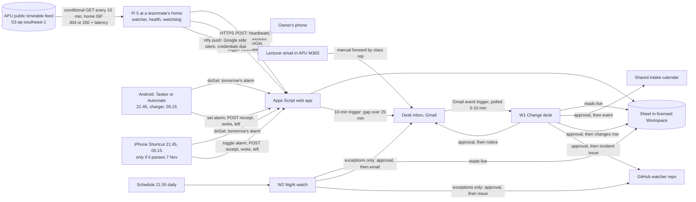

# Bangun

Bangun (Malay for "wake up") sets each APU student's phone alarm every night for tomorrow's real first class, from APU's public timetable plus any change a lecturer announced and the class rep approved, and every hop reports back, so a broken chain shows before it costs a class. Track: Intelligent Automation & Digital Transformation, whose listed ideas include "connecting devices with useful actions" and "automating repetitive campus workflows" ([challenge tracks](/docs/BRIEF.md#challenge-tracks)).

Contents:

1. [Bangun at a glance](#bangun-at-a-glance)
1. [The problem: a first class that moves](#the-problem-a-first-class-that-moves)
1. [What students do today](#what-students-do-today)
1. [How Bangun works](#how-bangun-works)
   1. [Where each job runs](#where-each-job-runs)
   1. [Phones by OS](#phones-by-os)
   1. [The Pi watcher](#the-pi-watcher)
   1. [The Apps Script feeder](#the-apps-script-feeder)
   1. [Gemini Enterprise workflows](#gemini-enterprise-workflows)
   1. [When a person clicks](#when-a-person-clicks)
   1. [Network path and diagram](#network-path-and-diagram)
1. [Bangun's connectors](#banguns-connectors)
1. [Cloud, IoT, and network in Bangun](#cloud-iot-and-network-in-bangun)
1. [Real data and failure behaviour](#real-data-and-failure-behaviour)
1. [Research plan](#research-plan)
1. [Impact and measurement](#impact-and-measurement)
1. [Time to impact](#time-to-impact)
1. [Day-to-day operation](#day-to-day-operation)
1. [Demo and review](#demo-and-review)
1. [Privacy and rules](#privacy-and-rules)
1. [Build plan to 10 November](#build-plan-to-10-november)
1. [Risks and kill criteria](#risks-and-kill-criteria)
1. [Bangun's scores](#banguns-scores)
1. [See also](#see-also)

## Bangun at a glance

- **User:** APU students whose first class moves, which the feed shows is nearly all of them; commuters lose a trip to a wrong alarm, and international students carry the 80% attendance rule for visa renewal.
- **Owner:** each intake's class rep or a volunteer classmate forwards lecturer announcements and approves each change; each student owns their alarm rule (intake, group, lead time, in person only or online too).
- **Signal:** APU's public timetable feed, polled by a Raspberry Pi 5 from a home line; forwarded announcements; phone receipts and `woke` and `left` events; the Pi's heartbeat and health.
- **Trigger:** phones fetch tomorrow's alarm at 21:45 from Apps Script, outside Gemini Enterprise; inside it, a Gmail event starts Change desk on each forward, and a 21:55 schedule starts Night watch.
- **Connectors:** 1P Gmail, Google Calendar, Drive and Sheets; 3P GitHub (GA).
- **Measured outcome:** alarm correctness per student-morning (class and no-class mornings apart), receipt completeness per night, drill detection delay, approval clicks per night, and precision and recall on 30–50 real announcements.
- **Live on 10 November:** the Pi watcher and Android alarms on teammates' phones since 5 November; Change desk and Night watch with run history from 6–7 November; iPhone only if it passes the 7 November kill test.
- **Score:** 80.6 of 100, stated-criteria subtotal 44.0 of 55 ([scores](#banguns-scores)).

## The problem: a first class that moves

**Who and how often.** The feed lists 1,045 intakes. Within a week, the first in-person class start of 953 intake-groups with three or more in-person days (2–6 November) spreads by a median of 315 minutes (25th percentile 270, 75th 420); 96% spread by 2 hours or more and none starts at the same time every day ([feed measurements](/docs/research/rules-and-guarantees.md#apspace-timetable-feed-measurements)). A single daily alarm is wrong for almost everyone.

**Week to week.** A repeating alarm per weekday mostly holds inside a teaching block and fails across a break. Measured for this doc on 5 November 2026 from the [feed] file then served (ETag `c9d8d238…`, lecturer fields dropped in memory), comparing each intake-group's first in-person start on the same weekday:

- **26 October against 2 November:** 97.1% of 3,935 weekday slots kept the same start; 10.3% of 845 intake-groups had at least one change.
- **2 November against 16 November**, across the week of 9 November: 87.7% of 4,181 weekday slots differ (76.9% moved, 5.9% gained a class, 4.9% lost one), in 99.8% of 855 intake-groups. The moves vary in size and direction, and module sets changed no more than between ordinary weeks (574 of 859 identical), so **Inference:** classes were re-slotted, not replaced.
- **Holidays:** 8 and 9 November are empty. 437 of the 449 intakes in session that week have Monday classes on 2 or 16 November, so **Inference:** a repeating Monday alarm rings for nothing on 9 November. The feed doesn't label the empty days; secondary listings put Deepavali on Sunday 8 November with a Monday replacement day in Kuala Lumpur, which no gazette confirmed.

**How costly.** Attendance feeds the 80% rule for visa renewal, and an APU commenter says students get an email "after missing 4 classes in a row" ([attendance](/docs/research/social.md#attendance-moodle-locks-and-the-80-visa-rule)). A student given the wrong timetable wrote "I got marked absent because of this", and another says "The time table changes every week", with changes "announced by the lecturers or administrators" ([timetable churn](/docs/research/social.md#timetable-churn-and-a-compressed-calendar)).

**The file everyone copies is old, and the copies die quietly.**

- The feed was last written 28 October 2026 at 09:39:49 MYT and was unchanged at 06:11 MYT on 5 November; APSpace loads the same file without a login ([APU feed](/docs/research/apu.md#timetable-feed-change-behaviour)).
- Of the original and 40 [forks][cron-forks] of the most-forked student sync, 1 schedule was active on 5 November; 34 were `disabled_inactivity`, 3 `disabled_fork` and 3 had no workflow. GitHub disables scheduled workflows on forks by default and after 60 days without activity, with no promised warning ([GitHub rules](/docs/research/rules-and-guarantees.md#github-disables-scheduled-workflows)).
- A bot author's parents kept asking "What time is your class starting for tomorrow?" ([bot README][dbot]). Automation builders name the same pain: "A run can finish green and still do nothing" ([automation that survives](/docs/research/social.md#automation-that-survives-daily-use)).

**Strongest disconfirming evidence:**

- **Students barely install these tools.** APSync's latest release shows 1 download and APLife's 6 (GitHub release assets, 5 November); APLife also ships from its own site, so these are floors. The demand signal is that builders keep rebuilding.
- **No source counts how often lecturers announce changes**, or by which channel (email, Teams, Moodle or WhatsApp). If most come by Teams or WhatsApp, the forward becomes a copy-paste.
- **Inside a block, a weekly alarm is right about 97% of the time**, so Bangun's daily value is concentrated at block changes, holidays and announced changes (**Inference**).
- **The test window is thin.** Saturday 7 November has no in-person session, 8 and 9 November have none at all, and 466 intakes have no classes from 9 to 15 November. From 6 to 13 November, the mornings with in-person classes are 6 November (818 intakes) and 10–13 November (345–360 a day), counted from the same file.
- **No source confirms that class reps exist at APU** or how they relay changes; interviews must.

[feed]: https://s3-ap-southeast-1.amazonaws.com/open-ws/weektimetable
[cron-forks]: https://github.com/Hackthletes-APU/cron-apu-timetable/forks

## What students do today

| Substitute                      | What it does                                                                                                                                           | What it misses                                                                      |
| ------------------------------- | ------------------------------------------------------------------------------------------------------------------------------------------------------ | ----------------------------------------------------------------------------------- |
| APSpace (official)              | Shows the feed; a 2026 review says "no realtime updated class schedule timing" ([APSpace app](/docs/research/competition.md#the-official-apspace-app)) | Same 28 October file; no alarm; no announced changes                                |
| cron-apu-timetable and 40 forks | GitHub Actions copies the feed into Google Calendar on Fridays ([feed users](/docs/research/apu.md#who-already-uses-the-timetable-feed))               | 1 of 41 copies still scheduled; feed-only; no liveness signal                       |
| [APSync][apsync] (Android)      | "Checks for changes every 12 hours and notifies you if anything shifted"                                                                               | Feed-only; Android background limits; 1 release download                            |
| [APLife][aplife] (Android)      | Calendar sync and reminders; students "Override date, start/end time, room" and "Add Replacement Classes" by hand                                      | Every student retypes the same change; reminders, not a wake-up alarm; no receipts  |
| [ApSpace Discord bot][dbot]     | Daily and weekly timetable posts in a server                                                                                                           | A message, not an alarm; feed-only                                                  |
| [VariAlarm] (iOS, 24 ratings)   | "Calendar Automation matches events by keyword and creates the alarm for you"                                                                          | Only as right as the calendar; no announcement intake; proves the alarm step exists |
| Class rep retyping into a chat  | The channel today, per students' descriptions (**Inference**; confirm in interviews)                                                                   | Each student still edits their own calendar and alarm                               |

At least 12 independent timetable tools since 2013, five created in 2026, sit in this space ([student-built tools](/docs/research/competition.md#apu-student-built-tools)). **What is left:** one approved forward reaches a whole intake's calendars and alarms, and every hop reports, so silence shows. No substitute takes an announcement or reports its own death. The alarm step is commodity; Bangun borrows it.

[VariAlarm]: https://apps.apple.com/app/id6757322888
[apsync]: https://github.com/AaronKhoolb/APSync
[aplife]: https://github.com/osscv/APLife

## How Bangun works

### Where each job runs

The nightly alarm runs outside Gemini Enterprise on purpose: a wake-up alarm must not wait on a model, a quota, a 5–10 minute event poll or an approval. The agent owns the jobs that need reading, judgment or a person.

| Job                                                                                                                     | Runs on               |
| ----------------------------------------------------------------------------------------------------------------------- | --------------------- |
| Poll the feed, drop lecturer fields, post sessions and diffs; heartbeat and health                                      | Pi                    |
| Store rows; answer each phone's fetch with tomorrow's alarm (feed plus approved changes, minus lead time)               | Apps Script           |
| Heartbeat-gap check every 10 minutes; `watcher-silent` email                                                            | Apps Script           |
| Set or switch the alarm; receipt; `woke` and `left` events; on-phone error notice                                       | Phone                 |
| Check the Google side at 21:50; push to the owner; credential countdown                                                 | Pi                    |
| Read a forwarded announcement, extract and match the change, hold it for approval, write the calendar, row and notice   | Gemini Enterprise, W1 |
| Tell a dead Pi from a dead feed or a drill; draft the watcher-down notice and issue                                     | Gemini Enterprise, W1 |
| Audit each night: missing receipts, heartbeat gaps, feed age, undervoltage, unprocessed forwards; draft notices; digest | Gemini Enterprise, W2 |

On a night with no announcement and every receipt in, the agent's only work is one Night watch run that reads the Sheet and writes nothing. Its value shows on the nights something changes or breaks, and the pitch says so rather than claiming the agent sets alarms. Automation users draw the same line: "Real automation ... is deterministic", while "Using LLMs to parse unstructured text is their one actual killer feature" ([automation that survives](/docs/research/social.md#automation-that-survives-daily-use)).

### Phones by OS

Limits per setup are in [which phone setups survive](/docs/research/phones-and-pi.md#which-phone-setups-survive-for-days); the alarm facts are in [setting alarms without a person](/docs/research/rules-and-guarantees.md#setting-alarms-from-a-phone-without-a-person).

**Android, the documented path:**

- **App:** Tasker (RM19.99, 7-day trial) on teammates' phones, because its Set Alarm action says "If Confirm is not checked no user interaction will be required". Automate (free) is tested beside it for recruits and reviewers; its Alarm add page says nothing about prompts.
- **At 21:45, on charger connected, and at 05:15:** an HTTP GET to the Apps Script `doGet` (intake, group, token). It first dismisses any active `Bangun` alarm that no longer matches, and with a class tomorrow sets a one-off alarm labelled `Bangun`. `ACTION_DISMISS_ALARM` prompts when more than one alarm matches, so the flow keeps at most one active; whether dismissing an upcoming alarm needs a tap is part of the switch-off test. Then it POSTs a receipt: alarm time or "none", source (feed or announcement), fetch milliseconds, or the error text.
- **On a fetch error:** a phone notification ("Bangun couldn't confirm tomorrow: …") and no alarm change.
- **Events:** alarm dismissed posts `woke` (whether each app exposes this event is checked on 6 November); leaving home Wi-Fi posts `left`. Each carries a timestamp, never coordinates. A week of `woke` to `left` gaps suggests a lead time; the student decides.
- **Needs:** battery optimisation off and the phone on its charger at night, which takes it out of Doze ([Android limits](/docs/research/phones-and-pi.md#android-background-limits)). Samsung, Xiaomi and OnePlus may still kill the app, which the missing-receipt rule exists to catch.

**iPhone, unverified until the kill test:**

- **Setup once, by hand:** a setup Shortcut asks Apps Script which alarm times the student's intake-group needs in the feed window (each distinct first-class start minus their lead time) and creates them, labelled and off. That is a median of 6 alarms per intake-group, 8 at the 90th percentile and 11 at most (same file), not a grid of 27.
- **Time of Day 21:45 and 05:15, Run Immediately:** Get Contents of URL, then Toggle Alarm turns on the matching alarm and the rest off, or all off with no class, then a receipt POST. If the needed time has no alarm yet (a new time from a change), it posts that and notifies the student to rerun setup.
- **Events:** the Alarm trigger "is stopped" posts `woke`; Leave home posts `left`; no coordinates leave the phone.
- **Not verified:** whether Toggle Alarm runs without a prompt inside a Run Immediately automation. Apple lists the alarm actions only by name, and its iOS 27 guide says "You also may need to set individual actions to run automatically" ([Shortcuts automations](/docs/research/phones-and-pi.md#ios-shortcuts-personal-automations)). Toggle-only avoids deletion, which a community guide says needs "Allow Deleting Without Confirmation" on iOS 18.

### The Pi watcher

- **Service:** a Pi 5 at a teammate's home on Ethernet and the official 27 W supply, a systemd unit with `Restart=always` and `WatchdogSec`, and the hardware watchdog at about 10 seconds ([keeping it alive](/docs/research/phones-and-pi.md#services-and-watchdogs)). It boots by itself when power returns.
- **Every 10 minutes:** a conditional GET with `If-None-Match`, logging status (304, 200 or error), latency, ETag and `Last-Modified`. On a 200 it downloads the 1.1 MB file, drops `NAME`, `SAMACCOUNTNAME` and `LECTID` in memory, keeps the subscribed intakes, diffs them and posts the diff. It keeps that filtered copy, which a 304 confirms is current, so a new subscriber's intake posts without a fresh download.
- **Heartbeat every 10 minutes:** uptime, `vcgencmd get_throttled`, SoC temperature and the last poll status ([power and undervoltage](/docs/research/phones-and-pi.md#power-undervoltage-and-the-rtc)). The reply carries the subscribed intakes and any drill flag.
- **At 21:50:** it checks the Google side: a canary `doGet` answers, and the Apps Script gap check ran in the last 20 minutes. If either fails it sends an [ntfy] push to the owner. It also pushes on days 12 and 13 after the last credential refresh, because a workflow whose credentials expired can't remind anyone.
- **Why a Pi:** a watcher can't certify itself, so the outside half sits off Google. It also polls from a residential Malaysian line, as students' phones do.

[ntfy]: https://ntfy.sh/

### The Apps Script feeder

- **Where:** a web app writing a Sheet in the licensed Workspace domain, the no-card path the connectors can read live ([Pi to Apps Script](/docs/research/phones-and-pi.md#pi-to-apps-script-and-sheets)). Tabs: `polls`, `heartbeats`, `health`, `sessions` (no lecturer fields), `feed_diffs`, `changes`, `subscribers`, `receipts` and `events`. Each row stores the device time and the receive time.
- **`doGet` for phones:** tomorrow's first session (in person, or online too if chosen) after approved `changes`, minus lead time. It answers only if the Pi's last poll is under 20 minutes old and returned 304 or 200; otherwise it returns the error and its time. `doGet` and `doPost` don't spend trigger quota.
- **10-minute time trigger:** when the heartbeat gap passes 25 minutes, it makes one conditional GET of the feed itself (to tell a dead feed from a dead Pi) and emails a `watcher-silent` marker with both facts to the desk inbox. It sends from a different teammate's account than the desk, so the Gmail trigger sees received mail ([triggers](/docs/research/gemini-enterprise.md#triggers-and-schedules)). It writes its last-run time for the Pi to check.
- **Status page and drill link:** a `doGet` page shows feed age, last poll, watcher uptime and receipt completeness, never timetable contents. A tokenised drill link sets a flag; the Pi pauses heartbeats for 60 minutes, labelled `drill`, at most once every 3 hours.

### Gemini Enterprise workflows

Two workflows, built in Workflow Builder; approval steps and event triggers are added in the UI, because natural language can't add them ([limits](/docs/research/gemini-enterprise.md#limits-that-bite-in-a-one-week-build)).

**W1 Change desk.** Trigger: Gmail "When an email is received" on the desk inbox. Reads live through the Sheets and Gmail connectors.

- **Branch A, a forward:** reads the forwarded text and the intake's `sessions` and `changes`.
  - R1: extract module, date, old and new time, room, and campus or online.
  - R2: the change must match exactly one session in the feed window, or one free slot for a replacement class.
  - R3: if it contradicts an approved change, hold it and ask the rep.
  - R4: the sender must be a registered forwarder; that names the intake.
  - R5: a session due within 12 hours is flagged urgent.
  - R6: no lecturer's name or address is ever written.
  - R7: record whether the feed already shows the change.
  - **After one approval:** a Calendar create, update or delete on the shared intake calendar, which holds only approved changes; a `changes` row, which the next phone fetch uses; and a Gmail notice to the intake's subscribers.
- **Branch B, a `watcher-silent` marker:** reads the last heartbeat, health, poll errors, Apps Script's own feed check and the drill flag. It tells a dead Pi or home line from a dead feed and from a drill, then drafts "watcher silent since HH:MM" to the owner and subscribers and a GitHub issue, sent after approval (drills labelled).

**W2 Night watch.** Trigger: schedule, 21:55 daily, after the phones' 21:45 fetch. Reads 24 hours of heartbeats, polls and health, tomorrow's receipts, `changes` and the desk inbox.

- N1: a heartbeat gap over 25 minutes becomes an incident line.
- N2: a subscriber with a class tomorrow and no receipt gets a drafted email ("Bangun couldn't confirm your alarm: first class HH:MM, room"), with the phone's error if it sent one.
- N3: a feed unchanged for over 7 days gets the status line "feed last written 28 Oct; only forwarded announcements are newer".
- N4: a feed shape-hash change, or 3 or more fetch errors in a row, gets a GitHub issue.
- N5: undervoltage or throttle flags get a health line.
- N6: a forward older than an hour with no change row or hold is listed as unprocessed, because event-triggered runs that fail on quota aren't retried ([unattended runs](/docs/research/gemini-enterprise.md#what-runs-without-anyone-signed-in)).
- N7, Sundays: the week's approved changes, the share the feed never showed, receipt completeness, watcher uptime and clicks per night, as a digest.
- **Writes only on exceptions,** in one batched approval. A clean night completes with no writes; its findings still show in the run's trace.

### When a person clicks

Scheduled runs that affect other people "automatically pause for review", and connector writes from workflow agent nodes require human review ([unattended runs](/docs/research/gemini-enterprise.md#what-runs-without-anyone-signed-in)). A nightly click would be babysitting, so Bangun keeps clicks to exceptions:

- **A clean night:** no click.
- **An announced change:** one click by the intake's approver, a decision only someone in the class can make. Recruited reps confirm by replying to the desk, and a teammate with a seat approves. Not verified: whether an approval step can be assigned to a named user, and whether one review covers the calendar, row and notice writes together.
- **A night with missing receipts:** one batched click for every drafted email.
- **An incident** (watcher down, feed shape change): one click each.
- **No alarm waits on a click.** A late approval delays a notice, not an alarm, except that a change approved after 05:15 misses the next morning, which R5 flags.
- **Measured:** clicks per night and approval latency go in the digest and the README. If drafts routinely wait past 23:00 during 6–9 November, the missing-receipt email moves to Apps Script, and Night watch keeps the diagnosis.

### Network path and diagram

Each hop is timestamped in the Sheet:

1. APU's S3 bucket (`ap-southeast-1`) to the Pi over a home ISP: conditional GET, 304 or 200, latency.
1. Pi to Apps Script (`curl -L` HTTPS POST) to the Sheet: lag is device time against row time.
1. Lecturer to student by APU's Microsoft 365 mail, then a manual forward to the desk inbox in the team's Workspace Gmail. Microsoft's outbound policy blocks automatic external forwarding (Inbox rules, mailbox forwarding) in many tenants with a 5.7.520 bounce and lists no manual forward ([Microsoft][ms-forward]); **Inference:** a manual forward gets through. The quoted original's sent time against the desk's receive time gives the announcement lag.
1. Gmail to the W1 event trigger, polled every 5–10 minutes.
1. Approval, then the Calendar write, the `changes` row and the notice.
1. Phone to `doGet` at 21:45 over mobile data or home Wi-Fi, then the alarm, then the receipt POST; `woke` the next morning.
1. The watchdog pair: Apps Script checks the Pi's heartbeats, and the Pi checks Apps Script at 21:50.

[ms-forward]: https://learn.microsoft.com/en-us/defender-office-365/outbound-spam-policies-external-email-forwarding

## Bangun's connectors

| Connector               | 1P or 3P | Status | Mode                                              | Job                                                                                         |
| ----------------------- | -------- | ------ | ------------------------------------------------- | ------------------------------------------------------------------------------------------- |
| Gmail                   | 1P       | GA     | Event trigger (received); read; send              | Desk inbox starts W1; notices, missing-receipt emails, watcher alerts, digest               |
| Google Calendar         | 1P       | GA     | Create, update, delete event                      | Shared intake calendar of approved changes                                                  |
| Google Drive and Sheets | 1P       | GA     | Live read (Get cell values); Update cell values   | `sessions`, `changes`, `receipts`, heartbeats; approved `changes` rows                      |
| GitHub                  | 3P       | GA     | Write issue (through a GitHub App the team makes) | Incident issues in the public watcher repo: feed errors, shape change, watcher down, drills |

Actions and statuses are from [actions and write-back](/docs/research/gemini-enterprise.md#actions-and-write-back). Outlook and Teams are left out: they would read APU's Microsoft 365 tenant, which needs consent only APU IT can give (G2). No custom MCP server: the organisation policy blocks it by default, and nothing here needs it.

## Cloud, IoT, and network in Bangun

- **Cloud:** Change desk and Night watch in Gemini Enterprise, with their Runs tabs, read live Sheet rows and write Calendar events, `changes` rows, emails and GitHub issues. Apps Script is the feeder and the alarm service. In the demo the Runs tab shows a forward becoming a calendar change, and a pulled cable becoming a watcher-down draft.
- **IoT:** phones are actuators (they set and switch real alarms) and sensors (alarm stopped, left home, fetch errors). The Pi reports its own health (`get_throttled`, temperature, uptime). The sensing is phone events and a web feed, not a physical measurement.
- **Network:** every hop carries timestamps: feed latency and 304s over a home line, Pi-to-Sheet lag, each phone's fetch milliseconds, the announcement lag and the heartbeat gap. The two-sided watchdog makes a silent hop visible within 45 minutes.

## Real data and failure behaviour

| Stream                           | Live from                      | Source                                                                                     | Licence or consent                                                |
| -------------------------------- | ------------------------------ | ------------------------------------------------------------------------------------------ | ----------------------------------------------------------------- |
| Feed polls and diffs             | 5 Nov                          | APU's public feed, through the Pi                                                          | Public, no licence; APU's terms (see privacy)                     |
| Heartbeats and Pi health         | 5 Nov                          | The team's Pi                                                                              | Team-owned                                                        |
| Alarm answers and receipts       | 5 Nov (team), 8 Nov (recruits) | Apps Script; teammates' and recruits' phones                                               | Opt-in notice at install                                          |
| `woke` and `left` events         | 6 Nov                          | The same phones                                                                            | Opt-in; timestamps only                                           |
| Forwarded announcements          | 6 Nov                          | Teammates and recruited reps, from their own mail                                          | Forwarder's consent; lecturer names never written                 |
| Accuracy test set                | Collected 6–7 Nov              | 30–50 past announcements from teammates' and volunteers' own inboxes, August–November 2026 | Volunteers' consent; scored in W1's Test tab, never shown as live |
| Change desk and Night watch runs | 6–7 Nov                        | Gemini Enterprise Runs tab                                                                 | Team-owned                                                        |

The accuracy set is the "30–50 real items" test the [context](/docs/CONTEXT.md#what-ntt-data-said-it-will-rate) asks for, not a replayed stream; it isn't published because it holds lecturer names, and nothing from it reaches the live calendar or notices. No mock GPS is used anywhere.

Real schedule events in the window, from the feed: 8 and 9 November are empty; 466 intakes return on 16 November; the 28 October window ends 22 November, so a rewrite must land by then for APSpace to show the week of 23 November (**Inference:** possibly after the assessment).

**Failure behaviour:** a failed feed poll, a silent Pi or a stale poll makes `doGet` return the error with its time; the phone shows it, changes no alarm, and the student's own alarms stay as they set them. A silent phone shows as a missing receipt in Night watch. Nothing synthetic, no cached feed shown as current, no default alarm.

## Research plan

Remote, with no APU staff, 6–8 November:

- **Interviews (6–8, two rounds: 6 and 8 November):**
  - **2–3 student tool builders:** the maintainers of APLife and APSync, the Discord bot's author and the one active fork, asked for a 15-minute call by a public issue or discussion on their repos. Why they built it, how often the feed changed, what broke.
  - **2–3 class reps or volunteers:** through the hackathon Discord (about 212 members), the GDG on Campus APU chapter (3,128 members) and teammates' intake WhatsApp groups ([communities](/docs/research/everyday-reddit.md#communities-found)). How announcements arrive, how many came last month, how long relaying takes. This is the first count of announcement volume, since no source has one.
  - **2 commuting students:** by public replies in r/malaysiauni attendance and timetable threads ([recruiting](/docs/research/everyday-reddit.md#how-a-remote-team-could-use-them)). Their alarm habit and their last late or missed class.
- **Timed observation (6–7 November):** on a call with consent, 5 students check tomorrow's first class and set their alarm their usual way; time from opening the app to alarm set, and any wrong reading. If a real announcement arrives, the relay is timed too: the lecturer's mail, the rep's post, and each classmate's calendar update, then the same item through Bangun.
- **Survey (6–8 November):** one post each in r/malaysiauni, the hackathon Discord, the GDG chapter and intake WhatsApp groups, offering a survey swap or an RM5 Touch 'n Go draw per local norms ([recruiting norms](/docs/research/everyday-reddit.md#what-recruiting-looks-like-there)). Questions: one fixed alarm, one per weekday, or set nightly; prep and travel minutes; the channel of the last change; announcements a month; ever late, absent or a wasted trip because of a change. APU survey posts often draw almost nothing, so interviews carry the research.
- **Public posts as evidence:** the dated threads in [the problem](#the-problem-a-first-class-that-moves).

## Impact and measurement

**Baselines:**

- Sync liveness: 1 of 41 copies scheduled (5 November).
- Fixed-alarm error: a median within-week spread of 315 minutes; for weekly alarms, 87.7% of weekday slots changed between the weeks of 2 and 16 November. The survey gives the share of students on each alarm habit.
- Evening check time, from the timed observation; announcements per intake a month, from interviews and the survey.
- Feed age: 8 days on 5 November, logged daily.

**After (6–14 November):**

| Metric                               | Definition                                                                                                     | Target                          |
| ------------------------------------ | -------------------------------------------------------------------------------------------------------------- | ------------------------------- |
| Alarm correctness, class mornings    | Mornings with a class where the alarm equalled the first session minus lead time, confirmed by a one-tap reply | ≥ 95%, with n                   |
| Alarm correctness, no-class mornings | Mornings with no class where no `Bangun` alarm rang                                                            | Reported apart, with n          |
| Receipt completeness                 | Receipts ÷ subscribed phones, per night                                                                        | ≥ 90%; every miss explained     |
| Drill detection delay                | Last heartbeat to W1's watcher-down draft, over ≥ 2 drills                                                     | ≤ 45 minutes                    |
| Forward to calendar                  | Median minutes from a forward's arrival to the approved Calendar write                                         | < 30 minutes, against the relay |
| Approval clicks per night            | Clicks needed per night, with approval latency                                                                 | 0 on clean nights               |
| Feed agreement                       | Share of announced changes in the feed window that the feed showed by the session date                         | Reported as found               |

Keeping no-class mornings apart stops holidays and the week break from inflating the rate. **Inference:** class mornings will number about 25–40, from 6 and 7 November and 10–13 November for teammates and recruits in session.

**Accuracy on 30–50 real items:** past announcements, each labelled blind by the student who received it (module, date, old and new time, room, mode). Precision is correct extracted changes over extracted changes, recall is correct over true changes, and R2's match accuracy is scored only for items dated 26 October to 22 November, the dates the feed covers. Reported with n, the number of intakes, and every miss with its cause ([accuracy method](/docs/research/judging.md#measuring-an-agents-accuracy-honestly)). **Limit:** the items come from a few intakes and lecturers, so the score may not carry to other schools' wording.

## Time to impact

| By                     | What                                                                                                                                                                                                          | Owner                                     | Rests on                                                                                                                                                                                     |
| ---------------------- | ------------------------------------------------------------------------------------------------------------------------------------------------------------------------------------------------------------- | ----------------------------------------- | -------------------------------------------------------------------------------------------------------------------------------------------------------------------------------------------- |
| 30 Nov 2026            | Running for the team's and recruits' intakes; the public status page; the receipt endpoint offered to the APLife, APSync and Discord bot authors by GitHub issue; the feed rewrite due by 22 November handled | Team                                      | The trial licence still active                                                                                                                                                               |
| 10 Feb 2027 (3 months) | 10 intakes through class reps; ≥ 95% class-morning correctness and ≥ 90% receipts over a full month; the semester-start rewrite handled                                                                       | Team (operations), class reps (approvers) | A seat after the trial: Standard from $30 per seat a month, since a console-built app isn't Business ([editions](/docs/research/gemini-enterprise.md#gemini-enterprise-editions-and-prices)) |
| 10 May 2027 (6 months) | 30+ intakes; reps approve their own intakes; the watcher run by GDG on Campus APU or the Student Developer Society; the survey repeated against November                                                      | Society maintainers, class reps           | A seat per approving rep, or one seat holder approving after reps' replies; volunteers keep the Pi and credentials alive                                                                     |

Nothing waits on APU saying yes. If APU objects to feed use, the stop switch turns the poller off and Bangun keeps announcements, which are students' own mail.

## Day-to-day operation

- **Unattended:** the Pi (polls, heartbeats, the 21:50 check), Apps Script (`doGet`, the gap check), the phones (21:45, charger, 05:15, events), Night watch at 21:55 and Change desk on every forward or marker.
- **Run history:** Night watch nightly from 7 November, so 3 runs by submission on 10 November and 8 by 14 November; Change desk runs for every forward plus at least 2 drills; 144 polls and heartbeats a day from 5 November; receipts every night.
- **Credentials:** schedules run on the author's credentials, which expire 14 days after refresh. Refresh on 9 November covers to 23 November; the Pi's push on days 12 and 13 is the reminder.
- **Quotas:** Standard pools 160 assistant queries per user a day, resetting at 4:00 PM MYT. **Inference:** one Night watch run a night plus one Change desk run per forward or marker stays far below that; N6 lists any forward a failed run left behind.
- **Who keeps what running, 11–14 November, from home:**
  - **Pi:** the teammate who hosts it, on Ethernet and the official supply; they check the status page morning and evening, others reach it over Tailscale SSH ([remote access](/docs/research/phones-and-pi.md#network-and-remote-access)), and OS updates are frozen from 10 to 14 November.
  - **Phones:** each teammate's own phone on its charger overnight with the flow on.
  - **Approvals:** the seat holder checks **Needs Review** at 22:00 and 07:00.
- **When something loses power or network (what a reviewer sees):**
  - **Pi power cut or home line down:** the status page shows "watcher silent since HH:MM", W1 drafts the watcher-down notice within 45 minutes, and phones fetching meanwhile get "can't confirm tomorrow: watcher silent since HH:MM" and set nothing. The Pi reboots itself when power returns, and the journal gap plus `power_reset` tell an outage from a watchdog reset.
  - **Feed error:** the status page shows the HTTP status; phones get the error; three in a row draft a GitHub issue.
  - **Apps Script or the Sheet down:** the Pi's 21:50 check pushes to the owner, and phones show their fetch error.
  - **A phone off or killed:** its receipt is missing, and Night watch drafts the email.
- **Reviewer triggers without touching a teammate's device:** install on their own phone, and the drill link ([demo and review](#demo-and-review)).

## Demo and review

**Video (about 3:45, labelled as a recording with its capture date):**

1. 0:00–0:25, "1 of 41": the forks' API states, then APSpace and the feed both showing a file last written 28 October.
1. 0:25–1:05, the daily case: one teammate's real first-class times from the feed and the alarm following them each night, including 9 November, when no alarm rang where a repeating Monday alarm would have; receipts with hop timestamps; the 10 November ring if recorded before submission.
1. 1:05–1:50, one real announcement end to end: the forward, W1's run with the trigger lag visible, the approval click, the shared calendar, the next 21:45 fetch moving the Android alarm, the receipt.
1. 1:50–2:35, failure is visible: the Pi's Ethernet pulled on camera and the measured delay to "watcher silent since HH:MM"; one phone in airplane mode at 21:44 and Night watch's missing-receipt draft; a clean night completing with no writes and no click.
1. 2:35–3:20, the numbers: precision and recall on n real announcements, alarm correctness (class and no-class mornings apart), receipt completeness, clicks per night, the Pi health tab, the Runs tab over the nights.
1. 3:20–3:45, the 3- and 6-month plan.

**Reviewer access:** the README's "How to review" gives the app URL, how to request a seat, the video, the status page and a Sheet view of `receipts` without email addresses ([reviewer access](/docs/CONTEXT.md#reviewer-access)).

**Triggers reviewers fire themselves:**

- **Their own phone:** install the Automate flow (or the Tasker trial) from the README, or the Shortcut if iPhone passed; enter any real intake code from APU's public intake listing; run it once. The receipt row appears in the Sheet view, and that night's 21:45 run sets tomorrow's alarm if the intake has a class.
- **The drill link:** the Pi pauses heartbeats for 60 minutes, labelled `drill`, and W1's marker run and draft follow within 45 minutes.

Both are real events, not test data.

## Privacy and rules

- **PDPA** (Act 709, amended by Act A1727 in 2024; [PDPA](/docs/research/judging.md#malaysias-pdpa-and-the-2024-amendment)):
  - **Stored per subscriber:** an email address, intake, group, lead time and a random token. Phone events are an event name and a timestamp, with no coordinates, SSID or device ID.
  - **Notice and choice:** a consent notice on the install page; "stop" by reply deletes the subscriber.
  - **Retention:** receipts and events for 30 days; forwards reduced to extracted fields and deleted from the inbox within 7 days.
  - **Breach:** a named teammate as contact, inside the guidelines' 72-hour notice to the Commissioner.
- **Lecturer data:** the feed's `NAME`, `SAMACCOUNTNAME` and `LECTID` are dropped in memory on the Pi before any storage, log or prompt ([personal data in the feed](/docs/research/apu.md#personal-data-in-the-timetable-feed)). R6 never writes a lecturer's name; forwards are read inside the licensed Workspace, and no free-tier Gemini API sees them.
- **APU's Terms of Use** reserve copyright and ask permission before "use of this Website or any of the Contents"; the feed isn't named and carries no licence ([terms](/docs/research/apu.md#terms-of-use-and-robotstxt)). This is a reading of the terms, not legal advice. Bangun keeps it light:
  - Conditional GETs only; the 1.1 MB file comes down only when the ETag moves. No probing of other paths and no archive.
  - Only subscribed intakes' non-personal fields; the public status page shows feed metadata, never timetable contents.
  - "Source: APU APSpace public timetable feed" on every output, and a stop switch that halts the poller within 10 minutes.
  - An optional courtesy note in `#help-desk`; nothing waits on a reply (G2).
- **Students' APU mail:** each forward is the student's own manual action. **Inference:** APU's mail rules weren't found in public sources, so automatic forwarding rules are avoided.
- **Never stored:** coordinates, lecturer identities, full email bodies after extraction, phone identifiers, and anything about students who didn't opt in.

## Build plan to 10 November

A = Pi and feeder, B = phones, C = Gemini Enterprise, D = research, E = README and video.

| Day        | Work                                                                                                                                                                                                                                                                                            | Done when                                         |
| ---------- | ----------------------------------------------------------------------------------------------------------------------------------------------------------------------------------------------------------------------------------------------------------------------------------------------- | ------------------------------------------------- |
| Thu 5 Nov  | A: Pi poller, heartbeat and health service; Apps Script tabs, `doGet` and `doPost`. B: Tasker flow on 2 Android phones before 21:45, since 6 November is the last in-person class morning before 10 November. D: GitHub issues to tool authors, recruitment posts, past announcements collected | First 304 rows; first receipts at 21:45           |
| Fri 6 Nov  | B: Automate flow beside Tasker; iPhone setup and nightly Shortcuts; one phone per OS on an intake with a Saturday class. C: W1 with the Gmail trigger and approval added in the UI. D: interviews round 1, timed observation                                                                    | Night receipts; first W1 run on a real forward    |
| Sat 7 Nov  | C: W2 Night watch; W1's marker branch; GitHub App connector; accuracy test. A: 21:50 check, ntfy pushes, drill link. B: one Android left unplugged. **Kill check at 23:59**                                                                                                                     | Precision and recall computed; kill decision made |
| Sun 8 Nov  | D: interviews round 2; recruits install. A: 2 drills. C: Sunday digest. E: README sections; every member registered before registration closes                                                                                                                                                  | ≥ 2 drills with measured delay                    |
| Mon 9 Nov  | E: record the video from the live system; refresh schedule credentials; test reviewer access from a non-team account; freeze features                                                                                                                                                           | Video labelled with its capture date              |
| Tue 10 Nov | E: the 10 November morning clip; deck PDF, diagram, "How to review"; the leader submits early in the day                                                                                                                                                                                        | Submitted                                         |

## Risks and kill criteria

1. **Phone actuation fails unattended:** an iOS prompt on Toggle Alarm, a clock app ignoring the skip-UI request, or a vendor killing Automate or Tasker. _Mitigation:_ Tasker with Confirm off on teammates' Androids, one of them a Samsung; receipts make every failure visible; the README lists the setups that held.
1. **The agent looks peripheral:** few live announcements arrive, so the Runs tab shows Night watch completing with no writes and the visible product is an Apps Script alarm. _Mitigation:_ the pitch states the split in [where each job runs](#where-each-job-runs) and leads with the nights something changed or broke; drills are real events that exercise W1 at least twice.
1. **Too few announcements or users:** no source counts announcements, and the window is thin. _Mitigation:_ recruit from the 449 intakes in session from 9 November; score accuracy on past real announcements and say so.
1. **Approval latency and credentials:** _Mitigation:_ exception-only approvals, checked at 22:00 and 07:00; refresh on 9 November; the Pi's countdown push.
1. **Copycats:** APU-savvy teams may enter timetable-to-calendar sync, though none of 780 simulated ideas did ([saturation tiers](/docs/research/competition.md#saturation-tiers)). _Mitigation:_ lead with "1 of 41" and receipts, not the calendar.

**Kill test, decided 7 November at 23:59** (after the 21:45 phone runs and the 21:55 Night watch). The feed has no in-person session on 7 or 8 November, so a teammate's own intake would only test switching off. On the night of 6 November, one phone per OS subscribes, with "online too", to one of the two real intakes that have a 09:00 online session on Saturday 7 November; the other phones must switch everything off. On the night of 7 November every phone must switch off. The night of 5 November (818 intakes in person on 6 November) counts as an extra test if the flow is live.

- **Kill** if no teammate's Android gets both nights right unattended, with a receipt each night and at least one alarm set on 6 November that rang (`woke`) on Saturday morning. Without the phone half, Bangun is a calendar sync with a dead man's switch.
- **Kill** if fewer than 15 real past announcements are collected, because the accuracy test and W1 would have nothing honest to run on.
- **Decide the iPhone:** if no teammate's iPhone passes the same two nights, iPhone is cut; Bangun ships Android-only, says so in the README, and iPhone students get the shared calendar only.
- **Narrow the claim:** if no class rep outside the team has agreed to forward by 7 November, or fewer than 3 live forwards arrive by 10 November, the pitch says W1 was measured on past announcements and fed by the team.
- **Doze check:** the unplugged Android's night is reported as it happened, and if it misses, Night watch must flag it; if it doesn't, that is fixed before 9 November.

## Bangun's scores

The panel's final mean scores on the 1–5 scale, with weights from the [scoring matrix](/docs/ideas/opus-03/00-ranking.md#scoring-matrix). The panel scored the version before this doc's corrections (two workflows instead of four, Android first, about 6 iPhone alarms instead of 27, exception-only approvals); those target F and W and are not rescored.

| ID  | Component           | Weight | Mean | Points | Reason                                                                                                                                 |
| --- | ------------------- | ------ | ---- | ------ | -------------------------------------------------------------------------------------------------------------------------------------- |
| I   | Impact              | 15     | 4.0  | 12.0   | Widest reach, since nearly every student's first class moves daily; the before/after is measured on recruits this week                 |
| T   | Technical build     | 12     | 4.0  | 9.6    | Gmail trigger and send, Calendar and Sheets writes, GitHub GA; the daily alarm path bypasses the agent                                 |
| R   | Research            | 8      | 4.0  | 6.4    | Tool builders reachable on GitHub, reps through Discord and the GDG chapter, a timed observation, all remote                           |
| TT  | Time to impact      | 8      | 4.0  | 6.4    | Useful within weeks with no APU yes; reps approving their own intakes need seats after the trial                                       |
| W   | Day-to-day workflow | 12     | 4.0  | 9.6    | A nightly schedule and an event trigger with run history; the evening approval click read as babysitting                               |
| C   | Convergence         | 10     | 4.0  | 8.0    | The phone now acts and reports, and the Pi and cloud watch each other                                                                  |
| O   | Originality         | 12     | 4.0  | 9.6    | Absent tier, but APU-savvy teams may enter calendar sync; "1 of 41" and receipts are the shield                                        |
| U   | Real use            | 12     | 4.7  | 11.2   | The strongest existing-behaviour evidence in the set; held below 5 because users barely install these tools                            |
| D   | Demo                | 6      | 4.0  | 4.8    | Two reviewer-fired triggers; assessment mornings are mostly "alarm off", right but invisible                                           |
| F   | Feasibility         | 5      | 3.0  | 3.0    | Four workflows, two phone OSes, 27 iPhone alarms (since cut to about 6), ntfy, a drill link and a GitHub App; the iPhone path untested |

- **Weighted total:** 80.6 of 100, the mean of the three judges' totals (79.0, 81.4, 81.4); points use the unrounded means, so U's 4.67 gives 11.2.
- **Stated-criteria subtotal** (I, T, R, TT, W): 44.0 of 55.

## See also

- [opus-03 ranking](/docs/ideas/opus-03/00-ranking.md): the scoring matrix and how Bangun ranks.
- [Brief](/docs/BRIEF.md) and [hackathon context](/docs/CONTEXT.md): rules, dates, judging outline and real-data decisions.
- [APSpace timetable feed](/docs/research/apu.md#apspace-timetable-feed): endpoints, schema, change behaviour and personal data.
- [Rules and guarantees](/docs/research/rules-and-guarantees.md): the re-verified feed measurements, GitHub's schedule rules and the alarm actions.
- [APU student-built tools](/docs/research/competition.md#apu-student-built-tools): the timetable tools students keep rebuilding.
- [Phones and Raspberry Pi](/docs/research/phones-and-pi.md): Shortcuts, Android limits, watchdogs and the Apps Script path.
- [Gemini Enterprise](/docs/research/gemini-enterprise.md): triggers, approvals, actions, quotas and reviewer access.
- [Social research](/docs/research/social.md) and [Reddit research](/docs/research/everyday-reddit.md): the student posts and where to recruit.

[dbot]: https://github.com/notedwin-dev/ApSpace-Discord-Bot
