# Janji

Janji ("promise") checks what a project group said it would do in its five-minute wrap-up against what actually changed in the group's Google Drive folder and GitHub repo, and sends a Friday ledger of said, shipped and slipped. Track: Intelligent Automation & Digital Transformation (**Inference**: the brief's own reading is that this track fits everyday workflows most directly; see [challenge tracks](/docs/BRIEF.md#challenge-tracks)).

Contents:

1. [At a glance](#at-a-glance)
1. [Problem](#problem)
1. [What people do today](#what-people-do-today)
1. [How it works](#how-it-works)
   1. [Devices and setup per OS](#devices-and-setup-per-os)
   1. [Network path](#network-path)
   1. [Gemini Enterprise workflow](#gemini-enterprise-workflow)
   1. [Diagram](#diagram)
1. [Connectors](#connectors)
1. [Cloud, IoT, and network](#cloud-iot-and-network)
1. [Real data](#real-data)
1. [Research plan](#research-plan)
1. [Impact and measurement](#impact-and-measurement)
1. [Time to impact](#time-to-impact)
1. [Day-to-day operation](#day-to-day-operation)
1. [Demo and review](#demo-and-review)
1. [Privacy and rules](#privacy-and-rules)
1. [Build plan to 10 November](#build-plan-to-10-november)
1. [Risks and kill criteria](#risks-and-kill-criteria)
1. [Scores](#scores)
1. [See also](#see-also)

## At a glance

- **User and owner:** APU assignment and final-year-project groups of 3 to 6, including this week's hackathon teams. The group lead owns the Sheet, the Drive folder, the GitHub repo and the consent rows, and approves each outbound email.
- **Reach limit:** Janji verifies only work that lives in Google Drive or GitHub. Most APU group work lives in Microsoft 365, which the team cannot read without APU's tenant consent (G2), so the reachable set is hackathon teams, code groups and groups already on Google Drive. This limits reach and is stated up front.
- **Signal:** the free-rider threads on r/malaysiauni and the hand-built evidence trail students assemble ("screenshots of the document editing history").
- **Trigger:** a Drive event when a wrap-up file lands, a daily 18:00 MYT check, and a Friday 17:00 MYT ledger.
- **Connectors:** Drive and Sheets, Calendar, Gmail (1P, GA); GitHub (3P, GA).
- **Measured outcome:** share of promises met by their due date, minutes from wrap-up to ledger row, and the lead's chasing hours, with precision and recall on 30 to 50 real promises.
- **Live on 10 November:** the team's own build as a real group project (a wrap-up every evening from 6 November, daily runs), plus any outside groups whose Drive or GitHub the team's account can read.
- **Score:** 71.1 weighted, 41.4 of 55 on the stated criteria ([Scores](#scores)).

## Problem

Project groups of 3 to 6 make verbal promises ("who does what by when") that live in WhatsApp and memory. Effort stays invisible until the deadline, and the student who did the work assembles proof by hand. Verified in the research docs (opened 5 November 2026):

- An APU student who reported a free rider, who then failed and confronted them: 2,623 points and 327 comments on r/malaysiauni (15 May 2026); the top reply says "freeloaders never think about all the pain and burden we've endured to complete THEIR work" (454) ([Reddit][r-group]).
- A groupmate handed in "a whole paper full of AI. He didn't even delete the fricking prompt response" (415 points); advice was to "keep your lecturer informed" and to complete the part and tell the lecturer (114) ([Reddit][r-group]).
- "Getting sick and tired of AI-dependent people": a group met four days before a proposal deadline and kept switching ideas (569 points, 16 October 2026) ([Reddit][r-group]).
- "every single unread receipt and empty contribution log" in a project worth 40% (1,860 likes, 519 replies, 11 May 2026), and in Malay, a free rider or silent partner "we do everything, they get their name on it too" ([X][x-group]).
- The Reddit pass names the unmet need: "Visible contribution in group work: effort stays invisible until the deadline, so students collect screenshots and edit histories for the lecturer" ([Reddit][r-unmet]).
- Size: r/malaysiauni has 63,046 weekly active users and the hackathon Discord 212 members; the share in group work is not measured ([Reddit][r-communities]).

Strongest disconfirming evidence:

- "Every workaround ends with the lecturer, which a team without staff help cannot arrange or test" ([Reddit][r-disconf]). Janji works group-first, before any lecturer is involved, but a ledger nobody can enforce may change nothing ([Risks and kill criteria](#risks-and-kill-criteria)).
- No post asks for a tool; posts ask for sympathy and for individual grading.
- "Accused of being a freeloader by freeloaders" (76 points): a ledger can be gamed by trivial commits or edits ([Reddit][r-group]).
- "It is so depressing when nobody wants you in group project" (391 points): a tool that scores members may deepen exclusion ([Reddit][r-group]).
- Coverage: APU is on Microsoft 365 ([CONTEXT][ctx-apu]), so most groups work in OneDrive, Word, Teams and WhatsApp, none of which Janji can read. Typical groups also use Canva, Figma and local files (**Inference**).

## What people do today

| Substitute                        | What it does                                                                                                                                                                | What it doesn't do                                                    |
| --------------------------------- | --------------------------------------------------------------------------------------------------------------------------------------------------------------------------- | --------------------------------------------------------------------- |
| Google Meet "Take notes for me"   | Notes in a Google Doc; "Next steps" "lists the actionable items and assigned tasks"; needs an eligible Workspace edition or Google AI plan ([Google Meet][meet])            | Online Meet calls only; no check against Drive or GitHub              |
| Microsoft Teams intelligent recap | AI notes and AI-suggested tasks; needs Teams Premium or Microsoft 365 Copilot (taken from a search summary; the Microsoft page returned 404 on 5 November) ([Teams][teams]) | Licence students are unlikely to hold (unverified); no artefact check |
| Otter.ai                          | "Clear next steps are automatically captured and assigned from every meeting" ([Otter][otter])                                                                              | Audio goes to Otter's cloud; nothing checks that the action happened  |
| Fireflies.ai                      | Captures "next steps, tasks, owners, and deadlines" and creates tasks ([Fireflies][fireflies])                                                                              | Creates tasks, never verifies them                                    |
| Notion AI Meeting Notes           | Identifies "key points and action items"; "You must be on Notion's Business or Enterprise Plan" ([Notion][notion])                                                          | Paid plan; no verification                                            |
| Hand-made evidence                | Screenshots of edit history, contribution logs, a message to the lecturer ([Reddit][r-group], [X][x-group])                                                                 | Assembled at the end, by the person who did the work                  |

What is left for Janji: the verification step (a promise matched to a Drive revision by that member before the date, or a commit or pull request by that author touching the promised path), and home transcription that keeps groupmates' voices off every vendor's cloud. **Inference:** a reviewer who has read 200 entries has seen meeting-notes agents, and filed next to them Janji's difference is that it refuses to produce notes and audits what shipped. The nearest saturated tier is document processing ([saturation tiers](/docs/research/competition.md#saturation-tiers)), and the crowd will build meeting-notes agents anyway.

## How it works

Janji has no notes output. The only artefact is the said-versus-shipped ledger and the only input is the wrap-up, not the meeting.

### Devices and setup per OS

| Device                                          | Setup                                                                                                                                                                                                                                                                                                                                                                              | Unattended                                                                             |
| ----------------------------------------------- | ---------------------------------------------------------------------------------------------------------------------------------------------------------------------------------------------------------------------------------------------------------------------------------------------------------------------------------------------------------------------------------- | -------------------------------------------------------------------------------------- |
| Any phone (Android or iPhone)                   | The lead records the wrap-up in the stock voice recorder, after spoken consent. The file reaches the Pi through the Tailscale app (a real install step for the recorder's phone) or an upload page on the Pi                                                                                                                                                                       | No: recording is a deliberate act, at the moment the group says "so who's doing what?" |
| Pi 5 (8 GB, heatsink only, one teammate's home) | `whisper.cpp` base (the multilingual model; `ms`, `zh` and `id` are in whisper's language list ([whisper][whisper-lang])); an `inotify` job transcribes, writes the promise text, deletes the audio, POSTs the transcript text and logs bytes in, bytes out, seconds and `vcgencmd get_throttled`; `Restart=always`, hardware watchdog, updates frozen ([phones-and-pi][pp-alive]) | Yes                                                                                    |
| Lead's laptop                                   | Nothing to install: the Sheet and the ledger email                                                                                                                                                                                                                                                                                                                                 | n/a                                                                                    |

If the lead types the promises into the Sheet instead of recording, the Pi drops out and the workflow still runs. An optional Discord voice bot on the Pi (`@discordjs/voice` 0.19.1 or later, where receive was fixed per [discord.js][djs]) is untested and not on the critical path.

### Network path

1. Phone to Pi over Tailscale (home or mobile data). The upload is the only large transfer, about 5 MB for 5 minutes of AAC.
2. Pi to Apps Script `doPost` over HTTPS: transcript text only, a few KB. Egress log row: audio bytes in, text bytes out, transcribe seconds, throttle flags, CPU temperature.
3. Apps Script writes the raw transcript to a wrapups tab and creates `wrapup-<group>-<date>.txt` in the group's Drive folder, which is the event Gemini Enterprise polls.
4. A nightly Apps Script trigger exports Drive Activity per member and per file in the folder (`ancestorName` and `time` filters are query criteria ([Drive Activity][drive-activity])) into an activity tab. GitHub commits are read live through the GitHub connector, which lists commits with `author`, `since`, `until` and `path` filters at the REST level ([GitHub][gh-commits]).
5. Gemini Enterprise reads wrapups, promises, activity and GitHub, and writes promises, ledger rows, Calendar tasks, GitHub issues and the Friday email, each pausing at Needs Review.

### Gemini Enterprise workflow

- **Triggers:** a Drive event (new `wrapup-*.txt`, polled every 5 to 10 minutes); a daily 18:00 MYT schedule; a Friday 17:00 MYT schedule.
- **Run A, extract:** reads the transcript and produces promise rows `{group, member_id, what, artefact_type, path_or_file, due}`. Names map to member IDs from the roster tab. Each promise gets a Calendar task on its due date. The transcript then moves to a `processed` folder.
- **Run B, daily check:** for every promise due today or earlier and not closed, looks for a Drive Activity edit or create by that member after the promise and before the due time, or a commit or merged pull request by that author touching the named path. Rules in the rules tab:
  - R1 **Met:** a matching artefact before the due time.
  - R2 **Late:** a matching artefact after the due time.
  - R3 **Slipped:** no matching artefact by due plus 24 hours, which files a GitHub issue (code promises) or a Drive comment task (document promises) for the member and a one-line Gmail to that member only.
  - R4 **Thin:** an artefact exists but is under the group's size threshold (for example a commit touching fewer than 5 lines); never counted as met.
  - R5 **Could not verify:** the promise names an artefact type outside Drive or GitHub (a Word file, a Canva design, a local file) or a read failed; never counted as slipped.
- **Run C, Friday ledger:** per member, promised, met, late, slipped, thin and could-not-verify, each row linking to the revision or commit, with group totals and week-over-week change. It reports the artefact coverage (share of promises with a checkable artefact) beside the totals. No transcript text is included.
- **Approval:** the lead approves the Friday email and any member email at Needs Review ([gemini-enterprise][ge-unattended]). Sheet and GitHub writes also pause for review; the lead batch-approves them with the daily run, which is a daily chore.

### Diagram

```mermaid
flowchart LR
  PH["Phone: 5-minute wrap-up, spoken consent first"] -- "Tailscale upload" --> PI["Pi 5 at a teammate's home: whisper.cpp base, audio deleted, egress and throttle log"]
  PI -- "HTTPS: transcript text only" --> AS["Apps Script doPost plus nightly Drive Activity export"]
  AS --> SH[("Sheet: wrapups, promises, activity, rules, ledger")]
  AS -- "creates wrapup file" --> DF[("Group Drive folder")]
  DF -- "Drive event trigger" --> A["Run A: extract promises"]
  GH[("GitHub repo")] -- "GitHub connector: commits, PRs" --> B["Run B: daily 18:00 check"]
  SH -- "Drive and Sheets read" --> B
  A -- "Sheets write, Calendar task" --> SH
  B -- "GitHub issue, Sheets write" --> R{"Needs Review: group lead"}
  C["Run C: Friday 17:00 ledger"] -- "Gmail to group" --> R
  SH --> C
  R -- "approve" --> OUT["Ledger: said, shipped, slipped, with links to revisions and commits"]
```

## Connectors

| Connector                      | 1P or 3P | Stage    | Mode                                         | Job                                                                                                                       |
| ------------------------------ | -------- | -------- | -------------------------------------------- | ------------------------------------------------------------------------------------------------------------------------- |
| Google Drive and Sheets        | 1P       | GA       | Event trigger (new file), read, write cells  | Wrap-up file starts Run A; promises, activity and ledger tabs                                                             |
| Google Calendar                | 1P       | GA       | Write (create event)                         | One task per promise on its due date                                                                                      |
| Gmail                          | 1P       | GA       | Action (send)                                | Friday ledger to the group; slipped-item note to one member                                                               |
| GitHub                         | 3P       | GA       | Read (commits, pull requests), write (issue) | Verifies code promises; files a slipped-item issue; needs a GitHub App the team creates ([gemini-enterprise][ge-actions]) |
| Jira Cloud                     | 3P       | GA       | Optional write                               | Only for groups already on Jira; not on the critical path                                                                 |
| Microsoft 365 (OneDrive, Word) | 3P       | Not used | None                                         | Out of reach without APU's tenant consent (G2); this is the reach limit                                                   |

## Cloud, IoT, and network

- **Cloud:** Gemini Enterprise is the core. It extracts promises, checks them against Drive and GitHub, and sends the ledger. Apps Script and Sheets are the feeder and the store.
- **IoT:** the phone microphone captures the wrap-up and the Pi 5 transcribes it at the edge, so audio never leaves the house. This is bursty edge AI rather than a continuous sensor ([phones-and-pi][pp-takeaways]): ten 30-second windows at about 2.5 seconds each on whisper base is about 25 seconds of CPU, well short of the roughly 200 seconds a heatsink-only Pi tolerates before throttling ([thermal][pp-thermal], [speech to text][pp-stt]).
- **Network:** the Tailscale path from phone to Pi, then HTTPS from Pi to Apps Script. The egress log (about 5 MB in, a few KB out, seconds, throttle flags) is shown beside the ledger, so the claim that audio stays home is visible rather than asserted. **Inference:** if the lead types promises, the Pi and the network path become decoration and Convergence falls, which is the main reason the recording path matters.

## Real data

| What                         | Source                                                                          | Licence or consent                                       |
| ---------------------------- | ------------------------------------------------------------------------------- | -------------------------------------------------------- |
| Wrap-up audio and transcript | The team's own evening wrap-ups from 6 November, and recruited groups' wrap-ups | Spoken consent on each recording; consent row per member |
| Drive activity               | Drive Activity export of the group's own folder                                 | The group's own folder, read with the lead's access      |
| Commits and pull requests    | GitHub connector on the group's own repo                                        | A GitHub App the group installs                          |
| Pi readings                  | Real `get_throttled`, CPU temperature and byte counts from the Pi               | The team's own device                                    |

- **Replayed or synthetic:** nothing. A failed GitHub or Drive Activity read is written to the ledger as "could not verify (error text)", never as slipped, and no cached copy is used.
- **Expected run history by 11 November:** 5 to 10 event runs, 5 daily runs and a first Friday run from the team's own project, plus any recruited groups' runs. 9 daily runs and the second Friday run (13 November) by the end of assessment.

## Research plan

Remote, with no APU staff.

- **Interviews, 6 to 8, 6 to 9 November:** reply in the live free-rider threads on r/malaysiauni and in the hackathon Discord, where every participant is in a group with a 10 November deadline ([Reddit][r-group], [recruiting][r-recruit]); move to a 15-minute call. Ask how promises are tracked, hours spent chasing on the last project, whether they would record a 5-minute wrap-up, where the group's work lives (Drive, GitHub, OneDrive, WhatsApp) and who may see the ledger.
- **Timed observation:** one recruited group's real wrap-up, timed from "so who's doing what?" to the ledger row, and the lead's hand-made evidence trail timed for comparison.
- **Survey, 8 questions:** in r/malaysiauni and intake WhatsApp groups (a swap or small Touch 'n Go reward are the local norms): group size, how promises are tracked, hours chasing per project, where the shared work lives, acceptance of recording, acceptance of the lecturer seeing the ledger. The where-it-lives question measures the reach limit.

## Impact and measurement

- **Baseline:** promises tracked in WhatsApp and memory; evidence assembled by hand at the end; chasing hours self-reported by leads.
- **Before and after:** (1) share of promises met by their due date, week over week, per group; (2) minutes from wrap-up to ledger row (Pi time, poll time, approval time); (3) the lead's chasing hours, before and after two weeks; (4) artefact coverage, the share of promises with a checkable Drive or GitHub artefact.
- **Precision and recall on 30 to 50 real promises:** the team alone makes 3 to 5 a day, so 30 to 50 by 10 November. Two tests: (a) extraction, each promise row checked by the member who said it (who, what, due); (b) verification, Run B's met, late, slipped, thin and could-not-verify labels against the member's own answer and the lead's judgement. Report precision and recall per label with n.
- **Whisper accuracy:** word error rate on the promise lines of real wrap-ups against a hand transcript, because Manglish code-switching is the likeliest failure; run on the team's own wrap-ups on 6 November.
- **Caution:** "met" reduces to "a revision or commit touched the promised path", which is weak evidence of the work itself. A wrong "slipped" is worse than none, so members confirm extracted rows and unverifiable promises are labelled, not scored.

## Time to impact

- **By 10 November:** the team's own group plus any outside groups that meet the artefact test ([Risks and kill criteria](#risks-and-kill-criteria)). The lead of each group is the owner.
- **3 months, by 10 February 2027, owner: the team:** a one-page setup (Sheet template, Apps Script, a Pi image or a hosted whisper fallback on the group's own laptop) for 10 groups in the January 2027 semester, recruited through r/malaysiauni and intake groups, with met-by-due rates published. Assumptions: the Gemini Enterprise licence outlives the hackathon (unverified), a group lead with a seat can own their workflow, and the group's work lives in Drive or GitHub.
- **6 months, by 10 May 2027, owner: group leads:** 50 groups, with the ledger offered as the group's own evidence pack where a module has peer evaluation (APU's practice is not verified and the plan doesn't depend on it). A OneDrive path would need APU's tenant consent, which isn't assumed.

## Day-to-day operation

- **Unattended:** a Drive-event run per wrap-up, a daily 18:00 check, a Friday 17:00 ledger. The Pi transcribes new audio on its own.
- **Run history:** see [Real data](#real-data). Credentials for scheduled runs are refreshed on 9 November (the 14-day limit, [gemini-enterprise][ge-unattended]).
- **Devices:** the Pi sits at one teammate's home on mains power and Wi-Fi or Ethernet, with the watchdog and `Restart=always`; that teammate keeps it online 11 to 14 November. Phones are only used to record, so no phone must stay on.
- **Failure:** if the Pi loses power or network, the Tailscale upload fails on the phone and the upload page is unreachable. **Inference:** Run A then has no new wrap-up, but Run B and Run C still run from Drive and GitHub, and the group can fall back to typing promises into the Sheet. A failed read appears as "could not verify (error text)" in the ledger.
- **Quotas:** the wrap-up is at most 5 minutes, so the Pi does about 25 seconds of CPU per job and the throttle flag is logged with each job.
- **Reviewer trigger without touching a teammate's device:** see [Demo and review](#demo-and-review).

## Demo and review

Video, 3 to 4 minutes, from the live system and labelled with its date:

1. 0:00 The free-rider thread and the "screenshots of the editing history" workaround; one line: Janji never writes notes, it checks promises.
1. 0:30 A real wrap-up: the consent line, 4 minutes compressed, upload to the Pi, and the Pi's log (bytes in, bytes out, seconds, throttle flags, audio deleted).
1. 1:20 Runs tab: the Drive-event run extracting promise rows; Calendar tasks appear.
1. 1:50 The 18:00 run: one promise met by a Drive revision, one by a commit on the promised path, one thin, one slipped with a GitHub issue created after approval, one could not verify.
1. 2:50 The Friday ledger email approved by the lead, with artefact coverage, precision and recall and n.
1. 3:30 What never leaves the house, the reach limit stated plainly, and the reviewer trigger.

**Reviewer-fireable trigger:** a `reviewer` group with its own Drive folder and GitHub repo, shared with the reviewer. The reviewer drops a text file `wrapup-reviewer-<date>.txt` with one line ("Reviewer: README section 3 by Thursday") into the folder. Run A extracts it within 10 minutes, and editing the README (or not) before 18:00 shows as met or slipped in that evening's run and the next Friday ledger. A voice-memo path would need a public upload page on the Pi (a Tailscale Funnel page, untested), so the text file is the reliable path.

## Privacy and rules

- **Voices are personal data.** Spoken consent opens every wrap-up on the recording; a consent row per member (date, yes or no) is in the roster tab. A member who declines is not recorded and the lead types their promises (the person the tool is for may opt out, which the design accepts).
- **Retention:** audio deleted on the Pi in the same minute as transcription; the transcript file deleted 7 days after Run A; only promise rows survive.
- **PDPA 2024 amendment:** nothing biometric is stored (no voiceprints; whisper output is text) ([judging][pdpa]). The Pi doesn't hold the roster, so the transcript leaves the house with first names in it and Run A maps them to member IDs. **Inference:** this is the one place personal data reaches the cloud, so the privacy claim is "audio stays home, names go", and the README says so.
- **Never stored:** anything from the meeting outside the wrap-up; member-to-member comparisons beyond ledger counts; any lecturer-facing output unless the lead sends it.
- **Platform terms:** the group's own repo and folder, read through a GitHub App the group installs and the lead's Drive; no scraping, and no attempt to read Microsoft 365.
- **Gemini Enterprise:** Workspace accounts only; audio and the whisper model never touch the Gemini API free tier, where personal data in prompts is barred ([CONTEXT][ctx-tools]).

## Build plan to 10 November

| Day    | Work                                                                                                                                                                                                                                                                                  |
| ------ | ------------------------------------------------------------------------------------------------------------------------------------------------------------------------------------------------------------------------------------------------------------------------------------- |
| Thu 6  | Pi: whisper.cpp base, `inotify` job, upload over Tailscale, egress and throttle log. Apps Script `doPost` and tabs. First real wrap-up tonight and the whisper accuracy test on the team's own wrap-ups. Drive Activity export tested. Recruitment posts in Discord and r/malaysiauni |
| Fri 7  | Run A on the Drive event, GitHub App and connector, rules R1 to R5. Artefact coverage on the team's first five wrap-ups. First Friday ledger (Run C) at 17:00. Interviews 1 to 4. Kill decision                                                                                       |
| Sat 8  | Outside groups onboarded (only those the account can read); Calendar tasks and GitHub issue write proven at Needs Review; timed observation of one group's wrap-up; survey posted                                                                                                     |
| Sun 9  | Interviews 5 to 8; accuracy sheet at 30 or more items; refresh scheduled credentials; reviewer group set up                                                                                                                                                                           |
| Mon 10 | README (connector table, diagram, privacy, how to review), deck, video from the live system; submit early                                                                                                                                                                             |

## Risks and kill criteria

1. **Coverage, the most likely failure:** under half of real promises map to a Drive revision or commit, so the ledger is mostly "could not verify" and reviewers see a transcription demo. Most APU groups work in Microsoft 365 or WhatsApp, which Janji can't see.
1. **Outside groups can't be read:** if recruited groups keep their artefacts in Microsoft 365, the demo becomes the team auditing itself.
1. **Transcription of Manglish code-switching** produces wrong promises. Mitigation: members confirm extracted rows; whisper small as a fallback (about 85 seconds per wrap-up).
1. **A ledger nobody enforces changes nothing,** and gaming or resentment follows (trivial commits, exclusion). Mitigation: the thin label, links to the actual revision, group-first and lecturer-never-by-default.
1. **Unproven parts:** the Drive Activity export to Sheets, the GitHub App, and whether a Drive event trigger fires for a file created by Apps Script under the same account.

**Kill criteria, decided by 7 November:**

- **Artefact coverage:** fewer than 60% of promises on the team's first five wrap-ups map to a checkable Drive or GitHub artefact type. Kill, or reduce to a GitHub and Drive-only tool for code groups.
- **Outside reach:** fewer than two outside groups whose Drive folder or GitHub repo the team's account can read by 7 November. Without them Run B has nothing outside the team to check, so the claim of reach beyond the team's own project is dropped.
- **Whisper accuracy:** more than 30% of promise lines wrong on the team's own wrap-ups of 6 November (n stated). Drop the recording path and ship typed promises only; if typed promises also find no group, kill.

## Scores

Round 4 panel means, weights at [the scoring matrix](/docs/ideas/opus-03/00-ranking.md#scoring-matrix). Weighted total **71.1**; stated-criteria subtotal (I, T, R, TT, W) **41.4 of 55**.

| ID  | Component           | Score | Reason                                                                                                                                   |
| --- | ------------------- | ----- | ---------------------------------------------------------------------------------------------------------------------------------------- |
| I   | Impact              | 3.7   | Named group and a frequent, costly problem; reach shrinks because most APU group work is in Microsoft 365                                |
| T   | Technical build     | 4.0   | 1P Drive event, Sheets, Calendar and Gmail plus 3P GitHub read and write, every hop named; Drive Activity export and GitHub App unproven |
| R   | Research            | 4.0   | Interviewees are one Discord channel and live 2026 threads away; a timed observation is cheap                                            |
| TT  | Time to impact      | 3.0   | Useful to one group after one wrap-up, but each group needs a Pi or hosted whisper and the licence to outlive the hackathon              |
| W   | Day-to-day workflow | 4.0   | Event, daily and weekly runs on the team's own build from 6 November; the lead's daily batch approval is a chore                         |
| C   | Convergence         | 3.3   | Phone mic, Pi edge transcription and the egress log are real but bursty; falls if the lead types promises                                |
| O   | Originality         | 3.0   | Next to saturated meeting notes and document processing; the said-versus-shipped audit is the unseen part                                |
| U   | Real use            | 3.3   | The hand-made evidence trail is what it automates, but no post asks for a tool and the member it targets can opt out                     |
| D   | Demo                | 4.0   | Met, thin and slipped on real commits and revisions is obvious on screen; reviewers fire it with a one-line file                         |
| F   | Feasibility         | 3.0   | Whisper on 5 minutes is seconds of CPU and there is no local LLM; Tailscale on the recorder's phone and the unproven pieces cost days    |

## See also

- [Ranking](/docs/ideas/opus-03/00-ranking.md)
- [Brief](/docs/BRIEF.md)
- [Context](/docs/CONTEXT.md)
- [Reddit research](/docs/research/everyday-reddit.md)
- [X research](/docs/research/everyday-x.md)
- [Phones and Pi](/docs/research/phones-and-pi.md)
- [Gemini Enterprise](/docs/research/gemini-enterprise.md)
- [Judging](/docs/research/judging.md)

[r-group]: /docs/research/everyday-reddit.md#group-assignments-and-free-riders
[r-unmet]: /docs/research/everyday-reddit.md#unmet-needs-inference
[r-disconf]: /docs/research/everyday-reddit.md#disconfirming-signals-and-gaps
[r-communities]: /docs/research/everyday-reddit.md#communities-found
[r-recruit]: /docs/research/everyday-reddit.md#what-recruiting-looks-like-there
[x-group]: /docs/research/everyday-x.md#group-assignments-and-survey-respondents
[pp-thermal]: /docs/research/phones-and-pi.md#temperature-and-throttling
[pp-stt]: /docs/research/phones-and-pi.md#speech-to-text
[pp-alive]: /docs/research/phones-and-pi.md#keeping-it-alive-unattended
[pp-takeaways]: /docs/research/phones-and-pi.md#takeaways-for-this-hackathon
[ge-unattended]: /docs/research/gemini-enterprise.md#what-runs-without-anyone-signed-in
[ge-actions]: /docs/research/gemini-enterprise.md#actions-and-write-back
[ctx-apu]: /docs/CONTEXT.md#apus-own-documents-and-systems
[ctx-tools]: /docs/CONTEXT.md#tools-and-accounts
[pdpa]: /docs/research/judging.md#malaysias-pdpa-and-the-2024-amendment
[djs]: https://github.com/discordjs/discord.js/issues/11419
[whisper-lang]: https://github.com/openai/whisper/blob/main/whisper/tokenizer.py
[drive-activity]: https://developers.google.com/workspace/drive/activity/v2/reference/rest/v2/activity/query
[gh-commits]: https://docs.github.com/en/rest/commits/commits?apiVersion=2022-11-28
[meet]: https://support.google.com/meet/answer/14754931
[otter]: https://otter.ai/
[fireflies]: https://fireflies.ai/features
[notion]: https://www.notion.com/help/ai-meeting-notes
[teams]: https://support.microsoft.com/en-us/office/recap-in-microsoft-teams-c2e3a0fe-504f-4b2c-bf85-504938f110ef
