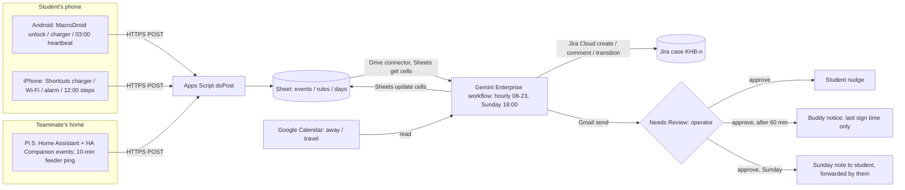

# Khabar

Khabar lets a student who lives alone name one classmate as a buddy and write one standing rule; the phone's own charger, unlock and step events are the check-in, so there is nothing to tap, and the buddy hears only the time of the last sign, never a location. The promise is "noticed within the day, by someone you chose", not rescue. Track: Smart Campus & Student Experience ("more accessible student experiences", see [challenge tracks](/docs/BRIEF.md#challenge-tracks)), built on Gemini Enterprise with a phone-events feeder.

Contents:

1. [At a glance](#at-a-glance)
1. [Problem](#problem)
1. [What people do today](#what-people-do-today)
1. [How it works](#how-it-works)
   1. [Devices and setup per OS](#devices-and-setup-per-os)
   1. [Network path, hop by hop](#network-path-hop-by-hop)
   1. [Feeder](#feeder)
   1. [Gemini Enterprise workflow](#gemini-enterprise-workflow)
   1. [Diagram](#diagram)
1. [Connectors](#connectors)
1. [Cloud, IoT and network in Khabar](#cloud-iot-and-network-in-khabar)
1. [Real data](#real-data)
1. [Research plan](#research-plan)
1. [Impact and measurement](#impact-and-measurement)
1. [Time to impact](#time-to-impact)
1. [Day-to-day operation](#day-to-day-operation)
1. [Demo and review](#demo-and-review)
1. [Privacy and rules](#privacy-and-rules)
1. [Build plan to 10 November](#build-plan-to-10-november)
1. [Risks and kill criteria](#risks-and-kill-criteria)
1. [Scores](#scores)
1. [Not verified](#not-verified)
1. [See also](#see-also)

## At a glance

- **User:** APU students who live alone off campus, international students first. Group size is not verified: no source in `docs/research/` counts them.
- **Owner:** the student owns the rule and the data; the buddy is a peer who installs the same thing. The operator who clicks Approve is the team until 14 November. It stays the team until a student society's welfare lead signs; none has.
- **Signal:** a phone's own events. Android: unlock, charger plugged or unplugged, and a 03:00 heartbeat. iPhone: charger, home Wi-Fi join, alarm stopped, and a 12:00 step reading. Location is never read.
- **Trigger:** a Gemini Enterprise schedule, hourly from 08:00 to 23:00 MYT (16 runs a day), plus a Sunday 18:00 run for an opt-in weekly note.
- **Connectors:** Drive and Sheets, Gmail and Calendar (1P, GA); Jira Cloud (3P, GA) as the case tracker. Every send and write pauses at Needs Review.
- **Measured outcome:** false alarms per person-week (the headline metric and the kill criterion), and minutes from last sign to buddy notice on real silences.
- **Live on 10 November:** 2 to 5 teammates' phones on real days, 3 to 6 recruited students if they join, about 80 hourly runs of history, and a reviewer-only student id with a 10-minute window.
- **Score:** 69.3 of 100 (stated-criteria subtotal 37.8 of 55); see [Scores](#scores).

## Problem

Who: students living alone in off-campus flats, who have nobody whose job is to notice a missing day. Signs the group exists: incoming students asking for "the entire unit to myself" ([Reddit][r-alone]), the move to Parkhill, M Vertica and Bloomsvale ([social research](/docs/research/social.md#lifts-laundry-and-deposits)), and loneliness threads among international students ([Reddit][r-lonely]). How often and how costly: the event is rare; the fear is constant. **Inference:** the cost that matters is the false alarm, because one wrong alert to a buddy ends the pair.

Verified pointers, from `docs/research/` (opened 5 November 2026):

- A Malaysian living alone asked X (in Malay) whether there is "any automation prompt to notify family members or friends so they know you died alone at home" (26 October 2025; 14 likes, 13 replies, 3,568 views) ([X][x-alone]). It is the only Malaysian ask, and it asks for automation, not a button.
- A working Malaysian adult living alone: "If I die in the house, people will only find a carcass" (5 September 2025; 15 likes) ([X][x-alone]).
- The viral paid app "Are You Dead?" (Demumu) topped Apple's paid chart in China in January 2026; a news post drew 60,989 likes and 1.86M views, and a founder said 7 or 8 in 10 buyers were women over 25 living alone ([X][x-alone]). The BBC reported a May 2025 launch with a tap every two days ([Reddit][r-alone], citing the BBC; the BBC page itself could not be fetched).
- Parents far away: a founder's 3 AM call to check on an 84-year-old father drew 23,020 likes and 2.2M views ([X][x-alone]).
- The "third option": a parent asked for a way "where the kids track one another and I don't … Not for bedtimes or partying but for safety" (26 May 2026; 11 likes, 25 replies) ([X][x-loc]).
- Self-built passive versions exist: QuietOK "checks in automatically using your phone's step activity … You don't tap anything, and it doesn't track your location" (7 October 2026) ([X][x-alone]); a Reddit builder ties the check-in to "your phone charging event" ([Reddit][r-alone]).
- Snug's AMA: the top feature question was a weekly rather than daily interval (47 points), and "I forgot to check in one day and the Fire Department came to my door" ([Reddit][r-alone]).

Strongest disconfirming evidence, stated plainly:

- **Demand evidence is weak.** The passive clones found few users: QuietOK "almost nobody knows it exists" and is "still struggling to reach actual app users" ([X][x-alone]); clones on Hacker News and r/SideProject got 3 points each ([Reddit][r-disconf]). No Malaysian thread asks for a check-in app beyond the one post above, and the demand "may be a January 2026 novelty spike" ([X][x-disconf], [Reddit][r-disconf]). No APU student has asked for Khabar.
- **The main complaint is false alarms.** "99% of the time the emergency contacts will be bc people forget to respond, which will cause unnecessary panic" (12 likes) ([X][x-alone]); "Seems really easy to miss the check in by accident and then freak out a loved one" (134 points) ([Reddit][r-alone]).
- The biggest location-sharing posts are against anything that watches adult students (16k to 25k likes) ([X][x-loc]). Khabar never reads location, and says so first.

[x-alone]: /docs/research/everyday.md#living-alone-and-check-ins
[x-loc]: /docs/research/everyday.md#location-sharing-between-friends-students-and-parents
[x-disconf]: /docs/research/everyday.md#disconfirming-signals-and-gaps
[r-alone]: /docs/research/everyday.md#living-alone-and-check-ins
[r-lonely]: /docs/research/everyday.md#loneliness-and-finding-people
[r-disconf]: /docs/research/everyday.md#disconfirming-signals-and-gaps
[r-communities]: /docs/research/everyday.md#communities-found
[r-recruit]: /docs/research/everyday.md#what-recruiting-looks-like-there

## What people do today

| Product                       | What it does                                                                                                                                                                                                                                                                        | What it does not do                                                                                            |
| ----------------------------- | ----------------------------------------------------------------------------------------------------------------------------------------------------------------------------------------------------------------------------------------------------------------------------------- | -------------------------------------------------------------------------------------------------------------- |
| Apple Check In (Messages)     | "Check In requires iOS 17 or later for both the sender and the recipient"; timer or travel based; if the phone is not progressing "you'll receive a prompt and have 15 minutes to respond"; Limited shares location and battery and network signal ([Apple][apple-checkin], opened) | Per trip, started by hand; iPhone to iPhone only; shares location by design. No daily passive rule             |
| Pixel Safety Check            | A timer "from one minute to 8 hours"; if you do not check in "your emergency contacts will get a text that shares your current location on Google Maps" ([Google][pixel-safety], opened)                                                                                            | Pixel phones only; a timer you start; location shared                                                          |
| Snug                          | "The free daily check-in app for people who live alone"; "Open Snug and tap the green checkmark"; a missed check-in sends contacts "your most recent location"; US$12.50 a month for Dispatch ([Snug][snug], opened)                                                                | A daily tap (the false-alarm complaint); location shared; US phone line                                        |
| Demumu ("Are You There")      | One green button, tap every two days, contact emailed on the third day; vendor claims "3M+ users in 20+ countries" ([X][x-alone])                                                                                                                                                   | A tap; a 2 to 3 day delay that critics called "a death notice, not an emergency warning"; pivoted to eldercare |
| Life360 Check In              | "The Check in button instantly sends your location to every member in a Circle" ([Life360][life360], search result)                                                                                                                                                                 | Manual; location-centred; the "parents tracking" product the backlash is about                                 |
| QuietOK, self-hosted switches | Passive, from steps; "It is a notification tool, not a guarantee" ([X][x-alone])                                                                                                                                                                                                    | iPhone only (QuietOK); one builder each; no users yet                                                          |

What is left: a passive rule that works on both Android and iPhone from apps students already have (Shortcuts, MacroDroid), never reads location, nudges the student before anyone else, is recruited through reciprocal buddy pairs inside a cohort, and publishes its false-alarm rate. **Inference:** the mechanism is not new, since QuietOK proves it; the cohort distribution and the honest latency and false-alarm figures are the pitch.

[apple-checkin]: https://support.apple.com/guide/personal-safety/use-check-in-for-messages-ips56b5bc469/web
[pixel-safety]: https://blog.google/products-and-platforms/devices/pixel/google-pixel-phone-watch-safety-features/
[snug]: https://www.snugsafe.com/
[life360]: https://support.life360.com/hc/en-us/articles/23053645947031-Check-In-With-My-Circle

## How it works

A student writes a rule: a window end ("no sign by 11:00"), a grace period, a buddy's email, and whether they want the Sunday note. If the phone shows no sign by then, the student is nudged first. Only after 60 more minutes of silence does the buddy get a message, and it carries the time of the last sign and nothing else.

### Devices and setup per OS

| Device                       | Setup                                                                                                                                                                                                                                                                                                        | What runs unattended                                                                                                                                   | What does not                                                                                                                                                                                                                                                                                                       |
| ---------------------------- | ------------------------------------------------------------------------------------------------------------------------------------------------------------------------------------------------------------------------------------------------------------------------------------------------------------ | ------------------------------------------------------------------------------------------------------------------------------------------------------ | ------------------------------------------------------------------------------------------------------------------------------------------------------------------------------------------------------------------------------------------------------------------------------------------------------------------- |
| Android (recruited students) | MacroDroid free (5 macros): Device Unlocked, Power Connected, Power Disconnected, and a 03:00 time trigger; each does an HTTP POST to the Apps Script URL with event, timestamp and device                                                                                                                   | Unlock and charger events fire when the phone is awake                                                                                                 | The 03:00 heartbeat may be deferred by Doze or killed on Samsung and Xiaomi ([phones and Pi](/docs/research/iot-and-network.md#android-background-limits)); MacroDroid's HTTP action was not confirmed on a MacroDroid page ([phones and Pi](/docs/research/iot-and-network.md#android-automation-apps-and-termux)) |
| Android (teammates, richest) | Home Assistant Companion to Home Assistant on the Pi 5 at one teammate's home; sensors `interactive`, `charger_type`, `steps`, `doze`, `app_standby_bucket` ([HA sensors][ha-sensors], opened); an HA automation POSTs each change to the same Apps Script URL                                               | Event sensors on change; a 15-minute update while on a charger                                                                                         | The same vendor killers; the Pi is needed only for this instance                                                                                                                                                                                                                                                    |
| iPhone                       | Shortcuts personal automations: Charger Is Connected, Charger Is Disconnected, home Wi-Fi join, Alarm stopped, plus one Time of Day at 12:00 posting the step count; "Allow Running When Locked", run without asking ([phones and Pi](/docs/research/iot-and-network.md#ios-shortcuts-personal-automations)) | All listed triggers can run without asking; individual actions may also need setting to run automatically (iOS 27 guide)                               | No interval, no unlock trigger, no 03:00 heartbeat; iPhone silence cannot be split into "offline" and "untouched"                                                                                                                                                                                                   |
| Pi 5 (one teammate's home)   | Home Assistant OS for the teammates' Android instance; a cron that pings the Apps Script URL every 10 minutes and logs the round trip, so feeder outages show as data                                                                                                                                        | Yes, with `Restart=always`, a hardware watchdog, Wi-Fi power save off ([phones and Pi](/docs/research/iot-and-network.md#keeping-it-alive-unattended)) | Not on the critical path for recruited students                                                                                                                                                                                                                                                                     |

[ha-sensors]: https://companion.home-assistant.io/docs/core/sensors

### Network path, hop by hop

1. Phone event (home Wi-Fi or mobile data) over HTTPS POST to the Apps Script web app `doPost` (it follows the redirect and has no trigger quota) ([phones and Pi](/docs/research/iot-and-network.md#pi-to-apps-script-and-sheets)).
1. `doPost` appends `{student_id, event, phone_ts, server_ts, device}` to the **events** tab of a Sheet in the licensed Workspace domain; `server_ts - phone_ts` is the per-event delay, shown on the ledger.
1. Gemini Enterprise reads the Sheet live through the Drive connector and Sheets actions (GA, federated, no indexed copy) ([Gemini Enterprise](/docs/research/gemini-enterprise.md#actions-and-write-back)).
1. Writes go out through Gmail (to the student or the buddy) and Jira Cloud (the case), each pausing at Needs Review.
1. The rule distinguishes three states: **touched** (any sign since 00:00), **untouched but alive** (the Android 03:00 heartbeat arrived, no sign), and **offline** (no heartbeat and no sign; an iPhone always falls here when silent). Only "untouched but alive" is strong; "offline" takes the softer path.

### Feeder

One Apps Script project: `doPost` (events), a **rules** tab (student, buddy email, window end, grace minutes, note opt-in, travel flag), and a **days** tab the hourly workflow maintains (date, student, first sign, state, case key). No Pi is required for a recruited student.

### Gemini Enterprise workflow

- **Trigger:** schedule, hourly 08:00 to 23:00 MYT; a second schedule on Sunday at 18:00 for the note.
- **Reads:** the events and rules tabs (Sheets get cell values), each student's Calendar (all-day events titled "away" or "travel" suppress checks), and open Jira cases.
- **Rule set** (inspectable, in the rules tab):
  - R1 **Nudge:** now is past window end plus grace, no sign since 00:00, no travel flag or away event, no open case. Create Jira case `KHB-n` (student id, last sign time, state) and email the student: "No sign from your phone since Tue 22:40. Tap any key, plug in, or reply to this."
  - R2 **Buddy:** case open for at least 60 minutes, still no sign, state "untouched but alive". Email the buddy: "Khabar: no sign from your friend's phone since Tue 22:40. Could you message or call? Reply here when you have." Add a Jira comment "buddy asked".
  - R3 **Offline path:** state "offline" means R1 only; R2 waits until window end plus 24 hours, because a flat battery is the usual cause (**Inference**).
  - R4 **Close:** any new event for the student moves the case to Done and, if the buddy was asked, sends a one-line "all good, sign at 11:52".
  - R5 **Sunday note (opt-in):** days with a first sign before window end and the longest quiet stretch, no times and no places, emailed to the student only, with "forward if you like".
- **Writes:** Jira Cloud create issue, create comment, change issue status; Gmail send; Sheets update cell values (days tab).
- **Approval point:** every Gmail send and Jira write pauses at Needs Review for the operator ([Gemini Enterprise](/docs/research/gemini-enterprise.md#what-runs-without-anyone-signed-in)). The click checks "did the rule fire as written", not "should we contact". Approval latency is logged per case and reported.

The approval gate is why the promise is same-day notice: an hourly schedule, a human click and polling make anything faster a false claim, and the README says so.

### Diagram

## Connectors

| Connector               | 1P or 3P | Stage   | Mode                                                 | Job                                                        |
| ----------------------- | -------- | ------- | ---------------------------------------------------- | ---------------------------------------------------------- |
| Google Drive and Sheets | 1P       | GA      | Read (get cell values), write (update cell values)   | Events and rules in; days tab out                          |
| Gmail                   | 1P       | GA      | Action (send)                                        | Student nudge, buddy notice, Sunday note; each pauses      |
| Google Calendar         | 1P       | GA      | Read                                                 | "away" and "travel" events suppress checks                 |
| Jira Cloud              | 3P       | GA      | Action (create issue, create comment, change status) | One case per silence, with a timeline the student can read |
| Custom MCP              | 3P       | Preview | None                                                 | Not used                                                   |

Sources: [actions and write-back](/docs/research/gemini-enterprise.md#actions-and-write-back) and the [connector catalogue](/docs/research/gemini-enterprise.md#connector-catalogue). Jira comments and transitions are listed as actions but are unproven until they run in the app; the fallback is create issue plus comment only.

## Cloud, IoT and network in Khabar

- **Cloud:** a Gemini Enterprise schedule judges every student's rule against the Sheet, opens and closes Jira cases, and drafts the messages. Without it there is no rule engine and no audit trail.
- **IoT:** the phone is the sensor. Unlock, charger and step events are the only evidence of a person; with no phone events there is nothing to judge. The Pi carries the teammates' richest Android instance and a 10-minute feeder ping.
- **Network:** every event is an HTTPS POST whose phone and server timestamps give a per-event delay, and the rule branches on what the network shows: touched, untouched but alive, or offline. A missing heartbeat changes the message the buddy would get (softer path, 24-hour wait). The Pi's ping makes feeder outages visible as "feeder unreachable", never as silence.

## Real data

| What is live                                | Source                                                                                                                                                  | Licence or consent                  |
| ------------------------------------------- | ------------------------------------------------------------------------------------------------------------------------------------------------------- | ----------------------------------- |
| Phone events from 2 to 5 teammates' phones  | MacroDroid, HA Companion and Shortcuts on their own phones                                                                                              | The teammates' own consent          |
| Phone events from 3 to 6 recruited students | The same apps on each student's own phone, from 9 November                                                                                              | The rules row is the consent record |
| Feeder pings every 10 minutes               | A cron on the Pi 5                                                                                                                                      | Team-owned                          |
| Calendar "away" and "travel" events         | Each student's own Google Calendar                                                                                                                      | The student's own consent           |
| Real silences                               | Any case that fires; for the video, a teammate really leaves their phone untouched past their window and the Jira case is labelled "deliberate silence" | The teammate's consent              |

Replayed and synthetic data: none. A failed feeder ping shows as a "feeder unreachable" row, and a failed run shows its error; nothing is cached or defaulted.

## Research plan

Remote, with no APU staff.

- **Interviews (6 to 8, 6 and 7 November):** reply in public, then DM, to people who already posted about the problem: the Malaysian X poster who asked for the automation ([X][x-alone]), the incoming student who wanted "the entire unit to myself" and the first-time-living-alone thread ([Reddit][r-alone]), and the international-student loneliness threads on r/malaysiauni ([Reddit][r-lonely]). Add teammates' own intake WhatsApp groups and the hackathon Discord `#general` (212 members) ([Reddit][r-communities]). Ask: who would you want told, after how long, what must never be shared, would you install a buddy's rule for them.
- **Timed observation (8 November):** one teammate's full day of events against their own diary, to time "last real sign" versus "last recorded sign", which bounds the system's blind spot.
- **Survey (8 November):** 10 questions on r/malaysiauni (survey posts are allowed; expect to offer a swap) and in intake groups: live alone, who would notice, acceptable delay, tap versus passive, location never or sometimes, would your parents want a weekly note. Local norms: swaps or small Touch 'n Go payments ([Reddit][r-recruit]).

## Impact and measurement

- **Baseline:** Demumu's tap every two days gives a 48 to 72 hour notice ([X][x-alone]); a daily-tap app's false alarm is "I forgot" ([Reddit][r-alone]). For a student living alone today the default is nothing: "if i don't come to work 2 days in a row my job know im dead" ([X][x-alone]).
- **Headline metric:** false alarms per person-week, meaning a case opened while the person was fine and had simply not touched the phone. It is also the kill criterion.
- **Second metric:** minutes from last sign to buddy notice on real silences, split into rule latency, poll latency and approval latency. For the Sunday note: how many opted-in students forwarded it.
- **Precision and recall on 30 to 50 real items:** person-days from 6 to 13 November across 5 to 8 phones (about 40 to 60). Ground truth is each person's own one-line diary ("fine and active by 09:10"). A positive is an opened case. Precision is cases that were real silences over all cases; recall is deliberate and real silences caught over all silences. In parallel each teammate also taps a Demumu-style daily button in a Sheet for the same days, so "forgot to tap" false alarms can be counted against the passive rule's on the same people. The sample is small and the write-up says so.

## Time to impact

- **By 10 November, owner: the team:** 2 to 5 teammates plus 3 to 6 recruited students; the team is the operator.
- **3 months (by 10 February 2027), owner: the team:** 30 buddy pairs recruited through two student-run international or national students' societies, whose committees the team contacts online; no APU staff. If a society welfare lead agrees, they become operator with a seat; if none signs, the team stays operator. Publish the false-alarm and latency figures monthly. Assumption: the Gemini Enterprise licence continues past the hackathon, which is unverified ([Gemini Enterprise](/docs/research/gemini-enterprise.md#not-verified)).
- **6 months (by 10 May 2027), owner: whoever operates:** 100 pairs, adding the new intake (reachable through intake WhatsApp groups); a measured false-alarm rate under 1 per person-month and median time to notice under 3 hours, or stop.

## Day-to-day operation

- **Unattended:** 16 hourly runs a day from 6 November, about 80 runs by 11 November plus one Sunday note run on 8 November. Most end in "no action", which is the point. The run history is the evidence.
- **Operator rota:** one team member is awake and signed in from 08:00 to 23:00 MYT to click Approve. A silence at 02:00 waits for the 08:00 run and an awake approver. This is human babysitting and the demo says so.
- **Credentials:** workflow schedule credentials are refreshed on 9 November so the 14-day expiry falls after assessment (11 to 14 November). Quotas for the hourly schedule are not verified (see [Not verified](#not-verified)).
- **Devices:** the Pi 5 stays at one teammate's home on wired power and Wi-Fi with a watchdog, and that teammate keeps it online 11 to 14 November. Each teammate keeps their own phone on its macros and carries it normally. Recruited students keep their own phones.
- **When it fails:** if the Pi loses power or network, the 10-minute ping stops and the ledger shows "feeder unreachable" from that time. If a phone is offline, the day's state is "offline", which takes the softer path; a reviewer sees "offline, unverified", never a claim of silence.
- **Reviewer trigger without touching a teammate's device:** see [Demo and review](#demo-and-review).

## Demo and review

Video (3 to 4 minutes, recorded from the live system and labelled with its date):

1. 0:00 The Malaysian ask on screen (14 likes, 13 replies) and the Demumu critics' "forgot to tap"; one line: no tap, no location, your rule.
1. 0:35 A student's rules row: window 11:00, grace 30, buddy, note opt-in. The phone: MacroDroid macros and the iPhone Shortcuts, each posting one event; the events tab filling, with per-event delay.
1. 1:20 The runs tab: four days of hourly runs, nearly all "no action"; the Sunday note run.
1. 1:50 A real deliberate silence (a teammate's phone left on the desk that morning): the 11:30 run opens `KHB-7`, Needs Review, the operator approves, the nudge arrives; the 12:30 run sends the buddy notice with "last sign Tue 22:40"; the teammate unlocks, the 13:30 run closes the case and tells the buddy.
1. 3:00 The numbers: person-days, false alarms, minutes to notice, approval latency.
1. 3:30 What is never stored, and the reviewer trigger.

**Reviewer-fireable trigger:** a reviewer-only student id whose rules row has a 10-minute window. The README gives the Shortcut or MacroDroid macro and the Apps Script URL. Plugging a phone in and then leaving it for 10 minutes past the window (or simply not posting) makes the next hourly run open a case the reviewer can see in Jira; posting one event closes it. Reviewers use their own phone, not a teammate's.

## Privacy and rules

- **PDPA 2010 and the 2024 amendment (Act A1727):** consent, notice, retention and security principles apply; the amendment adds biometric data ("any personal data resulting from technical processing" of behavioural traits) to sensitive data and raises penalties to RM1 million ([PDPA research](/docs/research/judging.md#malaysias-pdpa-and-the-2024-amendment)). **Inference:** a timestamped unlock history could be read as technically processed behavioural data, so Khabar keeps raw events for 14 days only, reduces each day to "first sign at HH:MM" and a state, and never builds a profile or "usual hour" model.
- **Consent:** the student's rules row is the consent record (what is sent, to whom, when); the buddy consents by installing or replying "yes" to one email, kept in the Sheet. Either can opt out by email, which deletes their rows the same day.
- **Never stored or sent:** location, Wi-Fi network name (an iPhone Wi-Fi join is sent as "home" only), app or notification content, step counts beyond "steps > 0 today", any wellbeing wording. Buddy notices carry a time, nothing else.
- **The operator sees silence cases:** a teammate approving a case reads a student id, a last-sign time and a state. This is a real exposure, so the operator sees ids rather than names where the Sheet allows it (**Inference**, unbuilt).
- **No APU rules touched:** no APU system, premises or staff. It is not a commercial transaction while a prototype; the README says how it would comply if a society ran it.
- **Gemini Enterprise:** Workspace accounts in the licensed domain only; consumer Gmail is not supported for connectors ([Gemini Enterprise](/docs/research/gemini-enterprise.md#edition-and-account-limits)).

## Build plan to 10 November

| Day    | Work                                                                                                                                                                                                                                                             |
| ------ | ---------------------------------------------------------------------------------------------------------------------------------------------------------------------------------------------------------------------------------------------------------------- |
| Thu 6  | Apps Script `doPost` and Sheet tabs; MacroDroid on one Samsung and one other Android, Shortcuts on one iPhone, HA Companion on the Pi instance; events flowing with a delay column; the 72-hour false-alarm test starts; recruitment replies; first 3 interviews |
| Fri 7  | Workflow R1 to R4 on the hourly schedule, Jira Cloud Free project, Needs Review tested end to end; diary and daily-tap baseline started for everyone; interviews 4 to 6; interview-side kill decision                                                            |
| Sat 8  | Recruited students onboarded (one email with the macro and the Shortcut); Sunday-note run built; survey posted; timed observation; 48-hour interim read of the false-alarm count                                                                                 |
| Sun 9  | 72-hour false-alarm test closes and the go or stop decision is made; first Sunday note; refresh schedule credentials; first deliberate silence recorded for the video; precision and recall sheet started                                                        |
| Mon 10 | README (the five NTT DATA points, connector table, diagram, privacy, "how to review" with the reviewer id), deck, video from the live system; submit early in the day                                                                                            |

## Risks and kill criteria

1. **False alarms** on vendor-killed Androids (the 03:00 heartbeat missing, read as "offline"), on an iPhone whose owner sleeps unplugged and so gives few signs, or on a student who simply left the phone. The offline path's 24-hour wait and the student-first nudge limit the damage, but one bad week loses the pair.
1. **Nobody installs it for a stranger's sake:** reciprocal pairs form only inside existing friendships, which the loneliest students lack ([Reddit][r-lonely]). Impact caps at the already-connected.
1. **Operator latency:** a 02:00 silence waits for the 08:00 run and an awake approver; a reviewer may read "same-day notice" as too weak. The README says "noticed within the day, not rescue".
1. **Owner:** the owner is still the team until a student society signs; nothing in the plan depends on one signing.
1. **Unverified tools:** MacroDroid's HTTP action and the 03:00 heartbeat inside Doze, tested on 6 November.

**Kill criteria.** Interviews, by 7 November: fewer than 3 of the 6 interviewees who live alone say they would install a no-tap rule with a peer buddy. False alarms, by the morning of 9 November: a 72-hour test on real phones across one iPhone and two Android phones (one Samsung), including an overnight Doze test with the phone left idle. More than 1 false alarm per person-week, counted as the rate over those 72 hours, stops the build and the effort goes to another finalist. The first 48 hours are read as a warning on 8 November, but 48 hours alone is too short to decide on: it misses a full weekend rhythm and one overnight on each vendor.

## Scores

Weights are in the [scoring matrix](/docs/ideas/opus-03/00-ranking.md#scoring-matrix). Scores are the panel's means.

| ID  | Component           | Score | Reason                                                                                                                                             |
| --- | ------------------- | ----- | -------------------------------------------------------------------------------------------------------------------------------------------------- |
| I   | Impact              | 3.0   | Real fear with viral evidence abroad and one Malaysian ask; group size unverified; reach is capped by existing friendships                         |
| T   | Technical build     | 4.0   | GA 1P reads and writes (Sheets, Gmail, Calendar) plus GA 3P Jira create, comment and transition; every hop named                                   |
| R   | Research            | 3.0   | Interviewees exist in public threads but are strangers; the survey competes with five a day on r/malaysiauni                                       |
| TT  | Time to impact      | 3.0   | A pair works within a day; the 3-month plan needs no staff but needs the licence to outlive the hackathon, and the operator is still the team      |
| W   | Day-to-day workflow | 4.0   | 16 unattended runs a day, almost all correctly "no action", one approval per case; the shape the platform asks for                                 |
| C   | Convergence         | 3.3   | Phone events are load-bearing; the network layer is the offline versus untouched split; the Pi is one instance, not essential                      |
| O   | Originality         | 3.7   | Wellbeing is nearly absent from the crowd map; the mechanism is QuietOK's and check-in clones are common, so cohort distribution is the difference |
| U   | Real use            | 3.0   | A paid viral app and workaround behaviour exist, but passive clones found few users and no APU student asked                                       |
| D   | Demo                | 4.0   | A real deliberate silence through nudge, buddy and close is obvious on camera; reviewers can fire it with a 10-minute window                       |
| F   | Feasibility         | 4.0   | Apps already on phones, no native code, no Pi on the critical path; MacroDroid HTTP and the Doze heartbeat are the two things to prove             |

Weighted total: **69.3** of 100. Stated-criteria subtotal (I, T, R, TT, W): **37.8** of 55.

## Not verified

- MacroDroid's HTTP request action and Device Unlocked trigger on a page of MacroDroid's own; the research doc says the HTTP action was not confirmed.
- Whether a MacroDroid 03:00 trigger fires inside Doze on Samsung and Xiaomi phones.
- The BBC article on Demumu (the fetch was blocked); facts come from the research doc's summary.
- Jira Cloud "change issue status" and "create comment" running from a workflow node in the sponsored app.
- Whether the sponsored licence continues after 14 November, and the quotas for an hourly schedule.
- The number of APU students living alone, and the size of any international students' society.

## See also

- [Idea ranking](/docs/ideas/opus-03/00-ranking.md)
- [Hackathon brief](/docs/BRIEF.md)
- [Context and decisions](/docs/CONTEXT.md)
- [Everyday signals on X](/docs/research/everyday.md) and [on Reddit](/docs/research/everyday.md)
- [Phones and Raspberry Pi limits](/docs/research/iot-and-network.md)
- [Gemini Enterprise limits](/docs/research/gemini-enterprise.md)
- [Malaysia's PDPA](/docs/research/judging.md#malaysias-pdpa-and-the-2024-amendment)
