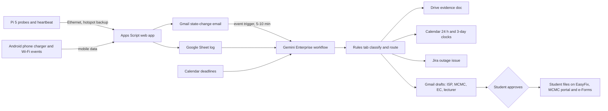

# Cap Masa

Cap Masa ("time stamp") turns a home line or power drop into dated proof: it starts the ticket clock Unifi's own alerts don't cover, tracks the 3-day APU extenuating-circumstances (EC) window, and drafts the paperwork for the student to send. Track: Intelligent Automation & Digital Transformation ("connecting devices with useful actions", see [challenge tracks](/docs/BRIEF.md#challenge-tracks)).

Contents:

1. [At a glance](#at-a-glance)
1. [Problem](#problem)
1. [What people do today](#what-people-do-today)
1. [How it works](#how-it-works)
1. [Connectors](#connectors)
1. [Cloud, IoT, and network](#cloud-iot-and-network)
1. [Real data](#real-data)
1. [Research plan](#research-plan)
1. [Impact and measurement](#impact-and-measurement)
1. [Time to impact](#time-to-impact)
1. [Day-to-day operation](#day-to-day-operation)
1. [Demo and review](#demo-and-review)
1. [Privacy and rules](#privacy-and-rules)
1. [Build plan to 10 November](#build-plan-to-10-november)
1. [Risks and kill criteria](#risks-and-kill-criteria)
1. [Scores](#scores)
1. [See also](#see-also)

## At a glance

- **User:** APU students living off campus on their own broadband (APU residences fail the remote-team gate). First the 2 to 3 teammates on different ISPs, then students recruited from r/malaysiauni and APU Discord. Unifi Promise only covers Unifi plans of 100 Mbps and above, so Maxis, CelcomDigi and TIME users get the receipt, the MCMC draft and the EC route only.
- **Owner:** the student. They approve every outbound draft at the platform's Needs Review step and file everything themselves. No APU staff are involved.
- **Signal:** a Pi 5 wired to the home router probing every 60 s, plus an Android phone on a charger reporting "charger disconnected" and "Wi-Fi lost" over mobile data.
- **Trigger:** a state-change email from an Apps Script web app, picked up by a Gmail event trigger (5 to 10 minute poll), plus a nightly schedule. The promise is "within 15 minutes", never seconds.
- **Connectors:** Gmail, Google Drive (Sheets actions), Google Calendar and Jira Cloud, all GA. Globalping is an optional preview extra and carries none of the technical claim.
- **Measured outcome:** minutes from first failure to a filed ticket, and the share of outages with a timestamped evidence document, with precision and recall of the verdict on 30 to 50 real periods.
- **Live on 10 November:** about 5 days of probe rows from 2 to 4 homes, run history of the nightly workflow, and a fireable labelled test trigger. A natural line outage is not guaranteed.
- **Score:** 69.9 of 100, stated-criteria subtotal 38.4 of 55 ([scores](#scores)).

## Problem

**Who and how often.** Malaysian renters and students lose home internet and power. A Lowyat member paying RM136 a month wrote that "almost every week will have outage that would last randomly from half an hour to entire day", with 82 posts in December 2025. A Malaysian X user reported "Unifi down almost 2 days" in June 2026, and another wrote of an outage lasting 13 days with nine calls to 100 and an MCMC website that "doesn't work either" ([everyday Reddit](/docs/research/everyday.md#water-power-and-home-internet-outages), [everyday X](/docs/research/everyday.md#water-power-and-home-internet-outages)).

**The lived question is "is it just me?"** A Kerala developer built a PIN-code power-cut tracker for "is it only my house, or the whole area?" (25 April 2026, 320 points). The Malaysian analogues are a TRX blackout thread (3,017 points) and the Johor Jaya substation fire of 16 October 2026 (216 points) ([everyday Reddit](/docs/research/everyday.md#water-power-and-home-internet-outages)).

**The rules that make a timestamp valuable** (all from [rules and guarantees](/docs/research/rules-and-guarantees.md), checked 5 November 2026):

- **Unifi Promise:** restore within 24 hours, counted in the FAQ "from the time an official complaint or trouble ticket is made"; otherwise a rebate of RM50, redeemable in MyUnifi within 30 days; 100 Mbps plans and above only ([Unifi Promise](https://unifi.com.my/unifipromise), [rules](/docs/research/rules-and-guarantees.md#unifi-promise)). The page words the start of the clock two ways, so the ticket time is the safe start.
- **MCMC:** complaints go through the MCMC Consumer Redress Portal, and the form requires the provider's complaint or ticket number; there is no strict time limit to lodge ([rules](/docs/research/rules-and-guarantees.md#mcmc-complaints-for-telco-and-broadband-issues)). **Inference:** a ticket number with timestamps is needed twice, once for the rebate and once for MCMC.
- **APU EC:** the knowledge-base page "What happens when IT equipment fails?" says network-failure evidence needs "appropriate time stamp and screen shots", with any engagement with the lecturer or invigilator, "without which the claim will be rejected" (published 21 December 2022, never edited since). A claim is submitted through e-Forms no more than 3 days after the event ([rules](/docs/research/rules-and-guarantees.md#extenuating-circumstances-for-it-or-network-failure)). **Inference:** the 3-day clock runs from the event, so the log has to exist before the claim does.

**What the KB does not say.** It describes many computers out of action for several hours as a possible basis for a short extension, with a Technical Assistant countersigning. It does not say a Moodle outage qualifies, so "Moodle down" is a supporting fact, never a stated ground.

**Strongest disconfirming evidence:**

- Unifi already offers proactive alerts. Its own page lists Proactive Service Alerts over WhatsApp and MyUnifi, where replying "Y" confirms the fault and the "report will be auto-created", and a Malaysian X user learned of their outage from such a WhatsApp message. This can cover the plain single-customer line fault Cap Masa would otherwise lead with, which is why it leads with the cases below instead.
- No thread describes classes or exams lost to a home outage, and no APU post describes a rejected EC claim for connectivity ([disconfirming signals](/docs/research/everyday.md#disconfirming-signals-and-gaps)).
- Outages may be too rare to show in a week: Lowyat replies to "Is unifi down today?" are often "No issue".
- The rebate is RM50, and only for 100 Mbps and above Unifi plans.
- The 2018 EC policy reportedly says a purely personal network fault may not qualify. This is **not verified**: the PDF returned 404 and the claim came from a search summary.

**Where Cap Masa aims.** Because Unifi's alerts auto-create tickets for some outages, Cap Masa is aimed at what they leave uncovered:

- **Premises faults versus line faults:** Unifi's alerts can cover a single-customer line fault, but for a fault in the customer's own equipment or premises the page says "the existing On-Site Support Charges will be imposed", so the receipt separates the two before the student calls, and keeps the timestamps the EC claim needs either way.
- **Multi-customer outages:** the page says proactive alerts are not sent when the downtime affects multiple customers in the area, or when the fault is already reported.
- **Other ISPs:** Maxis, CelcomDigi and TIME have no Unifi Promise, but the MCMC route and the EC evidence apply to every ISP.
- **Power cuts:** no ISP alert exists for them, and the student needs a dated record for a TNB report or an EC statement.
- **APU EC evidence:** the timestamped, screenshot-backed record the KB demands, plus the 3-day window clock, which no ISP tool tracks.

## What people do today

| Substitute                                                                                               | What it does                                                                                                                                   | What is left                                                                                                                                 |
| -------------------------------------------------------------------------------------------------------- | ---------------------------------------------------------------------------------------------------------------------------------------------- | -------------------------------------------------------------------------------------------------------------------------------------------- |
| Uptime Kuma, Speedtest Tracker, Smokeping on a Pi or NAS (self-hosted)                                   | Log outages and speed to answer "Is the internet down?!" ([everyday Reddit](/docs/research/everyday.md#water-power-and-home-internet-outages)) | They log; they do not start the ISP ticket, track the 24 h and 3-day clocks, or write the EC and MCMC text                                   |
| Unifi proactive alerts, MyUnifi, EasyFix, Unifi Cares WhatsApp                                           | Notify and auto-create a ticket for some outages; EasyFix and MyUnifi take reports                                                             | Not sent for multi-customer or already-reported faults; nothing for other ISPs or power; the student still needs a timeline for MCMC and APU |
| Status boards (a Bluesky status bot posted "Unifi is reportedly down for some users" on 4 November 2026) | Crowd view of one ISP                                                                                                                          | Nothing about your line, your deadline or your claim                                                                                         |
| Asking the class WhatsApp, neighbours, the balcony                                                       | "Is it just me?"                                                                                                                               | No timestamps, no filing                                                                                                                     |
| Dual-WAN routers with 5G failover, a Home Assistant phone left on a charger, a UPS with NUT on a Pi      | Keep working or detect a parent's outage                                                                                                       | Detection only; no claim or evidence                                                                                                         |

**Saturated tier, and why this angle differs.** Wi-Fi and network diagnosis, and telemetry-to-ticket, are saturated ideas in the [crowd map](/docs/research/competition.md#saturation-tiers), and a reviewer who has read 200 entries will pattern-match a Pi that probes Moodle and opens a Jira ticket. The crowd's version watches the campus network and files IT tickets for APU. Cap Masa watches the student's own home, files nothing itself, and ends in a claim the student sends to a provider, a regulator or APU, which is a different user and a different deliverable. Even so, the headline must be the filing and the clocks, never a latency chart. **Inference:** the crowd is unlikely to build the home-ISP rebate and EC form of this idea, though it may build the probe half.

## How it works

**Devices and setup** (per [phones and Pi](/docs/research/iot-and-network.md)):

- **Pi 5 (8 GB), wired to the home router, at a teammate's or recruited student's home.** A systemd service probes every 60 s: gateway round trip, DNS, TCP and HTTPS to ISP-neutral anchors, and APU's Moodle, APSpace and Microsoft sign-in pages (GET of the public login page, no credentials). It also writes a heartbeat row. The uplink is Ethernet, with the phone hotspot on `wlan0` as backup, so a "line down" row still reaches the cloud over mobile data.
- **Android phone on the bedside charger** (Home Assistant Companion or MacroDroid): reports "charger disconnected" and "Wi-Fi lost" over mobile data. Battery optimisation must be off.
- **iPhone:** a Shortcuts personal automation on "Charger Is Disconnected" that runs without asking ([Shortcuts](/docs/research/iot-and-network.md#ios-shortcuts-personal-automations)). Events only: iOS has no interval trigger, so no phone-side probing.
- **Probes from other homes:** teammates on other ISPs run the same Pi script, and the cross-home rows are the outside view. Adopting the Pi as a Globalping probe is optional and sits off the critical path.

**Power is inferred, not seen.** A Pi can't observe a power cut while it happens. After it reboots, the gap between the last log entry and the new boot, plus `power_reset`, tells an outage from a watchdog or undervoltage reset ([power and the RTC](/docs/research/iot-and-network.md#power-undervoltage-and-the-rtc)). The phone's charger-disconnected event gives an earlier live hint, but it too is a signal, not a confirmed cut: a phone can be unplugged by hand. Every power verdict is labelled "inferred" and counted separately.

**Network path.** Pi probes (Ethernet, hotspot backup) go over HTTPS to an Apps Script web app and into a Sheet row. On a state change the script saves a Drive file and sends a Gmail message to the student's own address. Gemini Enterprise workflows have no webhook trigger, so a polled Gmail or Drive trigger is the bridge ([triggers](/docs/research/gemini-enterprise.md#triggers-and-schedules)). Google's docs say to use "When an email is sent" for mail one sends to oneself, so that is the trigger to try first.

**Classifier rules** (an inspectable rules tab):

| Pattern                                                               | Verdict                      | Filing route                                                                                                           |
| --------------------------------------------------------------------- | ---------------------------- | ---------------------------------------------------------------------------------------------------------------------- |
| Gateway reachable, public anchors unreachable, other homes up         | Line fault                   | Unifi ticket now (EasyFix or MyUnifi); rebate claim if 24 h pass                                                       |
| Gateway unreachable, phone charger still connected, Pi up             | Premises (router or cabling) | Fix and note; Unifi may impose on-site charges for faults in the customer's equipment                                  |
| Charger disconnected and Pi heartbeat gap after a boot                | Power cut (inferred)         | No ISP ticket; dated note for a TNB report or EC statement                                                             |
| Public anchors fine, Moodle or APSpace failing from two or more homes | APU-side                     | Supporting evidence for an EC statement only if a deadline fell inside the window                                      |
| All homes on one ISP down                                             | Wide ISP outage              | File anyway, since Unifi sends no proactive alert for multi-customer outages; MCMC draft once the ticket number exists |

**Gemini Enterprise workflow:**

- **Trigger:** Gmail event trigger on the state-change email, plus a nightly schedule. There is no 15-minute schedule: a schedule cannot be made conditional on an open outage, and 96 runs a day would eat the 160-query daily pool ([limits](/docs/research/gemini-enterprise.md#limits-that-bite-in-a-one-week-build)). Whether one run costs one query is unmeasured, so measure it.
- **Reads:** the probe Sheet, Calendar deadlines and classes, and the ticket reference the student pastes back.
- **Rule set:** the classifier tab above.
- **Writes:** Calendar events "Unifi ticket filed, clock ends HH:MM" and "EC window closes DD Mon"; a Drive evidence document (timeline, verdict, screenshot index); one Jira issue per outage; Gmail drafts for the lecturer notice, the ISP follow-up, the rebate or MCMC text and the EC statement.
- **Approval:** the student approves every draft at Needs Review. Writes through connectors need human review anyway ([approval rules](/docs/research/gemini-enterprise.md#what-runs-without-anyone-signed-in)).
- **First prompt:** at minute 10 of a line-fault verdict the email says "File on EasyFix now; the 24 h clock starts at your ticket".

## Connectors

| Connector                     | 1P or 3P | Stage   | Mode                  | Job                                                            |
| ----------------------------- | -------- | ------- | --------------------- | -------------------------------------------------------------- |
| Gmail                         | 1P       | GA      | Event trigger, action | State-change trigger; drafts                                   |
| Google Drive (Sheets actions) | 1P       | GA      | Read, action          | Probe log; evidence doc                                        |
| Google Calendar               | 1P       | GA      | Read, action          | Deadlines in; clock events out                                 |
| Jira Cloud                    | 3P       | GA      | Action                | One issue per outage with timeline                             |
| Globalping                    | 3P       | Preview | Read only             | Optional outside view; the technical claim does not rest on it |
| Slack                         | 3P       | GA      | Action                | Optional class-rep notice (the rep approves)                   |

The Globalping connector's public API has no "list my measurements" endpoint, so whether it can find the team's own measurements is untested ([Globalping](/docs/research/iot-and-network.md#globalping-probe), [connector note](/docs/research/gemini-enterprise.md#network-measurements-through-globalping)). Prove one live Sheet read and one reviewed Jira create first.

## Cloud, IoT, and network

- **Cloud:** the Gemini Enterprise workflow reads the Sheet and Calendar, applies the rules tab, and writes Calendar, Drive, Jira and Gmail drafts. Without it there are rows and no filing.
- **IoT:** real readings from the team's own Pi (reachability, latency, heartbeat gaps) and phones (charger, Wi-Fi). The verdict flips on them: a charger event with a heartbeat gap says power; a gateway failure with the charger connected says premises.
- **Network:** the hotspot failover is what lets a "line down" row reach the cloud while the line is down, and rows from homes on other ISPs separate a line fault from a wide outage. If the Ethernet is unplugged, a reviewer sees the row arrive over mobile data.

## Real data

| Data                                          | Source                                                             | Licence or consent                   |
| --------------------------------------------- | ------------------------------------------------------------------ | ------------------------------------ |
| Probe rows (reachability, latency, heartbeat) | Teammates' and recruited students' own Pi 5s, live from 6 November | The owner's own consent              |
| Charger and Wi-Fi events                      | The owners' own phones                                             | The owner's own consent              |
| APU page reachability                         | HTTPS GET of public login pages, no credentials                    | Public pages; no scraping of content |
| Deadlines and classes                         | The student's own Calendar                                         | The student's own account            |

- **Induced outages** (unplugging the router or Ethernet) are labelled "induced" and never counted in the outcome table.
- **Replays:** none. Past outages students recall from MyUnifi or emails may be pasted in, labelled "recalled, no timestamps", and are never counted in the outcome table or used as evidence.
- **Failure behaviour:** a failed probe or write shows its error ("no probe rows since HH:MM", a failed Sheet read); nothing is cached, defaulted or filled in.
- **History by 11 November:** about 5 days of rows for 2 to 4 homes. If no natural outage occurs, the false-positive count over quiet nights is the honest result.

## Research plan

Remote, with no APU staff ([research notes](/docs/research/everyday.md#water-power-and-home-internet-outages)).

- **Where:** r/malaysiauni (recruiting works, but APU requests get 0 to 1 replies, so offer a swap or RM5), APU Discord and the intake groups the team can reach, and Lowyat Unifi threads for ISP-side interviewees.
- **6 to 8 interviews (15 minutes, voice or text):** off-campus APU students, ideally on Unifi. The questions: the last time the net dropped near a deadline, what did you do and what did you have to show; have you ever filed an EC; do you know the 24 h rule; did you get Unifi's own alert; was any outage in the last 3 months left unticketed or unrebated; did you ever need a timeline for MCMC.
- **Timed observation:** a teammate times "is it just me?" from first failure to a verified answer plus filing with their normal methods, then with Cap Masa.
- **Survey (2 days, 10 questions):** ISP, plan speed, outages a month, ever reported, ever claimed the rebate, ever filed EC for connectivity, would they install a Pi or phone app.
- **Dates:** recruit from 5 November, interviews 7 and 8 November, the kill check on 7 November ([risks](#risks-and-kill-criteria)).

## Impact and measurement

- **Baseline:** minutes from first failure to a filed ticket today (timed observation), and the share of outages the student reported at all (survey).
- **Before and after:** minutes to ticket, and the share of outages with a timestamped evidence document.
- **Accuracy test on 30 to 50 real periods** (outages plus quiet windows) from the probe logs: label each with a second source, the router log or the student's own record, then report precision and recall of "line fault vs premises vs power vs APU-side". Power is reported as "inferred" with its own count. With fewer than 30 labelled periods, state the number and report the false-positive rate only.
- **Reach:** unknown. No source counts APU students on Unifi, so none is estimated.

## Time to impact

- **Weeks 1 to 4 (to early December 2026):** the 2 to 3 teammate homes plus recruited non-team homes. Owner: the PM teammate for recruiting, the Pi teammate for the image. Publish the Pi image and a phone setup sheet on GitHub.
- **Month 3 (February 2027):** a 20-home cohort via r/malaysiauni; first real rebate or MCMC filing outcomes recorded. Owner: the ops teammate.
- **Month 6 (May 2027):** publish the classifier rules and filing guide for any Malaysian renter on any ISP, independent of APU. Owner: the whole team.
- **Assumptions:** recruited students own or will install a Pi, which most do not, so a phone-only path (charger events, no line-fault view) is the fallback. No step needs APU staff.

## Day-to-day operation

- **Unattended:** Pi probes every 60 s, the heartbeat, state-change emails, the Gmail-triggered workflow and the nightly schedule. Expect 5 days of rows and nightly runs in the Runs tab by assessment ([run history](/docs/research/gemini-enterprise.md#what-runs-without-anyone-signed-in)).
- **Credentials:** scheduled runs use the author's delegated credentials, which expire every 14 days, so a refresh entry goes on the team calendar for 9 November. Event-triggered runs that fail with `RESOURCE_EXHAUSTED` are not retried.
- **Quotas:** Standard allows 160 assistant queries a day per user, pooled. The schedule is nightly only, and usage per run is measured on 6 and 7 November.
- **Who keeps devices up:** each teammate or recruited student keeps their Pi on the official 27 W supply and their Android phone charging at home, 11 to 14 November. Updates are frozen from 10 November, and logs leave the Pi promptly, because a power cut can corrupt SD storage and an overlay file system loses buffered logs ([Pi power cuts](/docs/research/iot-and-network.md#power-cuts-and-sd-cards)).
- **Power loss:** a Pi on default settings boots by itself when power returns. A reviewer sees "no probe rows since HH:MM" and, after reboot, a power-inferred period.
- **Network loss:** the hotspot carries a "line down" row; if both fail, the same "no rows" error shows.
- **Reviewers fire a trigger** without touching a teammate's device: see [demo and review](#demo-and-review).

## Demo and review

1. 0:00 A student's Moodle deadline is 90 minutes away (a Calendar event).
2. 0:30 Unplug the Pi's Ethernet live. The row arrives over the hotspot, and the Gmail alert lands.
3. 1:15 The workflow runs. The Runs tab shows "line fault (induced)", and the first email says "File on EasyFix now; clock starts at your ticket".
4. 2:00 Show the drafts (lecturer notice, ISP follow-up) and the Drive evidence document, then approval at Needs Review.
5. 2:40 Show two real days of history, including the real quiet-night false-positive count and any real outage.
6. 3:15 Reviewer trigger and the polling delay.

**Reviewer trigger.** A reviewer emails "STATUS" to the team's alert mailbox; within 15 minutes the workflow replies with each home's current classification and an evidence document built from the live log, which is usually the real answer "line up, no open outage". Outages are never simulated by email: they are natural, or induced at a teammate's home by unplugging the router and labelled "induced". Whether the trigger fires on mail from outside the account is untested. The recorded video is labelled with its capture date and does not replace live access.

## Privacy and rules

- **PDPA 2010 as amended in 2024:** only the student's own, consented data. The Pi logs reachability only, never traffic content or browsing. Names and emails stay in the student's own Workspace, and no IP address leaves the project beyond the Sheet owner's account.
- **APU rules:** the lecturer email and EC statement are drafts the student sends; the team contacts no APU staff or system beyond public HTTPS reachability probes. APU's KB pages are quoted briefly and stay APU's ([terms of use](/docs/research/apu.md#terms-of-use-and-robotstxt)).
- **Unifi and MCMC:** Cap Masa never files for the student. It points them to EasyFix, MyUnifi and the MCMC portal, which refuses anonymous complaints.
- **Never stored:** browsing history, traffic content, credentials, other people's data.

## Build plan to 10 November

- **Thu 5 and Fri 6:** Pi probe service and Apps Script; phone charger events on two Android phones and one iPhone; Gmail trigger test with "When an email is sent"; start recruiting; start the logs on 6 November.
- **Sat 7:** classifier rules tab; Calendar clock events; the kill check; interviews 1 to 4.
- **Sun 8:** Jira and Drive writes, draft prompts, Needs Review flow; interviews 5 to 8; timed observation.
- **Mon 9:** accuracy labelling; credential refresh; freeze updates.
- **Tue 10:** record the video, write the README, submit before 23:59 MYT.

## Risks and kill criteria

1. **No natural outage in the window** (likely). The result is a clean log with induced events labelled and an honest false-positive rate. Three ISPs raise the odds.
2. **It reads as the saturated network-monitor idea,** or as a copy of Unifi's alerts. Mitigation: open the demo on the filing and the uncovered cases, not on a chart.
3. **The Unifi alert already closes the gap** for most students. This is the kill test below.
4. **EC value is weaker than assumed** for a purely personal fault. Lead with the ISP and MCMC routes, and use EC only where the APU-side verdict applies.
5. **The cohort is the team,** because recruited students lack a Pi.

**Kill by 7 November**, if any holds:

- Fewer than 2 of 6 off-campus Unifi interviewees had an outage in the last 3 months that went unticketed or unrebated despite Unifi's own proactive alert, or that needed a timeline for MCMC or an EC claim. Then no gap remains after the incumbent, and the filing product has no job.
- Fewer than 2 non-team homes are logging by 7 November. Then the cohort is the team, and reach is the team.
- The Pi to Apps Script to Gmail trigger path does not start a workflow within 15 minutes on the first test.

## Scores

Weights are in the [scoring matrix](/docs/ideas/opus/03/00-ranking.md#scoring-matrix). The panel's final mean scores, which are scored out of 5:

| ID  | Component           | Score | Reason                                                                                                                       |
| --- | ------------------- | ----- | ---------------------------------------------------------------------------------------------------------------------------- |
| I   | Impact              | 2.7   | Unifi's own proactive alerts cover the plain line fault, the rebate is RM50, and no APU EC-loss post exists                  |
| T   | Technical build     | 4.0   | GA Gmail, Drive, Calendar and Jira do real reads and writes; Globalping is optional                                          |
| R   | Research            | 4.0   | Off-campus Unifi students are recruitable on Reddit and Discord, and ISP threads are available                               |
| TT  | Time to impact      | 3.0   | The Pi image and guide start without APU, but a Pi in every home limits reach to the team                                    |
| W   | Day-to-day workflow | 4.0   | Probes and nightly runs are unattended; approvals are required by the platform                                               |
| C   | Convergence         | 4.7   | Pi, phone charger, hotspot failover and cloud each decide the verdict                                                        |
| O   | Originality         | 3.0   | The clock-starter and filing route are new; network monitoring is a saturated tier                                           |
| U   | Real use            | 3.0   | Self-hosters log ISP failures and Malaysians ask "just my house?", but the setup is a hobbyist's and the EC need is unproven |
| D   | Demo                | 3.7   | Fireable by unplugging, but the reviewer trigger is a labelled test and real history may be thin                             |
| F   | Feasibility         | 3.3   | Pi, phones and Apps Script by Tuesday is tight with a cohort to recruit                                                      |

- **Weighted total:** 69.9 of 100, the mean of the three judges' totals.
- **Stated-criteria subtotal (I, T, R, TT, W):** 38.4 of 55, likewise the mean of the three judges' subtotals; the rounded component means above give 38.5.

## See also

- [Ranking](/docs/ideas/opus/03/00-ranking.md)
- [Brief](/docs/BRIEF.md)
- [Context](/docs/CONTEXT.md)
- [Rules and guarantees](/docs/research/rules-and-guarantees.md)
- [Everyday Reddit signals](/docs/research/everyday.md)
- [Everyday X signals](/docs/research/everyday.md)
- [Phones and Raspberry Pi 5](/docs/research/iot-and-network.md)
- [Gemini Enterprise](/docs/research/gemini-enterprise.md)
- [Competition](/docs/research/competition.md)
