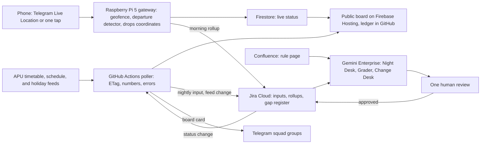

# BoardCast

BoardCast tells APU shuttle riders, the night before, what missing each run will cost them and how early to be at the stop, from APU's own feeds and riders' phones. This is the hill-climbed version of the seed, scored on 5 November 2026 against the [set's matrix](/docs/ideas/opus/00-ranking.md#scoring-matrix): 53 to 70.5 out of 100. An independent review then scored it 50.5. Every score is a hypothesis: nothing is built, no rider has reported, and no licence has arrived. **Inference** marks conclusions no source states.

Contents:

1.  [Read this first](#read-this-first)
1.  [Pitch and track](#pitch-and-track)
1.  [At a glance](#at-a-glance)
1.  [Problem and evidence](#problem-and-evidence)
1.  [How it works](#how-it-works)
1.  [Fit with the team's circumstances](#fit-with-the-teams-circumstances)
1.  [Hill-climb log](#hill-climb-log)
1.  [Scores](#scores)
1.  [Research plan](#research-plan)
1.  [Time to impact](#time-to-impact)
1.  [Demo, video, final pitch, and reviewer path](#demo-video-final-pitch-and-reviewer-path)
1.  [Build plan](#build-plan)
1.  [Risks and kill criteria](#risks-and-kill-criteria)
1.  [Independent review](#independent-review)
    1.  [Claims that hold](#claims-that-hold)
    1.  [Claims that fail or lack support](#claims-that-fail-or-lack-support)
    1.  [What the reviewer would change](#what-the-reviewer-would-change)
    1.  [Domain risks the doc misses](#domain-risks-the-doc-misses)
    1.  [Rescore](#rescore)
    1.  [Flashy yet practical](#flashy-yet-practical)
    1.  [Cheapest test by Fri 6 Nov 22:00](#cheapest-test-by-fri-6-nov-2200)
    1.  [Not verified by the reviewer](#not-verified-by-the-reviewer)
1.  [Not verified](#not-verified)

## Read this first

**Verdict:** an independent transit and crowdsourcing review says **build with changes** and scores this 50.5 of 100, against the 70.5 below. Its full text is under [Independent review](#independent-review). Where the two disagree, treat the review as the current position.

**What the review changes:**

1.  **Lead with a class-connection check.** A 105-minute gap isn't lateness and doesn't say when to leave, so miss cost becomes supporting information.
1.  **No learned cut-off yet.** One rider per run isn't full coverage, and 3 reports can't justify "be there by". Show individual reports with their age.
1.  **The weekday idea stays open.** Daily gate exits were the wrong test, so timetable load stays an unvalidated predictor, neither rejected nor advertised.
1.  **Private summaries, not public slips.** A slip isn't an official delay certificate.
1.  **The tap page is the main path.** Telegram location can prompt a rider to confirm, but it doesn't detect boarding.

**Team limit, 5 November:** the team can't get a route captain, returning riders, or six rider interviews. It has one friend's second-hand account. So:

- The review's launch gate and its Friday go or no-go can't be met, and they aren't used as gates here.
- Before submission, co-op runs only on the team's own phones. The `live` partition stays empty, and no APU queue result can be claimed.
- The checks left for Fri 6 Nov 22:00 are the ones the team controls: one real Gemini Enterprise read, review, and write; phone tests of the tap page and Telegram; and the friend's three questions. **Inference:** that's a lower bar than the reviewer's, so Research and Usage stay at its 2.5 and 2.0.

## Pitch and track

"At seven APU shuttle stops, one full run costs you at least 105 minutes, and nobody publishes when it fills. Tonight's board shows what each run costs. Riders' phones learn the real cut-off. When a run leaves people behind, anyone can show a dated slip." Proposed track: Smart Campus & Student Experience. The climb replaced the seed's headline, a weekday forecast, with a miss-cost board and a learned cut-off. The co-op and the name stay.

Blunt findings:

- **The seed's flagship is wrong.** Parkhill is a 684 m walk from APU, so it can't carry the pitch.
- **The seed's forecast failed the one independent test available.** Timetable load doesn't track daily gate exits at LRT Bukit Jalil, and those exits barely vary by weekday.
- **The co-op survives and becomes the core.** It is the only source of real cut-offs, but it will hold no APU reports by 10 November, so the best output can't be shown with real values at submission.
- **BoardCast adds no seats.** It reduces uncertainty and wasted waiting. It doesn't fix capacity.

## At a glance

- **Users:** riders at seven low-frequency stops (M Vertica, Bloomsvale, Harmony, D'IVO, Kuchai Sentral, Maple, Bayu Jalil) and LRT Bukit Jalil peak riders. No office has to do anything.
- **Track:** Smart Campus & Student Experience.
- **Trigger:** cron at 21:30 (Night Desk) and 12:00 (Grader), a Jira event when a feed changes or fails (Change Desk), and a rider's live location or tap.
- **Live signal:** APU's timetable, schedule, and holiday feeds polled with ETags; riders' phones through Telegram Live Location or a one-tap page.
- **Connectors:** Jira Cloud and Confluence on any licence; Drive and Sheets, Calendar, and Gmail if the licence sits on Workspace; custom MCP only as an add-on.
- **Decision:** what to flag on tomorrow's board, which left-behind clusters count as Confirmed, and which rule changes to propose.
- **Action and approval:** code publishes the numbers. The desk's verdict waits for one review by a duty captain (a builder now, a resident later), then goes to Telegram groups, the page, and the ledger.
- **Reviewer self-trigger:** run the Night Desk by hand for any date in the feed, or, with no seat, tap "I'm in a queue" on the public page and get a real distance check.

## Problem and evidence

- **Who loses most per miss:** a missed first run costs 195 minutes at Bayu Jalil, 135 at Kuchai Sentral and Maple, 120 at D'IVO, and 105 at M Vertica, Bloomsvale, and Harmony ([published schedule][pdf]; feeds fetched 4 November, 23:51 MYT). Those stops sit 6.5–13.3 km from APU by [OSM routing](https://routing.openstreetmap.de/), measured from residence polygons (Harmony and Maple are name matches; Bayu Jalil wasn't found). For a 13:30 class with a 15-minute margin, riders at Bloomsvale, Harmony, D'IVO, and M Vertica arrive 120–150 minutes early, while 78–103 rooms start at 13:30 (2–5 November).
- **Parkhill isn't that user:** [OSM](https://www.openstreetmap.org/way/1088370245) places it on Jalan Teknologi 2, inside TPM: 536 m and 89 seconds by car, 684 m and about 9 minutes on foot, with 34–39 m elevation on SRTM30. Nobody has walked it for this check. A miss costs 30 minutes, and the seed's 135-minute wait for a 13:30 class binds only riders who can't or won't walk. APU's schedule calls these riders "students living in their own private accommodation", on an RM70 pass "under review". **Inference:** a judge who knows APU will ask why they don't walk, so Parkhill gets a walk line, not the headline. The friend's account is second-hand, from one person. [Satellite Campus Residence @ TPM](https://www.apu.edu.my/satellite-campus-residence-tpm) is a different building "next to the APU Campus", with no route in the feed or the PDF, so mocking GPS there tests no shuttle trip.
- **LRT Bukit Jalil:** **Inference:** the largest crowd, with 51 weekday runs to campus and a median of about 3,825 weekday gate exits from January 2025 to 3 November 2026 ([Rapid Rail data](/docs/research/data-sources.md#rapid-rail-origin-destination-ridership); not all APU). The PDF says that from 7:30 to 8:45 the buses "will not follow a schedule", while the API lists 13 timed entries in that window. So rating "each run" there is meaningless; BoardCast rates arrival bands.
- **Why the cut-off matters:** [APU's page](https://www.apu.edu.my/shuttle-services-campus-connect) says "When the bus is full, it will depart" and "APU does not guarantee a seat". The PDF calls times "Estimated Departure Time", uses vans on three routes, and runs Bloomsvale and Harmony as one run ("7:45 [BV] / 7:55 [HM]"). **Inference:** Harmony boards what is left. No capacity is published. Seven routes leave at exactly 07:45.
- **What the timetable can say:** Tue 17 Nov has 264 intake groups at 08:30, the highest in the window, against 169 and 181 on the two earlier normal Tuesdays. On Thu 19 Nov, 95 groups have their first class at 09:00, against 11 and 12 on earlier Thursdays. Intake groups aren't headcounts and aren't per route. The feed was last written on 28 October. The seed's "61 last Tuesday" is unfair: 10 November falls in a week with 345–360 intakes on campus against 720–881 on other weekdays, and the holiday feed explains only 8–9 November.
- **The test the seed failed:** across 35 weekdays in three timetable windows (April 2025, June 2025, October–November 2026; archived copies, personal fields dropped; one stadium-night spike removed), the within-window Spearman between 08:30 intake groups and daily exits at LRT Bukit Jalil is −0.04 (permutation p 0.82), and for all physical sessions +0.30 (p 0.08). Weekday medians for September–November 2026, event spikes excluded, are flat: Mon 3,925, Tue 3,914, Wed 3,906, Thu 3,834, Fri 3,777. Daily totals include non-APU riders and can't see the morning, so this doesn't disprove a sharper peak. **Inference:** don't sell "which weekday is busy". Sell how many people need the same run.
- **Public evidence:** 13 of 58 low-star reviews mention bus, shuttle, taxi, or LRT; "expect long queue times at 8am and 5pm"; at M Vertica "when on time it's always full", though an update says times were added ([other platforms](/docs/research/social.md#shuttle-buses-and-the-lrt-last-mile)). The closest thing to a public forecast I found is a Reddit reply: "if you have to be on campus at 9, make sure you're at the station by 820 or 830" ([Reddit](/docs/research/social.md#getting-to-campus-shuttle-lrt-bukit-jalil-and-traffic)). The [80% visa rule](/docs/research/social.md#attendance-moodle-locks-and-the-80-visa-rule) makes lateness costly, and reviewers describe being late "even during exam season". The user's point that some students skip lectures is team observation, not measurement. No source ties shuttle lateness to lost attendance.
- **Counterevidence:** one rider usually waits no more than 20 minutes ([S4](/docs/research/social.md#s4-a-rider-reports-bearable-morning-waits)); a Parkhill resident reports occasional 10–15 minute waits ([S6](/docs/research/social.md#s6-a-parkhill-resident-describes-an-alternative-commute)); 30–60 minutes comes from one former student. Nothing here is measured.
- **What exists:** APSpace's shuttle chunks (3530, 8413) hold no `track`, `gps`, `latitude`, `traffic`, `queue`, or `seat` string, though APU's orientation guide says "bus tracking". [apu-smart-shuttle](https://github.com/nacyng-netizen/apu-smart-shuttle) is README-only, promising GPS tracking with no position feed. [BUSSYSTEM](https://github.com/Kibbs-dibs/BUSSYSTEM) is a staff dashboard with bus cameras and an LSTM; none of its 20 plates appears in APU's feed and it lists Parkhill at 4 km. **Inference:** its trip log is simulated, so it stays out. [Transit GO](https://transitapp.com/en/features/go-crowdsourcing) shows riders sharing for a helped count ("One rider = one point"). Shuttle ideas hold 0.5% of the [crowd baseline](/docs/research/competition.md#saturation-tiers).

## How it works



### The two features

**1. Tomorrow's board.** It works with zero users and leads with what is certain. A real card from the current feeds:

```text
M Vertica → APU, Tue 17 Nov
07:45 (estimated). Miss it: next 09:30, 105 min later.
Load: 394 intake groups start before 10:00. Last two normal Tuesdays: 287, 325.
Not a headcount. Campus-wide, not this route.
Be there by: no rider reports yet.
```

Code does all arithmetic. Gemini explains what changed, such as the 09:00 jump above, and flags weeks it can't explain. Riders pick a stop and first class time with no login. Parkhill's card adds the walk line once the friend or riders confirm the route is usable.

**2. Queue co-op.** Example wording below shows format only; no such report exists yet. **Inference:** one rider per run is enough. By 10:30, the seven stops have 14 departures, so 14 reports a morning give full coverage, from people already standing there.

- **Sensing:** a web page gets GPS only while visible ([W3C](https://www.w3.org/TR/geolocation/)), but that doesn't force a native app. [Telegram Live Location](https://telegram.org/blog/live-locations) shares for 15 minutes to 8 hours, and the [Bot API](https://core.telegram.org/bots/api) exposes `live_period` and `horizontal_accuracy`. The rider shares with the bot in a private chat, and the Pi turns the stream into "at stop since" and "departed" events. A one-tap page covers riders without Telegram.
- **Learned cut-off:** far stops record boarded or left behind; the LRT and short-gap routes record wait minutes and turns, because "turn" means little where the next run is 105 minutes away. With at least 3 reports for a run and load band, the card says "Be there by 07:3x (n=6)", from the last arrival that boarded and the first that didn't. Below that it says no reports. Form answers appear separately as "riders' memory".
- **Run slip:** when at least 3 devices from at least 2 squads agree, a public page records route, run, date, time it left, riders left behind, and next run. It names no one. It follows [JR East's delay certificates](https://traininfo.jreast.co.jp/delay_certificate/), published by line for delays of about 5 minutes or more and kept for 45 days. A lecturer may ignore it, and nothing depends on that. It gives reporters something the same morning. GPS is only a speed bump, since the team's own recording mocks it, so the guard is corroboration across squads, and a slip proves nothing about any one person.
- **Squads and game:** Telegram groups that peers add the bot to, seeing status only: "2 of your squad left behind at this run". A share link covers WhatsApp groups. They arrange any Grab themselves: [APRide](https://apride.net) already does planned rides, and its own [guide](https://apride.net/guides/weekend-late-class-commute) sends right-now needs to e-hailing. The game is a helped count, a route coverage streak, and map columns that stay translucent until a rider confirms them. Points come per covered run, so spamming earns nothing.

### Day-to-day loop

1.  **21:00:** the poller publishes tomorrow's numbers and files a Jira input issue.
1.  **21:30:** the Night Desk reads the issue and the rule page, flags changes, drafts reasons in English and Malay, and stops at review. Once the duty captain approves, the poller posts the card to squads and commits it to the ledger before anyone boards.
1.  **07:00–10:30:** phones report; squads see status; the Pi files a rollup at 11:45.
1.  **12:00:** the Grader reads rider notes, settles conflicts, marks runs Confirmed, Disputed, or No reports, grades the board, and stops at review. On Sundays it also proposes rule edits with evidence. With zero reports it says so and proposes nothing.
1.  **Any time:** a feed change or failure files a Jira issue, and the Change Desk explains it within the 5–10 minute polling delay.

### Failure handling

- **Feed fails:** the card shows the feed, HTTP status, and time. No last-known values appear.
- **Desk fails or isn't approved** (quota, expired credentials, no captain): the numbers stay up with "Desk did not review tonight".
- **Pi offline:** the page says the gateway is offline and since when. Telegram holds updates for up to 24 hours, and they flush with their real delay on reconnect.
- **Weak data:** a report above the GPS accuracy limit counts as unverified and can't produce a slip. No reports reads "No reports", never "Clear". Rider notes are data, never instructions, and every write stops at human review.

### Connectors and platform checks

| Connector                          | Stage   | Job                                                              | Platform check                                                                                                   |
| ---------------------------------- | ------- | ---------------------------------------------------------------- | ---------------------------------------------------------------------------------------------------------------- |
| Jira Cloud                         | GA      | Nightly input, morning rollup, gap register, Change Desk start   | Listed for [workflows][wf] and [event triggers][ev]; event names undocumented                                    |
| Confluence Cloud                   | GA      | Rule page that captains edit                                     | Listed for both; agent edits need human review                                                                   |
| Drive and Sheets, needs Workspace  | GA      | Load table for the whole window                                  | Consumer accounts unsupported ([account limits](/docs/research/gemini-enterprise.md#edition-and-account-limits)) |
| Calendar and Gmail, need Workspace | GA      | Public forecast calendar; a reviewer's email report starts a run | Runs affecting others pause; "received" doesn't fire on self-sent mail                                           |
| Custom MCP on the Pi               | Preview | `board_status` tool, add-on only                                 | Blocked by default by [org policy](/docs/research/gemini-enterprise.md#requirements-and-registration)            |

- **Checked on 5 November:** the [workflows page][wf] lists neither GitHub nor Supabase, so ledger writes run in GitHub Actions after approval. **Inference:** this qualifies [CONTEXT's](/docs/CONTEXT.md#connectors-and-live-data) Supabase path for consumer accounts, which leaves Jira and Confluence as the licence-independent core.
- **Limits:** Standard allows 1 agent creation per user per day, and schedule credentials expire every 14 days ([unattended runs](/docs/research/gemini-enterprise.md#what-runs-without-anyone-signed-in)). Refresh on 10 November and again before the final. Use federated mode where a connector offers it, never ingestion, so the desk can't answer from a stale copy. **Antigravity** is the supporting tool for the poller, bot, and connector setup, credited in the README. Free-trial seats exclude it, so use a personal plan if needed ([licensing](/docs/research/gemini-enterprise.md#surfaces-and-licensing)).

### Cloud, IoT, and network

- **Cloud:** Gemini Enterprise workflows decide; GitHub Actions polls and publishes; Firestore and Hosting on the no-card Spark plan carry live status and the page.
- **IoT:** phones are the GPS sensors. The Pi 5 is a gateway that turns location into events and drops coordinates, the pattern NTT DATA Malaysia [describes](/docs/research/judging.md#ntt-data) as triggering workflows "without sending raw data elsewhere". Honest limit: it sits at home, not at a stop.
- **Network:** each event carries device, gateway, and cloud times, shown per hop. Pulling the Pi's cable on camera shows the delayed flush. The poller logs 304s and failures.
- **Privacy:** a notice at `/start`; raw coordinates stay in the Pi's memory for the session and never reach disk; events carry a rotating hash and are deleted after 14 days; no faces, no names on slips. Telegram sees the live location under its own terms, and the notice says so.

## Fit with the team's circumstances

Assumes 3 builders, one Pi 5, phones, and no new boards.

- **Works with nobody on site:** the numbers board from Thu 5 Nov; poller and desk; the bot and detector on real rides at any stop near a builder; the gate test; the form. Interviews beyond the one friend aren't possible now.
- **Doesn't work:** any real cut-off or left-behind count at APU; a timed baseline; checking stops. APU's feed has coordinates only for LRT, APU, and the mosque, and OSM has residence polygons, not pick-up points, so geofences start wide and the first real rider pins each stop.
- **Three data partitions:** `live` (real riders at real stops, the only one in any metric, grade, or ledger); `field-test` (the team's real rides at other stops, used only for detector results); `rehearsal` (mock GPS at APU stops, for tests and recording). A rehearsal slip reads "Rehearsal, no run observed", because a slip states that a run happened, and the [ruling](/docs/CONTEXT.md#decisions-so-far) bars that statement for mocked runs. A failed feed shows its error.

## Hill-climb log

Each score applies the mutation alone to the round's starting point, then survivors merge. The seed scored 53.0.

| Round | Mutation                                                        | Check                                                                                                                     |        Score | Verdict                           |
| ----: | --------------------------------------------------------------- | ------------------------------------------------------------------------------------------------------------------------- | -----------: | --------------------------------- |
|     1 | Better weekday forecast: MET rain, TomTom road time             | Parkhill's road time is 89 seconds; gate test rho −0.04                                                                   |         54.0 | Died: more inputs, failed premise |
|     1 | Core attack: no forecast, live co-op only                       | Zero reports by 10 Nov, so reviewers see an empty screen                                                                  |         46.5 | Died                              |
|     1 | Core attack: lead with miss cost and waves, not weekdays        | 105–195 minutes is certain from APU's schedule                                                                            |         57.5 | Kept                              |
|     1 | Retarget from Parkhill to seven stops and LRT peak              | 684 m walk; PDF's unscheduled peak; M Vertica 13.3 km                                                                     |         56.5 | Kept                              |
|     1 | Weekly gap dossier to Logistics                                 | Breaks the no-office constraint                                                                                           |         54.5 | Died; optional export later       |
|     2 | Learned cut-off: "be there by", with n                          | APU: full buses depart, times estimated; empty at submission                                                              |         60.5 | Kept                              |
|     2 | Run slip: public record per run, no names                       | JR East precedent; attendance chain; no lecturer asked yet                                                                |         61.0 | Kept                              |
|     2 | Telegram Live Location to a bot, Pi gateway                     | Disproves "needs a native app" on paper; untested on phones                                                               |         61.5 | Kept                              |
|     2 | Native Android app with a foreground service                    | Real background GPS; no iPhone; sideload; 6 days                                                                          |         58.5 | Died                              |
|     2 | On-device camera queue count                                    | Flashy; can't test on a real queue; faces in frame                                                                        |         60.5 | Died                              |
|     2 | Exit advisor: T580, carpool in the queue                        | [T580](/docs/research/data-sources.md#routes-and-stops-near-apu-gtfs-static) runs every 50 minutes; APRide exists; safety |         59.5 | Died; squad status remains        |
|     3 | Cron plus Gemini-written reasons                                | No decision and little connector work                                                                                     |         64.5 | Died                              |
|     3 | Sheets-first desk                                               | Strong on Workspace; unsupported on consumer accounts; account unknown                                                    | 67.5 or 55.5 | Add-on only                       |
|     3 | Atlassian-first desk with Gemini on notes, conflicts, and diffs | Both GA, workflow-listed, event-capable; APU runs both                                                                    |         67.5 | Kept                              |
|     3 | Public self-grading ledger; numbers publish without the desk    | Reviewers need no seat; board survives a licence gap                                                                      |         64.5 | Kept                              |
|     3 | Student chat agent inside Gemini Enterprise                     | Every user needs a seat and a role                                                                                        |         61.0 | Died                              |
|     4 | Full gamified 3D city on OSM                                    | Overpass, 5 Nov: 2,506 TPM buildings, 202 with height, 12 near Parkhill; APU is one block; days of work                   |         69.5 | Died; one extrusion layer stays   |
|     4 | Ghost columns and the 07:45 launch replay                       | Columns need no building data; real schedule; one builder-day                                                             |         69.5 | Kept, last built                  |
|     4 | Detector precision and recall on 30–50 real rides, one filmed   | Real GPS at stops near builders; claims nothing about APU                                                                 |         70.0 | Kept                              |
|     4 | Audience QR at the final, split-flap board on the Pi            | Real reports on the forecast morning; the matrix scores neither                                                           |         69.0 | Kept for the final; cut line      |
|     4 | Boarding groups assigning squads to runs                        | Seven stops have nothing to shift to; confusing                                                                           |         69.0 | Died                              |

Critique of each round's winner, by an NTT DATA forward deployed engineer (FDE), an APU IoT lecturer, and a student stuck in the queue:

- **Round 1, what can the board truthfully say, and for whom (58.5):** FDE: a lookup table with no connector, agent, or outcome. Lecturer: no sensor anywhere; a form with GPS isn't IoT. Student: I know 07:45 is my only run; I don't know when it fills, and I have no reason to report.
- **Round 2, make reports worth giving and sensing real (63.0):** FDE: a cron and if-statements could do this, Gemini is a copywriter, and reviewers see nothing without a seat. Lecturer: a Pi at home isn't edge; prove the detector and show the network. Student: I won't share location with a bot, my building is on WhatsApp, and a slip won't save my attendance.
- **Round 3, make Gemini Enterprise earn its place (69.0):** FDE: what happens after the trial, where are six days of runs, and where is a measured outcome? Lecturer: your demo is mock GPS, so show a real boarding. Student: I'd read the board, and I'd tap only if someone in my group does.
- **Round 4, make it land without breaking honesty (70.5):** a gain of 1.5, under 2, so the climb stops. The critics still hold: no measured outcome, no device at a stop, and no extra seats.

## Scores

Weights are unchanged, so this compares with the set. One gate changes: "Reachable" drops the office owner, because the team can't deploy into an office and users are students. The final's heavier presentation weight stays outside the score; the demo's 5 points understate it.

| Component      | Weight | Seed | Final | Lowest honest reason                                                                 |
| -------------- | -----: | ---: | ----: | ------------------------------------------------------------------------------------ |
| Impact         |     15 |  2.5 |   3.0 | No headcount, no measured before and after, no added seats                           |
| Connectors     |     15 |  2.5 |   3.5 | Nothing has run; 1P needs Workspace, and without it this falls 1.5 points            |
| Research       |     10 |  2.0 |   3.5 | No timed queue observation is possible by 10 Nov; precision covers the detector only |
| Time to impact |     10 |  3.0 |   3.5 | Needs APU's written permission, a paid seat after the trial, and a cold start        |
| Workflow       |     15 |  3.0 |   3.5 | The Grader has no APU reports to grade at submission; credentials need refreshing    |
| Theme          |     10 |  2.5 |   3.5 | No sensor at an APU stop before 10 Nov; the Pi is a home gateway                     |
| Originality    |     10 |  3.0 |   4.0 | Transit GO and BUSSYSTEM are close neighbours; the slip is borrowed                  |
| Usage          |     10 |  2.5 |   3.5 | Cold start; Telegram share among residents unknown                                   |
| Demo           |      5 |  3.0 |   4.5 | It can't show a real APU queue                                                       |
| **Total**      |    100 | 53.0 |  70.5 |                                                                                      |

Gates: real data passes through the partitions. Gemini Enterprise core passes only if a licence arrives. Buildable passes, with no card. IoT real and reachable are soft: both rest on real rides away from APU and a form that may get few answers. Self-trigger passes. Thresholds throughout this page are starting choices, not findings.

## Research plan

1.  **Thu 5 Nov:** ask the friend three past-tense questions: why not walk the 684 m, what happened on your last morning ride, and what did you do? Ask `#help-desk` for written permission to use the feeds, naming the URLs and fields kept.
1.  **Form, open until Sun 8 Nov 12:00, in Discord and course chats:** stop, date and run of your last ride, time you reached the stop, turns or left behind, on time for class, and which chat your building uses. No names or TP numbers; a check for under-18s. Report as n of N, and label it as recall.
1.  **6–8 remote interviews in two rounds:** 2 far-stop riders, 2 LRT, 1 Parkhill, 1 short-gap route, and 1–2 lecturers on what they did the last time a student blamed the shuttle. **Not possible under the team's limit on 5 November; kept for after launch.**
1.  **Real tests:** detector precision, recall, and time error on 30–50 real rides, with hand-noted truth and negatives such as walking away or a bus passing. Then form labels against the load index, reported even if null, alongside the gate test. State the limits in the README: no on-site observation, no timed baseline, recall instead of measurement.

## Time to impact

- **By 17 February 2027 (3 months, after the 21 December–2 January break in APU's holiday feed):** students run M Vertica, Kuchai Sentral, and the LRT stop with one route captain each. A rider notices a real be-there-by time on those runs. Target: half of those morning departures have a report on at least 3 of 5 weekdays.
- **By 17 May 2027 (6 months):** all seven stops. Measured: how often riders who arrived by the published cut-off were still left behind, cut-off creep, and helped count. An export for Logistics is optional.
- **What must be true:** APU's written permission; one desk seat at a list price from $30 a month, or the desk pauses and the board and co-op continue; captains keep approving.

## Demo, video, final pitch, and reviewer path

**The 75-second prototype, two features only:**

1.  Scrub the map to 07:45: seven routes launch at once from the real schedule. "Miss this and it costs up to 195 minutes." Open the real M Vertica card, with "no rider reports yet" left visible.
1.  Show real footage: a builder's phone at a real stop near them, sharing live location. The bus leaves, and the group gets the event. Pull the Pi's cable, plug it back, and watch the rows flush with their delays.
1.  Show a slip from that `field-test` ride, then the Runs tab, the review click, and the card updating.

**Video:** about 3:45 on the [minute plan](/docs/research/judging.md#minute-plan), labelled as a recording with its capture date. Mock GPS scenes at APU stops carry no label, per the ruling, but the script never says a rider was at a named place, and those rows stay in `rehearsal`. It reports the gate test's null result, because **Inference:** a measured failure builds more trust with forward deployed engineers than a claimed accuracy.

**Final pitch, 3–5 minutes:** open with "The most precise shuttle forecast we could find for APU is a Reddit comment." Show the board for that morning, committed the night before; the current feed makes 17 November the top 08:30 load of the window, so recheck on 16 November. Then put up a QR: "How long did you wait this morning?" Real GPS inside APU, real answers tagged as recall, and columns going solid while the room grades the forecast. If the network dies, show the error and move on; a recording can't stand in. The friend's "2 features" advice holds. The departure from it is spending 20 seconds on a failed test.

**Reviewer path:** no seat: the public board, the ledger, the video, and the report button, which returns a real distance rejection; `/trystop` in the bot makes a private test stop at their own location for a real walk-away test. With a seat: run the Night Desk by hand for any date, and read its trace up to review. Reviewers see their own runs, so the README shows the owner's Runs tab over several days ([reviewer access](/docs/research/gemini-enterprise.md#reviewer-access)).

## Build plan

| Day                  | Critical path, in order                                                                                    | Exit check                                      |
| -------------------- | ---------------------------------------------------------------------------------------------------------- | ----------------------------------------------- |
| Thu 5 Nov            | Organiser questions; form out; poller; numbers board; bot gets live location on the Pi                     | Real board online; update gap timed on 2 phones |
| Fri 6 Nov            | Mobile page; geofence and departure detector; interviews; Night Desk thin slice, if licensed               | One real run in Runs, stopped at review         |
| Sat 7 Nov            | Squads, run page, slip; Grader; first 10 real rides; rule page                                             | A real ride produces a `field-test` slip        |
| Sun 8 Nov, Deepavali | Form closes at noon; kill check; everyone registered by noon; Change Desk; more rides                      | Kill criteria read; registration confirmed      |
| Mon 9 Nov, holiday   | Freeze at noon; precision and recall; columns if green; record video; README; deck; non-team reviewer test | Video uploaded; access tested                   |
| Tue 10 Nov           | Refresh credentials; recheck every number; leader submits by 18:00                                         | Entry locked; workflows still on                |

Cut in this order: split-flap board, gamification, columns, custom MCP, Change Desk, 1P connectors if no Workspace, passive Telegram sensing (back to one tap). Never cut: the numbers board, one-tap report, Night Desk with review, real-ride results, and error states.

## Risks and kill criteria

- **The queue may not hurt enough:** S4 and S6 say waits are bearable. **Kill:** by Sun 8 Nov 12:00, with at least 15 run-level answers, if fewer than 1 in 5 riders were left behind in the last 14 days, ship the board only or change idea. Under 15 answers, say so and take Research down to 3.
- **Permission:** APU's [Terms of Use](/docs/research/apu.md#terms-of-use-and-robotstxt) ask for written permission, and a public ledger at an APU-run event may read as a complaint board. Keep the wording neutral, quote APU's own terms, and tell the organisers first. **Kill:** on a refusal, stop using the feeds, since the board can't run. With no reply by Mon 9 Nov 12:00, keep the repo private and the page unlisted, and say so in the README.
- **Licence:** **kill:** with no licence by Mon 9 Nov 12:00, the Gemini Enterprise gate fails, and the score falls to about 61.5. Say so rather than fake a desk.
- **Telegram and detector:** **kill passive sensing** by Fri 6 Nov 22:00 if a backgrounded phone sends no updates on one Android and one iPhone, or updates are more than 120 seconds apart: go to one tap and take Theme down to 3. **Kill self-counting** under 0.7 recall or 0.8 precision on at least 30 rides: manual buttons only. If the form shows residents are on WhatsApp, lead with the page and the share link.
- **Herding:** seven stops have no other run to herd to, but arrival time can creep earlier, and seats stay fixed. Publish cut-offs as a time with n, show quiet runs for later classes, and track creep on the ledger.
- **Cold start and one Pi:** 14 reports a morning is small, but it is still 14 people who don't exist yet, and no squad's first week happens before judging. If the Pi at home loses power or broadband during assessment, the live co-op stops and the board keeps running; keep a phone hotspot ready, and show the error otherwise.
- **Final in person:** everyone is away and a remote option is unconfirmed. Ask now, and decide who travels by 15 November.

## Independent review

Review by `gpt-6-astra` at xhigh through Codex, 5 November 2026. "I" in this section is the reviewer, and its text is unchanged apart from headings and the marked notes. Coordinator's check: the reviewer read a snapshot that the author later trimmed. Its objections on one-rider coverage, the three-report cut-off, and Telegram's eight-hour limit still apply to this doc. The 380, 394, and 402 eligibility counts recompute exactly from the same feed copies.

### Claims that hold

| Claim                                                                 | How I checked                                                                                                                                    | Result                                                                                                                                                                                                                                                                                                          |
| --------------------------------------------------------------------- | ------------------------------------------------------------------------------------------------------------------------------------------------ | --------------------------------------------------------------------------------------------------------------------------------------------------------------------------------------------------------------------------------------------------------------------------------------------------------------- |
| Missing the first departure can expose riders to a large service gap. | Recomputed successive weekday departures towards APU from the supplied 4 November schedule snapshot; checked the [published schedule][schedule]. | First gaps: Bayu Jalil 195 minutes; Kuchai Sentral and Maple 135; D'IVO 120; M Vertica, Bloomsvale and Harmony 105; Parkhill 30. These are scheduled departure gaps.                                                                                                                                            |
| The timetable contains a changing morning arrival signal.             | Removed rows with rooms starting `ONL` or `(Online)` in `MODID`; took the earliest physical start per date and distinct `INTAKE`.                | Of 31,606 rows, 2,714 are online. Physical rows represent 9,627 sessions, deduplicated by date, start, end, room and module. First starts at 08:30: 169 on 27 October, 181 on 3 November, 264 on 17 November. Before 10:00: 287, 325, 394 respectively. Source: supplied snapshot of the [APU feed][timetable]. |
| The unusual November week needs separate treatment.                   | Recomputed distinct intakes with physical classes each weekday.                                                                                  | 10–13 November has 345–360 per day, versus 720–881 on other populated weekdays. Do not call this a normal Tuesday baseline or infer its cause.                                                                                                                                                                  |
| LRT peak service needs a different model.                             | Counted 13 schedule entries from 07:30 through 08:45; compared them with the PDF's continuous-operation instruction.                             | Use arrival bands, observed waits and buses passed before boarding. The API entries do not establish actual fixed departures. Only 3 of 15 stop records contain coordinates; none of the seven distant stops does.                                                                                              |
| Information and co-op can help without adding seats.                  | [Watkins et al.][wait-study] measured actual and perceived waiting; [Transit][transit-history] documents rider-powered tracking.                 | There is a credible mechanism for reducing uncertainty and avoidable waiting. Neither establishes BoardCast's benefit at APU or solves excess demand.                                                                                                                                                           |

### Claims that fail or lack support

| Claim                                                                       | Problem                                                                                                                                                                                                                    | Correction                                                                                                                                                                                                                                                    |
| --------------------------------------------------------------------------- | -------------------------------------------------------------------------------------------------------------------------------------------------------------------------------------------------------------------------- | ------------------------------------------------------------------------------------------------------------------------------------------------------------------------------------------------------------------------------------------------------------- |
| “What missing this run costs you” answers when to leave.                    | A 105-minute departure gap is neither guaranteed extra waiting nor lecture lateness. The next vehicle can also be full; another mode can be faster. Early full departures matter.                                          | Keep “next scheduled departure” as supporting information. Lead with a class connection, the travel allowance, boarding uncertainty and an explicit unknown buffer. For an 08:30 class, M Vertica's 09:30 departure is already 60 minutes late before travel. |
| Daily LRT exits independently falsify the weekday forecast.                 | Wrong population, time resolution and outcome: non-APU riders, all-day totals, one station, no queue or boarding labels. A weak correlation cannot distinguish no effect from a diluted morning effect.                    | The proposal dropped the hypothesis too quickly. Keep timetable pressure as an unvalidated predictor; do not advertise weekday busyness yet. A station-wide null is a limitation, not validation of the replacement.                                          |
| Timetable load estimates per-run passengers.                                | Intakes have unknown sizes, attendance, residence, mode and run choices. Multiple intakes share sessions; tutorial groups and electives complicate the earliest-class assumption.                                          | Estimate eligible class groups and conditional relative pressure only. Counting `INTAKE` plus `GROUPING` instead gives 419 first starts before 10:00 on 17 November, versus 394 by intake: the unit must be explicit.                                         |
| One report per run gives coverage; three learn a cut-off.                   | One boarded rider cannot see everyone left behind. The 14 entries through 10:30 are stop-departure opportunities, not necessarily independent vehicles. Three observations across different days cannot bracket one queue. | Report individual outcomes immediately, with age and provenance. A boundary needs arrivals and outcomes near both sides of the same departure under a first-come-first-served assumption. Repeated comparable days are needed for prediction.                 |
| Telegram supplies a dependable boarding sensor.                             | The API transports user-supplied locations; it does not detect boarding, count a queue or certify GPS. Walking away and entering a car can resemble departure.                                                             | Treat movement as a prompt for “boarded / left behind / left voluntarily”, never the boarding verdict. Keep the tap page as the main path.                                                                                                                    |
| The Pi keeps raw location local; rotating hashes make events anonymous.     | Telegram receives location before the Pi. Chat messages, bot identities and small squad counts can identify routines even after coordinate deletion.                                                                       | Describe the whole data path. Use private, opt-in reports; publish coarse aggregates, not identifiable peer trails. Local deletion does not delete Telegram's copy.                                                                                           |
| A dated slip is equivalent to a delay certificate or attendance protection. | [JR East][jr] is the operator certifying its own service. BoardCast is an unaffiliated witness collector. Corroboration does not establish a person's presence, total queue size or why they missed class.                 | Offer a private “rider-reported incident summary” with correction and dispute status. Ask lecturers whether it helps. Do not imply official certification, attendance credit or a causal link to skipped lectures.                                            |

Transit practice separates headway, regularity, punctuality and capacity. [TfL][tfl] measures excess waiting for frequent services and schedule adherence for infrequent ones. Denied boarding adds waits for further vehicles; its distribution needs passenger and vehicle observations ([Ma et al.][denied]). A reliability buffer covers variability ([FHWA][buffer]). The eventual decision is `leave by = class start − chosen percentile of door-to-class time`, including access, queueing, denied boarding, travel and the classroom walk. Those distributions are absent here.

**Demand without route shares:** passengers on a run equal the sum of cohort size × attendance probability × stop/mode share × run-choice probability. The feeds identify none of those multipliers. **Sensitivity assumption:** everyone selects the latest feasible departure, with 15/30/45 minutes from departure to classroom. On 17 November, M Vertica's 07:45 is then the only feasible scheduled departure for 380/394/402 campus-wide intakes' first classes. These are eligibility counts. Relative changes might help under stable cohort composition and route choices; otherwise rankings can reverse. Calibrate with voluntary stop and intended-run choices, not home addresses.

**Better forecast test:** collect stop × departure/date observations: queue arrival, actual departure, boarded/denied/voluntarily skipped, subsequent boarding and capacity where observable. Include uneventful days. Compare timetable predictions against stop/run history and weekday-only baselines on later held-out dates; never split reports from one bus across training and validation. Score wait error and denied-boarding probability calibration. Predefine holiday handling and event exclusions. Remote recall cannot replace this prospective test.

**How much evidence is enough:** no universal count exists. One account supports “one rider reported”; two witnesses may corroborate an event. For a fixed, prospectively tested cut-off, **assuming independent comparable departures**, zero failures in 3 observations still permits a 63.2% failure probability at a one-sided 95% confidence limit. Zero in 59 brings that bound below 5%, from `1 − 0.05^(1/n)` ([exact-binomial method][binomial]). This illustrates uncertainty, not a mandated sample size. Count independent dates per stop/run/regime, not friends on one bus; separate learning from validation. Three reports justify history, never “be there by”.

**Cold start:** Transit offered departures/navigation before GO and introduced crowdsourcing locally; [Moovit][moovit] recruits route/schedule editors; [Waze][waze] provides navigation while collecting passive traces. The lesson is individual value plus concentrated recruitment. Start with one residence chat and one morning departure: choose class/run → add peer → report arrival/outcome → peer receives fresh status. Recruit a captain and returning group before expanding. With no reports, the connection check still works; the stop never displays “clear”.

**Telegram details:** handle incoming `message` and `edited_message`, keyed by chat/message; `request_location` requests a current location, not an automatic live subscription. `horizontal_accuracy` is optional and updates have no documented sampling guarantee. Undelivered bot updates last at most 24 hours; that does not guarantee a complete GPS trace. A bot account is not a unique device. Use message/edit and receipt times without calling either a handset GPS-fix timestamp ([Bot API][telegram-api], [bot FAQ][telegram-faq]). The proposal's eight-hour maximum is outdated: Telegram supports [indefinite sharing][telegram-live]. Explicitly stop sharing; never default to indefinite collection.

### What the reviewer would change

**Coordinator's note:** change 2 needs a returning rider group, which the team doesn't have, so it applies only after launch. See [Team limit](#read-this-first).

Effort figures are **planning assumptions**, in total person-hours across three students; they are not elapsed hours or measured estimates.

1. **Build a class-connection guard — 16–22 hours.** Select stop/class; show compatible departures, travel allowance, pass requirements and consequences of missing the last feasible run. Use rider-supplied travel time with sensitivity until measured. This is the materially better intervention available by 10 November: immediate value for one user. Attach co-op to their run. Moves **impact, usage, time to impact**.
2. **Launch one-stop co-op; remove learned cut-offs — 12–18 hours.** Choose a reachable returning rider group. Collect arrival/outcome taps, optionally assisted by GPS. Show report counts, never inferred queue totals. Give peers fresh status; reward completed coverage, not alarming claims. Moves **usage, research, workflow**.
3. **Retain a modest timetable hypothesis and repair validation — 8–12 hours.** Publish the aggregate arithmetic and assumptions; recruit remote riders to reconstruct specific recent trips and compare the connection card with their current method. Preserve a prospective test plan rather than claiming the gate-exit null settles it. Moves **research, impact**.
4. **Build one reviewed workflow — 12–18 hours.** Read real reports/feed records from Jira and rules from Confluence; draft an evidence-linked advisory. Conflicts stay disputed. Keep live peer status outside the approval path: Google's polling can take [5–10 minutes][events]. Prove the licence and one connector write by Friday. Moves **connectors, day-to-day workflow, feasibility**.
5. **Replace public slips and continuous tracking with minimal, private evidence — 6–10 hours.** Use event-only storage, consent, deletion, access control and a private incident summary. Add the compact map only after the loop works, with a further **4–6-hour cap**. Moves **usage, time to impact, demo**.

### Domain risks the doc misses

1. **Advice changes the queue.** A common “arrive by” time moves demand earlier and can make buses fill earlier. Fixed seats mean gains may transfer from nonusers to users. Version advice, measure total waiting and denied boarding including nonusers where possible, and suggest other runs only when class times permit. Shared Bloomsvale/Harmony service also makes upstream boarding affect downstream capacity.
2. **Corroboration can be organised fraud.** Two squads can be the same friends; multiple accounts can be one person. Deduplicate per account/run, rate-limit, flag implausible times, expire reports and review contradictions. Never sum overlapping witnesses' queue estimates. Keep mock-GPS tests out of training, public incidents and impact metrics; an LLM cannot authenticate testimony.
3. **Privacy is more than deleting coordinates.** Telegram location is cloud-chat data ([policy][telegram-privacy]). Identifiable movement is personal data; PDPA scope concerns commercial transactions, so this student prototype's exact status needs checking. An APU deployment needs a named controller, clear bilingual notice, voluntary consent, limited retention, access/correction and withdrawal handling ([JPDP principles][pdpa-principles]). Document overseas recipients and the applicable [transfer basis][transfers]. Regular systematic monitoring can trigger DPO duties independently of large headcounts ([JPDP FAQ][pdpa-faq]). Keep under-18s out of the initial pilot and individual locations out of AI prompts.
4. **Short distance is not usable access.** A 684 m routing result does not establish an open gate, pavement, disability access, heat tolerance or safety. The Parkhill complaint remains worth interviewing. Do not recommend walking until the route is verified. Missing stop coordinates also undermine geofence rejection as a reviewer demonstration.
5. **The wrong outcomes can make failure look successful.** Recall forms favour memorable bad trips; lecture skippers are missing from stop reports. “Helped” counts and detector precision are not avoided lateness. The proposed 15-answer/20% kill rule mixes routes and ignores severity: rare 195-minute gaps can matter. Measure decision errors now; actual door-to-class time, missed boardings and reporting burden later.

### Rescore

Same 1–5 scale and weights. These are judgement scores for what the current scope could credibly demonstrate by 10 November, **assuming a licence arrives**; they are not official judging criteria. No credit for unobserved APU cut-offs.

| Component          |  Weight | Doc's score | Your score | Reason                                                                                      |
| ------------------ | ------: | ----------: | ---------: | ------------------------------------------------------------------------------------------- |
| Impact             |      15 |         3.0 |        2.5 | Serious possible consequences; no prevalence, baseline or demonstrated better decision.     |
| Connectors         |      15 |         3.5 |        2.5 | Supported integrations are plausible; no working trace, licence or confirmed account setup. |
| Research           |      10 |         3.5 |        2.5 | Strong desk research; mismatched validation target and no observed boarding outcomes.       |
| Time to impact     |      10 |         3.5 |        2.5 | One-stop pilot is plausible; captains, permission and sustained reporting are unsecured.    |
| Workflow           |      15 |         3.5 |        2.5 | Empty grading loop and several daily approvals impose work before value is established.     |
| Theme              |      10 |         3.5 |        2.5 | Real phone/network testing is possible; the home Pi adds no unique boarding observation.    |
| Originality        |      10 |         4.0 |        3.0 | Useful campus focus; schedules, crowd tracking and incident summaries already exist.        |
| Usage              |      10 |         3.5 |        2.0 | No committed reporting group; channel and location-sharing acceptance unknown.              |
| Demo               |       5 |         4.5 |        3.0 | Real integration can be shown; the promised APU intelligence cannot.                        |
| **Weighted total** | **100** |    **70.5** |   **50.5** | **Sum of weight × score ÷ 5.**                                                              |

The matrix's gates still apply. Gemini Enterprise core is unpassed until exercised; Jira/Confluence availability does not replace its licence. Reachable users and relevant real validation items remain unproved. Off-campus rides can validate plumbing, not APU boarding claims. Calling these gates “soft” changes the comparison. Google's [workflow documentation][workflows] confirms connector writes need review, not that this team has a working deployment.

### Flashy yet practical

**Keep:** a real two-phone co-op interaction: a teammate completes a journey near their location, confirms its outcome, and an added peer's card updates with freshness/source. Show it beside a real APU connection card; keep the field-test data separate. Permitted mock GPS contributes no outcome evidence.

**Cut:** the seven-route 07:45 launch spectacle. Scheduled departures are not observed moving buses, and it demonstrates no boarding decision. The seven distant stops do not all start at 07:45: five do, Harmony at 07:55 and Maple at 08:05.

**Smallest worthwhile 3D version:** one tilted OSM view, selected stop, APU, opt-in peer status and a coverage badge. Keep times/buttons usable without the map. No invented bus movement, queue-height columns or individual trails. Attribute OSM and use compliant tiles ([policy][osm]). This helps demo comprehension; a city-building game consumes research/workflow time for a five-point component. Co-op stays even if 3D is cut.

### Cheapest test by Fri 6 Nov 22:00

**Coordinator's note:** steps 1 and 3, and the recruited group in step 5, can't be met. See [Team limit](#read-this-first).

1. **Remote decision test — assumption: six recent riders are reachable.** Interview the Parkhill friend directly and riders from one candidate stop. Reconstruct their latest completed trip: arrival, departure, outcome, class time and workaround. Mark all recollections as recall. Ask why they did not walk or use another route.
2. **Compare decisions.** Use riders' actual classes and published shuttle options. Counterbalance the schedule and plain connection card; record task time, infeasible choices and understanding of uncertainty. Six participants give formative findings, not transport impact.
3. **Test willingness with a real action.** Ask them to open the report page, add a consenting peer and choose a real future run to cover. Record completion and refusals. **Assumed launch gate:** a named captain and at least three returning volunteers for the same stop; this is recruitment evidence, not a training sample.
4. **Test sensors away from APU.** On available Android and iPhone devices, share real location while stationary, walking and screen-locked; stop sharing and disconnect/reconnect the Pi. Measure update gaps and stale-state handling. Keep taps if either platform fails. These tests need no shuttle or on-site observer and cannot establish boarding-detector accuracy.
5. **Decide at 22:00.** Require observed decision value, a recruited group and a demonstrated Gemini Enterprise read/review/write path, or explicit organiser acceptance of an alternative. Otherwise reject the proposed scope. Mocked riders cannot satisfy these checks.

### Not verified by the reviewer

Live web search worked. Official Telegram, APU, Google Cloud, TfL, JPDP and product sources were consulted; timetable and schedule results above were recomputed from the supplied snapshots. The cited 2026 Act 709 PDF could not be retrieved; privacy findings rely on JPDP's accessible guidance, not a completed legal assessment.

Not verified: the archived 35-day station-exit calculation or its exclusions; actual stops, walkability, capacities, waits, lecturer acceptance, attendance effects, adoption or phone behaviour; a Gemini Enterprise licence, deployed connector flow or permission to republish feeds. No rider interview, device test or on-site observation was performed for this review. No other proposal was assessed, so this is not a ranking against the lift idea.

## Not verified

- A backgrounded phone delivering Telegram Live Location to a bot, its update rate, and whether mock GPS reaches Telegram on Android. Docs only; no bot was run.
- Whether Parkhill's 684 m walk is usable: pavement, shade, gates, and safety. The S6 thread's replies returned HTTP 429 on 5 November, so that account comes through the [social research](/docs/research/social.md#s6-a-parkhill-resident-describes-an-alternative-commute).
- Why 10–13 November is half-empty, whether later weeks hold when the feed next updates, Telegram's share among residents, pick-up points, GPS accuracy under shelters, vehicle capacities, whether lecturers would look at a slip, whether Harmony and Maple are the OSM polygons "Residensi Riamas, The Harmony" and "The Maple Residences", and whether Bayu Jalil is on OSM under another name.
- Every Gemini Enterprise step, including Jira and Confluence event names and how review behaves in scheduled runs: no licence has arrived. TomTom's Malaysia coverage: not tested, because road time decides little here.

[pdf]: https://publicwebsite-media.apu.edu.my/assets/2026-10/2026Oct22_APU-SHUTTLE-SERVICES.pdf
[wf]: https://docs.cloud.google.com/gemini/enterprise/docs/workflow-builder/workflows
[ev]: https://docs.cloud.google.com/gemini/enterprise/docs/workflow-builder/configure-event-trigger
[schedule]: https://publicwebsite-media.apu.edu.my/assets/2026-10/2026Oct22_APU-SHUTTLE-SERVICES.pdf
[timetable]: https://s3-ap-southeast-1.amazonaws.com/open-ws/weektimetable
[wait-study]: https://doi.org/10.1016/j.tra.2011.06.010
[transit-history]: https://blog.transitapp.com/autogo/
[jr]: https://traininfo.jreast.co.jp/delay_certificate/
[tfl]: https://tfl.gov.uk/forms/14144.aspx
[denied]: https://doi.org/10.1177/0361198119857034
[buffer]: https://ops.fhwa.dot.gov/publications/fhwahop19062/whatis.htm
[binomial]: https://www.itl.nist.gov/div898/handbook/prc/section2/prc241.htm
[moovit]: https://updates.moovit.com/improve-your-city-%F0%9F%97%BD/
[waze]: https://support.google.com/waze/answer/6071177
[telegram-api]: https://core.telegram.org/bots/api
[telegram-faq]: https://core.telegram.org/bots/faq
[telegram-live]: https://telegram.org/blog/my-profile-and-15-more#share-location-indefinitely
[events]: https://docs.cloud.google.com/gemini/enterprise/docs/workflow-builder/configure-event-trigger
[telegram-privacy]: https://telegram.org/privacy
[pdpa-principles]: https://www.pdp.gov.my/en/principles-of-personal-data-protection/
[transfers]: https://www.pdp.gov.my/ppdpv1/wp-content/uploads/2025/08/GP_CBPDT_EN.pdf
[pdpa-faq]: https://www.pdp.gov.my/en/faq/
[workflows]: https://docs.cloud.google.com/gemini/enterprise/docs/workflow-builder/workflows
[osm]: https://operations.osmfoundation.org/policies/tiles/
