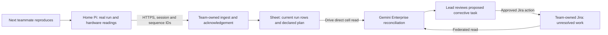

# BenchRelay

A remote student team owns one Pi prototype. BenchRelay tells the next teammate what is actually running, which observations belong to that revision, and what must be resolved before the handoff is ready. **Rank 1, 80/100** in the [internal ranking](00-ranking.md); conditional recommendation, not a validated product.

Contents:

1. [User and evidence](#user-and-evidence)
1. [The useful difference](#the-useful-difference)
1. [Daily workflow](#daily-workflow)
1. [Cloud, device and network](#cloud-device-and-network)
1. [Scope and remote demonstration](#scope-and-remote-demonstration)
1. [Validation and kill criteria](#validation-and-kill-criteria)
1. [Build, impact and risks](#build-impact-and-risks)

## User and evidence

**User/owner:** the integration lead of a 2–5 person student team sharing one real Pi at a member's home. Job: “Before I change or demonstrate it, let me reproduce the last trusted observation and see what my teammate left unresolved.” Choose **Intelligent Automation & Digital Transformation**.

A student asked how members of a programming group could continuously test Git code on one Pi from their separate machines, rather than gathering around it. This is a direct description of the collaboration problem, from outside APU and an older thread; it is not evidence that current tools leave this gap. [Original comment](https://www.reddit.com/r/raspberry_pi/comments/jzubxl/comment/ge6vrc3/), [research and date limits](/docs/research/everyday.md).

No campus access, institutional administrator, lecturer, lab booking or private student record is involved. One team and one device give immediate value; a marketplace or campus sensor population is unnecessary.

## The useful difference

Pi Connect already offers remote access; Arduino Cloud already offers shared telemetry and device workflows; labgrid already manages exclusive resource access. See [incumbent checks](/docs/research/competition.md#incumbents-checked-against-official-documentation) and the [social report](/docs/research/everyday.md). None of those features alone is BenchRelay's invention.

The proposed seam is a **handoff receipt**: device/session ID, actual running revision, declared configuration, observation IDs, unresolved task IDs, acceptance conditions and next person's reproduction result. A receipt becomes outdated when revision or declared configuration changes. It is a team record, not cryptographic proof of physical truth.

Compare against **README + Git/CI status + remote shell + shared checklist**. The candidate earns its complexity only if reconciling changed context and contradictory evidence saves the next teammate work beyond that baseline. Gemini interprets the mismatch and prepares a precise next step; deterministic code verifies IDs, rules and freshness. A health threshold alone needs no LLM.

## Daily workflow

1. A teammate runs one pre-agreed test on the real Pi. The collector records revision, test version, session nonce, actual SoC temperature, throttling state and start/end evidence. Configuration descriptions are human declarations, visibly distinct from sensed facts.
1. The Pi uploads actual observations with sequence numbers and acknowledgements. Changing revision invalidates readiness for the previous receipt; missing telemetry yields **unknown**, never “failed hardware” or a fabricated diagnosis.
1. A low-frequency Enterprise workflow reads the current run range, declared handoff plan and outstanding corrective work. It identifies missing proof or contradictory state and drafts one request with evidence IDs and the relevant acceptance condition.
1. The lead reviews any connector mutation. A team-owned Jira issue is justified when another member must fix or reproduce something; one device/session/reason key prevents duplicate tasks.
1. The next member performs the reproduction remotely. A receipt is accepted only after a matching real result and explicit acceptance. Closing a ticket is not proof of reproduction. A later change reopens readiness review rather than reusing yesterday's success.

Unattended work is evidence reconciliation and draft preparation. Device locks, lease expiry and safety rules cannot wait for a polled workflow or a model. Use a single local coordinator with exclusive sessions; no arbitrary shell commands generated by an agent. MVP tests are a small allowlist maintained by the team.

## Cloud, device and network

| Layer/connector                     | Necessary job                                                             | Failure boundary                                                                                                   |
| ----------------------------------- | ------------------------------------------------------------------------- | ------------------------------------------------------------------------------------------------------------------ |
| Pi 5, 8 GB                          | Real target and built-in hardware telemetry; no external sensors required | SoC temperature is not room temperature; no claim of full physical-state attestation                               |
| HTTPS ingest, Apps Script and Sheet | Record actual test output and acknowledged delivery                       | Server timestamps and per-device sequence expose delay; reject bad signatures/IDs; no secret in public client code |
| Drive/Sheets, first party           | Direct read of current run cells and the team-authored plan               | Workspace/tenant gate; search or indexed knowledge does not certify live state                                     |
| Jira Cloud, third party             | Read blockers and create/update real corrective work after approval       | Team owns site; no APU IT queue; source error stops that decision                                                  |
| Enterprise workflow                 | Explain context-dependent handoff problems and prepare next action        | Asynchronous; no subsecond lock/control promises                                                                   |

The documented capabilities and account limits are in [platform research](/docs/research/gemini-enterprise.md#platform-constraints-and-design-consequences). Direct GitHub workflow integration and custom MCP are outside the critical path. An ingest adapter may record a revision from a real checkout without asserting that the model inspected GitHub.

The network matters because two remote people must agree which run arrived and which state it describes. Buffer only actual unsent readings; on reconnect upload them as **historical backlog**, with capture and receipt timestamps. A latest status cannot use an old successful reading after failure. Keep last-run history inspectable, separated from live state.

## Scope and remote demonstration

**MVP:** one Pi, two teammates, one test family, one plan, one corrective-work loop and one receipt. Exclude fleet management, generic hardware flashing, automatic repairs, an open shell agent, lab booking and camera inspection. Use an actual small team project; if no genuine changing prototype exists, the product hypothesis fails its task gate.

Run everything from home. Demonstrate the existing revision and real observations, an actual approved change to the team's project, an outdated handoff receipt, the specific missing check, approval and a successful reproduction by the second teammate. Disconnect the Pi's upstream connection to show an honest unknown/delivery error; reconnect and identify historical rows correctly. Do not invent a crash, false ticket or fake sensor value to make the story cleaner.

A manual workflow invocation can show the same loop during a short demo, labelled manual. Separately show scheduled/event runs and their actual delays. Keep the live device available for reviewers; a dated video is supporting evidence. The team member who hosts the device can maintain it at home throughout assessment.

## Validation and kill criteria

First observe one real handoff with the baseline. Record context-reconstruction minutes, failed reproduction attempts, correctness of the final state description and whether the next person knows what to do. Then test the candidate on comparable real handoffs, recording the denominator and order effects.

**Planned go thresholds:** at least two actual failures not resolved by CI/README alone; at least three handoffs across two people; median reconstruction time at least 30% lower; no accepted receipt attached to the wrong revision; a teammate voluntarily uses it again. Small trials are directional, not statistically generalizable.

**Kill:** no genuine shared-device job by 6 November; a checklist solves the observed failures equally well; device/account access fails; receipts mislead users about unsensed configuration; or human review takes longer than the saved reconstruction. If rules-only reconciliation matches the agent, simplify rather than claim AI value.

## Build, impact and risks

Estimate **20–28 combined builder-hours**, assuming working licences and an existing project: 6–8 for collector/receipt, 6–8 for connector workflow, 4–6 for real handoffs and error cases, 4–6 for evidence/access/packaging. Account provisioning can exceed this and is gated separately. Use Antigravity for actual feeder/adapter implementation and document its use if built.

| Date        | Student owner      | Conditional impact and measure                                                                    |
| ----------- | ------------------ | ------------------------------------------------------------------------------------------------- |
| 6 Nov 2026  | Integration lead   | First real handoff with a working live read and measured baseline                                 |
| 10 Nov 2026 | Workflow owner     | One complete recurring loop, documented errors and live reviewer access                           |
| 5 Feb 2027  | Student maintainer | Three willing teams; compare setup burden, repeat usage and handoff time against baselines        |
| 5 May 2027  | Student maintainer | Continue only if teams still return and support/licence cost per completed handoff is sustainable |

Risks: outdated nonlocal demand evidence; excellent incumbents; unmeasured switching cost; Pi or home-network downtime; unsupported tenant; review delays; quota and credential expiry; and assessment access. Do not estimate savings across APU or claim reliability before measuring. A hash only links bytes; it cannot prove what was physically connected. The [ranking's submission and finals gates](00-ranking.md#build-and-submission-plan) apply in full.
