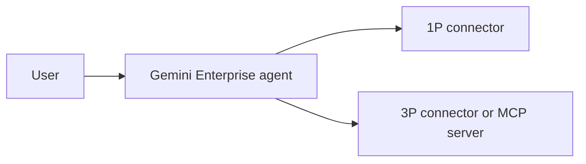

# Judging, evidence, and packaging

How entries in the APU Cloud Innovation Hackathon 2026 are likely to be judged, and how a student team can evidence and package each judging point in the week before the 10 November 2026 deadline. The hackathon has not released its judging criteria, so this file merges a survey of how comparable events score submissions, what the sponsor and organisers care about, and how to package a repo, deck, and demo for asynchronous review and a live final, with a guide to researching the problem, measuring impact and time to impact, and building NTT DATA's five-point README and 3–4 minute video. Both were researched on 3 November 2026; anything about what this hackathon's judges will value, and any conclusion no source states outright, is marked **Inference**.

Contents:

1.  [What NTT DATA and the organisers asked for](#what-ntt-data-and-the-organisers-asked-for)
1.  [Comparable rubrics](#comparable-rubrics)
    1.  [Rubric comparison](#rubric-comparison)
    1.  [Common core](#common-core)
    1.  [How scores are combined](#how-scores-are-combined)
1.  [Sponsor and organiser focus](#sponsor-and-organiser-focus)
    1.  [NTT DATA](#ntt-data)
    1.  [Google Cloud](#google-cloud)
    1.  [APU School of Technology](#apu-school-of-technology)
    1.  [NexConnect '26](#nexconnect-26)
1.  [Problem research in one week](#problem-research-in-one-week)
    1.  [Interviews](#interviews)
    1.  [Observation and contextual inquiry](#observation-and-contextual-inquiry)
    1.  [Short surveys and desk research](#short-surveys-and-desk-research)
    1.  [How many people is enough](#how-many-people-is-enough)
    1.  [Consent and anonymised quotes](#consent-and-anonymised-quotes)
    1.  [A research plan for this week](#a-research-plan-for-this-week)
1.  [Evidencing the research](#evidencing-the-research)
1.  [Measuring impact and outcome](#measuring-impact-and-outcome)
    1.  [Baseline and before-and-after metric](#baseline-and-before-and-after-metric)
    1.  [Measuring an agent's accuracy honestly](#measuring-an-agents-accuracy-honestly)
1.  [Time to impact](#time-to-impact)
    1.  [Mapping 3 and 6 months to delivery phases](#mapping-3-and-6-months-to-delivery-phases)
    1.  [Adoption and cost metrics](#adoption-and-cost-metrics)
    1.  [Owners and what has to be true](#owners-and-what-has-to-be-true)
1.  [Responsible AI, privacy, and impact framing](#responsible-ai-privacy-and-impact-framing)
    1.  [Google's AI Principles and Gemini API terms](#googles-ai-principles-and-gemini-api-terms)
    1.  [Malaysia's PDPA and the 2024 amendment](#malaysias-pdpa-and-the-2024-amendment)
    1.  [SDGs in Solution Challenge judging](#sdgs-in-solution-challenge-judging)
1.  [Packaging for asynchronous assessment](#packaging-for-asynchronous-assessment)
    1.  [Deck that reads without a presenter](#deck-that-reads-without-a-presenter)
    1.  [Keeping the PDF under 10 MB](#keeping-the-pdf-under-10-mb)
    1.  [README for judges](#readme-for-judges)
    1.  [What GitHub renders](#what-github-renders)
1.  [README skeleton](#readme-skeleton)
1.  [Demo video](#demo-video)
    1.  [Video length limits in comparable events](#video-length-limits-in-comparable-events)
    1.  [Video structure and production](#video-structure-and-production)
    1.  [Minute plan](#minute-plan)
    1.  [Recording and captions](#recording-and-captions)
    1.  [Hosting so a reviewer can open it logged out](#hosting-so-a-reviewer-can-open-it-logged-out)
    1.  [Labelling the recording](#labelling-the-recording)
1.  [Live final pitch](#live-final-pitch)
    1.  [Structure and timing](#structure-and-timing)
    1.  [Live demo risk and backups](#live-demo-risk-and-backups)
    1.  [Q&A preparation](#qa-preparation)
1.  [Takeaways for this hackathon](#takeaways-for-this-hackathon)
1.  [Not verified](#not-verified)
1.  [See also](#see-also)

## What NTT DATA and the organisers asked for

The hackathon's website says criteria "will be released soon" and that every prototype is reviewed and scored 11–14 November ([brief](/docs/BRIEF.md)). The organisers' own submission list is a repo link, a PDF deck of at most 10 MB, and a demo link ([brief](/docs/BRIEF.md#submission-requirements)). At the 3 November briefing, the NTT DATA presenters added more ([briefing deliverables], [briefing Q&A]):

- **Judging outline:** an unofficial five-point outline: impact, connectors, research, time to impact, and day-to-day workflows ([brief](/docs/BRIEF.md#judging-and-prizes)).
- **Deliverables:** a five-point README, a diagram in the repo, a 3–4 minute video, and reviewer access to the team's Gemini Enterprise app ([brief](/docs/BRIEF.md#submission-requirements)).
- **Five points**, in the README and the video, in the presenter's own words: "the problem statement, what you are trying to solve it, and then how you solving the problem", "What all are the research you did it?", "how the team work", and "the impact. Impact is like outcome. Outcome in this case, like what will be the success ratio?" [1:46:06–1:46:48].
- **Accuracy framing:** for an admissions document-checking agent, "this agent will give accuracy of eighty percentage. … I will not say like hundred percent accuracy because AI itself have eighty percent" [1:46:48]. **Inference:** read this as an example of the kind of figure wanted, not a target; a measured figure with its sample size is stronger than a quoted one.
- **Time to impact:** "what if we implement now, how it will be impacting, whether it might be three months or six months" [1:48:03]. He tied it to intake cycles: "Three months once, six months once. There might be five hundred to two thousand application" [1:42:37].
- **Day to day:** "how I make that agent work on daily basis" [1:38:48], and an agent that "runs three months or six months without any disruption" [1:42:37].

On 3 November 2026 the user ruled that a video is allowed only if recorded from the live system on real data, labelled as a recording with its capture date, and never offered instead of live access ([context](/docs/CONTEXT.md#decisions-so-far)). **Conflict, now resolved:** the research-and-impact notes said CONTEXT.md and the judging-and-pitching notes still recorded the earlier ban on recorded videos; both already record this ruling.

[briefing deliverables]: /docs/sources/briefing-session/transcript.md#hackathon-tracks-and-deliverables
[briefing Q&A]: /docs/sources/briefing-session/transcript.md#questions-and-answers

## Comparable rubrics

The rubrics below come from events in the same lineage (Google student programmes, GDG on Campus Malaysia, APU) and from the two big hackathon platforms.

### Rubric comparison

| Event                                                                    | Criteria and weights                                                                                                                                                                                                                                                                                                                                                      | Source                          |
| ------------------------------------------------------------------------ | ------------------------------------------------------------------------------------------------------------------------------------------------------------------------------------------------------------------------------------------------------------------------------------------------------------------------------------------------------------------------- | ------------------------------- |
| KitaHack 2023 (GDSC Malaysia), run alongside the 2023 Solution Challenge | Ideathon round: Impact 50, Technology 10 points. Prototype round: Impact 10, Technology 50. Impact: clear problem, chosen SDG and why, three real-user feedback points and the iteration they caused, success metrics, next steps. Technology: architecture and why each Google product, all components built, demo of a working app "not a mockup", scales to more users | [KitaHack 2023]                 |
| Solution Challenge 2026 India (GDG on Campus with Hack2skill), prototype | Technical merit 40% (technical complexity, AI integration, performance and scalability, security and privacy), user experience 10%, alignment with cause 25%, innovation and creativity 25%. Finale: innovation, impact, technical depth, scalability, presentation quality (no weights)                                                                                  | [Solution Challenge 2026 India] |
| KitaHack 2026 (GDG on Campus Malaysia)                                   | Preliminary screening for documentation and format; technical evaluation of depth, code quality, architecture, and use of AI and Google technologies; final round: innovation and impact 20%, presentation 40%, technical 40%                                                                                                                                             | [KitaHack 2026]                 |
| KitaHack 2025                                                            | Not found: the kickoff on 22 February 2025 covered "rules and judging criteria", but the event pages don't list them                                                                                                                                                                                                                                                      | [KitaHack 2025 kickoff]         |
| Devpost, common criteria                                                 | Technological implementation, ease of use, demonstration (video), potential impact, quality of the idea, design; each organiser sets its own criteria and weights                                                                                                                                                                                                         | [Devpost criteria]              |
| Google Cloud AI Accelerate hackathon on Devpost (Nov–Dec 2025)           | Stage one pass/fail on baseline viability (all requirements met, addresses a challenge, uses the required tools). Stage two, equally weighted: technological implementation, design, potential impact, quality of the idea                                                                                                                                                | [AI Accelerate rules]           |
| MLH standard rules                                                       | Technology, design, completion, learning, weighted equally. Explicitly not judged: code quality, pitch quality, idea quality                                                                                                                                                                                                                                              | [MLH rules]                     |
| Gemini API Developer Competition 2024                                    | 13 questions scored 1–5, maximum 65: impact 15 (accessible to everyone, environmental sustainability, improves lives), remarkability 10, creativity 15, usefulness 15 (defined user persona, needs, how well it meets them), execution 10 (software and LLM best practice). Video and code judged; ties rejudged on video impact                                          | [Gemini competition rules]      |
| APU Sustainability Hackathon 2025 and 2026                               | Creativity and originality, technology implementation, significance and practicality, product validation, feasibility, presentation and execution (no weights published)                                                                                                                                                                                                  | [APU 2025], [APU 2026]          |
| GDGoC APU, earlier events                                                | Not found: no published rubric from a previous GDGoC APU event turned up in web or Exa searches                                                                                                                                                                                                                                                                           | —                               |

Notes on the sources:

- Google's own Solution Challenge judging page (`developers.google.com/community/gdsc-solution-challenge/judging`) now redirects to the Google for Developers community home, and the Internet Archive was offline when checked, so the nearest primary source is the KitaHack 2023 page, which pointed teams at "KitaHack and the 2023 Solution Challenge" and asks the Solution Challenge's questions.
- The official Gemini competition rules URL now redirects to Google AI Studio; the rules text is cited from a forum post that reproduces them in full (secondary).

[KitaHack 2023]: https://google-developer-student-club-malaysia.github.io/kitahack2023/
[Solution Challenge 2026 India]: https://hack2skill.com/event/solution-challenge-2026
[KitaHack 2026]: https://kitahack2026.my/
[KitaHack 2025 kickoff]: https://gdg.community.dev/events/details/google-gdg-on-campus-universiti-malaya-kuala-lumpur-malaysia-presents-kitahack-2025-kickoff-session-1/
[Devpost criteria]: https://info.devpost.com/blog/understanding-hackathon-submission-and-judging-criteria
[AI Accelerate rules]: https://ai-partner-catalyst.devpost.com/rules
[MLH rules]: https://github.com/MLH/mlh-policies/blob/main/standard-hackathon-rules.md
[Gemini competition rules]: https://discuss.ai.google.dev/t/do-we-need-to-submit-the-full-code-how-will-judges-verify-partial-code/33566
[APU 2025]: https://www.apu.edu.my/news/shaping-sustainable-future
[APU 2026]: https://www.apu.edu.my/news/apu-sustainability-hackathon-2026-empowers-students-innovate-greener-future

### Common core

Every rubric above scores technical implementation, all but MLH's score problem and impact, and most score all five:

1.  **Problem and impact:** a specific problem, who has it, and evidence the solution helps. Google-lineage rubrics ask for success metrics and real-user feedback ([KitaHack 2023]); APU's own hackathons score "product validation" ([APU 2026]).
1.  **Technical implementation:** depth, architecture, and use of the named tools, with Google rubrics asking which Google product was chosen and why ([KitaHack 2023], [Solution Challenge 2026 India]).
1.  **A working product:** "an actual working application (not a mockup)" ([KitaHack 2023]); MLH's "Does the hack work?" ([MLH rules]).
1.  **Design and user experience** ([Devpost criteria], [MLH rules], [Solution Challenge 2026 India]).
1.  **Originality** ([Devpost criteria], [Gemini competition rules], [APU 2025]).

Feasibility and scalability recur in Google and APU rubrics. Presentation is usually unscored in the written round but heavy in finals: 40% in the KitaHack 2026 final ([KitaHack 2026]). Two rubrics also test whether AI is justified: "could a simpler approach have worked?" ([Solution Challenge 2026 India]) and whether the LLM component follows ML/LLM best practice ([Gemini competition rules]).

### How scores are combined

- On Devpost, each judge rates every criterion 1–5 stars, and there is "no other mechanism for judges to provide feedback" ([Devpost judging]).
- KitaHack 2023 averaged several judges' scores after dropping the highest and lowest ([KitaHack 2023]).
- Comparable events gate on completeness first: the Google Cloud Devpost hackathon's pass/fail stage one ([AI Accelerate rules]) and KitaHack 2026's preliminary screening for "proper documentation and submission format" ([KitaHack 2026]).

[Devpost judging]: https://help.devpost.com/article/103-how-to-judge-an-online-hackathon

## Sponsor and organiser focus

This hackathon is organised by APU School of Technology with GDGoC APU, sponsored by NTT DATA, and lists Google Cloud and NexConnect 2026 as partners ([brief](/docs/BRIEF.md)). No judges had been named by 3 November.

### NTT DATA

- **Gemini Enterprise with Google Cloud (8 June 2026):** NTT DATA expanded its Google Cloud collaboration "to help enterprises move from AI experimentation to scaled deployment of agentic AI solutions built with Gemini Enterprise", set up a Gemini Enterprise practice targeting 5,000 certified experts, and plans to co-innovate up to 500 AI agents. The release stresses "governance, security, compliance and responsible use of AI" ([NTT DATA Gemini release]).
- **Private 5G and edge AI (26 February 2026):** a multi-year Ericsson partnership on private 5G, edge AI, and physical AI, with NTT DATA Edge AI agents running on Ericsson edge platforms, for sectors including energy, transportation, and smart cities ([NTT DATA Ericsson release]).
- **Malaysia (20 October 2026):** an NTT DATA Malaysia blog on the national grid says the company applies "AI, IoT and advanced analytics" to predictive maintenance, uses edge computing to "identify anomalies and trigger workflows without sending raw data elsewhere", and concludes: "The point isn't to put AI, private 5G or IoT everywhere but to identify operational problems where faster, richer information changes the outcome, then build the architecture around those problems" ([NTT DATA Malaysia energy blog]).
- **Malaysia site (3 November 2026):** the home page leads with the "Intelligence to Impact" positioning and generative and agentic AI reports ([NTT DATA Malaysia]).
- **At this hackathon:** the briefing included Gemini Enterprise training with NTT DATA, whose presenters called Gemini Enterprise mandatory ([brief](/docs/BRIEF.md#tools)).

Inference: NTT DATA judges are likely to reward a concrete operational problem with a measurable outcome, AI that runs as an agent or workflow rather than a chat box, and visible attention to governance and security.

[NTT DATA Gemini release]: https://www.nttdata.com/en-us/news/2026/ntt-data-expands-collaboration-with-google-cloud
[NTT DATA Ericsson release]: https://www.nttdata.com/en-us/news/2026/ntt-data-and-ericsson-team-up-to-scale-private-5g-and-physical-ai
[NTT DATA Malaysia energy blog]: https://www.nttdata.com/en-my/insights/blog/more-power-more-renewables-more-complexity-malaysias-next-energy-challenge
[NTT DATA Malaysia]: https://www.nttdata.com/en-my

### Google Cloud

- Google Cloud's student page centres on skills and credentials: 200 free Google Skills credits that expire after a year, skill badges, Cloud Certificates, and student communities ([Google Cloud for students]).
- The GDG on Campus Solution Challenge 2026 India asks students to "design, prototype, and launch ideas that create measurable impact for communities", and its technical criterion includes security and privacy ("Is user data handled securely, with consideration for privacy and ethical issues?") ([Solution Challenge 2026 India]).

Inference: a Google Cloud judge will look for a clear reason each Google product is there, and for AI that earns its place.

[Google Cloud for students]: https://cloud.google.com/edu/students

### APU School of Technology

- At the launch of APU's Google for Education Centre of Excellence on 13 February 2026, a senior lecturer for Cloud, Networking & IoT in the School of Technology said APU has "Google as our primary cloud partner" and that its Edge Computing module runs "from Google Coral Edge TPU devices to Vertex AI modelling and analytics dashboards" ([APU GCoE]).
- At the same launch, Cloud Engineering students showed "an AI-powered IoT and Edge computing system" that processes real-time sensor and camera data to optimise energy use, an architecture the article says ensures "scalability, operational efficiency and privacy-conscious automation"; the GDGoC APU president demoed a cloud-hosted app ([APU GCoE]).

Inference: School of Technology judges will know sensor-to-edge-to-Vertex pipelines well, so they will probably notice a weak or faked IoT layer quickly, and value privacy-conscious edge processing.

[APU GCoE]: https://www.apu.edu.my/news/apu-ignites-malaysias-ai-future-launch-google-education-centre-excellence-and-strategic

### NexConnect '26

The final pitching for the top five is at the APU Auditorium during NexConnect '26, and the site lists "NexConnect 2026" as a partner ([brief](/docs/BRIEF.md)). Not found: what NexConnect '26 is. Web and Exa searches for "NexConnect 2026 APU" and "NexConnect '26 Asia Pacific University School of Technology" turned up only unrelated organisations with similar names.

## Problem research in one week

### Interviews

- **The Mom Test** (Rob Fitzpatrick, [The Mom Test]) gives three rules, quoted from the book: "Talk about their life instead of your idea", "Ask about specifics in the past instead of generics or opinions about the future", and "Talk less and listen more" ([Mom Test quote]). **Inference:** in practice, ask "The last time you checked an application, what did you do?" rather than "Would you use an agent that checks applications?"
- **IDEO.org's Interview method:** interview in the person's own space where possible, bring no more than three team members, give each a role (interviewer, note-taker, photographer), start broad and narrow down, allow 60–90 minutes, and write down exactly what the person says rather than your interpretation ([IDEO interview]). **Inference:** in one week, 30-minute interviews with one interviewer and one note-taker are a workable cut, and verbatim notes are what make quotes usable in the README.

[The Mom Test]: https://www.momtestbook.com/
[Mom Test quote]: https://www.goodreads.com/book/show/52283963-the-mom-test
[IDEO interview]: https://www.designkit.org/methods/interview.html

### Observation and contextual inquiry

- NN/g defines contextual inquiry as "a type of ethnographic field study that involves in-depth observation and interviews" of a small group of users, with the researcher as apprentice to the user as master. Its four principles are context (observe in the natural environment), partnership, interpretation (check your understanding with the user), and focus (know the purpose of the research). Sessions range "from an hour or two to several days" ([NN/g contextual inquiry]).
- **Inference:** watching a staff member or student do the task once, with a stopwatch, gives both the qualitative story and the baseline time per task (see [Baseline and before-and-after metric](#baseline-and-before-and-after-metric)). Observation beats asking people to estimate their own time.

[NN/g contextual inquiry]: https://www.nngroup.com/articles/contextual-inquiry/

### Short surveys and desk research

- NN/g: "The most important thing to remember about surveys is to keep them short"; focus on closed-ended questions; don't ask respondents to predict behaviour; always pilot with the target audience; and if a questionnaire leans on open-ended questions, "it might be a red flag" that interviews would serve better ([NN/g survey practices]).
- GOV.UK: surveys, A/B tests, and benchmarking need "hundreds of participants to produce clear findings" ([GOV.UK plan research]).

**Inference:** a survey posted to classmates this week will get tens, not hundreds, of answers. Use it to count how often a problem happens to the people who answered, and report it as "n of N respondents", never as a percentage of APU students.

For desk research, GOV.UK discovery asks teams to understand users and their needs, the constraints (legislation, contracts, legacy technology, existing processes), "how much the problem is currently costing", and how they will measure success ([GOV.UK discovery]). Real public sources by track are in [public data sources](/docs/research/data-sources.md), and APU's own public documents in [APU's public documents, data, and systems](/docs/research/apu.md); the project's rule is real public data only, with no mock or sample data ([project conventions](/docs/references/project-conventions.md)).

[NN/g survey practices]: https://www.nngroup.com/articles/survey-best-practices/

### How many people is enough

- NN/g's interview guidance: there is no fixed number; "for many exploratory-research studies, 5 participants are too few"; start with a small representative sample "(say 5-6), and analyze your interviews as you go", and stop "once you're no longer learning anything new". Griffin and Hauser estimated that 20–30 interviews uncover 90–95% of customer needs ([NN/g interview sample size]). NN/g's "5 users" rule is for qualitative usability testing; for statistics, test at least 20 ([NN/g how many test users]).
- GOV.UK: interviews and usability tests usually need "between 4 and 8 participants for each round", with at least one round every 2 weeks ([GOV.UK plan research]).

**Inference:** 6–8 interviews of one narrow user group in two rounds, plus one or two observed sessions, is defensible for one week. Say in the README whether the last two interviews added new themes; don't claim saturation if they did.

[NN/g interview sample size]: https://www.nngroup.com/articles/interview-sample-size/
[NN/g how many test users]: https://www.nngroup.com/articles/how-many-test-users/

### Consent and anonymised quotes

- GOV.UK consent: tell participants who is doing the research, why, what data you collect, whether and how the session is recorded, who is watching, how results are used and shared, and how long data is kept; participation "is voluntary and they can stop or withdraw their consent at any time"; for children, also get consent from "a parent, guardian, carer or other responsible adult" ([GOV.UK consent]).
- GOV.UK research data: "collect only the data that you need"; "fully anonymise the extracts you use so that the participants cannot be identified"; always remove direct identifiers such as names; don't make non-anonymised outputs public ([GOV.UK research data]).
- PDPA principles and the 2024 amendment are under [Malaysia's PDPA and the 2024 amendment](#malaysias-pdpa-and-the-2024-amendment), and the Gemini free-tier warning against submitting personal information is under [Google's AI Principles and Gemini API terms](#googles-ai-principles-and-gemini-api-terms).

**Inference:** label quotes by role and number ("P3, Year 2 student"), keep the consent record and raw notes out of the repo, check the age of any participant who may be under 18, and don't paste raw transcripts into a free-tier AI tool to summarise them.

[GOV.UK consent]: https://www.gov.uk/service-manual/user-research/getting-users-consent-for-research
[GOV.UK research data]: https://www.gov.uk/service-manual/user-research/managing-user-research-data-participant-privacy

### A research plan for this week

**Inference**, fitted to the dates in the [brief](/docs/BRIEF.md#key-dates):

1.  **Tue 3 – Wed 4 Nov:** desk research; write three learning goals and a one-page Mom Test interview guide; recruit 6–8 people from one user group.
1.  **Wed 4 – Thu 5 Nov:** round one, 3–4 interviews and one observed, timed task; synthesise the same evening.
1.  **Fri 6 Nov:** round two, 3–4 interviews; optional five-question survey; freeze the problem statement and baseline.
1.  **Sat 7 – Mon 9 Nov:** build; assemble a real evaluation set and score the agent on it.
1.  **Tue 10 Nov:** README, deck, video; final submission by 11:59 PM MYT.

## Evidencing the research

Comparable rubrics ask for real-user feedback and the iteration it caused ([KitaHack 2023]; see [Rubric comparison](#rubric-comparison)), and the briefing asked how the team came up with the problem statement and why it chose it [1:46:06].

**Inference**, what the README's research section should show:

- **Method:** interviews, observation, survey, desk research, with dates.
- **Who:** roles, not names ("4 Year 2 computing students, 2 admissions staff"), and how they were recruited.
- **How many:** participants per method, and survey responses as "n of N".
- **Key quotes:** three to five verbatim, anonymised quotes that show the problem in the user's words.
- **Counts:** how many participants reported each finding ("5 of 7 re-check the same fields by hand").
- **What changed:** a short finding-to-decision list, such as "staff wanted to keep the final say, so the agent drafts the email instead of sending it".
- **Limits:** who you could not reach, and anything still assumed.

## Measuring impact and outcome

### Baseline and before-and-after metric

- GOV.UK: "Establish a 'baseline' of how your service performs currently, across all channels" and "Judge changes to the service's performance against this"; "Work out your measurements as you build the service, not afterwards" ([GOV.UK performance metrics]).
- GOV.UK's completion-rate guide says to check during discovery whether legacy or offline data can give completion rates "to use as a baseline" ([GOV.UK completion rate]).

**Inference**, a one-week recipe:

1.  Pick one metric the users care about: minutes per task, error or rework rate, or backlog size.
1.  Measure the "before" by observing and timing real instances of the task (see [Observation and contextual inquiry](#observation-and-contextual-inquiry)), not by asking for estimates.
1.  Measure the "after" on the same task with the prototype, including the time a person spends reviewing the agent's output.
1.  Project only with real inputs, and show the formula: time saved per item × items per period, using a published or stated volume such as the presenter's "five hundred to two thousand" applications per intake [1:42:37]. Label it a projection.

[GOV.UK performance metrics]: https://www.gov.uk/service-manual/measuring-success/how-to-set-performance-metrics-for-your-service

### Measuring an agent's accuracy honestly

- NIST: accuracy measures should consider "false positive and false negative rates" and "should always be paired with clearly defined and realistic test sets – that are representative of conditions of expected use – and details about test methodology" ([NIST AI RMF], section 3.1). MEASURE 2.1 asks that "Test sets, metrics, and details about the tools used" be documented, and MEASURE 2.3 that performance be "demonstrated for conditions similar to deployment setting(s)".
- Google's ML Crash Course: precision = TP / (TP + FP), recall = TP / (TP + FN); prefer recall "when false negatives are more expensive than false positives"; accuracy misleads on imbalanced data, where always predicting the majority class can score 99% ([Google precision and recall]).
- Google Cloud's gen AI evaluation service uses rubric-based (LLM-judged) or computation-based metrics, the latter "when a ground truth is available", and asks for prompts that "represent the types of inputs that your models process in production" ([Google eval overview], [Google eval dataset]). Agent evaluation scores both the final response and the trajectory, the sequence of tool calls, with metrics such as `trajectory_precision` and `trajectory_recall` ([Google agent eval]).
- A Google Cloud blog on agent evaluation says a golden dataset "shouldn't be a blocker": start with human evaluation, build the golden set from anonymised real interactions, and "align the LLM judge to the human evaluation" before trusting it ([Google agent eval blog]).

**Inference**, a small honest evaluation for a document-checking agent:

1.  Define the positive class ("document has a missing or wrong field") and decide which error costs more; for screening, a missed problem is usually worse, so lead with recall.
1.  Collect 30–50 real items. The rule is real public data; if the task needs private documents such as student applications, ask the user before using any, and never use made-up ones.
1.  Two team members label each item independently before running the agent; settle disagreements and record how many there were.
1.  Run the agent once over the whole set with fixed prompts and settings, and log every output.
1.  Report the confusion matrix, precision, recall, n, and the failure cases, and keep the set and the labelling notes in the repo if they contain no personal data.

For the figure itself, the NIST/SEMATECH handbook gives the Wilson interval for a proportion and warns that normal-approximation limits "may not be accurate enough" for small samples ([NIST proportion interval]). Worked from its formula, 40 correct out of 50 is 80% with a 95% interval of about 67–89%, and 16 out of 20 is 80% with about 58–92%. **Inference:** write `recall R and precision P on N real documents labelled by two reviewers (95% interval A–B), tested DATE`, not "80% accurate"; a small number with its n holds up in Q&A, and YC calls exaggeration a fatal error ([Q&A preparation](#qa-preparation)).

[Google precision and recall]: https://developers.google.com/machine-learning/crash-course/classification/accuracy-precision-recall
[Google eval overview]: https://docs.cloud.google.com/vertex-ai/generative-ai/docs/models/evaluation-overview
[Google eval dataset]: https://docs.cloud.google.com/vertex-ai/generative-ai/docs/models/evaluation-dataset
[Google agent eval]: https://docs.cloud.google.com/vertex-ai/generative-ai/docs/models/evaluation-agents
[Google agent eval blog]: https://cloud.google.com/blog/topics/developers-practitioners/a-methodical-approach-to-agent-evaluation
[NIST proportion interval]: https://www.itl.nist.gov/div898/handbook/prc/section2/prc241.htm

## Time to impact

### Mapping 3 and 6 months to delivery phases

- GOV.UK phases: discovery checks whether a problem is worth solving and typically takes "around 4 to 8 weeks" ([GOV.UK discovery]); alpha tries out solutions and "Alphas tend to last between 6 and 8 weeks" ([GOV.UK alpha]); beta builds the best idea "for real", starting in private beta "by inviting a limited number of people", then public beta and live ([GOV.UK beta]).

**Inference:** GOV.UK's typical lengths add up to 10–16 weeks before beta, so a 3-month claim only holds if the hackathon week counts as most of discovery and the prototype as an early alpha. A credible plan in those terms:

- **By 3 months:** finish discovery with the owning office, run alpha on its real workload, and start a private beta with one team or one cohort, with the baseline already measured.
- **By 6 months:** run the private beta through one full cycle, such as one intake given the presenter's "three months once, six months once" [1:42:37], measure the KPIs below against the baseline, and decide on wider rollout.
- State impact by date: what a user notices at 3 months, and the measured change at 6 months.

[GOV.UK alpha]: https://www.gov.uk/service-manual/agile-delivery/how-the-alpha-phase-works
[GOV.UK beta]: https://www.gov.uk/service-manual/agile-delivery/how-the-beta-phase-works

### Adoption and cost metrics

- GOV.UK's four mandatory KPIs are cost per transaction, user satisfaction, completion rate, and digital take-up ([GOV.UK KPIs]). Cost per transaction is total cost, including staff, divided by completed transactions ([GOV.UK cost per transaction]); completion rate is completed transactions over all started, excluding test users ([GOV.UK completion rate]).
- NIST asks for "Feedback processes for end users and impacted communities to report problems and appeal system outcomes" (MEASURE 3.3) and for in-deployment results to be informed by domain experts (MEASURE 4.2) ([NIST AI RMF]).

**Inference**, the same four adapted to a campus agent: staff minutes per item handled; share of items that go through the agent; share it completes without a person redoing it; and user satisfaction from a one-question survey. Add re-measured precision and recall on a sample of live items each month.

[GOV.UK KPIs]: https://www.gov.uk/service-manual/measuring-success/data-you-must-publish
[GOV.UK cost per transaction]: https://www.gov.uk/service-manual/measuring-success/measuring-cost-per-transaction

### Owners and what has to be true

**Inference**, since APU's structure is out of scope here: name three owners in the README, by role and as the research found them: the office that runs the process today (business owner), the team that would run the connectors and accounts (IT), and whoever answers for personal data (the 2024 PDPA amendment requires data protection officers; see [Malaysia's PDPA and the 2024 amendment](#malaysias-pdpa-and-the-2024-amendment)). Ask the interviewees who would have to say yes. Then list the assumptions the 3- and 6-month claims rest on:

- The owning office agrees to a pilot and gives reviewer time.
- The connector can read the system of record, with access approved.
- A PDPA notice and retention rule are in place before real personal data flows.
- Licences continue after the hackathon's sponsored trial (see [Gemini Enterprise](/docs/research/gemini-enterprise.md)).
- The team and the owner agree a minimum precision and recall before go-live, matching NIST MAP 1.5's "risk tolerances are determined and documented" ([NIST AI RMF]).

## Responsible AI, privacy, and impact framing

### Google's AI Principles and Gemini API terms

- Google's AI Principles have three parts: bold innovation, responsible development and deployment, and collaborative progress. The second includes "appropriate human oversight", "rigorous design, testing, monitoring, and safeguards to mitigate unintended or harmful outcomes and avoid unfair bias", and "Promoting privacy and security" ([Google AI Principles]).
- Google's Gemini API safety guidance has four steps: understand the app's safety risks, adjust to mitigate them, test for safety, and gather user feedback and monitor use. Mitigations it lists include restricted input methods such as drop-down prompts, blocking unsafe inputs and filtering outputs, per-user rate limits, guarding against prompt injection, and choosing narrower, lower-risk tasks with human review ([Gemini safety guidance]).
- The Gemini API terms (effective 23 March 2026) say users must be 18 or older and must not use the API in an app "directed towards or is likely to be accessed by individuals under the age of 18". On unpaid services such as Google AI Studio and the free quota, Google uses submitted content to improve its products, human reviewers may read it, and the terms say: "Do not submit sensitive, confidential, or personal information to the Unpaid Services." Paid-tier prompts are not used to improve products ([Gemini API terms]).

[Google AI Principles]: https://ai.google/principles/
[Gemini safety guidance]: https://ai.google.dev/gemini-api/docs/safety-guidance
[Gemini API terms]: https://ai.google.dev/gemini-api/terms

### Malaysia's PDPA and the 2024 amendment

- **Scope:** the Personal Data Protection Act 2010 (Act 709) applies to processing personal data "in respect of commercial transactions" ([Act 709]).
- **The seven principles:** General (consent), Notice and Choice, Disclosure, Security, Retention (keep data no longer than necessary, then delete it), Data Integrity, and Access ([Act 709]).
- **The 2024 amendment (Act A1727):** received Royal Assent on 9 October 2024 and was published in the Gazette on 17 October 2024 ([Act A1727]). It:
  1.  Renames "data user" to "data controller".
  1.  Adds biometric data, defined as "any personal data resulting from technical processing" of physical, physiological, or behavioural traits, to sensitive personal data.
  1.  Makes data processors comply with the Security Principle.
  1.  Raises the penalty for breaching the principles from RM300,000 or two years to RM1 million or three years.
  1.  Requires data protection officers.
  1.  Requires breach notification: to the Commissioner "as soon as practicable", and to data subjects "without unnecessary delay" where there is significant harm.
  1.  Adds a right to data portability.
  1.  Removes the ministerial whitelist for cross-border transfers.
- **Commencement and guidelines (secondary):** DLA Piper reports that the breach notification and DPO requirements took effect on 1 June 2025. The Commissioner's guidelines set 72 hours to notify the Commissioner and seven days after that to notify data subjects, and require a DPO above thresholds such as personal data of more than 20,000 data subjects ([DLA Piper]).

Inference: a one-week prototype is unlikely to be a commercial transaction itself, but a campus product run by APU would process student data, so judges may ask how it would comply. Collecting as little personal data as possible, avoiding face or other biometric data, and showing a consent notice and retention rule are cheap answers.

[Act 709]: https://www.pdp.gov.my/wp-content/uploads/2026/10/Akta-709-cetakan-semula-2026-BI.pdf
[Act A1727]: https://www.pdp.gov.my/wp-content/uploads/2024/11/Act-A1727.pdf
[DLA Piper]: https://privacymatters.dlapiper.com/2025/03/malaysia-guidelines-issued-on-data-breach-notification-and-data-protection-officer-appointment/

### SDGs in Solution Challenge judging

- The 2023 Solution Challenge asked teams which UN goals "AND target(s)" they chose and what inspired them, and scored whether teams "explain clearly which (Selected SDG) they chose for their solution and why" ([KitaHack 2023]).
- KitaHack 2026's "Innovation & Impact" criterion (20%) scores "potential impact on addressing SDG-related challenges" ([KitaHack 2026]); the Solution Challenge 2026 India gives "Alignment With Cause" 25% ([Solution Challenge 2026 India]).
- APU's 2026 Sustainability Hackathon listed each winner's SDG focus, such as SDG 13 for a smart energy tracker ([APU 2026]).
- UN targets close to this hackathon's tracks: 4.3, "ensure equal access for all women and men to affordable and quality technical, vocational and tertiary education, including university" ([SDG 4]); 7.3, "double the global rate of improvement in energy efficiency" ([SDG 7]); 11.6, reduce cities' environmental impact, "paying special attention to air quality and municipal and other waste management" ([SDG 11]).

This hackathon's brief does not mention the SDGs ([brief](/docs/BRIEF.md)).

[SDG 4]: https://sdgs.un.org/goals/goal4
[SDG 7]: https://sdgs.un.org/goals/goal7
[SDG 11]: https://sdgs.un.org/goals/goal11

## Packaging for asynchronous assessment

Reviewers get a project title, track, summary, HTTPS repo link, a PDF deck of up to 10 MB, and an optional demo link; final submission locks the project and the PDF ([brief](/docs/BRIEF.md)). NTT DATA's extra asks (the five-point README, a diagram, the video, and reviewer access) are under [What NTT DATA and the organisers asked for](#what-ntt-data-and-the-organisers-asked-for); the README template is under [README skeleton](#readme-skeleton) and the video under [Demo video](#demo-video).

### Deck that reads without a presenter

- Guy Kawasaki's 10/20/30 rule: ten slides, twenty minutes, no font smaller than thirty points ([Kawasaki 10/20/30]).
- Y Combinator's demo day guide orders a pitch as introduction, problem, product and customer, opportunity, traction, team, conclusion, and advises one main point per slide, large fonts, and important text at the top ([YC demo day guide]). Kevin Hale's YC deck guide asks for slides that are legible, simple, and obvious: "Show it to a stranger and ask them to tell you what it means" ([YC deck design]).
- The Solution Challenge 2026 India asks for a deck "detailing your solution and impact", and a final deck covering "goals, features, technical implementation, and real-world impact" ([Solution Challenge 2026 India]).

Inference: that advice is written for decks shown on stage. A deck read alone on a laptop can carry a full sentence per slide as the headline, but should keep one idea per slide, name the scoring criterion it answers, and link the repo and the live app on the first and last slides, printing the live app and video URLs as visible text because GitHub ignores links inside PDFs ([What GitHub renders](#what-github-renders)).

[Kawasaki 10/20/30]: https://guykawasaki.com/the_102030_rule/
[YC demo day guide]: https://www.ycombinator.com/blog/guide-to-demo-day-pitches
[YC deck design]: https://www.ycombinator.com/library/4T-how-to-design-a-better-pitch-deck

### Keeping the PDF under 10 MB

- In PowerPoint, **Compress Pictures** reduces image size and dimensions; Microsoft 365's default picture resolution is 220 ppi ([Microsoft compress pictures]).
- Ghostscript's `-dPDFSETTINGS` presets resample an existing PDF: `/screen` is low resolution, `/ebook` medium; the docs warn that presets alter the output and can lower quality ([Ghostscript PDF settings]).

  ```bash
  gs -sDEVICE=pdfwrite -dPDFSETTINGS=/ebook -dNOPAUSE -dBATCH -sOutputFile=deck-small.pdf deck.pdf
  ```

Inference: link the live app instead of embedding media, and check the compressed PDF's screenshots are still readable before the final submission locks it.

[Microsoft compress pictures]: https://support.microsoft.com/en-us/office/reduce-the-file-size-of-your-images-in-microsoft-office-8db7211c-d958-457c-babd-194109eb9535
[Ghostscript PDF settings]: https://ghostscript.readthedocs.io/en/latest/VectorDevices.html

### README for judges

- GitHub says a README should cover what the project does, why it is useful, how to get started, where to get help, and who maintains it, and that README content beyond 500 KiB is truncated ([GitHub READMEs]).
- Google Cloud's Devpost rules require a repo containing "all necessary source code, assets, and instructions required for the project to be functional", a hosted URL "for judging and testing", and a description of features, technologies, "any other data sources used", and learnings ([AI Accelerate rules]).
- MLH recommends that teams credit AI tools in "a detailed readme" to make clear "what they made vs what they are using", and that projects not be a reskin of an existing AI tool; its sample rules say to list frameworks and remove API keys before sharing ([MLH organiser rules]). MLH's standard rules require teams to be "honest and transparent about the AI code tools they used" ([MLH rules]).
- The Solution Challenge 2023 questions map well to README sections: architecture and component responsibilities, which products and why, one hard technical challenge and how it was solved, and real-user feedback ([KitaHack 2023]).

Inference, a README order that answers those questions: one-line problem and track; demo link and screenshots; architecture diagram (device, network, cloud, AI); a table of what is real versus stubbed or simulated; run instructions; data sources; AI and tool use; team. The [README skeleton](#readme-skeleton) fits these into NTT DATA's five points.

[GitHub READMEs]: https://docs.github.com/en/repositories/managing-your-repositorys-settings-and-features/customizing-your-repository/about-readmes
[MLH organiser rules]: https://guide.mlh.com/general-information/judging-and-submissions/rules-for-your-hackathon

### What GitHub renders

- **Mermaid:** a fenced block with the `mermaid` language identifier renders as a diagram in Markdown files, issues, pull requests, discussions, and wikis ([GitHub diagrams]). `.mmd` and `.mermaid` files also render ([GitHub non-code files]).
- **PDFs:** GitHub renders PDFs in the repo, but "links within PDFs are ignored" ([GitHub non-code files]); see the deck inference under [Deck that reads without a presenter](#deck-that-reads-without-a-presenter).
- **Links:** GitHub recommends relative links to files in the repo; "Links starting with `/` will be relative to the repository root"; heading anchors replace spaces with hyphens and drop other punctuation ([GitHub formatting]).
- **Images:** use relative paths and alt text; the `<picture>` element is supported ([GitHub formatting]). The docs don't cover resizing, so export diagrams and screenshots at the size you want shown.
- **Size limits:** files over 25 MiB can't be added in the browser, Git warns above 50 MiB, and GitHub blocks files over 100 MiB ([GitHub large files]). README truncation at 500 KiB is under [README for judges](#readme-for-judges).

[GitHub diagrams]: https://docs.github.com/en/get-started/writing-on-github/working-with-advanced-formatting/creating-diagrams
[GitHub non-code files]: https://docs.github.com/en/repositories/working-with-files/using-files/working-with-non-code-files
[GitHub formatting]: https://docs.github.com/en/get-started/writing-on-github/getting-started-with-writing-and-formatting-on-github/basic-writing-and-formatting-syntax
[GitHub large files]: https://docs.github.com/en/repositories/working-with-files/managing-large-files/about-large-files-on-github

## README skeleton

**Inference:** the five H2 headings in the template below use the briefing's wording and order so a reviewer can tick them off; the extra sections answer the other judging points (connectors, day-to-day running, time to impact). The general README order is under [README for judges](#readme-for-judges).

````markdown
# <Project name>

<One sentence: who it helps, what it does.> Track: <track>.

- Live system: <URL, or "reviewers are invited to our Gemini Enterprise app">
- Video, a recording of the live system captured <date>: <URL>
- Slides: [deck.pdf](docs/deck.pdf); diagram: [How we solve it](#how-we-solve-it)

## The existing problem

<Who has it, how often, and what it costs today: the baseline and its source.>

## How we solve it



### Connectors

### How it runs day to day

<Trigger, schedule, who reviews the output; then a real-versus-simulated table.>

## The research we did

<Method, who, how many, dates; key quotes; counts; what changed because of it; limits.>

## How the team worked

<Roles, who did what, how you decided, tools and AI tools used.>

## Impact and outcome

<Baseline and measured result; precision and recall with n on a real evaluation set.>

### Time to impact: 3 and 6 months

<Pilot plan by date, owners, adoption and cost metrics, what has to be true.>

## Data and privacy

## How to review or run it
````

## Demo video

NTT DATA asked for a 3–4 minute video of the same five points as the README; the user's ruling on recordings is under [What NTT DATA and the organisers asked for](#what-ntt-data-and-the-organisers-asked-for).

### Video length limits in comparable events

- MLH digital events: 2 minutes or less ([MLH rules]).
- Devpost: "most are under three minutes long" ([Devpost video tips]).
- Gemini API Developer Competition: 30 seconds to 3 minutes; only the first 3 minutes judged ([Gemini competition rules]).
- Google Cloud Devpost hackathon: at most 3 minutes, only the first 3 evaluated, must show the project working ([AI Accelerate rules]).
- Solution Challenge 2026 India final: up to 3 minutes ([Solution Challenge 2026 India]).

### Video structure and production

Structure and production advice from Devpost:

- Say what the app does, and how it fits the hackathon, in the first few seconds; prefer a narrated screencast to a marketing video; edit out mistakes; write and rehearse a script ([Devpost video help]).
- The demo video is "one of the first things that judges will look at"; judges review projects back to back, so open with an overview; split the time into intro, idea, components, demo, close; show the product running on real input ([Devpost video tips]).

[Devpost video tips]: https://info.devpost.com/blog/6-tips-for-making-a-hackathon-demo-video
[Devpost video help]: https://help.devpost.com/article/84-video-making-best-practices

### Minute plan

**Inference**, for a 3:45 cut over the five points, keeping the demo and the impact inside the first three minutes because some comparable events judge only the first 3 minutes ([Video length limits in comparable events](#video-length-limits-in-comparable-events)):

| Time      | Point                | What to show                                                                 |
| --------- | -------------------- | ---------------------------------------------------------------------------- |
| 0:00–0:15 | Label and one-liner  | Recording slate with capture date; one sentence on what it does and for whom |
| 0:15–0:40 | The existing problem | The baseline number and one participant quote                                |
| 0:40–2:10 | How we solve it      | One real task end to end in the live system; the connectors; the daily run   |
| 2:10–2:40 | Impact and outcome   | Before and after; precision and recall with n; 3- and 6-month plan           |
| 2:40–3:10 | The research we did  | Methods, numbers, and what changed because of them                           |
| 3:10–3:35 | How the team worked  | Who did what, how you worked                                                 |
| 3:35–3:45 | Close                | Live link, repo link, capture date again                                     |

Write the script per the Devpost advice above and time a read-through against this plan.

### Recording and captions

- **macOS:** Shift-Command-5 opens the Screenshot toolbar with Record Entire Screen and Record Selected Portion; choose a microphone under Options ([Apple screen recording]).
- **Windows 11:** Snipping Tool records with Windows logo key + Shift + R and saves an MP4 to the `Screen Recordings` folder under Videos; **Edit in Clipchamp** adds captions or audio ([Microsoft Snipping Tool]).
- **OBS Studio:** "Free and open source software for video recording and live streaming", for Windows 10 and 11, macOS 13 or newer, and Linux; version 33.0.1 was current on 3 November 2026 ([OBS Studio]).
- **YouTube captions:** automatic captions are published when available, but "the quality of the captions may vary" with accents and background noise; review and edit them in YouTube Studio under **Subtitles** ([YouTube automatic captions]).

**Inference:** record at the screen's native resolution with large browser zoom, close notifications, and blur or crop anything personal before export.

[Apple screen recording]: https://support.apple.com/en-us/102618
[Microsoft Snipping Tool]: https://support.microsoft.com/en-us/windows/apps/use-snipping-tool-to-capture-screenshots
[OBS Studio]: https://obsproject.com/
[YouTube automatic captions]: https://support.google.com/youtube/answer/6373554?hl=en

### Hosting so a reviewer can open it logged out

- **Devpost:** expects videos on YouTube or Vimeo ([Devpost submission]). It warns to check privacy settings and to upload early because processing can take hours; a participant tip it published adds marking YouTube videos "Not for Kids" so judges can view them ([Devpost video tips], [Devpost video help]).
- **YouTube unlisted:** unlisted videos "can be seen and shared by anyone with the link" and don't appear in search ([YouTube privacy]). YouTube requires every uploader to say whether a video is made for kids ([YouTube made for kids]).
- **Google Drive:** with General access set to "Anyone with the link", anyone "can open the file without signing in to a Google Account", and you can turn off download for viewers. A work or school organisation "may restrict external link sharing" ([Drive sharing]).
- **GitHub:** video attachments are capped at 10 MB on free plans and are for issues, pull requests, and comments ([GitHub attachments]); a 3–4 minute screen recording usually needs an external host linked from the README.

**Inference:** YouTube unlisted is the safer default because it plays without sign-in and can add automatic captions; if using Drive, upload from an account whose admin allows public links. Either way, open the link in a private browser window before submitting.

[Devpost submission]: https://help.devpost.com/article/126-creating-a-submission
[YouTube privacy]: https://support.google.com/youtube/answer/157177?hl=en
[YouTube made for kids]: https://support.google.com/youtube/answer/9528076?hl=en
[Drive sharing]: https://support.google.com/drive/answer/2494822?hl=en
[GitHub attachments]: https://docs.github.com/en/get-started/writing-on-github/working-with-advanced-formatting/attaching-files

### Labelling the recording

**Inference**, to meet the user's ruling: put the label in the title, on a slate in the first seconds and a small caption throughout, and in the description, and link the live system in every place the video is linked:

```text
Title: <Project name>: recording of the live system, captured <capture date>

Recording, not a live demo. Captured <capture date> from <live system URL>.
Data: <real public source, with link>, fetched <date and time MYT>.
Edits: cuts only, marked on screen; no simulated or staged data.
Live access for reviewers: <URL or invitation route>. Repo: <URL>.
```

## Live final pitch

The format, timing, and judges for the 17 November final are unannounced ([brief](/docs/BRIEF.md)).

### Structure and timing

- Devpost: set the scene in a few sentences, demo the working project and show it resolving the problem, then "sell the dream" in a sentence or two ([Devpost live demo]).
- Paul Graham (YC): explain what you're doing without preamble, spend no more than a tenth of the time on the problem, and when demoing show how the product solves the problem rather than "a catalog of features"; his Demo Day slot was ten minutes. He has since marked the demo advice obsolete for YC, where slots became too short for demos ([Paul Graham]).
- YC demo day guide: build around 3–4 memorable points by asking "What are we building and for whom? Why hasn't this been done before? Why is it hard to do what we are doing? Why is this an opportunity not to be missed?"; have one person present, without switching; speak slowly; practise ([YC demo day guide]).
- KitaHack 2026's final weights presentation at 40%, including "engagement with the judging panel" ([KitaHack 2026]).

### Live demo risk and backups

- Paul Graham: "assume that the network connection will mysteriously die 30 seconds into your presentation, and come prepared with a copy of the server software running on your laptop" ([Paul Graham]).
- YC: "demos seldom work in modern demo day presentations" ([YC demo day guide]).
- Devpost: skip mundane flows such as creating accounts, and copy any needed text to the clipboard ([Devpost live demo]).

Inference: for a Cloud + IoT + network project, the backup is a second live path, such as a phone hotspot and a second device, with the device brought on stage only if the venue network has been tested. A recording can't stand in for the live demo ([context](/docs/CONTEXT.md#decisions-so-far)).

[Devpost live demo]: https://info.devpost.com/blog/how-to-present-a-successful-hackathon-demo
[Paul Graham]: https://paulgraham.com/investors.html

### Q&A preparation

- YC lists "Exaggerating the truth" among the most common pitch errors and calls exaggerations "fatal errors" ([YC demo day guide]).
- MLH expects teams to answer judges' questions honestly about the AI tools they used ([MLH rules]).
- Questions the rubrics above suggest judges will ask: how it scales, what is real versus simulated, why each Google product, how user data is protected, what real users said, and what comes next ([KitaHack 2023], [Solution Challenge 2026 India]).

## Takeaways for this hackathon

- **Evidence:** every comparable rubric scores technical implementation, all but MLH's score problem/impact, and most also score a working product, design, and originality. **Inference:** give the deck and README headings named after those five so a judge scoring 1–5 per criterion can find the evidence fast.
- **Evidence:** comparable events gate on completeness first, and Google Cloud's Devpost rules want a repo with everything needed to run it. **Inference:** a missing run instruction or a private repo could cost more than any feature, so check access from a logged-out browser before 10 November.
- **Evidence:** Google-lineage rubrics reward a working app over a mockup, and School of Technology staff teach the Coral-to-Vertex AI edge pipeline. **Inference:** a short "real vs stubbed" table in the README and deck protects credibility on the IoT and network layers.
- **Evidence:** NTT DATA's 2026 messaging is Gemini Enterprise agents, private 5G and edge AI for sectors including smart cities, and "operational problems where faster, richer information changes the outcome". **Inference:** frame the project as one campus operational problem with a before/after metric, and show the AI acting, not only chatting.
- **Evidence:** the demo link is optional, but comparable events treat a ≤3-minute video as one of the first things judges see. **Inference:** a demo link is worth submitting. After the briefing, the user allowed a 3–4 minute recording of the live system on real data, labelled with its capture date, but never as a stand-in for live access, so the link should lead to the live system, with the video alongside ([context](/docs/CONTEXT.md#decisions-so-far)).
- **Evidence:** finals elsewhere weight presentation heavily (40% at KitaHack 2026), and YC advises one presenter and lots of practice. **Inference:** pick the strongest speaker and rehearse 3-, 5-, and 10-minute versions, since the format is unannounced.
- **Evidence:** the Gemini API free tier lets Google use and human-review inputs and says not to submit personal information, and PDPA 2024 treats biometric data as sensitive. **Inference:** keep classmates' personal data out of free-tier calls, avoid face recognition, and say so on a privacy slide.
- **Evidence:** MLH and YC treat dishonesty about tools or results as disqualifying or fatal. **Inference:** list AI coding tools and any simulated parts in the README.
- **Evidence:** Google student rubrics score SDG alignment; this hackathon's brief doesn't mention it. **Inference:** one line naming a target such as 7.3 or 4.3 is cheap insurance, not a centrepiece.

## Not verified

- The Mom Test's three rules are quoted from the book via a Goodreads quote and matching summaries; the book's site lists no rules, and the book text itself was not checked.
- Google Cloud's evaluation docs give no dataset size; the 30–50 item figure is this file's inference.
- Whether reviewers will watch past 3 minutes, and whether the video and README are scored or only requested, is unknown ([brief](/docs/BRIEF.md#open-questions)).
- Which APU office would own a given process, and its intake volumes beyond the presenter's example, were not researched (out of scope).
- Whether APU student Google accounts allow "Anyone with the link" sharing was not checked.

## See also

- [Hackathon brief](/docs/BRIEF.md): dates, submission fields, judging outline, and open questions.
- [Briefing transcript](/docs/sources/briefing-session/transcript.md): the presenter's words on deliverables and judging.
- [Past winners](/docs/research/winners.md): what won comparable events.
- [Gemini Enterprise](/docs/research/gemini-enterprise.md): Gemini Enterprise and connectors.
- [Google Cloud](/docs/research/google-cloud.md): Gemini and Google Cloud options.
- [IoT and network](/docs/research/iot-and-network.md): getting a real device and network signal in a week.
- [Public data sources](/docs/research/data-sources.md): real datasets for each track, for research and evaluation sets.
- [NIST AI RMF](https://www.nist.gov/itl/ai-risk-management-framework) and the [GOV.UK Service Manual](https://www.gov.uk/service-manual): the main method sources.

[NIST AI RMF]: https://nvlpubs.nist.gov/nistpubs/ai/NIST.AI.100-1.pdf
[GOV.UK discovery]: https://www.gov.uk/service-manual/agile-delivery/how-the-discovery-phase-works
[GOV.UK plan research]: https://www.gov.uk/service-manual/user-research/plan-user-research-for-your-service
[GOV.UK completion rate]: https://www.gov.uk/service-manual/measuring-success/measuring-completion-rate
