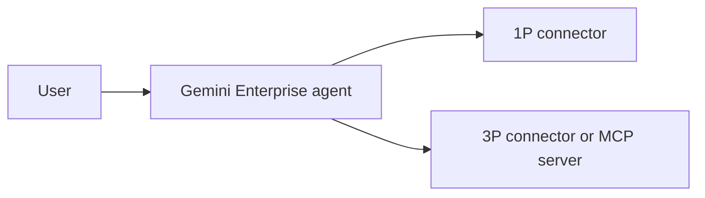

# Research and impact

How a student team can research its problem, measure and present impact and time to impact, and package NTT DATA's five-point README and 3–4 minute video in the week before the 10 November 2026 deadline. Researched on 3 November 2026; it builds on [judging and pitching](/docs/research/judging-and-pitching.md) and does not repeat it, and conclusions no source states outright are marked **Inference**.

Contents:

1.  [What NTT DATA asked for](#what-ntt-data-asked-for)
1.  [Problem research in one week](#problem-research-in-one-week)
    1.  [Interviews](#interviews)
    1.  [Observation and contextual inquiry](#observation-and-contextual-inquiry)
    1.  [Short surveys and desk research](#short-surveys-and-desk-research)
    1.  [How many people is enough](#how-many-people-is-enough)
    1.  [Consent and anonymised quotes](#consent-and-anonymised-quotes)
    1.  [A research plan for this week](#a-research-plan-for-this-week)
1.  [Evidencing the research](#evidencing-the-research)
1.  [Measuring impact and outcome](#measuring-impact-and-outcome)
    1.  [Baseline and before-and-after metric](#baseline-and-before-and-after-metric)
    1.  [Measuring an agent's accuracy honestly](#measuring-an-agents-accuracy-honestly)
1.  [Time to impact](#time-to-impact)
    1.  [Mapping 3 and 6 months to delivery phases](#mapping-3-and-6-months-to-delivery-phases)
    1.  [Adoption and cost metrics](#adoption-and-cost-metrics)
    1.  [Owners and what has to be true](#owners-and-what-has-to-be-true)
1.  [The five-point README](#the-five-point-readme)
    1.  [What GitHub renders](#what-github-renders)
    1.  [README skeleton](#readme-skeleton)
1.  [The 3–4 minute video](#the-34-minute-video)
    1.  [Minute plan](#minute-plan)
    1.  [Recording and captions](#recording-and-captions)
    1.  [Hosting so a reviewer can open it logged out](#hosting-so-a-reviewer-can-open-it-logged-out)
    1.  [Labelling the recording](#labelling-the-recording)
1.  [Not verified](#not-verified)
1.  [See also](#see-also)

## What NTT DATA asked for

The NTT DATA presenter's own words at the briefing ([briefing deliverables], [briefing Q&A]):

- **Five points**, in the README and the video: "the problem statement, what you are trying to solve it, and then how you solving the problem", "What all are the research you did it?", "how the team work", and "the impact. Impact is like outcome. Outcome in this case, like what will be the success ratio?" [1:46:06–1:46:48].
- **Accuracy framing:** for an admissions document-checking agent, "this agent will give accuracy of eighty percentage. … I will not say like hundred percent accuracy because AI itself have eighty percent" [1:46:48]. **Inference:** read this as an example of the kind of figure wanted, not a target; a measured figure with its sample size is stronger than a quoted one.
- **Time to impact:** "what if we implement now, how it will be impacting, whether it might be three months or six months" [1:48:03]. He tied it to intake cycles: "Three months once, six months once. There might be five hundred to two thousand application" [1:42:37].
- **Day to day:** "how I make that agent work on daily basis" [1:38:48], and an agent that "runs three months or six months without any disruption" [1:42:37].

The organisers' own list is a repo link, a PDF deck of at most 10 MB, and a demo link ([brief](/docs/BRIEF.md#submission-requirements)). On 3 November 2026 the user ruled that a video is allowed only if recorded from the live system on real data, labelled as a recording with its capture date, and never offered instead of live access; [context](/docs/CONTEXT.md#decisions-so-far) and [judging and pitching](/docs/research/judging-and-pitching.md#takeaways-for-this-hackathon) still record the earlier ban on recorded videos.

[briefing deliverables]: /docs/sources/briefing-session/transcript.md#hackathon-tracks-and-deliverables
[briefing Q&A]: /docs/sources/briefing-session/transcript.md#questions-and-answers

## Problem research in one week

### Interviews

- **The Mom Test** (Rob Fitzpatrick, [The Mom Test]) gives three rules, quoted from the book: "Talk about their life instead of your idea", "Ask about specifics in the past instead of generics or opinions about the future", and "Talk less and listen more" ([Mom Test quote]). **Inference:** in practice, ask "The last time you checked an application, what did you do?" rather than "Would you use an agent that checks applications?"
- **IDEO.org's Interview method:** interview in the person's own space where possible, bring no more than three team members, give each a role (interviewer, note-taker, photographer), start broad and narrow down, allow 60–90 minutes, and write down exactly what the person says rather than your interpretation ([IDEO interview]). **Inference:** in one week, 30-minute interviews with one interviewer and one note-taker are a workable cut, and verbatim notes are what make quotes usable in the README.

[The Mom Test]: https://www.momtestbook.com/
[Mom Test quote]: https://www.goodreads.com/book/show/52283963-the-mom-test
[IDEO interview]: https://www.designkit.org/methods/interview.html

### Observation and contextual inquiry

- NN/g defines contextual inquiry as "a type of ethnographic field study that involves in-depth observation and interviews" of a small group of users, with the researcher as apprentice to the user as master. Its four principles are context (observe in the natural environment), partnership, interpretation (check your understanding with the user), and focus (know the purpose of the research). Sessions range "from an hour or two to several days" ([NN/g contextual inquiry]).
- **Inference:** watching a staff member or student do the task once, with a stopwatch, gives both the qualitative story and the baseline time per task (see [Baseline and before-and-after metric](#baseline-and-before-and-after-metric)). Observation beats asking people to estimate their own time.

[NN/g contextual inquiry]: https://www.nngroup.com/articles/contextual-inquiry/

### Short surveys and desk research

- NN/g: "The most important thing to remember about surveys is to keep them short"; focus on closed-ended questions; don't ask respondents to predict behaviour; always pilot with the target audience; and if a questionnaire leans on open-ended questions, "it might be a red flag" that interviews would serve better ([NN/g survey practices]).
- GOV.UK: surveys, A/B tests, and benchmarking need "hundreds of participants to produce clear findings" ([GOV.UK plan research]).

**Inference:** a survey posted to classmates this week will get tens, not hundreds, of answers. Use it to count how often a problem happens to the people who answered, and report it as "n of N respondents", never as a percentage of APU students.

For desk research, GOV.UK discovery asks teams to understand users and their needs, the constraints (legislation, contracts, legacy technology, existing processes), "how much the problem is currently costing", and how they will measure success ([GOV.UK discovery]). Real public sources by track are in [public data sources](/docs/research/public-data-sources.md); the project's rule is real public data only, with no mock or sample data ([project conventions](/docs/references/project-conventions.md)).

[NN/g survey practices]: https://www.nngroup.com/articles/survey-best-practices/

### How many people is enough

- NN/g's interview guidance: there is no fixed number; "for many exploratory-research studies, 5 participants are too few"; start with a small representative sample "(say 5-6), and analyze your interviews as you go", and stop "once you're no longer learning anything new". Griffin and Hauser estimated that 20–30 interviews uncover 90–95% of customer needs ([NN/g interview sample size]). NN/g's "5 users" rule is for qualitative usability testing; for statistics, test at least 20 ([NN/g how many test users]).
- GOV.UK: interviews and usability tests usually need "between 4 and 8 participants for each round", with at least one round every 2 weeks ([GOV.UK plan research]).

**Inference:** 6–8 interviews of one narrow user group in two rounds, plus one or two observed sessions, is defensible for one week. Say in the README whether the last two interviews added new themes; don't claim saturation if they did.

[NN/g interview sample size]: https://www.nngroup.com/articles/interview-sample-size/
[NN/g how many test users]: https://www.nngroup.com/articles/how-many-test-users/

### Consent and anonymised quotes

- GOV.UK consent: tell participants who is doing the research, why, what data you collect, whether and how the session is recorded, who is watching, how results are used and shared, and how long data is kept; participation "is voluntary and they can stop or withdraw their consent at any time"; for children, also get consent from "a parent, guardian, carer or other responsible adult" ([GOV.UK consent]).
- GOV.UK research data: "collect only the data that you need"; "fully anonymise the extracts you use so that the participants cannot be identified"; always remove direct identifiers such as names; don't make non-anonymised outputs public ([GOV.UK research data]).
- PDPA principles and the 2024 amendment are in [judging and pitching](/docs/research/judging-and-pitching.md#malaysias-pdpa-and-the-2024-amendment), and the Gemini free-tier warning against submitting personal information is in [its AI terms section](/docs/research/judging-and-pitching.md#googles-ai-principles-and-gemini-api-terms).

**Inference:** label quotes by role and number ("P3, Year 2 student"), keep the consent record and raw notes out of the repo, check the age of any participant who may be under 18, and don't paste raw transcripts into a free-tier AI tool to summarise them.

[GOV.UK consent]: https://www.gov.uk/service-manual/user-research/getting-users-consent-for-research
[GOV.UK research data]: https://www.gov.uk/service-manual/user-research/managing-user-research-data-participant-privacy

### A research plan for this week

**Inference**, fitted to the dates in the [brief](/docs/BRIEF.md#key-dates):

1.  **Tue 3 – Wed 4 Nov:** desk research; write three learning goals and a one-page Mom Test interview guide; recruit 6–8 people from one user group.
1.  **Wed 4 – Thu 5 Nov:** round one, 3–4 interviews and one observed, timed task; synthesise the same evening.
1.  **Fri 6 Nov:** round two, 3–4 interviews; optional five-question survey; freeze the problem statement and baseline.
1.  **Sat 7 – Mon 9 Nov:** build; assemble a real evaluation set and score the agent on it.
1.  **Tue 10 Nov:** README, deck, video; final submission by 11:59 PM MYT.

## Evidencing the research

Comparable rubrics ask for real-user feedback and the iteration it caused ([judging and pitching](/docs/research/judging-and-pitching.md#rubric-comparison)), and the briefing asked how the team came up with the problem statement and why it chose it [1:46:06].

**Inference**, what the README's research section should show:

- **Method:** interviews, observation, survey, desk research, with dates.
- **Who:** roles, not names ("4 Year 2 computing students, 2 admissions staff"), and how they were recruited.
- **How many:** participants per method, and survey responses as "n of N".
- **Key quotes:** three to five verbatim, anonymised quotes that show the problem in the user's words.
- **Counts:** how many participants reported each finding ("5 of 7 re-check the same fields by hand").
- **What changed:** a short finding-to-decision list, such as "staff wanted to keep the final say, so the agent drafts the email instead of sending it".
- **Limits:** who you could not reach, and anything still assumed.

## Measuring impact and outcome

### Baseline and before-and-after metric

- GOV.UK: "Establish a 'baseline' of how your service performs currently, across all channels" and "Judge changes to the service's performance against this"; "Work out your measurements as you build the service, not afterwards" ([GOV.UK performance metrics]).
- GOV.UK's completion-rate guide says to check during discovery whether legacy or offline data can give completion rates "to use as a baseline" ([GOV.UK completion rate]).

**Inference**, a one-week recipe:

1.  Pick one metric the users care about: minutes per task, error or rework rate, or backlog size.
1.  Measure the "before" by observing and timing real instances of the task (see [Observation and contextual inquiry](#observation-and-contextual-inquiry)), not by asking for estimates.
1.  Measure the "after" on the same task with the prototype, including the time a person spends reviewing the agent's output.
1.  Project only with real inputs, and show the formula: time saved per item × items per period, using a published or stated volume such as the presenter's "five hundred to two thousand" applications per intake [1:42:37]. Label it a projection.

[GOV.UK performance metrics]: https://www.gov.uk/service-manual/measuring-success/how-to-set-performance-metrics-for-your-service

### Measuring an agent's accuracy honestly

- NIST: accuracy measures should consider "false positive and false negative rates" and "should always be paired with clearly defined and realistic test sets – that are representative of conditions of expected use – and details about test methodology" ([NIST AI RMF], section 3.1). MEASURE 2.1 asks that "Test sets, metrics, and details about the tools used" be documented, and MEASURE 2.3 that performance be "demonstrated for conditions similar to deployment setting(s)".
- Google's ML Crash Course: precision = TP / (TP + FP), recall = TP / (TP + FN); prefer recall "when false negatives are more expensive than false positives"; accuracy misleads on imbalanced data, where always predicting the majority class can score 99% ([Google precision and recall]).
- Google Cloud's gen AI evaluation service uses rubric-based (LLM-judged) or computation-based metrics, the latter "when a ground truth is available", and asks for prompts that "represent the types of inputs that your models process in production" ([Google eval overview], [Google eval dataset]). Agent evaluation scores both the final response and the trajectory, the sequence of tool calls, with metrics such as `trajectory_precision` and `trajectory_recall` ([Google agent eval]).
- A Google Cloud blog on agent evaluation says a golden dataset "shouldn't be a blocker": start with human evaluation, build the golden set from anonymised real interactions, and "align the LLM judge to the human evaluation" before trusting it ([Google agent eval blog]).

**Inference**, a small honest evaluation for a document-checking agent:

1.  Define the positive class ("document has a missing or wrong field") and decide which error costs more; for screening, a missed problem is usually worse, so lead with recall.
1.  Collect 30–50 real items. The rule is real public data; if the task needs private documents such as student applications, ask the user before using any, and never use made-up ones.
1.  Two team members label each item independently before running the agent; settle disagreements and record how many there were.
1.  Run the agent once over the whole set with fixed prompts and settings, and log every output.
1.  Report the confusion matrix, precision, recall, n, and the failure cases, and keep the set and the labelling notes in the repo if they contain no personal data.

For the figure itself, the NIST/SEMATECH handbook gives the Wilson interval for a proportion and warns that normal-approximation limits "may not be accurate enough" for small samples ([NIST proportion interval]). Worked from its formula, 40 correct out of 50 is 80% with a 95% interval of about 67–89%, and 16 out of 20 is 80% with about 58–92%. **Inference:** write `recall R and precision P on N real documents labelled by two reviewers (95% interval A–B), tested DATE`, not "80% accurate"; a small number with its n holds up in Q&A, and YC calls exaggeration a fatal error ([judging and pitching](/docs/research/judging-and-pitching.md#qa-preparation)).

[Google precision and recall]: https://developers.google.com/machine-learning/crash-course/classification/accuracy-precision-recall
[Google eval overview]: https://docs.cloud.google.com/vertex-ai/generative-ai/docs/models/evaluation-overview
[Google eval dataset]: https://docs.cloud.google.com/vertex-ai/generative-ai/docs/models/evaluation-dataset
[Google agent eval]: https://docs.cloud.google.com/vertex-ai/generative-ai/docs/models/evaluation-agents
[Google agent eval blog]: https://cloud.google.com/blog/topics/developers-practitioners/a-methodical-approach-to-agent-evaluation
[NIST proportion interval]: https://www.itl.nist.gov/div898/handbook/prc/section2/prc241.htm

## Time to impact

### Mapping 3 and 6 months to delivery phases

- GOV.UK phases: discovery checks whether a problem is worth solving and typically takes "around 4 to 8 weeks" ([GOV.UK discovery]); alpha tries out solutions and "Alphas tend to last between 6 and 8 weeks" ([GOV.UK alpha]); beta builds the best idea "for real", starting in private beta "by inviting a limited number of people", then public beta and live ([GOV.UK beta]).

**Inference:** GOV.UK's typical lengths add up to 10–16 weeks before beta, so a 3-month claim only holds if the hackathon week counts as most of discovery and the prototype as an early alpha. A credible plan in those terms:

- **By 3 months:** finish discovery with the owning office, run alpha on its real workload, and start a private beta with one team or one cohort, with the baseline already measured.
- **By 6 months:** run the private beta through one full cycle, such as one intake given the presenter's "three months once, six months once" [1:42:37], measure the KPIs below against the baseline, and decide on wider rollout.
- State impact by date: what a user notices at 3 months, and the measured change at 6 months.

[GOV.UK alpha]: https://www.gov.uk/service-manual/agile-delivery/how-the-alpha-phase-works
[GOV.UK beta]: https://www.gov.uk/service-manual/agile-delivery/how-the-beta-phase-works

### Adoption and cost metrics

- GOV.UK's four mandatory KPIs are cost per transaction, user satisfaction, completion rate, and digital take-up ([GOV.UK KPIs]). Cost per transaction is total cost, including staff, divided by completed transactions ([GOV.UK cost per transaction]); completion rate is completed transactions over all started, excluding test users ([GOV.UK completion rate]).
- NIST asks for "Feedback processes for end users and impacted communities to report problems and appeal system outcomes" (MEASURE 3.3) and for in-deployment results to be informed by domain experts (MEASURE 4.2) ([NIST AI RMF]).

**Inference**, the same four adapted to a campus agent: staff minutes per item handled; share of items that go through the agent; share it completes without a person redoing it; and user satisfaction from a one-question survey. Add re-measured precision and recall on a sample of live items each month.

[GOV.UK KPIs]: https://www.gov.uk/service-manual/measuring-success/data-you-must-publish
[GOV.UK cost per transaction]: https://www.gov.uk/service-manual/measuring-success/measuring-cost-per-transaction

### Owners and what has to be true

**Inference**, since APU's structure is out of scope here: name three owners in the README, by role and as the research found them: the office that runs the process today (business owner), the team that would run the connectors and accounts (IT), and whoever answers for personal data (the 2024 PDPA amendment requires data protection officers; see [judging and pitching](/docs/research/judging-and-pitching.md#malaysias-pdpa-and-the-2024-amendment)). Ask the interviewees who would have to say yes. Then list the assumptions the 3- and 6-month claims rest on:

- The owning office agrees to a pilot and gives reviewer time.
- The connector can read the system of record, with access approved.
- A PDPA notice and retention rule are in place before real personal data flows.
- Licences continue after the hackathon's sponsored trial (see [Google tools](/docs/research/google-tools.md)).
- The team and the owner agree a minimum precision and recall before go-live, matching NIST MAP 1.5's "risk tolerances are determined and documented" ([NIST AI RMF]).

## The five-point README

### What GitHub renders

- **Mermaid:** a fenced block with the `mermaid` language identifier renders as a diagram in Markdown files, issues, pull requests, discussions, and wikis ([GitHub diagrams]). `.mmd` and `.mermaid` files also render ([GitHub non-code files]).
- **PDFs:** GitHub renders PDFs in the repo, but "links within PDFs are ignored" ([GitHub non-code files]). **Inference:** print the live app and video URLs as visible text on the deck's first and last slides.
- **Links:** GitHub recommends relative links to files in the repo; "Links starting with `/` will be relative to the repository root"; heading anchors replace spaces with hyphens and drop other punctuation ([GitHub formatting]).
- **Images:** use relative paths and alt text; the `<picture>` element is supported ([GitHub formatting]). The docs don't cover resizing, so export diagrams and screenshots at the size you want shown.
- **Size limits:** files over 25 MiB can't be added in the browser, Git warns above 50 MiB, and GitHub blocks files over 100 MiB ([GitHub large files]). README content beyond 500 KiB is truncated ([judging and pitching](/docs/research/judging-and-pitching.md#readme-for-judges)).

[GitHub diagrams]: https://docs.github.com/en/get-started/writing-on-github/working-with-advanced-formatting/creating-diagrams
[GitHub non-code files]: https://docs.github.com/en/repositories/working-with-files/using-files/working-with-non-code-files
[GitHub formatting]: https://docs.github.com/en/get-started/writing-on-github/getting-started-with-writing-and-formatting-on-github/basic-writing-and-formatting-syntax
[GitHub large files]: https://docs.github.com/en/repositories/working-with-files/managing-large-files/about-large-files-on-github

### README skeleton

**Inference:** the five H2 headings below use the briefing's wording and order so a reviewer can tick them off; the extra sections answer the other judging points (connectors, day-to-day running, time to impact). The general README order is in [judging and pitching](/docs/research/judging-and-pitching.md#readme-for-judges).

````markdown
# <Project name>

<One sentence: who it helps, what it does.> Track: <track>.

- Live system: <URL, or "reviewers are invited to our Gemini Enterprise app">
- Video, a recording of the live system captured <date>: <URL>
- Slides: [deck.pdf](docs/deck.pdf); diagram: [How we solve it](#how-we-solve-it)

## The existing problem

<Who has it, how often, and what it costs today: the baseline and its source.>

## How we solve it



### Connectors

### How it runs day to day

<Trigger, schedule, who reviews the output; then a real-versus-simulated table.>

## The research we did

<Method, who, how many, dates; key quotes; counts; what changed because of it; limits.>

## How the team worked

<Roles, who did what, how you decided, tools and AI tools used.>

## Impact and outcome

<Baseline and measured result; precision and recall with n on a real evaluation set.>

### Time to impact: 3 and 6 months

<Pilot plan by date, owners, adoption and cost metrics, what has to be true.>

## Data and privacy

## How to review or run it
````

## The 3–4 minute video

The general advice on demo videos, length limits elsewhere, and YouTube unlisted links is in [judging and pitching](/docs/research/judging-and-pitching.md#demo-video).

### Minute plan

**Inference**, for a 3:45 cut over the five points, keeping the demo and the impact inside the first three minutes because some comparable events judge only the first 3 minutes ([judging and pitching](/docs/research/judging-and-pitching.md#demo-video)):

| Time      | Point                | What to show                                                                 |
| --------- | -------------------- | ---------------------------------------------------------------------------- |
| 0:00–0:15 | Label and one-liner  | Recording slate with capture date; one sentence on what it does and for whom |
| 0:15–0:40 | The existing problem | The baseline number and one participant quote                                |
| 0:40–2:10 | How we solve it      | One real task end to end in the live system; the connectors; the daily run   |
| 2:10–2:40 | Impact and outcome   | Before and after; precision and recall with n; 3- and 6-month plan           |
| 2:40–3:10 | The research we did  | Methods, numbers, and what changed because of them                           |
| 3:10–3:35 | How the team worked  | Who did what, how you worked                                                 |
| 3:35–3:45 | Close                | Live link, repo link, capture date again                                     |

Write a script and time a read-through; Devpost advises a narrated screencast with mistakes edited out ([judging and pitching](/docs/research/judging-and-pitching.md#demo-video)).

### Recording and captions

- **macOS:** Shift-Command-5 opens the Screenshot toolbar with Record Entire Screen and Record Selected Portion; choose a microphone under Options ([Apple screen recording]).
- **Windows 11:** Snipping Tool records with Windows logo key + Shift + R and saves an MP4 to the `Screen Recordings` folder under Videos; **Edit in Clipchamp** adds captions or audio ([Microsoft Snipping Tool]).
- **OBS Studio:** "Free and open source software for video recording and live streaming", for Windows 10 and 11, macOS 13 or newer, and Linux; version 33.0.1 was current on 3 November 2026 ([OBS Studio]).
- **YouTube captions:** automatic captions are published when available, but "the quality of the captions may vary" with accents and background noise; review and edit them in YouTube Studio under **Subtitles** ([YouTube automatic captions]).

**Inference:** record at the screen's native resolution with large browser zoom, close notifications, and blur or crop anything personal before export.

[Apple screen recording]: https://support.apple.com/en-us/102618
[Microsoft Snipping Tool]: https://support.microsoft.com/en-us/windows/apps/use-snipping-tool-to-capture-screenshots
[OBS Studio]: https://obsproject.com/
[YouTube automatic captions]: https://support.google.com/youtube/answer/6373554?hl=en

### Hosting so a reviewer can open it logged out

- **YouTube unlisted:** anyone with the link can watch, and it doesn't appear in search ([judging and pitching](/docs/research/judging-and-pitching.md#demo-video)). YouTube requires every uploader to say whether a video is made for kids ([YouTube made for kids]).
- **Google Drive:** with General access set to "Anyone with the link", anyone "can open the file without signing in to a Google Account", and you can turn off download for viewers. A work or school organisation "may restrict external link sharing" ([Drive sharing]).
- **GitHub:** video attachments are capped at 10 MB on free plans and are for issues, pull requests, and comments ([GitHub attachments]); a 3–4 minute screen recording usually needs an external host linked from the README.

**Inference:** YouTube unlisted is the safer default because it plays without sign-in and can add automatic captions; if using Drive, upload from an account whose admin allows public links. Either way, open the link in a private browser window before submitting.

[YouTube made for kids]: https://support.google.com/youtube/answer/9528076?hl=en
[Drive sharing]: https://support.google.com/drive/answer/2494822?hl=en
[GitHub attachments]: https://docs.github.com/en/get-started/writing-on-github/working-with-advanced-formatting/attaching-files

### Labelling the recording

**Inference**, to meet the user's ruling: put the label in the title, on a slate in the first seconds and a small caption throughout, and in the description, and link the live system in every place the video is linked:

```text
Title: <Project name>: recording of the live system, captured <capture date>

Recording, not a live demo. Captured <capture date> from <live system URL>.
Data: <real public source, with link>, fetched <date and time MYT>.
Edits: cuts only, marked on screen; no simulated or staged data.
Live access for reviewers: <URL or invitation route>. Repo: <URL>.
```

## Not verified

- The Mom Test's three rules are quoted from the book via a Goodreads quote and matching summaries; the book's site lists no rules, and the book text itself was not checked.
- Google Cloud's evaluation docs give no dataset size; the 30–50 item figure is this file's inference.
- Whether reviewers will watch past 3 minutes, and whether the video and README are scored or only requested, is unknown ([brief](/docs/BRIEF.md#open-questions)).
- Which APU office would own a given process, and its intake volumes beyond the presenter's example, were not researched (out of scope).
- Whether APU student Google accounts allow "Anyone with the link" sharing was not checked.

## See also

- [Judging and pitching](/docs/research/judging-and-pitching.md): rubrics, README for judges, demo video, deck, live pitch, privacy.
- [Hackathon brief](/docs/BRIEF.md): submission requirements and judging outline.
- [Briefing transcript](/docs/sources/briefing-session/transcript.md): the presenter's words on deliverables and judging.
- [Public data sources](/docs/research/public-data-sources.md): real data for research and evaluation sets.
- [Google tools](/docs/research/google-tools.md): Gemini Enterprise and connectors.
- [NIST AI RMF](https://www.nist.gov/itl/ai-risk-management-framework) and the [GOV.UK Service Manual](https://www.gov.uk/service-manual): the main method sources.

[NIST AI RMF]: https://nvlpubs.nist.gov/nistpubs/ai/NIST.AI.100-1.pdf
[GOV.UK discovery]: https://www.gov.uk/service-manual/agile-delivery/how-the-discovery-phase-works
[GOV.UK plan research]: https://www.gov.uk/service-manual/user-research/plan-user-research-for-your-service
[GOV.UK completion rate]: https://www.gov.uk/service-manual/measuring-success/measuring-completion-rate
