# Briefing session slides

The NTT DATA slide deck "Gemini Enterprise and Google Antigravity Workshop", shown during the hackathon briefing on 3 November 2026. Each slide was cropped from the screen share in `briefing-session.mp4` from the organizers' [Google Drive folder][drive], captured on 3 November 2026. What the presenters said is in the [Briefing session transcript](transcript.md).

Contents:

1.  [About these slides](#about-these-slides)
1.  [Slide 1: Gemini Enterprise and Google Antigravity Workshop](#slide-1-gemini-enterprise-and-google-antigravity-workshop)
1.  [Slide 2: Agenda](#slide-2-agenda)
1.  [Slide 3: Workshop Overview](#slide-3-workshop-overview)
1.  [Slide 4: About NTT DATA](#slide-4-about-ntt-data)
1.  [Slide 5: Team Introduction](#slide-5-team-introduction)
1.  [Slide 6: Hackathon Theme](#slide-6-hackathon-theme)
1.  [Slide 7: Google Cloud Basics](#slide-7-google-cloud-basics)
1.  [Slide 8: Google Cloud Hierarchy](#slide-8-google-cloud-hierarchy)
1.  [Slide 9: Gemini Enterprise Overview](#slide-9-gemini-enterprise-overview)
1.  [Slide 10: Gemini Enterprise Enablement (Hands-on)](#slide-10-gemini-enterprise-enablement-hands-on)
1.  [Slide 11: Google Antigravity Enablement](#slide-11-google-antigravity-enablement)
1.  [Slide 12: Antigravity Enablement (Hands-on)](#slide-12-antigravity-enablement-hands-on)
1.  [Slide 13: Q&A and Discussion](#slide-13-qa-and-discussion)
1.  [See also](#see-also)

[drive]: https://drive.google.com/drive/folders/1-NCJcE80LqnsgYKGdcCmralFJbUDG0m-

## About these slides

- **Deck:** the editor showed 15 slides in the file; slides 1 to 13 were presented. Slide 14 is a closing NTT DATA logo slide and slide 15 never appeared.
- **Images:** the screen share was smaller than the recording, so images are 843 to 1,360 pixels wide. Slide 12 was captured with part of the presenter's Meet sharing bar over the footer; slide 13 was only shown in the PowerPoint editor.
- **Footer:** every slide carries "© 2026 NTT DATA, Inc.", its page number, and the NTT DATA logo. The footer is not repeated below.
- **Shown at:** positions in the recording where each slide appears, as `h:mm:ss`.

## Slide 1: Gemini Enterprise and Google Antigravity Workshop

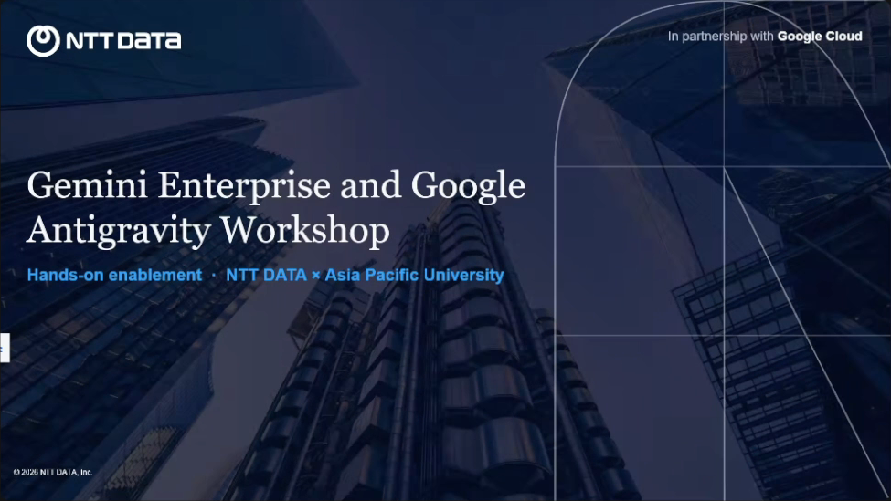

Shown at 0:25:04.

- NTT DATA, in partnership with Google Cloud
- **Gemini Enterprise and Google Antigravity Workshop**
- Hands-on enablement · NTT DATA × Asia Pacific University

## Slide 2: Agenda

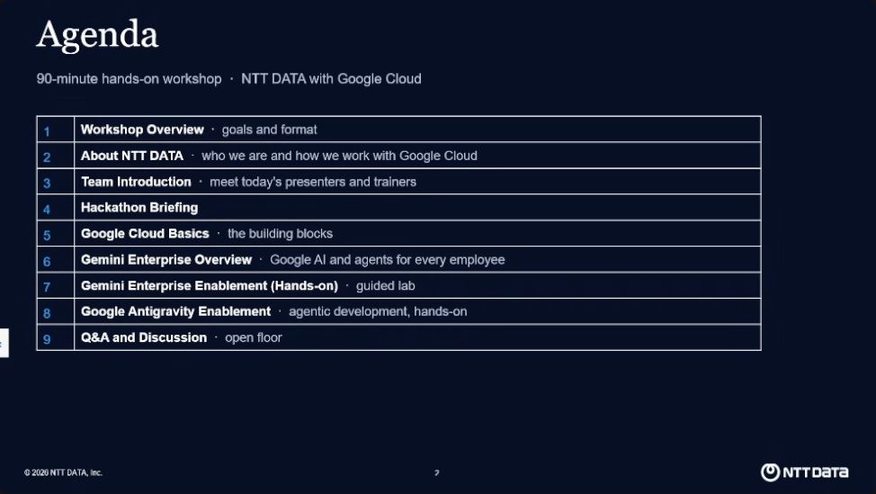

Shown at 0:25:38.

90-minute hands-on workshop · NTT DATA with Google Cloud

1.  **Workshop Overview** · goals and format
2.  **About NTT DATA** · who we are and how we work with Google Cloud
3.  **Team Introduction** · meet today's presenters and trainers
4.  **Hackathon Briefing**
5.  **Google Cloud Basics** · the building blocks
6.  **Gemini Enterprise Overview** · Google AI and agents for every employee
7.  **Gemini Enterprise Enablement (Hands-on)** · guided lab
8.  **Google Antigravity Enablement** · agentic development, hands-on
9.  **Q&A and Discussion** · open floor

## Slide 3: Workshop Overview

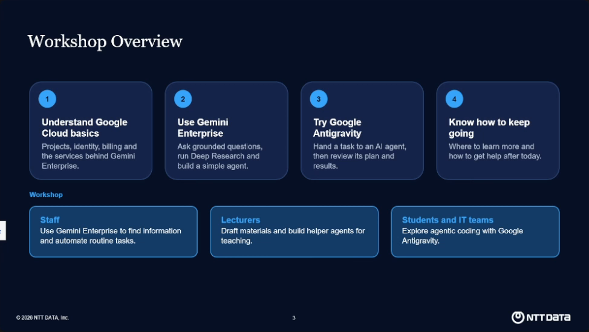

Shown at 0:26:08.

1.  **Understand Google Cloud basics:** Projects, identity, billing and the services behind Gemini Enterprise.
2.  **Use Gemini Enterprise:** Ask grounded questions, run Deep Research and build a simple agent.
3.  **Try Google Antigravity:** Hand a task to an AI agent, then review its plan and results.
4.  **Know how to keep going:** Where to learn more and how to get help after today.

Workshop

- **Staff:** Use Gemini Enterprise to find information and automate routine tasks.
- **Lecturers:** Draft materials and build helper agents for teaching.
- **Students and IT teams:** Explore agentic coding with Google Antigravity.

## Slide 4: About NTT DATA

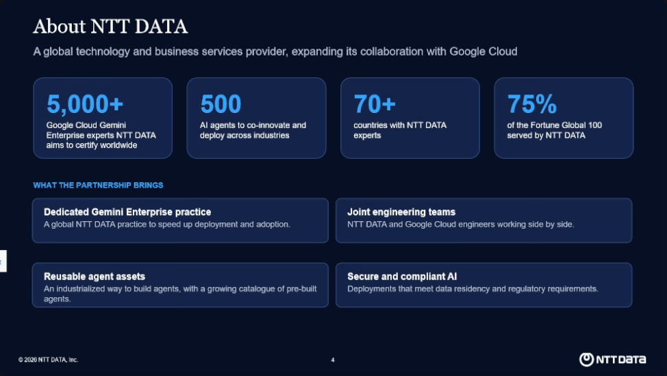

Shown at 0:27:30.

A global technology and business services provider, expanding its collaboration with Google Cloud

- **5,000+** Google Cloud Gemini Enterprise experts NTT DATA aims to certify worldwide
- **500** AI agents to co-innovate and deploy across industries
- **70+** countries with NTT DATA experts
- **75%** of the Fortune Global 100 served by NTT DATA

What the partnership brings

- **Dedicated Gemini Enterprise practice:** A global NTT DATA practice to speed up deployment and adoption.
- **Joint engineering teams:** NTT DATA and Google Cloud engineers working side by side.
- **Reusable agent assets:** An industrialized way to build agents, with a growing catalogue of pre-built agents.
- **Secure and compliant AI:** Deployments that meet data residency and regulatory requirements.

## Slide 5: Team Introduction

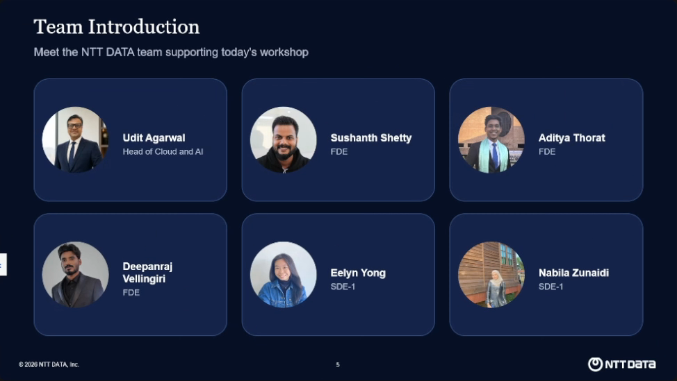

Shown at 0:28:14.

Meet the NTT DATA team supporting today's workshop

| Name                 | Title                |
| -------------------- | -------------------- |
| Udit Agarwal         | Head of Cloud and AI |
| Sushanth Shetty      | FDE                  |
| Aditya Thorat        | FDE                  |
| Deepanraj Vellingiri | FDE                  |
| Eelyn Yong           | SDE-1                |
| Nabila Zunaidi       | SDE-1                |

## Slide 6: Hackathon Theme

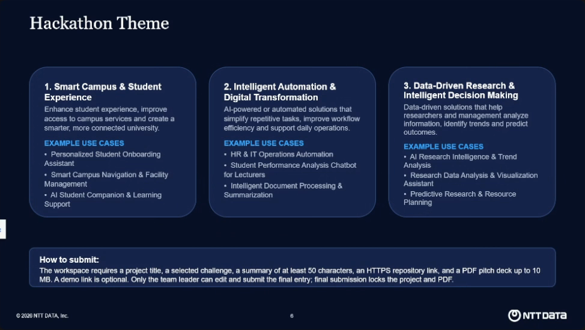

Shown at 0:28:48 and again at 1:38:00.

**1. Smart Campus & Student Experience**

Enhance student experience, improve access to campus services and create a smarter, more connected university.

Example use cases:

- Personalized Student Onboarding Assistant
- Smart Campus Navigation & Facility Management
- AI Student Companion & Learning Support

**2. Intelligent Automation & Digital Transformation**

AI-powered or automated solutions that simplify repetitive tasks, improve workflow efficiency and support daily operations.

Example use cases:

- HR & IT Operations Automation
- Student Performance Analysis Chatbot for Lecturers
- Intelligent Document Processing & Summarization

**3. Data-Driven Research & Intelligent Decision Making**

Data-driven solutions that help researchers and management analyze information, identify trends and predict outcomes.

Example use cases:

- AI Research Intelligence & Trend Analysis
- Research Data Analysis & Visualization Assistant
- Predictive Research & Resource Planning

**How to submit:** The workspace requires a project title, a selected challenge, a summary of at least 50 characters, an HTTPS repository link, and a PDF pitch deck up to 10 MB. A demo link is optional. Only the team leader can edit and submit the final entry; final submission locks the project and PDF.

## Slide 7: Google Cloud Basics

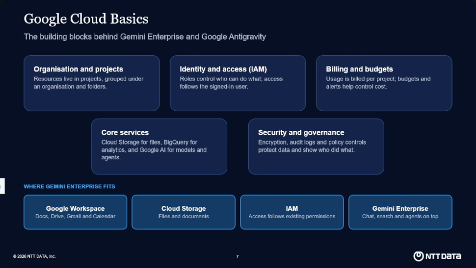

Shown at 0:31:10.

The building blocks behind Gemini Enterprise and Google Antigravity

- **Organisation and projects:** Resources live in projects, grouped under an organisation and folders.
- **Identity and access (IAM):** Roles control who can do what; access follows the signed-in user.
- **Billing and budgets:** Usage is billed per project; budgets and alerts help control cost.
- **Core services:** Cloud Storage for files, BigQuery for analytics, and Google AI for models and agents.
- **Security and governance:** Encryption, audit logs and policy controls protect data and show who did what.

Where Gemini Enterprise fits

| Service           | Role                                |
| ----------------- | ----------------------------------- |
| Google Workspace  | Docs, Drive, Gmail and Calendar     |
| Cloud Storage     | Files and documents                 |
| IAM               | Access follows existing permissions |
| Gemini Enterprise | Chat, search and agents on top      |

## Slide 8: Google Cloud Hierarchy

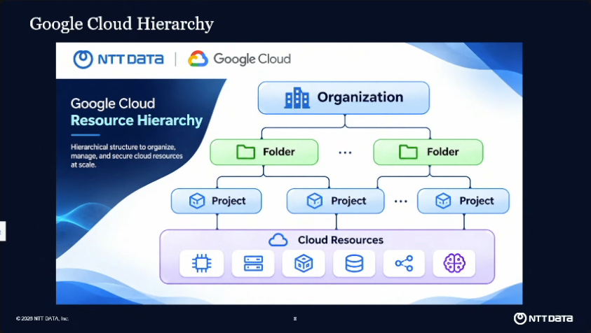

Shown at 0:31:30.

The slide holds an NTT DATA and Google Cloud diagram titled "Google Cloud Resource Hierarchy": a hierarchical structure to organize, manage, and secure cloud resources at scale.

- **Organization** contains folders.
- **Folder** contains projects.
- **Project** contains cloud resources.
- **Cloud Resources** are shown as icons for compute, storage, databases, networking, and AI.

## Slide 9: Gemini Enterprise Overview

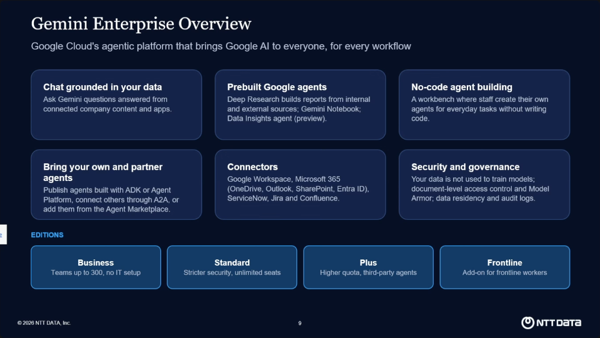

Shown at 0:32:12 and again at 0:58:50.

Google Cloud's agentic platform that brings Google AI to everyone, for every workflow

- **Chat grounded in your data:** Ask Gemini questions answered from connected company content and apps.
- **Prebuilt Google agents:** Deep Research builds reports from internal and external sources; Gemini Notebook; Data Insights agent (preview).
- **No-code agent building:** A workbench where staff create their own agents for everyday tasks without writing code.
- **Bring your own and partner agents:** Publish agents built with ADK or Agent Platform, connect others through A2A, or add them from the Agent Marketplace.
- **Connectors:** Google Workspace, Microsoft 365 (OneDrive, Outlook, SharePoint, Entra ID), ServiceNow, Jira and Confluence.
- **Security and governance:** Your data is not used to train models; document-level access control and Model Armor; data residency and audit logs.

Editions

| Edition   | Summary                            |
| --------- | ---------------------------------- |
| Business  | Teams up to 300, no IT setup       |
| Standard  | Stricter security, unlimited seats |
| Plus      | Higher quota, third-party agents   |
| Frontline | Add-on for frontline workers       |

## Slide 10: Gemini Enterprise Enablement (Hands-on)

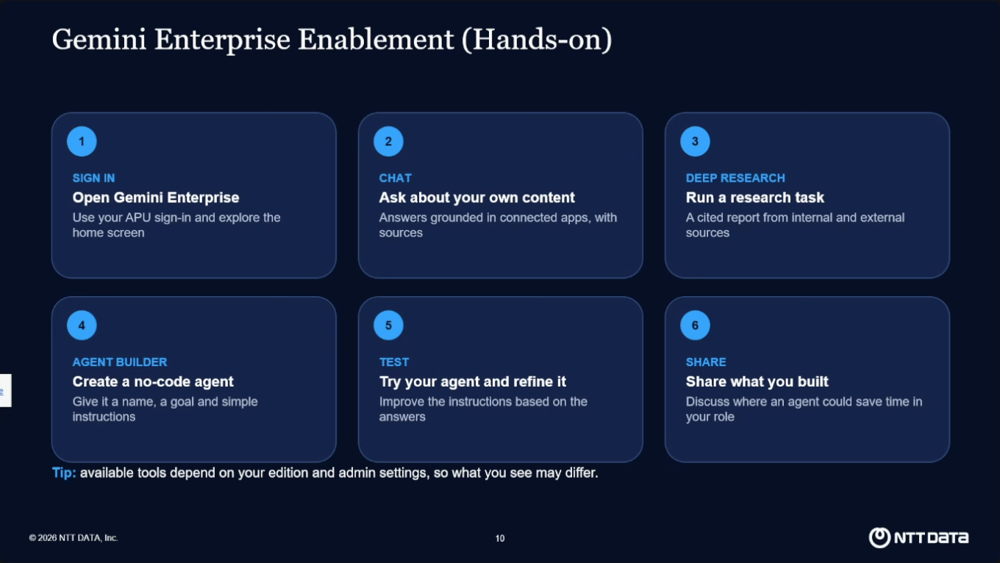

Shown at 1:00:48.

1.  **Sign in — Open Gemini Enterprise:** Use your APU sign-in and explore the home screen.
2.  **Chat — Ask about your own content:** Answers grounded in connected apps, with sources.
3.  **Deep Research — Run a research task:** A cited report from internal and external sources.
4.  **Agent Builder — Create a no-code agent:** Give it a name, a goal and simple instructions.
5.  **Test — Try your agent and refine it:** Improve the instructions based on the answers.
6.  **Share — Share what you built:** Discuss where an agent could save time in your role.

Tip: available tools depend on your edition and admin settings, so what you see may differ.

## Slide 11: Google Antigravity Enablement

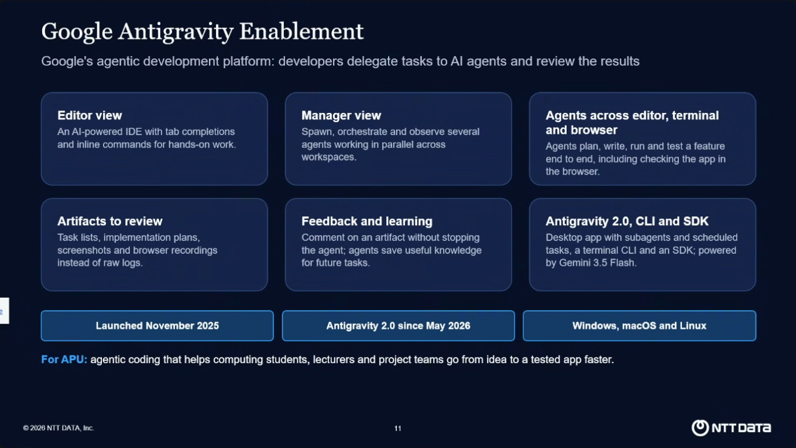

Shown at 1:01:24, in the editor at 1:01:56, and again at 1:35:24.

Google's agentic development platform: developers delegate tasks to AI agents and review the results

- **Editor view:** An AI-powered IDE with tab completions and inline commands for hands-on work.
- **Manager view:** Spawn, orchestrate and observe several agents working in parallel across workspaces.
- **Agents across editor, terminal and browser:** Agents plan, write, run and test a feature end to end, including checking the app in the browser.
- **Artifacts to review:** Task lists, implementation plans, screenshots and browser recordings instead of raw logs.
- **Feedback and learning:** Comment on an artifact without stopping the agent; agents save useful knowledge for future tasks.
- **Antigravity 2.0, CLI and SDK:** Desktop app with subagents and scheduled tasks, a terminal CLI and an SDK; powered by Gemini 3.5 Flash.

Launched November 2025 · Antigravity 2.0 since May 2026 · Windows, macOS and Linux

For APU: agentic coding that helps computing students, lecturers and project teams go from idea to a tested app faster.

## Slide 12: Antigravity Enablement (Hands-on)

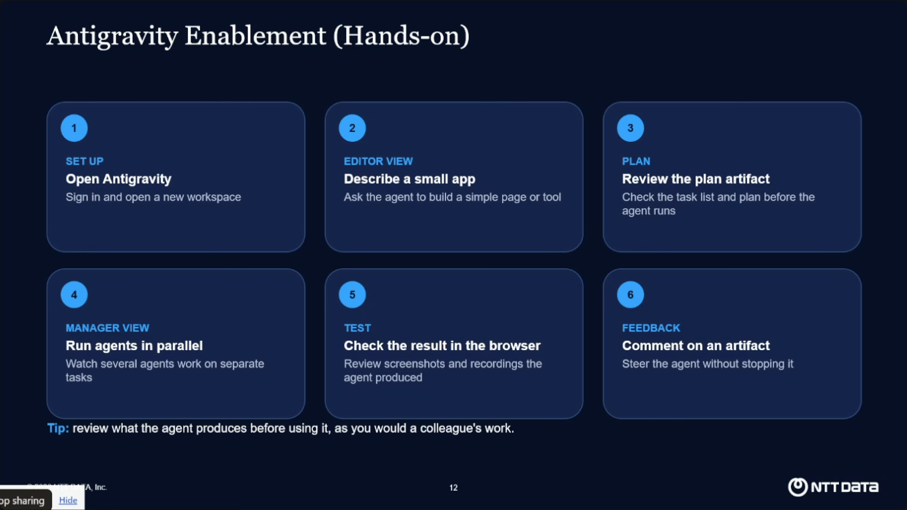

Shown at 1:35:40.

1.  **Set up — Open Antigravity:** Sign in and open a new workspace.
2.  **Editor view — Describe a small app:** Ask the agent to build a simple page or tool.
3.  **Plan — Review the plan artifact:** Check the task list and plan before the agent runs.
4.  **Manager view — Run agents in parallel:** Watch several agents work on separate tasks.
5.  **Test — Check the result in the browser:** Review screenshots and recordings the agent produced.
6.  **Feedback — Comment on an artifact:** Steer the agent without stopping it.

Tip: review what the agent produces before using it, as you would a colleague's work.

## Slide 13: Q&A and Discussion

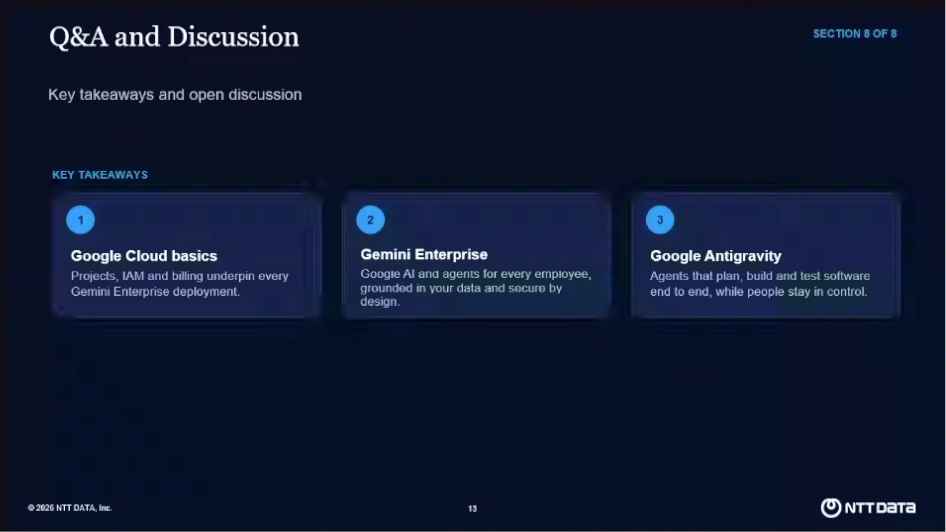

Shown at 1:35:54, in the PowerPoint editor.

Key takeaways and open discussion. Section 8 of 8.

1.  **Google Cloud basics:** Projects, IAM and billing underpin every Gemini Enterprise deployment.
2.  **Gemini Enterprise:** Google AI and agents for every employee, grounded in your data and secure by design.
3.  **Google Antigravity:** Agents that plan, build and test software end to end, while people stay in control.

## See also

- [Briefing session transcript](transcript.md): speakers, Q&A, and the full transcript.
- [Problem statements](/docs/sources/discord.com/problem-statements.md): the organizers' Discord post on the three challenge areas.
